# PRD consolidado — Do Talhão à O.S.

**Versão 3.11 · 27 de setembro de 2026 · Produto fixo ou troca de marca pelo mesmo ingrediente ativo (40.5); sobre a v3.10: confiabilidade transacional, resiliência offline e desempenho; design system; melhoria contínua; refinamentos selecionados da comparação externa** (versão anterior preservada: v3.10 de 27/09/2026)

**Destinatários:** direção, produto, design, agronomia, operações, controladoria e engenharia.  
**Finalidade imediata:** orientar a atualização do protótipo para validação pelo proprietário. Iniciar o software real somente após comando explícito posterior; preservar os requisitos de engenharia para essa fase.
**Produto-alvo:** plataforma de gestão agrícola integrada, para empresas com uma ou várias fazendas, culturas e operações.  
**Natureza:** requisitos propostos e decisões de produto/engenharia; não descreve software já implementado, testado ou implantado nem garante resultados econômicos ou ausência de defeitos. Valores de demonstração são fictícios. A construção real deve comprovar os critérios de aceite antes de atender clientes.

**Conteúdo:** 63 diagramas editáveis com raias e etapas; 56 diagramas substituídos, 4 fluxos UX integrados e 3 novos. Mantém a especificação integrada de produto, negócio, agronomia, UX e engenharia. O catálogo canônico contém 98 famílias de telas, incluindo quatro destinos administrativos exclusivos da plataforma. Os capítulos 33–68 são contratos detalhados dos respectivos domínios, vinculados às telas no capítulo 5; o capítulo 69 apresenta a matriz de cobertura e os fluxos de reconciliação; o capítulo 70 registra o tratamento dos 68 achados da revisão independente e as decisões ainda pendentes. As referências às 91 telas do protótipo anterior são históricas e não numeração desta entrega.

**Estado da entrega:** v3.11: acrescenta 40.5 e 40.6 (modo do item do plano: produto fixo ou alternativas com aprovação técnica; troca de marca pelo mesmo ingrediente ativo, do plano à compra e à O.S.) e ajusta 11.1, CAL-11, 40.1 e SU-04, com validação tripla Codex, Gemini e Claude. v3.10: acrescenta o capítulo 73 (idempotência de ponta a ponta, validade das reservas de material, conciliação de fatos de campo, integrações resilientes, consultas e projeções seletivas, metas mensuráveis, aprovação agronômica das operações mecânicas e decisões pendentes) e o capítulo 74 (design system: tokens, cores com significado, componentes, padrões de tela, dados e mapa, acessibilidade medida e governança) e o capítulo 75 (relato com print e comentário, uso real e simplificação, produtividade da interface, incidentes com plantão real e assistente com validação cruzada entre dois modelos), reconcilia as seções afetadas e incorpora os refinamentos aprovados da comparação externa; a v3.9 permanece como versão anterior. A v3.9 incorporou ao v3.8 de processos as decisões do proprietário de 26/09/2026 e as correções verificadas na reconciliação com o protótipo (capítulo 72); 7 fluxogramas atualizados, demais preservados. Navegação recente reconciliada nos capítulos 71 e 72. Contratos técnicos anteriores preservados. A revisão documental não equivale à homologação do produto nem à validação de protocolos, integrações ou máquinas reais.

**Índice navegável**

- [0. Instrução para o Claude e autoridade deste documento](#0-instrução-para-o-claude-e-autoridade-deste-documento)
- [1. Visão, escopo e resultados](#1-visão-escopo-e-resultados)
- [2. Pessoas, responsabilidade e permissões](#2-pessoas-responsabilidade-e-permissões)
- [3. Regras únicas do produto](#3-regras-únicas-do-produto)
- [4. Experiência e arquitetura de navegação](#4-experiência-e-arquitetura-de-navegação)
- [5. Catálogo completo de menus e telas de destino](#5-catálogo-completo-de-menus-e-telas-de-destino)
- [6. Formulários e detalhes críticos](#6-formulários-e-detalhes-críticos)
- [7. Requisitos funcionais verificáveis](#7-requisitos-funcionais-verificáveis)
- [8. Estados, comandos e continuidade transacional](#8-estados-comandos-e-continuidade-transacional)
- [9. Fluxos completos e integrados](#9-fluxos-completos-e-integrados)
- [10. Cálculos, unidades e práticas agronômicas](#10-cálculos-unidades-e-práticas-agronômicas)
- [11. Modelo de dados e identidade](#11-modelo-de-dados-e-identidade)
- [12. Arquitetura técnica, APIs, integrações e offline](#12-arquitetura-técnica-apis-integrações-e-offline)
- [13. Qualidade, operação e segurança](#13-qualidade-operação-e-segurança)
- [14. Indicadores e decisões gerenciais](#14-indicadores-e-decisões-gerenciais)
- [15. Automação e assistência por IA](#15-automação-e-assistência-por-ia)
- [16. Dados de demonstração e jornadas obrigatórias](#16-dados-de-demonstração-e-jornadas-obrigatórias)
- [17. Critérios de aceite e validação](#17-critérios-de-aceite-e-validação)
- [18. Implantação, evolução e modelo comercial](#18-implantação-evolução-e-modelo-comercial)
- [19. Destino das telas antigas e decisões de desenho](#19-destino-das-telas-antigas-e-decisões-de-desenho)
- [20. Contrato de entrega para a construção pelo Claude Code](#20-contrato-de-entrega-para-a-construção-pelo-claude-code)
- [21. Glossário, fontes e controle da especificação](#21-glossário-fontes-e-controle-da-especificação)
- [22. Compromisso de engenharia e política de qualidade](#22-compromisso-de-engenharia-e-política-de-qualidade)
- [23. Stack, padrões de código e revisão](#23-stack-padrões-de-código-e-revisão)
- [24. Integridade de negócio, transações e contratos](#24-integridade-de-negócio-transações-e-contratos)
- [25. Estratégia de testes e critérios automáticos de qualidade](#25-estratégia-de-testes-e-critérios-automáticos-de-qualidade)
- [26. Segurança de aplicação, infraestrutura e cadeia de dependências](#26-segurança-de-aplicação-infraestrutura-e-cadeia-de-dependências)
- [27. CI/CD, revisão, publicação e migrações](#27-cicd-revisão-publicação-e-migrações)
- [28. Infraestrutura, Terraform, banco e capacidade](#28-infraestrutura-terraform-banco-e-capacidade)
- [29. Desempenho, disponibilidade e testes sob carga](#29-desempenho-disponibilidade-e-testes-sob-carga)
- [30. Observabilidade, incidentes, backup e continuidade](#30-observabilidade-incidentes-backup-e-continuidade)
- [31. Aceite técnico, entregáveis e instrução de implementação](#31-aceite-técnico-entregáveis-e-instrução-de-implementação)
- [32. Referências técnicas e controle desta revisão](#32-referências-técnicas-e-controle-desta-revisão)
- [33. Inteligência agronômica multicultura e biblioteca científica](#33-inteligência-agronômica-multicultura-e-biblioteca-científica)
- [34. Aceite da inteligência agronômica e validação por cultura](#34-aceite-da-inteligência-agronômica-e-validação-por-cultura)
- [35. Referências agronômicas e controle documental](#35-referências-agronômicas-e-controle-documental)
- [36. Amostragem por talhão ou setor, taxa variável e arquivos para máquinas](#36-amostragem-por-talhão-ou-setor-taxa-variável-e-arquivos-para-máquinas)
- [37. Planejamento direto e sugestões agronômicas no mesmo fluxo](#37-planejamento-direto-e-sugestões-agronômicas-no-mesmo-fluxo)
- [38. Análise de solo completa no laudo, mapa e recomendação](#38-análise-de-solo-completa-no-laudo-mapa-e-recomendação)
- [39. Posicionamento de variedades, datas e gatilhos na safra](#39-posicionamento-de-variedades-datas-e-gatilhos-na-safra)
- [40. Ajustes individuais do plano padrão por talhão](#40-ajustes-individuais-do-plano-padrão-por-talhão)
- [41. Aprovação agronômica de cada O.S. e execução guiada](#41-aprovação-agronômica-de-cada-os-e-execução-guiada)
- [42. Almoxarifado, apontamento, sobras e encerramento da O.S.](#42-almoxarifado-apontamento-sobras-e-encerramento-da-os)
- [43. Parcelamento prático do talhão e continuidade até a execução](#43-parcelamento-prático-do-talhão-e-continuidade-até-a-execução)
- [44. PCP: demanda, tabela operacional, recursos e orçamento mensal](#44-pcp-demanda-tabela-operacional-recursos-e-orçamento-mensal)
- [45. Beneficiamento de grãos, frutas/HF e café](#45-beneficiamento-de-grãos-frutashf-e-café)
- [46. Comercial: relacionamento, negociação, entrega e recebimento](#46-comercial-relacionamento-negociação-entrega-e-recebimento)
- [47. PCM integrado: frota, implementos, irrigação e beneficiamento](#47-pcm-integrado-frota-implementos-irrigação-e-beneficiamento)
- [48. Venda, frete, expedição e entrega integrados](#48-venda-frete-expedição-e-entrega-integrados)
- [49. Pedido iniciado pelo cliente e disponibilidade líquida por data](#49-pedido-iniciado-pelo-cliente-e-disponibilidade-líquida-por-data)
- [50. Agendamento e fila dinâmica de caminhões](#50-agendamento-e-fila-dinâmica-de-caminhões)
- [51. PCP e orçamento multidimensional para decisão de margem](#51-pcp-e-orçamento-multidimensional-para-decisão-de-margem)
- [52. Biblioteca de rendimentos por operação, cultura e conjunto](#52-biblioteca-de-rendimentos-por-operação-cultura-e-conjunto)
- [53. Disponibilidade, utilização e desempenho dos ativos](#53-disponibilidade-utilização-e-desempenho-dos-ativos)
- [54. Inspeções, gráficos de não conformidades e resposta rápida do PCM](#54-inspeções-gráficos-de-não-conformidades-e-resposta-rápida-do-pcm)
- [55. Indicadores essenciais por processo, decisão e experiência de uso](#55-indicadores-essenciais-por-processo-decisão-e-experiência-de-uso)
- [56. Rastreabilidade universal, documento de origem e mapa de relações](#56-rastreabilidade-universal-documento-de-origem-e-mapa-de-relações)
- [57. Modelo de receita, preço por hectare e monetização dos parceiros](#57-modelo-de-receita-preço-por-hectare-e-monetização-dos-parceiros)
- [58. Entrada imediata, ativação guiada, trial e contratação](#58-entrada-imediata-ativação-guiada-trial-e-contratação)
- [59. Assistente de IA transversal: orientar, preparar e executar com controle](#59-assistente-de-ia-transversal-orientar-preparar-e-executar-com-controle)
- [60. Cadastros nativos, bibliotecas e implantação por seleção](#60-cadastros-nativos-bibliotecas-e-implantação-por-seleção)
- [61. Laboratórios, interpretação de solo e mapas temáticos integrados](#61-laboratórios-interpretação-de-solo-e-mapas-temáticos-integrados)
- [62. Importação de mapas de colheita e inteligência espacial de produtividade](#62-importação-de-mapas-de-colheita-e-inteligência-espacial-de-produtividade)
- [63. Irrigação competitiva, decisão no mapa e validação em campo](#63-irrigação-competitiva-decisão-no-mapa-e-validação-em-campo)
- [64. App de campo por função: prioridades, execução e apontamento integrado](#64-app-de-campo-por-função-prioridades-execução-e-apontamento-integrado)
- [65. PCE: política de reposição por item, disponibilidade e capital em estoque](#65-pce-política-de-reposição-por-item-disponibilidade-e-capital-em-estoque)
- [66. Integrações Sankhya e TOTVS: contrato, sincronização e homologação](#66-integrações-sankhya-e-totvs-contrato-sincronização-e-homologação)
- [67. Mapa dinâmico amplo, com informações complementares abaixo](#67-mapa-dinâmico-amplo-com-informações-complementares-abaixo)
- [68. Experiência transversal: diagnóstico, planejamento, execução e melhoria contínua](#68-experiência-transversal-diagnóstico-planejamento-execução-e-melhoria-contínua)

- [69. Reconciliação final, cobertura e contrato de implementação](#69-reconciliação-final-cobertura-e-contrato-de-implementação)

- [70. Revisão independente e reconciliação da versão 3.7](#70-revisão-independente-e-reconciliação-da-versão-37)

- [71. Revisão multifuncional dos fluxos](#71-revisão-multifuncional-dos-fluxos--26092026)
- [72. Decisões do proprietário de 26/09/2026 e reconciliação com o protótipo](#72-decisões-do-proprietário-de-26092026-e-reconciliação-com-o-protótipo)
- [73. Confiabilidade transacional, resiliência offline e desempenho — v3.10](#73-confiabilidade-transacional-resiliência-offline-e-desempenho--v310)
- [74. Design system — v3.10](#74-design-system--v310)
- [75. Melhoria contínua com o proprietário e os usuários — v3.10](#75-melhoria-contínua-com-o-proprietário-e-os-usuários--v310)

## 0. Instrução para o Claude e autoridade deste documento

### 0.1 Comando para validação e posterior construção no Claude Code

> Atualize primeiro o protótipo “Do Talhão à O.S.” conforme esta revisão v3.10, os 63 fluxos e as reconciliações dos capítulos 71, 72 e 73. Mostre etapas contínuas, responsabilidades, estados, impedimentos e próximos passos, preservando o mesmo registro entre módulos. Mantenha visível apenas o recorte de menus da seção 71.6. Valide as jornadas com o proprietário. Não inicie a construção de produção até receber seu comando explícito. Após esse comando, implemente o produto completo pelos contratos RN/CAL/CMD/FO e pelos requisitos de engenharia deste PRD, incluindo ambientes separados, controles transacionais, testes e recuperação; não trate o protótipo como backend homologado. Não invente resultados de testes nem prometa zero bugs.

### 0.2 Fonte única e leitura

Esta versão reconcilia o PRD consolidado salvo, a correspondência nele registrada com os materiais do Claude e os requisitos posteriores do proprietário. A seção 19 preserva as referências históricas ao protótipo original. Esta entrega modifica a especificação; não afirma ter reconstruído o HTML ou PDF originais. O implementador deve gerar novos protótipo, mapa e PDF a partir das rotas canônicas deste documento.

Ordem de leitura: fundamentos e regras → navegação e catálogo → estados e comandos → fluxos → cálculos → cenários → correspondência das telas antigas → engenharia e aceite. O catálogo descreve **famílias de telas**: lista, detalhe e formulário compartilham domínio, mas cada registro possui URL e identidade próprias. Todas as famílias integram o produto completo; as ondas organizam a construção e a entrada em operação. O modo demonstração permite validar a experiência, enquanto o aceite de produção exige backend e controles reais.

**Atualização v3.8:** o capítulo 71 e os diagramas substituídos definem a navegação e as passagens entre responsáveis nesta revisão. O início do software real depende do comando posterior do proprietário.

**Hierarquia normativa interna:** RN/CAL definem o negócio; fluxos e telas as consomem. ENG define implementação, qualidade e operação; NFR resume os objetivos detalhados nos capítulos 29–30. AC verifica produto e ACE verifica engenharia. Se uma alteração afetar regra, cálculo, contrato ou meta, atualizar seus dependentes e testes no mesmo trabalho. Não manter anexos que contradigam silenciosamente o corpo principal.

**Convenções adicionais:** AGR/ACAG = inteligência agronômica e seu aceite; TV/ACTV = taxa variável e seu aceite; FX/ACFX = operação direta e seu aceite; SOLO/SAFRA/AJUSTE = critérios dos capítulos 38–40. Esses capítulos detalham as RN/CAL e integram o aceite de produção do respectivo domínio.

**Convenções:** RN = regra; RF = requisito funcional; CAL = cálculo; NFR = qualidade; AC = aceite de produto; ENG = requisito de engenharia; ACE = aceite técnico; FL = fluxo de negócio; FO = formulário; CMD = comando. P0 = obrigatório antes de colocar o domínio em operação; P1 = necessário à experiência completa; P2 = evolução. E0 é a fundação técnica obrigatória; E1/E2/E3/E4 são ondas de implantação, sem prazo presumido. Os perfis P1/P2 do capítulo 29 designam envelopes de capacidade, não prioridade de funcionalidade.

### 0.3 O que foi preservado e o que foi decidido

| Tema | Decisão consolidada | Motivo |
|---|---|---|
| Profundidade agrícola | Manter solo, folha, diagnóstico, recomendações, MIP/MID, perenes, parcelas, irrigação e escalonamento | A operação precisa de modelos por cultura e situação |
| Navegação | Áreas por responsabilidade, submenus diretos, atalhos por tarefa e visibilidade por papel | Usuário frequente não atravessa lançadores obrigatórios |
| Mapas | Um mapa canônico com camadas e vínculos | Evitar dois produtos geográficos divergentes |
| PCM e oficina | Planejamento e execução da mesma ordem de manutenção | Eliminar duplicação de documentos e custos |
| PCE, compras e almoxarifado | Uma cadeia em Suprimentos; planejamento e execução continuam distinguíveis | Uma única demanda, requisição e posição física |
| Aprovação da safra | Rascunho → plano operacional publicado com validações técnicas aplicáveis → orçamento autorizado → execução | Eliminar a dependência circular cálculo/safra |
| Cálculo agronômico | Motor automático e memória de cálculo dentro da recomendação/plano | Não exigir aprovação isolada da multiplicação |
| Estoque | Reserva, transferência de custódia, consumo e devolução separados | Quantidade e custo baixados uma única vez |
| Colheita e packing | Oferta por semana/classe, capacidade, genealogia e qualidade | Previsão não equivale a produto vendável |
| Financeiro | Experiência completa de acompanhamento; fonte oficial definida por integração ou modo autônomo básico | Não confundir venda, entrega, recebível e dinheiro |
| Portais e crédito | Manter portais de fornecedor, comprador e credor; decisão do credor separada do pagamento | Preservar o valor comercial do Claude sem prometer crédito instantâneo |
| Segurança técnica | Regras obrigatórias não são superadas por justificativa gerencial | Distinguir restrição de desvio econômico |
| Dados reais | Fato ocorrido sempre registrável, mesmo não conforme | O sistema precisa revelar o ocorrido |
| Automação | Calcular, conferir, deduplicar, propor e preparar; decisões sensíveis seguem política, exceto a aprovação técnica de O.S. agrícola, sempre individual (APROV-05) | Menos trabalho manual com responsabilidade identificável |
| Fórmulas e catálogos | Unidades explícitas, exemplos verificáveis e protocolos versionados | Não reutilizar tabelas antigas não validadas como verdade universal |
| IA | Assistente contextual sobre dados autorizados; cálculos por serviços determinísticos | Evitar decisões inventadas e efeitos sem rastreio |

## 1. Visão, escopo e resultados

O sistema conecta **necessidade → decisão → plano → recursos → execução → produção → entrega → resultado → melhoria**. Uma necessidade pode nascer do plano, de uma vistoria, de uma falha, de um pedido de cliente ou de um desvio. Todas as entradas preservam origem e chegam a uma fila de trabalho com responsável.

Direção acompanha resultado, capital e exceções. Gerência resolve impedimentos. Especialistas decidem dentro de sua competência. Equipes executam instruções claras, inclusive offline. O mesmo fato alimenta estoque, custo e histórico sem nova digitação.

### 1.1 Escopo do produto completo

Inclui organização e empresas, fazendas, geografia, parcelas e ciclos; agronomia; safras e orçamento; programação integrada; campo; irrigação; máquinas e manutenção; suprimentos e contratos de compra; colheita e pós-colheita; qualidade; comercial e logística; gestão e financeiro; portais; configuração, auditoria e integrações.

Culturas suportadas por pacotes de processo: grãos; cana; laranja e outras frutas; mamão; hortaliças; café; forragens. O núcleo é compartilhado, os campos e regras específicas variam. Não simular diversidade agrícola apenas trocando o nome da cultura em um formulário de soja.

### 1.2 Fronteiras

- O produto mantém fatos e fluxos agrícolas. Contabilidade societária, folha, apuração tributária e emissão fiscal usam sistemas/serviços designados; esta versão não cria um ERP fiscal completo.
- **Modo integrado, padrão para o piloto:** títulos oficiais e liquidações vêm do ERP. **Modo autônomo básico:** agenda financeira e liquidações registradas/importadas, explicitamente gerenciais. Um objeto não pode ter dois escritores oficiais simultâneos.
- Crédito é solicitação, proposta, decisão, contratação e acompanhamento. A plataforma não presume atuar como instituição financeira nem conceder crédito autonomamente.
- DeFi, tokens, bolsa de derivativos e marketplace público irrestrito não integram o núcleo. Portais privados de negociação e compromissos físicos integram o escopo.
- Medição de equipamento é diferente de comando. Comando remoto fica desativado por padrão e exige conector e política específicos; o protótipo apenas simula estados, sem acionamento real.
- Integrações são demonstradas com dados sintéticos até existir contrato, acesso e homologação. Ausência de API não autoriza afirmar sincronização inexistente.

### 1.3 Métricas de produto — metas propostas para validar

| Métrica | Definição | Meta inicial proposta |
|---|---|---|
| Ciclo digital completo | Operações elegíveis com origem, execução, conferência e materiais reconciliados / operações elegíveis concluídas | ≥95% após estabilização do piloto |
| Registro simples no campo | Tempo ativo para apontamento simples, sem contar espera física | Mediana ≤45 s e p90 ≤90 s |
| Retrabalho de digitação | Campos obrigatórios já disponíveis na origem | Zero redigitação evitável |
| Integridade de efeitos | Reenvios que duplicam saldo, título ou custo | Zero |
| Sucesso de tarefa | Tarefas críticas concluídas sem ajuda após orientação inicial | ≥90% em teste de usabilidade |
| Rastreio de lote | Tempo para identificar origens e destinos no conjunto de teste | ≤2 min |
| Reconciliação após conexão | Registros elegíveis transmitidos até 24 h após reconexão | ≥98%, demais com erro e responsável |
| Valor econômico | Benefício atribuível validado menos custo total da solução | Medir baseline; não prometer redução universal de custo |

Uma meta é critério de avaliação, não resultado observado. Não usar quantidade de cliques como único indicador: uma confirmação de risco pode ser necessária; um salto de módulo sem contexto pode custar mais que dois cliques claros.

## 2. Pessoas, responsabilidade e permissões

| Papel | Entrada padrão | Decide | Executa/consulta |
|---|---|---|---|
| Direção/proprietário | GE-01, resultados e decisões relevantes | Capital, orçamento, estratégia e alçadas | Consolidado por grupo, empresa, fazenda e cultura |
| Gerente | IN-01, trabalho e impedimentos | Prioridades, contingências permitidas e recursos | Agenda e situação ponta a ponta |
| Agrônomo/RT | AG-01 e IN-02 | Recomendação, protocolo, tratamento de desvio técnico e aprovação de cada O.S. agrícola (CMD-42), inclusive operações mecânicas (APROV-02), exceto irrigação somente com água (DEC-2609-10) | Solo, MIP, perenes, água e eficácia |
| PCP | PL-04 | Datas, recursos e liberação de ordens aprovadas e prontas (CMD-06) | Demanda, capacidade, colheita e reprogramação |
| Encarregado/operador | MB-01 | Iniciar, pausar e informar ocorrência | Somente trabalhos e locais autorizados |
| Irrigante | MB-08 | Execução e apontamento dentro da O.S. | Setor, lâmina, volume, energia e ocorrências |
| PCM/mecânico | MA-03/MA-04 ou MB-09 | Condição técnica, reparo, teste e retorno | Ativos, peças, horas e falhas |
| Comprador | SU-01/SU-04 | Negociação e proposta de contratação | Necessidades, contratos e entregas |
| Almoxarife | SU-06/SU-07 ou MB-05 | Custódia e conferência física | Recebimento, reserva, retirada e inventário |
| Colheita/packing/qualidade | CO-02/CO-05/CO-06 | Programação, transformação e aptidão do lote | Pesagem, classificação, embalagem e rastreio |
| Comercial/logística | VE-01/LO-01 | Promessa, negociação e atendimento | Disponibilidade, padrão, expedição e entrega |
| Financeiro/controladoria | GE-03 a GE-08 | Conciliação, fechamento e decisões em alçada | Caixa, títulos, custos, margens e capital |
| Administrador | CF-01/CF-03 | Configuração e acessos | Não ganha aprovação técnica só por administrar. Como integrador/TI, trata em CF-03 a fila de integração, a consulta ao destino e as exceções técnicas (INTEG-20, INTEG-25), sem decidir efeito de negócio |
| Parceiro externo | PT-01 | Sua proposta ou decisão de crédito | Apenas negociações e dados concedidos |

**Tela após autenticação:** os destinos da coluna Entrada padrão são o padrão por papel. O usuário pode escolher uma tela inicial autorizada em Preferências, inclusive IN-04 (Mapa da fazenda), GE-01 ou IN-01; a preferência não amplia acesso e recua ao padrão se o acesso for revogado. A posição inicial do mapa no PDF/menu anterior não é evidência suficiente de uma decisão de login único no mapa. Mantém-se o padrão por papel, com escolha explícita pelo usuário; não presumir mudança de preferência do proprietário.

### 2.1 Política de autorização

Combinar papel, empresa/fazenda, domínio, objeto, ação, valor e vigência. Credencial técnica é atributo separado do vínculo empregatício: profissional externo contratado como RT pode receber a competência técnica correspondente; consultor sem essa competência apenas recomenda/comenta.

Uma pessoa pode acumular papéis. Alçadas dependem do porte e risco da organização; não presumir quatro pessoas diferentes em toda fazenda. Segregação obrigatória, exceções gerenciais permitidas, segundo aprovador e revisão posterior são configurados e auditados. Exceção gerencial nunca supera restrição técnica/legal obrigatória. Ninguém amplia o próprio acesso.

**Alteração que afeta a própria avaliação.** Vale para as metas que a organização marcou como usadas em avaliação ou remuneração (FO-38; 55.5). Quem está entre os avaliados pode propor, mas não publica sozinho mudança de meta, padrão, tolerância, exclusão, classificação ou critério de cálculo que altere a própria avaliação, nem confirma sozinho a exclusão ou reclassificação de registro que a altere. Publicar ou confirmar exige revisor de outra identidade, com competência na alçada de CF-02 e fora dos avaliados daquela meta. Outro papel da mesma pessoa, substituto designado por ela para isso ou o assistente de IA não contam como revisor. O servidor faz a mesma verificação na interface, na API, na importação (FO-40) e na IA (RN-041). A proposta mostra motivo, evidência, vigência, registros afetados e resultado antes/depois; o revisor a recebe em IN-02. Apontamento comum não ganha segunda aprovação, e fato ou ocorrência de segurança continua registrável (RN-018): enquanto a exclusão ou reclassificação está em revisão, o indicador usa a classificação anterior e mostra a pendência. Sem outra identidade competente, a organização pode habilitar em CF-02 a exceção prevista neste item, com revisor posterior designado: a mudança é publicada com a marca **Sem revisão independente** e fica **Revisão posterior pendente** em CF-04 até ser revista. Em meta ligada a remuneração variável, o uso dessa exceção depende de decisão do proprietário (PEND-18, 73.12). A trilha nunca a registra como revisada, e a exceção não alcança restrição técnica ou legal obrigatória.

Aprovação aplica-se à versão e ao conteúdo indicado. Mudança material de produto, dose, área, contraparte, preço ou obrigação revoga apenas aprovações afetadas; alterar observação não obriga refazer toda a cadeia. O servidor valida a ação, inclusive por URL direta e API.

## 3. Regras únicas do produto

| ID | Definição normativa |
|---|---|
| RN-001 | Cada fato possui identidade imutável. Cada intenção tem chave gerada por quem a inicia (app, web, integração, IA ou processo automático); repetir a mesma intenção não repete efeitos: mesma chave com conteúdo equivalente devolve o recibo registrado, e mesma chave com outro conteúdo é conflito. O UUID sozinho não garante a idempotência (73.3). Comando é a intenção; evento é o fato confirmado (73.2; PROJ-01). |
| RN-002 | Intenção, aprovação, liberação e realizado são objetos/marcos distintos. Simulação não cria saldo nem obrigação. |
| RN-003 | Todo documento conserva empresa, objeto, versão e origem. Filtros de navegação não alteram seus dados. Valores, linhas, eventos e cálculos devem permitir rastreabilidade bidirecional conforme capítulo 56, com controle de acesso e sem substituir vínculos causais por mera coincidência de datas. |
| RN-004 | Ciclo produtivo é distinto da safra gerencial. Perene atravessa períodos; abrir safra não confirma novo plantio. |
| RN-005 | Geometria, área física, área plantada, tratada e colhida são distintas; versões preservam histórico. |
| RN-006 | A necessidade tem um ID de origem. Ao convertê-la em ordem, sua parcela deixa de ser demanda paralela no plano. |
| RN-007 | Plano operacional e orçamento têm autorizações separadas conforme alçadas. Validação técnica é exigida quando aplicável, sem impor análise/recomendação à operação direta do capítulo 37. Toda O.S. agrícola, inclusive de origem direta, exige aprovação do agrônomo antes do preparo ou execução; irrigação somente com água não passa pelo agrônomo (41.8). A exigência inclui as operações mecânicas; orçamento, janela e prontidão não substituem a aprovação (APROV-02, APROV-05). Cálculo funciona em rascunho e não exige safra previamente aprovada. |
| RN-008 | O.S. nasce uma vez por necessidade/ocorrência e parcela de execução. Revisão do plano não cria cópia cega. |
| RN-009 | Toda ordem recebe prontidão condicional ao trabalho: janela, pessoa, ativo e material aplicáveis. Aprovação técnica e autorização econômica são condições separadas da prontidão; nenhuma supre outra (APROV-01). |
| RN-010 | Material futuro confirmado cobre planejamento, mas não constitui reserva física nem permite retirada inexistente. |
| RN-011 | Reserva não altera físico. Disponível para nova reserva = utilizável menos reservas ativas no mesmo escopo. Reserva ativa é a quantidade reservada ainda não entregue nem devolvida ao disponível (RN-046; RSV-06). |
| RN-012 | MRP utiliza físico apto incluindo reservas e demanda residual que inclui esses compromissos uma vez; ver CAL-01. |
| RN-013 | Entrega ao campo transfere custódia; consumo definitivo ocorre uma vez. Legado que baixa na entrega é reconciliado sem segunda baixa. |
| RN-014 | Consignação tem proprietário e autorização de uso próprios. Pode ser utilizável se o contrato permitir; consumo gera obrigação, não compra duplicada. |
| RN-015 | Lote em quarentena, bloqueado ou vencido não entra no utilizável. Expiração é avaliada na data de uso. |
| RN-016 | Restrição obrigatória de registro/bula, receituário aplicável, carência, reentrada ou captação não aceita justificativa como autorização de infração. |
| RN-017 | Protocolo técnico possui fonte, escopo, unidade, método, versão e vigência. Dado insuficiente não vira recomendação automática. |
| RN-018 | Fato ocorrido pode ser registrado mesmo não conforme; a validação e o encerramento podem ficar pendentes. Não inventar fatos para fechar saldo. |
| RN-019 | Programação muda somente trabalho futuro ou saldo não executado. O realizado nunca muda silenciosamente. |
| RN-020 | Sem trabalho iniciado, CMD-46 só conclui cancelamento após conciliar material em custódia; pedido de cancelamento bloqueia novo início e abre retorno sem criar coluna. Após início, CMD-47 destina saldo, preserva realizado e segue Em conferência até CMD-10. Correção de fato usa ajuste/estorno vinculado. |
| RN-021 | Condição do ativo é única e compartilhada por campo, irrigação, packing e logística. Liberação técnica não realoca automaticamente agendas já revistas. |
| RN-022 | Concluir execução, conferir fatos e encerrar reconciliação são marcos distintos. Regras podem automatizar os dois últimos quando todas as condições forem satisfeitas. |
| RN-023 | Cada impedimento tem causa, dono, impacto, próxima ação e condição de resolução. Ocultar alerta não o resolve. |
| RN-024 | Previsão, compromisso futuro, colhido, classificado e estoque físico são quantidades distintas. |
| RN-025 | Toda transformação preserva genealogia de lotes, balanço de massa e qualidade. Mistura não elimina origens. |
| RN-026 | Retorno comercial de cliente entra bloqueado até decisão de destinação (FO-35). Na devolução interna de sobras de O.S., a conferência registrada pelo almoxarifado é a decisão de destinação: produto original intacto, identificado, válido e apto retorna ao utilizável; aberto, impróprio, desconhecido ou calda segue avaliação/destinação específica da seção 42.4. Crédito financeiro e retorno físico são relacionados, mas independentes. |
| RN-027 | Expedição baixa o armazém na saída física autorizada; transferência de propriedade e receita seguem o contrato e a política contábil. Entrega e pagamento têm estados próprios. |
| RN-028 | Compra, crédito, contrato, título e liquidação são objetos distintos. Aprovação de crédito não significa dinheiro recebido nem pedido pago. |
| RN-029 | Barter/garantia/venda relacionados usam obrigação única e vínculos, impedindo dupla contagem do mesmo compromisso físico. |
| RN-030 | Cada componente de custo é apropriado uma vez. Taxa estimada e gasto real são reconciliados, não somados automaticamente. |
| RN-031 | Orçamento-base, previsão revista e realizado coexistem. Revisar previsão não apaga a base aprovada. |
| RN-032 | Dado ausente não é zero. Estimativa, medição, provisório e definitivo são sinalizados. |
| RN-033 | Toda quantidade possui unidade e base; valores monetários têm moeda, data e conversão quando aplicável. |
| RN-034 | Receber arquivo, enviar comando e obter confirmação externa são estados distintos. Falha externa permanece visível e reprocessável. |
| RN-035 | Ação em lote informa sucesso/erro por item e não exige repetir itens já confirmados. Cada item do lote tem chave e recibo próprios (IDEM-10). |
| RN-036 | Fonte oficial tem um escritor por entidade/escopo. ERP e agrícola não mantêm saldos independentes sem reconciliação. |
| RN-037 | Mudança de política afeta vigência futura; histórico conserva regra aplicada. Restrição vigente obrigatória é reavaliada antes de nova execução. |
| RN-038 | Offline conserva fatos e versões. Conflito não usa automaticamente o último horário do dispositivo para escolher vencedor: reenvio da mesma intenção, com a mesma chave e conteúdo equivalente, devolve o recibo existente (IDEM-14); mesma chave com outro conteúdo é conflito de chave, não conferência. Outro registro do mesmo fato físico fica vinculado ao fato existente, sem novo efeito (CONC-02; CONC-11); correção ou estorno é registro novo vinculado ao original (CONC-16). Fatos distintos, aceitos e compatíveis somam; possível mesmo fato, fato incompatível ou excedente é preservado e abre conferência com dono e prazo (73.5). O ledger confirmado permanece a autoridade até a resolução (8.3, 12.5 e FL-25). |
| RN-039 | Parceiro vê sua negociação e blocos autorizados; assinatura não compra acesso irrestrito a dados de produtores. |
| RN-040 | Indicador abre composição, fonte, período e pendências. Comparações exigem mesma base de área, unidade, cultura e competência. |
| RN-041 | IA consulta, prepara e pode executar comandos tipados sob autorização do usuário e políticas do capítulo 59; cálculo, saldo, permissões e efeitos usam serviços determinísticos. Aprovação técnica privativa permanece com o profissional competente; nenhuma instrução em documento amplia poderes. |
| RN-042 | Atalho abre o mesmo registro; não cria segundo estoque, segunda oficina ou segunda previsão. |
| RN-043 | Limites/valores de demonstração não se tornam padrões agronômicos, alçadas ou contratos de produção. |
| RN-044 | Toda alteração material deixa causa, autor, versão, impacto e vínculos; não editar comprovante confirmado para esconder correção. |
| RN-045 | Função fora do escopo do perfil não aparece como pendência; impedimento causado por outro perfil mostra responsável e prazo, sem conceder seu poder. |
| RN-046 | Reserva de material tem finalidade e validade definidas por política versionada (73.4). Ao vencer, só a quantidade elegível volta ao disponível, por evento auditável com aviso aos responsáveis; físico, utilizável, entregue, custódia, consumo, preparo e cota offline vigente não mudam. Pausa dentro da validade da liberação não vence a reserva. Retomar exige nova verificação de disponibilidade e reserva. Vencer, renovar, separar e entregar a mesma reserva são decididos numa transação, com um vencedor. |
| RN-047 | A etapa da O.S. e a situação de integração de cada efeito externo são dimensões separadas. O encerramento (CMD-10) exige só os requisitos locais do cap. 42; os efeitos seguem ao ERP depois, pela outbox, salvo tipo de efeito marcado no contrato do conector como "confirmação antes do encerramento" (INTEG-16). Falha, atraso, rejeição ou resultado desconhecido da integração não estorna, cancela nem apaga fato físico, não reabre a O.S. e não muda sua etapa. Depois de resultado desconhecido, o destino é consultado antes de repetir ou compensar. Efeito de integração não confirmado impede o fechamento do período (CMD-30), não o encerramento da O.S. |

## 4. Experiência e arquitetura de navegação

O backoffice da plataforma é uma área de trabalho separada, exclusiva de seus administradores: Planos e contratos (BO-01), Assinaturas e cobrança (BO-02), Medição e conciliação (BO-03), Economia e crescimento (BO-04). Não acrescentar esses menus à navegação do agricultor.

### 4.1 Menu desktop definitivo

Manter sidebar com ícone e nome, um módulo expandido por vez, favoritos no topo e Cadastros/Configurações na base. A árvore completa tem 13 áreas; cada papel vê somente suas áreas e ações autorizadas. No protótipo de validação vale o recorte de menus de 71.6; as demais áreas ficam ocultas, com os requisitos preservados. Não obrigar o usuário a percorrer um lançador para abrir um submenu. Um resumo do módulo pode existir na rota raiz, mas não interrompe acesso direto.

| Área principal | Submenus — destinos canônicos |
|---|---|
| **Início** | Meu dia; Aprovações; Agenda e pendências; Mapa da fazenda |
| **Agronomia** | Monitoramento e vistorias; Análises e amostras; Diagnósticos; Recomendações; Protocolos e planos técnicos; Eficácia e histórico; Bulas e registros |
| **Planejamento** | Safras, ciclos e metas; Plano operacional; Capacidade e recursos; Programação integrada; Impedimentos e reprogramação; Parcelas e escalonamento |
| **Campo** | Ordens de campo; Apontamentos e conferência; Ocorrências; Minhas requisições |
| **Irrigação** | Balanço hídrico; Programação da irrigação; Ordens de irrigação; Clima, sensores e desempenho |
| **Máquinas e manutenção** | Ativos e disponibilidade; Solicitações e inspeções; Plano de manutenção; Ordens de manutenção; Abastecimentos e desempenho |
| **Colheita e pós-colheita** | Previsão e maturação; Programação e ordens de colheita; Cargas, pesagens e romaneios; Recebimento da produção; Beneficiamento; Qualidade e rastreabilidade; Estoque de produção |
| **Suprimentos** | Necessidades e cobertura; Políticas de estoque; Saldos e lotes; Solicitações e cotações; Contratos, pedidos e entregas; Recebimentos e divergências; Requisições e entregas; Transferências e movimentos; Inventários e ajustes |
| **Comercial** | Demanda e oferta; Mercado e preços; Ofertas e propostas; Pedidos de venda; Contratos e compromissos; Reclamações e devoluções |
| **Logística** | Programação de transporte; Expedições e cargas; Viagens e entregas; Fretes e transportadores |
| **Gestão e resultados** | Visão gerencial; Orçamento e previsões; Custos e fechamento; Contas a pagar e caixa; Contas a receber; Indicadores operacionais; Planos de ação; Crédito e garantias |
| **Cadastros** | Fazendas, áreas e talhões; Culturas, cultivares e operações; Máquinas, instalações e setores; Pessoas e equipes; Parceiros e fornecedores; Produtos, unidades e locais; Estrutura gerencial |
| **Configurações** | Usuários e permissões; Alçadas e regras; Integrações e sincronização; Auditoria e parâmetros; Assinatura e medição |

PCP, PCM e PCE permanecem como sinônimos na busca e explicação secundária, não como nomes exclusivos que o usuário precisa decorar. Mercado é acessível por Comercial e por atalho da decisão de safra, sem duplicar tela.

### 4.2 Contexto, orientação e continuidade

- Topo: empresa/fazenda; safra/período e cultura/ciclo somente onde aplicáveis. Documento específico fixa seu contexto com indicação clara.
- Breadcrumbs e botão Voltar respeitam a origem real; retorno conserva filtros, seleção e posição da lista.
- Busca global por ID, talhão, ativo, lote, pessoa, parceiro e termos de tarefa. Resultado respeita permissão e não revela contagens restritas.
- **Ajuda** fica num lugar fixo e discreto: no topo, ao lado do perfil, na web; no cabeçalho do app, junto ao perfil (4.4). Não é botão primário nem item de menu. Abre um painel sobre a tela atual, sem sair dela, com a ajuda da tela e **Relatar problema ou sugestão**, que é o chamado de 68.5 (regras em 75.2); o painel segue DS-41 (74.5.15), e a entrada fica junto de Perguntar à IA (DS-87), sem ser outro acesso à IA.
- No detalhe: origem, versão, responsável, prazo, estado e faixa de continuidade: **Veio de → Está aqui → Falta → Próxima ação**.
- Um botão primário por contexto ativo; até duas ações secundárias frequentes; demais em menu. Verbo descreve efeito: Revisar, Submeter, Aprovar, Programar, Liberar, Iniciar, Pausar, Registrar, Conferir, Encerrar. Lista única de verbos e termos a evitar: 74.8.
- Lançador usa verbo de abertura; execução usa verbo de efeito. Exemplo: “Revisar paradas” abre plano; “Confirmar 5 paradas” compromete agenda após conferência.
- Ícones não substituem rótulo. Cor sempre vem acompanhada de texto/ícone. Verde representa condição favorável ou ação principal, não receita automática de aprovação. Mapa estado → cor → palavra em 74.4; tag de classificação tem contorno e status tem preenchimento (74.4).

### 4.3 Padrões visuais e de interação

Desktop: menu lateral e conteúdo fluido; largura do menu (`layout.menu`, medida no protótipo validado; CORR-DS-30), cor de ação, famílias e escala tipográfica e escala de espaçamento seguem os tokens de 74.3. Tabelas começam com até sete colunas úteis; outras são configuráveis ou ficam no detalhe. O usuário pode ampliar colunas para análise sem violar um limite artificial do produto. Até quatro indicadores acionáveis por contexto.

**Contrato de toda tabela de lista:** cabeçalho ordena quando o tipo é ordenável; menu da coluna oferece ordenação, filtro textual e seleção dos valores realmente existentes no conjunto autorizado, além de intervalos para números/datas. **+ Agrupar por** aceita colunas categóricas, datas em faixas e outras dimensões declaradas como agrupáveis; não oferecer agrupamento sem sentido em ações, anexos ou texto livre extenso. Subtotais somente em medidas aditivas de mesma unidade/base; percentuais, custos por hectare e taxas são recalculados pela fórmula, nunca somados.

Exibir **N de M linhas**, com N = total filtrado e M = total acessível no escopo antes desses filtros, distintos das linhas da página. Ordenação, valores de filtro e agrupamentos consideram o conjunto autorizado completo no servidor, não só registros carregados. Preservar filtro/ordem/agrupamento/posição no retorno. Preferências salvas são por usuário/contexto e não mudam dados ou permissões. Colunas não compatíveis explicam a indisponibilidade do recurso.

Linha abre detalhe canônico por clique/teclado com foco acessível; checkbox, link, botão e edição na célula não disparam abertura da linha. Na tabela cartográfica, Selecionar e Localizar no mapa continuam ações explícitas (67.3); abrir detalhe preserva zoom/seleção. Menus de coluna e agrupamentos têm alternativa de teclado e leitor de tela; em celular, oferecer controles equivalentes sobre a lista de cartões.

Uma lista é para localizar e decidir; um detalhe é para compreender e agir; formulário curto abre painel; processo com várias dependências abre página. Não usar tabela larga dentro de modal estreito. Gráficos não substituem números e unidades.

Estados obrigatórios: carregando, vazio com próximo passo, sem resultado, sem permissão, erro recuperável, integração pendente, offline, versão em conflito, confirmação parcial e leitura de período encerrado. A aparência de cada estado está no catálogo de 74.5; as palavras de integração pendente, offline e versão em conflito estão em 74.4, com o vocabulário do cap. 73 (73.2). Texto de bloqueio informa condição faltante e quem pode resolvê-la.

Acessibilidade alvo: WCAG 2.2 AA. Ações principais no campo terão alvo de toque proposto de pelo menos 44 × 44 CSS px, por decisão de usabilidade adicional. Foco, teclado, contraste, leitor de tela e alternativa a arrastar nos calendários fazem parte do aceite [S3]. Pares de cor medidos e limites de contraste: 74.9; teste automático: 74.10.

### 4.4 Experiência móvel

Barra inferior consistente: **Meu dia · Ordens · Registrar · Caixa** (64.7). Perfil/configuração no cabeçalho. “Registrar” abre seletor contextual: produção, consumo, ocorrência, vistoria, frutos, irrigação, abastecimento ou pesagem, conforme função. QR é método de identificação, não módulo de negócio.

Página móvel mostra primeiro trabalho, local, instrução, quantidade, condição e ação. Dados administrativos ficam recolhidos. Autosalvar rascunho; indicar claramente a situação de envio com as palavras de 64.5 e 73.2.2 (Salvo neste aparelho, Aguardando envio, Enviando, Sincronizado, Conflito) e, à parte, o resultado da conferência (Conferido); cor e ícone em 74.4. Após registrar, oferecer próximo ponto/planta/carga/ordem; nunca levar obrigatoriamente o executor a uma tabela desktop.

### 4.5 Variações por cultura

| Processo | Comportamento obrigatório |
|---|---|
| Grãos | Safra e sucessão, umidade/impurezas, peso físico e equivalente comercial, secagem, silo e compromisso futuro |
| Cana | Ciclo e número de corte, plantio e soqueira, cargas para usina, atributos contratuais como ATR, liquidação vinculada ao contrato |
| Frutas e mamão | Plantio persistente, plantas vivas, idade e fenologia, colheita recorrente, previsão por semana/calibre/destino, perdas e packing |
| Citros | Talhão/parcela/idade/carga e qualidade comercial/industrial; caixa com massa contratual explícita; não presumir peso universal |
| Hortaliças | Parcelas com ciclos sobrepostos, ocupação e preparo, colheita única ou prolongada, curva semanal de rendimento e perecibilidade |
| Café | Ciclo persistente, floradas e colheita, processo pós-colheita configurado, classes de qualidade e rendimento |
| Forragens | Cortes recorrentes, conservação, fardos/lotes, massa natural e matéria seca com laudo/origem; preço comparado na mesma base |
| Arrendamento e serviços | Obrigações e receitas por contrato; não criar colheita ou O.S. fictícia quando não há operação agrícola própria |

### 4.6 Contrato transversal de fluxo contínuo

Todas as famílias do capítulo 5 e os destinos complementares posteriores seguem o capítulo 68: posição no processo, estado real, responsável, impedimentos acionáveis, resultado da ação e próximo passo contextual. O usuário avança pelo registro e seus vínculos, sem precisar localizar o módulo seguinte no menu. Isso não impõe assistente linear a processos paralelos nem permite avançar sem pré-condições. Passagens de responsabilidade criam pendências vinculadas, preservando dados e evitando mensagens/tarefas duplicadas. A validação do produto deve cobrir jornadas completas, incluindo exceções e retorno ao planejamento.

## 5. Catálogo completo de menus e telas de destino

Este catálogo contém **98 famílias de telas**. Rotas de detalhe acrescentam `/:id`; formulário novo usa `/novo` quando página, ou painel com estado de URL. Todas as famílias possuem voltar, estados de erro, permissões e vínculos definidos na seção 4, com continuidade e critérios transversais do capítulo 68.

Desktop, móvel e portal consomem os mesmos objetos de domínio quando têm o mesmo significado. A rota muda a apresentação e o escopo de acesso; não duplica o registro. Cada ação exige o contrato da seção 8.

### IN-01 — Meu dia

**Rota:** `/inicio/meu-dia` · **Responsável/usuário:** Todos, por função.

**Conteúdo:** Fila priorizada por prazo, impacto, responsabilidade e prontidão; alternar Minhas tarefas e Minha equipe conforme permissão.

**Campos e informação essencial:** Objeto; fazenda/local; tarefa; prazo; responsável; impedimento; próxima ação. Até quatro contadores abrem filtros.

**Botões e destinos:** Abrir tarefa → registro de origem; Assumir → atribuição permitida; Resolver → ação específica; Registrar ocorrência → CA-03.

**Continuidade e estados:** Resolver atualiza a fila sem perder posição. Não escolher uma O.S. arbitrária como ação global. Alertas repetidos do mesmo caso são agrupados.

**Contrato reconciliado de implementação:** Prioridade, prazo, impacto, responsável e bloqueio. Resolver abre o registro filtrado; retornar mantém a fila.

**Dependências e aceite:** capítulos 55–56, 67–68; critérios IND, RAST, MAPUX, FLUXUX; fluxos FL-01, FL-R10. Os detalhamentos desses capítulos são obrigatórios nesta família, inclusive em lista, detalhe, edição e versão móvel aplicável.

**Contrato dos formulários:** aplicar seções 6.2–6.5 e famílias FO-29, FO-38, FO-40, FO-45 conforme a ação desta tela. Destinos apenas de consulta herdam dados e abrem o formulário de origem autorizado; não exigem cadastro duplicado para preencher colunas.


### IN-02 — Aprovações

**Rota:** `/inicio/aprovacoes` · **Responsável/usuário:** Aprovadores.

**Conteúdo:** Caixa única, agrupada por decisão, alçada e vencimento; painel de diferença da versão submetida.

**Campos e informação essencial:** Solicitante; objeto/versão; efeito; valor/quantidade; prazo; conflito; documentos.

**Botões e destinos:** Revisar → detalhe; Aprovar versão; Devolver com motivo; Rejeitar; Aprovar selecionados quando independentes.

**Continuidade e estados:** Aprovação não encerra execução. Mudança material invalida somente decisão afetada. Exibir resultado por item e voltar à próxima pendência.

**Contrato reconciliado de implementação:** Versão submetida, diferenças, competência exigida e escopo aprovado. Aprovar nunca inclui versões alteradas após a revisão.

**Dependências e aceite:** capítulos 8.4–8.6, 41–42, 47, 55–56, 67–68; critérios OSA, GRUPO, ESTOS, PCM, IND, RAST, FLUXUX; fluxos FL-OS-01, FL-AG-07, FL-PCM-01, FL-R02. Os detalhamentos desses capítulos são obrigatórios nesta família, inclusive em lista, detalhe, edição e versão móvel aplicável.

**Contrato dos formulários:** aplicar seções 6.2–6.5 e famílias FO-29 conforme a ação desta tela. Destinos apenas de consulta herdam dados e abrem o formulário de origem autorizado; não exigem cadastro duplicado para preencher colunas.

**Despacho de decisões por objeto:** FO-29 aplica-se a ordens/liberações. Orçamento usa FO-36; ajuste de inventário FO-32; políticas de estoque FO-31; acessos/alçadas FO-39; metas e parâmetros de indicador FO-38 com CMD-29. A caixa apresenta o formulário e comando do domínio original com diferenças, versão e alçada; aprovar aqui tem o mesmo efeito e recibo de aprovar no módulo. Nunca renderizar campos de ordem para um ajuste de estoque ou criar uma aprovação paralela.


### IN-03 — Agenda e pendências

**Rota:** `/inicio/agenda` · **Responsável/usuário:** Gestão e coordenação.

**Conteúdo:** Agenda diária/semanal e lista equivalente, com tarefas técnicas, administrativas e dependências.

**Campos e informação essencial:** Data/fuso; objeto; responsável; prioridade; compromisso; bloqueio; prazo limite.

**Botões e destinos:** Abrir origem; Atribuir; Reprogramar → PL-05 quando altera operação; Criar tarefa vinculada → GE-07.

**Continuidade e estados:** Tarefa não duplica O.S.; pendência usa condição de resolução do objeto. Adiar alerta não muda a data da obrigação.

**Contrato reconciliado de implementação:** Calendário de compromissos e recursos com fuso e janela; reagendar mostra efeitos antes da confirmação.

**Dependências e aceite:** capítulos 55–56, 67–68; critérios IND, RAST, MAPUX, FLUXUX; fluxos FL-01, FL-R10. Os detalhamentos desses capítulos são obrigatórios nesta família, inclusive em lista, detalhe, edição e versão móvel aplicável.

**Contrato dos formulários:** aplicar seções 6.2–6.5 e famílias FO-05, FO-38 conforme a ação desta tela. Destinos apenas de consulta herdam dados e abrem o formulário de origem autorizado; não exigem cadastro duplicado para preencher colunas.


### IN-04 — Mapa da fazenda

**Contrato visual obrigatório:** capítulo 67 com as reconciliações de 71.6 e 72. O mapa ocupa toda a largura útil. A **barra vertical** traz as nove funcionalidades (Integrado, Satélite, Solo, Pragas e doenças, Ordens de serviço, Irrigação, Estádio, Colheita e produtividade e Custos), com ícone e nome; os nomes seguem DEC-2609-12. A **barra horizontal**, no topo do mapa, traz os filtros e os indicadores da funcionalidade ativa, a fonte/data e um atalho para o módulo dela. As ferramentas (Selecionar área, Medir, Tela cheia) ficam sobre o mapa. Abaixo, só a legenda. Selecionar um talhão abre à direita um painel fechável. Sem tabela abaixo do mapa e sem rolagem externa no desktop.

**Contrato obrigatório:** camada Solo conforme capítulo 38, com seletor completo de atributos, método, unidade, profundidade e campanha; camada Estádio (ocupação, cultura e fenologia) conforme capítulo 39, com variedade por ocupação e datas previstas/reais.

**Rota:** `/inicio/mapa` · **Responsável/usuário:** Gestão, agronomia e operação.

**Conteúdo:** Mapa e lista equivalentes; camadas canônicas do capítulo 67.2, com os nomes de DEC-2609-12: Integrado, Satélite, Solo, Pragas e doenças, Ordens de serviço, Irrigação, Estádio, Colheita e produtividade e Custos; legenda, fonte e data por camada.

**Campos e informação essencial:** Geometria/localização e sua qualidade; tipo/ID da ordem; etapa canônica; atividade; janela; realizado confirmado/provisório; saldo/unidade; aprovação individual ou Liberada pela prontidão (água); impedimento/responsável; última atualização; legenda, fonte e data da camada.

**Botões e destinos:** Selecionar área → ordens da área no painel direito; Medir; atalho da funcionalidade (ex.: Ordens de serviço → lista/Kanban em Ordem de Serviço; Pragas e doenças → Criar vistoria); Abrir O.S./tarefa → detalhe canônico; Criar vistoria → AG-01; Abrir Irrigação de hoje → IR-03; Ver recomendação → AG-04; Tela cheia; filtros por etapa/avanço/janela sem efeito transacional.

**Continuidade e estados:** Mancha de satélite é indício para inspeção, não diagnóstico. Nuvem e dado antigo não recebem cor de condição atual. Preservar zoom e seleção ao voltar.

**Contrato reconciliado de implementação:** Seção 8.4: mapa, lista e Kanban sincronizam fases e avanço da O.S., incluindo execução parcial, pausas e pendências de encerramento. Mapa ocupa largura útil com a barra vertical de funcionalidades; filtros e indicadores na barra horizontal; o detalhe da seleção fica no painel direito. Camadas Solo, Satélite, Irrigação e Colheita/produtividade têm unidade, fonte, data, qualidade e legenda próprias; ausência de dado é distinta de valor zero.

**Dependências e aceite:** capítulos 55–56, 67–68; critérios IND, RAST, MAPUX, FLUXUX; fluxos FL-01, FL-R10. Os detalhamentos desses capítulos são obrigatórios nesta família, inclusive em lista, detalhe, edição e versão móvel aplicável.

**Contrato dos formulários:** aplicar seções 6.2–6.5 e famílias FO-40, FO-44 conforme a ação desta tela. Destinos apenas de consulta herdam dados e abrem o formulário de origem autorizado; não exigem cadastro duplicado para preencher colunas.

**Preferência de entrada:** ação Usar como tela inicial grava preferência por usuário, conforme capítulo 2; mapa permanece acessível diretamente mesmo para perfis cujo padrão é outro painel.


### AG-01 — Monitoramento e vistorias

**Rota:** `/agronomia/monitoramento` · **Responsável/usuário:** Agrônomo e vistoriador.

**Conteúdo:** Lista de rotas, alvos e vistorias; detalhe por pontos e série temporal.

**Campos e informação essencial:** Ciclo/parcela; alvo; estádio; protocolo/versão; método/unidade; amostras e qualidade; evidências.

**Botões e destinos:** Programar vistoria → FO-03; Coletar → MB-06; Concluir coleta; Revisar evidências; Criar diagnóstico → AG-03.

**Continuidade e estados:** Próximo ponto avança dentro da rota. Abaixo de limiar não cancela automaticamente manejo preventivo. Critério por presença não usa divisão por zero.

**Contrato reconciliado de implementação:** Aplicar os campos, validações e ações acima com fonte do dado, unidade quando numérico, permissão no servidor e vínculo ao documento de origem. A ação seguinte abre o registro de destino preservando contexto e saldo.

**Dependências e aceite:** capítulos 33–41, 60–62; critérios AGR, ACAG, TV, ACTV, SOLO, LABMAP, COLMAP; fluxos FL-04, FL-05, FL-R01, FL-R06. Os detalhamentos desses capítulos são obrigatórios nesta família, inclusive em lista, detalhe, edição e versão móvel aplicável.

**Contrato dos formulários:** aplicar seções 6.2–6.5 e famílias FO-03, FO-08 conforme a ação desta tela. Destinos apenas de consulta herdam dados e abrem o formulário de origem autorizado; não exigem cadastro duplicado para preencher colunas.


### AG-02 — Análises e amostras

**Contrato obrigatório:** capítulo 38 define atributos completos, métodos, unidades, profundidades e paridade com mapa/recomendação; capítulo 36 define representatividade espacial.

**Rota:** `/agronomia/analises` · **Responsável/usuário:** Agronomia/laboratório autorizado.

**Conteúdo:** Planos de amostragem, amostras e laudos; painel do original ao lado dos valores extraídos.

**Campos e informação essencial:** Local/área representada; profundidade; data; laboratório; método/extrator; unidades; validação.

**Botões e destinos:** Planejar coleta; Importar laudo → FO-02; Corrigir extração; Validar dados; Abrir diagnóstico → AG-03.

**Continuidade e estados:** OCR não aprova laudo. Original é preservado. Inconsistência bloqueia recomendação dependente, mas não toda operação da fazenda.

**Contrato reconciliado de implementação:** Tabela configurável completa de atributos químicos, físicos e biológicos do capítulo 38; originais, unidades, método, profundidade, laboratório e limite de detecção. Importar abre prévia com erros por linha e mapeamento reutilizável. Amostra composta não gera resolução espacial inventada.

**Dependências e aceite:** capítulos 33–41, 60–62; critérios AGR, ACAG, TV, ACTV, SOLO, LABMAP, COLMAP; fluxos FL-04, FL-05, FL-R01, FL-R06. Os detalhamentos desses capítulos são obrigatórios nesta família, inclusive em lista, detalhe, edição e versão móvel aplicável.

**Contrato dos formulários:** aplicar seções 6.2–6.5 e famílias FO-02, FO-40 conforme a ação desta tela. Destinos apenas de consulta herdam dados e abrem o formulário de origem autorizado; não exigem cadastro duplicado para preencher colunas.


### AG-03 — Diagnósticos

**Rota:** `/agronomia/diagnosticos` · **Responsável/usuário:** Agrônomo.

**Conteúdo:** Decisões técnicas por ciclo/parcela, com solo, folha, vistoria, ensaio, histórico e contexto econômico.

**Campos e informação essencial:** Evidências; hipótese/causa; cultura/cultivar; meta; risco; ação proposta; responsável.

**Botões e destinos:** Criar diagnóstico; Solicitar evidência; Registrar decisão; Preparar recomendação → AG-04; Comparar cenário → PL-02.

**Continuidade e estados:** Diagnóstico descreve interpretação e decisão. Doses são formalizadas na recomendação. Emergência MIP não depende de laudo de solo irrelevante.

**Contrato reconciliado de implementação:** Aplicar os campos, validações e ações acima com fonte do dado, unidade quando numérico, permissão no servidor e vínculo ao documento de origem. A ação seguinte abre o registro de destino preservando contexto e saldo.

**Dependências e aceite:** capítulos 33–41, 60–62; critérios AGR, ACAG, TV, ACTV, SOLO, LABMAP, COLMAP; fluxos FL-04, FL-05, FL-R01, FL-R06. Os detalhamentos desses capítulos são obrigatórios nesta família, inclusive em lista, detalhe, edição e versão móvel aplicável.

**Contrato dos formulários:** aplicar seções 6.2–6.5 e famílias FO-04 conforme a ação desta tela. Destinos apenas de consulta herdam dados e abrem o formulário de origem autorizado; não exigem cadastro duplicado para preencher colunas.


### AG-04 — Recomendações

**Contrato obrigatório:** capítulos 33–38 definem fonte científica, dados completos de solo, dose informada versus sugerida e prescrição para máquina. Operação direta pode nascer em PL-02 sem criar recomendação fictícia.

**Rota:** `/agronomia/recomendacoes` · **Responsável/usuário:** Agrônomo/RT.

**Conteúdo:** Lista e detalhe técnico com abas Contexto, Itens, Cálculo, Prescrição espacial, Versões e Execução.

**Campos e informação essencial:** Origem; ciclo/parcela; operação/alvo; produto e unidade; dose/quantidade; janela; fonte e aprovador.

**Botões e destinos:** Editar rascunho → FO-04; Ver memória CAL; Gerar prescrição espacial; Submeter; Aprovar recomendação; Ver demanda → PL-02.

**Continuidade e estados:** Cálculo automático. Prescrição variável é subdetalhe /:id/prescricao; usar dose fixa é opção técnica, não aprovação adicional. Alteração pós-aprovação cria versão e proposta para saldo futuro.

**Contrato reconciliado de implementação:** Escolher operação direta, recomendação por análise, dose uniforme, setor ou taxa variável; mostrar fonte/edição/região, memória de cálculo, restrições e aprovação. Exportar prescrição valida terminal, unidade, coordenadas e versão.

**Dependências e aceite:** capítulos 33–41, 60–62; critérios AGR, ACAG, TV, ACTV, SOLO, LABMAP, COLMAP; fluxos FL-04, FL-05, FL-R01, FL-R06. Os detalhamentos desses capítulos são obrigatórios nesta família, inclusive em lista, detalhe, edição e versão móvel aplicável.

**Contrato dos formulários:** aplicar seções 6.2–6.5 e famílias FO-04, FO-29, FO-44 conforme a ação desta tela. Destinos apenas de consulta herdam dados e abrem o formulário de origem autorizado; não exigem cadastro duplicado para preencher colunas.


### AG-05 — Biblioteca agronômica e planos técnicos

**Rota:** `/agronomia/protocolos` · **Responsável/usuário:** Agronomia e mantenedor do catálogo.

**Conteúdo:** Biblioteca de operações técnicas por cultura, região e fase; distinguir plano-modelo, tabela e protocolo.

**Campos e informação essencial:** Escopo; referência; unidade; gatilhos; validade; revisão; aprovador técnico.

**Botões e destinos:** Criar versão; Importar referência; Comparar versões; Validar; Publicar; Simular aplicação → PL-02.

**Continuidade e estados:** Modelo publicado não reescreve planos em execução. Limiares sem fonte/escopo validados ficam inativos. Planos perenes suportam idade, fenologia e eventos.

**Contrato reconciliado de implementação:** Modelo por cultura e região versionado; Alterar modelo mostra diferenças para cada adoção. Ajustes locais não são apagados pela atualização.

**Dependências e aceite:** capítulos 33–41, 60–62; critérios AGR, ACAG, TV, ACTV, SOLO, LABMAP, COLMAP; fluxos FL-04, FL-05, FL-R01, FL-R06. Os detalhamentos desses capítulos são obrigatórios nesta família, inclusive em lista, detalhe, edição e versão móvel aplicável.

**Contrato dos formulários:** aplicar seções 6.2–6.5 e famílias FO-21 conforme a ação desta tela. Destinos apenas de consulta herdam dados e abrem o formulário de origem autorizado; não exigem cadastro duplicado para preencher colunas.


### AG-06 — Eficácia e histórico agronômico

**Rota:** `/agronomia/eficacia` · **Responsável/usuário:** Agronomia e gestão.

**Conteúdo:** Intervenções comparadas com observações posteriores, desvio, recorrência e custo.

**Campos e informação essencial:** Recomendação; execução real; método pré/pós; data; resultado; confiança; custo.

**Botões e destinos:** Programar avaliação → AG-01; Abrir aplicação → CA-01; Registrar parecer; Propor revisão → AG-05/GE-07.

**Continuidade e estados:** Redução observada não equivale automaticamente a eficácia causal. Economia adiada e efetivamente evitada aparecem separadas.

**Contrato reconciliado de implementação:** Aplicar os campos, validações e ações acima com fonte do dado, unidade quando numérico, permissão no servidor e vínculo ao documento de origem. A ação seguinte abre o registro de destino preservando contexto e saldo.

**Dependências e aceite:** capítulos 33–41, 60–62; critérios AGR, ACAG, TV, ACTV, SOLO, LABMAP, COLMAP; fluxos FL-04, FL-05, FL-R01, FL-R06. Os detalhamentos desses capítulos são obrigatórios nesta família, inclusive em lista, detalhe, edição e versão móvel aplicável.

**Contrato dos formulários:** aplicar seções 6.2–6.5 e famílias FO-03, FO-04, FO-38 conforme a ação desta tela. Destinos apenas de consulta herdam dados e abrem o formulário de origem autorizado; não exigem cadastro duplicado para preencher colunas.


### AG-07 — Bulas e registros

**Rota:** `/agronomia/bulas` · **Responsável/usuário:** Agronomia/RT.

**Conteúdo:** Busca por produto, ingrediente, cultura e alvo; ficha oficial, documentos e restrições.

**Campos e informação essencial:** Registro/situação; cultura/alvo; dose e unidade; formulação; carência/reentrada; aplicações; fonte/data.

**Botões e destinos:** Ver documento oficial; Comparar produtos; Usar na recomendação → AG-04; Preparar receituário → FO-04; Atualizar fonte.

**Continuidade e estados:** Receituário é documento técnico específico, com identificação e assinatura aplicáveis. Produto equivalente por ingrediente não é automaticamente substituível. Cache mostra vigência e idade.

**Contrato reconciliado de implementação:** Aplicar os campos, validações e ações acima com fonte do dado, unidade quando numérico, permissão no servidor e vínculo ao documento de origem. A ação seguinte abre o registro de destino preservando contexto e saldo.

**Dependências e aceite:** capítulos 33–41, 60–62; critérios AGR, ACAG, TV, ACTV, SOLO, LABMAP, COLMAP; fluxos FL-04, FL-05, FL-R01, FL-R06. Os detalhamentos desses capítulos são obrigatórios nesta família, inclusive em lista, detalhe, edição e versão móvel aplicável.

**Contrato dos formulários:** aplicar seções 6.2–6.5 e famílias FO-21 conforme a ação desta tela. Destinos apenas de consulta herdam dados e abrem o formulário de origem autorizado; não exigem cadastro duplicado para preencher colunas.


### PL-01 — Safras, ciclos e metas

**Rota:** `/planejamento/safras` · **Responsável/usuário:** Gerência e agronomia.

**Conteúdo:** Lista de períodos e detalhe com ciclos vinculados, metas, marcos, prontidão e histórico de encerramento.

**Campos e informação essencial:** Empresa/fazenda; período; ciclos/parcelas; culturas; metas; datas previstas/reais; situação.

**Contrato obrigatório:** o Plano de cultivo do capítulo 39 posiciona cultura, variedade e data por fazenda/talhão/parcela antes de detalhar operações, na mesma jornada.

**Botões e destinos:** Criar planejamento → FO-01; Vincular ciclo; Revisar idades; Abrir plano → PL-02; Autorizar execução; Encerrar período.

**Continuidade e estados:** Cálculo existe no rascunho. Autorizar exige plano e orçamento aplicáveis aprovados. Pomar não é recriado; pendências antigas recebem destinação explícita.

**Contrato reconciliado de implementação:** Grade fazenda → talhão → parcela/ocupação → cultura → variedade → área → plantio previsto/real → plano → orçamento. Replicar preserva identidade própria de cada ocupação.

**Dependências e aceite:** capítulos 39–44, 51–53, 65; critérios SAFRA, AJUSTE, PARC, DAP, PCP, ALOC, PCMP, ORC; fluxos FL-03, FL-08, FL-R01, FL-R03, FL-R04. Os detalhamentos desses capítulos são obrigatórios nesta família, inclusive em lista, detalhe, edição e versão móvel aplicável.

**Contrato dos formulários:** aplicar seções 6.2–6.5 e famílias FO-01, FO-06, FO-27 conforme a ação desta tela. Destinos apenas de consulta herdam dados e abrem o formulário de origem autorizado; não exigem cadastro duplicado para preencher colunas.


### PL-02 — Plano operacional

**Rota:** `/planejamento/plano` · **Responsável/usuário:** Agronomia e PCP.

**Conteúdo:** Operações previstas por parcela e data, visão por talhão/cultura/atividade e memória de quantidades.

**Campos e informação essencial:** Fazenda/talhão/parcela e ciclo herdados; cultura/variedade; origem da decisão; necessidade; atividade/ocorrência; área; dose/quantidade e unidade; gatilho por extenso, âncora e data resultante; janela; versão. Recomendações e análises são vínculos opcionais na operação direta.

**Botões e destinos:** Adicionar operação → FO-04; Gerar sugestões pelas análises → painel contextual AG-04; Aplicar modelo; Editar cultivo/variedade → PL-01 contextual; Ajustar este talhão → FO-04 (capítulo 40); Comparar com o padrão; Simular; Publicar plano conforme alçadas; Ver capacidade → PL-03; Ver cobertura → SU-01. Capítulos 37 e 39 definem o comportamento obrigatório.

**Continuidade e estados:** Publicação cria necessidades únicas; conversão em O.S. consome o saldo da mesma necessidade. Ajustes em vários talhões são revalidados em cada destino. O capítulo 40 rege dose/produtos locais, comparação e atualização do padrão sem sobrescrever exceções.

**Contrato reconciliado de implementação:** Editar apenas este talhão/parcela permite incluir/excluir produto e alterar dose com motivo e comparativo de custos; publicar não altera o modelo original.

**Dependências e aceite:** capítulos 39–44, 51–53, 65; critérios SAFRA, AJUSTE, PARC, DAP, PCP, ALOC, PCMP, ORC; fluxos FL-03, FL-08, FL-R01, FL-R03, FL-R04. Os detalhamentos desses capítulos são obrigatórios nesta família, inclusive em lista, detalhe, edição e versão móvel aplicável.

**Contrato dos formulários:** aplicar seções 6.2–6.5 e famílias FO-04, FO-27, FO-29 conforme a ação desta tela. Destinos apenas de consulta herdam dados e abrem o formulário de origem autorizado; não exigem cadastro duplicado para preencher colunas.


### PL-03 — Capacidade e recursos

**Contrato obrigatório:** capítulo 44: demanda herdada automaticamente do plano, dimensionamento de máquinas/implementos/pessoas/turnos, colheita e packing, custo e plano de atendimento dos déficits. Seções 44.9–44.10: central de alocação e ociosidade, sugestões viáveis de reaproveitamento entre setores, responsáveis e conferência da execução.

**Rota:** `/planejamento/capacidade` · **Responsável/usuário:** PCP e gerência.

**Conteúdo:** Carga versus capacidade por janela, dia, semana e mês; frentes completas e cenários de contratação. Aba Alocação e ociosidade com matriz recurso × tempo, demanda sem atendimento e oportunidades de realocação.

**Campos e informação essencial:** Operação; quantidade; rendimento; calendário; conjuntos/equipe; indisponibilidade; déficit.

**Botões e destinos:** Ver origem da demanda → PL-02/CO; Ver tabela operacional → CD-02; Simular turnos/equipe/conjuntos; Comparar remanejamento, terceirização, aluguel e aquisição; Propor contratação/cotação → SU-04; Planejar pessoal; Publicar cenário → PL-04 e GE-02. Publicação não contrata nem compra automaticamente.

**Continuidade e estados:** Uma mesma máquina não ocupa duas frentes no mesmo horário. Não descontar manutenção duas vezes em disponibilidade e eficiência.

**Contrato reconciliado de implementação:** Carga mensal por recurso/classe, capacidade líquida, ocupado, livre, sem alocação, indisponível e déficit. Simular remanejamento, turno, terceirização, aluguel ou aquisição considera custo e restrições.

**Dependências e aceite:** capítulos 39–44, 51–53, 65; critérios SAFRA, AJUSTE, PARC, DAP, PCP, ALOC, PCMP, ORC; fluxos FL-03, FL-08, FL-R01, FL-R03, FL-R04. Os detalhamentos desses capítulos são obrigatórios nesta família, inclusive em lista, detalhe, edição e versão móvel aplicável.


**Visão compartilhada de recursos:** implementar quadro Máquinas agora e na programação da seção 44.11; condição técnica, ocupação e elegibilidade separadas, com critérios RECURSO-01 a RECURSO-10.

**Contrato dos formulários:** aplicar seções 6.2–6.5 e famílias FO-23, FO-28 conforme a ação desta tela. Destinos apenas de consulta herdam dados e abrem o formulário de origem autorizado; não exigem cadastro duplicado para preencher colunas.


### PL-04 — Programação integrada

**Rota:** `/planejamento/programacao` · **Responsável/usuário:** PCP.

**Conteúdo:** Lista e calendário das mesmas ordens, com filtros campo/água/colheita/manutenção e teste de prontidão.

**Campos e informação essencial:** Ordem; janela; recurso/conjunto; operador; duração; material; impedimento.

**Botões e destinos:** Programar → FO-05; Simular mudança; Reservar recurso; Revisar prontidão; Enviar ao agrônomo; Liberar selecionadas já aprovadas; Abrir execução → CA-01/IR-03/CO-02/MA-04.

**Continuidade e estados:** Arrastar mostra impacto antes de confirmar. Material previsto não significa disponível físico. Ordem sem insumo não exige requisição.

**Contrato reconciliado de implementação:** Agenda por conjunto máquina/implemento/equipe/instalação. DAP/DAC/calendário mostram âncora prevista ou real; mudanças recalculam apenas saldo futuro e pedem revisão onde cabível.

**Dependências e aceite:** capítulos 39–44, 51–53, 65; critérios SAFRA, AJUSTE, PARC, DAP, PCP, ALOC, PCMP, ORC; fluxos FL-03, FL-08, FL-R01, FL-R03, FL-R04. Os detalhamentos desses capítulos são obrigatórios nesta família, inclusive em lista, detalhe, edição e versão móvel aplicável.


**Visão compartilhada de recursos:** implementar quadro Máquinas agora e na programação da seção 44.11; condição técnica, ocupação e elegibilidade separadas, com critérios RECURSO-01 a RECURSO-10.

**Janela de trabalho:** seção 8.6; filtrar, preparar/emitir e liberar selecionadas são ações distintas. Mostrar pendências de outros períodos e validar JANELA-01 a JANELA-10.

**Contrato dos formulários:** aplicar seções 6.2–6.5 e famílias FO-05, FO-28, FO-29 conforme a ação desta tela. Destinos apenas de consulta herdam dados e abrem o formulário de origem autorizado; não exigem cadastro duplicado para preencher colunas.


### PL-05 — Impedimentos e reprogramação

**Rota:** `/planejamento/impedimentos` · **Responsável/usuário:** PCP e donos dos impedimentos.

**Conteúdo:** Fila de faltas, chuva, ativo, técnica, pessoas, qualidade e integração; propostas lado a lado.

**Campos e informação essencial:** Causa; ordens afetadas; impacto; responsável; prazo; alternativa; aprovação; data de vencimento da reserva quando o saldo é reprogramado para fora da liberação (RSV-05).

**Botões e destinos:** Resolver origem; Simular substituição; Reprogramar saldo → FO-05; Aprovar proposta; Notificar responsáveis; Renovar reserva (CMD-49), secundária, quando o saldo é reprogramado para fora da liberação (73.10.3).

**Continuidade e estados:** Resolver compra ou manutenção revalida prontidão; não inicia máquina nem muda agenda automaticamente. Versão executada permanece intacta.

**Contrato reconciliado de implementação:** Fila única de impedimentos com causa, origem, afetados, dono, prazo e ação; resolver reavalia a prontidão sem liberar automaticamente restrição técnica.

**Dependências e aceite:** capítulos 39–44, 51–53, 65; critérios SAFRA, AJUSTE, PARC, DAP, PCP, ALOC, PCMP, ORC; fluxos FL-03, FL-08, FL-R01, FL-R03, FL-R04. Os detalhamentos desses capítulos são obrigatórios nesta família, inclusive em lista, detalhe, edição e versão móvel aplicável.

**Contrato dos formulários:** aplicar seções 6.2–6.5 e famílias FO-05, FO-08 conforme a ação desta tela. Destinos apenas de consulta herdam dados e abrem o formulário de origem autorizado; não exigem cadastro duplicado para preencher colunas.


### PL-06 — Parcelas e escalonamento

**Contrato obrigatório:** capítulo 43: parcelas com variedade/data próprias, mapa e tabela sincronizados, sem duplicar talhão; operações e materiais seguem a parcela correta.

**Rota:** `/planejamento/escalonamento` · **Responsável/usuário:** Agronomia, PCP e comercial.

**Conteúdo:** Mapa de parcelas e curva semanal de oferta versus demanda por produto/classe, em vários ciclos.

**Campos e informação essencial:** Geometria; ciclo e ocupação; janela de colheita; preparo/limpeza; demanda residual; curva de produção; capacidade.

**Botões e destinos:** Simular parcelas → FO-06; Comparar cenários; Ajustar datas; Publicar parcelamento e plano → PL-01/PL-02.

**Continuidade e estados:** Proposta não divide área vigente até aprovação. Oferta de colheita prolongada não repete a produtividade total em toda semana. Replantio respeita liberação física da parcela.

**Contrato reconciliado de implementação:** Dividir área com geometria e vigência, cultivar e data próprias; validar soma, sobreposição e histórico. Parcelas não duplicam hectares de cobrança.

**Dependências e aceite:** capítulos 39–44, 51–53, 65; critérios SAFRA, AJUSTE, PARC, DAP, PCP, ALOC, PCMP, ORC; fluxos FL-03, FL-08, FL-R01, FL-R03, FL-R04. Os detalhamentos desses capítulos são obrigatórios nesta família, inclusive em lista, detalhe, edição e versão móvel aplicável.

**Contrato dos formulários:** aplicar seções 6.2–6.5 e famílias FO-01, FO-06, FO-27, FO-33 conforme a ação desta tela. Destinos apenas de consulta herdam dados e abrem o formulário de origem autorizado; não exigem cadastro duplicado para preencher colunas.


### CA-01 — Ordens de campo

**Contrato obrigatório:** capítulo 41: fila “Aguardando agrônomo”, revisão comparativa de plano/O.S./situação atual, edição e aprovação por versão, fichas para caldeiro e operador. Sem aprovação, ordem emitida é identificada como não autorizada para execução.

**Rota:** `/campo/ordens` · **Responsável/usuário:** PCP, encarregado e operador.

**Conteúdo:** Lista com filtros de estado e detalhe completo da ordem; identificação única em todas as entradas.

**Campos e informação essencial:** ID/tipo; fazenda/talhão/parcela; atividade; janela; etapa canônica; versão/aprovação; equipe/conjunto; total autorizado; realizado confirmado e provisório; saldo/unidade; impedimento e responsável; pendências finais.

**Botões e destinos:** Preparar/emitir período; Revisar e aprovar; Ajustar produtos/doses; Liberar selecionadas; Iniciar/Pausar/Retomar; Registrar avanço → MB-03; Finalizar apontamento do turno; Concluir execução → Em conferência; Conferir → CA-02; Encerrar O.S. somente após reconciliação; Ver fichas; Requisitar → SU-07; Reprogramar saldo → PL-05.

**Continuidade e estados:** Mostrar plano e recomendação de origem, realizado, saldo e documentos seguintes. Trocar data não troca produto ou área autorizados.

**Contrato reconciliado de implementação:** Seção 8.4: Lista/Kanban/Mapa mostram ciclo, avanço parcial, motivos de pausa e saldo. Aprovação agronômica por versão com incluir/excluir produto, dose e justificativa. Agrupar somente ordens compatíveis; fichas de caldeiro, operador e almoxarife derivam da mesma revisão.

**Dependências e aceite:** capítulos 41–42, 64; critérios OSA, GRUPO, ESTOS, CAMPO; fluxos FL-12, FL-13, FL-R02. Os detalhamentos desses capítulos são obrigatórios nesta família, inclusive em lista, detalhe, edição e versão móvel aplicável.


**Janela de trabalho:** seção 8.6; filtrar, preparar/emitir e liberar selecionadas são ações distintas. Mostrar pendências de outros períodos e validar JANELA-01 a JANELA-10.

**Ciclo canônico obrigatório:** A liberar → Liberadas → Em execução → Em conferência → Encerradas. Aplicar seção 8.4, FL-OS-01 e OSFASE-01 a OSFASE-18; término físico entra automaticamente em Em conferência.

**Contrato dos formulários:** aplicar seções 6.2–6.5 e famílias FO-04, FO-05, FO-07, FO-08, FO-09, FO-29 conforme a ação desta tela. Destinos apenas de consulta herdam dados e abrem o formulário de origem autorizado; não exigem cadastro duplicado para preencher colunas.


### CA-02 — Apontamentos e conferência

**Rota:** `/campo/apontamentos` · **Responsável/usuário:** PCP, agronomia e controladoria.

**Conteúdo:** Fila por condição de conferência e painel previsto versus observado, com eventos offline e evidências.

**Campos e informação essencial:** O.S./versão; apontamento/turno; data; parcela; equipe/conjunto; realizado do período; acumulado confirmado/provisório; saldo; horas; consumos; sobras; origem do registro (autor, aparelho e fonte) e situação do relato (73.2.2); registro ainda no aparelho só como selo Apontamentos pendentes (73.10.2); estado da conferência do apontamento separado da etapa da O.S.

**Botões e destinos:** Conferir apontamento; Resolver relato (CMD-50), visível só com caso Em conferência aberto (73.10.3); Corrigir com histórico; Ver consumo e devoluções; Devolver para esclarecimento; Abrir O.S.; Encerrar O.S. apenas com término físico e todas as condições satisfeitas. Conferir um dia não conclui a ordem de vários dias.

**Continuidade e estados:** Fato permanece registrável fora da tolerância. Consumo recebe um único evento de efeito; conferência posterior não repete baixa.

**Contrato reconciliado de implementação:** Área/quantidade real, tempo, pessoas, máquina, consumo e sobras. Concluir execução não encerra a O.S. com custódia, divergência ou conferência pendente.

**Dependências e aceite:** capítulos 41–42, 64; critérios OSA, GRUPO, ESTOS, CAMPO; fluxos FL-12, FL-13, FL-R02. Os detalhamentos desses capítulos são obrigatórios nesta família, inclusive em lista, detalhe, edição e versão móvel aplicável.

**Contrato dos formulários:** aplicar seções 6.2–6.5 e famílias FO-07, FO-09 conforme a ação desta tela. Destinos apenas de consulta herdam dados e abrem o formulário de origem autorizado; não exigem cadastro duplicado para preencher colunas.


### CA-03 — Ocorrências

**Rota:** `/campo/ocorrencias` · **Responsável/usuário:** Qualquer papel no escopo.

**Conteúdo:** Lista e detalhe de ocorrência vinculada à operação, talhão, lote ou ativo.

**Campos e informação essencial:** Tipo; local; instante; relato; gravidade; evidência; destino e responsável.

**Botões e destinos:** Registrar → FO-08/MB-04; Abrir manutenção → MA-02; Encaminhar agronomia → AG-03; Reprogramar → PL-05; Encerrar tratamento.

**Continuidade e estados:** Encerrar exige resolução do caso ou destinação documentada. A abertura de manutenção a partir da mesma ocorrência é idempotente.

**Contrato reconciliado de implementação:** Aplicar os campos, validações e ações acima com fonte do dado, unidade quando numérico, permissão no servidor e vínculo ao documento de origem. A ação seguinte abre o registro de destino preservando contexto e saldo.

**Dependências e aceite:** capítulos 41–42, 64; critérios OSA, GRUPO, ESTOS, CAMPO; fluxos FL-12, FL-13, FL-R02. Os detalhamentos desses capítulos são obrigatórios nesta família, inclusive em lista, detalhe, edição e versão móvel aplicável.

**Contrato dos formulários:** aplicar seções 6.2–6.5 e famílias FO-08 conforme a ação desta tela. Destinos apenas de consulta herdam dados e abrem o formulário de origem autorizado; não exigem cadastro duplicado para preencher colunas.


### CA-04 — Minhas requisições

**Rota:** `/campo/requisicoes` · **Responsável/usuário:** Executor/encarregado.

**Conteúdo:** Visão filtrada de SU-07, incluindo custódia do usuário/equipe e saldos por ordem.

**Campos e informação essencial:** Requisição; ordem; item/lote; solicitado; entregue; consumido; saldo.

**Botões e destinos:** Solicitar da ordem → FO-09; Confirmar recebimento; Apontar uso → CA-02; Devolver saldo → SU-07.

**Continuidade e estados:** É o mesmo registro de Suprimentos. Nunca criar almoxarifado paralelo em Campo.

**Contrato reconciliado de implementação:** Aplicar os campos, validações e ações acima com fonte do dado, unidade quando numérico, permissão no servidor e vínculo ao documento de origem. A ação seguinte abre o registro de destino preservando contexto e saldo.

**Dependências e aceite:** capítulos 41–42, 64; critérios OSA, GRUPO, ESTOS, CAMPO; fluxos FL-12, FL-13, FL-R02. Os detalhamentos desses capítulos são obrigatórios nesta família, inclusive em lista, detalhe, edição e versão móvel aplicável.

**Contrato dos formulários:** aplicar seções 6.2–6.5 e famílias FO-09 conforme a ação desta tela. Destinos apenas de consulta herdam dados e abrem o formulário de origem autorizado; não exigem cadastro duplicado para preencher colunas.


### IR-01 — Balanço hídrico

**Rota:** `/irrigacao/balanco` · **Responsável/usuário:** Agronomia e irrigação.

**Conteúdo:** Tabela por setor/parcela e série temporal com necessidade, programado, aplicado e déficit remanescente.

**Campos e informação essencial:** Setor/cultura/estádio; déficit; fontes/idade/qualidade; necessidade/lâmina/volume; limites; parâmetros do equipamento e do solo (versão); água sem produtos ou fertirrigação.

**Botões e destinos:** Recalcular e explicar; Ajustar limites do equipamento (pela linha do setor); Programar → IR-02; Consultar tarefa existente → IR-03. Água sem produto é liberada pela prontidão, sem assinatura (DEC-2609-10).

**Continuidade e estados:** Modelos por setor; água aplicada parcialmente não é creditada ao pivô inteiro. Sem dados suficientes, usar estimativa por ET marcada como estimativa, sem bloquear (PROJ-14).

**Contrato reconciliado de implementação:** Déficit, água disponível, precipitação efetiva, ET e lâmina líquida/bruta com método, qualidade e restrições. Aprovar recomendação não liga equipamento.

**Dependências e aceite:** capítulos 41–42, 53, 63–64; critérios OSA, ESTOS, IRCOMP, CAMPO; fluxos FL-14, FL-R03. Os detalhamentos desses capítulos são obrigatórios nesta família, inclusive em lista, detalhe, edição e versão móvel aplicável.


**Água sem insumos:** implementar Irrigação de hoje da seção 41.8 e AGUA-01 a AGUA-08: tarefa automática com a lâmina pela necessidade da cultura (em passadas quando passar do limite do equipamento) e liberação pela prontidão, sem aprovação do agrônomo e sem requisição/custódia de produtos; pendências operacionais encaminhadas ao responsável. Fertirrigação mantém aprovação individual.

**Contrato dos formulários:** aplicar seções 6.2–6.5 e famílias FO-43 conforme a ação desta tela. Destinos apenas de consulta herdam dados e abrem o formulário de origem autorizado; não exigem cadastro duplicado para preencher colunas.


### IR-02 — Programação da irrigação

**Rota:** `/irrigacao/programacao` · **Responsável/usuário:** Irrigação e PCP.

**Conteúdo:** Agenda com captação, bomba, setor, vazão, energia e interferência com outras operações.

**Campos e informação essencial:** Setor/equipamento; tarefa vinculada; modalidade água/produtos; janela; lâmina/volume; duração; rede/energia; conflito; condição PCM; aprovação individual (fertirrigação) ou parâmetros do equipamento (água); prontidão.

**Botões e destinos:** Programar período; Simular capacidade; Resolver conflito; Ver Irrigação de hoje → IR-03. Gerar/recuperar tarefa única automaticamente; água liberada automaticamente pela prontidão operacional. Produtos exigem aprovação individual.

**Continuidade e estados:** Divisão em passadas pelo limite por passada do equipamento, sem agrônomo. Aprovação não liga equipamento. Setor/gotejo e pivô usam contratos de medição distintos.

**Contrato reconciliado de implementação:** Simulação hidráulica e elétrica por setor e janela, capacidade compartilhada e paradas PCM; fertirrigação exige aprovação agronômica individual; água sem produto é liberada pela prontidão (41.8).

**Dependências e aceite:** capítulos 41–42, 53, 63–64; critérios OSA, ESTOS, IRCOMP, CAMPO; fluxos FL-14, FL-R03. Os detalhamentos desses capítulos são obrigatórios nesta família, inclusive em lista, detalhe, edição e versão móvel aplicável.


**Água sem insumos:** implementar Irrigação de hoje da seção 41.8 e AGUA-01 a AGUA-08: tarefa automática com a lâmina pela necessidade da cultura (em passadas quando passar do limite do equipamento) e liberação pela prontidão, sem aprovação do agrônomo e sem requisição/custódia de produtos; pendências operacionais encaminhadas ao responsável. Fertirrigação mantém aprovação individual.

**Contrato dos formulários:** aplicar seções 6.2–6.5 e famílias FO-04, FO-09, FO-29, FO-43 conforme a ação desta tela. Destinos apenas de consulta herdam dados e abrem o formulário de origem autorizado; não exigem cadastro duplicado para preencher colunas.

**Reclassificação controlada:** no detalhe da tarefa, botão **Adicionar produtos (reclassificar para fertirrigação)** → FO-04/FO-29, somente para usuário autorizado a propor/revisar o saldo. Herdar ID, setor, janela e saldo; exigir produtos/doses/unidades, motivo e prévia dos efeitos. Confirmar invoca CMD-32 e cria nova versão da mesma tarefa, cancela a liberação automática de água para o saldo e encaminha à fila do agrônomo. Antes do primeiro início volta a A liberar; se já iniciou, mantém Em execução com selo Revisão de saldo pendente. Bloquear novos preparos/partidas do saldo até aprovação individual e nova liberação. Requisição canônica é criada/atualizada após aprovação e usa SU-07/FO-09; não emitir segunda aplicação. Irrigante sem permissão solicita ajuste/ocorrência em MB-08, sem editar dose ou produto. Registrar apontamento já ocorrido nunca concede autorização retroativa.


### IR-03 — Ordens de irrigação

**Rota:** `/irrigacao/ordens` · **Responsável/usuário:** Irrigante e responsável.

**Conteúdo:** Lista e detalhe da ordem; instrução, execução por setores e materiais apenas na fertirrigação.

**Campos e informação essencial:** Tarefa/O.S.; modalidade água ou produtos; setor/pivô; janela; etapa; lâmina/volume alvo e aplicado; área; duração; energia; fonte medida/estimada; aprovação individual (fertirrigação) ou liberação pela prontidão (água); impedimento; última atualização.

**Botões e destinos:** Abrir tarefa; Iniciar; Pausar/Retomar; Registrar avanço → MB-08; Confirmar término da irrigação → Em conferência; Revisar divergência. Encerramento automático se elegível. Requisitar insumo → SU-07 (FO-09) e Devolver sobras → SU-07 (FO-09), somente quando houver produtos; reutilizar a requisição da mesma ordem, sem estoque paralelo.

**Continuidade e estados:** Consumo de fertilizante segue custódia normal. Comando remoto, quando habilitado, tem autorização e confirmação física independentes.

**Contrato reconciliado de implementação:** Usar o mesmo ID/versão de tarefa em lista, mapa, Kanban e MB-08. Distinguir liberação pela prontidão (água) e aprovação agronômica individual para produtos/exceções. Água elegível não abre requisição/custódia; confirmar término registra Em conferência e pode acionar conferência/encerramento automáticos somente com fatos consistentes. Produtos exigem requisição e conciliação de materiais. Área, volume/lâmina e tempo permanecem medidos ou estimados com origem; somar aplicações confirmadas uma vez e manter saldo e desvio explícitos (8.4–8.6; 41–42; 63–64). A ação seguinte abre o registro de destino preservando contexto e saldo.

**Dependências e aceite:** capítulos 41–42, 53, 63–64; critérios OSA, ESTOS, IRCOMP, CAMPO; fluxos FL-14, FL-R03. Os detalhamentos desses capítulos são obrigatórios nesta família, inclusive em lista, detalhe, edição e versão móvel aplicável.


**Janela de trabalho:** seção 8.6; filtrar, preparar/emitir e liberar selecionadas são ações distintas. Mostrar pendências de outros períodos e validar JANELA-01 a JANELA-10.

**Ciclo canônico obrigatório:** A liberar → Liberadas → Em execução → Em conferência → Encerradas. Aplicar seção 8.4, FL-OS-01 e OSFASE-01 a OSFASE-18; término físico entra automaticamente em Em conferência.

**Água sem insumos:** implementar Irrigação de hoje da seção 41.8 e AGUA-01 a AGUA-08: tarefa automática com a lâmina pela necessidade da cultura (em passadas quando passar do limite do equipamento) e liberação pela prontidão, sem aprovação do agrônomo e sem requisição/custódia de produtos; pendências operacionais encaminhadas ao responsável. Fertirrigação mantém aprovação individual.

**Contrato dos formulários:** aplicar seções 6.2–6.5 e famílias FO-04, FO-09, FO-10, FO-29 conforme a ação desta tela. Destinos apenas de consulta herdam dados e abrem o formulário de origem autorizado; não exigem cadastro duplicado para preencher colunas.

**Reclassificação controlada:** no detalhe da tarefa, botão **Adicionar produtos (reclassificar para fertirrigação)** → FO-04/FO-29, somente para usuário autorizado a propor/revisar o saldo. Herdar ID, setor, janela e saldo; exigir produtos/doses/unidades, motivo e prévia dos efeitos. Confirmar invoca CMD-32 e cria nova versão da mesma tarefa, cancela a liberação automática de água para o saldo e encaminha à fila do agrônomo. Antes do primeiro início volta a A liberar; se já iniciou, mantém Em execução com selo Revisão de saldo pendente. Bloquear novos preparos/partidas do saldo até aprovação individual e nova liberação. Requisição canônica é criada/atualizada após aprovação e usa SU-07/FO-09; não emitir segunda aplicação. Irrigante sem permissão solicita ajuste/ocorrência em MB-08, sem editar dose ou produto. Registrar apontamento já ocorrido nunca concede autorização retroativa.


### IR-04 — Clima, sensores e desempenho

**Rota:** `/irrigacao/desempenho` · **Responsável/usuário:** Agronomia, irrigação e gestão.

**Conteúdo:** Observações, qualidade dos sensores, calibração e eficiência por período e setor.

**Campos e informação essencial:** Origem; atualização; unidade; calibração; cobertura espacial; volume/energia; indicador.

**Botões e destinos:** Cadastrar/inspecionar sensor; Importar leitura; Marcar leitura suspeita; Comparar períodos; Abrir ação → GE-07.

**Continuidade e estados:** Dados de previsão meteorológica não são chuva realizada. Troca/reset de medidor exige evento próprio; nunca produzir consumo negativo silencioso.

**Contrato reconciliado de implementação:** Aplicar os campos, validações e ações acima com fonte do dado, unidade quando numérico, permissão no servidor e vínculo ao documento de origem. A ação seguinte abre o registro de destino preservando contexto e saldo.

**Dependências e aceite:** capítulos 41–42, 53, 63–64; critérios OSA, ESTOS, IRCOMP, CAMPO; fluxos FL-14, FL-R03. Os detalhamentos desses capítulos são obrigatórios nesta família, inclusive em lista, detalhe, edição e versão móvel aplicável.

**Contrato dos formulários:** aplicar seções 6.2–6.5 e famílias FO-40, FO-43 conforme a ação desta tela. Destinos apenas de consulta herdam dados e abrem o formulário de origem autorizado; não exigem cadastro duplicado para preencher colunas.


### MA-01 — Ativos e disponibilidade

**Contrato obrigatório:** capítulo 47: hierarquia e dependências de frota/implementos/veículos/irrigação/beneficiamento, impactos de capacidade e condição técnica única.

**Rota:** `/manutencao/ativos` · **Responsável/usuário:** PCM e operações.

**Conteúdo:** Lista de ativos móveis/fixos com condição técnica e agenda compartilhada.

**Campos e informação essencial:** Ativo/categoria; local; horímetro/contador; condição; próxima manutenção; utilização; ordens vinculadas.

**Botões e destinos:** Abrir ficha → CD-03; Ver agenda → PL-04; Registrar inspeção → MA-02; Restringir/liberar com motivo.

**Continuidade e estados:** Bomba, packing e silo também são ativos. Disponibilidade técnica não significa ausência de compromisso de agenda.

**Contrato reconciliado de implementação:** Árvore de ativos móveis/fixos, condição, calendário, disponibilidade, utilização e custo. Agregação por grupo/classe usa horas somadas e denominadores explícitos.

**Dependências e aceite:** capítulos 47, 53–54, 65; critérios PCM, PCMP, ATIV, INSP, PCE; fluxos FL-15, FL-R03, FL-R04. Os detalhamentos desses capítulos são obrigatórios nesta família, inclusive em lista, detalhe, edição e versão móvel aplicável.


**Visão compartilhada de recursos:** implementar quadro Máquinas agora e na programação da seção 44.11; condição técnica, ocupação e elegibilidade separadas, com critérios RECURSO-01 a RECURSO-10.

**Contrato dos formulários:** aplicar seções 6.2–6.5 e famílias FO-22, FO-28 conforme a ação desta tela. Destinos apenas de consulta herdam dados e abrem o formulário de origem autorizado; não exigem cadastro duplicado para preencher colunas.


### MA-02 — Solicitações e inspeções

**Contrato obrigatório:** capítulo 54: checklists do operador e da manutenção geram achados rastreáveis, gráficos de não conformidades e fila de ação por risco, prazo e responsável; integração com condição do ativo e ordem de manutenção.

**Rota:** `/manutencao/solicitacoes` · **Responsável/usuário:** Operação, PCM e mecânico.

**Conteúdo:** Fila de falhas, alertas e inspeções, com triagem e vínculo à ocorrência de origem.

**Campos e informação essencial:** Ativo; sintoma; criticidade; contador; evidência; condição recomendada; responsável.

**Botões e destinos:** Registrar inspeção; Triar; Bloquear ativo; Criar ordem → MA-04; Vincular a ordem existente.

**Continuidade e estados:** Sintoma repetido pode ser agregado ao caso; não gerar novas ordens a cada alerta idêntico. Plano de contingência informa ordens afetadas.

**Contrato reconciliado de implementação:** Checklist gera não conformidade rastreável, criticidade, evidência e restrição; Pareto por item/ativo e fila de resposta sem duplicar a mesma falha.

**Dependências e aceite:** capítulos 47, 53–54, 65; critérios PCM, PCMP, ATIV, INSP, PCE; fluxos FL-15, FL-R03, FL-R04. Os detalhamentos desses capítulos são obrigatórios nesta família, inclusive em lista, detalhe, edição e versão móvel aplicável.

**Contrato dos formulários:** aplicar seções 6.2–6.5 e famílias FO-08, FO-30 conforme a ação desta tela. Destinos apenas de consulta herdam dados e abrem o formulário de origem autorizado; não exigem cadastro duplicado para preencher colunas.


### MA-03 — Plano de manutenção

**Contrato obrigatório:** capítulo 47, com planos por calendário/uso/condição, recursos, peças, criticidade e programação integrada ao PCP.

**Rota:** `/manutencao/planos` · **Responsável/usuário:** PCM.

**Conteúdo:** Biblioteca por modelo e plano aplicado por ativo, com previsão por horas, tempo e condição.

**Campos e informação essencial:** Modelo/ativo; serviço; fonte; intervalo/calendário; contador; janela; peças e recursos.

**Botões e destinos:** Editar versão → FO-11; Simular paradas; Revisar impacto; Confirmar paradas; Gerar ordens em rascunho → MA-04.

**Continuidade e estados:** Não fixar universalmente 80%, 100% ou 110% de intervalo. Fabricante, criticidade e política validada definem antecipação, vencimento e possibilidade de extensão.

**Contrato reconciliado de implementação:** Contadores, calendário, projeção de vencimento, duração, peças e janela PCP. Previsão é recalculada pela carga projetada e distingue parada planejada de restrição real.

**Dependências e aceite:** capítulos 47, 53–54, 65; critérios PCM, PCMP, ATIV, INSP, PCE; fluxos FL-15, FL-R03, FL-R04. Os detalhamentos desses capítulos são obrigatórios nesta família, inclusive em lista, detalhe, edição e versão móvel aplicável.


**Visão compartilhada de recursos:** implementar quadro Máquinas agora e na programação da seção 44.11; condição técnica, ocupação e elegibilidade separadas, com critérios RECURSO-01 a RECURSO-10.

**Janela de trabalho:** seção 8.6; filtrar, preparar/emitir e liberar selecionadas são ações distintas. Mostrar pendências de outros períodos e validar JANELA-01 a JANELA-10.

**Contrato dos formulários:** aplicar seções 6.2–6.5 e famílias FO-11, FO-28 conforme a ação desta tela. Destinos apenas de consulta herdam dados e abrem o formulário de origem autorizado; não exigem cadastro duplicado para preencher colunas.


### MA-04 — Ordens de manutenção

**Contrato obrigatório:** capítulo 47: autorização própria da manutenção, execução segura, teste/liberação técnica distintos da conciliação administrativa e gestão de peças recuperáveis.

**Rota:** `/manutencao/ordens` · **Responsável/usuário:** PCM, mecânico e responsável técnico.

**Conteúdo:** Visão de programação e de oficina sobre a mesma entidade; serviços, peças, terceiros e testes.

**Campos e informação essencial:** O.S./ativo; serviço/criticidade; janela; etapa; técnico/equipe; tarefas realizadas/pendentes; horas; peças; teste/resultado; condição do ativo; previsão de retorno; sobras/destinações.

**Botões e destinos:** Planejar e autorizar; Liberar serviço; Iniciar; Registrar avanço/peças; Finalizar apontamento do turno; Concluir serviço → Em conferência; Registrar teste; Definir aptidão; Resolver sobras; Encerrar O.S. quando elegível. Teste reprovado mantém bloqueio e permite retorno autorizado ao trabalho.

**Continuidade e estados:** Concluir serviço não equivale automaticamente a liberar ativo. Retrabalho cria ordem vinculada. Custo não migra inteiro para outra safra só por mudança de ano.

**Contrato reconciliado de implementação:** Executar, apontar peças/horas, testar e liberar ativo; encerramento de custo e aptidão operacional são decisões distintas.

**Dependências e aceite:** capítulos 47, 53–54, 65; critérios PCM, PCMP, ATIV, INSP, PCE; fluxos FL-15, FL-R03, FL-R04. Os detalhamentos desses capítulos são obrigatórios nesta família, inclusive em lista, detalhe, edição e versão móvel aplicável.


**Visão compartilhada de recursos:** implementar quadro Máquinas agora e na programação da seção 44.11; condição técnica, ocupação e elegibilidade separadas, com critérios RECURSO-01 a RECURSO-10.

**Janela de trabalho:** seção 8.6; filtrar, preparar/emitir e liberar selecionadas são ações distintas. Mostrar pendências de outros períodos e validar JANELA-01 a JANELA-10.

**Ciclo canônico obrigatório:** A liberar → Liberadas → Em execução → Em conferência → Encerradas. Aplicar seção 8.4, FL-OS-01 e OSFASE-01 a OSFASE-18; término físico entra automaticamente em Em conferência.

**Contrato dos formulários:** aplicar seções 6.2–6.5 e famílias FO-09, FO-11, FO-29, FO-30 conforme a ação desta tela. Destinos apenas de consulta herdam dados e abrem o formulário de origem autorizado; não exigem cadastro duplicado para preencher colunas.


### MA-05 — Abastecimentos e desempenho

**Rota:** `/manutencao/abastecimentos` · **Responsável/usuário:** Almoxarife do local ou abastecedor designado do ponto (PEND-08; até a decisão, o almoxarife do local), PCM e controladoria.

**Conteúdo:** Lançamentos por ativo/tanque, contadores, consumo reconciliado e desvios.

**Campos e informação essencial:** Ativo; tanque/lote; volume; data/horímetro; nível quando usado; operador; evidência.

**Botões e destinos:** Registrar abastecimento → FO-12/MB-09; Conferir contador; Corrigir com estorno; Investigar desvio → MA-02.

**Continuidade e estados:** Litros abastecidos não são consumo exato do intervalo sem método tanque cheio ou reconciliação de níveis. Taxa estimada é identificada. O segundo registro do mesmo abastecimento fica vinculado ao primeiro, sem novo movimento, e o autor vê "Já registrado por …" (CONC-11).

**Contrato reconciliado de implementação:** Aplicar os campos, validações e ações acima com fonte do dado, unidade quando numérico, permissão no servidor e vínculo ao documento de origem. A ação seguinte abre o registro de destino preservando contexto e saldo.

**Dependências e aceite:** capítulos 47, 53–54, 65; critérios PCM, PCMP, ATIV, INSP, PCE; fluxos FL-15, FL-R03, FL-R04. Os detalhamentos desses capítulos são obrigatórios nesta família, inclusive em lista, detalhe, edição e versão móvel aplicável.

**Contrato dos formulários:** aplicar seções 6.2–6.5 e famílias FO-12, FO-38 conforme a ação desta tela. Destinos apenas de consulta herdam dados e abrem o formulário de origem autorizado; não exigem cadastro duplicado para preencher colunas.


### CO-01 — Previsão e maturação

**Rota:** `/producao/previsao` · **Responsável/usuário:** Agronomia, colheita e comercial.

**Conteúdo:** Oferta semanal por ciclo/parcela, classe/calibre e destino; distribuição e incerteza visíveis.

**Campos e informação essencial:** Contagem/estádio; plantas vivas; área; peso/curva; rendimento comercial; perdas; faixa prevista.

**Botões e destinos:** Coletar → MB-07; Revisar previsão; Comparar pedidos → VE-01; Publicar versão; Programar colheita → CO-02.

**Continuidade e estados:** Contagem é observação; publicação é responsabilidade autorizada. Não duplicar volume total em semanas sucessivas nem somar produtos como se fossem substitutos.

**Contrato reconciliado de implementação:** Aplicar os campos, validações e ações acima com fonte do dado, unidade quando numérico, permissão no servidor e vínculo ao documento de origem. A ação seguinte abre o registro de destino preservando contexto e saldo.

**Dependências e aceite:** capítulos 43–45, 49, 62; critérios PARC, PCP, BEN, ATP, COLMAP; fluxos FL-16, FL-17, FL-18, FL-19, FL-R07. Os detalhamentos desses capítulos são obrigatórios nesta família, inclusive em lista, detalhe, edição e versão móvel aplicável.

**Contrato dos formulários:** aplicar seções 6.2–6.5 e famílias FO-33 conforme a ação desta tela. Destinos apenas de consulta herdam dados e abrem o formulário de origem autorizado; não exigem cadastro duplicado para preencher colunas.

**Qualidade da previsão:** mostrar versão congelada/antecedência, WAPE/viés, amostra e meta proposta ou aprovada conforme 55.5; Revisar amostragem/modelo abre ação com dono e prazo quando abaixo do alvo.


### CO-02 — Programação e ordens de colheita

**Rota:** `/producao/colheita` · **Responsável/usuário:** PCP e colheita.

**Conteúdo:** Recorte da agenda integrada com maturação, pedido, equipe, embalagem, packing e transporte.

**Campos e informação essencial:** O.S.; origem/parcela/cultura; janela; etapa; área/quantidade prevista; realizado do dia/acumulado; saldo; equipe/máquinas; cargas vinculadas; capacidade de recebimento; impedimentos.

**Botões e destinos:** Preparar ordens do período; Revisar versão (agrônomo) e, depois de aprovada, Liberar para execução (DEC-2609-05; APROV-09); Iniciar; Registrar avanço/carga; Finalizar apontamento do turno; Concluir execução → Em conferência; Conferir cargas/apontamentos; Encerrar após conciliação.

**Continuidade e estados:** Ordem deriva da mesma necessidade e usa reserva de recursos compartilhada. Capacidade em unidades compatíveis.

**Contrato reconciliado de implementação:** FO-07 registra avanço por área/horas; FO-13 registra carga/pesagem. Os eventos são ligados à mesma ordem e preservam unidade/base, mas hectares concluídos não geram automaticamente quilogramas de estoque nem toda pesagem confirma área colhida. Validar capacidade de equipe/máquinas, transporte e destino na janela, com saldo por parcela e apontamentos de vários dias. Finalizar turno mantém Em execução; término físico vai a Em conferência, com cargas, origens e divergências conciliadas antes de Encerradas. Qualidade do lote permanece separada (8.4–8.6; 43–45; 64). A ação seguinte abre o registro de destino preservando contexto e saldo.

**Dependências e aceite:** capítulos 43–45, 49, 62; critérios PARC, PCP, BEN, ATP, COLMAP; fluxos FL-16, FL-17, FL-18, FL-19, FL-R07. Os detalhamentos desses capítulos são obrigatórios nesta família, inclusive em lista, detalhe, edição e versão móvel aplicável.


**Janela de trabalho:** seção 8.6; filtrar, preparar/emitir e liberar selecionadas são ações distintas. Mostrar pendências de outros períodos e validar JANELA-01 a JANELA-10.

**Ciclo canônico obrigatório:** A liberar → Liberadas → Em execução → Em conferência → Encerradas. Aplicar seção 8.4, FL-OS-01 e OSFASE-01 a OSFASE-18; término físico entra automaticamente em Em conferência.

**Contrato dos formulários:** aplicar seções 6.2–6.5 e famílias FO-05, FO-07, FO-13, FO-29 conforme a ação desta tela. Destinos apenas de consulta herdam dados e abrem o formulário de origem autorizado; não exigem cadastro duplicado para preencher colunas.

**Origem do avanço:** Registrar avanço e Finalizar apontamento do turno usam FO-07; Registrar carga usa FO-13. O avanço de 30 ha em uma ordem de 100 ha pode ser registrado antes da pesagem: mostrar 30 ha realizados e 70 ha de saldo. Área executada não gera massa fictícia, e pesagens não duplicam a produção da mesma carga; vínculo pode ser conciliado posteriormente sem impedir o registro factual do turno.

### CO-03 — Cargas, pesagens e romaneios

**Rota:** `/producao/cargas` · **Responsável/usuário:** Colheita, balança e transporte interno.

**Conteúdo:** Cargas com pesagens de origem/destino, documentos e atribuição às parcelas.

**Campos e informação essencial:** Carga/ordem; origem; veículo; bruto/tara/líquido; qualidade inicial; horário; destino.

**Botões e destinos:** Registrar carga → FO-13/MB-10; Vincular pesagem; Emitir romaneio; Confirmar chegada → CO-04.

**Continuidade e estados:** Dois tickets da mesma carga não duplicam produção. Mistura entre parcelas informa participação medida ou estimada e mantém rastreio.

**Contrato reconciliado de implementação:** Aplicar os campos, validações e ações acima com fonte do dado, unidade quando numérico, permissão no servidor e vínculo ao documento de origem. A ação seguinte abre o registro de destino preservando contexto e saldo.

**Dependências e aceite:** capítulos 43–45, 49, 62; critérios PARC, PCP, BEN, ATP, COLMAP; fluxos FL-16, FL-17, FL-18, FL-19, FL-R07. Os detalhamentos desses capítulos são obrigatórios nesta família, inclusive em lista, detalhe, edição e versão móvel aplicável.

**Contrato dos formulários:** aplicar seções 6.2–6.5 e famílias FO-13 conforme a ação desta tela. Destinos apenas de consulta herdam dados e abrem o formulário de origem autorizado; não exigem cadastro duplicado para preencher colunas.


### CO-04 — Recebimento da produção

**Rota:** `/producao/recebimentos` · **Responsável/usuário:** Armazém/packing e qualidade.

**Conteúdo:** Conferência de cargas e lote recebido, incluindo divergências e destino provisório.

**Campos e informação essencial:** Carga; peso recebido; local; condição; amostra; divergência; lote criado.

**Botões e destinos:** Conferir carga; Segregar; Encaminhar processo → CO-05; Solicitar inspeção → CO-06; Registrar divergência.

**Continuidade e estados:** Entrada não equivale a liberação comercial. Produto em processo continua identificado; quantidade recebida substitui estimativa conforme regra de medição, sem duplicação.

**Contrato reconciliado de implementação:** Aplicar os campos, validações e ações acima com fonte do dado, unidade quando numérico, permissão no servidor e vínculo ao documento de origem. A ação seguinte abre o registro de destino preservando contexto e saldo.

**Dependências e aceite:** capítulos 43–45, 49, 62; critérios PARC, PCP, BEN, ATP, COLMAP; fluxos FL-16, FL-17, FL-18, FL-19, FL-R07. Os detalhamentos desses capítulos são obrigatórios nesta família, inclusive em lista, detalhe, edição e versão móvel aplicável.

**Contrato dos formulários:** aplicar seções 6.2–6.5 e famílias FO-13, FO-15 conforme a ação desta tela. Destinos apenas de consulta herdam dados e abrem o formulário de origem autorizado; não exigem cadastro duplicado para preencher colunas.


### CO-05 — Beneficiamento

**Contrato obrigatório:** capítulo 45, com rotas e fluxogramas próprios para grãos, frutas/HF e café, controles por etapa, balanço de materiais e integração ao PCP do capítulo 44.

**Rota:** `/producao/beneficiamento` · **Responsável/usuário:** Packing, armazém e qualidade.

**Conteúdo:** Ordens de processo e lotes com múltiplas entradas/saídas; campos variam por cultura.

**Campos e informação essencial:** Ordem/rota/versão; produto/cultura; janela; etapa; lotes de entrada; processamento por turno; saídas por classe; produto em processo; perdas; materiais; divergência de balanço; condição de qualidade separada.

**Botões e destinos:** Criar/preparar ordem; Autorizar rota e liberar; Iniciar processo; Registrar avanço e saídas; Finalizar apontamento do turno; Concluir execução → Em conferência; Conferir balanço; Fechar processo → Encerradas quando elegível; Encaminhar qualidade → CO-06 sem liberar lote automaticamente.

**Continuidade e estados:** Secagem para grãos, classificação/embalagem para frutas e processos específicos para café/forragens. Genealogia permanece após mistura e divisão.

**Contrato reconciliado de implementação:** Rota específica para grãos, frutas/HF ou café; entradas/saídas por estado físico, umidade, classes, embalagens, perdas, subprodutos e genealogia. Sem liberação automática por balanço fechar.

**Dependências e aceite:** capítulos 43–45, 49, 62; critérios PARC, PCP, BEN, ATP, COLMAP; fluxos FL-16, FL-17, FL-18, FL-19, FL-R07. Os detalhamentos desses capítulos são obrigatórios nesta família, inclusive em lista, detalhe, edição e versão móvel aplicável.


**Ciclo canônico obrigatório:** A liberar → Liberadas → Em execução → Em conferência → Encerradas. Aplicar seção 8.4, FL-OS-01 e OSFASE-01 a OSFASE-18; término físico entra automaticamente em Em conferência.

**Horizonte:** aplicar a janela móvel da seção 8.6 com responsável de produção; projeção de safra não libera todas as ordens industriais.

**Contrato dos formulários:** aplicar seções 6.2–6.5 e famílias FO-09, FO-14, FO-15, FO-29 conforme a ação desta tela. Destinos apenas de consulta herdam dados e abrem o formulário de origem autorizado; não exigem cadastro duplicado para preencher colunas.


### CO-06 — Qualidade e rastreabilidade

**Rota:** `/producao/qualidade` · **Responsável/usuário:** Qualidade e agronomia conforme competência.

**Conteúdo:** Inspeções, bloqueios e árvore de lotes para trás e para frente; simulação de recolhimento.

**Campos e informação essencial:** Lote; padrão/método; amostra; resultado; decisão; origens/destinos; responsável.

**Botões e destinos:** Inspecionar → FO-15; Liberar/Bloquear; Definir destinação; Rastrear clientes; Abrir recolhimento → VE-06/LO-03.

**Continuidade e estados:** Bloqueio invalida elegibilidade das reservas afetadas e avisa Comercial. Rastreio não depende de lote estar com saldo.

**Contrato reconciliado de implementação:** Aplicar os campos, validações e ações acima com fonte do dado, unidade quando numérico, permissão no servidor e vínculo ao documento de origem. A ação seguinte abre o registro de destino preservando contexto e saldo.

**Dependências e aceite:** capítulos 43–45, 49, 62; critérios PARC, PCP, BEN, ATP, COLMAP; fluxos FL-16, FL-17, FL-18, FL-19, FL-R07. Os detalhamentos desses capítulos são obrigatórios nesta família, inclusive em lista, detalhe, edição e versão móvel aplicável.

**Contrato dos formulários:** aplicar seções 6.2–6.5 e famílias FO-15 conforme a ação desta tela. Destinos apenas de consulta herdam dados e abrem o formulário de origem autorizado; não exigem cadastro duplicado para preencher colunas.


### CO-07 — Estoque de produção

**Rota:** `/producao/estoque` · **Responsável/usuário:** Armazém, comercial e controladoria.

**Conteúdo:** Saldo físico por proprietário, local, produto, lote e classe; visões livres, comprometidas e bloqueadas.

**Campos e informação essencial:** Lote/local; físico; qualidade; reservado; disponível; validade; origem.

**Botões e destinos:** Abrir lote → CO-06; Alocar pedido → VE-04; Transferir → SU-08; Ver movimentos; Inventariar → SU-09.

**Continuidade e estados:** Única tela canônica de produto acabado. Compromisso futuro não subtrai estoque físico já reservado pelo mesmo contrato duas vezes.

**Contrato reconciliado de implementação:** Saldo físico, bloqueado, apto, reservado e disponível por lote/classe/local/proprietário; não somar oferta futura como estoque.

**Dependências e aceite:** capítulos 43–45, 49, 62; critérios PARC, PCP, BEN, ATP, COLMAP; fluxos FL-16, FL-17, FL-18, FL-19, FL-R07. Os detalhamentos desses capítulos são obrigatórios nesta família, inclusive em lista, detalhe, edição e versão móvel aplicável.

**Contrato dos formulários:** aplicar seções 6.2–6.5 e famílias FO-15, FO-32 conforme a ação desta tela. Destinos apenas de consulta herdam dados e abrem o formulário de origem autorizado; não exigem cadastro duplicado para preencher colunas.


### SU-01 — Necessidades e cobertura

**Rota:** `/suprimentos/necessidades` · **Responsável/usuário:** PCE/comprador/PCP.

**Conteúdo:** Necessidade líquida por data com origem, utilizável (físico apto), recebimentos e propostas de reposição.

**Campos e informação essencial:** Item; data necessária; demanda residual; utilizável (físico apto, incluindo reservado); reservado; disponível para novas reservas; recebimentos firmes; fornecimento condicionado à qualidade; prazo/confiança da decisão; falta firme/condicionada; pedir até.

**Botões e destinos:** Ver memória CAL-01; Abrir origem; Reprogramar proposta; Preparar cotação → SU-04; Programar liberação de contrato → SU-05.

**Continuidade e estados:** Uma revisão da falta não envia automaticamente nova cotação. Mostrar cobertura prevista e estoque físico separadamente.

**Contrato reconciliado de implementação:** Demanda datada única da agronomia, PCP, PCM e produção; mostrar estoque apto, reservas, entregas firmes, faltas e data limite de compra.

**Dependências e aceite:** capítulos 42, 44, 65–66; critérios ESTOS, PCP, PCE, ERP; fluxos FL-09, FL-10, FL-11, FL-12, FL-R04, FL-R09. Os detalhamentos desses capítulos são obrigatórios nesta família, inclusive em lista, detalhe, edição e versão móvel aplicável.

**Contrato dos formulários:** aplicar seções 6.2–6.5 e famílias FO-16, FO-31 conforme a ação desta tela. Destinos apenas de consulta herdam dados e abrem o formulário de origem autorizado; não exigem cadastro duplicado para preencher colunas.


### SU-02 — Políticas de estoque

**Rota:** `/suprimentos/politicas` · **Responsável/usuário:** Suprimentos e gerente.

**Conteúdo:** Política por item/grupo e depósito, com exceções versionadas. Capítulo 65: mínimo/máximo, necessidade datada ou planejamento com proteção, usando uma única composição de demanda e reposição.

**Campos e informação essencial:** ABC/criticidade; segurança; lead time; lote/múltiplo; validade; capacidade; limite econômico.

**Botões e destinos:** Editar proposta; Simular cobertura; Submeter exceção; Publicar vigência; Ver efeito → SU-01.

**Continuidade e estados:** Classe ABC financeira não substitui criticidade. Limites do depósito e validade restringem entrega, sem equivaler automaticamente ao tamanho do contrato.

**Contrato reconciliado de implementação:** Política por item/local: mínimo/máximo, necessidade datada ou híbrida; segurança, prazo, lote, múltiplo, validade e justificativa.

**Dependências e aceite:** capítulos 42, 44, 65–66; critérios ESTOS, PCP, PCE, ERP; fluxos FL-09, FL-10, FL-11, FL-12, FL-R04, FL-R09. Os detalhamentos desses capítulos são obrigatórios nesta família, inclusive em lista, detalhe, edição e versão móvel aplicável.

**Contrato dos formulários:** aplicar seções 6.2–6.5 e famílias FO-31 conforme a ação desta tela. Destinos apenas de consulta herdam dados e abrem o formulário de origem autorizado; não exigem cadastro duplicado para preencher colunas.


### SU-03 — Saldos e lotes de materiais

**Rota:** `/suprimentos/saldos` · **Responsável/usuário:** Almoxarifado, compras e operação.

**Conteúdo:** Estoque por item/lote/proprietário/local com extrato e custódias.

**Campos e informação essencial:** Item/lote/local/proprietário; físico; bloqueado/quarentena/vencido sem sobreposição; utilizável (apto); reservado; disponível (livre); custódia; validade; valor/origem.

**Botões e destinos:** Ver movimentos; Reservar para ordem; Transferir → SU-08; Requisitar → SU-07; Inspecionar → SU-06.

**Continuidade e estados:** Não somar físico de depósito e custódia duas vezes no consolidado. Consignado aparece identificado e obedece autorização contratual.

**Contrato reconciliado de implementação:** Aplicar os campos, validações e ações acima com fonte do dado, unidade quando numérico, permissão no servidor e vínculo ao documento de origem. A ação seguinte abre o registro de destino preservando contexto e saldo.

**Dependências e aceite:** capítulos 42, 44, 65–66; critérios ESTOS, PCP, PCE, ERP; fluxos FL-09, FL-10, FL-11, FL-12, FL-R04, FL-R09. Os detalhamentos desses capítulos são obrigatórios nesta família, inclusive em lista, detalhe, edição e versão móvel aplicável.

**Contrato dos formulários:** aplicar seções 6.2–6.5 e famílias FO-25, FO-32 conforme a ação desta tela. Destinos apenas de consulta herdam dados e abrem o formulário de origem autorizado; não exigem cadastro duplicado para preencher colunas.


### SU-04 — Solicitações e cotações

**Rota:** `/suprimentos/cotacoes` · **Responsável/usuário:** Comprador e aprovador.

**Conteúdo:** Rascunho pré-preenchido da necessidade e comparação equalizada de propostas.

**Campos e informação essencial:** Origem; especificação; quantidade/unidade; data/local; fornecedores; condição; custo comparável.

**Botões e destinos:** Preparar cotação → FO-16; Revisar destinatários; Enviar; Comparar; Selecionar proposta; Aprovar contratação → SU-05.

**Continuidade e estados:** Comparar qualidade/especificação, frete, prazo, tributos conforme política e condições financeiras. No item com produto fixo, só propostas do mesmo produto (registro, formulação e concentração) são comparáveis; proposta divergente fica como ocorrência "Fora do produto fixado", sem recomendação nem seleção. No item com alternativas, a proposta de outro produto aparece na linha da necessidade com planejado → candidato (40.5), e a contratação só é aprovada com o candidato aceito e adotado num escopo que ainda precise dele, sem exceder a necessidade líquida. Token externo leva a PT-02, não à lista interna.

**Contrato reconciliado de implementação:** Aplicar os campos, validações e ações acima com fonte do dado, unidade quando numérico, permissão no servidor e vínculo ao documento de origem. A ação seguinte abre o registro de destino preservando contexto e saldo.

**Dependências e aceite:** capítulos 42, 44, 65–66; critérios ESTOS, PCP, PCE, ERP; fluxos FL-09, FL-10, FL-11, FL-12, FL-R04, FL-R09. Os detalhamentos desses capítulos são obrigatórios nesta família, inclusive em lista, detalhe, edição e versão móvel aplicável.

**Contrato dos formulários:** aplicar seções 6.2–6.5 e famílias FO-16 conforme a ação desta tela. Destinos apenas de consulta herdam dados e abrem o formulário de origem autorizado; não exigem cadastro duplicado para preencher colunas.

**Destinatários e oportunidades:** em Revisar destinatários, sugerir parceiros elegíveis por categoria/cultura/região e explicar a correspondência (57.4.2). Somente convite confirmado ou política expressamente autorizada concede acesso, com finalidade, prazo e documentos escolhidos; não enviar automaticamente pelo simples pagamento do parceiro.

### SU-05 — Contratos, pedidos e entregas

**Rota:** `/suprimentos/pedidos` · **Responsável/usuário:** Compras, suprimentos e financeiro.

**Conteúdo:** Abas Contratos de fornecimento, Pedidos e Programação de entregas; relações e saldos explícitos.

**Campos e informação essencial:** Contraparte; item/unidade; volume líquido preliminar; tolerância inferior/superior por item/contrato e versão aceita; preço/condição; contratado; liberado pendente; recebido; chegada prevista; uso previsto; depósito; exposição atual/projetada/limite em R$ quando aplicável; origem/vigência da apólice ou limite de crédito; ritmo de cargas e capacidade de recebimento; conflito/responsável.

**Botões e destinos:** Formalizar contrato → FO-17; Emitir pedido/liberação; Confirmar fornecedor; Reprogramar entrega; Solicitar crédito → GE-08; Receber → SU-06.

**Continuidade e estados:** Saldo contratual não subtrai recebido novamente se já incluído nas liberações acumuladas. Antecipação e prazo têm títulos próprios e regras de conciliação.

**Contrato reconciliado de implementação:** Aplicar os campos, validações e ações acima com fonte do dado, unidade quando numérico, permissão no servidor e vínculo ao documento de origem. A ação seguinte abre o registro de destino preservando contexto e saldo.

**Dependências e aceite:** capítulos 42, 44, 65–66; critérios ESTOS, PCP, PCE, ERP; fluxos FL-09, FL-10, FL-11, FL-12, FL-R04, FL-R09. Os detalhamentos desses capítulos são obrigatórios nesta família, inclusive em lista, detalhe, edição e versão móvel aplicável.

**Contrato dos formulários:** aplicar seções 6.2–6.5 e famílias FO-17 conforme a ação desta tela. Destinos apenas de consulta herdam dados e abrem o formulário de origem autorizado; não exigem cadastro duplicado para preencher colunas.

**Programação de entregas:** capítulo 65.5.1; visões Por item, Por carga (fornecedor), Por depósito (R$) e Por mês; filtros Cronograma pronto, Acima do limite e Acima da cobertura. Simular pico de exposição e ritmo de cargas antes de Emitir liberação; ultrapassagem gera conflito e reprogramação proposta. ±10% é referência do protótipo, não tolerância aceita por padrão. Capacidade do depósito e validade seguem 65.5/PCE-08; proposta não equivale a entrega confirmada.

### SU-06 — Recebimentos e divergências

**Rota:** `/suprimentos/recebimentos` · **Responsável/usuário:** Almoxarife, qualidade e comprador.

**Conteúdo:** Conferência de pedido, documento e material, com quantidades aceitas, bloqueadas e recusadas.

**Campos e informação essencial:** Pedido/documento; item/lote; quantidade; unidade; validade; inspeção; divergência.

**Botões e destinos:** Receber → FO-18; Ler documento/QR; Segregar; Liberar qualidade; Resolver diferença; Encaminhar título → GE-04.

**Continuidade e estados:** Recebimento parcial mantém saldo aberto. Documento duplicado não cria segunda entrada. Aceite físico e aprovação financeira são estados distintos.

**Contrato reconciliado de implementação:** Aplicar os campos, validações e ações acima com fonte do dado, unidade quando numérico, permissão no servidor e vínculo ao documento de origem. A ação seguinte abre o registro de destino preservando contexto e saldo.

**Dependências e aceite:** capítulos 42, 44, 65–66; critérios ESTOS, PCP, PCE, ERP; fluxos FL-09, FL-10, FL-11, FL-12, FL-R04, FL-R09. Os detalhamentos desses capítulos são obrigatórios nesta família, inclusive em lista, detalhe, edição e versão móvel aplicável.

**Contrato dos formulários:** aplicar seções 6.2–6.5 e famílias FO-18 conforme a ação desta tela. Destinos apenas de consulta herdam dados e abrem o formulário de origem autorizado; não exigem cadastro duplicado para preencher colunas.

**Qualidade e cobertura:** parcela recebida em quarentena alimenta a projeção condicionada de SU-01 (65.4), com prazo/responsável e vínculo ao lote. Aceite contra pedido não equivale a disponibilidade para uso.


### SU-07 — Requisições e entregas

**Contrato obrigatório:** capítulo 42: entrega de O.S. agrícola somente na versão aprovada pelo agrônomo; autorização por produto/quantidade, saldo em custódia, retorno físico conferido e encerramento conciliado.

**Rota:** `/suprimentos/requisicoes` · **Responsável/usuário:** Almoxarife e recebedor.

**Conteúdo:** Fila de separação por ordem; detalhe conserva solicitado, reservado, separado, entregue e conciliado.

**Campos e informação essencial:** O.S./destino; item/lote; quantidades; local; recebedor; custódia; saldo; Reservado até, por linha (RSV-16).

**Botões e destinos:** Solicitar → FO-09; Reservar; Separar FEFO; Ler QR → MB-05; Confirmar entrega; Receber devolução; Conciliar. Renovar reserva e Devolver ao disponível (CMD-49) ficam no menu da linha, como ações secundárias; a primária continua a da etapa (RSV-16; 73.10.3). Entrega com reserva vencida é recusada com Reservar de novo, primária enquanto impede a entrega (RSV-13; 73.10.3).

**Continuidade e estados:** Entrega parcial libera somente a parcela executável da ordem. Material entregue deixa de ser reserva livre do depósito e passa a custódia; consumo não repete saída já contabilizada por adaptador legado.

**Contrato reconciliado de implementação:** Entregar somente saldo elegível da versão autorizada; retirada parcial, custódia, consumo e devolução por produto/lote. Excesso e substituição exigem revisão pertinente.

**Dependências e aceite:** capítulos 42, 44, 65–66; critérios ESTOS, PCP, PCE, ERP; fluxos FL-09, FL-10, FL-11, FL-12, FL-R04, FL-R09. Os detalhamentos desses capítulos são obrigatórios nesta família, inclusive em lista, detalhe, edição e versão móvel aplicável.

**Contrato dos formulários:** aplicar seções 6.2–6.5 e famílias FO-09 conforme a ação desta tela. Destinos apenas de consulta herdam dados e abrem o formulário de origem autorizado; não exigem cadastro duplicado para preencher colunas.


### SU-08 — Transferências e movimentos

**Rota:** `/suprimentos/movimentos` · **Responsável/usuário:** Almoxarifado e controladoria.

**Conteúdo:** Extrato imutável e transferências entre locais, custódias, armazéns e empresas.

**Campos e informação essencial:** Origem/destino; item/lote; quantidade/unidade; proprietário; motivo; documento; confirmação.

**Botões e destinos:** Transferir; Confirmar recebimento; Devolver; Registrar perda em alçada; Estornar com vínculo.

**Continuidade e estados:** Transferência possui trânsito e confirmação; movimentos entre empresas seguem documentos aplicáveis. Correção não apaga a operação original.

**Contrato reconciliado de implementação:** Aplicar os campos, validações e ações acima com fonte do dado, unidade quando numérico, permissão no servidor e vínculo ao documento de origem. A ação seguinte abre o registro de destino preservando contexto e saldo.

**Dependências e aceite:** capítulos 42, 44, 65–66; critérios ESTOS, PCP, PCE, ERP; fluxos FL-09, FL-10, FL-11, FL-12, FL-R04, FL-R09. Os detalhamentos desses capítulos são obrigatórios nesta família, inclusive em lista, detalhe, edição e versão móvel aplicável.

**Contrato dos formulários:** aplicar seções 6.2–6.5 e famílias FO-32 conforme a ação desta tela. Destinos apenas de consulta herdam dados e abrem o formulário de origem autorizado; não exigem cadastro duplicado para preencher colunas.


### SU-09 — Inventários e ajustes

**Rota:** `/suprimentos/inventarios` · **Responsável/usuário:** Almoxarifado, qualidade e controladoria.

**Conteúdo:** Contagens cegas por local/item/lote, corte de movimentos e tratamento de diferenças.

**Campos e informação essencial:** Escopo/data de corte; contador; quantidade observada; recontagem; diferença; causa; aprovador.

**Botões e destinos:** Planejar contagem; Contar → MB-05; Recontar; Submeter ajuste; Aprovar ajuste; Ver efeito no extrato.

**Continuidade e estados:** Não permitir que movimentações durante a contagem produzam diferença fictícia. Limite e segregação seguem CF-02.

**Contrato reconciliado de implementação:** Aplicar os campos, validações e ações acima com fonte do dado, unidade quando numérico, permissão no servidor e vínculo ao documento de origem. A ação seguinte abre o registro de destino preservando contexto e saldo.

**Dependências e aceite:** capítulos 42, 44, 65–66; critérios ESTOS, PCP, PCE, ERP; fluxos FL-09, FL-10, FL-11, FL-12, FL-R04, FL-R09. Os detalhamentos desses capítulos são obrigatórios nesta família, inclusive em lista, detalhe, edição e versão móvel aplicável.

**Contrato dos formulários:** aplicar seções 6.2–6.5 e famílias FO-32 conforme a ação desta tela. Destinos apenas de consulta herdam dados e abrem o formulário de origem autorizado; não exigem cadastro duplicado para preencher colunas.


### VE-01 — Demanda e oferta

**Rota:** `/comercial/demanda-oferta` · **Responsável/usuário:** Comercial, agronomia e PCP.

**Conteúdo:** Balanço por produto/classe/local/semana entre pedidos, previsão residual, oferta futura e estoque apto.

**Campos e informação essencial:** Produto/classe; janela; pedidos firmes; previsão residual; estoque livre; oferta futura; falta/excesso.

**Botões e destinos:** Detalhar demanda; Rever previsão → CO-01; Simular atendimento; Criar oferta → VE-03; Propor ajuste → PL-06.

**Continuidade e estados:** Não somar contratos à média histórica que já os contém. Compromissos futuros são alocados por carteira e risco, sem estoque fictício.

**Contrato reconciliado de implementação:** Disponibilidade por dia e classe: estoque elegível mais oferta futura confiável menos compromissos únicos e margem definida. Mostrar incerteza e capacidade de atender.

**Dependências e aceite:** capítulos 46, 48–50, 56; critérios VEN, LOG, ATP, FILA, RAST; fluxos FL-20, FL-21, FL-R07. Os detalhamentos desses capítulos são obrigatórios nesta família, inclusive em lista, detalhe, edição e versão móvel aplicável.

**Contrato dos formulários:** aplicar seções 6.2–6.5 e famílias FO-19, FO-33 conforme a ação desta tela. Destinos apenas de consulta herdam dados e abrem o formulário de origem autorizado; não exigem cadastro duplicado para preencher colunas.

**Reserva e promessa:** aplicar 49.2–49.3 e ATP-04/05/07. Mostrar tipo de reserva, quantidade, vencimento e estado de confirmação; a conversão em pedido mantém dedução única. Déficit aparece ao produtor; disponibilidade publicada ao comprador nunca é negativa.

### VE-02 — Mercado e preços

**Rota:** `/comercial/mercado` · **Responsável/usuário:** Comercial e direção.

**Conteúdo:** Preços observados, contratos, câmbio e sazonalidade por instrumento e mercado, com atraso visível.

**Campos e informação essencial:** Fonte/licença; instrumento; praça; unidade; moeda; vencimento/data; preço/basis.

**Botões e destinos:** Comparar janelas; Criar alerta; Simular preço líquido; Preparar oferta → VE-03; Usar premissa → GE-02.

**Continuidade e estados:** Alerta não realiza venda. Cotação ausente não vira zero. Não inventar contrato futuro ou misturar bushel, saca e tonelada sem conversão declarada.

**Contrato reconciliado de implementação:** Aplicar os campos, validações e ações acima com fonte do dado, unidade quando numérico, permissão no servidor e vínculo ao documento de origem. A ação seguinte abre o registro de destino preservando contexto e saldo.

**Dependências e aceite:** capítulos 46, 48–50, 56; critérios VEN, LOG, ATP, FILA, RAST; fluxos FL-20, FL-21, FL-R07. Os detalhamentos desses capítulos são obrigatórios nesta família, inclusive em lista, detalhe, edição e versão móvel aplicável.

**Contrato dos formulários:** aplicar seções 6.2–6.5 e famílias FO-38, FO-40 conforme a ação desta tela. Destinos apenas de consulta herdam dados e abrem o formulário de origem autorizado; não exigem cadastro duplicado para preencher colunas.


### VE-03 — Ofertas e propostas

**Contrato obrigatório:** capítulo 46: relacionamento comercial, oferta privada, contraproposta versionada, comparação de recebimento líquido e aceite das condições por ambas as partes.

**Rota:** `/comercial/ofertas` · **Responsável/usuário:** Comercial e aprovador.

**Conteúdo:** Negociação com propostas privadas por cliente, preço líquido e atendimento possível.

**Campos e informação essencial:** Produto/padrão; volume/base; janela; destino; preço/condição; clientes; validade.

**Botões e destinos:** Preparar oferta → FO-19; Revisar destinatários; Enviar → PT-03; Comparar propostas; Aprovar venda → VE-04.

**Continuidade e estados:** Proposta/solicitação não fecha pedido sozinha. Confirmação automática só sob política prévia explícita do produtor conforme capítulo 49; margem, crédito, exposição, saldo e capacidade são verificados na confirmação.

**Contrato reconciliado de implementação:** Aplicar os campos, validações e ações acima com fonte do dado, unidade quando numérico, permissão no servidor e vínculo ao documento de origem. A ação seguinte abre o registro de destino preservando contexto e saldo.

**Dependências e aceite:** capítulos 46, 48–50, 56; critérios VEN, LOG, ATP, FILA, RAST; fluxos FL-20, FL-21, FL-R07. Os detalhamentos desses capítulos são obrigatórios nesta família, inclusive em lista, detalhe, edição e versão móvel aplicável.

**Contrato dos formulários:** aplicar seções 6.2–6.5 e famílias FO-19, FO-42 conforme a ação desta tela. Destinos apenas de consulta herdam dados e abrem o formulário de origem autorizado; não exigem cadastro duplicado para preencher colunas.

**Destinatários e oportunidades:** em Revisar destinatários, sugerir parceiros elegíveis por categoria/cultura/região e explicar a correspondência (57.4.2). Somente convite confirmado ou política expressamente autorizada concede acesso, com finalidade, prazo e documentos escolhidos; não enviar automaticamente pelo simples pagamento do parceiro.

### VE-04 — Pedidos de venda

**Contrato obrigatório:** capítulo 46: preço/base de medição, entregas e vencimentos ligados ao mesmo acordo; revisão exige novo aceite, promessas verificadas e recebimento conciliado.

**Rota:** `/comercial/pedidos` · **Responsável/usuário:** Comercial e logística.

**Conteúdo:** Detalhe com dimensões Comercial, Atendimento e Financeiro; alocações futuras e físicas separadas.

**Campos e informação essencial:** Cliente; itens/classe; quantidade; preço; janela; condição; alocação.

**Botões e destinos:** Confirmar pedido; Alocar produção/estoque; Programar entrega → LO-01; Emitir solicitação fiscal; Ver recebíveis → GE-05; Tratar devolução → VE-06.

**Continuidade e estados:** Expedição parcial mantém saldo. Recebimento financeiro não é inferido da entrega. Revisão contratual preserva versão e aceitações.

**Contrato reconciliado de implementação:** Preço/unidade, quantidade/classe, janela, local, responsável pelo frete e evento de vencimento integram a versão aceita; aceitar pedido recalcula e reserva atomicamente.

**Dependências e aceite:** capítulos 46, 48–50, 56; critérios VEN, LOG, ATP, FILA, RAST; fluxos FL-20, FL-21, FL-R07. Os detalhamentos desses capítulos são obrigatórios nesta família, inclusive em lista, detalhe, edição e versão móvel aplicável.

**Contrato dos formulários:** aplicar seções 6.2–6.5 e famílias FO-17, FO-19, FO-34 conforme a ação desta tela. Destinos apenas de consulta herdam dados e abrem o formulário de origem autorizado; não exigem cadastro duplicado para preencher colunas.

**Reserva e promessa:** aplicar 49.2–49.3 e ATP-04/05/07. Mostrar tipo de reserva, quantidade, vencimento e estado de confirmação; a conversão em pedido mantém dedução única. Déficit aparece ao produtor; disponibilidade publicada ao comprador nunca é negativa.

### VE-05 — Contratos e compromissos

**Rota:** `/comercial/contratos` · **Responsável/usuário:** Comercial e financeiro.

**Conteúdo:** Contratos físicos, barter e compromissos vinculados a compra, venda e garantia.

**Campos e informação essencial:** Obrigação única; contraparte; produto/base; volume; janela; condições; vínculos.

**Botões e destinos:** Formalizar compromisso → FO-17; Vincular compra/crédito; Simular exposição; Programar entrega → VE-04/LO-01; Liquidar por eventos confirmados.

**Continuidade e estados:** Barter conta uma vez como obrigação física. Garantia que cobre a mesma obrigação não vira segunda venda. Derivativos financeiros, se importados, ficam em dimensão separada.

**Contrato reconciliado de implementação:** Aplicar os campos, validações e ações acima com fonte do dado, unidade quando numérico, permissão no servidor e vínculo ao documento de origem. A ação seguinte abre o registro de destino preservando contexto e saldo.

**Dependências e aceite:** capítulos 46, 48–50, 56; critérios VEN, LOG, ATP, FILA, RAST; fluxos FL-20, FL-21, FL-R07. Os detalhamentos desses capítulos são obrigatórios nesta família, inclusive em lista, detalhe, edição e versão móvel aplicável.

**Contrato dos formulários:** aplicar seções 6.2–6.5 e famílias FO-17 conforme a ação desta tela. Destinos apenas de consulta herdam dados e abrem o formulário de origem autorizado; não exigem cadastro duplicado para preencher colunas.


### VE-06 — Reclamações e devoluções

**Rota:** `/comercial/devolucoes` · **Responsável/usuário:** Comercial, qualidade e financeiro.

**Conteúdo:** Casos por entrega/lote, com retorno, destinação, crédito e ação corretiva.

**Campos e informação essencial:** Pedido/entrega; motivo; lote; quantidade; evidências; decisão; tratamento financeiro.

**Botões e destinos:** Abrir caso; Autorizar retorno; Receber bloqueado → CO-04/CO-06; Emitir solicitação de crédito → GE-05; Encerrar caso.

**Continuidade e estados:** Recolhimento usa genealogia e clientes afetados. Encerrar exige destinação física e financeira aplicável; reclamação não libera estoque automaticamente.

**Contrato reconciliado de implementação:** Aplicar os campos, validações e ações acima com fonte do dado, unidade quando numérico, permissão no servidor e vínculo ao documento de origem. A ação seguinte abre o registro de destino preservando contexto e saldo.

**Dependências e aceite:** capítulos 46, 48–50, 56; critérios VEN, LOG, ATP, FILA, RAST; fluxos FL-20, FL-21, FL-R07. Os detalhamentos desses capítulos são obrigatórios nesta família, inclusive em lista, detalhe, edição e versão móvel aplicável.

**Contrato dos formulários:** aplicar seções 6.2–6.5 e famílias FO-35 conforme a ação desta tela. Destinos apenas de consulta herdam dados e abrem o formulário de origem autorizado; não exigem cadastro duplicado para preencher colunas.


### LO-01 — Programação de transporte

**Contrato obrigatório:** capítulo 48: retirada pelo cliente/entrega organizada pelo agricultor, frete, agendamento, capacidade e janelas herdados do acordo comercial.

**Rota:** `/logistica/programacao` · **Responsável/usuário:** Logística e PCP.

**Conteúdo:** Agenda de cargas de venda, transferência, colheita e compras com capacidade e janelas.

**Campos e informação essencial:** Origem/destino; produto/carga; janela; veículo/prestador; capacidade; compatibilidade; custo.

**Botões e destinos:** Agrupar entregas compatíveis; Cotar frete → LO-04; Programar viagem; Reservar doca; Preparar expedição → LO-02.

**Continuidade e estados:** Trânsito interno e comercial compartilham recurso quando aplicável. Não misturar produtos incompatíveis para preencher capacidade.

**Contrato reconciliado de implementação:** Slots de doca com duração, transportador e responsabilidade; atrasado perde prioridade conforme política sem apagar a promessa original.

**Dependências e aceite:** capítulos 48–50; critérios LOG, ATP, FILA; fluxos FL-21, FL-R07. Os detalhamentos desses capítulos são obrigatórios nesta família, inclusive em lista, detalhe, edição e versão móvel aplicável.

**Contrato dos formulários:** aplicar seções 6.2–6.5 e famílias FO-24, FO-34 conforme a ação desta tela. Destinos apenas de consulta herdam dados e abrem o formulário de origem autorizado; não exigem cadastro duplicado para preencher colunas.


### LO-02 — Expedições e cargas

**Contrato obrigatório:** capítulo 48: conferência por pedido/lote, quantidade real, prontidão, documentos e saída física única; entrega e pagamento são eventos separados.

**Rota:** `/logistica/expedicoes` · **Responsável/usuário:** Expedição e fiscal autorizado.

**Conteúdo:** Preparação da carga, separação, qualidade, pesagem, documentos e liberação de saída.

**Campos e informação essencial:** Pedido/transferência; lotes; quantidade/peso; veículo; checklist; documento autorizado; destino.

**Botões e destinos:** Separar; Conferir carga; Solicitar documento fiscal; Reprocessar erro; Autorizar saída; Confirmar saída → LO-03.

**Continuidade e estados:** Solicitar NF não é obter autorização. Físico sai uma vez na saída efetiva; comando repetido não duplica baixa.

**Contrato reconciliado de implementação:** Fila de presentes aptos, bloqueados e atrasados. Chamar próximo exige doca/carga pronta; reordenação registra motivo, não paralisa por caminhão ausente.

**Dependências e aceite:** capítulos 48–50; critérios LOG, ATP, FILA; fluxos FL-21, FL-R07. Os detalhamentos desses capítulos são obrigatórios nesta família, inclusive em lista, detalhe, edição e versão móvel aplicável.

**Contrato dos formulários:** aplicar seções 6.2–6.5 e famílias FO-13, FO-34 conforme a ação desta tela. Destinos apenas de consulta herdam dados e abrem o formulário de origem autorizado; não exigem cadastro duplicado para preencher colunas.

**Rateio de frete:** aplicar 48.5; formulário FO-34 registra direcionador/versão, base por item/trecho, componentes diretos/comuns, memória e reconciliação do total. LO-04 mantém padrão; LO-02/LO-03 exibem a versão aplicada à viagem.


### LO-03 — Viagens e entregas

**Rota:** `/logistica/viagens` · **Responsável/usuário:** Logística e transportador autorizado.

**Conteúdo:** Acompanhamento por etapas, aceite parcial, comprovante e divergências.

**Campos e informação essencial:** Viagem; eventos/data; carga; destinatário; recebido/recusado; evidência; ocorrência.

**Botões e destinos:** Registrar evento; Confirmar entrega; Registrar recusa → VE-06; Conciliar frete → LO-04; Ver financeiro → GE-05.

**Continuidade e estados:** Entrega tardia distingue causa, reprogramação e compromisso original. Cliente receber produto não prova pagamento.

**Contrato reconciliado de implementação:** Aplicar os campos, validações e ações acima com fonte do dado, unidade quando numérico, permissão no servidor e vínculo ao documento de origem. A ação seguinte abre o registro de destino preservando contexto e saldo.

**Dependências e aceite:** capítulos 48–50; critérios LOG, ATP, FILA; fluxos FL-21, FL-R07. Os detalhamentos desses capítulos são obrigatórios nesta família, inclusive em lista, detalhe, edição e versão móvel aplicável.

**Contrato dos formulários:** aplicar seções 6.2–6.5 e famílias FO-34, FO-35 conforme a ação desta tela. Destinos apenas de consulta herdam dados e abrem o formulário de origem autorizado; não exigem cadastro duplicado para preencher colunas.

**Rateio de frete:** aplicar 48.5; formulário FO-34 registra direcionador/versão, base por item/trecho, componentes diretos/comuns, memória e reconciliação do total. LO-04 mantém padrão; LO-02/LO-03 exibem a versão aplicada à viagem.


### LO-04 — Fretes e transportadores

**Rota:** `/logistica/fretes` · **Responsável/usuário:** Logística e financeiro.

**Conteúdo:** Cotação, contrato e prestação de frete, com avaliação de desempenho.

**Campos e informação essencial:** Prestador; rota; unidade de cobrança; preço; condição; documentos; viagem.

**Botões e destinos:** Cotar; Comparar; Contratar; Vincular viagem; Conferir serviço; Encaminhar pagamento → GE-04.

**Continuidade e estados:** Frete pode ser próprio ou contratado e pode compor custo/receita conforme política, sem dupla apropriação.

**Contrato reconciliado de implementação:** Aplicar os campos, validações e ações acima com fonte do dado, unidade quando numérico, permissão no servidor e vínculo ao documento de origem. A ação seguinte abre o registro de destino preservando contexto e saldo.

**Dependências e aceite:** capítulos 48–50; critérios LOG, ATP, FILA; fluxos FL-21, FL-R07. Os detalhamentos desses capítulos são obrigatórios nesta família, inclusive em lista, detalhe, edição e versão móvel aplicável.

**Contrato dos formulários:** aplicar seções 6.2–6.5 e famílias FO-24, FO-34 conforme a ação desta tela. Destinos apenas de consulta herdam dados e abrem o formulário de origem autorizado; não exigem cadastro duplicado para preencher colunas.

**Rateio de frete:** aplicar 48.5; formulário FO-34 registra direcionador/versão, base por item/trecho, componentes diretos/comuns, memória e reconciliação do total. LO-04 mantém padrão; LO-02/LO-03 exibem a versão aplicada à viagem.


### GE-01 — Visão gerencial

**Rota:** `/gestao/resultados` · **Responsável/usuário:** Direção e gestores.

**Conteúdo:** Painel hierárquico de grupo/empresa/fazenda/cultura com resultado, capital e causas prioritárias.

**Campos e informação essencial:** Período/competência; receita; margem; custo unitário; capital/ROIC; qualidade dos dados; ações.

**Botões e destinos:** Abrir composição → GE-03/GE-06; Comparar cenário → GE-02; Criar ação → GE-07; Abrir origem do desvio.

**Continuidade e estados:** DRE/DFC/ROIC por cultura e consolidado; talhão é detalhamento operacional de custo e produtividade. Visões com/sem terra são nomeadas e reconciliadas.

**Contrato reconciliado de implementação:** Aplicar os campos, validações e ações acima com fonte do dado, unidade quando numérico, permissão no servidor e vínculo ao documento de origem. A ação seguinte abre o registro de destino preservando contexto e saldo.

**Dependências e aceite:** capítulos 51, 53, 55–57, 66; critérios CUSTO, ORC, ATIV, IND, RAST, PRECO, ERP; fluxos FL-22, FL-23, FL-24, FL-R05, FL-R09. Os detalhamentos desses capítulos são obrigatórios nesta família, inclusive em lista, detalhe, edição e versão móvel aplicável.

**Contrato dos formulários:** aplicar seções 6.2–6.5 e famílias FO-38 conforme a ação desta tela. Destinos apenas de consulta herdam dados e abrem o formulário de origem autorizado; não exigem cadastro duplicado para preencher colunas.


### GE-02 — Orçamento e previsões

**Contrato obrigatório:** capítulo 51: custos multidimensionais e cenários integrados ao PCP/agronomia, margem, caixa e projeção final, preservando base aprovada.

**Rota:** `/gestao/orcamento` · **Responsável/usuário:** Planejamento e controladoria.

**Conteúdo:** Base aprovada, cenário e previsão corrente em paralelo, com impactos técnicos e financeiros.

**Campos e informação essencial:** Versão; premissas; volumes; preços; componentes de custo; cronograma de caixa; aprovadores.

**Botões e destinos:** Criar cenário; Recalcular; Comparar base; Submeter orçamento; Autorizar versão; Publicar previsão → PL-02/PL-04/SU-01.

**Continuidade e estados:** Base original permanece. Juros financeiros, remuneração de capital e depreciação não são somados indistintamente em COE/COT.

**Contrato reconciliado de implementação:** Orçado original, revisado e realizado em quantidade, preço e custo; total, por ha e por unidade, por natureza/centro/cultura/projeto/talhão. Ponte de variações concilia ao total.

**Dependências e aceite:** capítulos 51, 53, 55–57, 66; critérios CUSTO, ORC, ATIV, IND, RAST, PRECO, ERP; fluxos FL-22, FL-23, FL-24, FL-R05, FL-R09. Os detalhamentos desses capítulos são obrigatórios nesta família, inclusive em lista, detalhe, edição e versão móvel aplicável.

**Contrato dos formulários:** aplicar seções 6.2–6.5 e famílias FO-26, FO-27, FO-36 conforme a ação desta tela. Destinos apenas de consulta herdam dados e abrem o formulário de origem autorizado; não exigem cadastro duplicado para preencher colunas.


### GE-03 — Custos e fechamento

**Contrato obrigatório:** capítulo 51: natureza, centro, processo/operação/atividade, cultura/parcela e recurso; total, R$/ha e R$/unidade com denominador e conciliação explícitos.

**Rota:** `/gestao/custos` · **Responsável/usuário:** Controladoria e gestores.

**Conteúdo:** Composição por natureza, centro, cultura, ciclo, talhão, operação e ativo; pendências de fechamento.

**Campos e informação essencial:** Competência; origem; componente; quantidade/preço; rateio; provisório/definitivo; conciliação.

**Botões e destinos:** Ver documento; Revisar rateio; Conciliar estimado/real; Fechar período; Solicitar reabertura; Exportar para ERP.

**Continuidade e estados:** Fechamento exige tratar pendências obrigatórias, inclusive os efeitos de integração da competência fora de Confirmada, com origem, situação, idade e responsável (INTEG-26). Parâmetro futuro não recalcula período fechado sem revisão autorizada.

**Contrato reconciliado de implementação:** Lançamento único com dimensões, origem, regra de rateio e versão; rastrear até documento e demonstrar ausência de dupla apropriação.

**Dependências e aceite:** capítulos 51, 53, 55–57, 66; critérios CUSTO, ORC, ATIV, IND, RAST, PRECO, ERP; fluxos FL-22, FL-23, FL-24, FL-R05, FL-R09. Os detalhamentos desses capítulos são obrigatórios nesta família, inclusive em lista, detalhe, edição e versão móvel aplicável.

**Contrato dos formulários:** aplicar seções 6.2–6.5 e famílias FO-26, FO-36 conforme a ação desta tela. Destinos apenas de consulta herdam dados e abrem o formulário de origem autorizado; não exigem cadastro duplicado para preencher colunas.


### GE-04 — Contas a pagar e caixa

**Rota:** `/gestao/pagar-caixa` · **Responsável/usuário:** Financeiro.

**Conteúdo:** Títulos e previsões com vencimentos, parcelas, origem, antecipações e saldo de caixa por cenário.

**Campos e informação essencial:** Fonte oficial; credor; documento; vencimento; principal/encargos; pago/saldo; conciliação.

**Botões e destinos:** Abrir origem; Propor pagamento; Aprovar alçada; Enviar ao sistema financeiro; Importar/registrar liquidação; Conciliar.

**Continuidade e estados:** Modo integrado aguarda confirmação do ERP/banco designado. Antecipação aprovada cria crédito vinculado e posterior abatimento; não exige fingir recebimento.

**Contrato reconciliado de implementação:** Aplicar os campos, validações e ações acima com fonte do dado, unidade quando numérico, permissão no servidor e vínculo ao documento de origem. A ação seguinte abre o registro de destino preservando contexto e saldo.

**Dependências e aceite:** capítulos 51, 53, 55–57, 66; critérios CUSTO, ORC, ATIV, IND, RAST, PRECO, ERP; fluxos FL-22, FL-23, FL-24, FL-R05, FL-R09. Os detalhamentos desses capítulos são obrigatórios nesta família, inclusive em lista, detalhe, edição e versão móvel aplicável.

**Contrato dos formulários:** aplicar seções 6.2–6.5 e famílias FO-37 conforme a ação desta tela. Destinos apenas de consulta herdam dados e abrem o formulário de origem autorizado; não exigem cadastro duplicado para preencher colunas.


### GE-05 — Contas a receber

**Rota:** `/gestao/receber` · **Responsável/usuário:** Financeiro e comercial autorizado.

**Conteúdo:** Recebíveis por cliente, título e parcela, ligados a pedido, faturamento, entrega e devolução.

**Campos e informação essencial:** Fonte; cliente; origem; vencimento; valor; recebido/saldo; divergência.

**Botões e destinos:** Abrir pedido; Registrar cobrança autorizada; Conciliar recebimento; Tratar crédito/devolução; Ver carteira.

**Continuidade e estados:** Desconto, devolução e baixa financeira deixam vínculo; não editar o pedido original para apagar divergência.

**Contrato reconciliado de implementação:** Aplicar os campos, validações e ações acima com fonte do dado, unidade quando numérico, permissão no servidor e vínculo ao documento de origem. A ação seguinte abre o registro de destino preservando contexto e saldo.

**Dependências e aceite:** capítulos 51, 53, 55–57, 66; critérios CUSTO, ORC, ATIV, IND, RAST, PRECO, ERP; fluxos FL-22, FL-23, FL-24, FL-R05, FL-R09. Os detalhamentos desses capítulos são obrigatórios nesta família, inclusive em lista, detalhe, edição e versão móvel aplicável.

**Contrato dos formulários:** aplicar seções 6.2–6.5 e famílias FO-37 conforme a ação desta tela. Destinos apenas de consulta herdam dados e abrem o formulário de origem autorizado; não exigem cadastro duplicado para preencher colunas.


### GE-06 — Indicadores operacionais

**Contrato obrigatório:** capítulo 53, painel Desempenho dos ativos por classe, grupo e ativo, com disponibilidade, utilização, capacidade, custo e ações. PCM/MA-01 abre a mesma visão por contexto.

**Rota:** `/gestao/indicadores` · **Responsável/usuário:** Gestores por domínio.

**Conteúdo:** Painéis por processo com meta, tendência, composição e diferenças entre previsto e realizado.

**Campos e informação essencial:** Indicador/fórmula; período; unidade; denominador; fonte; cobertura; causa.

**Botões e destinos:** Detalhar; Filtrar operações; Comparar base; Abrir plano de ação → GE-07; Propor parâmetro → CF-02/AG-05.

**Continuidade e estados:** Um índice não substitui decisão. Disponibilidade, utilização, produtividade e eficiência são conceitos distintos.

**Contrato reconciliado de implementação:** Cada KPI tem fórmula, unidade, fonte, período, meta, responsável e ação contextual; MTBF/MTTR/disponibilidade/utilização mantêm bases distintas.

**Dependências e aceite:** capítulos 51, 53, 55–57, 66; critérios CUSTO, ORC, ATIV, IND, RAST, PRECO, ERP; fluxos FL-22, FL-23, FL-24, FL-R05, FL-R09. Os detalhamentos desses capítulos são obrigatórios nesta família, inclusive em lista, detalhe, edição e versão móvel aplicável.

**Contrato dos formulários:** aplicar seções 6.2–6.5 e famílias FO-38 conforme a ação desta tela. Destinos apenas de consulta herdam dados e abrem o formulário de origem autorizado; não exigem cadastro duplicado para preencher colunas.


### GE-07 — Planos de ação

**Rota:** `/gestao/acoes` · **Responsável/usuário:** Gestores e responsáveis.

**Conteúdo:** Casos de melhoria e desvios, com causa, ação, dono, prazo e verificação do resultado.

**Campos e informação essencial:** Origem/indicador; causa; hipótese; ação; responsável; prazo; evidência.

**Botões e destinos:** Criar ação; Atribuir; Propor mudança; Verificar resultado; Encerrar; Reabrir caso com motivo.

**Continuidade e estados:** Aprendizado sugere nova versão de parâmetro e mostra diferença; não muda cadastro automaticamente a partir de um único apontamento.

**Contrato reconciliado de implementação:** Aplicar os campos, validações e ações acima com fonte do dado, unidade quando numérico, permissão no servidor e vínculo ao documento de origem. A ação seguinte abre o registro de destino preservando contexto e saldo.

**Dependências e aceite:** capítulos 51, 53, 55–57, 66; critérios CUSTO, ORC, ATIV, IND, RAST, PRECO, ERP; fluxos FL-22, FL-23, FL-24, FL-R05, FL-R09. Os detalhamentos desses capítulos são obrigatórios nesta família, inclusive em lista, detalhe, edição e versão móvel aplicável.

**Contrato dos formulários:** aplicar seções 6.2–6.5 e famílias FO-38 conforme a ação desta tela. Destinos apenas de consulta herdam dados e abrem o formulário de origem autorizado; não exigem cadastro duplicado para preencher colunas.


### GE-08 — Crédito e garantias

**Rota:** `/gestao/credito` · **Responsável/usuário:** Financeiro e direção.

**Conteúdo:** Solicitações, dossiês autorizados, propostas, decisões, contratos, liberações e serviço da dívida.

**Campos e informação essencial:** Finalidade; fluxo de caixa; compromissos; garantia; custo/condição; credor; consentimento/acesso.

**Botões e destinos:** Preparar solicitação → FO-20; Autorizar blocos; Solicitar proposta → PT-04; Comparar; Contratar; Acompanhar liberação; Ver título → GE-04.

**Continuidade e estados:** Capacidade usa caixa disponível ao serviço da dívida por período. CET/CETCR e valor presente têm método aplicável e premissas; aprovação do credor não liquida pedido.

**Contrato reconciliado de implementação:** Aplicar os campos, validações e ações acima com fonte do dado, unidade quando numérico, permissão no servidor e vínculo ao documento de origem. A ação seguinte abre o registro de destino preservando contexto e saldo.

**Dependências e aceite:** capítulos 51, 53, 55–57, 66; critérios CUSTO, ORC, ATIV, IND, RAST, PRECO, ERP; fluxos FL-22, FL-23, FL-24, FL-R05, FL-R09. Os detalhamentos desses capítulos são obrigatórios nesta família, inclusive em lista, detalhe, edição e versão móvel aplicável.

**Contrato dos formulários:** aplicar seções 6.2–6.5 e famílias FO-20 conforme a ação desta tela. Destinos apenas de consulta herdam dados e abrem o formulário de origem autorizado; não exigem cadastro duplicado para preencher colunas.

**Destinatários e oportunidades:** em Revisar destinatários, sugerir parceiros elegíveis por categoria/cultura/região e explicar a correspondência (57.4.2). Somente convite confirmado ou política expressamente autorizada concede acesso, com finalidade, prazo e documentos escolhidos; não enviar automaticamente pelo simples pagamento do parceiro.

### CD-01 — Fazendas, áreas e talhões

**Rota:** `/cadastros/areas` · **Responsável/usuário:** Gestor de dados e agronomia.

**Conteúdo:** Hierarquia e mapa com versões, parcelas, ocupação e restrições.

**Campos e informação essencial:** Empresa/fazenda; identificação; localização/fuso; polígono; área útil; documento; vigência.

**Botões e destinos:** Cadastrar → FO-01; Importar geometrias → FO-40, com prévia validada que cria/atualiza FO-01; Desenhar; Dividir/unir; Validar geometria; Vincular ciclo → PL-01.

**Continuidade e estados:** Cadastro básico pode existir pendente de documento; exigência documental bloqueia só o processo aplicável. Divisão preserva parentesco e histórico.

**Contrato reconciliado de implementação:** Aplicar os campos, validações e ações acima com fonte do dado, unidade quando numérico, permissão no servidor e vínculo ao documento de origem. A ação seguinte abre o registro de destino preservando contexto e saldo.

**Dependências e aceite:** capítulos 39, 43, 52, 56, 60; critérios SAFRA, PARC, REND, RAST, CADN; fluxos FL-02, FL-R01, FL-R03. Os detalhamentos desses capítulos são obrigatórios nesta família, inclusive em lista, detalhe, edição e versão móvel aplicável.

**Contrato dos formulários:** aplicar seções 6.2–6.5 e famílias FO-01, FO-40 conforme a ação desta tela. Destinos apenas de consulta herdam dados e abrem o formulário de origem autorizado; não exigem cadastro duplicado para preencher colunas.


### CD-02 — Culturas, cultivares e operações

**Contrato obrigatório:** capítulo 52: aba canônica Operações e atividades → Rendimentos operacionais, com padrões por operação/cultura/conjunto e acesso contextual pelo PCP/orçamento.

**Rota:** `/cadastros/operacoes` · **Responsável/usuário:** Agronomia e PCP.

**Conteúdo:** Catálogo de operação, capacidade e unidades, com fonte e vigência.

**Campos e informação essencial:** Cultura/cultivar; operação; unidade; rendimento; recursos; condições; fonte.

**Botões e destinos:** Editar rendimento → FO-28 na aba Rendimentos operacionais; Criar versão; Importar catálogo; Comparar real; Publicar; Abrir protocolo → AG-05.

**Continuidade e estados:** Operação descreve como medir e executar; prescrição específica continua em AG-04. Catálogo nativo é ponto inicial validável, não verdade universal.

**Contrato reconciliado de implementação:** Biblioteca nativa de operações/culturas e rendimentos; velocidade, largura e eficiência ou kg/h por máquina/pessoa, fonte e vigência.

**Dependências e aceite:** capítulos 39, 43, 52, 56, 60; critérios SAFRA, PARC, REND, RAST, CADN; fluxos FL-02, FL-R01, FL-R03. Os detalhamentos desses capítulos são obrigatórios nesta família, inclusive em lista, detalhe, edição e versão móvel aplicável.

**Contrato dos formulários:** aplicar seções 6.2–6.5 e famílias FO-21, FO-28 conforme a ação desta tela. Destinos apenas de consulta herdam dados e abrem o formulário de origem autorizado; não exigem cadastro duplicado para preencher colunas.


### CD-03 — Máquinas, instalações e setores

**Rota:** `/cadastros/ativos` · **Responsável/usuário:** PCM e gestores de ativos.

**Conteúdo:** Cadastro de ativos, conjuntos, componentes, bombas, pivôs, gotejo, packing, silo e medidores.

**Campos e informação essencial:** Identidade/modelo; capacidade; custo/componentes; contador; calibração; localização; fonte.

**Botões e destinos:** Cadastrar ativo; Vincular componente; Configurar contador; Registrar calibração; Abrir plano → MA-03.

**Continuidade e estados:** Dados do fabricante e ensaio da fazenda são distinguíveis. Troca de medidor mantém continuidade do histórico.

**Contrato reconciliado de implementação:** Conjuntos elegíveis máquina/implemento por cultura e operação, capacidades e instalações fixas; vínculo ao rendimento homologado e PCM.

**Dependências e aceite:** capítulos 39, 43, 52, 56, 60; critérios SAFRA, PARC, REND, RAST, CADN; fluxos FL-02, FL-R01, FL-R03. Os detalhamentos desses capítulos são obrigatórios nesta família, inclusive em lista, detalhe, edição e versão móvel aplicável.

**Contrato dos formulários:** aplicar seções 6.2–6.5 e famílias FO-22 conforme a ação desta tela. Destinos apenas de consulta herdam dados e abrem o formulário de origem autorizado; não exigem cadastro duplicado para preencher colunas.


### CD-04 — Pessoas e equipes

**Rota:** `/cadastros/pessoas` · **Responsável/usuário:** Gerência e administrador autorizado.

**Conteúdo:** Pessoas, equipes, calendários, habilidades e habilitações necessárias.

**Campos e informação essencial:** Pessoa/equipe; vínculo; disponibilidade; habilidade; vigência; custo autorizado; escopo.

**Botões e destinos:** Cadastrar; Vincular equipe; Definir calendário; Atualizar habilitação; Solicitar acesso → CF-01.

**Continuidade e estados:** Pessoa cadastrada não recebe login por consequência. Valores pessoais/custos são restritos por permissão.

**Contrato reconciliado de implementação:** Aplicar os campos, validações e ações acima com fonte do dado, unidade quando numérico, permissão no servidor e vínculo ao documento de origem. A ação seguinte abre o registro de destino preservando contexto e saldo.

**Dependências e aceite:** capítulos 39, 43, 52, 56, 60; critérios SAFRA, PARC, REND, RAST, CADN; fluxos FL-02, FL-R01, FL-R03. Os detalhamentos desses capítulos são obrigatórios nesta família, inclusive em lista, detalhe, edição e versão móvel aplicável.

**Contrato dos formulários:** aplicar seções 6.2–6.5 e famílias FO-23 conforme a ação desta tela. Destinos apenas de consulta herdam dados e abrem o formulário de origem autorizado; não exigem cadastro duplicado para preencher colunas.


### CD-05 — Parceiros e fornecedores

**Rota:** `/cadastros/parceiros` · **Responsável/usuário:** Compras, comercial e financeiro.

**Conteúdo:** Cadastro único com papéis de fornecedor, cliente, transportador, prestador e credor.

**Campos e informação essencial:** Identificação (CPF ou CNPJ conforme o tipo de pessoa); papel; contatos; e-mail e WhatsApp com autorização de canal; grupos de insumo homologados; culturas; condição; avaliação; documentos.

**Botões e destinos:** Cadastrar/verificar duplicidade; Ativar papel; Atualizar dados; Convidar portal; Suspender com motivo.

**Continuidade e estados:** Mesmo parceiro com vários papéis não duplica identidade. Alteração sensível de pagamento exige verificação prevista na política. Só recebe convite de cotação o fornecedor homologado no grupo do item e com canal autorizado. Homologar exige o papel Fornecedor, ao menos um grupo e e-mail autorizado.

**Contrato reconciliado de implementação:** Aplicar os campos, validações e ações acima com fonte do dado, unidade quando numérico, permissão no servidor e vínculo ao documento de origem. A ação seguinte abre o registro de destino preservando contexto e saldo.

**Dependências e aceite:** capítulos 39, 43, 52, 56, 60; critérios SAFRA, PARC, REND, RAST, CADN; fluxos FL-02, FL-R01, FL-R03. Os detalhamentos desses capítulos são obrigatórios nesta família, inclusive em lista, detalhe, edição e versão móvel aplicável.

**Contrato dos formulários:** aplicar seções 6.2–6.5 e famílias FO-24 conforme a ação desta tela. Destinos apenas de consulta herdam dados e abrem o formulário de origem autorizado; não exigem cadastro duplicado para preencher colunas.


### CD-06 — Produtos, unidades e locais

**Rota:** `/cadastros/produtos` · **Responsável/usuário:** Suprimentos e controladoria.

**Conteúdo:** Materiais, produtos agrícolas, embalagens, classes, unidades e locais de estoque.

**Campos e informação essencial:** Item/categoria; unidade-base; conversão; rastreio/validade; garantia/densidade quando aplicável; local; proprietário.

**Botões e destinos:** Cadastrar; Configurar conversão; Validar fator; Cadastrar local/capacidade; Vincular registro → AG-07.

**Continuidade e estados:** Fator depende de item/lote/contrato quando necessário. Insumo, produto e componente financeiro não compartilham unidade implícita.

**Contrato reconciliado de implementação:** Aplicar os campos, validações e ações acima com fonte do dado, unidade quando numérico, permissão no servidor e vínculo ao documento de origem. A ação seguinte abre o registro de destino preservando contexto e saldo.

**Dependências e aceite:** capítulos 39, 43, 52, 56, 60; critérios SAFRA, PARC, REND, RAST, CADN; fluxos FL-02, FL-R01, FL-R03. Os detalhamentos desses capítulos são obrigatórios nesta família, inclusive em lista, detalhe, edição e versão móvel aplicável.

**Contrato dos formulários:** aplicar seções 6.2–6.5 e famílias FO-25 conforme a ação desta tela. Destinos apenas de consulta herdam dados e abrem o formulário de origem autorizado; não exigem cadastro duplicado para preencher colunas.


### CD-07 — Estrutura gerencial

**Rota:** `/cadastros/estrutura` · **Responsável/usuário:** Controladoria.

**Conteúdo:** Dimensões independentes e mapeamentos com ERP, com vigência.

**Campos e informação essencial:** Empresa; natureza; centro de responsabilidade/resultado; cultura; processo; projeto; conta/TOP externa.

**Botões e destinos:** Mapear código; Importar estrutura; Validar vigência; Simular relatório; Publicar.

**Continuidade e estados:** Não codificar todas as combinações de fazenda/cultura/processo em um único centro. Fato recebe dimensões próprias; integração traduz para a estrutura externa.

**Contrato reconciliado de implementação:** Aplicar os campos, validações e ações acima com fonte do dado, unidade quando numérico, permissão no servidor e vínculo ao documento de origem. A ação seguinte abre o registro de destino preservando contexto e saldo.

**Dependências e aceite:** capítulos 39, 43, 52, 56, 60; critérios SAFRA, PARC, REND, RAST, CADN; fluxos FL-02, FL-R01, FL-R03. Os detalhamentos desses capítulos são obrigatórios nesta família, inclusive em lista, detalhe, edição e versão móvel aplicável.

**Contrato dos formulários:** aplicar seções 6.2–6.5 e famílias FO-26 conforme a ação desta tela. Destinos apenas de consulta herdam dados e abrem o formulário de origem autorizado; não exigem cadastro duplicado para preencher colunas.


### CF-01 — Usuários e permissões

**Rota:** `/configuracoes/acessos` · **Responsável/usuário:** Administrador autorizado.

**Conteúdo:** Usuários, papéis, escopos, credenciais e sessões/dispositivos.

**Campos e informação essencial:** Identidade; papel; escopo; ações; vigência; autenticação; delegação.

**Botões e destinos:** Convidar; Atribuir escopo; Simular visão; Revogar; Encerrar sessão; Revisar acessos.

**Continuidade e estados:** Visão de demonstração por persona não representa segurança real. Servidor é autoridade; alteração de perfil registra aprovador.

**Contrato reconciliado de implementação:** Aplicar os campos, validações e ações acima com fonte do dado, unidade quando numérico, permissão no servidor e vínculo ao documento de origem. A ação seguinte abre o registro de destino preservando contexto e saldo.

**Dependências e aceite:** capítulos 23–31, 56–59, 66; critérios ENG, ACE, RAST, PRECO, ONB, IAEXEC, ERP; fluxos FL-26, FL-R08, FL-R09, FL-R10. Os detalhamentos desses capítulos são obrigatórios nesta família, inclusive em lista, detalhe, edição e versão móvel aplicável.

**Contrato dos formulários:** aplicar seções 6.2–6.5 e famílias FO-39 conforme a ação desta tela. Destinos apenas de consulta herdam dados e abrem o formulário de origem autorizado; não exigem cadastro duplicado para preencher colunas.


### CF-02 — Alçadas e regras

**Rota:** `/configuracoes/regras` · **Responsável/usuário:** Gestor da política e aprovadores.

**Conteúdo:** Registro central de políticas com testes de exemplo, versão, proprietário e vigência.

**Campos e informação essencial:** Regra/ID; escopo; classe de bloqueio; limites; aprovadores; fonte; vigência.

**Botões e destinos:** Propor revisão; Simular casos; Aprovar; Publicar; Ver objetos afetados.

**Continuidade e estados:** Não permitir configuração que transforme restrição obrigatória em exceção livre. Exemplo de demo não é política publicada de cliente. Em meta usada em avaliação ou remuneração, a proposta do próprio avaliado fica **Aguardando revisão** e só outra identidade a publica, salvo a exceção habilitada de 2.1, publicada como **Sem revisão independente**. Nenhuma regra publicada aqui aprova ou libera automaticamente O.S. agrícola; a única liberação automática é a da água sem produto (APROV-06, APROV-16).

**Contrato reconciliado de implementação:** Aplicar os campos, validações e ações acima com fonte do dado, unidade quando numérico, permissão no servidor e vínculo ao documento de origem. A ação seguinte abre o registro de destino preservando contexto e saldo.

**Dependências e aceite:** capítulos 23–31, 56–59, 66; critérios ENG, ACE, RAST, PRECO, ONB, IAEXEC, ERP; fluxos FL-26, FL-R08, FL-R09, FL-R10. Os detalhamentos desses capítulos são obrigatórios nesta família, inclusive em lista, detalhe, edição e versão móvel aplicável.

**Contrato dos formulários:** aplicar seções 6.2–6.5 e famílias FO-39 conforme a ação desta tela. Destinos apenas de consulta herdam dados e abrem o formulário de origem autorizado; não exigem cadastro duplicado para preencher colunas.


### CF-03 — Integrações e sincronização

**Rota:** `/configuracoes/integracoes` · **Responsável/usuário:** TI e responsáveis de domínio.

**Conteúdo:** Conectores, fonte oficial, filas, falhas, reconciliação e dispositivos offline.

**Campos e informação essencial:** Conector/escopo; fonte; última atualização; evento/correlação; erro; responsável; reconciliação; por efeito, situação (73.6.5), tentativas, próxima tentativa, idade e prazo da exceção (INTEG-25); modo de gravação por operação (Somente leitura, Gravação habilitada, Gravação suspensa) e corte.

**Botões e destinos:** Configurar em ambiente autorizado; Testar; Consultar destino; Reprocessar item, só depois de ausência confirmada ou dado corrigido (INTEG-20); Conciliar; Habilitar gravação, Suspender gravação e Conciliar e retomar, por operação (66.3); Exportar diagnóstico sem segredo.

**Continuidade e estados:** Reprocessamento é idempotente. Credenciais não aparecem em logs. Não apresentar integração simulada como online. No detalhe da operação, a ação primária segue o modo: Somente leitura → Habilitar gravação; Gravação suspensa → Conciliar e retomar; em Gravação habilitada, Suspender gravação é secundária. A prévia aparece só aqui, nunca como sincronização ou pendência no documento de origem.

**Contrato reconciliado de implementação:** Escritor oficial por objeto e escopo ERP, credenciais protegidas, fila de erros, deduplicação, conflitos e reconciliação. Reprocessar não duplica efeito.

**Dependências e aceite:** capítulos 23–31, 56–59, 66; critérios ENG, ACE, RAST, PRECO, ONB, IAEXEC, ERP; fluxos FL-26, FL-R08, FL-R09, FL-R10. Os detalhamentos desses capítulos são obrigatórios nesta família, inclusive em lista, detalhe, edição e versão móvel aplicável.

**Contrato dos formulários:** aplicar seções 6.2–6.5 e famílias FO-40 conforme a ação desta tela. Destinos apenas de consulta herdam dados e abrem o formulário de origem autorizado; não exigem cadastro duplicado para preencher colunas.


### CF-04 — Auditoria e parâmetros

**Rota:** `/configuracoes/auditoria` · **Responsável/usuário:** Administração e auditoria autorizadas.

**Conteúdo:** Histórico de decisões, parâmetros globais, retenção, exportação e documentação de processos.

**Campos e informação essencial:** Objeto/versão; autor; revisor e independência quando exigida (2.1): independente, sem revisão independente com revisão posterior pendente ou concluída; antes/depois; motivo; instante/fuso; origem; efeito.

**Botões e destinos:** Filtrar trilha; Exportar autorizado; Ver FL/RN/CAL; Consultar política; Solicitar correção pelo domínio.

**Continuidade e estados:** Consulta não edita fato. A área Documentação mostra os fluxos e o catálogo, com links para exemplos e regras.

**Contrato reconciliado de implementação:** Aplicar os campos, validações e ações acima com fonte do dado, unidade quando numérico, permissão no servidor e vínculo ao documento de origem. A ação seguinte abre o registro de destino preservando contexto e saldo.

**Dependências e aceite:** capítulos 23–31, 56–59, 66; critérios ENG, ACE, RAST, PRECO, ONB, IAEXEC, ERP; fluxos FL-26, FL-R08, FL-R09, FL-R10. Os detalhamentos desses capítulos são obrigatórios nesta família, inclusive em lista, detalhe, edição e versão móvel aplicável.

**Contrato dos formulários:** aplicar seções 6.2–6.5 e famílias FO-40 conforme a ação desta tela. Destinos apenas de consulta herdam dados e abrem o formulário de origem autorizado; não exigem cadastro duplicado para preencher colunas.


### CF-05 — Assinatura e medição

**Rota:** `/configuracoes/assinatura` · **Responsável/usuário:** Administrador comercial do cliente.

**Conteúdo:** Plano de serviço, área contratada/medida, memória de cobrança, faturas e contestação.

**Campos e informação essencial:** Plano/versão; escopo; período; hectares elegíveis; exclusões; preço contratado; cobrança.

**Botões e destinos:** Ver memória; Simular mudança; Solicitar plano; Contestar medição; Baixar dados.

**Continuidade e estados:** Cobrança por hectare não duplica área por safras sobrepostas, parcelas ou consórcio. Regra contratual define arredondamento e proporcionalidade; inadimplência não apaga dados.

**Contrato reconciliado de implementação:** Área contratual deduplicada, plano/versão, trial, renovação, faturas, pagamento confirmado, cancelamento e exportação. Hipótese de preço não é tabela ativa.

**Dependências e aceite:** capítulos 23–31, 56–59, 66; critérios ENG, ACE, RAST, PRECO, ONB, IAEXEC, ERP; fluxos FL-26, FL-R08, FL-R09, FL-R10. Os detalhamentos desses capítulos são obrigatórios nesta família, inclusive em lista, detalhe, edição e versão móvel aplicável.

**Contrato dos formulários:** aplicar seções 6.2–6.5 e famílias FO-41 conforme a ação desta tela. Destinos apenas de consulta herdam dados e abrem o formulário de origem autorizado; não exigem cadastro duplicado para preencher colunas.


### MB-01 — Meu dia

**Rota:** `/app/meu-dia` · **Responsável/usuário:** Executor conforme função.

**Conteúdo:** Fila curta do dia por função, em Agora, Depois e Impedidas (64.7), e registros pendentes de envio.

**Campos e informação essencial:** Tarefa/O.S.; tipo; local; prioridade; janela; etapa canônica; realizado/saldo; próxima ação; impedimento/responsável; última atualização; pendências locais de envio.

**Botões e destinos:** Abrir tarefa no formulário específico (campo MB-02/MB-03, água MB-08, manutenção MB-09, cargas MB-10, almoxarifado MB-05, vistoria MB-06, frutos MB-07); Registrar avanço; Finalizar apontamento do turno; Ver pendências; Sincronizar. Irrigante abre Irrigação de hoje sem preencher emissão manual.

**Continuidade e estados:** Sempre retornar à lista de origem. Sem tarefa, explicar o próximo passo permitido.

**Contrato reconciliado de implementação:** Aplicar os campos, validações e ações acima com fonte do dado, unidade quando numérico, permissão no servidor e vínculo ao documento de origem. A ação seguinte abre o registro de destino preservando contexto e saldo.

**Dependências e aceite:** capítulos 41–42, 54, 64; critérios OSA, ESTOS, INSP, CAMPO; fluxos FL-12, FL-13, FL-25, FL-R02. Os detalhamentos desses capítulos são obrigatórios nesta família, inclusive em lista, detalhe, edição e versão móvel aplicável.

**Contrato dos formulários:** aplicar seções 6.2–6.5 e famílias FO-03, FO-07, FO-08, FO-09, FO-10, FO-11, FO-12, FO-13, FO-30, FO-33, FO-34, FO-35 conforme a ação desta tela. Destinos apenas de consulta herdam dados e abrem o formulário de origem autorizado; não exigem cadastro duplicado para preencher colunas.


### MB-02 — Ordem e execução móvel

**Rota:** `/app/ordens` · **Responsável/usuário:** Operador/encarregado.

**Conteúdo:** Lista e detalhe de ordem, com instrução, checklist, materiais e saldo.

**Campos e informação essencial:** ID/tipo e contexto; etapa; instrução/versão; autorização; janela; quantidade/unidade; acumulado/saldo; equipe/conjunto; checklist; impedimento; validade offline; materiais somente aplicáveis.

**Botões e destinos:** Ler QR; Iniciar; Pausar; Retomar; Registrar avanço → MB-03; Finalizar apontamento do turno → MB-03; Registrar ocorrência → MB-04; Concluir execução somente com término físico/saldo formalmente destinado. Abrir água simplificada → MB-08.

**Continuidade e estados:** Todos os tipos abrem a mesma entidade do desktop com campos específicos; pacote offline tem validade e versão visíveis.

**Contrato reconciliado de implementação:** Instrução liberada e versão, área, produto, dose, volume e preparo por tanque/carga; sem cálculos mentais. Divergência bloqueia preparo novo até revisão aplicável.

**Dependências e aceite:** capítulos 41–42, 54, 64; critérios OSA, ESTOS, INSP, CAMPO; fluxos FL-12, FL-13, FL-25, FL-R02. Os detalhamentos desses capítulos são obrigatórios nesta família, inclusive em lista, detalhe, edição e versão móvel aplicável.

**Contrato dos formulários:** aplicar seções 6.2–6.5 e famílias FO-07, FO-08, FO-09, FO-29 conforme a ação desta tela. Destinos apenas de consulta herdam dados e abrem o formulário de origem autorizado; não exigem cadastro duplicado para preencher colunas.


### MB-03 — Apontamento móvel

**Rota:** `/app/apontar` · **Responsável/usuário:** Executor.

**Conteúdo:** Registro do realizado em poucos campos, com dados anteriores preenchidos e rascunho durável.

**Campos e informação essencial:** O.S./versão; ID do apontamento; data/turno; parcela; equipe/conjunto; realizado neste apontamento; unidade; acumulado confirmado/provisório; saldo; início/fim/pausas; contadores; consumo/sobras quando aplicáveis; evidência; situação de envio (64.5) e, ao lado, situação do relato e conferência do apontamento (73.2.2; 73.10.1).

**Botões e destinos:** Salvar rascunho; Registrar avanço; Finalizar apontamento do turno (mantém O.S. Em execução se há trabalho); Concluir execução da O.S. (entra Em conferência); Registrar não conformidade; Ver recibo de envio; Próxima tarefa → MB-01. Na revisão de Conflito, Enviar como novo registro (IDEM-07); Corrigir, secundária, como nova intenção vinculada (CONC-16). Não oferecer Encerrar O.S. como sinônimo de salvar o dia.

**Continuidade e estados:** Salvar offline não diz Conferido. Área duplicada ou dose fora da faixa abre pendência sem apagar o relato.

**Contrato reconciliado de implementação:** FO-07 registra um avanço por ordem/parcela/turno e versão autorizada. Registrar avanço e Finalizar apontamento do turno não mudam a ordem para concluída. Exibir separadamente realizado confirmado, captura local pendente e saldo confirmado; reenvio mantém identidade/recibo e sobreposição gera conferência. Concluir execução é decisão distinta, válida apenas no término físico ou com destinação autorizada do saldo, seguida de Em conferência; não encerrar por alcançar visualmente 100% (8.4–8.6; 12.5; 41–42; 64). A ação seguinte abre o registro de destino preservando contexto e saldo.

**Dependências e aceite:** capítulos 41–42, 54, 64; critérios OSA, ESTOS, INSP, CAMPO; fluxos FL-12, FL-13, FL-25, FL-R02. Os detalhamentos desses capítulos são obrigatórios nesta família, inclusive em lista, detalhe, edição e versão móvel aplicável.

**Contrato dos formulários:** aplicar seções 6.2–6.5 e famílias FO-07 conforme a ação desta tela. Destinos apenas de consulta herdam dados e abrem o formulário de origem autorizado; não exigem cadastro duplicado para preencher colunas.


### MB-04 — Ocorrência móvel

**Rota:** `/app/ocorrencia` · **Responsável/usuário:** Todos no escopo.

**Conteúdo:** Captura curta com foto/voz transcrita para revisão, localização e causa.

**Campos e informação essencial:** Objeto; tipo; gravidade; descrição; instante; evidência; encaminhamento.

**Botões e destinos:** Salvar ocorrência; Pausar ordem quando aplicável; Enviar ao responsável; Voltar à tarefa.

**Continuidade e estados:** É CA-03 na mesma identidade. A sugestão de encaminhamento pode ser corrigida antes de enviar.

**Contrato reconciliado de implementação:** Aplicar os campos, validações e ações acima com fonte do dado, unidade quando numérico, permissão no servidor e vínculo ao documento de origem. A ação seguinte abre o registro de destino preservando contexto e saldo.

**Dependências e aceite:** capítulos 41–42, 54, 64; critérios OSA, ESTOS, INSP, CAMPO; fluxos FL-12, FL-13, FL-25, FL-R02. Os detalhamentos desses capítulos são obrigatórios nesta família, inclusive em lista, detalhe, edição e versão móvel aplicável.

**Contrato dos formulários:** aplicar seções 6.2–6.5 e famílias FO-08 conforme a ação desta tela. Destinos apenas de consulta herdam dados e abrem o formulário de origem autorizado; não exigem cadastro duplicado para preencher colunas.


### MB-05 — Almoxarifado móvel

**Rota:** `/app/almoxarifado` · **Responsável/usuário:** Almoxarife/recebedor.

**Conteúdo:** QR e conferência por tarefa: receber, separar, entregar, devolver e contar.

**Campos e informação essencial:** O.S./versão; autorização; produto/lote; autorizado; reservado; entregue; consumido; retorno declarado/recebido; perda/destinação; saldo em custódia; responsável.

**Botões e destinos:** Ler QR; Conferir e entregar; Receber devolução; Registrar divergência; Abrir pendência/O.S. Água sem insumos não cria fila nem documento de movimentação de produtos.

**Continuidade e estados:** Reserva central nova requer conexão ou cota previamente delegada. Reserva e cota mostram a validade; entrega com reserva vencida é recusada com Reservar de novo (RSV-09, RSV-16; 73.10.1). Fato físico offline pode ser registrado pendente, sem fabricar saldo confirmado.

**Contrato reconciliado de implementação:** Ler QR da O.S./lote, entregar saldo autorizado, receber sobra e registrar comprovante. Material preparado não retorna como produto original disponível.

**Dependências e aceite:** capítulos 41–42, 54, 64; critérios OSA, ESTOS, INSP, CAMPO; fluxos FL-12, FL-13, FL-25, FL-R02. Os detalhamentos desses capítulos são obrigatórios nesta família, inclusive em lista, detalhe, edição e versão móvel aplicável.

**Contrato dos formulários:** aplicar seções 6.2–6.5 e famílias FO-09 conforme a ação desta tela. Destinos apenas de consulta herdam dados e abrem o formulário de origem autorizado; não exigem cadastro duplicado para preencher colunas.


### MB-06 — Vistoria por pontos

**Rota:** `/app/vistoria` · **Responsável/usuário:** Vistoriador.

**Conteúdo:** Rota e coleta por ponto com contadores e unidade do protocolo.

**Campos e informação essencial:** Rota/ponto; alvo; método/unidade; estádio; contagens; foto; qualidade/GPS.

**Botões e destinos:** Adicionar contagem; Voltar ponto; Próximo ponto; Concluir coleta; Ver resumo.

**Continuidade e estados:** Próximo ponto não abre desktop. GPS fora da tolerância aceita justificativa de qualidade quando a política permitir, sem inventar posição.

**Contrato reconciliado de implementação:** Aplicar os campos, validações e ações acima com fonte do dado, unidade quando numérico, permissão no servidor e vínculo ao documento de origem. A ação seguinte abre o registro de destino preservando contexto e saldo.

**Dependências e aceite:** capítulos 33–34, 41, 64; critérios AGR, ACAG, CAMPO; fluxos FL-05, FL-AG-03, FL-25. Os detalhamentos desses capítulos são obrigatórios nesta família, inclusive em lista, detalhe, edição e versão móvel aplicável.

**Contrato dos formulários:** aplicar seções 6.2–6.5 e famílias FO-03, FO-08 conforme a ação desta tela. Destinos apenas de consulta herdam dados e abrem o formulário de origem autorizado; não exigem cadastro duplicado para preencher colunas.


### MB-07 — Contagem de frutos

**Rota:** `/app/frutos` · **Responsável/usuário:** Coletor/colheita.

**Conteúdo:** Coleta por planta e parcela com estádios e amostra rastreável.

**Campos e informação essencial:** Ciclo/parcela; planta/ponto; estádio; quantidade; classe/peso amostral; data; método.

**Botões e destinos:** Próxima planta; Corrigir contagem; Concluir parcela; Próxima parcela; Enviar para revisão → CO-01.

**Continuidade e estados:** Não publicar previsão automaticamente a cada planta. Amostra e estimativa de população ficam explícitas.

**Contrato reconciliado de implementação:** Aplicar os campos, validações e ações acima com fonte do dado, unidade quando numérico, permissão no servidor e vínculo ao documento de origem. A ação seguinte abre o registro de destino preservando contexto e saldo.

**Dependências e aceite:** capítulos 43, 45, 49, 64; critérios PARC, BEN, ATP, CAMPO; fluxos FL-16, FL-25. Os detalhamentos desses capítulos são obrigatórios nesta família, inclusive em lista, detalhe, edição e versão móvel aplicável.

**Contrato dos formulários:** aplicar seções 6.2–6.5 e famílias FO-33 conforme a ação desta tela. Destinos apenas de consulta herdam dados e abrem o formulário de origem autorizado; não exigem cadastro duplicado para preencher colunas.


### MB-08 — Irrigação móvel

**Rota:** `/app/irrigacao` · **Responsável/usuário:** Irrigante.

**Conteúdo:** Registro por ordem/setor com cronômetro, medidores e área efetivamente atendida.

**Campos e informação essencial:** Tarefa automática/setor; água ou fertirrigação; etapa; janela; alvo; parâmetros do equipamento (versão) ou aprovação individual; início/fim/pausas; volume/área; método e fonte; pressão/vazão quando disponíveis; energia medida/estimada; ocorrência; situação de envio (64.5).

**Botões e destinos:** Iniciar; Pausar/Retomar; Registrar avanço; Finalizar apontamento do turno; Confirmar término da irrigação → Em conferência; Próximo setor. Se elegível, conferir/encerrar automaticamente e mostrar recibo; se divergente, mostrar motivo. Nunca usar Encerrar e apontar. Produtos abrem controles específicos; água não exibe requisição/devolução.

**Continuidade e estados:** Se área/volume forem insuficientes, registrar tempo e estimativa pendente, sem afirmar lâmina medida. Corrigir CAL de pivô substitui fórmula anterior.

**Contrato reconciliado de implementação:** Aplicar os campos, validações e ações acima com fonte do dado, unidade quando numérico, permissão no servidor e vínculo ao documento de origem. A ação seguinte abre o registro de destino preservando contexto e saldo.

**Dependências e aceite:** capítulos 41–42, 54, 63–64; critérios OSA, ESTOS, INSP, IRCOMP, CAMPO; fluxos FL-12, FL-13, FL-14, FL-25, FL-R02. Os detalhamentos desses capítulos são obrigatórios nesta família, inclusive em lista, detalhe, edição e versão móvel aplicável.


**Água sem insumos:** implementar Irrigação de hoje da seção 41.8 e AGUA-01 a AGUA-08: tarefa automática com a lâmina pela necessidade da cultura (em passadas quando passar do limite do equipamento) e liberação pela prontidão, sem aprovação do agrônomo e sem requisição/custódia de produtos; pendências operacionais encaminhadas ao responsável. Fertirrigação mantém aprovação individual.

**Contrato dos formulários:** aplicar seções 6.2–6.5 e famílias FO-09, FO-10 conforme a ação desta tela. Destinos apenas de consulta herdam dados e abrem o formulário de origem autorizado; não exigem cadastro duplicado para preencher colunas.


### MB-09 — Manutenção e combustível móvel

**Rota:** `/app/manutencao` · **Responsável/usuário:** Mecânico/abastecedor.

**Conteúdo:** Tarefas de serviço, inspeção e abastecimento, com campos por contexto.

**Campos e informação essencial:** Ativo/O.S.; etapa; checklist; serviços; horas; peças; teste; condição técnica; combustível em registro próprio; pendências/situação de envio (64.5).

**Botões e destinos:** Iniciar serviço; Registrar avanço/peças; Finalizar apontamento do turno; Concluir serviço → Em conferência; Registrar teste por pessoa autorizada; Reportar falha; Registrar abastecimento. Abastecimento não encerra manutenção nem libera ativo.

**Continuidade e estados:** Abastecer não leva automaticamente à oficina. Registro de abastecimento que já existe fica vinculado, sem segundo movimento (CONC-11). A liberação técnica respeita a competência do usuário.

**Contrato reconciliado de implementação:** Aplicar os campos, validações e ações acima com fonte do dado, unidade quando numérico, permissão no servidor e vínculo ao documento de origem. A ação seguinte abre o registro de destino preservando contexto e saldo.

**Dependências e aceite:** capítulos 41–42, 47, 53–54, 64; critérios OSA, ESTOS, PCM, ATIV, INSP, CAMPO; fluxos FL-12, FL-15, FL-25, FL-PCM-01, FL-PCM-02. Os detalhamentos desses capítulos são obrigatórios nesta família, inclusive em lista, detalhe, edição e versão móvel aplicável.

**Contrato dos formulários:** aplicar seções 6.2–6.5 e famílias FO-09, FO-11, FO-12, FO-30 conforme a ação desta tela. Destinos apenas de consulta herdam dados e abrem o formulário de origem autorizado; não exigem cadastro duplicado para preencher colunas.


### MB-10 — Cargas e entregas móvel

**Rota:** `/app/cargas` · **Responsável/usuário:** Colheita/balança/logística.

**Conteúdo:** Pesagem, romaneio e confirmação de entrega em tarefas separadas pelo papel.

**Campos e informação essencial:** Carga/romaneio ou viagem; O.S. de colheita de origem quando aplicável; peso/unidade; origem/destino; data; evidência; divergência; situação de envio (64.5); estados logísticos separados da etapa da O.S.

**Botões e destinos:** Registrar carga e vincular à O.S.; Confirmar pesagem/entrega conforme papel; Registrar divergência; Próxima carga. Salvar carga não conclui automaticamente toda a O.S. de colheita.

**Continuidade e estados:** Transportador externo só vê seus dados autorizados, sem preços/custos internos por padrão. Pesagem não encerra beneficiamento.

**Contrato reconciliado de implementação:** Aplicar os campos, validações e ações acima com fonte do dado, unidade quando numérico, permissão no servidor e vínculo ao documento de origem. A ação seguinte abre o registro de destino preservando contexto e saldo.

**Dependências e aceite:** capítulos 43–45, 48–50, 64; critérios BEN, LOG, ATP, FILA, CAMPO; fluxos FL-17, FL-21, FL-25, FL-LOG-01, FL-LOG-02. Os detalhamentos desses capítulos são obrigatórios nesta família, inclusive em lista, detalhe, edição e versão móvel aplicável.

**Contrato dos formulários:** aplicar seções 6.2–6.5 e famílias FO-07, FO-08, FO-13, FO-34, FO-35 conforme a ação desta tela. Destinos apenas de consulta herdam dados e abrem o formulário de origem autorizado; não exigem cadastro duplicado para preencher colunas.

**Formulários por tarefa:** FO-07 para avanço da colheita; FO-13 para carga/pesagem; FO-34 para chegada/saída/entrega, destinatário/recebedor, quantidade entregue/aceita, data/local e evidência; FO-35 para recusa total/parcial, motivo, quantidade/unidade e destinação proposta. Geram os mesmos eventos em LO-03 e VE-06, com ID offline/idempotência. Papel, finalidade e autorização restringem campos; recusa não recoloca produto em estoque apto. Validar LOG-07 e FL-21/FL-R07, além dos critérios móveis.

### PT-01 — Portal do parceiro — início

**Rota:** `/portal/inicio` · **Responsável/usuário:** Parceiro autenticado ou acesso limitado por convite.

**Conteúdo:** Oportunidades concedidas, propostas, tarefas e decisões próprias.

**Campos e informação essencial:** Organização do parceiro; papel; convite; prazo; situação; próxima ação; notificações.

**Botões e destinos:** Abrir cotação → PT-02; Abrir oferta → PT-03; Analisar crédito → PT-04; Ver negócios → PT-05.

**Continuidade e estados:** Assinatura e região elegível não dão acesso a todo produtor. Toda oportunidade depende de destinatário autorizado e da política de distribuição definida em 57.4.2; assinatura não é consentimento do produtor.

**Contrato reconciliado de implementação:** Aplicar os campos, validações e ações acima com fonte do dado, unidade quando numérico, permissão no servidor e vínculo ao documento de origem. A ação seguinte abre o registro de destino preservando contexto e saldo.

**Dependências e aceite:** capítulos 46, 48–50, 57–59; critérios VEN, LOG, ATP, FILA, PRECO, ONB, IAEXEC; fluxos FL-20, FL-21, FL-22, FL-26, FL-R07, FL-R08. Os detalhamentos desses capítulos são obrigatórios nesta família, inclusive em lista, detalhe, edição e versão móvel aplicável.

**Contrato dos formulários:** aplicar seções 6.2–6.5 e famílias FO-24, FO-41, FO-42 conforme a ação desta tela. Destinos apenas de consulta herdam dados e abrem o formulário de origem autorizado; não exigem cadastro duplicado para preencher colunas.


### PT-02 — Cotação do fornecedor

**Rota:** `/portal/cotacoes` · **Responsável/usuário:** Fornecedor convidado.

**Conteúdo:** Dossiê da solicitação e sua própria proposta, inclusive entregas e condição.

**Campos e informação essencial:** Especificação; volume/unidade; entrega; preço; frete; prazo/pagamento; validade.

**Botões e destinos:** Salvar proposta; Submeter; Revisar antes do prazo; Responder esclarecimento; Baixar comprovante.

**Continuidade e estados:** Retorno ao comprovante/portal, nunca à comparação interna SU-04. Versões submetidas são preservadas e outros fornecedores ficam ocultos.

**Contrato reconciliado de implementação:** Aplicar os campos, validações e ações acima com fonte do dado, unidade quando numérico, permissão no servidor e vínculo ao documento de origem. A ação seguinte abre o registro de destino preservando contexto e saldo.

**Dependências e aceite:** capítulos 46, 48–50, 57–59; critérios VEN, LOG, ATP, FILA, PRECO, ONB, IAEXEC; fluxos FL-20, FL-21, FL-22, FL-26, FL-R07, FL-R08. Os detalhamentos desses capítulos são obrigatórios nesta família, inclusive em lista, detalhe, edição e versão móvel aplicável.

**Contrato dos formulários:** aplicar seções 6.2–6.5 e famílias FO-42 conforme a ação desta tela. Destinos apenas de consulta herdam dados e abrem o formulário de origem autorizado; não exigem cadastro duplicado para preencher colunas.


### PT-03 — Oferta ao comprador

**Contrato obrigatório:** capítulos 46 e 49: catálogo privado com disponibilidade líquida por data, pedido iniciado pelo cliente, reserva e confirmação consistentes, contraproposta, recompra e acompanhamento; dados internos do agricultor permanecem privados.

**Rota:** `/portal/ofertas` · **Responsável/usuário:** Cliente convidado.

**Conteúdo:** Oferta autorizada e proposta do próprio comprador.

**Campos e informação essencial:** Produto/padrão; volume; janela; local; preço/condição; validade; observações.

**Botões e destinos:** Salvar; Enviar proposta; Solicitar ajuste; Acompanhar negociação; Baixar comprovante.

**Continuidade e estados:** Não acessa carteira comercial interna. Enviar proposta não confirma contrato sem aceite das partes.

**Contrato reconciliado de implementação:** Oferta autorizada e saldo por data/classe; Solicitar pedido gera intenção, não venda irrevogável. Reserva temporária expira segundo política visível.

**Dependências e aceite:** capítulos 46, 48–50, 57–59; critérios VEN, LOG, ATP, FILA, PRECO, ONB, IAEXEC; fluxos FL-20, FL-21, FL-22, FL-26, FL-R07, FL-R08. Os detalhamentos desses capítulos são obrigatórios nesta família, inclusive em lista, detalhe, edição e versão móvel aplicável.

**Contrato dos formulários:** aplicar seções 6.2–6.5 e famílias FO-19, FO-34, FO-42 conforme a ação desta tela. Destinos apenas de consulta herdam dados e abrem o formulário de origem autorizado; não exigem cadastro duplicado para preencher colunas.

**Reserva e promessa:** aplicar 49.2–49.3 e ATP-04/05/07. Mostrar tipo de reserva, quantidade, vencimento e estado de confirmação; a conversão em pedido mantém dedução única. Déficit aparece ao produtor; disponibilidade publicada ao comprador nunca é negativa.

### PT-04 — Dossiê de crédito

**Rota:** `/portal/credito` · **Responsável/usuário:** Credor autorizado.

**Conteúdo:** Blocos de informação concedidos e proposta/decisão estruturada.

**Campos e informação essencial:** Finalidade; caixa; compromissos; garantias; documentos; condições; vigência do acesso.

**Botões e destinos:** Pedir complemento; Propor condições; Aprovar/contrapropor/recusar; Registrar condição precedente; Acompanhar liberação.

**Continuidade e estados:** Acesso expirável por bloco/finalidade. Não revender dossiê. Aprovação pode ser condicional e não marca compra como paga.

**Contrato reconciliado de implementação:** Dossiê com consentimento, finalidade, validade e histórico de acesso; condição de crédito aceita não equivale a desembolso.

**Dependências e aceite:** capítulos 46, 48–50, 57–59; critérios VEN, LOG, ATP, FILA, PRECO, ONB, IAEXEC; fluxos FL-20, FL-21, FL-22, FL-26, FL-R07, FL-R08. Os detalhamentos desses capítulos são obrigatórios nesta família, inclusive em lista, detalhe, edição e versão móvel aplicável.

**Contrato dos formulários:** aplicar seções 6.2–6.5 e famílias FO-20, FO-42 conforme a ação desta tela. Destinos apenas de consulta herdam dados e abrem o formulário de origem autorizado; não exigem cadastro duplicado para preencher colunas.


### PT-05 — Negócios e documentos

**Rota:** `/portal/negocios` · **Responsável/usuário:** Parceiro.

**Conteúdo:** Negócios ganhos/perdidos próprios, pedidos/contratos e execução permitida.

**Campos e informação essencial:** Negociação; resultado; condição aceita; documento; entrega; obrigação; mensagem.

**Botões e destinos:** Confirmar pedido; Atualizar previsão de entrega; Enviar documento; Acompanhar situação; Abrir divergência.

**Continuidade e estados:** Motivos agregados de perda não revelam proposta concorrente ou dado reservado. Mensagem permanece vinculada ao negócio.

**Contrato reconciliado de implementação:** Aplicar os campos, validações e ações acima com fonte do dado, unidade quando numérico, permissão no servidor e vínculo ao documento de origem. A ação seguinte abre o registro de destino preservando contexto e saldo.

**Dependências e aceite:** capítulos 46, 48–50, 57–59; critérios VEN, LOG, ATP, FILA, PRECO, ONB, IAEXEC; fluxos FL-20, FL-21, FL-22, FL-26, FL-R07, FL-R08. Os detalhamentos desses capítulos são obrigatórios nesta família, inclusive em lista, detalhe, edição e versão móvel aplicável.

**Contrato dos formulários:** aplicar seções 6.2–6.5 e famílias FO-42 conforme a ação desta tela. Destinos apenas de consulta herdam dados e abrem o formulário de origem autorizado; não exigem cadastro duplicado para preencher colunas.

**Reserva e promessa:** aplicar 49.2–49.3 e ATP-04/05/07. Mostrar tipo de reserva, quantidade, vencimento e estado de confirmação; a conversão em pedido mantém dedução única. Déficit aparece ao produtor; disponibilidade publicada ao comprador nunca é negativa.

### PT-06 — Inteligência do parceiro

**Rota:** `/portal/indicadores` · **Responsável/usuário:** Parceiro autorizado.

**Conteúdo:** Indicadores próprios e, se contratado e permitido, agregados com proteção contra reidentificação.

**Campos e informação essencial:** Período; funil; taxa de resposta/conversão; entrega; receita própria; origem; cobertura.

**Botões e destinos:** Filtrar; Abrir negócio próprio; Exportar autorizado; Criar ação interna.

**Continuidade e estados:** Não permitir inferir fazenda individual por filtros de amostras pequenas. Benchmark entre clientes exige governança e consentimentos/bases aplicáveis.

**Contrato reconciliado de implementação:** Aplicar os campos, validações e ações acima com fonte do dado, unidade quando numérico, permissão no servidor e vínculo ao documento de origem. A ação seguinte abre o registro de destino preservando contexto e saldo.

**Dependências e aceite:** capítulos 46, 48–50, 57–59; critérios VEN, LOG, ATP, FILA, PRECO, ONB, IAEXEC; fluxos FL-20, FL-21, FL-22, FL-26, FL-R07, FL-R08. Os detalhamentos desses capítulos são obrigatórios nesta família, inclusive em lista, detalhe, edição e versão móvel aplicável.

**Contrato dos formulários:** aplicar seções 6.2–6.5 e famílias FO-38 conforme a ação desta tela. Destinos apenas de consulta herdam dados e abrem o formulário de origem autorizado; não exigem cadastro duplicado para preencher colunas.


### PT-07 — Perfil e assinatura do parceiro

**Rota:** `/portal/perfil` · **Responsável/usuário:** Administrador do parceiro.

**Conteúdo:** Empresa, usuários, categorias, regiões, preferências e contrato de serviço.

**Campos e informação essencial:** Identidade; papéis; grupos/regiões; canais; plano; vigência; usuários.

**Botões e destinos:** Atualizar perfil; Gerir usuários; Escolher preferências; Ver assinatura/fatura; Revogar acesso.

**Continuidade e estados:** Plano pago não altera ranking técnico de proposta nem autorização de dados; distinguir publicidade, se existir, de comparação econômica.

**Contrato reconciliado de implementação:** Básico gratuito de fornecedor/comprador separado de recursos profissionais. Crédito sem tabela validada usa proposta comercial; nunca cobrança implícita por hectare total da plataforma.

**Dependências e aceite:** capítulos 46, 48–50, 57–59; critérios VEN, LOG, ATP, FILA, PRECO, ONB, IAEXEC; fluxos FL-20, FL-21, FL-22, FL-26, FL-R07, FL-R08. Os detalhamentos desses capítulos são obrigatórios nesta família, inclusive em lista, detalhe, edição e versão móvel aplicável.

**Contrato dos formulários:** aplicar seções 6.2–6.5 e famílias FO-24, FO-41 conforme a ação desta tela. Destinos apenas de consulta herdam dados e abrem o formulário de origem autorizado; não exigem cadastro duplicado para preencher colunas.


### ON-01 — Entrada e implantação guiada

**Rota:** `/entrada` · **Responsável/usuário:** Responsável da organização.

**Conteúdo:** Assistente retomável: organização, fazenda/área, cultura/ciclo, recursos, importação e primeiro trabalho.

**Campos e informação essencial:** Organização; escopo; origem dos dados; mapa; responsável; modo integrado/autônomo; pendências.

**Botões e destinos:** Importar → FO-40 (prévia, mapeamento, CRS e erros por objeto); Desenhar → FO-01; Validar prévia; Convidar equipe; Configurar integração; Criar primeiro planejamento → PL-01; Abrir mapa → IN-04.

**Continuidade e estados:** Ver mapa cedo é objetivo de experiência; operar exige os dados e autorizações do processo. Nunca inventar CAR, plantio, estoque ou orçamento para completar o assistente.

**Contrato reconciliado de implementação:** Google/Apple e alternativa segura, perfil e primeiro objetivo; cadastros progressivos, importar com prévia, trial transparente e contratação sem exigir cartão para tarefas gratuitas.

**Dependências e aceite:** capítulos 58, 60; critérios ONB, CADN, PRECO; fluxos FL-02, FL-R08. Os detalhamentos desses capítulos são obrigatórios nesta família, inclusive em lista, detalhe, edição e versão móvel aplicável.

**Contrato dos formulários:** aplicar seções 6.2–6.5 e famílias FO-01, FO-24, FO-40, FO-41 conforme a ação desta tela. Destinos apenas de consulta herdam dados e abrem o formulário de origem autorizado; não exigem cadastro duplicado para preencher colunas.


### BO-01 — Planos e contratos da plataforma

**Rota:** `/plataforma/planos` · **Responsável/usuário:** administrador autorizado da plataforma; isolado da gestão da fazenda.

**Conteúdo e campos:** Plano, moeda, vigência, recursos, franquias, excedentes, descontos e contratante. Preços em hipótese não são publicáveis sem decisão comercial.

**Botões e destinos:** Criar versão; Simular cobrança; Aprovar tabela; Vincular contrato; consulta contratual ligada a CF-05 ou PT-07 segundo o contratante. Alterações de preço não são retroativas.

**Continuidade e estados:** proposta → revisada → vigente → substituída/encerrada. Confirmação de pagamento segue evento validado do provedor, com idempotência. Nenhum privilégio administrativo concede consulta indiscriminada a dados agronômicos dos clientes.

**Dependências e aceite:** capítulos 57–58 e 26–30; PRECO, ONB, ENG e ACE; FL-R08.

**Contrato dos formulários:** aplicar seções 6.2–6.5 e famílias FO-41 conforme a ação desta tela. Destinos apenas de consulta herdam dados e abrem o formulário de origem autorizado; não exigem cadastro duplicado para preencher colunas.

**Trial:** registrar matriz de direitos, coorte, duração, limite de área, franquias finitas de serviços externos, regra de esgotamento e retenção/exportação conforme 58.1. Oferta comercial não pode ser publicada com direitos ou franquias indefinidos; consulta e fechamento seguro de trabalho já iniciado sobrevivem à expiração.


### BO-02 — Assinaturas e cobrança

**Rota:** `/plataforma/assinaturas` · **Responsável/usuário:** administrador autorizado da plataforma; isolado da gestão da fazenda.

**Conteúdo e campos:** Trial, assinatura, fatura, tentativa de pagamento, confirmação, reembolso, cancelamento e permissões. Token do provedor; sem armazenar cartão completo.

**Botões e destinos:** Abrir assinatura; Ver fatura; Reconciliar pagamento; Cancelar ao fim do ciclo; consulta contratual ligada a CF-05 ou PT-07 segundo o contratante.

**Continuidade e estados:** Assinatura: trial, ativa, renovação com aceite, recuperação por falha e cancelamento conforme capítulo 58. Pagamento/fatura: pendente, ação necessária, pago, falhou, estornado e cancelado; confirmação vem de evento validado do provedor e conciliação idempotente, nunca do retorno visual do checkout. Nenhum privilégio administrativo concede consulta indiscriminada a dados agronômicos dos clientes.

**Dependências e aceite:** capítulos 57–58 e 26–30; PRECO, ONB, ENG e ACE; FL-R08.

**Contrato dos formulários:** aplicar seções 6.2–6.5 e famílias FO-41 conforme a ação desta tela. Destinos apenas de consulta herdam dados e abrem o formulário de origem autorizado; não exigem cadastro duplicado para preencher colunas.


### BO-03 — Medição e conciliação comercial

**Rota:** `/plataforma/medicao` · **Responsável/usuário:** administrador autorizado da plataforma; isolado da gestão da fazenda.

**Conteúdo e campos:** Área contratada deduplicada, carteira patrocinada, direitos cobertos, franquia, eventos medidos e ajustes com origem.

**Botões e destinos:** Ver memória de cálculo; Comparar contrato; Revisar divergência; Aprovar ajuste; consulta contratual ligada a CF-05 ou PT-07 segundo o contratante.

**Continuidade e estados:** Período de medição aberto → conciliado → aprovado. Contestação abre revisão, com estado contestado; ajuste documentado retorna à conciliação antes da aprovação. Medição já faturada não é reescrita: gerar ajuste/crédito vinculado no período e com a alçada aplicáveis. Preservar memória de cálculo e origem. Nenhum privilégio administrativo concede consulta indiscriminada a dados agronômicos dos clientes.

**Dependências e aceite:** capítulos 57–58 e 26–30; PRECO, ONB, ENG e ACE; FL-R08.

**Contrato dos formulários:** aplicar seções 6.2–6.5 e famílias FO-40, FO-41 conforme a ação desta tela. Destinos apenas de consulta herdam dados e abrem o formulário de origem autorizado; não exigem cadastro duplicado para preencher colunas.


### BO-04 — Economia e crescimento da plataforma

**Rota:** `/plataforma/economia` · **Responsável/usuário:** administrador autorizado da plataforma; isolado da gestão da fazenda.

**Conteúdo e campos:** Receita recorrente, conversão, ativação, churn, CAC, margem e suporte por coorte/perfil; método e período explícitos.

**Botões e destinos:** Abrir coorte; Rastrear receita/custo; Investigar adoção; Criar experimento; consulta contratual ligada a CF-05 ou PT-07 segundo o contratante.

**Continuidade e estados:** Painel de leitura sobre eventos confirmados, com período, método e origem; sem máquina de estados própria. Criar experimento abre cadastro separado, sem alterar retroativamente métricas ou contratos. Investigar adoção abre a lista de contas que pedem atenção e, dela, o detalhe da conta, cuja ação primária é Registrar tratamento (FO-38); regras em 58.5 (ONB-11 a ONB-15); a medida de adoção por oportunidade é a de USO-03 (75.3). Nenhum privilégio administrativo concede consulta indiscriminada a dados agronômicos dos clientes.

**Dependências e aceite:** capítulos 57–58 e 26–30; PRECO, ONB, ENG e ACE; FL-R08.

**Contrato dos formulários:** aplicar seções 6.2–6.5 e famílias FO-38, FO-41 conforme a ação desta tela. Destinos apenas de consulta herdam dados e abrem o formulário de origem autorizado; não exigem cadastro duplicado para preencher colunas.

## 6. Formulários e detalhes críticos

Todo formulário herda empresa, fazenda, ciclo, origem e versão já conhecidos. Campos calculados são identificados e abrem memória; não são redigitados. Obrigatoriedade depende da operação. Salvar rascunho aceita incompletude; confirmar exige os dados e as condições da transição. Campo inválido permanece preenchido com erro localizado.

| ID | Formulário e entrada | Campos obrigatórios para confirmar | Derivados e validações | Salvar/confirmar e destino | Seletores pesquisáveis/estruturados | Complementos persistidos e exibidos |
|---|---|---|---|---|---|---|
| FO-01 | Fazenda, área, ciclo e safra — CD-01/PL-01/ON-01 | Identidade, localização/fuso, unidade de área; cultura, variedade/cultivar, ocupação/parcela e datas previstas/reais com precisão do ciclo conforme capítulo 39 | Geometria válida; área calculada; sobreposições justificadas; documento pendente visível | Salvar base/planejamento; abrir PL-01. Sem plantio fictício | Organização, fazenda, talhão/parcela, safra, cultura e variedade compatível | ID/vigência da ocupação; data prevista/real e precisão; geometria/fonte; finalidade e fuso |
| FO-02 | Amostra e laudo — AG-02 | Local/representatividade, profundidade, data, laboratório, método/extrator, resultados e unidades | Coerência SB/CTC/V/m%; original preservado; revisão da extração | Validar dados; abrir AG-03 ou pendência de coleta | Laboratório, campanha, amostra, método/extrator, profundidade e atributo/unidade | Campanha/data/coleta, representatividade, limite de detecção quando presente, resultado original e normalizado; painel completo do capítulo 38 |
| FO-03 | Plano de vistoria/coleta — AG-01 | Ciclo/parcela, alvo, método, unidade, protocolo, responsável e janela | Quantidade/posição de amostras conforme protocolo; rota e evidências necessárias | Programar coleta; MB-06 executa | Ocupação, alvo, protocolo/versão, responsável/equipe | Janela, rota, unidade/amostragem e método; evidências e completude |
| FO-04 | Operação direta, recomendação, ajuste e receituário — AG-04/PL-02 | Origem, local, operação/alvo, dose/unidade quando aplicável, área, momento e produtos; evidência para sugestão científica; motivo de ajuste quando exigido, conforme capítulo 37 | Registro/bula e restrições por situação; conversão; estoque apenas informativo; assinatura técnica quando exigida | Salvar → validações/alçadas aplicáveis. Rascunho direto não exige laudo; a O.S. agrícola exige aprovação do agrônomo antes de executar (capítulo 41); demanda PL-02 e documento técnico quando aplicável | Origem manual/análise, operação/alvo, produto, unidade, protocolo e modalidade uniforme/zona/taxa variável | Área e base da dose, datas/gatilho, fonte, versão, justificativa e alterações; sem laudo obrigatório para decisão manual |
| FO-05 | Programação e reprogramação — PL-04/PL-05 | Ordem/saldo, data/janela, conjunto/equipe, duração e motivo da mudança | Conflitos, prontidão, capacidade, material e versão; diferença entre antes/depois | Confirmar programação; liberar somente ordens aptas | O.S./saldo, máquina/implemento, equipe/turno e motivo | Intervalo/fuso, duração/fonte, impacto, versão e validação de disponibilidade |
| FO-06 | Parcelamento e escalonamento — PL-06 | Geometria/área útil, cultura/ciclo, demanda por semana/classe, curva de rendimento, ocupação e retorno ao uso | Simulação de vários ciclos; capacidade e continuidade; cenário não altera área vigente | Publicar proposta aprovada; PL-01/PL-02/CO-01 | Talhão, ocupação, cultura/variedade, modelo de ciclo e classe comercial | Área/geo por parcela, datas próprias, curva/demanda e retorno ao uso; soma e sobreposição |
| FO-07 | Apontamento — CA-02/MB-03/CO-02/MB-10 | Ordem e parcela de execução, quantidade/unidade, instante/intervalo, turno/equipe, máquinas, horas e autor; materiais se utilizados. Na colheita, área/quantidade avançada na unidade operacional da O.S., distinta das cargas pesadas em FO-13 | Sobreposição, contadores, tolerâncias, consumos e evidências; registro não conforme aceito como fato | Registrar avanço / Finalizar apontamento do turno; Concluir execução da O.S. somente no término; conferir em CA-02 | O.S., parcela, turno/equipe, conjunto, ocorrência e produtos pertinentes | Data/versão; quantidade do apontamento e unidade; início/fim/pausas; saldo derivado; origem e sincronização |
| FO-08 | Ocorrência — CA-03/MB-04 | Objeto/local, tipo, instante, descrição e gravidade | Sugestão de destino; vínculo a caso existente; responsável e prazo | Registrar; abrir MA-02, AG-03 ou PL-05 conforme causa | Tipo de ocorrência, objeto, gravidade, motivo e responsável | Evidência, instante/local, efeito/impedimento, prazo e vínculo ao caso existente |
| FO-09 | Requisição/entrega/devolução — SU-07/CA-04 | Ordem/destino autorizado, item, quantidade/unidade; lote/recebedor na entrega | Quantidade autorizada, validade na data de uso, saldo, custódia e retorno | Solicitar, Entregar ou Receber devolução são comandos distintos | O.S., depósito/local, produto/lote e recebedor | Tipo entrega/retorno; quantidade real; condição; comprovante; custódia/origem; item não aplicável para água sem produtos |
| FO-10 | Irrigação — IR-03/MB-08 | Ordem/setor, tempos, área atendida, origem da medição; volume ou dados suficientes para estimativa; leituras de energia quando disponíveis | Lâmina por área, setor, vazão/calibração, pausas, reset de medidor; líquido/bruto distintos | Registrar avanço/turno; Confirmar término → Em conferência; água sem produto segue 41.8 e pode encerrar automaticamente; IR-01/IR-04 recebem fatos | Tarefa/setor, modalidade, motivo de pausa e origem da medição | Água: herdar alvo e parâmetros do equipamento (versão); registrar aplicado medido/estimado, área/tempo e dados de energia disponíveis; produtos ativam controles específicos |
| FO-11 | Plano/ordem de manutenção — MA-03/MA-04 | Ativo, serviço, gatilho/fonte, janela, condição técnica e responsável | Próximo vencimento; recursos/peças; conflito de agenda; versão do plano | Confirmar plano; executar mesma ordem; teste/liberação separados | Ativo, plano/serviço, gatilho, equipe e peças | Tipo preventiva/preditiva/corretiva; contador; janela; condição; previsão; teste e conciliação conforme etapa |
| FO-12 | Abastecimento — MA-05/MB-09 | Ativo, tanque, volume/unidade, contador/data, autor | Capacidade, contador regressivo, método de consumo e movimento único pela chave física do abastecimento (CONC-05): segundo registro do mesmo fato é vinculado, sem novo movimento | Registrar e abrir próxima tarefa; divergência acima da tolerância vai à conferência (CONC-10) | Ativo, tanque/local, combustível, unidade e operador | Leitura/contador e reinício identificado, volume real, origem, custo derivado; não digitar novo saldo do tanque |
| FO-13 | Carga/pesagem — CO-03/MB-10 | Ordem/origem, veículo ou recipiente, ticket, bruto/tara ou líquido medido, destino | Duplicidade de ticket, sequência de pesagens, unidade/base; participação das origens | Registrar carga; romaneio derivado; CO-04 recebe | O.S./origens, veículo/recipiente, balança e destino | Ticket/ID, datas, massa/unidade, tara/bruto/líquido, umidade/base quando pertinente; origens rateadas e duas pesagens sem dupla produção |
| FO-14 | Beneficiamento — CO-05 | Lotes/quantidades de entrada, processo, recurso, saídas/classes, perdas e estoque em processo | Balanço de massa, bases de umidade, embalagem e genealogia | Registrar avanço; Concluir execução → Em conferência; Fechar processo após conciliação; qualidade em CO-06 controla liberação do lote separadamente | Rota, equipamento, lotes, classes e embalagens | Etapas físicas por cultura; entradas/saídas e bases; perdas/estoque em processo; turno; genealogia |
| FO-15 | Inspeção/liberação de lote — CO-06 | Lote, método/plano, amostra, resultados, padrão e decisão | Limites vigentes e perfil; impacto em pedidos reservados | Liberar, Bloquear ou Destinar; CO-07/VE-04 atualizam | Lote, protocolo/método, atributo, padrão e decisão | Resultados/unidades, amostra/data, responsável e motivo; qualidade separada do encerramento da ordem |
| FO-16 | Cotação — SU-04 | Origem, especificação, quantidade/unidade, prazo/local, destinatários e validade | Faltas reconciliadas, grupos elegíveis, dados compartilhados; condição de comparação | Salvar rascunho; Revisar e enviar; PT-02 recebe | Necessidades, itens, unidades, fornecedores e local | Especificação, data necessária, quantidade e validade; destinatários explícitos; condições comparáveis; destinatários concedidos, origem convite/sugestão, consentimento/política, documentos/finalidade e prazo de acesso conforme 57.4.2 |
| FO-17 | Contrato/pedido/compromisso — SU-05/VE-05 | Partes, itens/base, volume, preço/condição, janela, obrigações e aprovações | Saldo contratual, tolerância aceita, exposição/pico por apólice quando aplicável, ritmo de cargas, capacidade/validade (65.5–65.5.1), crédito/garantia e mudanças materiais | Formalizar versão; documentos e liberações vinculados | Partes, produtos/classes, unidade, condições e modalidade comercial | Preço/moeda/base; entregas/parcelas; frete; evento e prazo de pagamento; obrigações/garantia; versão aceita; tolerância contratual por item; limite/apólice, escopo, vigência e eventos de exposição; ritmo de cargas (65.5.1) |
| FO-18 | Recebimento de compra — SU-06 | Pedido/origem, documento, item/lote, quantidade recebida, condição e local | Duplicidade; quantidade aceita/quarentena/recusada; diferenças; títulos/antecipações | Confirmar físico; liberar apenas apto; GE-04 trata financeiro | Pedido/linhas, local, item/lote e condição | Quantidades aceita/bloqueada/recusada, unidade, documento/data, validade quando aplicável, divergência/destinação |
| FO-19 | Oferta/pedido de venda — VE-03/VE-04 | Cliente(s), produto/padrão, quantidade, janela/local, preço/condição, validade | Oferta futura versus física; capacidade, margem/exposição, crédito | Submeter oferta; aceitar proposta gera pedido; LO-01 atende | Cliente, produto/classe/embalagem, janela, local e frete | Preço/moeda/unidade; quantidade; validade; evento de vencimento; disponibilidade física/futura; versão da proposta; destinatários concedidos, origem convite/sugestão, consentimento/política, documentos/finalidade e prazo de acesso conforme 57.4.2 |
| FO-20 | Crédito/garantia — GE-08 | Finalidade, valor e cronograma, dados autorizados, credores, obrigações e garantias | Custo por fluxo; capacidade de caixa; garantia já onerada; acesso por finalidade | Solicitar proposta; contratação e liberação posteriores | Credor, finalidade, modalidade, garantias e documentos autorizados | Fluxos de desembolso/pagamento, moeda/taxas/encargos, consentimento/validade, ônus e condição de contratação; destinatários concedidos, origem convite/sugestão, consentimento/política, documentos/finalidade e prazo de acesso conforme 57.4.2 |


### 6.0.1 Formulários complementares obrigatórios

FO identifica uma família de formulários de domínio, não uma tela única contendo todos os campos. Criar, revisar, executar e confirmar são variantes progressivas conforme tarefa/permissão. Os campos abaixo completam FO-01 a FO-20; campos não pertinentes não são exigidos. Destinos canônicos permanecem os do capítulo 5, sem novos lançadores.

| ID | Família e telas | Campos e seleções necessários | Validações, persistência e destino |
|---|---|---|---|
| FO-21 | Culturas, variedades, operações e biblioteca — CD-02/AG-05/AG-07 | Código/nome; cultura/variedade; finalidade; região/protocolo/fonte/edição; operação/unidade; modelo e vigência; registro de produto quando aplicável | Seleções versionadas e critérios de curadoria; não publicar recomendação sem homologação; alimenta planos/seletores mantendo histórico |
| FO-22 | Ativos, componentes e conjuntos — CD-03/MA-01 | Código; classe/tipo; fabricante/modelo; número de série quando existente; fazenda/local; propriedade; capacidade/unidade; contadores; componentes; vínculos máquina/implemento; início de uso e custo conforme escopo | Compatibilidade e unidades por classe; histórico de condição/calendário separados do cadastro; agenda recebe recurso elegível |
| FO-23 | Pessoas, equipes e turnos — CD-04/PL-03 | Pessoa/equipe; função; vínculo; calendário; turno/intervalos/fuso; competências e validade; composição/vigência; custo-hora e encargos por acesso autorizado | Não expor remuneração ao operador; alocação valida habilitação e sobreposição; dados pessoais mínimos para finalidade |
| FO-24 | Parceiros, contatos e locais — CD-05/PT-07 | Pessoa física/jurídica; identificação conforme país; papéis fornecedor/comprador/credor/transportador; contatos; endereços de entrega/cobrança; unidades; condições autorizadas | Mesmo parceiro pode ter vários papéis; duplicidade por identificador; mudança bancária segue verificação; acesso externo por escopo |
| FO-25 | Produtos, unidades, depósitos e embalagens — CD-06 | Código/nome; categoria; unidade base; unidades compra/uso/venda e conversões; controle lote/série/validade; conservação; depósito/local; embalagem; composição/densidade quando tecnicamente aplicáveis | Conversões dimensionais e específicas versionadas; produto não contém saldo editável; lote/estoque nascem de movimentos |
| FO-26 | Estrutura gerencial — CD-07 | Código/nome; natureza; centro de custo; cultura/projeto; hierarquia e vigência; regra de apropriação/rateio e contas externas mapeadas | Dimensões separadas, sem árvore circular; mudança não reclassifica passado sem ajuste; alimenta GE-02/GE-03 |
| FO-27 | Safra, metas, plano e ajuste local — PL-01/PL-02/GE-02 | Safra/ciclo/ocupação; cultura/variedade; área; meta/unidade; modelo/versão; gatilho/evento/deslocamento; datas; itens/doses; override/motivo; cenário | Vincula FO-01/04/06; não reedita laudo ou modelo para ajustar um talhão; demanda única e diferenças de orçamento |
| FO-28 | Rendimento, capacidade e alocação — CD-02/PL-03/PL-04 | Operação/cultura; conjunto; largura/velocidade/eficiência ou kg/h; unidade/base; equipe; fonte/vigência; calendário; janela; demanda/versão; cenário | Cálculo de horas e custo; perdas descontadas uma vez; agenda confirma atomicamente; ativa FO-05 para reprogramação |
| FO-29 | Aprovação, agrupamento e liberação — IN-02/CA-01/IR-03/CO-02/MA-04/CO-05 | Ordens/versões; decisão/motivo; itens editados quando permitido; escopo/janela; grupo; compatibilidade; aprovação individual (água sem produto não usa FO-29) | Diferenças e efeitos antes de confirmar; só saldo futuro; competência por domínio; não aceita selecionar estado livremente |
| FO-30 | Checklist, inspeção de ativo e teste — MA-02/MA-04/MB-09 | Ativo/O.S.; modelo/versão; item; resultado conforme/não conforme/não aplicável; medição/unidade; evidência; criticidade; motivo; restrição; teste/decisão | Resposta sem default positivo; campos condicionais; achado vira caso sem duplicar falha; teste não é apenas checkbox genérico |
| FO-31 | Política de estoque — SU-02 | Item/local; método mínimo-máximo/datado/híbrido; prazo; segurança; mínimo/máximo/ponto de pedido; lote/múltiplo; revisão; fonte e vigência | Campos mudam por método; valida intervalos/unidades; quantidade proposta calculada; não duplica previsão e demanda firme |
| FO-32 | Transferência, inventário e ajuste — SU-08/SU-09 | Tipo; origem/destino; produto/lote; quantidade/unidade; data; motivo; contagem; condição; responsável; aprovação de ajuste | Movimentos separados de contagem; política de contagem cega; diferença não ajusta saldo automaticamente; sem edição direta de saldo |
| FO-33 | Previsão de colheita e contagem — CO-01/MB-07 | Ocupação/cultura; data/amostra/plantas; estádios/classes; quantidades; método; curva/rendimento; janela; responsável; confiança | Campos por cultura, precisão/amostra explícitas; versão publicada e oferta futura; não cria estoque físico |
| FO-34 | Agendamento, frete e expedição — LO-01/LO-02/LO-03/LO-04/MB-10 | Pedido/parcelas; retirada ou entrega; pagador/responsável pelo frete; transportador/motorista/veículo quando definidos; rota/local; slot/doca; capacidade; preço/base; direcionador e versão do rateio de frete; bases por item/trecho e memória de cálculo; carga/lotes; documentos exigidos; chegada/saída/entrega e evidências | Obrigatoriedade cresce por evento: cotação não exige placa ainda desconhecida; carga valida capacidade/lotes; ausência/atraso não bloqueia próximo apto |
| FO-35 | Divergência comercial, retorno e reclamação — VE-06/MB-10 | Pedido/entrega/lote; tipo; quantidade/unidade; motivo; evidência; parte responsável; ação/destinação; ajuste proposto e aprovação | Retorno não recoloca lote apto automaticamente; crédito financeiro depende de decisão/fonte oficial; histórico ligado à entrega |
| FO-36 | Orçamento, rateio e fechamento — GE-02/GE-03 | Cenário/versão; período; natureza/centro/cultura/projeto/talhão; recurso; quantidade/base; preço; regra de rateio; premissas; aprovação | Totais/ha/unidade e variações calculados; preservar baseline; fechamento verifica origens e pendências, sem lançamento duplicado |
| FO-37 | Títulos, caixa e conciliação — GE-04/GE-05 | Origem/contraparte; competência; valor/moeda; parcelas/vencimentos; evento contratual; conta autorizada; forma; referência externa; comprovante/estado confirmado | Em modo ERP, campos oficiais somente leitura ou solicitação de alteração; comprovante não equivale a liquidação; dados bancários restritos |
| FO-38 | Indicador, meta e plano de ação — GE-06/GE-07/GE-01 | Indicador/fórmula versionada; fonte; unidade; escopo/período; meta; responsável; uso em avaliação ou remuneração (padrão: não), com avaliados e data de corte; ação; causa; prazo; evidência e conclusão | Valor realizado vem da fonte, não da edição do gráfico; denominador zero explícito; resultado e ação vinculados; mudança que altere a avaliação de quem propõe segue 2.1 |
| FO-39 | Usuários, papéis e alçadas — CF-01/CF-02 | Identidade/convidado; papel; escopo; permissões; alçada/unidade; vigência; substituto; segregação | Autorização no servidor; concessão não amplia poder do concedente; sem permissões totais pré-marcadas |
| FO-40 | Integração, importação e parâmetros — CF-03/CF-04/AG-02/IN-04/CD-01/ON-01 | Fonte/conector; ambiente; credencial por mecanismo seguro; objeto/escritor; mapeamento; unidade/CRS; parser/versão; arquivo/hash; prévia; política de conflito; modo de gravação por operação, corte, evidências e aceite do responsável | Segredos mascarados; dados externos não executam instruções; valida lote/linha; amostra/camada guarda proveniência; servidor recusa escrita no ERP fora de Gravação habilitada; prévia nunca é promovida a envio; habilitar exige as evidências de 66.3 |
| FO-41 | Entrada, assinatura e cobrança — ON-01/CF-05/PT-07/BO-01/BO-02/BO-03 | Perfil; organização; plano/versão; área contratada elegível; período; preço/moeda; franquia; autorização de pagamento; cancelamento e evento do provedor | Entrada progressiva; social login não completa dados fiscais inexistentes; cartão em componente do provedor; não armazenar número/CVV; preço hipotético não ativa cobrança |
| FO-42 | Propostas e consentimentos do parceiro — PT-02/PT-03/PT-04/PT-05 | Convite/origem; itens/quantidades; preço/base; prazo/local/frete; pagamento; validade; documentos; finalidade/escopo/prazo de acesso | Herda proposta/identidade; privado por contraparte; enviar não aceita oferta automaticamente; dossiê só dados autorizados |
| FO-43 | Parâmetros operacionais e programação de irrigação — IR-01/IR-02/IR-04 | Setor/rede; cultura/estádio; método; fonte/atualidade; parâmetros do equipamento e do solo (lâmina máxima por passada, intervalo mínimo, eficiência), mantidos pelo gestor da irrigação, com versão; restrições; modalidade água/produtos | Parâmetros operacionais versionados, sem aprovação nem responsável técnico (DEC-2609-10; APROV-15); memória e passadas rastreáveis; FO-10 só registra execução; adição de produto exige reclassificação e aprovação individual |
| FO-44 | Prescrição e pacote para máquina — AG-04/IN-04/CF-03 | Prescrição/versão; zona/geometria/CRS; produto; dose/unidade; terminal/modelo/perfil; limites; formato; destino; hash e confirmação de importação | Só perfil homologado; prévia espacial e validação de unidade; exportar não confirma execução; compatibilidade real obrigatória |
| FO-45 | Ação assistida por IA — painel contextual autorizado | Intenção; registros/versões selecionados; campos propostos; origem/confiança; prévia dos efeitos; autorização exigida | Usa mesmos formulários/esquemas e comandos do domínio; não cria caminho alternativo sem validação; resultado confirmado pelo servidor |

### 6.1 Composição das telas mais importantes

**Meu dia:** contexto e data → até quatro contadores → fila por prioridade com causa e responsável → painel da tarefa selecionada → uma ação adequada ao seu estado. Separar tarefas executáveis de pendências que dependem de terceiros.

**Recomendação:** contexto/evidência → diagnóstico resumido → itens e doses → memória e fontes → impacto em materiais/custo/janela → restrições → aprovação da versão. Prescrição espacial e bula abrem detalhes sem perder o formulário.

**Programação:** horizonte e filtros → carga/prontidão → calendário com lista equivalente → painel da O.S. → simulação de alteração → diferença e confirmação. Não exigir arrastar para operar.

**O.S.:** identificação e estado → instrução principal → local/quantidade → prontidão e recursos → materiais/custódia → execução → origem e documentos seguintes. Ações mudam com o estado, nunca com um número fixo de exemplo.

**Compra:** falta rastreável → rascunho de cotação → comparação equalizada → decisão → pedido/contrato → recebimentos parciais → título/liquidação. A comparação preserva especificação, preço, prazo e risco; o menor número isolado não define vencedor.

**Requisição:** selecionar a ordem ou ler QR → conferir itens/lotes e saldo → quantidade real entregue → recebedor → comprovante → próxima tarefa. Consumo e sobras continuam visíveis após entregar.

**Previsão e atendimento:** semana/produto/classe → pedidos firmes e demanda residual → oferta física e futura → lacunas → capacidade de colheita/packing/frete → decisão com efeito por data.

**Beneficiamento:** entradas e identificação → etapa/processo → saídas por classe → perdas e balanço → qualidade → estoque apto. O indicador de rendimento abre a origem das quantidades.

**Pedido de venda:** contrato/condições → disponibilidade e compromissos → alocação → execução por entrega → documentos → recebíveis. Abas comercial, atendimento e financeiro não usam um único estado “concluído”.

**Gestão:** resultado do período → desvio relevante → composição → documento/causa → ação responsável → simulação → revisão aprovada. “Atualizar padrão” abre uma proposta de parâmetro com amostra e vigência.

### 6.2 Padrão obrigatório de controles de entrada

| Informação | Controle preferencial | Comportamento obrigatório |
|---|---|---|
| Escolha curta e estável | Lista suspensa simples ou botões de opção | Rótulos claros; alternativa não aplicável somente quando legítima; nunca default que simule decisão técnica |
| Fazenda, talhão, parceiro, produto, máquina, pessoa ou documento | Seletor pesquisável com busca paginada | Salva ID, mostra nome/código e contexto; somente registros acessíveis/compatíveis; não carregar milhares de opções no celular |
| Várias linhas de produtos/recursos | Grade de itens com seletor e quantidade/unidade | Inclusão/remoção clara, somatórios e validações por linha; seleção múltipla explícita sem sobrescrever dose/atributos distintos |
| Fazenda → talhão → parcela → ciclo/cultura → variedade | Seletores dependentes | Herdar contexto; mudança invalida dependências incompatíveis e pede revisão sem apagar digitação silenciosamente |
| Produto/lote/local ou máquina/implemento/operador | Seletores filtrados pelo domínio | Mostrar saldo, validade, aptidão, compatibilidade e indisponibilidade com motivo; esconder por permissão, não ocultar impedimento relevante |
| Quantidade, preço, dose, área e medidor | Entrada numérica com unidade/moeda visível | Formato pt-BR aceito; precisão e arredondamento definidos em 10.0; validação dimensional e de faixa; negativo somente onde permitido |
| Data, hora, período e janela | Seletor de data/hora com entrada por teclado | Fuso explícito, previsto/real separados; atalhos; regra de início/fim e validade; não confundir data civil com instante UTC |
| DAP/DAC e recorrência | Tipo de gatilho + evento âncora + deslocamento/recorrência | Aceitar DAP negativo; mostrar data resolvida e natureza estimada/real; DAC exige evento explícito |
| Decisão de aprovação, teste ou checklist | Opções explícitas e justificativa condicional | Nenhuma resposta aprovada/conforme pré-selecionada; evidência quando aplicável |
| Observação, diagnóstico livre e motivo detalhado | Texto curto/longo conforme necessidade | Texto complementa códigos estruturados; não substitui produto, unidade, ativo ou etapa |
| Documento, foto, laudo ou geometria | Anexo/importação com prévia | Tipo/tamanho/segurança, proveniência, progresso, erro por item e repetição sem duplicata |
| Produto/lote/O.S. etiquetado | Leitor QR/código com alternativa manual | Validar identidade e contexto; leitura não entrega material nem aprova transação sozinha |
| Dado calculado ou herdado | Somente leitura, com origem/memória e ação de revisão competente | Não exigir redigitar total, nome de cultura, saldo, fase ou custo já calculável |
| Segredo e pagamento | Componente protegido/serviço homologado | Mascarar, restringir acesso e não registrar segredo em log; pagamento confirmado por evento verificado |

Cadastro rápido em contexto é permitido para parceiro/item/base somente com permissão, campos mínimos e identificação de pendências; não cria referência técnica não homologada nem permite pular habilitação obrigatória. Registro inativo permanece visível no histórico e pode ser exibido como selecionado antigo, mas não é opção nova quando inaplicável. Campo obrigatório deve ser indicado antes da tentativa; condição e erro aparecem junto ao campo. Unidade não aparece apenas em tooltip.

### 6.3 Contrato de dados: formulário → entidade → tabela

**Não exigir que usuário digite todas as colunas da tabela.** Cada coluna exibida deve ter fonte classificada: **informada**, **herdada de cadastro/vínculo**, **calculada**, **gerada por evento** ou **externa confirmada**. Ausência legítima aparece como não informado/não aplicável/pendente, distinguindo zero. Uma coluna obrigatória ao processo não pode ser preenchida com exemplo fictício em produção.

Para cada variante de FO, a implementação mantém dicionário versionado com: identificador do campo; rótulo; tipo; unidade/precisão; origem; entidade/atributo persistido; relacionamento/ID; controle e fonte das opções; obrigatoriedade por estado/ação; valor inicial justificado; validação no cliente e no servidor; permissão; efeito de mudança; coluna/relatório consumidor; política de histórico e offline. Campos de lista não são colunas físicas obrigatórias do banco: uma projeção pode combinar entidades, preservando sua origem. Não criar atributo duplicado só para preencher tela.

| Grupo de saída | Fonte do dado | Formulário/evento de origem |
|---|---|---|
| Fazenda, área, parcela, ciclo e variedade | IDs de geografia/ocupação e suas versões; área derivada quando geométrica | FO-01/06/27 |
| Laudo, método, unidade, profundidade e valores | Amostra/resultado original e normalizado, com proveniência | FO-02/40 |
| Ordem, etapa, aprovação, janela e saldo | Ordem/ocorrência; registro transacional da ordem, lido por consulta direta (PROJ-02); saldo verificado na transação (PROJ-03) | FO-04/05/27/29 e comandos do ciclo |
| Realizado diário, acumulado e custo | Apontamentos únicos; consumos/horas e valoração; provisórios separados | FO-07/10/11/12/13/14 |
| Saldo físico, reservado e custódia | Movimentos e reservas; nunca campo manual no cadastro | FO-09/18/25/31/32 e eventos de estoque |
| Condição do ativo e capacidade | Inspeção/teste e agenda/calendário; aprovação PCM | FO-22/23/28/30, execução/manutenção |
| Produção, qualidade e genealogia | Entradas/saídas por lote, pesagens, perdas, inspeções | FO-13/14/15/33 |
| Preço, entrega, frete e vencimento | Versão aceita do negócio, expedição e evento contratual | FO-16/17/19/34/35/37/42 |
| Orçado e realizado por dimensão | Cenário, lançamentos/rateios e fontes transacionais | FO-26/28/36/37/38 |
| Parâmetros operacionais da água, alvo e aplicado | Parâmetros operacionais versionados, cálculo determinístico e aplicação confirmada | FO-43/10 |
| Assinatura, direitos, fatura e medição | Contrato/versão, base elegível e confirmação do provedor | FO-41 |

**Obrigatoriedade progressiva:** cadastro mínimo permite rascunho e primeira tarefa; emissão, aprovação, execução e fechamento têm conjuntos próprios. Exemplo: pedido em negociação não exige placa; expedição exige identificação de transporte aplicável. Ordem planejada não exige quantidade realizada; apontamento exige realizado ou ocorrência justificando ausência. Nunca pedir energia medida em equipamento sem medidor como condição impossível: admitir estimativa identificada quando permitida, ou manter dado desconhecido e abrir pendência pertinente.

### 6.4 Seletores e complementos dos formulários centrais
Os seletores pesquisáveis e complementos FO-01 a FO-20 foram incorporados à tabela canônica no início do capítulo 6. Há uma única linha normativa por família. A obrigatoriedade é condicionada à ação, modalidade e etapa: nenhum seletor de produto/retorno é exigido de tarefa de água sem produtos. Persistem os padrões comuns de 6.2–6.3 e os critérios de 6.5.

### 6.5 Usabilidade, integridade e aceite dos formulários

- **FORM-01:** todas as famílias FO possuem variantes por ação com dicionário campo/origem/destino e validação; nenhum endpoint confirma dado obrigatório ausente.
- **FORM-02:** referências usam IDs e seletores acessíveis com pesquisa; não persistir nome digitado como substituto de relacionamento. Homônimos mostram código/contexto.
- **FORM-03:** mudança de fazenda, parcela, produto ou unidade revalida dependências; alerta sobre valores incompatíveis sem apagá-los silenciosamente.
- **FORM-04:** rascunho preserva incompletude; confirmação aplica regras da etapa; nenhum campo irrelevante bloqueia a tarefa.
- **FORM-05:** toda coluna de grid/exportação tem linhagem para campo, cadastro, cálculo ou evento; testar criação, edição e reabertura do detalhe, verificando o valor exibido.
- **FORM-06:** dose/preço/quantidade com vírgula decimal, zero, nulo e arredondamento são tratados corretamente; conversão incompatível é rejeitada.
- **FORM-07:** perfil sem autorização não vê dado sensível nem consegue alterar campo via API; cadastro rápido respeita mesma regra.
- **FORM-08:** formulário funciona por teclado, leitor de tela e toque; rótulos persistentes, foco no erro, resumo de problemas e valor digitado preservado; cor não é única indicação.
- **FORM-09:** submissão repetida, offline e conflito de versão preservam rascunho/relato e não duplicam negócio; salvar mostra recibo ou estado pendente verdadeiro. A chave nasce na confirmação; falha transitória repete a mesma chave; editar depois de rejeição ou conflito é nova intenção (IDEM-03, IDEM-07).
- **FORM-10:** seleção longa usa busca/paginação; catálogo em cache offline identifica versão e validade; registro antigo não vira opção nova indevida.
- **FORM-11:** dados herdados/calculados não exigem redigitação; edição na origem mostra impactos e não reescreve passado silenciosamente.
- **FORM-12:** testar cenário completo de cada família aplicável com seus consumidores de tabela; um formulário visualmente preenchível sem persistência/projeção correta não passa no aceite.
- **FORM-13:** água sem produtos oculta campos/movimentos de insumos; trocar para fertirrigação ativa validações e aprovação individual, sem reutilizar a liberação automática da água (AGUA-05; APROV-15).
- **FORM-14:** apontamento do turno alimenta a mesma O.S.; tabela mostra diário, acumulado e saldo, distinguindo conferência da linha da etapa da ordem.
- **FORM-15:** importar arquivo oferece prévia, correspondência de colunas e erros por linha; não inventa campos ausentes nem confirma lote parcialmente rejeitado como integral. Causa repetida é corrigida uma vez com Aplicar a N linhas, por critério explícito, seleção revisável e antes/depois, e as linhas afetadas são revalidadas antes de publicar (60.3).
- **FORM-16:** validação conjunta produto/operação: representante do perfil conclui tarefa normal e trata erro real sem precisar conhecer estrutura técnica de banco ou código.

## 7. Requisitos funcionais verificáveis

Os requisitos abaixo são obrigatórios no produto-alvo conforme prioridade. E1–E4 organizam implantação; o protótipo de validação mostra só o recorte de menus de 71.6; os demais destinos continuam obrigatórios no produto. Dependências e regras RN da seção 3 aplicam-se a todas as linhas.

### Área de trabalho e continuidade

Como usuário, quero encontrar o que depende de mim e continuar o processo sem reconstruir o contexto.

**Dependências:** Identidade, permissões, objetos de domínio e agenda.

| ID | Prioridade / entrega | Requisito | Critério de aceite | Telas |
|---|---|---|---|---|
| RF-WRK-001 | P0 / E1 | Mostrar pendências por papel, prazo, impacto e origem, com responsável. | Uma pendência abre o objeto correto, mantém escopo e sai da fila quando a condição que a gerou termina. | IN-01, IN-03 |
| RF-WRK-002 | P0 / E1 | Unificar aprovações com alçada e versão do documento. | Aprovador sem escopo não visualiza conteúdo restrito; mudança material após submissão exige nova decisão. | IN-02 |
| RF-WRK-003 | P0 / E1 | Permitir busca por ID, talhão, ativo, parceiro e sinônimo do processo. | Busca por PCM encontra manutenção; busca por ID abre o mesmo registro usado pelo módulo. | IN-01 |
| RF-WRK-004 | P0 / E1 | Exibir mapa e lista equivalente com data e origem da camada. | Usuário sem mapa ou GPS acessa os mesmos registros pela lista; camada antiga mostra atualização e não parece ao vivo. | IN-04 |
| RF-WRK-005 | P1 / E2 | Gerar alertas deduplicados com responsável, prazo e escalonamento. | Mudanças repetidas no mesmo impedimento atualizam um caso, em vez de criar dezenas de tarefas; resolvido deixa de alertar. | IN-01, IN-03 |
| RF-WRK-006 | P1 / E2 | Salvar visões, favoritos e filtros por perfil. | Retorno a uma lista conserva filtro e posição; link não revela dado fora da permissão. | IN-01 |
| RF-WRK-007 | P0 / E1 | Informar a próxima ação permitida e os bloqueios em cada registro. | Ordem sem material mostra falta, dono e documento de compra/requisição relacionado, quando existente. | CA-01, PL-05 |

### Base, geografia e cadastros

Como gestor de dados, quero uma base íntegra que represente a operação e conserve seu histórico.

**Dependências:** Mapeamento de dados existentes e responsáveis por domínio.

| ID | Prioridade / entrega | Requisito | Critério de aceite | Telas |
|---|---|---|---|---|
| RF-DAT-001 | P0 / E1 | Cadastrar empresas, fazendas, áreas, talhões e hierarquias com IDs persistentes. | Renomear talhão não rompe ordens antigas; inativar bloqueia novos usos e conserva consulta histórica. | CD-01 |
| RF-DAT-002 | P0 / E1 | Manter geometria e área com vigência, unidade e origem. | Divisão de talhão cria novos vínculos/versões, conserva a área usada no apontamento anterior e detecta interseção indevida. | CD-01, IN-04 |
| RF-DAT-003 | P0 / E1 | Cadastrar ciclo e ocupação produtiva separados do período da safra. | Pomar em produção atravessa duas safras com o mesmo ciclo; consórcio explícito não gera duplicação indevida de área consolidada. | PL-01 |
| RF-DAT-004 | P0 / E1 | Cadastrar produtos, unidades, lotes e conversões por item. | Saca de massa não configurada impede conversão; caixa de fruta com peso variável exige peso real/base definida. | CD-06 |
| RF-DAT-005 | P0 / E1 | Manter catálogo único de parceiros com múltiplos papéis. | Mesmo identificador fiscal pode ser fornecedor e cliente sem duplicar contraparte; filiais têm identidade específica. | CD-05 |
| RF-DAT-006 | P0 / E1 | Cadastrar pessoas, equipes, habilitações, calendário e ativos fixos/móveis. | Recurso indisponível ou habilitação vencida aparece na prontidão conforme política; cadastro não concede login automaticamente. | CD-03, CD-04 |
| RF-DAT-007 | P0 / E1 | Importar cadastros com prévia, erros por linha, correção por causa repetida, deduplicação e reconciliação. | Importar novamente o mesmo lote de dados não duplica registros; linhas inválidas não são silenciosamente ignoradas; uma causa repetida é corrigida uma vez para as linhas do critério, revalidadas antes de publicar (60.3, CADN-07 a CADN-11). | CD-01, CD-06, CF-03 |
| RF-DAT-008 | P0 / E2 | Mapear dimensões gerenciais e códigos do ERP com vigência. | Custo pode ser classificado por natureza, CR, cultura e projeto sem codificar todas as combinações em um único campo. | CD-07 |
| RF-DAT-009 | P0 / E1 | Manter culturas, cultivares e operações padrão com unidade, capacidades e vigência. | Revisão de operação padrão não altera ordens executadas; aplicar padrão ao plano herda campos e permite ajuste justificado. | CD-02 |

### Agronomia

Como agrônomo, quero converter evidência em recomendação e avaliar seu efeito.

**Dependências:** Talhão/ciclo, dados de campo e modelos técnicos validados.

| ID | Prioridade / entrega | Requisito | Critério de aceite | Telas |
|---|---|---|---|---|
| RF-AGR-001 | P0 / E1 | Planejar e registrar vistorias com método, amostras, unidade, alvo e evidência. | Contagem sem unidade/método não é comparada automaticamente a limiar; coleta offline preserva horário e autoria. | AG-01 |
| RF-AGR-002 | P0 / E1 | Importar/registrar laudos vinculados à amostra e à área correta. | Resultado sem data, unidade ou identificação válida fica pendente; original permanece anexado e não é sobrescrito. | AG-02 |
| RF-AGR-003 | P0 / E1 | Criar diagnóstico com evidências, decisão e revisão futura. | Decisão sem intervenção registra justificativa e monitoramento; insuficiência de evidência gera nova coleta. | AG-03 |
| RF-AGR-004 | P0 / E1 | Elaborar recomendação com alvo, operação, área, janela, insumos e restrições. | Dose por área e concentração são cálculos distintos; quantidade calculada mostra base e versão técnica. | AG-04 |
| RF-AGR-005 | P0 / E1 | Aprovar recomendação e gerar demanda uma única vez. | Dois cliques ou reenvio criam a mesma demanda; recomendação aprovada não libera ordem física por si só. | AG-04, PL-02 |
| RF-AGR-006 | P0 / E1 | Registrar restrições técnicas aplicáveis e datas de liberação da área/produto. | Operação/colheita incompatível permanece bloqueada; substituição de produto exige revisão técnica e histórico. | AG-04, CO-02 |
| RF-AGR-007 | P0 / E1 | Manter protocolos, referências e ensaios versionados. | Aplicar protocolo cria rascunho contextualizado; fonte desatualizada é indicada; ensaio não vira regra universal sem aprovação. | AG-05 |
| RF-AGR-008 | P1 / E2 | Registrar avaliação pós-intervenção e recorrência. | Avaliação compara antes/depois com limitações; nova intervenção liga à anterior sem apagá-la. | AG-06 |

### Planejamento e programação

Como PCP, quero programar operações tecnicamente aptas e executáveis dentro dos recursos disponíveis.

**Dependências:** Recomendação, ciclo, calendário, materiais, condição de ativos e orçamento.

| ID | Prioridade / entrega | Requisito | Critério de aceite | Telas |
|---|---|---|---|---|
| RF-PLN-001 | P0 / E1 | Manter plano por ciclo, operação, janela, quantidade e perfil de recurso. | Linha conserva origem, saldo planejado, parcelas convertidas e realizado; sem sobreposição silenciosa de demanda. | PL-01, PL-02 |
| RF-PLN-002 | P0 / E1 | Desdobrar horizonte mensal/semanal/diário sem emitir todas as ordens antecipadamente. | Operação permanece no plano até conversão; somente parcela selecionada gera ordem programada. | PL-02, PL-04 |
| RF-PLN-003 | P0 / E1 | Calcular capacidade útil por recurso e período com premissas. | Plano de 12 h para recurso com 8 h úteis gera conflito visível; parada e jornada não são subtraídas duas vezes. | PL-03 |
| RF-PLN-004 | P0 / E1 | Alocar equipe, ativo, implemento e local com detecção de conflitos. | Mesmo ativo em duas ordens sobrepostas não é liberado sem resolver conflito; recurso compartilhado tem calendário único. | PL-04 |
| RF-PLN-005 | P0 / E1 | Revisar prontidão e liberar conjunto selecionado de ordens. | Resumo mostra material, equipe, ativo, restrições e aprovação agronômica vigente da versão por ordem; sucesso parcial informa exatamente quais foram liberadas; ordem agrícola sem aprovação vigente é recusada individualmente, mesmo pronta e dentro do orçamento e da janela (APROV-01, APROV-05). | PL-04 |
| RF-PLN-006 | P0 / E1 | Reprogramar apenas saldo com motivo e revalidação. | Após 30 de 100 ha executados, nova programação tem 70 ha; histórico dos 30 ha e consumos permanece intacto. | PL-05 |
| RF-PLN-007 | P0 / E1 | Manter base aprovada, cenários e previsão com diferenças e alçadas. | Simular V2 não altera V1; publicar V2 muda projeção futura e preserva comparação com orçamento-base. | PL-02, GE-02 |
| RF-PLN-008 | P1 / E2 | Simular terceirização ou recurso alternativo com custo total e prazo. | Cenário mostra capacidade adicional, preço, dependências e restrições; não contrata fornecedor automaticamente. | PL-03, SU-04 |
| RF-PLN-009 | P1 / E2 | Escalonar plantio e conciliar oferta, colheita, packing e transporte. | Mudança de plantio recalcula oferta prevista com pressupostos; compromissos em risco ficam listados. | PL-06, CO-01, VE-01 |

### Execução de campo e apontamento

Como operador, quero instruções claras e registro rápido, inclusive sem conexão.

**Dependências:** Ordem liberada, cache autorizado, material e disponibilidade.

| ID | Prioridade / entrega | Requisito | Critério de aceite | Telas |
|---|---|---|---|---|
| RF-OPS-001 | P0 / E1 | Mostrar ordens atribuídas com instrução, local, recursos e restrições. | Operador não precisa navegar por Agronomia para descobrir dose/instrução aprovada; lê a versão liberada da ordem. | CA-01 |
| RF-OPS-002 | P0 / E1 | Controlar início, pausa, retomada e conclusão parcial/total. | Pausa tem causa; conclusão parcial exige destino do saldo; troca de operador não apaga eventos anteriores. | CA-01 |
| RF-OPS-003 | P0 / E1 | Apontar área/quantidade, horas, leituras, insumos, equipe e evidências. | Campos dependem da operação; hora de máquina e hora de equipe não são multiplicadas incorretamente entre membros. | CA-02 |
| RF-OPS-004 | P0 / E1 | Conferir desvios com limites e tolerâncias configurados. | Execução fora do limite vai à conferência com motivo; dado válido dentro da regra pode usar conferência simplificada autorizada. | CA-02 |
| RF-OPS-005 | P0 / E1 | Persistir apontamento offline e reenviar com a mesma chave da intenção. | Chave e conteúdo são gravados antes do primeiro envio, com ou sem sinal; após fechar/reabrir aplicativo, registros pendentes permanecem e são reenviados com a mesma chave; envio repetido produz um único realizado (IDEM-05, IDEM-06; AC-73). | CA-02 |
| RF-OPS-006 | P0 / E1 | Encaminhar ocorrência por causa mantendo origem e dono. | Falha mecânica abre solicitação do ativo; suspeita fitossanitária abre diagnóstico; alerta de risco pode interromper execução. | CA-03 |
| RF-OPS-007 | P0 / E1 | Solicitar material pela ordem e acompanhar mesma requisição do estoque. | Quantidade, produto e destino são herdados; operador e almoxarife consultam o mesmo ID e saldo pendente. | CA-04, SU-07 |
| RF-OPS-008 | P0 / E2 | Registrar serviço terceirizado e medição para aceite. | Fornecedor aponta ou é registrado por responsável; aceite físico e autorização de pagamento são separados. | CA-02, SU-05, GE-04 |
| RF-OPS-009 | P1 / E2 | Apoiar coleta por código, voz ou telemetria com confirmação dos campos. | Transcrição ou dado importado mostra origem e precisa de validação antes de produzir efeitos críticos. | CA-02 |

### Irrigação e fertirrigação

Como gestor hídrico, quero atender a cultura respeitando água, energia e capacidade.

**Dependências:** Modelos agronômicos, setor/ativo, medições e limites cadastrados.

| ID | Prioridade / entrega | Requisito | Critério de aceite | Telas |
|---|---|---|---|---|
| RF-WAT-001 | P0 / E1 | Manter balanço hídrico por setor com método, entradas, premissas e qualidade. | Leitura ausente não é zero; cálculo registra método e versão, permitindo reproduzir a necessidade estimada. | IR-01 |
| RF-WAT-002 | P0 / E1 | Converter lâmina líquida em lâmina bruta, volume e duração com eficiência definida. | Para 10 mm brutos em 100 ha, mostrar 10.000 m³; duração usa vazão efetiva compatível com o setor. | IR-01, IR-02 |
| RF-WAT-003 | P0 / E1 | Programar água e energia com limites de rede, bomba e janela. | Dois setores que excedem capacidade conjunta não são liberados simultaneamente; bomba bloqueada gera impedimento. | IR-02 |
| RF-WAT-004 | P0 / E1 | Executar e medir irrigação por ordem, inclusive interrupções. | Concluir ordem registra volume/medição ou estimativa identificada; não inventa aplicação integral prevista. | IR-03 |
| RF-WAT-005 | P0 / E1 | Vincular fertirrigação à recomendação e ao consumo de insumos. | Quantidade aplicada alimenta o mesmo registro de estoque; mistura e substituição não são aprovadas pelo software sem regra técnica. | IR-03, AG-04, SU-07 |
| RF-WAT-006 | P1 / E1 | Comparar água, energia, uniformidade e desempenho por período. | kWh/m³ usa volume medido compatível; falha de sensor aparece como cobertura incompleta. | IR-04 |

### Ativos e manutenção

Como PCM/oficina, quero manter ativos aptos usando uma única ordem do planejamento ao teste.

**Dependências:** Ativos, contadores, calendário, peças e responsáveis técnicos.

| ID | Prioridade / entrega | Requisito | Critério de aceite | Telas |
|---|---|---|---|---|
| RF-AST-001 | P0 / E1 | Controlar condição do ativo e bloqueio operacional compartilhado. | Bloquear ativo sinaliza todas as alocações futuras afetadas; disponibilidade não depende de editar cadastro-base. | MA-01, PL-05 |
| RF-AST-002 | P0 / E1 | Triar falhas, inspeções e alertas com criticidade e decisão. | Mesmo alerta repetido pode atualizar solicitação existente; fechamento sem serviço requer motivo. | MA-02 |
| RF-AST-003 | P0 / E1 | Programar preventiva por contador, calendário ou condição. | Vencimento não cria duas ordens para a mesma intervenção; plano por modelo tem versão aplicada ao ativo. | MA-03 |
| RF-AST-004 | P0 / E1 | Executar ordem única com serviços, peças, mão de obra e terceiros. | PCM e mecânico veem estados do mesmo documento; espera por peça se distingue de tempo efetivo de reparo. | MA-04 |
| RF-AST-005 | P0 / E1 | Separar fim do reparo, teste, liberação técnica e fechamento. | Ativo continua bloqueado após concluir serviço até teste válido; custo pendente não precisa impedir aptidão técnica se política permitir. | MA-04, MA-01 |
| RF-AST-006 | P0 / E1 | Registrar combustível com tanque, quantidade e leitura do ativo. | Abastecimento gera um movimento, inclusive quando operador e almoxarife registram o mesmo abastecimento (CONC-11; AC-75); estimativa de consumo por horas não gera segunda baixa física. | MA-05, SU-03 |
| RF-AST-007 | P1 / E1 | Apurar disponibilidade, utilização, MTBF, MTTR e custo por hora com bases publicadas. | Usuário abre componentes e vê exclusões; indicadores de confiabilidade não confundem preventiva e falha. | MA-05, GE-06 |
| RF-AST-008 | P1 / E4 | Simular substituição de ativo e terceirização por custo futuro comparável. | Cenário diferencia investimento, custo operacional, disponibilidade e financiamento; nenhuma compra é executada pela simulação. | MA-05, GE-02 |

### Materiais, compras e estoque

Como Suprimentos, quero atender necessidade datada e conservar custódia, disponibilidade e valor.

**Dependências:** Plano, ordem, produtos, depósitos, fornecedores, alçadas e integração de custo.

| ID | Prioridade / entrega | Requisito | Critério de aceite | Telas |
|---|---|---|---|---|
| RF-SUP-001 | P0 / E2 | Calcular necessidades líquidas datadas com demandas reconciliadas. | Plano convertido não duplica demanda; pedido atrasado não conta como entrega pontual sem confirmação. | SU-01 |
| RF-SUP-002 | P1 / E2 | Configurar política por item/local com segurança, prazo, lote e criticidade. | Alterar política simula efeito antes de publicar; ABC financeiro não substitui criticidade operacional. | SU-02 |
| RF-SUP-003 | P0 / E1 | Exibir físico, bloqueado, utilizável, reservado, livre e custódia com extrato. | Todos os saldos são explicados por movimentos; editar diretamente o total é impossível. | SU-03 |
| RF-SUP-004 | P0 / E2 | Criar solicitação com origem, prazo, especificação, aprovação e saldo. | Solicitação gerada duas vezes para a mesma reposição retorna a existente, salvo mudança explicitamente versionada. | SU-04 |
| RF-SUP-005 | P0 / E2 | Cotar e equalizar propostas por item e custo total comparável. | Proposta incompatível tecnicamente não vence apenas pelo menor preço; decisão guarda justificativa e versão. | SU-04 |
| RF-SUP-006 | P0 / E2 | Emitir pedido após aprovação e acompanhar confirmações/entregas. | Recebimento parcial não encerra saldo do pedido; alteração relevante requer reaprovação. | SU-05 |
| RF-SUP-007 | P0 / E1 | Receber, inspecionar e liberar quantidade aceita, com referência de origem. | De 60 recebidas e 10 bloqueadas, apenas 50 ficam utilizáveis; NF/documento vinculado não substitui inspeção física. | SU-06 |
| RF-SUP-008 | P0 / E1 | Reservar, renovar e vencer reserva (CMD-49; RN-046), entregar, devolver e reconciliar requisição por destino autorizado. | Entregue 100, consumido 70, devolvido 20 e custódia 10 fecham balanço; nenhuma parcela é contada duas vezes; vencimento e entrega simultâneos têm um vencedor (AC-77). | SU-07 |
| RF-SUP-009 | P0 / E1 | Transferir entre locais com estado em trânsito e recebimento. | Material expedido internamente não fica disponível em dois depósitos; diferença gera reconciliação. | SU-08 |
| RF-SUP-010 | P0 / E1 | Inventariar com recontagem e ajuste aprovado. | Movimentos ocorridos durante contagem são considerados; ajuste conserva evidência, motivo e aprovador. | SU-09 |
| RF-SUP-011 | P0 / E2 | Conciliar pedido, recebimento e documento com o financeiro. | Divergência bloqueia a autorização pertinente e mostra responsável; adiantamento mantém vínculo e compensação posterior. | SU-06, GE-04 |
| RF-SUP-012 | P1 / E2 | Avaliar fornecedores por prazo, quantidade, qualidade e divergências. | OTIF usa data prometida versionada e itens devidos; alterar promessa não apaga atraso original. | SU-05, GE-06 |

### Colheita, pós-colheita e qualidade

Como produção, quero transformar oferta biológica em produto rastreável e comercialmente apto.

**Dependências:** Ciclo, previsão, pedido, capacidade, lotes e inspeção.

| ID | Prioridade / entrega | Requisito | Critério de aceite | Telas |
|---|---|---|---|---|
| RF-PRD-001 | P0 / E2 | Prever produção por janela e classe com método e confiança. | Previsão de 12 t e rendimento de classe de 80% resulta em 9,6 t estimadas nessa classe, sem criar saldo físico. | CO-01 |
| RF-PRD-002 | P0 / E2 | Programar colheita considerando aptidão, equipe, recipientes e destino. | Pedido urgente não libera área bloqueada; falta de packing/transporte fica explícita antes da liberação. | CO-02 |
| RF-PRD-003 | P0 / E2 | Registrar carga, tara, peso e romaneio a partir de um fato único. | Romaneio deriva da pesagem; correção guarda original e motivo; mistura de origens exige composição. | CO-03 |
| RF-PRD-004 | P0 / E2 | Receber produção com comparação origem/destino e classificação. | Diferença de peso é tratada; produto recebido pode seguir para venda direta, processo ou bloqueio. | CO-04 |
| RF-PRD-005 | P0 / E2 | Executar beneficiamento com entradas, embalagens, saídas e produto em processo. | Balanço fecha na base definida; embalagem/tara não infla massa do produto; secagem não é etapa obrigatória de frutas. | CO-05 |
| RF-PRD-006 | P0 / E2 | Rastrear genealogia muitos-para-muitos de lotes. | Misturar, dividir e reprocessar conserva origens, quantidades e destinos; localizar lote revela clientes/entregas afetados. | CO-06 |
| RF-PRD-007 | P0 / E2 | Inspecionar, bloquear e liberar lotes com critérios por produto/processo. | Bloqueio após reserva impede expedição e avisa pedido afetado; liberação exige perfil e resultado válidos. | CO-06 |
| RF-PRD-008 | P0 / E2 | Manter estoque único de produção, por lote, classe, validade e local. | Comercial, packing e logística consultam o mesmo saldo; FEFO quando aplicável respeita aptidão, não apenas data. | CO-07 |
| RF-PRD-009 | P0 / E2 | Controlar perdas, destinação e reprocessamento autorizados. | Descarte retira saldo com motivo; reprocessamento não apaga lote original; ambos repercutem no custo. | CO-05, CO-06, GE-03 |

### Comercial e compromissos

Como comercial, quero prometer produto e prazo com base na oferta e na capacidade reais.

**Dependências:** Previsão, estoque, capacidade, crédito e logística.

| ID | Prioridade / entrega | Requisito | Critério de aceite | Telas |
|---|---|---|---|---|
| RF-SAL-001 | P0 / E2 | Conciliar demanda prevista, pedidos firmes, oferta futura e estoque livre. | Cada componente tem fonte e período; comprometer produção futura não reserva lote inexistente. | VE-01 |
| RF-SAL-002 | P1 / E2 | Exibir mercado/preço com fonte, praça, unidade, moeda e atualização. | Série ausente mostra sem dados; histórico não é rotulado como cotação executável ou garantia de melhor época. | VE-02 |
| RF-SAL-003 | P1 / E2 | Gerir ofertas e propostas com condições e comparação de resultado líquido. | Envio exige destinatário/conteúdo revisados; converter proposta aprovada evita pedido duplicado. | VE-03 |
| RF-SAL-004 | P0 / E2 | Confirmar pedido com condição comercial, crédito e atendimento. | Pedido tem estados comercial, logístico e financeiro independentes; entrega não marca como pago. | VE-04 |
| RF-SAL-005 | P0 / E2 | Alocar estoque/lote e gerar necessidade logística. | Revalida qualidade e disponibilidade antes de reservar; dois vendedores não comprometem o mesmo saldo livre. | VE-04, LO-01 |
| RF-SAL-006 | P0 / E2 | Controlar contratos de entrega e saldos comprometidos. | Entrega parcial reduz compromisso correto; saldo por janela/cultura permanece consultável. | VE-05 |
| RF-SAL-007 | P1 / E2 | Vincular barter e contratos de fornecimento a obrigações separadas. | Compra e venda ligadas mantêm seus próprios documentos e liquidação; compromisso não duplica estoque ou caixa. | VE-05, GE-04, GE-05 |
| RF-SAL-008 | P0 / E2 | Tratar reclamação e devolução com retorno físico e ajuste comercial. | Produto retornado entra bloqueado; crédito financeiro não encerra inspeção/retorno ainda pendente. | VE-06 |

### Logística

Como logística, quero conectar transporte, produto e compromisso até a prova de entrega.

**Dependências:** Pedido/transferência, lotes, veículo, prestador e documentos.

| ID | Prioridade / entrega | Requisito | Critério de aceite | Telas |
|---|---|---|---|---|
| RF-LOG-001 | P0 / E2 | Planejar viagens por necessidade e janela, com capacidade e compatibilidade. | Mesmo veículo não assume viagens inviáveis; carga de colheita e comercial são distinguíveis e vinculadas. | LO-01 |
| RF-LOG-002 | P0 / E2 | Preparar e conferir carga com lotes, quantidades, pesagem e documentos. | Checklist incompleto ou lote bloqueado impede confirmação de saída; saída move saldo uma vez. | LO-02 |
| RF-LOG-003 | P0 / E2 | Rastrear andamento e confirmar entrega integral/parcial com evidência. | Parcial mantém saldo de atendimento; diferença entre peso enviado e aceito gera ocorrência. | LO-03 |
| RF-LOG-004 | P1 / E2 | Cotar, aprovar e conciliar frete com viagem e serviço realizado. | Valor/unidade comparáveis; aceite de serviço e título financeiro têm vínculo sem pagamento automático. | LO-04 |
| RF-LOG-005 | P0 / E2 | Registrar recusa, avaria e retorno preservando vínculo ao pedido/lote. | Retorno autorizado abre tratamento em qualidade e comercial; não repõe livremente o saldo vendável. | LO-03, VE-06 |

### Gestão, custos e capital

Como controladoria, quero explicar resultado e capital a partir de fatos conciliados.

**Dependências:** Dados oficiais do ERP, eventos validados, políticas de custo e alocação.

| ID | Prioridade / entrega | Requisito | Critério de aceite | Telas |
|---|---|---|---|---|
| RF-FIN-001 | P0 / E2 | Publicar visão gerencial com cobertura, base e origem de cada número. | Indicador sem dados necessários exibe indisponível/parcial; drill-down chega aos documentos de origem. | GE-01 |
| RF-FIN-002 | P0 / E1 | Manter orçamento físico/financeiro, cenários e previsões versionadas. | Orçamento-base não muda ao importar preço real; diferenças de volume/preço/eficiência são separáveis. | GE-02 |
| RF-FIN-003 | P0 / E1 | Apropriar custo operacional direto provisório ao objeto correto. | Consumo/horas validados produzem custo com taxa e versão; manutenção sem talhão não recebe talhão fictício. | GE-03 |
| RF-FIN-004 | P0 / E2 | Conciliar custo operacional e contábil sem duplicar despesas. | Combustível dentro de tarifa de máquina não é novamente somado como componente externo da mesma visão. | GE-03 |
| RF-FIN-005 | P0 / E2 | Ratear compartilhados por direcionador aprovado e vigência. | Soma das parcelas corresponde ao valor a distribuir; erro/taxa alterada não reescreve período fechado sem ajuste. | GE-03 |
| RF-FIN-006 | P0 / E2 | Consultar pagar/receber e conciliar documentos com ERP. | Título não nasce de entrega de forma incondicional; sistema mostra autoritativo, estado e última sincronização. | GE-04, GE-05 |
| RF-FIN-007 | P0 / E2 | Comparar realizado, orçamento e previsão por dimensões coerentes. | Mesma base/período/unidade; não somar custo acumulado do ciclo perene como se fosse custo mensal integral. | GE-01, GE-02 |
| RF-FIN-008 | P1 / E2 | Apurar DRE, caixa e retorno por cultura/global com capital reconciliado. | ROIC sem terra aparece como visão ajustada definida, nunca substitui silenciosamente a visão patrimonial completa. | GE-01 |
| RF-FIN-009 | P1 / E2 | Desdobrar desvio em ação com responsável, prazo e verificação de efeito. | Encerrar ação exige evidência; mudança de parâmetro segue aprovação da área dona. | GE-06, GE-07 |
| RF-FIN-010 | P0 / E2 | Fechar e reabrir período com autorização e trilha. | Movimento tardio é rejeitado ou ajustado conforme política; fechamento apresenta pendências e qualidade dos dados. | GE-03 |

### Governança e administração

Como administrador, quero que a operação seja controlada, auditável e recuperável.

**Dependências:** Identidade, políticas, mecanismos de auditoria e operação.

| ID | Prioridade / entrega | Requisito | Critério de aceite | Telas |
|---|---|---|---|---|
| RF-GOV-001 | P0 / E1 | Aplicar permissão por ação, empresa, fazenda e objeto. | Tentativa via URL/API/exportação fora do escopo é negada sem vazar conteúdo do registro. | CF-01 |
| RF-GOV-002 | P0 / E1 | Manter alçadas por documento, valor, risco e substituição temporária. | Usuário não eleva a própria alçada; substituição tem validade e aparece na auditoria. | CF-02 |
| RF-GOV-003 | P0 / E1 | Auditar decisões, mudanças, exportações sensíveis e acessos administrativos. | Histórico preserva autor, horário, origem, motivo, versão e campos alterados; operador não apaga trilha. | CF-04 |
| RF-GOV-004 | P0 / E1 | Manter parâmetros com dono, vigência e impacto avaliado. | Alterar limite exige aprovação pertinente e não altera decisões históricas automaticamente. O avaliado não publica sozinho mudança que altere a própria avaliação (2.1). | CF-04 |
| RF-GOV-005 | P0 / E1 | Disponibilizar diagnóstico de integrações e sincronização. | Falha tem ID, causa compreensível e ação; reprocessamento respeita permissão e idempotência. | CF-03 |
| RF-GOV-006 | P0 / E2 | Exportar dados e evidências do cliente em formato documentado. | Exportação inclui vínculos e unidades, respeita acesso e possui checksum/manifesto; cliente não depende de capturas de tela. | CF-04 |

### Integrações e eventos

Como TI, quero conectar fontes sem perder fatos ou criar dois saldos conflitantes.

**Dependências:** Definição da fonte oficial por entidade e contratos de dados.

| ID | Prioridade / entrega | Requisito | Critério de aceite | Telas |
|---|---|---|---|---|
| RF-INT-001 | P0 / E1 | Receber/enviar eventos com identidade, versão e correlação. | Evento duplicado não duplica efeito; evento fora de ordem não regride estado válido. | CF-03 |
| RF-INT-002 | P0 / E2 | Integrar ERP para entidades e documentos acordados. | IDs externos mapeados por empresa; reenvio mantém identidade; divergência aparece na fila de reconciliação. | CF-03, CD-07 |
| RF-INT-003 | P0 / E1 | Importar/exportar arquivos com esquema validado e resultado por linha. | Unidade inválida ou referência inexistente é rejeitada com motivo; lote possui totais de controle. | CF-03 |
| RF-INT-004 | P1 / E2 | Integrar sensores, telemetria, balanças e laboratórios por adaptador. | Dados tardios/duplicados são identificados; indisponibilidade da fonte não inventa leitura nem fecha operação. | CF-03, IR-04, CO-03 |
| RF-INT-005 | P1 / E2 | Integrar documentos fiscais e notificações por serviços autorizados. | Status externo confirmado é separado do envio; falha gera pendência. Comunicação real exige destinatários e conteúdo revisados. | CF-03, SU-05, LO-02 |
| RF-INT-006 | P0 / E1 | Conservar fila de efeitos pendentes e corrigir sem perda do fato de origem. | Queda do ERP após confirmação do apontamento mantém o efeito Pendente; sem a marcação de INTEG-16, a O.S. encerra com o efeito Pendente, sem estorno por falha de integração (INTEG-13, INTEG-17); reprocessamento conclui uma vez. | CF-03, CA-02 |

### Assistência e inteligência

Como usuário, quero encontrar causas e preparar decisões com evidência e autorização.

**Dependências:** Dados confiáveis, permissões, métricas de avaliação e limites de ação.

| ID | Prioridade / entrega | Requisito | Critério de aceite | Telas |
|---|---|---|---|---|
| RF-AI-001 | P1 / E4 | Responder perguntas sobre operação com dados e links de origem. | Pergunta sobre custo mostra período/fórmula/documentos; falta de dado gera limitação explícita, não número inventado. | IN-01, GE-01 |
| RF-AI-002 | P1 / E4 | Preparar rascunhos de ordem, solicitação e justificativa a partir de registros. | Rascunho informa campos herdados/inferidos e precisa de revisão; não aprova nem libera sozinho. | AG-04, SU-04 |
| RF-AI-003 | P1 / E4 | Sugerir causas de desvio e alternativas de programação. | Sugestão distingue hipótese de fato, enumera restrições e abre simulação sem alterar agenda vigente. | GE-07, PL-04 |
| RF-AI-004 | P1 / E4 | Detectar anomalias de consumo/produção com evidência e feedback. | Alerta mostra padrão de comparação; usuário confirma ou descarta; falso positivo é medido por caso de uso. | MA-05, GE-06 |
| RF-AI-005 | P0 / E4 | Aplicar permissões, isolamento e validação de ação a todas as funções de IA. | Documento anexado não consegue instruir o agente a ignorar alçadas; usuário não obtém dados de outra empresa pela conversa. | CF-01, CF-03 |
| RF-AI-006 | P0 / E4 | Avaliar qualidade antes de habilitar um caso de uso de IA. | Conjunto de teste com respostas verificadas, falhas críticas e critérios por domínio aprovado; opção de desativar disponível. | CF-03 |

### Variações produtivas e capacidades incorporadas na consolidação

| ID | Prioridade / entrega | Requisito | Critério de aceite | Telas |
|---|---|---|---|---|
| RF-DOM-001 | P0 / E1 | Modelar parcelas e ciclos persistentes, inclusive perenes. | Virada de safra mantém plantio, idade, genealogia da área e pendências; atividade antiga não é presumida realizada. | PL-01, PL-06, CD-01 |
| RF-DOM-002 | P0 / E2 | Tratar grãos com medidas físicas e equivalentes comerciais distintas. | Correção de umidade não cria massa física; secagem e desconto não duplicam perda. | CO-03, CO-05, CO-07 |
| RF-DOM-003 | P0 / E2 | Tratar frutas e HF por maturação, classe, semana e rendimento. | Previsão total não vira integralmente oferta de uma classe; colheita prolongada distribui a produção do ciclo. | CO-01, PL-06, VE-01 |
| RF-DOM-004 | P0 / E2 | Tratar cana por ciclo/corte e contrato de fornecimento ou arrendamento. | Carga, qualidade contratual e liquidação têm vínculo; renda de arrendamento não duplica receita de cana vendida. | PL-01, CO-03, VE-05, GE-01 |
| RF-DOM-005 | P0 / E2 | Tratar forragens por corte, conservação e base de matéria seca. | Conversão exige teor e origem; custo/preço em massa natural não é comparado como se fosse matéria seca. | CO-01, CO-05, CD-06 |
| RF-DOM-006 | P0 / E2 | Tratar café e consórcios por pacotes próprios, com rotas de café do capítulo 45. | Processamento/qualidade de café configuráveis; consórcio não duplica área física consolidada. | AG-05, PL-01, CO-05, GE-03 |
| RF-EXT-001 | P0 / E1 | Unificar o método e a memória de calagem/nutrição com fonte validada. | V% e PRNT passam nos exemplos CAL-10; método inadequado não é escolhido apenas pela UF. | AG-02, AG-04, AG-05 |
| RF-EXT-002 | P0 / E1 | Validar produto, dose, cultura, alvo e restrições na recomendação e nova liberação. | Justificativa econômica não supera bloqueio obrigatório; cópia entre talhões é revalidada. | AG-07, AG-04, PL-04 |
| RF-EXT-003 | P1 / E3 | Gerar prescrição espacial compatível com dados e equipamento. | Exportação declara unidade, sistema de referência e formato homologado; total e área conciliam com a recomendação. | AG-04, IN-04, CD-03 |
| RF-EXT-004 | P0 / E1 | Registrar irrigação parcial pelo volume/área ou estimativa fisicamente coerente. | Exemplo 2,1 h a 62% não credita 14 mm no pivô inteiro; origem e área coberta aparecem. | IR-03, MB-08 |
| RF-EXT-005 | P0 / E2 | Controlar contrato de fornecimento e liberações sem dupla subtração. | Contrato 1.000, liberações 400 e recebidas 250 resulta em 600 a liberar e 150 a receber. | SU-05, SU-01 |
| RF-EXT-006 | P0 / E2 | Separar consignação, custódia e propriedade. | Consignado apto permitido cobre uso conforme contrato; consumo gera obrigação correta, sem segunda compra física. | SU-03, SU-07, GE-04 |
| RF-EXT-007 | P0 / E3 | Manter portal de fornecedor com proposta privada e comprovante. | Parceiro não abre comparação interna nem proposta concorrente; revisão conserva versão anterior. | PT-01, PT-02, PT-05 |
| RF-EXT-008 | P0 / E3 | Manter portal de comprador com acesso por oferta/negócio. | Responder oferta não confirma venda e não expõe a carteira do produtor. | PT-03, VE-03 |
| RF-EXT-009 | P0 / E3 | Manter dossiê de crédito e autorização granular. | Credor acessa apenas blocos e prazo concedidos; encerramento/revogação produz efeito nos novos acessos. | GE-08, PT-04 |
| RF-EXT-010 | P0 / E3 | Separar proposta, decisão, contratação, liberação e pagamento de crédito. | Aprovação condicional não marca pedido pago; liberação confirmada cria vínculo financeiro sem duplicidade. | GE-08, GE-04, SU-05 |
| RF-EXT-011 | P0 / E3 | Calcular condição financeira por fluxos datados e comparação uniforme. | Taxa de comparação comum; parcelas, encargos e carências visíveis; ausência de dados não produz CET inventado. | GE-08, PT-04 |
| RF-EXT-012 | P1 / E3 | Oferecer histórico e indicadores próprios aos parceiros. | Indicador abre negócios próprios; agregações não revelam terceiros por filtros de amostra pequena. | PT-05, PT-06 |
| RF-EXT-013 | P0 / E3 | Configurar assinatura e medição por hectares ou contrato. | Área não duplica por safra, consórcio ou subdivisão; cobrança possui memória e contestação. | CF-05, PT-07 |
| RF-EXT-014 | P0 / E1 | Oferecer implantação guiada, importação e saneamento. | Assistente retomável; prévia de erros; primeiro planejamento sem inventar estoque ou plantio. | ON-01, CD-01, CF-03 |
| RF-EXT-015 | P0 / E1 | Manter todas as tarefas móveis em apresentação adequada ao dispositivo. | Próximo ponto/planta/carga mantém a coleta; confirmação não leva compulsoriamente a tela desktop. | MB-01, MB-06, MB-07, MB-10 |
| RF-EXT-016 | P0 / E1 | Distinguir conflitos offline entre fatos diferentes. | Duas execuções sobrepostas ou reservas concorrentes não são somadas por simples horário do aparelho. | MB-03, MB-05, CF-03 |
| RF-EXT-017 | P0 / E2 | Controlar formação de cultura e ativo produtivo na política de custo. | Implantação, formação, manutenção e produção têm classificação; DRE não recebe investimento integral sem política aprovada. | GE-03, CD-07 |
| RF-EXT-018 | P0 / E2 | Disponibilizar pagar/receber em modo integrado ou gerencial básico com fonte explícita. | Um título tem um escritor; importação repetida não duplica; mudança de modo exige reconciliação. | GE-04, GE-05, CF-03 |
| RF-EXT-019 | P0 / E1 | Registrar protocolos e testes da regra aplicada. | Cada recomendação aponta fonte, versão e exemplo; tabelas sintéticas são identificadas e não publicadas como reais. | AG-05, CF-02, AG-04 |
| RF-EXT-020 | P0 / E2 | Medir resultado e capital por cultura e consolidado. | Visão sem terra tem reconciliação; ativo financiado não desaparece do capital operacional. | GE-01, GE-03, CD-07 |

## 8. Estados, comandos e continuidade transacional

A gestão diária usa as cinco etapas resumidas da seção 8.4 e a janela móvel da seção 8.6. Estados técnicos detalhados preservam controles sem ampliar o Kanban.

### 8.1 Máquinas de estado

| Objeto | Estados principais | Dimensões que não devem ser confundidas |
|---|---|---|
| Safra gerencial | Rascunho → Planejamento técnico aprovado → Orçamento autorizado → Em execução → Em fechamento → Encerrada | Cultivo pode continuar em outro período; documento técnico e orçamento têm versões próprias |
| Ciclo produtivo | Planejado → Implantado → Em formação/produção → Em renovação → Encerrado | Estádio observado, idade e safra são atributos distintos |
| Recomendação | Rascunho → Em revisão → Aprovada → Substituída; Rejeitada/Cancelada quando cabível | Vigência e bloqueio técnico atual são avaliados separadamente |
| Operação planejada | Proposta → Aprovada → Parcialmente convertida → Convertida; Cancelada no saldo | Quantidade planejada, convertida e realizada reconciliadas |
| O.S. operacional | Rascunho → Emitida → Em revisão agronômica → Aprovada pelo agrônomo → Liberada para execução → Em execução ↔ Pausada → Em conferência (entrada automática ao concluir execução) → Encerrada; avanço parcial e programação são dimensões independentes; seção 8.4 | Aprovação agronômica individual obrigatória em toda O.S. agrícola, inclusive nas operações mecânicas (preparo de solo, plantio, cultivo, roçada, colheita e transporte interno da produção como ordem própria; APROV-02); irrigação somente com água não passa pelo agrônomo (DEC-2609-10); manutenção segue responsável próprio. Devolver para ajuste/rejeitar são ações da revisão; aprovação técnica e prontidão operacional são dimensões independentes. Capítulo 41 |
| Apontamento | Rascunho local → Capturado → Recebido → Validado; Vinculado; Aguardando original ou entrega (CONC-18); Em conferência/Não conforme quando necessário; correspondência destes termos e dos de 12.3 e 64.5 em 73.2.3 | Situação de envio (64.5; 73.3): Salvo neste aparelho · Aguardando envio · Enviando · Sincronizado · Conflito; cor em 74.4; fato e aceitação técnica distintos |
| Requisição | Solicitada → Aprovada → Reservada → Em separação → Entregue parcial/total → Em conciliação → Encerrada | Custódia residual não desaparece ao entregar; validade da reserva (ativa ou vencida) é dimensão própria (RN-046; 73.4), e renovação é evento, não estado |
| Cotação | Rascunho → Em aprovação → Enviada → Recebendo propostas → Em decisão → Convertida/Encerrada | Propostas têm versão e validade; vencimento não implica aceite |
| Contrato de fornecimento | Rascunho → Em aprovação → Vigente → Cumprido/Encerrado/Rescindido | Contratado, liberado acumulado, recebido e pago separados |
| Pedido de compra | Rascunho → Aprovado → Emitido → Confirmado → Recebido parcial/total → Encerrado | Qualidade, documento e financeiro são dimensões próprias |
| Lote | Recebido → Em inspeção → Liberado; Bloqueado, Em processo, Esgotado ou Destinado | Local/proprietário, reserva e qualidade distintos |
| Ordem de manutenção | Solicitada → Em triagem → Planejada → Aprovada pelo responsável de manutenção → Liberada → Em execução → Em conferência (teste e reconciliação) → Encerrada; sem aprovação agronômica obrigatória por ser manutenção | Condição do ativo e conciliação de custos não são o mesmo estado |
| Ordem de beneficiamento/processo | A liberar → Liberadas → Em execução → Em conferência → Encerradas; rascunhos e canceladas em visões próprias | Rota e recursos aprovados pelo responsável de produção; aprovação/liberação de qualidade do lote independente do encerramento da ordem |
| Pedido de venda | Comercial: rascunho/em aprovação/confirmado/cancelado | Atendimento: não atendido/parcial/atendido; financeiro: aberto/parcial/liquidado |
| Expedição/viagem | Planejada → Em preparação → Conferida → Saída confirmada → Em trânsito → Entregue parcial/total → Encerrada | Autorização fiscal e aceite do cliente possuem comprovação própria |
| Crédito | Rascunho → Solicitado → Em análise → Proposto → Aprovado condicional/Recusado → Contratado → Liberado parcial/total → Liquidado | Obrigações, garantia e título relacionados; atraso é condição da obrigação |
| Chamado de suporte | Recebido → Em análise ⇄ Aguardando você → Respondido; responder a um chamado Respondido o devolve a Em análise | A situação de envio do aparelho (64.5) não é estado do chamado: Recebido exige recibo do servidor (FB-04). Severidade (30.3) é atributo. O chamado não muda estado, saldo nem versão do registro de origem. Print, comentário, triagem e motivo do encerramento: 75.2 (FB-01, FB-05, FB-06) |
| Integração | Pendente → Enviando → Confirmada; Em reconciliação ou Com erro quando cabível (vocabulário único de 73.6.5) | Dimensão de cada efeito externo, independente da etapa da O.S. e do envio do aparelho; nunca coluna do Kanban (RN-047; INTEG-27). Fato local pode estar confirmado enquanto efeito externo aguarda; cor em 74.4 |

Cancelamento com fatos já executados não apaga o objeto: encerra o saldo futuro com motivo e mantém o histórico. Estorno corrige registro incorreto; não deve ser usado para fingir que uma aplicação física nunca ocorreu; falha de integração não gera estorno de fato físico (RN-047). A palavra exibida e a cor dos estados desta tabela seguem 74.4.3 (DS-24), que não cria estado; estado exibido que ainda não tem linha ali entra pela governança de 74.10 antes do uso; o rótulo "Em planejamento" da safra, usado no protótipo, não é estado de 8.1 (PEND-DS-08).

### 8.2 Contrato único dos comandos principais

CMD-01 a CMD-50 (8.2, 8.2.1 e 8.2.2) seguem o envelope de 8.2.1 e a identidade da intenção e idempotência de ponta a ponta de 73.3.

| ID | Comando / quem | Pré-condição | Efeito confirmado | Retorno de interface |
|---|---|---|---|---|
| CMD-01 | Aprovar recomendação / RT competente | Dados técnicos e restrições válidos; versão submetida | Registra decisão; cria/atualiza necessidade única | AG-04 mostra ID da necessidade e link PL-02 |
| CMD-02 | Publicar plano operacional / responsável | Recomendações aplicáveis aprovadas e plano consistente | Congela versão técnica de referência e grava o evento na mesma transação; projeções são atualizadas depois, pela outbox (PROJ-01, PROJ-06) | PL-02 com diferenças e orçamento a revisar |
| CMD-03 | Autorizar orçamento / alçada | Cenário calculado, cobertura e riscos apresentados | Publica autorização econômica de escopo/valor | GE-02; PL-01 mostra prontidão econômica |
| CMD-04 | Autorizar execução da safra / gerente | Plano e orçamento aplicáveis aprovados | Autoriza liberação operacional do escopo/valor/horizonte, sem aprovar tecnicamente nenhuma O.S. (APROV-05); rascunhos, simulações e emissão para revisão técnica podem existir antes, sem efeito executável | PL-01 → PL-04; não inicia todas as ordens |
| CMD-05 | Programar O.S. / PCP | Necessidade e saldo válidos; recursos/janela definidos | Cria/recupera ocorrência única e programa saldo; programação anterior à autorização econômica é proposta identificada, sem reserva de execução (RSV-03); publicação de alocação segue CMD-34. Não duplica O.S. gerada pelo gatilho | PL-04 mostra proposta/confirmada, conflitos e próxima liberação |
| CMD-06 | Liberar O.S. / liberador autorizado por domínio | Escopo e horizonte com autorização econômica/operacional vigente (CMD-04 para safra ou autorização equivalente CF-02 de manutenção/produção); aprovação técnica competente e vigente da versão, lida no registro na transação (APROV-01, APROV-07), exceto irrigação somente com água (DEC-2609-10); prontidão e restrições válidas, cobertura verificada de lotes aptos (RSV-03 a) e fichas aplicáveis (não exige entrega/preparo já realizados; 41.3) | Registra evento de liberação com versão, escopo, autor/serviço, origem, validade e autorização econômica; cria a reserva de execução, ou converte a de planejamento, na mesma transação (RSV-03 b) e vincula fichas por função. Água: CMD-06 automático pela prontidão operacional, com evento registrado (APROV-15) | CA-01/IR-03/CO-02/MA-04/CO-05 e lista do executor; aprovado/pronto sem evento permanece A liberar |
| CMD-07 | Iniciar/Pausar/Retomar / executor | Início/retomada exigem liberação registrada e vigente, aprovação técnica vigente da versão (APROV-07), salvo irrigação somente com água (DEC-2609-10), autorização do escopo, reserva ativa que cubra o saldo elegível para entrega (RSV-15), checklist e condições válidas; pacote offline válido quando aplicável. Registrar pausa/fato ocorrido permanece permitido para preservar realidade | Registra evento e realizado conhecido; revogação econômica impede novo início, sem inventar parada física remota | MB-02 com estado e ação seguinte |
| CMD-08 | Concluir execução da O.S. / executor | Fatos registrados; todo trabalho físico terminou ou saldo formalmente dispensado por CMD-47. Reprogramar saldo na mesma ordem não satisfaz término | Registra término físico ou conclusão parcial autorizada, distinguindo o motivo; entra Em conferência e gera reconciliação/retorno pertinente; pendências seguem abertas | MB-03 comprova registro; CA-02 recebe conferência |
| CMD-09 | Conferir apontamento / política ou conferente | Evidências e divergências tratadas no escopo | Valida versão; consolida efeitos sem repetição | CA-02 mostra custo/material e pendências |
| CMD-10 | Encerrar O.S. / regra autorizada | Apontamentos conferidos, saldo de trabalho destinado, sobras recebidas/destinadas e custódia da ordem zerada; reconciliações do capítulo 42 concluídas. Só requisitos locais (INTEG-13), lidos do registro na transação (CAL-02; PROJ-03), nunca de projeção nem de KPI-SUP-06; aceite do ERP não é condição, salvo INTEG-16 | Fecha edição direta; grava na mesma transação encerramento, recibo e evento com os efeitos a integrar, sem esperar o ERP (INTEG-15) | Registro histórico com ajustes vinculados permitidos |
| CMD-11 | Reprogramar saldo / PCP | Quantidade não executada e motivo | Nova programação somente para saldo; impacto em reservas/cobertura: dentro da liberação vigente a reserva fica protegida; fora dela, entra na política de validade (RSV-05) | PL-05 informa antes/depois e responsáveis |
| CMD-12 | Preparar cotação / comprador | Necessidade reconciliada ou solicitação aprovada | Cria rascunho, sem envio externo | SU-04 com itens/datas/destinatários |
| CMD-13 | Enviar cotação/oferta / usuário autorizado | Conteúdo e destinatários revistos; compartilhamento permitido | Cria convites e fila de envio idempotente | Status por destinatário, inclusive erro |
| CMD-14 | Contratar / alçada | Proposta válida e decisão aprovada | Cria contrato/pedido e obrigações previstas | SU-05/VE-04; não liquida título |
| CMD-15 | Receber compra / almoxarife | Origem e conferência válidas | Movimento físico aceito/bloqueado; saldo do pedido | SU-06 mostra utilizável e divergência |
| CMD-16 | Entregar material / almoxarife | Ordem/versão com liberação registrada vigente, autorização econômica/operacional, reserva ativa da versão liberada (72.3 item 2), saldo elegível, lote apto e recebedor; O.S. agrícola também exige aprovação agronômica vigente (capítulo 42); reserva vencida recusa com Reservar de novo (RSV-13) | Transferência do depósito à custódia uma vez; a confirmação de recebimento no app é aceite do mesmo movimento, sem segunda entrada em custódia (CONC-12); aprovação técnica isolada não autoriza entrega | SU-07/CA-04 mostram entregue e saldo |
| CMD-17 | Registrar consumo ou declarar devolução/destinação / responsável | Quantidade real, unidade/base, produto/lote, origem/custódia, destino e versão identificados; transferência direta exige política habilitada e autorização do almoxarifado | Consumo único (73.5; CONC-13) ou declaração de retorno, sem aumentar depósito antes de CMD-45; a custódia é lida no registro na transação (CAL-02; PROJ-03), e consumo acima dela fica Em conferência (CONC-07). Transferência direta só migra custódia à ordem destinatária após recebimento comprovado e atômico; CAL-02/42.4; diferença abre pendência | Extrato e ordens de origem/destino atualizados; intenção de devolução não é recebimento |
| CMD-18 | Bloquear ativo / responsável técnico/política | Falha ou condição comprovada | Impedimento em alocações afetadas | MA-01/PL-05 com impacto |
| CMD-19 | Liberar ativo / responsável técnico | Serviço e teste válidos para o risco | Atualiza aptidão; não reassume agenda antiga automaticamente | MA-04 e fila de reprogramação |
| CMD-20 | Programar água pela necessidade da cultura / sistema (DEC-2609-10; APROV-15) | Balanço hídrico e parâmetros operacionais versionados do equipamento e do solo; dado de sonda ou de clima ausente ou vencido usa estimativa por ET, marcada, sem bloquear (PROJ-14) | Programa a lâmina pela necessidade, em passadas pelo limite do equipamento, sem aprovação agronômica; programação verifica rede e recursos | IR-01 → IR-02; sem partida física implícita |
| CMD-21 | Confirmar aplicação de água / irrigante/telemetria validada | Medição ou estimativa identificada por área | Registra aplicado e energia; segundo registro da mesma aplicação (irrigante × telemetria) vincula-se à existente, com o valor pela precedência, sem segundo aplicado (CONC-05, CONC-09); atualiza balanço conciliado | IR-03/IR-04; permite próximo setor |
| CMD-22 | Publicar previsão / responsável | Amostra, modelo e rendimento revisados | Versão de oferta futura por janela/classe | CO-01/VE-01; não cria estoque |
| CMD-23 | Fechar processo / produção | Entradas, saídas, perdas e balanço conferidos | Cria lotes com genealogia e estado de qualidade adequado | CO-05 → CO-06/CO-07 |
| CMD-24 | Liberar lote / qualidade | Inspeção e critérios válidos | Habilita destinações compatíveis | CO-07 e pedidos afetados |
| CMD-25 | Confirmar venda / comercial/alçada | Condições, crédito e disponibilidade/risco aceitos | Compromisso físico único; demanda de atendimento | VE-04 → LO-01; título conforme política/fonte |
| CMD-26 | Confirmar saída / expedição | Carga conferida, lote apto e documentos exigidos autorizados | Movimento físico único e viagem em trânsito | LO-02 → LO-03 |
| CMD-27 | Confirmar entrega / logística | Quantidades aceitas/recusadas e evidência | Atualiza atendimento; abre retorno quando aplicável | LO-03/VE-06; financeiro independente |
| CMD-28 | Confirmar liquidação / fonte financeira designada | Evento financeiro verificado ou lançamento autorizado no modo básico | Baixa título/obrigação uma vez | GE-04/GE-05/GE-08 com origem |
| CMD-29 | Publicar parâmetro / dono da política | Proposta, amostra, escopo, validação e vigência; revisor de outra identidade quando a mudança alterar a avaliação de quem propõe (2.1) | Nova versão futura e recálculo controlado | CF-02/AG-05; histórico preservado |
| CMD-30 | Fechar/reabrir período / controladoria e alçada | Pendências tratadas, motivo e escopo; para fechar: nenhum efeito de integração da competência e do escopo fora de Confirmada (INTEG-26), consolidação no corte, aviso de aparelhos com envio pendente e retrato com posição, versões e hash (PROJ-16); reabrir gera novo retrato versionado (PROJ-16) | Fechamento ou janela de ajuste autorizada | GE-03 com trilha e relatórios versionados |

### 8.2.1 Comandos complementares vinculados aos domínios

Todos os comandos, de CMD-01 a CMD-50, recebem tenant, ator, escopo, versão esperada e chave de idempotência da intenção (73.3). O servidor valida permissão e invariantes; o retorno inclui ID, versão, efeitos, pendências e próxima ação. Resultado parcial deve discriminar cada item; repetição recupera o resultado, sem reaplicar efeitos.

| ID | Comando | Entrada e validação | Efeito e destino |
|---|---|---|---|
| CMD-31 | Confirmar âncora | Ocupação, evento, data real/estimada, evidência e versão | Recalcula futuro uma vez; PL-04/PL-05 mostram diferenças; preserva realizado |
| CMD-32 | Aplicar ajuste local / Adicionar produtos à irrigação | Adoção do plano ou ordem/tarefa existente, escopo ainda não executado, produtos/doses/unidades, motivo, versão esperada e permissão; reclassificação usa FO-04/FO-29 em IR-02/IR-03 | Nova versão na mesma identidade; recalcula orçamento/demandas do saldo; invalida aprovação/liberação afetadas. Água com produtos deixa a liberação automática de água (DEC-2609-10) e vai à revisão individual CMD-42, seguida de CMD-06 antes de entregar/iniciar; preserva fatos anteriores e não duplica aplicação |
| CMD-33 | Agrupar execução | IDs/versões de ordens aprovadas, compatibilidade e capacidade | Grupo com composição por ordem; fichas calculadas sem perder rastreabilidade |
| CMD-34 | Publicar alocação | Cenário, calendário, conjuntos, pessoas, paradas, versão e autorização econômica/operacional do escopo; simulações anteriores permanecem propostas | Reserva recursos sem sobreposição; conflitos vão a PL-05; não libera execução |
| CMD-35 | Importar dados técnicos | Arquivo original/hash, parser, unidades, coordenadas, mapeamento e prévia aprovada | Dados aceitos com proveniência; rejeições discriminadas em AG-02/IN-04 |
| CMD-36 | Confirmar reserva comercial | Pedido, classe, janela, quantidade, versão e política | Reserva atômica sobre disponibilidade; conflito exige nova oferta, sem sobrevenda |
| CMD-37 | Reordenar fila logística | Slot, caminhão presente/apto, motivo e alçada | Nova ordem da fila com promessa original preservada; LO-02 |
| CMD-38 | Executar ação assistida | Intenção estruturada, prévia, usuário, autorização e versão | Invoca comando existente; nunca SQL livre; recibo dos efeitos e trilha |
| CMD-39 | Confirmar evento de cobrança | Evento autenticado do provedor, assinatura, valor, moeda e identidade | Atualiza fatura/direitos uma vez; eventos fora de ordem reconciliados |
| CMD-40 | Reprocessar integração | Evento original, escritor oficial, chave externa e política de conflito; operação com gravação habilitada; fato anterior ao corte só por seleção explícita do responsável, após consulta ao ERP (66.3); depois de resultado desconhecido, reenvio só após consulta que confirme ausência (INTEG-20) | Confirma ou reconcilia efeito; sem duplicar documento, movimento ou título; prévia nunca vira envio automático; compensações só as de 73.6.7 |

### 8.2.2 Contratos complementares do ciclo da ordem

| ID | Comando / quem | Pré-condição | Efeito confirmado | Retorno de interface |
|---|---|---|---|---|
| CMD-41 | Emitir O.S. / emissor autorizado por tipo e escopo | Rascunho/ocorrência completo para revisão, identidade única, versão e janela de emissão determinadas; política explícita para emissão automática | Cria/recupera ID e versão e encaminha uma vez ao aprovador competente; não autoriza retirada, preparo ou execução | Detalhe da ordem e IN-02 com origem, versão e pendência econômica quando houver |
| CMD-42 | Decidir revisão da ordem / aprovador competente | Versão emitida ou revisão de saldo submetida; agrônomo habilitado para campo/colheita, irrigação com produtos (água sem produto não passa por CMD-42, DEC-2609-10), responsável de manutenção para MA-04 ou de produção para CO-05; versão exibida ao decisor | Aprovar como está, ajustar e aprovar, devolver para ajuste ou rejeitar com motivo; ajuste cria versão só da ordem/saldo, preserva realizado e invalida fichas afetadas. Aprovação gera/atualiza requisição derivada quando houver material. Rejeição bloqueia liberação, sem cancelamento automático | IN-02 e detalhe da ordem mostram decisão, versão, diferenças e próxima ação. Revisão por CMD-32 ou reclassificação de água para produtos exige nova aprovação individual e não herda a liberação automática de água |
| CMD-43 | Registrar avanço / executor; marcador opcional Finalizar apontamento do turno | Ordem em execução e instrução correspondente ao fato; início concomitante exige CMD-07 válido; quantidade/unidade/intervalo e identidade do fato válidos conforme FO-07 | Grava apontamento único pela chave física do fato (CONC-05), atualiza acumulado e saldo; fechar turno fecha somente o registro diário. Relato incompatível, ou ocorrido com instrução vencida/conflito, fica Em conferência (CONC-07), sem autorização retroativa nem baixa conflitante | MB-03/CA-02 com recibo, confirmado/provisório, saldo, situação de envio do aparelho e de conferência (73.2); sem situação de integração ERP (INTEG-27) |
| CMD-44 | Reservar lote / almoxarife, PCP em Reservar de novo (RSV-15) ou política autorizada | Requisição aprovada, lote apto, saldo livre e versão esperada; nenhuma reserva duplica necessidade planejada | Reserva atômica por produto/lote/destino, com finalidade e validade gravadas pela política (RSV-01, RSV-02): antes de CMD-06 é cobertura de planejamento, depois complementa a de execução (RSV-03 d); renovação só por CMD-49; conflito de saldo/versão retorna falha por item sem estoque negativo; não entrega material | SU-07/CA-04 mostram reservado, livre, custódia e conflito |
| CMD-45 | Receber devolução / almoxarife | Devolução declarada, produto/lote/custódia identificados e quantidade/condição conferidas | Aceita recebimento físico uma vez; devolução apta atualiza utilizável e custódia; material impróprio vai a bloqueio/destinação. Diferença declarado × recebido abre tarefa | SU-07/MB-05 e CA-04 exibem declarado, recebido apto/bloqueado, saldo e responsável |
| CMD-46 | Solicitar/concluir cancelamento sem execução / responsável com alçada CF-02 | Nenhum trabalho iniciado; motivo, versão e competência; conclusão exige custódia zero, transferências pendentes resolvidas e requisição conciliada | Revoga liberação, impede novo início e devolve ao disponível a reserva não entregue, por CMD-49 do sistema (RSV-05); havendo material, cria retorno/destinação único e conserva A liberar com selo Cancelamento pendente. Só confirma Cancelada após reconciliação; repetir não duplica retorno nem apaga documento | CA-01/IR-03/CO-02/MA-04/CO-05 e SU-07 mostram pendência; concluída vai à visão de canceladas |
| CMD-47 | Dispensar/cancelar saldo não executado / alçada gerencial CF-02 e validação técnica aplicável | Trabalho já iniciado, quantidade residual identificada, motivo e decisão competente; atividade agrícola exige decisão agronômica aplicável | Registra saldo dispensado sem alterar escopo/realizado históricos; a reserva do saldo dispensado volta ao disponível por CMD-49 (RSV-05); CMD-08 coloca Em conferência após confirmar registros. Se nenhum trabalho iniciou, usar CMD-46 | Detalhe da ordem/PL-05 mostram realizado, dispensado, motivo e pendências; encerramento parcial somente após CMD-10 |
| CMD-48 | Reabrir saldo para execução / conferente ou PCP com permissão específica CF-02 | Ordem Em conferência, trabalho físico adicional necessário, motivo e saldo/programação identificados; instrução do saldo revalidada pelo responsável competente quando afetada; reserva ativa que cubra o saldo elegível (RSV-15) | Retorna Em execução preservando término anterior e trilha; se prontidão/liberação não vigorar, saldo fica Pausado/Bloqueado até renovar condições de CMD-06/07. Correção só documental permanece Em conferência | CA-02/detalhe da ordem, mapa e app exibem mesmo saldo, bloqueios e histórico; não reabre período contábil nem reescreve fatos |
| CMD-49 | Renovar ou vencer reserva de material / almoxarife ou PCP (PCM na manutenção) com permissão CF-02; rotina do sistema segundo a política RN-046 (só vencer) | Linha de reserva identificada, versão esperada e chave (73.3). **Vencer:** validade gravada atingida ou gatilho sem carência (73.4.2), situação da ordem fora das proteções de RSV-04, relida na transação; cota só nas hipóteses (a) e (b) de RSV-09; manual exige motivo e não alcança reserva protegida. **Renovar:** reserva ativa não vencida; ordem não cancelada, Em conferência nem Encerrada; motivo; nova validade e número de renovações dentro dos limites da finalidade | **Vencer:** devolve ao disponível só a quantidade elegível (RSV-06); físico, utilizável, custódia, consumo, calda, separação em curso e cota vigente não mudam; grava evento auditável com política e versão, motivo e ator, e avisa almoxarife, PCP e encarregado (RSV-14); elegível zero devolve recibo "nada a devolver", sem evento. **Renovar:** prorroga a validade, sem mudar quantidade nem deduzir de novo. Disputa com entrega, separação, reserva ou outra renovação tem vencedor único (RSV-13); reenvio devolve o mesmo recibo. Não entrega, não cancela ordem e não restaura reserva vencida | SU-07 e MB-05 mostram "Reservado até" ou "Devolvido ao disponível: quantidade · motivo"; a tela da ordem mostra a validade só a vencer ou vencida (RSV-16) e, com reserva vencida, o Próximo passo Reservar de novo; Renovar reserva fica no menu da linha em SU-07 e em PL-05 (73.10.3); IN-01 e MB-01 recebem o aviso; perdedor da disputa vê o motivo, sem sucesso fictício |
| CMD-50 | Resolver relato de campo / conferente da O.S. (perfil com CMD-09 no escopo) para apontamento, horas, consumo e excedente; almoxarife do local para entrega, confirmação, devolução, custódia e abastecimento (ou abastecedor designado do ponto, se aprovado em PEND-08); irrigante para aplicação de água. Ciência do aprovador da versão quando aceita fato fora da versão aprovada ou acima do autorizado, conforme a proposta de PEND-10 | Caso Em conferência aberto (CONC-19) e versão esperada do caso; decisão entre vincular ao fato existente, aceitar como fato distinto, recusar como registro sem fato físico (a duplicata é vinculada), ou converter em correção vinculada; motivo obrigatório, exceto para vincular sem divergência; segregação conforme 2.1 quando o decisor for o autor do relato | Na mesma transação (INTEG-01), revalida CONC-06 sobre o estado atual. **Vincular:** nenhum efeito novo; valor por CONC-09; divergência registrada. **Aceitar:** aplica os efeitos do fato uma vez (avanço, movimento, horas, custo); acima do saldo, registra realizado acima do autorizado, sem ampliar autorização nem autorização retroativa; se saldo ou custódia ficariam negativos, é recusado com a origem física faltante, sem fabricar entrada (12.5). **Recusar:** relato fica Recusado, sem efeito. **Converter:** cria correção vinculada ao original (CONC-16). Nenhum relato é apagado; recibo e evento na outbox; mesma chave devolve o mesmo recibo (73.3) | CA-02 (ou SU-07, MA-05 e IR-03, conforme o tipo) mostra o caso resolvido, os efeitos, o recibo e o próximo passo; o app do autor mostra a nova situação, sem ação; sem outro caso aberto, a O.S. volta a ter Conferir e encerrar como próxima ação |

### 8.3 Efeitos de estoque e custo no recebimento de fatos

Ao receber fato tecnicamente íntegro e sem conflito de saldo, o servidor aplica seu movimento operacional uma vez e pode marcar a valoração/conferência como provisória. A conferência posterior valida ou corrige por movimento vinculado; não faz segunda baixa. Se o fato capturado conflita com o saldo, o relato fica Em conferência (CONC-07), sem impor saldo fictício ao ledger confirmado. Mostrar exposição/quantidade pendente para não ocultar indisponibilidade potencial. Classe de chegada (reenvio, outro registro do mesmo fato, fato distinto, correção vinculada), precedência das fontes e tolerância seguem 73.5 (CONC-01, CONC-09, CONC-10); fato que chega depois do vencimento da reserva segue RSV-10.

Essa regra vale também quando a integração legada baixa na entrega: o adaptador identifica a baixa já feita e apenas reconcilia consumo/sobras. Não manter dois modelos de custódia concorrentes no mesmo escopo.

### 8.4 Ciclo visual da O.S.: lista, Kanban e mapa sincronizados

**Decisão de produto:** a gestão de O.S. oferece três visualizações do mesmo conjunto de registros: **Lista · Kanban · Mapa**. Filtros, identidade, fase, versão, progresso, responsável e impedimentos vêm do mesmo serviço de domínio. Uma O.S. não é copiada ao mudar de visualização. Os detalhes se abrem na rota canônica, preservando filtros, posição e seleção no retorno. Aplicável a CA-01, IR-03, CO-02, MA-04, CO-05, PL-04, IN-01, IN-04 e às tarefas móveis correspondentes; o fluxo de manutenção usa seu aprovador próprio.

#### 8.4.1 Estados detalhados e eventos de controle

Os estados abaixo alimentam o histórico, as permissões e os selos do cartão; não são colunas individuais. A apresentação padrão tem somente as cinco etapas da seção 8.4.3. Lista, mapa, indicadores e aplicativo usam essa mesma etapa resumida e permitem consultar o estado detalhado.

| Fase | Significado e condição de entrada | Ação principal e destino |
|---|---|---|
| Rascunho | Simulação ou documento ainda incompleto; não é instrução executável | Completar e emitir; permanece no domínio da ordem |
| Emitida | Documento com ID e versão enviado à fila de revisão; emissão não autoriza preparo, retirada ou execução | Agrônomo abre Revisar O.S.; IN-02 e detalhe da ordem |
| Em revisão agronômica | Revisão iniciada, com checagem das necessidades atuais da lavoura, produtos, doses e restrições | Aprovar versão, devolver para ajuste ou rejeitar com motivo |
| Aprovada pelo agrônomo | Versão técnica aprovada; ainda pode faltar prontidão operacional | PCP consulta Resolver impedimentos ou Liberar para execução |
| Liberada para execução | Evento de liberação CMD-06 registrado e vigente, com autorização do escopo, aprovação competente e prontidão aplicáveis; fichas por função disponíveis | Executor abre instruções e Iniciar após checagens locais |
| Em execução | Primeiro evento real de início; exibe realizado, restante e previsão de término | Apontar avanço, Pausar ou Concluir execução |
| Pausada | Trabalho iniciado e interrompido; causa, responsável e saldo preservados; reserva protegida enquanto a liberação vigora (RSV-04) | Resolver causa e Retomar, ou Reprogramar saldo |
| Em conferência | Término físico confirmado, ou saldo formalmente dispensado; entrada automática mesmo antes de o conferente assumir a tarefa | Conferir apontamentos, materiais, sobras, testes ou balanço aplicáveis; Encerrar quando todas as condições forem satisfeitas |
| Encerrada | Conferência concluída, custódia e saldos reconciliados, valor dos movimentos gravado uma vez no fato, quando a política de custo o grava (CAL-04); apropriação e rateio seguem a projeção de custo (73.7.2) e não condicionam o encerramento; efeitos a integrar gravados (INTEG-15); aceite do ERP é dimensão própria (RN-047) | Consultar histórico/origens; ajustes posteriores por evento vinculado |
| Cancelada | Nenhum trabalho iniciado; CMD-46 autorizado e concluído, reserva não entregue devolvida ao disponível (RSV-05), requisição conciliada e custódia zero por devolução recebida/transferência ou destinação formal. Com retorno pendente, mantém A liberar com selo Cancelamento pendente, liberação revogada e início bloqueado | Consultar motivo e origem; não apagar documento |

“Execução concluída” é um evento com data e autor que coloca a ordem imediatamente em Em conferência; não existe etapa intermediária aguardando alguém iniciar a revisão. “Conferida” é resultado da conferência, com autor e data; não precisa ser coluna permanente adicional. Se houver pendência para encerrar, permanece Em conferência com o selo “Apontamentos conferidos” e o impedimento explícito. “Devolvida para ajuste”, “Rejeitada”, “Bloqueada”, “Atrasada” e “Aguardando recurso” são condições visíveis e filtráveis; não avançam a execução nem ocultam a fase. Rejeição técnica exige nova revisão antes de liberação. Manutenção substitui revisão/aprovação agronômica por revisão/aprovação do responsável de manutenção.

Emitir uma O.S. pode enviá-la automaticamente à fila do agrônomo; não exigir um segundo botão apenas para encaminhar. A entrada Em revisão ocorre quando o responsável assume a revisão. Aprovar (CMD-42) e Liberar para execução (CMD-06) são ações separadas, uma por vez, cada uma com seu registro, mesmo para quem tem as duas permissões; não há ação composta (APROV-09; DEC-2609-05). Não criar clique humano para mera passagem de coluna sem mudança real de responsabilidade.

#### 8.4.1.1 Aplicação uniforme por tipo de ordem

A etapa canônica é a mesma em todas as ordens de trabalho, inclusive ordens de processo/beneficiamento. O domínio define os responsáveis, autorizações e verificações; não redefine as cinco colunas. Rótulos de botões podem nomear a atividade, mas devem chamar o mesmo contrato de transição aplicável. Documentos de compra, venda, requisição, expedição e viagem conservam seus ciclos próprios; não são artificialmente transformados em O.S.

| Família | A liberar / Liberadas | Em execução | Em conferência | Encerradas |
|---|---|---|---|---|
| Campo — CA-01 | Agrônomo aprova versão; prontidão de recursos e janela permite liberação | Executar atividade e registrar avanços diários por área/quantidade | Confirmar apontamentos, consumo, retorno/destinação e saldo | Reconciliações obrigatórias completas |
| Irrigação — IR-03 | Água sem insumos: sem agrônomo, liberação pela prontidão (DEC-2609-10; 41.8); fertirrigação/produtos: aprovação individual. Validar rede, equipamento, energia e janela | Registrar aplicação, área/volume, duração, energia e interrupções | Conferir medido/estimado, desvios e materiais quando utilizados | Registros e saldos conciliados; não equivale a comando remoto |
| Colheita — CO-02 | Aprovação agronômica, recursos e capacidade de transporte/recebimento | Registrar área, produção, cargas e recursos por turno | Conferir cargas/romaneios, quantidades, destinos e divergências | Produção e recursos reconciliados, sem duplicar pesagens |
| Manutenção — MA-04 | Responsável de manutenção aprova; PCM alinha recursos e janela PCP | Executar serviço e registrar horas, peças e diagnóstico | Realizar teste aplicável, decidir condição do ativo e conciliar materiais | Ordem reconciliada; aptidão do ativo é decisão técnica própria |
| Beneficiamento — CO-05 | Responsável de produção aprova rota/versão; recursos, insumos e lotes elegíveis para a rota permitem liberação | Processar grãos, frutas/HF ou café e registrar entradas/saídas por etapa | Conferir balanço, perdas, produto em processo, consumo e destinação das saídas | Ordem conciliada; lote pode continuar bloqueado pela qualidade |

Aprovação agronômica individual continua obrigatória nas O.S. agrícolas, inclusive nas operações mecânicas (APROV-02), exceto irrigação somente com água (DEC-2609-10); a padronização visual não transfere sua competência à produção ou manutenção, nem exige sua assinatura nas ordens de beneficiamento e de manutenção cujo objeto não é talhão nem parcela (73.9.7). Um responsável pode acumular funções somente quando possuir permissões/competência e deixar registro das decisões separadas.

**Retornos e exceções:** pausas e execução parcial permanecem em Em execução. Se a conferência identificar trabalho físico ainda necessário, responsável autorizado reabre o saldo e retorna a Em execução com motivo, programação e revalidação técnica aplicável; não inventar apontamento para fechar a diferença. Se apenas informação/documento precisar de correção, permanece Em conferência. Teste de manutenção reprovado mantém ativo bloqueado; reparo adicional exige retorno à execução ou nova ordem vinculada conforme escopo. Reprocessamento industrial físico exige ordem/execução vinculada apropriada, sem apagar o lote ou os fatos anteriores. Encerramento com lote não liberado (Em inspeção ou Bloqueado) é permitido quando a reconciliação da ordem terminou e a pendência de qualidade foi formalmente encaminhada: inspeção aberta em CO-06/FO-15 ou destinação registrada, com responsável e prazo. Não exige decisão final de liberação do lote. Com ativo inapto, exigir teste/condição registrados e reparo adicional em nova ordem vinculada com responsável, ou decisão formal de destinação; teste reprovado isolado não encerra a responsabilidade. CMD-24 libera lote e CMD-19 decide aptidão do ativo independentemente de CMD-10; encerramento não antecipa essas decisões nem permite uso/venda indevidos (RN-015, RN-021, BEN-09).

**Migração e interfaces:** se existir implementação anterior, mapear estados antigos de término físico e pendências finais para Em conferência, preservando datas e histórico. Enumeração/etapa derivada única no backend atende lista, Kanban, mapa, aplicativo, filtros, indicadores e exportações; não criar um campo independente editável por tela. Conferência de um apontamento individual durante os sete dias não move a O.S. inteira para Em conferência antes do término físico do seu escopo.

Para irrigação somente com água, o fluxo abaixo não tem requisito técnico (DEC-2609-10; APROV-15); as demais verificações permanecem.

**FL-OS-01 — Ciclo comum das ordens**

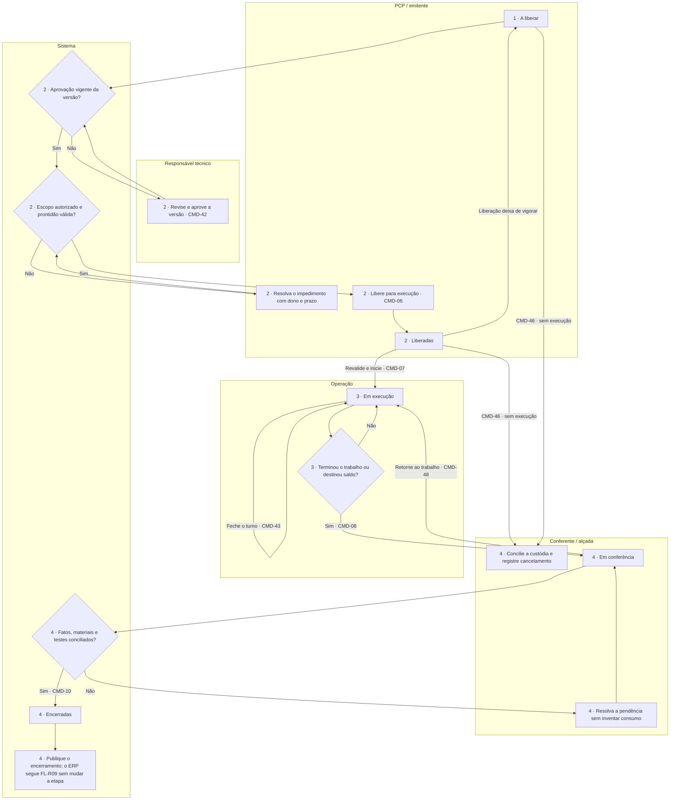

#### 8.4.2 Parcialmente concluída: progresso real e destino do saldo

**Parcialmente concluída é um estado de atendimento, independente da fase de trabalho.** Uma O.S. com 60 ha feitos de 100 ha apresenta “60% · 60/100 ha · 40 ha restantes” e pode estar Em execução, Pausada ou com saldo aguardando reprogramação. O filtro “Parcialmente concluídas” inclui essas ordens e distingue se continuam ativas ou se tiveram encerramento parcial autorizado. Não apresentar parcialmente executada como 100% concluída nem retirar seu saldo das necessidades do PCP/PCE.

| Situação | Tratamento obrigatório |
|---|---|
| Trabalho parcial continua no mesmo turno | Mantém Em execução; atualiza realizado e restante por apontamento validável |
| Trabalho parcial foi interrompido | Pausada, com motivo e previsão; execução anterior preservada |
| Saldo será feito em outro dia/equipe | Reprogramar apenas saldo, vinculado à mesma O.S. e suas execuções/versões; não duplicar a demanda |
| Saldo precisa de produtos/doses diferentes | Agrônomo revisa nova versão do saldo; bloqueia novas instruções até aprovação; não altera fichas nem consumos já realizados |
| Saldo deixou de ser necessário | Registrar decisão técnica e gerencial aplicável para cancelamento/dispensa do saldo; executar reconciliação final e mostrar “Encerrada parcialmente: 60 de 100 ha; saldo 40 ha dispensado”, com causa |
| Parte foi feita em condições não conformes | Registrar fato e incidente; não excluir área/consumo para maquiar desempenho; qualidade e aceite ficam pendentes |

O denominador principal é o escopo autorizado de referência; mostrar também revisões e saldo cancelado separadamente. Reduzir escopo após executar 60/100 não reescreve o histórico como desempenho original de 100%. Para operações por kg, unidades ou setores, usar a unidade apropriada. Área tratada repetidamente pode ser trabalho adicional legítimo, mas não soma duas vezes a cobertura única do talhão; distinguir área operacional acumulada de área geográfica coberta.

#### 8.4.3 Kanban operacional

O quadro padrão tem **cinco colunas fixas: A liberar · Liberadas · Em execução · Em conferência · Encerradas**. Essa é a mesma etapa resumida exibida na lista, no mapa e nas tarefas móveis. Aprovação, prontidão, progresso e reconciliação continuam registrados separadamente, sem exigir uma coluna ou clique para cada evento interno.

| Etapa do Kanban | Estados e condições reunidos | Próxima ação e responsável |
|---|---|---|
| A liberar | Emitida, em revisão, devolvida para ajuste ou aprovada tecnicamente — com ou sem prontidão — enquanto CMD-06 não tiver liberação registrada e vigente | Agrônomo revisa/aprova; PCP resolve recursos; cartão identifica responsável pela pendência atual |
| Liberadas | Liberação registrada e vigente por CMD-06, ainda não iniciada; automática apenas na irrigação somente com água, pela prontidão operacional (DEC-2609-10), com evento individual rastreável | Executor consulta instrução e inicia na janela autorizada |
| Em execução | Trabalho iniciado, inclusive realizado parcial, pausa ou espera pelo próximo turno | Equipe aponta avanço diário; PCP trata saldo e impedimentos |
| Em conferência | Execução física concluída ou saldo dispensado por decisão competente; conferência e reconciliação em curso | Conferente/almoxarife resolvem registros, sobras e custódia; encerrar quando elegível |
| Encerradas | Conferência e saldos concluídos; registro histórico preservado | Gestão consulta resultado, documentos e aprendizados |

**Selos no cartão:** Aguardando agrônomo, Em revisão, Devolvida para ajuste, Aprovação vencida/invalidada, Aprovada pelo agrônomo, Falta insumo, Falta máquina, Pausada, Parcial, Aguardando próximo turno, Revisão de saldo pendente, Cancelamento pendente, Janela a definir, Reserva vencida (RSV-16), Sobras pendentes e Apontamentos pendentes. Palavra exibida e cor de cada selo: 74.4.3, com vermelho só para o que impede o próximo passo (DS-17); "Sobras pendentes" × "Sobras a receber" é a PEND-DS-02. Mostrar apenas os pertinentes, com pendência principal, responsável e prazo. Atraso e criticidade são indicadores transversais, com a escala de prazo de 74.4.3. Rascunhos, rejeições definitivas e cancelamentos sem execução têm filtros/visões próprios; não criam colunas permanentes.

Uma O.S. aprovada pelo agrônomo mas sem máquina fica **A liberar**, com selo **Aprovada pelo agrônomo · Falta máquina**. Uma O.S. com 60/100 ha e chuva fica **Em execução · Pausada por chuva · 60%**. Uma O.S. com execução terminada e sobra a devolver fica **Em conferência · Sobras pendentes**. Esses exemplos são obrigatórios na demonstração.

A etapa é derivada dos estados oficiais e não gravada independentemente por cada tela. Antes do primeiro início, perda de prontidão ou invalidação da aprovação retira a ordem de Liberadas e a devolve a A liberar, explicando causa e histórico. Depois de iniciar, a ordem permanece Em execução com bloqueio/pausa do saldo; não apagar o realizado nem fazer parecer que nunca começou. Corrigir término declarado indevidamente exige evento autorizado de reabertura do saldo e justificativa, com preservação da trilha.

Emitir encaminha automaticamente à revisão. Aprovar (CMD-42) e Liberar para execução (CMD-06) são ações separadas, uma por vez, mesmo para usuário com ambas as permissões; não há ação composta (APROV-09). O botão Aprovar sozinho não libera a ordem. A liberação automática é exclusiva da irrigação somente com água (DEC-2609-10) e também registra CMD-06; orçamento autorizado, janela aberta e prontidão não aprovam nem liberam O.S. agrícola (APROV-05). Encerramento pode ser automático por política homologada quando os requisitos locais de INTEG-13 já estiverem confirmados; as reconciliações exigidas não incluem o aceite do ERP, salvo o tipo marcado de INTEG-16; material ou fato não conferido não é aceito automaticamente para eliminar uma etapa. Em conferência não exige espera artificial quando não há pendências.

Encerradas usam período selecionado; não carregar todo o histórico. No celular, seletor dessas cinco etapas e lista vertical substituem arraste horizontal obrigatório.

Cada cartão mostra ID, operação/atividade, fazenda/talhão/parcela, cultura, janela, prioridade, executor/equipe, máquina/conjunto, fase, avanço quantitativo, versão aprovada e impedimento principal. Detalhamento revela demais bloqueios e suas origens. Contadores mostram número de ordens e carga por unidade compatível; não somar hectares com toneladas em um total sem significado.

Arrastar cartão, quando oferecido, apenas inicia o comando de transição permitido. Não grava estado diretamente. O servidor verifica versão, permissão e regras; confirmação apresenta consequências materiais. Arrastar A liberar para Liberadas não contorna o agrônomo; arrastar Em execução para Encerrada não elimina conferência ou devoluções. Preferir botões contextuais claros às movimentações cegas.

Quadro possui filtros por safra, fazenda, cultura, talhão/parcela, atividade, fase, avanço parcial, janela, responsável, recursos, atraso e impedimento. Favoritos por perfil; ordenação sugerida por risco, prazo e prioridade explicada. Atualizações concorrentes chegam com indicação de mudança; nenhuma edição local sobrescreve versão nova silenciosamente. Registros ainda no aparelho aparecem como “Aguardando envio” (64.5; 73.3), só no aparelho que os capturou, distintos da fase confirmada no servidor; palavra e cor em 74.4. A situação de integração com o ERP não muda a fase nem cria coluna, selo ou indicação no cartão, salvo o impedimento do tipo marcado por INTEG-16 (INTEG-27).

**Revisão de saldo pendente:** selo transversal para ordem iniciada que aguarda nova aprovação técnica do saldo (41.2). A coluna permanece Em execução; cartão exibe responsável, prazo e saldo bloqueado. A mesma tarefa de aprovação pode aparecer em diferentes visões, sem duplicidade de documento.

#### 8.4.4 Mapa dinâmico do ciclo da O.S.

Em IN-04, a barrinha de funcionalidades mantém **O.S./prazos**. Dentro dessa função, selecionar **Fases · Avanço · Atrasos · Impedimentos**, sem substituir as camadas Solo, Satélite, Irrigação e Colheita/produtividade. O mapa permanece amplo; **Lista de O.S. e Kanban ficam abaixo do mapa**, em abas, conforme capítulo 67. Oferecer Tela cheia do mapa e Expandir quadro; nenhum painel lateral permanente reduz a largura do mapa.

O seletor de fase e os contadores filtram simultaneamente geometrias, lista e quadro. Clicar no talhão ou parcela destaca suas ordens abaixo, com ação Abrir O.S. e próxima ação permitida. Usar texto/ícone além de cor, com as mesmas cinco etapas; a cor de cada etapa está em 74.4.3 (proposta em PEND-DS-01). Pausa, aprovação técnica e demais condições aparecem em selos; o detalhe mantém os eventos originais. Vermelho identifica criticidade/atraso/impedimento, não uma fase única. Contraste e leitura sem cor seguem as medições de 74.7 e 74.9.

**Múltiplas ordens no mesmo talhão:** mostrar quantidade e resumo por fase/atividade; não atribuir uma única fase ao talhão inteiro nem deixar a última ordem sobrescrever todas as outras. Em zoom distante, agrupar marcadores preservando contagens; em zoom próximo, permitir seleção das ordens. Cor do polígono depende da camada/filtro ativo, com legenda explícita. Ordens de ativos fixos aparecem na localização conhecida; ativo móvel sem localização atual confiável aparece na lista sem ponto fictício.

**Avanço espacial:** quando existirem trilhas/polígonos executados confiáveis, distinguir área executada e restante com data/fonte/qualidade. Quando houver apenas apontamento de 60/100 ha sem geometria executada, mostrar barra/percentual no cartão e marcador; não pintar arbitrariamente 60% da geometria como se fossem hectares localizados. Taxa variável mantém a prescrição separada da execução efetivamente medida.

O.S. agrupadas preservam fases/avanço de cada ordem. Contagem de O.S. não soma grupo como ordem adicional. Selecionar o grupo permite navegar pelas parcelas e abrir ficha do caldeiro/operador, respeitando o perfil. Abrir a partir de qualquer origem mantém o mesmo ID, versão e dados.

#### 8.4.5 Indicadores e critérios de aceite do ciclo

Indicadores: emitidas aguardando revisão e tempo de espera; aprovadas ainda não liberadas por motivo; liberadas ainda não iniciadas; em execução e avanço; pausadas e horas de impedimento; parcialmente concluídas com saldo; execução concluída aguardando conferência; pendências de material; encerradas no prazo. Mostrar filas por responsável, envelhecimento e próxima ação. Medir pontualidade contra janela de referência versionada, sem apagar atraso pela reprogramação.

- **OSFASE-01:** emitir cria um ID e o coloca na fila do aprovador competente (agrônomo nas O.S. agrícolas, salvo irrigação somente com água, DEC-2609-10); mapa, lista e Kanban mostram a mesma fase confirmada.
- **OSFASE-02:** aprovação competente sem máquina/material mantém estado técnico aprovado e etapa A liberar. Mesmo com prontidão completa, sem evento CMD-06 registrado e vigente permanece A liberar em lista, Kanban, mapa e app; automático só na irrigação somente com água (DEC-2609-10).
- **OSFASE-03:** início real coloca Em execução; 60/100 ha aparece como parcial em todas as visões, com saldo de 40 ha.
- **OSFASE-04:** pausar e reprogramar mantém histórico e demanda residual; não cria consumo, área ou ordem duplicada.
- **OSFASE-05:** tentativa de encerrar com sobras/custódia/divergência impede encerramento e abre pendência com dono.
- **OSFASE-06:** duas ordens de fases distintas no mesmo talhão continuam distinguíveis; contagem do grupo não duplica ordens.
- **OSFASE-07:** sem geometria executada, progresso numérico não gera área espacial inventada.
- **OSFASE-08:** arraste inválido, chamada direta à API e usuário sem competência não ultrapassam aprovação/prontidão.
- **OSFASE-09:** relato offline conflitante fica Em conferência (CONC-07), sinaliza pendência e não regride fase confirmada.
- **OSFASE-10:** cancelamento de saldo exige motivo/alçada e mostra encerramento parcial, mantendo o escopo original para análise.
- **OSFASE-11:** fila, mapa e indicadores distinguem término físico de encerramento documental/material.
- **OSFASE-12:** homologar tarefa com agrônomo, PCP, executor e almoxarife: localizar próxima ação, identificar bloqueio, apontar parcial, receber sobra e encerrar sem interpretação incorreta da fase.
- **OSFASE-13:** lista, mapa, quadro e aplicativo apresentam as mesmas cinco etapas; pausa e parcial não geram colunas adicionais nem eliminam aprovação/conferência.
- **OSFASE-14:** perda de prontidão antes do início retorna a A liberar; após início conserva Em execução com bloqueio do saldo e histórico.
- **OSFASE-15:** nas cinco famílias de ordens, confirmar término físico coloca imediatamente Em conferência, inclusive antes de alguém assumir a conferência; não há etapa visual intermediária.
- **OSFASE-16:** conferir apontamento diário de ordem com saldo físico não concluído mantém Em execução; não confundir conferência da linha com fase da ordem.
- **OSFASE-17:** reparo/reprocessamento adicional preserva histórico e condição técnica/qualidade; retorno à execução exige comando autorizado e saldo identificado.
- **OSFASE-18:** ordens de beneficiamento usam cinco etapas; ordem reconciliada pode encerrar com lote Em inspeção/Bloqueado e inspeção/destinação vinculada com responsável/prazo. Sem encaminhamento formal, impedir encerramento. Lote continua indisponível à venda até CMD-24. Ativo inapto exige teste/condição e nova ordem vinculada ou destinação formal; CMD-10 não substitui CMD-19.

### 8.5 O.S. de vários dias e apontamentos acumulados

**Uma O.S. pode durar vários dias, turnos e frentes de trabalho.** A passagem de dia não emite nova O.S. nem encerra a existente. Relação obrigatória: O.S. 1:N execuções/turnos 1:N apontamentos, com vínculo à versão/instrução executada, talhão/parcela, operador/equipe e máquina/conjunto. Cada apontamento possui ID próprio, data operacional, início/fim, fuso, quantidade/unidade, horas por recurso, consumo por produto/lote quando aplicável, evidência, origem e situação de envio do aparelho e de conferência (73.2).

No aplicativo, a ação habitual é **Registrar avanço / Finalizar apontamento do turno**. A ação **Concluir execução da O.S.** é distinta e só aparece como conclusão do escopo ou destinação autorizada do saldo. Trabalho parcial em continuidade fica Em execução; fim normal do expediente não gera ocorrência de falha nem horas de parada técnica. Fora do turno, exibir “Aguardando próximo turno” quando aplicável. Pausa operacional extraordinária registra motivo e intervalo próprios.

A tela da O.S. apresenta abas **Resumo · Execuções e apontamentos · Insumos e sobras · Recursos e custos · Histórico e documentos**. Na aba diária, tabela com data/turno, parcela, responsável, máquina/conjunto, realizado no período, acumulado, saldo, horas, insumos, ocorrências e situação da conferência. Botões **Adicionar apontamento**, **Continuar execução**, **Corrigir com histórico**, **Reprogramar saldo** e **Concluir execução**, conforme permissão e estado. Filtros por dia/equipe/máquina não alteram o acumulado global da ordem, que permanece identificado.

Exemplo: O.S. de 350 ha executada em sete dias com 50 ha válidos por dia. No terceiro dia: 150/350 ha, 42,86%, saldo 200 ha. No sétimo: 350/350 ha, término físico elegível; ainda é necessário conferir registros, materiais, sobras e demais pendências para Encerrada. Se executar 40 ha no quarto dia, o saldo após esse dia será 160 ha; o sistema não completa a diferença automaticamente. Plano/programação podem ser revistos para terminar depois.

Acumulado confirmado = soma dos apontamentos distintos, aceitos e compatíveis, ajustados por correções vinculadas (CONC-08); relatos vinculados não entram; relatos Em conferência aparecem em coluna própria, fora do percentual (CONC-08); registro ainda no aparelho só entra depois do recibo (PROJ-01). Mostrar também avanço reportado provisório quando útil, sem confundi-lo com confirmado. Reenvio da mesma intenção não soma novamente; duplicidade de área, sobreposição de equipes na mesma parcela ou recurso e apontamentos incompatíveis geram conferência; frentes em parcelas distintas, com recursos distintos, consolidam sozinhas (CONC-08). Horas de máquina não são soma cega das horas de todos os trabalhadores; hora-homem total considera cada pessoa/quantidade de equipe e intervalos coerentes. Consumo registrado no preparo, entrega e aplicação representa eventos distintos e não três consumos.

Para área medida por GPS, calcular cobertura única conforme método e qualidade, distinguindo sobreposição e retrabalho. Quantidade operacional acumulada pode exceder a área física com motivo legítimo; não truncar o fato nem permitir percentuais enganosos sem explicação. Ordens por massa, unidades ou outras bases usam sua unidade operacional; não converter kg em ha sem fator válido. No mapa, preservar data e geometria de cada execução quando conhecidas, permitindo filtrar por dia e consultar acumulado.

Mudança técnica durante os sete dias cria revisão para o saldo futuro, com aprovação agronômica pertinente e novas fichas. Apontamentos dos dias anteriores continuam vinculados à versão executada; custos e consumos não são recalculados com a dose nova. Se houver grupo de ordens, cada apontamento distribui área/quantidade/consumo pelas ordens e parcelas de origem, sem duplicação do total.

- **OSDIA-01:** sete apontamentos de 50 ha alimentam uma única O.S. de 350 ha; não são geradas sete ordens.
- **OSDIA-02:** finalizar o turno do terceiro dia mantém saldo de 200 ha e O.S. aberta, com 150 ha acumulados.
- **OSDIA-03:** reenviar apontamento offline recupera o mesmo recibo e mantém acumulado; correção gera histórico e atualiza saldo/custo uma vez.
- **OSDIA-04:** apontamentos simultâneos de equipes diferentes preservam identidade; em parcelas distintas e com recursos distintos, consolidam sozinhos; com sobreposição ou uso simultâneo do mesmo recurso, abrem conferência e não permitem concluir por soma duplicada (CONC-08).
- **OSDIA-05:** alterar dose no quinto dia preserva versões, consumos e custos dos quatro dias anteriores; só saldo futuro usa revisão aprovada.
- **OSDIA-06:** lista, detalhe, Kanban, mapa e indicadores exibem acumulados da mesma fonte, distinguindo confirmado e provisório.
- **OSDIA-07:** 100% da área executada com sobra não recebida mostra término físico e pendência de material; não Encerrada.
- **OSDIA-08:** trocar turno/equipe/máquina mantém vínculo à O.S.; calendário normal não vira indisponibilidade de manutenção.

### 8.6 Janela móvel de emissão, aprovação e liberação de O.S.

**Regra obrigatória:** planejamento anual/plurianual não significa emitir ou liberar todas as O.S. desse horizonte. Necessidades previstas alimentam orçamento, capacidade PCP, manutenção projetada PCM e suprimentos PCE desde o planejamento, sem depender da existência de O.S. emitida. Cada gestor trabalha uma janela móvel explícita de ordens; emitir, aprovar e liberar são comandos distintos sobre versões determinadas.

| Horizonte | Finalidade | Efeito permitido |
|---|---|---|
| Planejamento | Safra/ano/ciclo ou horizonte escolhido; todas as necessidades futuras | Projetar demanda, recursos, manutenção, compras e custos; não autoriza execução |
| Preparação e emissão | Período operacional que o gestor quer preparar, com antecipação suficiente | Gerar/recuperar rascunhos e emitir ordens selecionadas à revisão competente |
| Aprovação técnica | Ordens emitidas do período, com evidências e condições atuais | Agrônomo aprova O.S. agrícolas/versão; irrigação somente com água não passa pelo agrônomo (DEC-2609-10); PCM usa aprovador próprio |
| Liberação operacional | Período mais próximo, escolhido para disponibilizar trabalho às equipes | Liberar somente ordens selecionadas, aprovadas e operacionalmente prontas, com validade definida |

#### 8.6.1 Controle simples por gestor

No cabeçalho de CA-01, IR-03, CO-02, PL-04 e MA-03/MA-04, oferecer **Período de trabalho: Hoje · Próximos 7 dias · Próximos 14 dias · Personalizado**, com datas inicial/final sempre visíveis e fuso da fazenda. Atalhos são sugestões de interface, não regra agronômica universal. Separar **Filtrar ordens** de **Preparar/emissão do período** e **Liberar selecionadas**: alterar filtro nunca gera, aprova ou libera documento.

Preferência por perfil/fazenda/tipo de operação, preservada por usuário: agrônomo prioriza revisão das O.S. agrícolas; PCP prepara recursos e liberação operacional; PCM emite preventivas projetadas e organiza a oficina. Preferências diferentes não criam documentos diferentes: todos usam a mesma ocorrência e a mesma O.S. já existente. Quando houver política organizacional, mostrar limites e permissões; não permitir que preferência pessoal amplie alçada.

A janela refere-se à **data/janela prevista de execução**, não à data de criação do documento. Para operações de vários dias, incluir ordens cujo intervalo se sobrepõe ao período e mostrar saldo relevante. A recorrência da mesma operação em outro evento constitui ocorrência própria; mudar a data de uma ocorrência existente reprograma a mesma necessidade, não emite duplicata.

#### 8.6.2 Prévia de emissão e fila administrável

**Preparar O.S. do período** apresenta lista com origem, atividade, talhão/parcela ou ativo, gatilho/âncora, janela, quantidade, responsável, ordem já existente, dependências e impedimentos. Contadores: **já emitidas**, **novas elegíveis**, **aguardando dados** e **fora do período**. Gestor seleciona o que emitir e vê impacto no volume da fila. Confirmação cria/recupera ordens idempotentemente; itens impedidos não são silenciosamente ignorados nem emitidos como executáveis.

Geração automática, quando habilitada, prepara rascunhos/ocorrências ou emite para revisão conforme política explícita de escopo, antecipação, frequência e limite por rodada, com chave derivada do gatilho; repetir a rodada recupera o que já foi criado (IDEM-04). Pode emitir/revisar antes da autorização econômica, com impedimento visível; CMD-06/07/16 recusam liberação, novo início e entrega sem autorização vigente do escopo. Não aprova tecnicamente nem libera execução por simples passagem da data, nem por orçamento autorizado ou janela aberta (APROV-05). A fila de revisão agronômica fica limitada às ordens emitidas pertinentes, mantendo acesso pesquisável às demais necessidades. Agrônomo pode abrir evidências e alterar produtos/doses antes de aprovar.

No modo de liberação, mostrar **Aprovadas e prontas · Pendentes de aprovação · Com impedimento · Já liberadas**, com janela, validade e recursos. “Liberar selecionadas” exige aprovação vigente e verificações de cada item no servidor. Lote tem resultados individuais: liberada, impedida ou conflito de versão. Nunca usar uma confirmação genérica para aprovar ordens não revisadas ou liberar toda a safra oculta por paginação/filtro.

#### 8.6.3 Janela autorizada, atraso e atualização

Liberação possui validade operacional explícita — início, fim, premissas e versão — adequada à atividade. Aprovação antecipada não dispensa checagem das condições reais na preparação/início. Se alteração de data afetar requisito técnico, clima, estádio, insumo ou instrução, solicitar revalidação conforme regra; não invalidar indiscriminadamente toda aprovação por mero ajuste administrativo sem efeito técnico. O responsável vê o motivo e a ação necessária.

Fora da janela, nova partida/preparo não autorizado é impedido e encaminhado à revisão/reprogramação. Operação já em execução não recebe comando físico de parada automática só porque o relógio venceu: preservar registro do fato, aplicar procedimento seguro e bloquear novas etapas que exigem autorização renovada. Offline usa validade e restrições do pacote autorizado, sem presumir cancelamento remoto recebido.

**Sempre visíveis além do filtro temporal:** ordens em execução, pausadas, atrasadas, com material em custódia ou aguardando encerramento aparecem em uma faixa **Pendências de outros períodos** e nos contadores, com link para tratamento. A janela controla a carga de trabalho nova; não esconde obrigações antigas. Fechar a janela ou trocar a semana não cancela nem encerra ordens.

Urgências técnicas/corretivas fora da janela podem ser emitidas por usuário competente com motivo, prioridade e impacto, seguindo aprovação e segurança aplicáveis. Agronomia/PCP/PCM recebem as consequências em sua fila; exceção não exige ampliar toda a janela nem liberar ordens não relacionadas. Peças de longo prazo e compras para safra futura permanecem no planejamento PCE antes de qualquer emissão próxima à execução.

#### 8.6.4 Exemplos de comportamento

- Safra contém 800 ocorrências previstas. Gestor escolhe próximos 14 dias, encontra 30, das quais 10 já têm O.S.: o sistema propõe até 20 novas ordens, nunca outras 800.
- Das 30 ordens, 18 têm aprovação técnica; somente 12 estão prontas e dentro da janela operacional selecionada. A prévia oferece essas 12 para liberação, mostrando as 18 restantes por motivo, sem confundir aprovação com prontidão.
- Preventiva prevista em 60 dias exige peça com prazo de 45 dias: PCE recebe necessidade datada agora; a oficina não precisa receber uma O.S. liberada hoje para que a compra seja planejada.
- O.S. iniciada na semana anterior tem 40 ha restantes: continua visível na faixa de pendências e na execução, mesmo com filtro da próxima semana.

#### 8.6.5 Critérios de aceite da janela

- **JANELA-01:** plano anual gera projeções completas sem emitir/liberar automaticamente todas as ordens.
- **JANELA-02:** selecionar período ou mudar filtro não causa nenhum efeito transacional.
- **JANELA-03:** agrônomo, PCP e PCM podem preparar seu horizonte sem duplicar a mesma ocorrência/O.S.
- **JANELA-04:** repetir emissão do mesmo período ou alterar a data da ocorrência mantém identidade e não duplica demanda/reserva.
- **JANELA-05:** liberação em lote revalida cada versão, aprovação, autorização econômica/operacional vigente do escopo, prontidão, janela e permissão; retorna resultado individual. Emitida/revisada antes de CMD-04 permanece A liberar; revogação bloqueia novo início/entrega; liberação automática só na irrigação somente com água (APROV-06).
- **JANELA-06:** ordens ativas/atrasadas/com custódia/pendentes não desaparecem ao avançar a janela.
- **JANELA-07:** compra de longo prazo usa necessidade planejada mesmo sem O.S. emitida; não duplica demanda quando a ordem nasce.
- **JANELA-08:** janela vencida impede novo início não autorizado; fato ocorrido permanece registrável e sujeito à conferência.
- **JANELA-09:** alteração relevante exige revalidação identificada e ficha vigente; não reescreve trabalho realizado.
- **JANELA-10:** emitir urgência justificada fora do horizonte mantém controles e não libera outras ordens.

## 9. Fluxos completos e integrados

Os fluxos mostram decisões, dependências e retornos. As transições executáveis são as da seção 8. Cada caixa abre a tela indicada no texto do fluxo; os IDs de registros são preservados. As setas de atualização automática representam eventos confirmados ou projeções identificadas, não uma obrigação de o usuário visitar todos os módulos.

### FL-01 — Gestão integrada da fazenda

**Responsáveis:** direção, agronomia, PCP, operações, comercial e controladoria. **Telas:** GE-01, PL-01, AG-03, PL-04, CA-01, CO-05, VE-04 e GE-03. Demanda comercial informa o plano antes da colheita; venda futura não precisa esperar estoque físico.

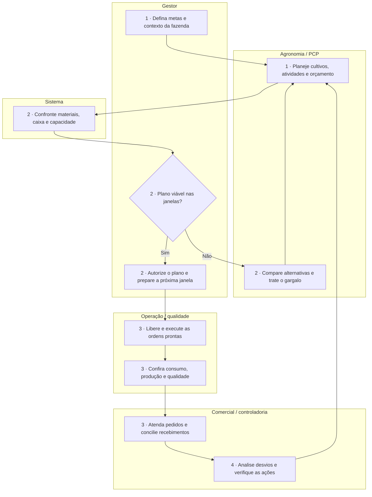

### FL-02 — Cadastro, importação e primeira operação

**Responsáveis:** gestor de dados, agronomia e TI. **Telas:** ON-01, CD-01 a CD-07, CF-03 e PL-01. **Saída:** base utilizável, com lacunas explícitas e primeiro planejamento; documentos ausentes bloqueiam somente processos que dependem deles.

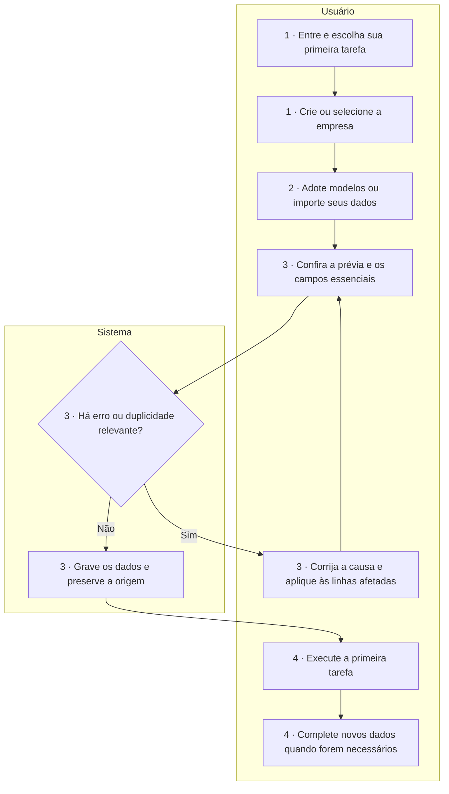

### FL-03 — Safra, plano e orçamento sem dependência circular

**Responsáveis:** agronomia aprova as recomendações (CMD-01) e cada O.S. agrícola (CMD-42); controladoria calcula; direção/gerência autoriza economia (CMD-03, CMD-04), sem aprovar O.S. (APROV-05); PCP programa; o liberador autorizado libera (CMD-06; APROV-01), e a água sem produto é liberada pela prontidão, sem agrônomo (APROV-15; DEC-2609-10). **Telas:** PL-01, PL-02, AG-04, PL-03, SU-01, GE-02 e PL-04. Cálculos, rascunhos e cotações preliminares podem existir antes da autorização operacional.

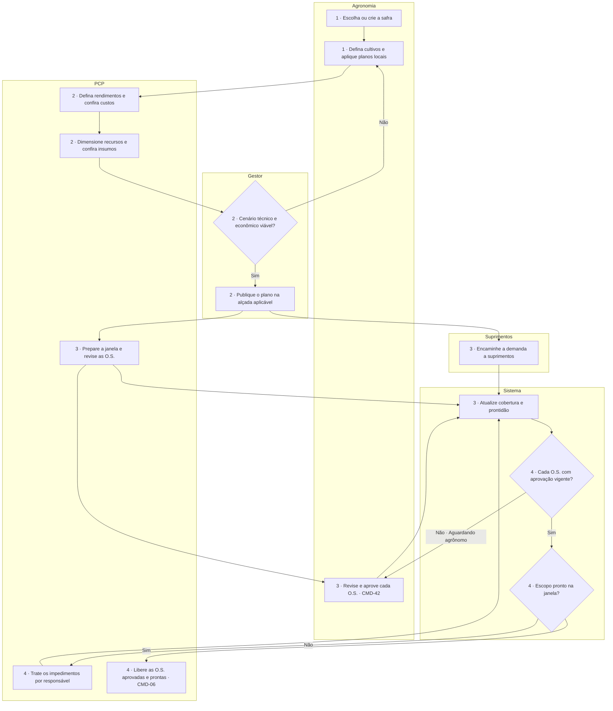

### FL-04 — Solo e folha até recomendação e execução

**Responsáveis:** coleta/laboratório, agronomia, PCP. **Telas:** AG-02 → AG-03 → AG-04 → PL-02. **Saída:** recomendação versionada e necessidade datada. O cálculo é parte da recomendação; a prescrição espacial é opcional e depende de dados/maquinário adequados.

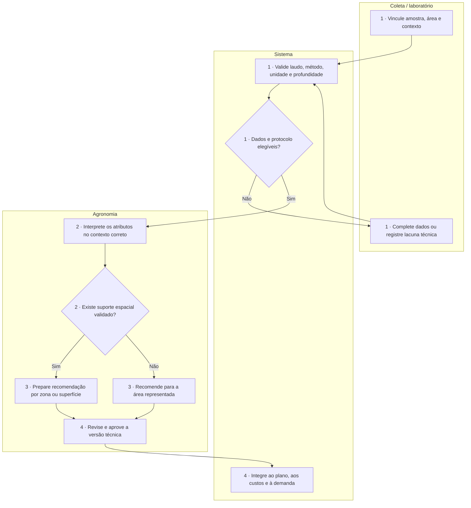

### FL-05 — Monitoramento, decisão e avaliação agronômica

**Responsáveis:** vistoriador, agrônomo/RT e PCP. **Telas:** AG-01, MB-06, AG-03, AG-04, CA-01 e AG-06. Não existe adiamento universal de sete dias nem aplicação automática pela cor do mapa.

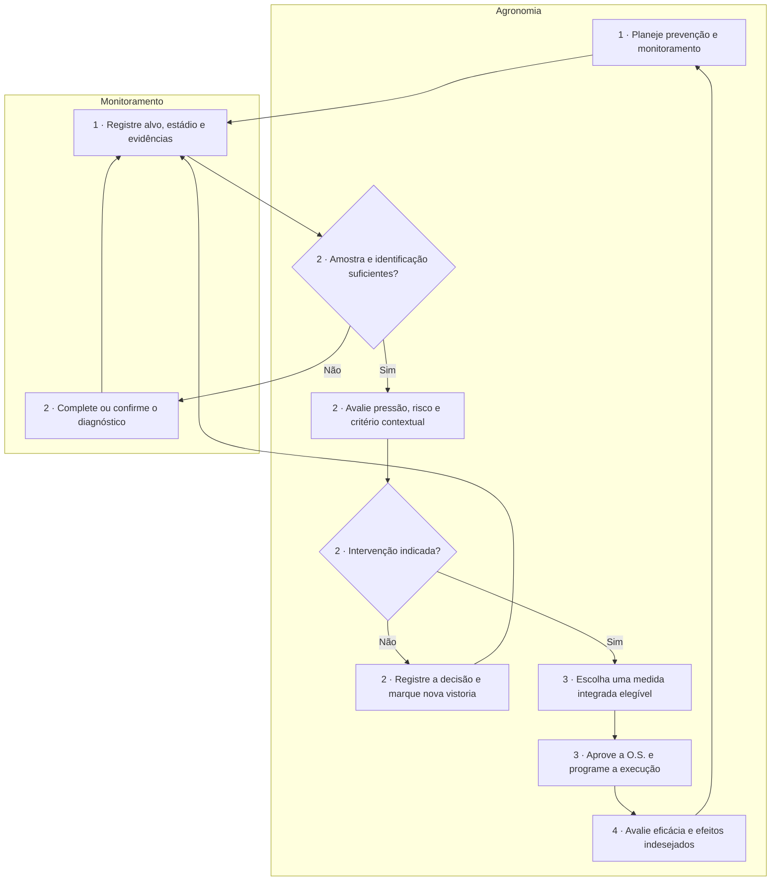

### FL-06 — Cultura perene, idade e pendências anteriores

**Responsáveis:** agronomia e PCP. **Telas:** PL-01, AG-05, PL-02 e CA-02. A âncora é o evento do próprio ciclo/parcela. Não inferir realização apenas porque a data passou.

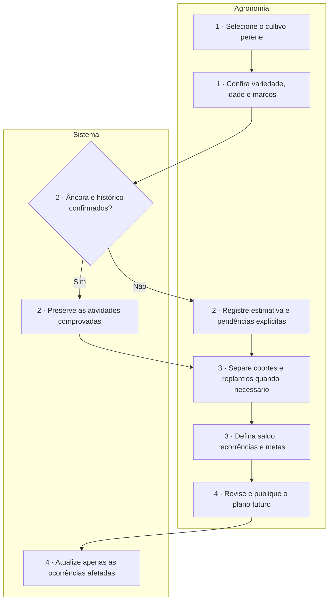

### FL-07 — Escalonamento de parcelas e continuidade de oferta

**Responsáveis:** comercial, agronomia e PCP. **Telas:** VE-01, PL-06, CO-01 e PL-02. **Saída:** proposta com área, datas, ocupação e produção por semana/classe. Simular mais de uma rodada para revelar buracos de oferta.

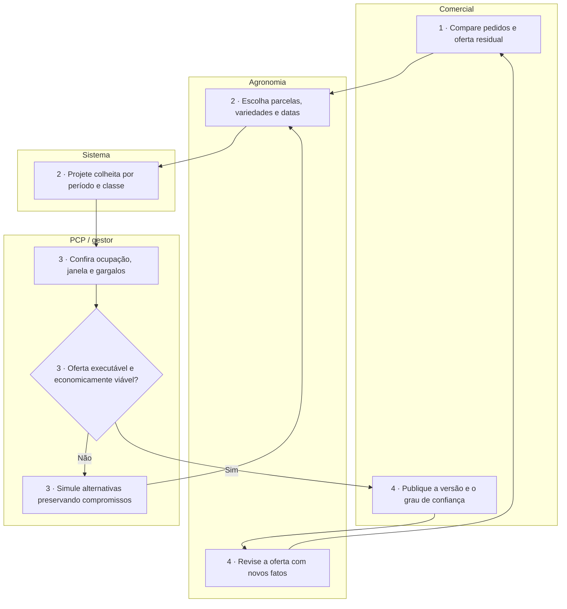

### FL-08 — Programação, liberação e reprogramação

**Responsáveis:** PCP coordena; cada especialista resolve seu impedimento. **Telas:** PL-04/PL-05, SU-07, MA-01 e listas de ordens. Ordem pode ser programada aguardando material; liberação (CMD-06) é por parcela fisicamente executável e, salvo na água sem produto, exige aprovação técnica vigente da versão, lida no registro, inclusive na O.S. agrícola de operação mecânica (APROV-01; APROV-02; APROV-07; DEC-2609-10).

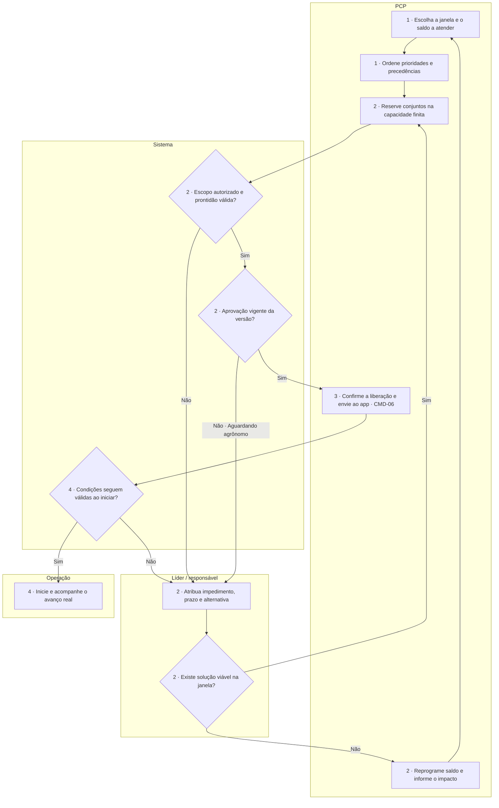

### FL-09 — Necessidade líquida datada

**Responsáveis:** sistema calcula; suprimentos revisa exceções. **Telas:** SU-01/SU-02/SU-03/SU-05. **Saída:** propostas de reposição, sem enviar compra automaticamente. CAL-01 define a convenção que evita subtrair reservas duas vezes.

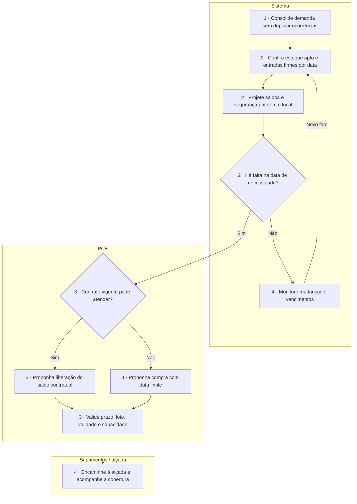

### FL-10 — Compra, recebimento parcial e obrigação financeira

**Responsáveis:** comprador, aprovador, fornecedor, almoxarife e financeiro. **Telas:** SU-04, PT-02, SU-05, SU-06 e GE-04. **Saída:** item apto no prazo, saldo contratual e financeiro reconciliados.

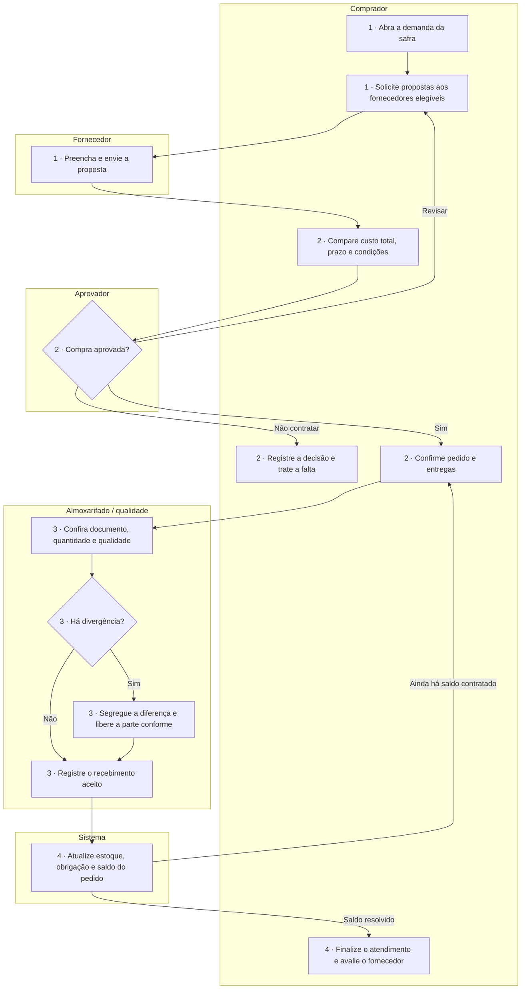

### FL-11 — Contrato de safra e liberações programadas

**Responsáveis:** compras, PCE, financeiro e fornecedor. **Telas:** SU-05, SU-01 e GE-04. Contratar preço/volume, pedir entrega e pagar são decisões relacionadas, com eventos e saldos distintos.

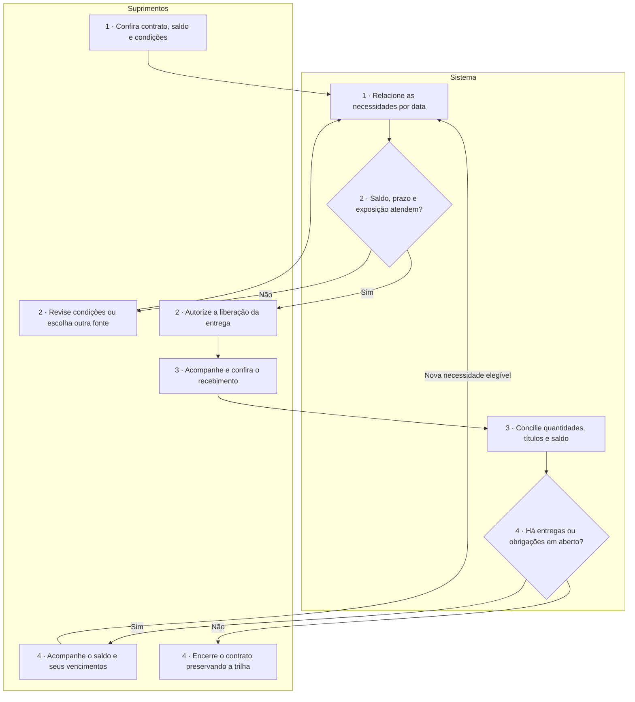

### FL-12 — Reserva, custódia, consumo e devolução

**Responsáveis:** almoxarife e executor. **Telas:** SU-07, CA-04, MB-05 e CA-02. **Invariante:** entradas em custódia = consumo + devolução recebida + transferência de saída autorizada e recebida + perda/destinação documentada + saldo em custódia. Entradas incluem entregas do depósito e transferências recebidas; a confirmação de recebimento no app é aceite da mesma entrega, não nova entrada (CONC-12); CAL-02. No vencimento (CMD-49), só a quantidade elegível da reserva volta ao disponível (RN-046; RSV-06); custódia e físico não mudam (RSV-07).

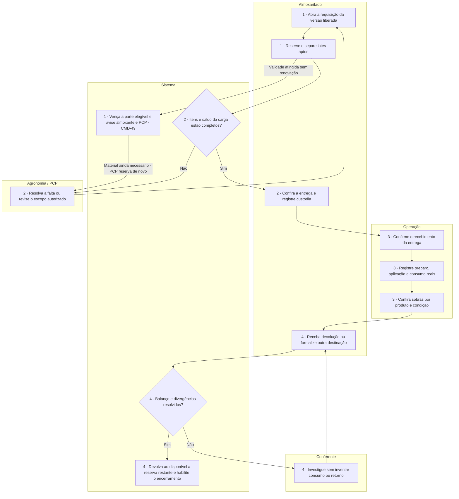

### FL-13 — Execução de campo e conferência

**Responsáveis:** executor, PCP e agronomia quando aplicável. **Telas:** MB-02/MB-03/MB-04, CA-02, GE-03. **Saída:** fato íntegro, saldo do trabalho e efeitos locais reconciliados; os efeitos a integrar seguem ao ERP depois do encerramento, pela outbox, sem mudar a etapa, salvo tipo de efeito marcado para confirmação antes do encerramento (RN-047; INTEG-15; INTEG-16). O formulário aceita relato não conforme.

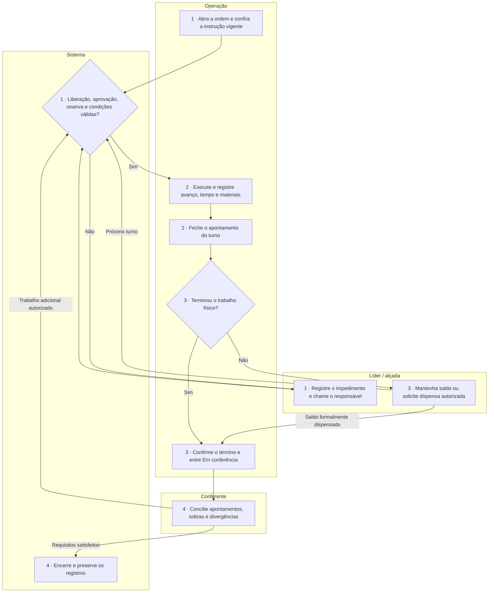

### FL-14 — Irrigação, capacidade e medição

**Responsáveis:** agronomia, irrigação, PCP e PCM. **Telas:** IR-01 a IR-04, MA-04 e MB-08. Fertirrigação usa também AG-04 e SU-07; irrigação simples não exige material de estoque.

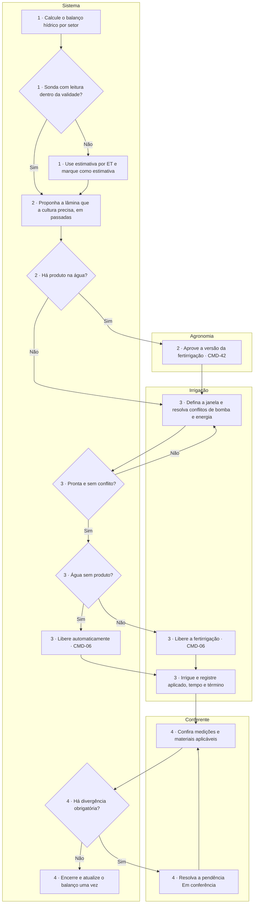

### FL-15 — Manutenção até retorno técnico

**Responsáveis:** operador, PCM, mecânico e liberador técnico. **Telas:** CA-03, MA-02/MA-03/MA-04, SU-07 e PL-05. Preventiva, falha e alerta de condição convergem na mesma carteira de manutenção.

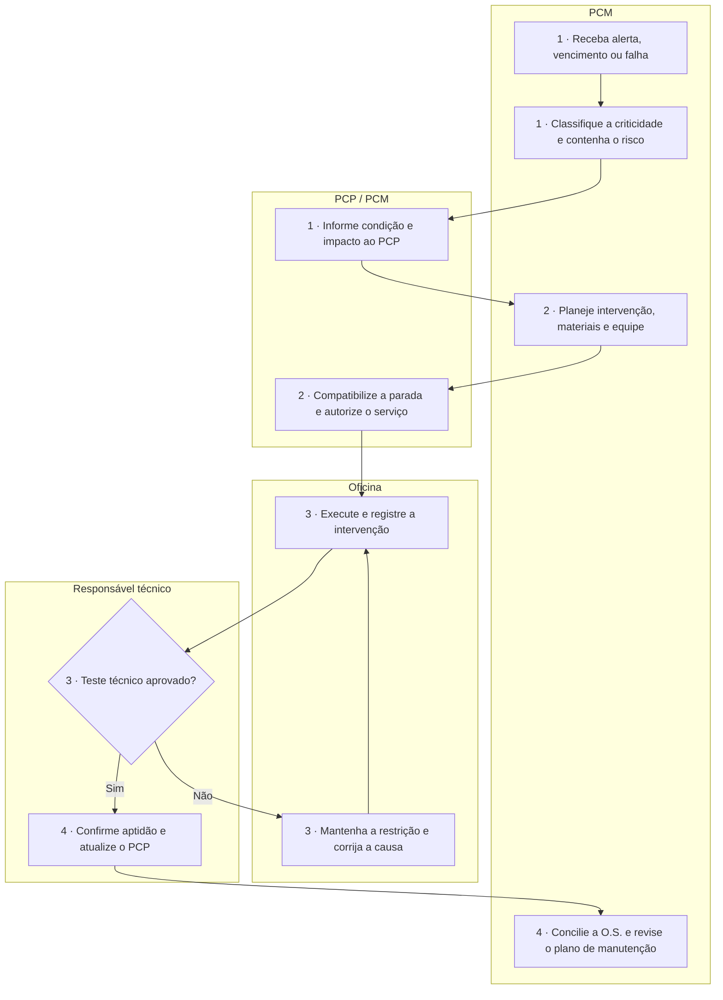

### FL-16 — Previsão semanal, demanda e capacidade

**Responsáveis:** coleta, agronomia, comercial e PCP. **Telas:** MB-07, CO-01, VE-01 e CO-02. Oferta é por semana/produto/classe; amostra, perdas, curva e confiança ficam visíveis.

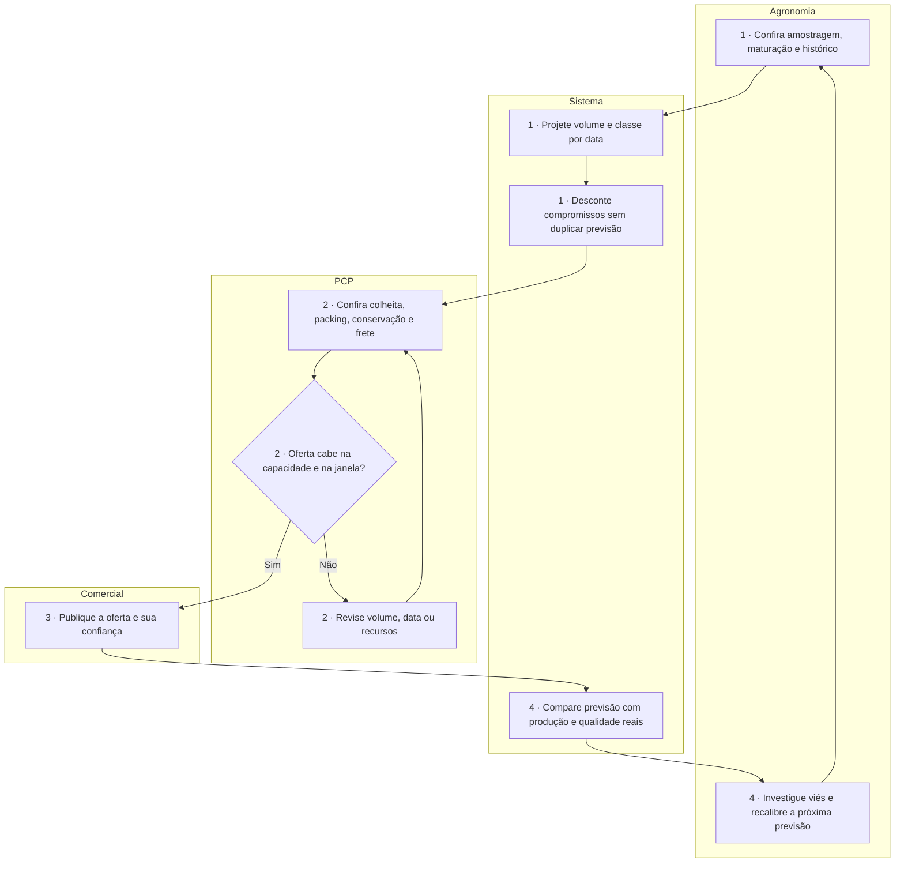

### FL-17 — Colheita, carga e recebimento

**Responsáveis:** PCP, equipe de colheita, balança e recebimento. **Telas:** CO-02/CO-03/CO-04 e MB-10. Avanço/horas do turno vêm de FO-07, mesmo antes de pesar; carga e pesagens vêm de FO-13. As pesagens de origem e destino são observações da mesma carga, não produção adicional.

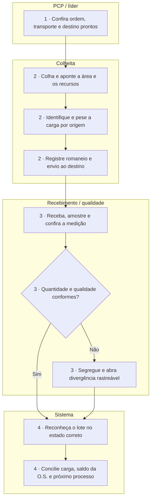

### FL-18 — Beneficiamento e estoque vendável

**Responsáveis:** produção, qualidade e armazém. **Telas:** CO-05/CO-06/CO-07. Nenhum processo é universal: secagem, limpeza, classificação, embalagem e conservação são rotas por produto. Este fluxo geral é detalhado pelos três fluxos BEN do capítulo 45, obrigatórios para a implementação dos respectivos segmentos.

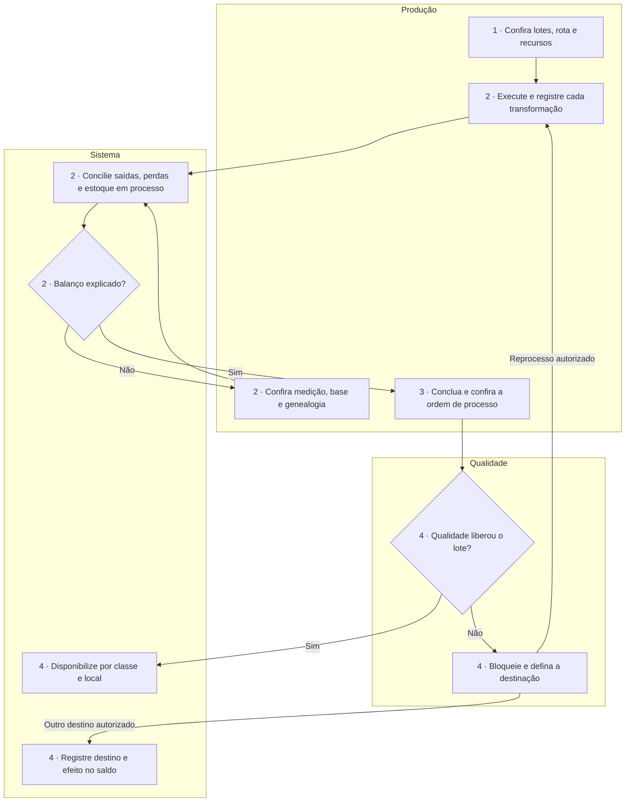

### FL-19 — Qualidade, devolução e recolhimento

**Responsáveis:** qualidade, comercial, logística e financeiro. **Telas:** CO-06, VE-06, LO-03, GE-05. **Saída:** contenção física, parceiros afetados, destinação e ajuste financeiro vinculados.

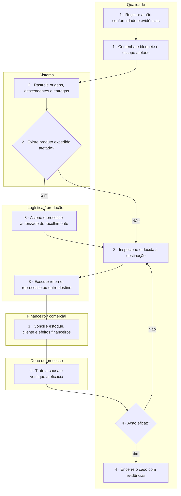

### FL-20 — Oferta, venda e compromisso

**Responsáveis:** comercial, cliente e aprovadores. **Telas:** VE-01/VE-02/VE-03, PT-03, VE-04 e VE-05. Oportunidade de preço é informação; o compromisso nasce de decisão aprovada.

```mermaid
flowchart TB
 subgraph RAIA_0["Comercial / cliente"]
  direction TB
  A["1 · Abra a oferta por produto, classe e data"]
  B["1 · Negocie preço, frete, entrega e pagamento"]
  D{"2 · Condições viáveis e aceitas?"}
  E["2 · Encerre a proposta e libere a reserva temporária"]
 end
 subgraph RAIA_1["Sistema"]
  direction TB
  C["2 · Revalide oferta, capacidade e crédito"]
  F["3 · Confirme pedido e compromisso atomicamente"]
  G["3 · Vincule estoque apto ou produção futura"]
 end
 subgraph RAIA_2["PCP / logística"]
  direction TB
  H["3 · Programe parcelas de entrega e acompanhe riscos"]
  I["4 · Encaminhe à expedição com as condições vigentes"]
 end
 A --> B
 B --> C
 C --> D
 D -->|Revisar| B
 D -->|Recusar| E
 D -->|Sim| F
 F --> G
 G --> H
 H --> I
```

### FL-21 — Expedição, entrega e divergência

**Responsáveis:** logística, armazém, emissor fiscal e cliente. **Telas:** LO-01 a LO-04, MB-10, VE-04, VE-06 e GE-05. FO-34/FO-35 geram eventos equivalentes no app e no desktop, com recebedor, evidência e recusa parcial quando houver. Saída física, propriedade, faturamento e aceite têm marcos próprios.

```mermaid
flowchart TB
 subgraph RAIA_0["Expedição"]
  direction TB
  A["1 · Confira pedido, veículo e lotes aptos"]
  B["1 · Separe, pese e confira a carga"]
  D["2 · Resolva a pendência antes da saída"]
 end
 subgraph RAIA_1["Sistema"]
  direction TB
  C{"2 · Documentos e liberação válidos?"}
  E["2 · Confirme a saída física uma vez"]
  I["4 · Atualize o atendimento comprovado"]
 end
 subgraph RAIA_2["Logística / cliente"]
  direction TB
  F["3 · Comprove o cumprimento no ponto contratado"]
  G{"3 · Houve falta, avaria ou diferença?"}
  H["3 · Registre o caso e acorde o saldo"]
 end
 subgraph RAIA_3["Financeiro / comercial"]
  direction TB
  J["4 · Concilie frete, recebível e próximo atendimento"]
 end
 A --> B
 B --> C
 C -->|Não| D
 D --> C
 C -->|Sim| E
 E --> F
 F --> G
 G -->|Sim| H
 G -->|Não| I
 H --> I
 I --> J
```

### FL-22 — Crédito, prazo e barter

**Responsáveis:** produtor/financeiro, credor, compras e comercial. **Telas:** GE-08, PT-04, SU-05, VE-05 e GE-04. Escolha de condição não significa aprovação de crédito nem liquidação.

```mermaid
flowchart TB
 subgraph RAIA_0["Gestor financeiro"]
  direction TB
  A["1 · Defina necessidade e autorize o dossiê"]
  B["1 · Compare propostas e obrigações"]
  C{"2 · Condições aprovadas e aceitas?"}
  D["2 · Encerre a proposta ou escolha outra fonte"]
  I["4 · Concilie liquidação e liberação de garantias"]
 end
 subgraph RAIA_1["Parceiro / gestor"]
  direction TB
  E["2 · Formalize contrato e condições precedentes"]
  F{"3 · Condições cumpridas e liberação confirmada?"}
  G["3 · Acompanhe pendências sem reconhecer caixa"]
 end
 subgraph RAIA_2["Sistema"]
  direction TB
  H["3 · Registre desembolso e compromissos únicos"]
 end
 A --> B
 B --> C
 C -->|Revisar| B
 C -->|Não| D
 C -->|Sim| E
 E --> F
 F -->|Não| G
 G --> F
 F -->|Sim| H
 H --> I
```

### FL-23 — Pagar, receber e conciliar

**Responsáveis:** financeiro e sistema oficial designado. **Telas:** GE-04/GE-05, SU-06, VE-04 e CF-03. Antecipação contratual é um caminho explícito, não recebimento fictício.

```mermaid
flowchart TB
 subgraph RAIA_0["Financeiro"]
  direction TB
  A["1 · Confira origem, valor, vencimento e competência"]
  B["1 · Vincule adiantamentos e ajustes autorizados"]
  F["3 · Mantenha pendência e reconcilie"]
  H["3 · Trate rejeição ou replaneje com autorização"]
  J["4 · Concilie saldo e encerre a obrigação atendida"]
 end
 subgraph RAIA_1["Aprovador"]
  direction TB
  C["2 · Aprove o pagamento ou acompanhe a cobrança"]
 end
 subgraph RAIA_2["Sistema"]
  direction TB
  D["2 · Registre envio e consulte o provedor oficial"]
  E{"3 · Resultado financeiro conclusivo?"}
  G{"3 · Liquidação confirmada?"}
  I["4 · Reconheça uma vez e vincule o extrato"]
 end
 A --> B
 B --> C
 C --> D
 D --> E
 E -->|Não| F
 F -->|Novo retorno ou consulta| D
 E -->|Sim| G
 G -->|Não| H
 G -->|Sim| I
 I --> J
```

### FL-24 — Custo, resultado e aprendizado

**Responsáveis:** controladoria, gestores e donos dos parâmetros. **Telas:** GE-03, GE-01, GE-06, GE-07, GE-02 e CF-02. Resultado abre causa e ação; a revisão não altera silenciosamente o passado.

```mermaid
flowchart TB
 subgraph RAIA_0["Controladoria"]
  direction TB
  A["1 · Confira orçamento-base e fatos conciliados"]
  C["1 · Separe causas com bases equivalentes"]
  F["2 · Investigue a origem e simule alternativas"]
 end
 subgraph RAIA_1["Sistema"]
  direction TB
  B["1 · Compare total, hectare e unidade produzida"]
  E["2 · Monitore a tendência"]
  J{"4 · Mudança altera a avaliação de quem propõe?"}
 end
 subgraph RAIA_2["Gestor"]
  direction TB
  D{"2 · Desvio exige ação?"}
  G["3 · Aprove ação, responsável e prazo"]
  K["4 · Revise efeito e evidências com outra identidade"]
 end
 subgraph RAIA_3["Dono do processo"]
  direction TB
  H["3 · Revise o futuro preservando a linha de base"]
  I["4 · Meça o resultado e proponha o novo padrão"]
  P["4 · Publique a nova versão · CMD-29"]
 end
 A --> B
 B --> C
 C --> D
 D -->|Não| E
 D -->|Sim| F
 F --> G
 G --> H
 H --> I
 E -->|Novo período| A
 I --> J
 J -->|Não| P
 J -->|Sim| K
 K -->|Aprovada| P
 K -->|Devolvida| I
 P -->|Novo ciclo| A
```

### FL-25 — Offline, reenvio e conflito

**Responsáveis:** executor, servidor de domínio e conferente. **Telas:** todas MB, CA-02 e CF-03. Captura local e confirmação central são estados distintos. UUID sozinho não garante idempotência nem resolve conflito entre fatos diferentes: reenvio e conflito de chave seguem 73.3; mesmo fato, fato distinto e correção vinculada seguem 73.5 (CMD-50); cota e reserva do pacote offline seguem RSV-08 e RSV-09.

```mermaid
flowchart TB
 subgraph RAIA_0["Aplicativo"]
  direction TB
  A["1 · Baixe ordens autorizadas e limites offline"]
  B["2 · Grave chave e conteúdo antes de enviar"]
  C{"2 · Há conexão?"}
  D["2 · Mantenha a fila e mostre pendência"]
  E["2 · Envie com chave e versão esperada"]
  J["4 · Atualize saldo e sincronização no dispositivo"]
 end
 subgraph RAIA_1["Servidor"]
  direction TB
  F{"3 · Chave já registrada?"}
  G["3 · Recupere o mesmo recibo"]
  H["3 · Grave uma vez e confirme o recibo"]
  K["3 · Responda conflito de chave, sem gravar"]
  N{"3 · Como classificar o relato de campo?"}
  L["3 · Vincule ao fato existente sem novo efeito"]
 end
 subgraph RAIA_2["Conferente"]
  direction TB
  I["3 · Preserve o relato e resolva o caso · CMD-50"]
 end
 A --> B
 B --> C
 D -->|Conexão retomada| C
 G --> J
 H --> J
 C -->|Sim| E
 C -->|Não| D
 E -->|Sem resposta ou falha transitória| D
 E --> F
 F -->|Mesmo conteúdo| G
 F -->|Outro conteúdo| K
 F -->|Não| N
 K --> J
 N -->|Mesmo fato| L
 N -->|Compatível ou correção| H
 N -->|Incompatível, possível mesmo fato ou excedente| I
 L --> J
 I -->|Aceito ou corrigido| H
```

### FL-26 — Portal e compartilhamento por finalidade

**Responsáveis:** produtor, parceiro e administração de acesso. **Telas:** PT-01 a PT-07, SU-04, VE-03, GE-08. Convite público limitado e sessão autenticada têm permissões explícitas.

```mermaid
flowchart TB
 subgraph RAIA_0["Agricultor"]
  direction TB
  A["1 · Defina finalidade, destinatário e prazo"]
  B["1 · Revise e autorize o compartilhamento"]
  H["4 · Emita recibo e encaminhe ao agricultor"]
 end
 subgraph RAIA_1["Sistema"]
  direction TB
  C["2 · Envie convite no canal autorizado"]
  D{"2 · Identidade, link e escopo válidos?"}
  E["2 · Explique o impedimento e ofereça recuperação"]
  F["3 · Mostre apenas a tarefa e os dados permitidos"]
  I["4 · Encerre ou revogue o acesso conforme a finalidade"]
 end
 subgraph RAIA_2["Parceiro"]
  direction TB
  G["3 · Preencha e envie a resposta"]
 end
 A --> B
 B --> C
 C --> D
 D -->|Não| E
 D -->|Sim| F
 F --> G
 G --> H
 H --> I
```

### FL-27 — Urgência, alteração e encerramento de período

**Responsáveis:** gerente, especialista do risco e controladoria. **Telas:** IN-02, PL-05, GE-03, CF-02. Urgência pode abreviar passos administrativos conforme política; não elimina restrição obrigatória nem registro real. A aprovação agronômica da O.S. agrícola não é passo administrativo e não é abreviada por urgência (APROV-05; 41.1).

```mermaid
flowchart TB
 subgraph RAIA_0["Solicitante"]
  direction TB
  A["1 · Registre urgência, fato ou correção"]
 end
 subgraph RAIA_1["Responsável técnico"]
  direction TB
  B["1 · Contenha o risco e identifique o impacto"]
  C{"2 · A ação pretendida viola restrição obrigatória?"}
  D["2 · Bloqueie nova execução e escolha alternativa válida"]
 end
 subgraph RAIA_2["Gestor / controladoria"]
  direction TB
  E["2 · Defina alçada, alcance e período aplicável"]
  F["3 · Aprove ajuste ou revisão com justificativa"]
  I["4 · Verifique causa e eficácia da resposta"]
 end
 subgraph RAIA_3["Sistema"]
  direction TB
  G["3 · Registre estorno vinculado ou nova versão futura"]
  H["4 · Concilie saldos e informe os responsáveis"]
 end
 A --> B
 B --> C
 C -->|Sim| D
 C -->|Não| E
 D --> E
 E --> F
 F --> G
 G --> H
 H --> I
```

## 10. Cálculos, unidades e práticas agronômicas

Esta seção substitui as fórmulas conflitantes das versões anteriores. Parâmetros agronômicos regionais não especificados aqui devem vir de protocolo validado, com fonte, unidade, domínio de validade e vigência. A ausência de tabela aprovada deve aparecer como pendência, nunca ser preenchida por um número plausível inventado. Cada uso de um CAL tem uma classe (transacional no comando, cálculo síncrono ou projeção assíncrona) definida em PROJ-04 (73.7.2); decisão só autoriza a partir do registro transacional (PROJ-03).

### 10.0 Política de precisão, unidades e arredondamento

Política computacional única e versionada, identificada em todo resultado CAL, API, importação e memória de cálculo. A configuração de referência abaixo é uma **proposta técnica inicial**, a homologar antes do primeiro cálculo produtivo; qualquer ajuste exige versão, testes de regressão e vigência, sem reescrever documentos históricos. Não deixar escalas/modo a critério independente de cada tela ou conector.

| Grandeza | Escala interna de referência | Apresentação padrão | Regra |
|---|---:|---:|---|
| Valor monetário calculado/intermediário | 8 decimais | 2 em BRL no valor final do documento | Moeda declara escala final; preço unitário preserva até 8, sem truncar antes de multiplicar |
| Área em ha e horas decimais | 6 decimais | 2 ha; 2 h ou duração em h:min | Eventos de duração preservam também timestamps/segundos originais |
| Quantidade em kg, L, t, m³; dose por ha | 6 decimais | Até 3, ampliável até a precisão disponível | Unidade e instrumento podem exigir escala/quantização específica |
| Taxa, coeficiente, rendimento e conversão | 12 decimais | Até 6, com unidade/base | Eficiência calculada em fração; apresentação percentual não troca a base |
| Itens indivisíveis | 0 decimais | 0 | Arredondar necessidade para lote/embalagem é regra de planejamento explícita, não simples arredondamento numérico |

Usar decimal com precisão mínima de 34 algarismos significativos nas operações intermediárias, sem arredondar a cada etapa; dízimas seguem essa precisão, não promessa de representação exata infinita. Persistir valores na escala declarada da grandeza e registrar resultado não quantizado quando uma prescrição ou instrumento exigir comparação. Serializar decimais como string decimal canônica ou inteiro escalado com escala declarada; não passar por ponto flutuante binário para reconciliar dinheiro/estoque.

Modo de referência proposto: **ROUND_HALF_UP** no marco final documentado de cada cálculo e na apresentação; exibir não altera o valor armazenado. Exceções de contrato de faturamento, precisão do instrumento de dose e perfil de equipamento sobrepõem o padrão somente com regra identificada/versionada. Não arredondar uma dose para cima automaticamente para caber em instrumento: validar limites e reapresentar à aprovação técnica se a quantização mudar a prescrição. Sem perfil válido, bloquear exportação executável, preservando simulação.

Cada documento declara se totaliza linhas finais ou arredonda o total de parcelas internas; referência para documentos monetários é soma das linhas monetárias finais. Rateio usa maior resto na menor unidade da moeda, com desempate por ID estável, para preservar exatamente o total: R$100,00 em três partes iguais gera R$33,34/R$33,33/R$33,33. Nenhum residual é lançado silenciosamente em produto/cliente diferente.

Casos de referência na configuração proposta: 1,005 BRL → 1,01; −1,005 BRL → −1,01; 0,0000005 ha → 0,000001 ha ao persistir em escala 6; apresentação em duas casas não é entrada de cálculo seguinte. Backend, protótipo e auditoria devem produzir a mesma string decimal na escala declarada. Tolerância de medição física, limite agronômico e tolerância contratual são campos distintos da tolerância computacional. Sem tolerância explicitada, exigir igualdade após quantização, não um epsilon oculto. Na interface, a escrita de número, unidade e duração segue 74.8.3; a apresentação compacta em rótulo de mapa, cartão e KPI está pendente (PEND-DS-13, 74.12) e, até a decisão, vale a coluna Apresentação padrão acima.

### CAL-01 — Necessidade líquida por data

Convenção única: o físico apto inicial **inclui reservas**, e a demanda residual inclui as necessidades reservadas uma vez. Consumo já realizado sai tanto do físico quanto da necessidade residual. Material em custódia só cobre o destino autorizado; a projeção deve preservar essas alocações.

`saldo_antes_reposicao[t] = saldo_final[t−1] + recebimentos_aptos[t] − demanda_residual_unica[t]`

`necessidade_liquida[t] = max(0, estoque_seguranca[t] − saldo_antes_reposicao[t])`

`saldo_final[t] = saldo_antes_reposicao[t] + reposicao_proposta_com_chegada_viavel[t]`

Recebimento após o dia de uso não cobre falta anterior. Não somar sucessivamente faltas cumulativas sem inserir a reposição no saldo projetado: isso superestima compra. Lote mínimo e múltiplo são aplicados depois da necessidade; a sobra entra no próximo período. Simular validade/FEFO, local, proprietário, capacidade e quantidades utilizáveis.

**Exemplo de aceite:** demanda residual 80; físico apto 60, dos quais 40 reservados para a mesma demanda; sem segurança ou pedidos. Compra = **20**. A visão “livre para novas reservas” mostra 20, mas não substitui o físico 60 nessa equação. Vencer a reserva não altera o físico apto nem a demanda residual; só o livre para novas reservas aumenta, pela quantidade elegível (RSV-07; AC-100). CAL-01 é projeção (PROJ-04): propostas e visão “livre para novas reservas” não reservam nem entregam; a reserva é verificada no comando por CAL-17 (PROJ-03).

**Qualidade pendente:** aplicar a projeção firme e condicionada da seção 65.4. Exemplo com demanda 100, recebidos 60 (50 aptos + 10 em quarentena) e 40 ainda a receber no prazo: cobertura firme 90; 10 condicionados à qualidade, com decisão visível. Não contar os 10 como saldo aberto do pedido ou apto, nem emitir compra duplicada automaticamente.

### CAL-02 — Custódia e saldos físicos

`entradas_em_custodia = entregas_do_deposito + transferencias_de_entrada_recebidas`

`entradas_em_custodia = consumido + devolvido_recebido + transferido_saida_autorizado_recebido + perda_ou_destinacao_documentada + saldo_em_custodia`

Aplicar por ordem, produto/lote e unidade/base compatível. Transferência direta 42.4 entra como saída da ordem de origem e entrada da destinatária, pelo mesmo movimento conciliado, sem consumo nem devolução fictícia. Antes de aceite do destino, quantidade permanece sob custódia/responsabilidade de origem identificada como em trânsito e indisponível para uso em ambas; no aceite, migração atômica de custódia. Se desabilitada, os termos de transferência direta são zero. Material transformado em calda preserva genealogia/equivalência conforme 41.6; não somar litros da mistura com litros de produto puro.

`fisico_final = fisico_inicial + entradas_externas − saidas_externas − consumos − perdas ± ajustes`

Transferências entre locais da mesma propriedade de estoque se anulam no consolidado; custódia continua física. Reserva não é saída. Material em trânsito não está disponível em dois locais. Vencer reserva não altera nenhum termo de custódia nem o físico (RSV-07). CAL-02 é verificada no registro transacional, dentro da transação de cada comando que a usa (lista em PROJ-04; PROJ-03); KPI-SUP-06 e painéis de custódia são projeção e não autorizam entrega, devolução, transferência nem encerramento.

**Exemplo:** entregue 100, sem transferência de entrada/saída, consumo 70, retorno recebido 20, perda zero e custódia 10: 100 = 70 + 20 + 0 + 0 + 10. Para O.S. agrícola, execução pode estar concluída, mas a ordem não encerra enquanto existir saldo em sua custódia sem destinação formal recebida (capítulo 42). Reenvio de consumo 70 mantém consumo 70.

### CAL-03 — Contratos, entregas e compromissos

`saldo_a_liberar = quantidade_contratada_vigente − liberacoes_acumuladas_validas`

Liberações acumuladas incluem parcelas já recebidas. Não subtrair recebido outra vez. Cancelamento de uma liberação restitui saldo contratual somente quando o contrato permitir.

`saldo_de_entrega = quantidade_pedida − entregue_fisicamente_confirmado − cancelado + devolvido_com_reposicao_devida`

Na fórmula, entregue significa quantidade reconhecida contra o pedido, inclusive quarentena quando aceita sob conferência; mera chegada de carga recusada não quita entrega contratual. Quarentena é material entregue ainda não utilizável, não nova entrega automaticamente devida. Compromissos comerciais e barter são somados por `obrigacao_id` distinto, produto/base e janela. O mesmo compromisso representado em contrato, pedido e garantia conta uma vez. Exposição física, risco de preço e garantia financeira são dimensões separadas.

**Exemplo:** contrato 1.000 unidades, liberações válidas 400, destas 250 recebidas. Restam **600 a liberar** e **150 a receber** nas liberações existentes.

### CAL-04 — Custeio sem dupla apropriação

Adotar uma política gerencial explicitamente mapeada ao financeiro/contábil. Cada lançamento tem componente, origem, objeto, competência e forma de apropriação. O custo completo por hora pode existir para simulação; sua composição precisa ser desmembrável.

- **COE gerencial:** gastos operacionais efetivos atribuídos ao período/processo, pela política aprovada.
- **COT gerencial:** COE + depreciação/amortização operacional e componentes adicionais definidos que ainda não estejam no COE.
- **Custo econômico total:** COT + remuneração de fatores/oportunidade que não estejam incluídos.

Uma despesa não entra simultaneamente pela nota, pelo apontamento e pela taxa integral da máquina. Gastos reais substituem/reconciliam taxas provisórias. Manutenção distribuída às operações sai do centro prestador na consolidação; investimento em formação de cultura segue política de capitalização, sem virar todo despesa operacional automaticamente. Conab oferece referência de separação de componentes; a política contábil da empresa define seu tratamento oficial [S2].

`depreciacao_h_estimativa = max(0, base_capitalizada − valor_residual) / vida_util_estimada_h`

A base capitalizada ainda inclui o residual; não deduzi-lo novamente de um valor que já seja depreciável líquido. Vida útil e residual são estimativas revisáveis conforme política, preservando o histórico.

`custo_operacao = componentes_diretos + componentes_indiretos_alocados_uma_vez`

**Exemplo:** insumos 800 + combustível 100 + manutenção 50 + mão de obra 200 = COE 1.150; depreciação 100 = COT 1.250; remuneração de fatores 60 = custo econômico 1.310. Se os 100 de depreciação já vierem desmembrados da taxa horária, não adicioná-los novamente.

### CAL-05 — Capacidade e recursos

**Contrato detalhado obrigatório:** capítulo 44, incluindo tabela operacional, ha-operação, kg de entrada/saída, horas por recurso/função, capacidade por janela, custos sem duplicação e alternativas para déficits mensais.

`capacidade_teorica_ha_h = largura_m × velocidade_km_h / 10`

`capacidade_efetiva = capacidade_teorica × eficiencia_de_campo`

`horas_requeridas = quantidade / capacidade_efetiva_na_mesma_unidade`

Calendário útil considera turnos, disponibilidade física, paradas conhecidas, recursos compartilhados e clima. Eficiência de campo não desconta novamente a mesma parada já retirada do calendário. Conjunto trator + implemento + operador deve estar simultaneamente disponível. Escala mensal dimensiona; a janela diária/semanal valida viabilidade.

`capacidade_colheita_kg_dia = min(pessoas × kg_pessoa_dia, packing_t_h × h_dia × 1000, frete_t_dia × 1000)`

**Exemplo:** 12 pessoas × 700 kg/dia = 8.400; packing 2,4 t/h × 8 h = 19.200; frete 15 t/dia = 15.000. Capacidade da frente = **8.400 kg/dia**. Recursos que processam classes distintas exigem restrições adicionais.

**Natureza e proveniência da fórmula:** Conversão geométrica e dimensional de capacidade adotada pelo produto. O fator 10 decorre de metros × km/h para ha/h; largura, velocidade, eficiência, calendário e rendimentos são parâmetros medidos ou de referência versionada, sujeitos à validação do capítulo 44 e da seção 10.1.

### CAL-06 — Disponibilidade, utilização e manutenção

O capítulo 53 explicita calendários, denominadores, consolidação e uso destes indicadores nos cálculos. Disponibilidade técnica, utilização real, ocupação projetada e disponibilidade OEE são medidas distintas, com fonte e base declaradas.

`disponibilidade_tecnica_no_calendario = (H_referencia − H_indisponibilidade_tecnica_na_referencia) / H_referencia`

`H_referencia` vem do calendário de referência versionado do período (53.1); não são as `horas_requeridas` por demanda produtiva de CAL-05. É o mesmo indicador **Disponibilidade técnica no calendário** da seção 53.2. Disponibilidade operacional com componentes adicionais de espera, se utilizada, exige indicador próprio e componentes explícitos; não usar os nomes como sinônimos. Denominador zero produz não calculável, nunca 100%.

Definir quais paradas entram e o calendário de referência. Não remover paradas do denominador e também do numerador por convenções diferentes.

`utilizacao = horas_em_uso / horas_disponiveis_no_mesmo_calendario`

`MTBF = horas_operadas / numero_de_falhas_corretivas`

`MTTR = horas_ativas_de_reparo / numero_de_reparos_considerados`

Espera por peça, deslocamento e autorização ficam separados do reparo ativo; podem compor tempo total de indisponibilidade. `MTBF/(MTBF+MTTR)` é uma medida sob hipóteses de disponibilidade inerente e não substitui automaticamente disponibilidade operacional com todas as esperas e preventivas. Sem falha no período, mostrar horas observadas e indicador não estimável, não prometer confiabilidade infinita.

Próxima preventiva = referência válida do último serviço + intervalo do plano, ou vencimento por calendário/condição, o que o protocolo definir. Troca de contador e extensão permitida têm trilha. Custo da hora parada usa cenário explícito: aluguel/substituição, margem perdida estimada ou penalidade comprovada; não somar alternativas sobre o mesmo prejuízo.

### CAL-07 — Combustível e energia

Litros abastecidos são transferência de combustível. Consumo pode ser estimado por método tanque cheio a tanque cheio ou por balanço de níveis, com qualidade do dado informada.

`consumo = estoque_inicial_no_tanque_do_ativo + abastecimentos − estoque_final − retiradas_identificadas`

Retiradas incluem transferências de saída e outras saídas identificadas que não sejam consumo do ativo. `abastecimentos` soma fatos de abastecimento, não relatos: dois registros do mesmo abastecimento de 100 L contam 100 L (CONC-11). O abastecimento é movimento de combustível verificado no comando; consumo conciliado, L/h, energia e custo são projeção (PROJ-04).

`L_h = consumo_conciliado / horas_operadas_compatíveis`

`energia_kWh = leitura_final − leitura_inicial`, somando segmentos quando há troca/reset de medidor.

`custo_energia_variavel = soma(kWh_no_intervalo × tarifa_aplicavel_ao_intervalo)`

Demanda contratada, encargos e outros componentes são apropriados separadamente. Não fixar universalmente horário ou desconto noturno; importar/configurar contrato e vigência da unidade consumidora.

### CAL-08 — Balanço hídrico e déficit

Com umidades volumétricas em fração e profundidade radicular em metros: `CAD_mm = 1000 × (theta_CC − theta_PMP) × Zr`. Não multiplicar novamente pela densidade. Umidade gravimétrica exige conversão explicitada.

`ETc_potencial = ETo × Kc`; o modelo adotado pode distinguir evaporação, transpiração e estresse. `reserva_facilmente_utilizavel = p × CAD`. Valores de Kc, p, raiz e ajustes dependem de protocolo, estádio e evidência [S1].

O balanço registra água infiltrada, irrigação líquida, evapotranspiração estimada, drenagem e outros fluxos modelados. Não contar escoamento/percolação duas vezes ao usar chuva efetiva. Dado ausente reduz confiança; chuva prevista não entra como realizada. Validade de cada entrada por fonte, estimativa por ET marcada quando falta dado atual e recálculo na liberação automática da água seguem PROJ-13 a PROJ-15.

Mostrar separadamente: **depleção na zona radicular**, **tempo acima do limiar técnico**, **lâmina recomendada ainda não atendida** e, quando o modelo permitir, **déficit de evapotranspiração**. Não chamar qualquer diferença entre previsto e aplicado de estresse comprovado da planta.

**Exemplo:** theta_CC 0,30, theta_PMP 0,18 e Zr 0,50 m → CAD **60 mm**. Se p = 0,5 no protocolo demonstrativo, reserva facilmente utilizável **30 mm**. Não publicar esses parâmetros como padrão de toda cultura.

### CAL-09 — Lâmina, volume e pivô

`volume_m3 = lamina_bruta_mm × area_irrigada_ha × 10`

`lamina_bruta_mm = volume_m3 / (10 × area_irrigada_ha)`

`lamina_liquida = lamina_bruta × eficiencia_aplicavel`, com eficiência identificada, sem aplicá-la duas vezes.

Para pivô calibrado com vazão constante, `p = percentimetro/100`; `lamina_por_passagem = lamina_a_100/p`; `tempo_de_volta = tempo_a_100/p`. Percentímetro atua no deslocamento: tempo parcial não comprova que toda a área recebeu a lâmina da passagem [S4].

**Correção do exemplo antigo:** 6,7 mm e 9 h a 100%, trabalhando a 62%, indicam aproximadamente **10,81 mm por passagem** e **14,52 h por volta**. Em 2,1 h, sem pausas nem sobreposição, percorre aproximadamente **14,47% de uma volta**. Não registrar 14 mm em todo o pivô. Guardar setor/ângulos, área efetiva e origem da estimativa; hidrometria validada prevalece conforme política.

Gotejo utiliza vazão efetiva do setor, tempo, área atendida e critérios de eficiência próprios. Vazão nominal não vira volume medido. `kWh/m3` exige volume compatível; `kWh/(mm·ha) = kWh / (lamina_bruta × area)` permite comparação com escopo declarado.

### CAL-10 — Solo, calagem e fertilizantes

Aplicar capítulos 33–38: falta de dado bloqueia somente recomendação automática dependente. Dose diretamente informada pode ser planejada sem laudo, com origem e controles aplicáveis. Indicadores T/t/V/m e dados laboratoriais seguem o contrato do capítulo 38.

`SB = Ca + Mg + K + outros_cations_considerados_no_metodo`, em unidade coerente. `V_percentual = 100 × SB / CTC_pH7`.

No método de saturação por bases, com CTC em cmolc/dm³ e condições convencionais de referência de 0–20 cm especificadas no protocolo: `NC100_t_ha = max(0, (V_alvo − V_atual) × CTC / 100)`. `dose_comercial = NC100 × 100/PRNT_percentual`. Fazer a correção por PRNT **uma única vez** [S9].

**Exemplo aritmético:** V atual 40%, alvo 60%, CTC 5 cmolc/dm³ → NC100 = 1 t/ha; PRNT 80% → 1,25 t/ha. Não é recomendação para um talhão real.

Profundidade, incorporação, plantio direto, método SMP ou neutralização de alumínio seguem protocolo regional validado. Não aplicar automaticamente fator 0,5 em todo plantio direto. Gessagem precisa diagnóstico subsuperficial e método pertinente; não reutilizar regra de calcário.

N, P, K, S e micronutrientes usam tabela calibrada por cultura/região, extrator, unidade, classe, produtividade e situação de manejo. Balanço de exportação é conferência quando aplicável, não substituição universal de recomendação regional. Preservar referência bibliográfica exata e valores importados validados.

`produto_kg_ha = nutriente_kg_ha / fracao_garantida_do_produto`

`produto_total_kg = dose_g_planta × plantas_vivas / 1000`

Mistura de fontes resolve contribuições simultâneas de nutrientes sem exceder limites técnicos. Não prescrever apenas para atingir um nutriente ignorando os demais fornecidos. Laudo de solo ausente bloqueia recomendação que dele depende; não bloqueia inspeção, manutenção ou decisão MIP independente.

### CAL-11 — Quantidade, preparo e margem de suprimento

`quantidade_aplicada_alvo = dose_autorizada × area_tratada`, ou dose por planta × plantas.

Quantidade de compra, quantidade preparada e quantidade efetivamente aplicada são campos distintos. Se a hipótese for perda de fração `p` do preparado, `preparar = alvo/(1−p)`. Se for apenas margem de suprimento `m`, `comprar_base = alvo×(1+m)`. Não chamar as duas de mesma fórmula de perda.

O limite da dose aplicada permanece válido. Margem de compra não autoriza elevar dose para esvaziar embalagem. Último tanque é proporcional à área remanescente; dose por hectare, concentração, volume de calda e quantidade por tanque têm unidades explícitas.

**Comparação por ingrediente ativo e custo por hectare (40.5):** `ativo_ha = dose_ha × concentração`, na mesma base de expressão; `dose_referencia_B = ativo_ha ÷ concentração_B`, na unidade resultante (g/ha ÷ g/L = L/ha; g/ha ÷ g/kg = kg/ha), sem densidade; densidade só converte massa e volume do mesmo material, e sal × equivalente ácido só com fator declarado. A referência é comparação, não dose autorizada: a dose vem da bula do produto, definida pelo habilitado. `custo_ha = dose_ha × preço por unidade-base`, só com dose normalizada por hectare; dose por 100 L, por planta ou por semente usa as bases de 41.5. Antes da dose autorizada, faixa estimada só quando a bula tem faixa explícita aplicável e o contexto dimensional está completo; senão, **Dose técnica pendente**, sem custo e fora da ordenação por preço. Custo da área = `custo_ha × área coberta` + frete e demais condições de SU-04.

### CAL-12 — MIP/MID e avaliação

`media = soma_das_observacoes_validas / numero_de_amostras_validas`, somente entre métodos/unidades comparáveis. Protocolo define quando estratificar, ponderar ou avaliar máximos/distribuição.

Quando o limiar numérico é positivo e aplicável: `%_limiar = media/limiar×100`. Critério por presença, risco climático ou regra obrigatória usa decisão própria, não limiar zero numa divisão. Amostragem, fase, finalidade de grão/semente e alvo devem corresponder à fonte; recomendações de MIP da Embrapa exemplificam essa necessidade de protocolo específico [S5].

Polígono de aplicação localizada exige delimitação e método tecnicamente válidos. União de áreas de influência deve evitar sobreposição e respeitar limites do talhão, mas não comprova sozinha a extensão biológica da infestação.

`reducao_observada = 1 − contagem_pos/contagem_pre`, somente com pré > 0 e amostras comparáveis. Chamar de redução observada; eficácia causal exige desenho/metodologia apropriados. Economia de aplicação adiada é projeção; economia realizada exige comprovação de aplicação efetivamente evitada e custos não incorridos.

### CAL-13 — Idade, âncoras e recorrência

O capítulo 39 detalha a interface, o contrato tipado e os testes obrigatórios de calendário, variedade, marcos previstos/reais, plantio parcial e reprogramação. Data fixa não acompanha mudança do plantio; saldo dependente acompanha segundo a política, sem alterar realizado.

Armazenar a data observada e sua precisão, além da prevista. Idade usa calendário real; acrescentar meses com função de calendário, não `meses×30,44`. Para precisão mês, mostrar intervalo de idade ou estimativa identificada, sem transformar o dia 15 em data de plantio comprovada.

Guardar idade em dias/meses completos. “Ano zero” significa 0–11 meses completos se o catálogo adotar essa convenção; “primeiro ano de cultivo” é outro rótulo. Proibir mistura de convenções na mesma tabela. Fase observada pode divergir da estimada pela idade.

Gatilho = `tipo_de_marco + id_da_ocorrencia_do_marco + deslocamento + regra_de_recorrencia`. Plantio, florada, poda e colheita são marcos distintos; deslocamento negativo significa antes do marco previsto. Não usar “DAC” com dois significados. Atividade vencida exige consulta a realizado e decisão sobre pendência, não descarte automático.

### CAL-14 — Escalonamento e colheita prolongada

`demanda_total = pedidos_firmes + previsao_residual_nao_coberta_por_esses_pedidos`

`parcelas_minimas = teto(tempo_de_ocupacao_da_parcela / intervalo_entre_plantios)`

Ocupação abrange implantação até liberação para novo plantio, incluindo colheita, limpeza e preparo. Folga adicional é parâmetro explicitado, não “+1” escondido em algumas telas.

Para ciclo com produtividade total Q: `oferta_semana = soma(area × Q × fracao_da_curva_na_semana × rendimento_aplicavel)`. A soma das frações da curva é 1 para o ciclo completo; perdas não entram duas vezes se o rendimento já for comercial líquido.

**Exemplo:** 55 dias até início da colheita, 7 dias ocupados em colheita e 1 dia para liberar a área → ocupação 63 dias. Intervalo de 7 dias → **9 parcelas**. Demanda 6.000 kg/semana, produtividade bruta 25.000 kg/ha e rendimento 92% → **0,26087 ha por parcela**, aproximadamente **2,34783 ha** para nove parcelas, nas hipóteses de colheita desse exemplo. Simulação deve verificar a cadência efetiva, inclusive fronteiras de datas.

**Natureza e proveniência da fórmula:** Convenção aritmética de planejamento adotada pelo produto, sob as hipóteses de ocupação e cadência explicitadas. Curvas, produtividade, perdas e tempo de retorno ao uso exigem fonte/contexto e validação conforme 10.1; a identidade não constitui recomendação regional.

### CAL-15 — Previsão de frutos e oferta comercial

`kg_previstos_semana_classe = soma(plantas_vivas × frutos_medios_por_estadio × peso_medio_kg × fracao_que_matura_na_semana × fracao_comercial_da_classe)`

Definir se a fração comercial já inclui perdas; não descontá-las duas vezes. Método de amostragem considera heterogeneidade e representatividade, não número fixo de vinte plantas para qualquer área. Calibração deve distinguir erro de contagem, peso, maturação, população e rendimento comercial.

`saldo_ofertavel_futuro = max(0, previsao_conservadora_da_classe − compromissos_futuros_unicos)`

**Exemplo:** 1.000 plantas × 10 frutos × 1,2 kg × 50% maduros na semana × 80% na classe = **4.800 kg** dessa classe/semana. Se aplicar margem explícita de 5% à previsão de 42,3 t e houver pedidos de 38 t, saldo = **2,185 t**, não 4,3 t. Produto/calibre/janela precisam ser os mesmos na comparação.

**Natureza e proveniência da fórmula:** Modelo aritmético de previsão adotado pelo produto, não uma recomendação agronômica universal. Amostragem, pesos, maturação e frações comerciais devem ser calibrados por cultura/contexto e ter fonte e versão conforme 10.1.

### CAL-16 — Peso, qualidade e balanço de massa

`peso_liquido_fisico = peso_bruto − tara`

Na convenção contratual que primeiro retira impurezas: `peso_limpo = peso_liquido_fisico × (1−fracao_impurezas)`. A ordem e o método devem corresponder à regra de classificação/contrato.

`peso_equivalente_na_umidade_referencia = peso_limpo × (100−umidade_atual)/(100−umidade_referencia)`

Equivalente comercial não substitui pesagem física da saída do secador. Estoque e valoração indicam a base usada; água removida não é desconto aplicado novamente sobre peso já corrigido. Sacas/caixas usam fator específico do produto/contrato, sem peso universal implícito.

`entrada + estoque_inicial_em_processo = produtos + subprodutos + perdas_identificadas + estoque_final_em_processo`

Balanço usa bases compatíveis, identifica água removida/adicionada e exclui tara/embalagem. **Exemplo:** 12 t de fruta recebida → 9,6 t classe A + 1,8 t classe B + 0,6 t descarte = 12 t. A venda da classe A dispõe de 9,6 t, não de 12 t.

**Natureza e proveniência da fórmula:** Identidades físicas e contábeis de massa adotadas pelo produto, incluindo conservação da matéria seca na equivalência de umidade. Bases, medição, umidade de referência e ordem dos descontos seguem protocolo e convenção contratual documentados conforme 10.1; não atribuir desconto comercial a esta identidade física.

### CAL-17 — Disponibilidade e promessa comercial

`disponivel_fisico = fisico_apto − reservas_fisicas_validas`

Para material, `reservas_fisicas_validas` é a soma de `reserva_ativa` de todas as linhas, inclusive a parcela conservada por linha vencida (RN-046; RSV-06, RSV-07); para produção, `reservas_fisicas_validas` continua sendo a reserva comercial de 49.3. CAL-17 é verificada no comando que reserva ou confirma (CMD-06 e CMD-44 para material; CMD-36 e CMD-25 para produção), sobre o registro transacional; calendário de disponibilidade e saldos exibidos não autorizam (PROJ-03, PROJ-04).

Oferta futura é projeção por data e classe, sujeita a risco e capacidade; não é somada ao físico quando já representa os mesmos lotes colhidos. Ao materializar produção, substituir a parcela correspondente da previsão por fatos e manter diferenças explícitas.

**Exemplo:** físico apto 38.420 sc; reserva 3.875 sc → disponível físico **34.545 sc**. Um contrato que já originou essa reserva não é novamente subtraído como barter na mesma visão. Para promessa futura, aplicar o balanço e a conversão atômica de reservas temporárias em 49.2–49.3; preservar déficit interno, expondo ao comprador somente quantidade não negativa.

### CAL-18 — Preço, margem, retorno e capital

`preco_liquido_unitario = preco_bruto × (1−tributos_percentuais_aplicaveis) − despesas_unitarias_da_venda`

Para custo unitário C e despesa de venda d ainda não incluída: `preco_equilibrio_bruto = (C+d)/(1−aliquota_sobre_venda)`. Para margem-alvo m sobre receita **bruta**, usar denominador `1−aliquota−m`, se positivo. Se a margem for sobre receita líquida somente dos tributos proporcionais, o denominador passa a `(1−aliquota)×(1−m)`. Declarar a base antes de calcular. Markup sobre custo é outra política. PMV deve indicar base COE, COT ou econômica; meta comercial não se chama ponto de equilíbrio.

`margem = receita_liquida − custo_na_base_publicada`

`ROIC = NOPAT / capital_operacional_investido_medio`

Capital inclui ativos operacionais e necessidade de capital de giro conforme política; caixa excedente e dívida financeira não são tratados como contas operacionais apenas para melhorar índice. NCG = ativos circulantes operacionais − passivos circulantes operacionais. ROE utiliza lucro do acionista/patrimônio líquido e não é sinônimo de ROIC. Apresentar visão integral e, quando útil, ajustada sem terra, com ponte de reconciliação. Não usar compra financiada para retirar o ativo do denominador do retorno operacional.

Culturas compartilham custos/capital por direcionador explícito; DRE/DFC/ROIC são por cultura e consolidado. Custo e produtividade podem detalhar talhão. Não prometer precisão de ROIC por talhão sem política adequada de capital.

### CAL-19 — Crédito, valor presente e barter

`cobertura_servico_divida = caixa_disponivel_ao_servico_da_divida / principal_e_encargos_devidos_no_periodo`

Caixa disponível considera operação, tributos e demais compromissos conforme definição divulgada. Receita bruta não é esse numerador. Denominador zero mostra não aplicável e valores absolutos. Testar sazonalidade e cenários de produtividade/preço.

Custo efetivo é calculado pelos fluxos datados, incluindo custos abrangidos pelo método aplicável. Comparação em valor presente usa uma **taxa comum de comparação**, mesma data-base e benefício equivalente; descontar cada proposta pela sua própria taxa pode ocultar diferenças. Identificar CET/CETCR conforme operação e norma vigente, sem generalizar uma regra financeira a todo crédito rural [S8].

`sacas_devidas = valor_total_da_obrigacao_que_sera_liquidada / preco_contratual_da_saca`, quando essa for a convenção do contrato. Encargos já embutidos não são adicionados novamente. Em contrato de quantidade fixa, a quantidade contratada prevalece; variação de preço de mercado altera exposição/valor econômico, não o número de sacas devido por conta própria.

### CAL-20 — Acurácia, atendimento e gestão

`WAPE = soma(abs(previsto−real)) / soma(real)`, para conjunto com mesma unidade e base, quando denominador > 0. Exibir erro absoluto quando não calculável; não ocultar erro superior a 100% com truncamento. Medir viés separadamente. Comparação usa a versão da previsão disponível antes da decisão, não previsão revista depois da colheita.

`OTIF = entregas_elegiveis_no_prazo_e_completas / entregas_elegiveis_devidas`

Definir unidade de análise (pedido, entrega ou linha), tolerâncias e data original/prometida revisada. Alterar promessa não apaga atraso histórico. Desvio percentual = (real−base)/base, quando base diferente de zero; fora disso apresentar diferença absoluta.

ABC é classificação por valor de consumo no período e não criticidade técnica. PME/PMR/PMP usam bases e médias coerentes com o ciclo e a política: sazonalidade agrícola exige série e composição, não comparação cega de um mês com o seguinte.

### 10.1 Registro técnico obrigatório dos protocolos

Cada tabela/método contém: identificador; cultura/alvo/região; sistema de cultivo; estágio; método de amostragem e extrator; unidade; parâmetros e faixas; condições de aplicação; limitações; referência exata; responsável pela validação; versão; vigência; exemplos numéricos; testes; substituição de versão. A referência “Embrapa” sozinha não basta.

Catálogos de bulas, restrições e normas mantêm data da fonte e política de atualização. Registro histórico conserva a versão utilizada, enquanto nova liberação verifica a restrição vigente aplicável. Consulta a fonte externa indisponível tem tratamento explícito por risco; não converter ausência de confirmação em permissão.

Para o protótipo, usar protocolos sintéticos marcados **“Exemplo — não usar como recomendação agronômica”** onde não houver tabela técnica validada. Toda tela continua funcional para demonstrar o processo; valores técnicos não validados não são publicados como recomendação real.

## 11. Modelo de dados e identidade

### 11.1 Entidades e vínculos obrigatórios

| Domínio | Entidades essenciais | Relação que deve permanecer íntegra |
|---|---|---|
| Identidade | Organização, empresa, fazenda, usuário, pessoa, papel, escopo, credencial, delegação | Pessoa e usuário distintos; parceiro possui organização própria |
| Geografia | Talhão, versão de geometria, parcela, setor irrigado, restrição geográfica | Divisão/união conserva linhagem; área histórica reproduzível |
| Cultivo | Ciclo produtivo, cultura/cultivar planejada e real, ocupação, safra gerencial, vínculo ciclo–safra, evento tipado previsto/observado, coorte de plantio | Capítulo 39: ocupação temporal, variedade por parcela, âncora e saldo preservados; sem duplicar área física |
| Técnica | Amostra/área representada, resultado analítico tipado, laudo, observação, fonte/edição/tabela, protocolo/versão, diagnóstico, recomendação/versão, prescrição, perfil de máquina, pacote/transferência e aplicação retornada | Sugestão científica cita evidências e fonte; decisão direta registra autor/origem sem exigir recomendação. Capítulos 33–38 |
| Plano | Modelo publicado, plano do ciclo, ajuste, operação planejada, ocorrência recorrente, necessidade | Modelo + ajustes não perde sua origem; instância de recorrência tem ID; necessidade tem modo (produto fixo ou alternativas, 40.5) e pode ter alocações parciais por área, data, produto, dose e versão, cuja soma é a necessidade, sem duplicar demanda nem reserva |
| Trabalho | O.S., item de ordem por parcela, programação, alocação, autorização, checklist, apontamento | Ordem pode ter várias parcelas; realizado tem versão técnica e área/quantidade própria |
| Materiais | Item (produto comercial registrado com composição versionada: ingredientes, concentração e base de expressão, formulação, registro e bula; de-para do código do fornecedor), unidade, conversão, lote, proprietário, local, reserva (finalidade, validade, política e versão aplicadas, versão da linha; RSV-01), requisição, custódia, movimento, inventário | Ledger físico e reservas reconciliáveis; local virtual de custódia não duplica o item; saldo, reserva e entrega pelo produto comercial e lote reais, nunca por ingrediente nem por código de fornecedor |
| Compras | Solicitação, reposição proposta, cotação, convite, proposta, contrato, liberação, pedido, recebimento | Saldo contratual, entrega e obrigação financeira separados |
| Ativos | Ativo, componente, conjunto, contador, leitura, plano de manutenção, solicitação, ordem, teste, bloqueio | O.S. de manutenção pertence ao ativo, não migra artificialmente de safra |
| Água | Captação, limite/vigência, setor, calibração, medidor, leitura, balanço, recomendação, ordem/aplicação | Volume, lâmina, área e energia possuem origem; medição parcial mantém cobertura |
| Produção | Previsão/versão/coorte, carga, ticket, lote, processo, entrada/saída, genealogia, inspeção | Vários lotes de origem e destino, sem duplicar pesagens ou previsão materializada |
| Comercial | Oferta, proposta, pedido, contrato, obrigação física, alocação futura/física, reclamação | Barter e documentos derivados compartilham obrigação_id quando representam o mesmo compromisso |
| Logística | Necessidade de transporte, cotação/contrato de frete, viagem, carga, documento, evento, entrega | Pedido pode ter várias entregas; carga pode atender itens compatíveis de vários pedidos |
| Financeiro | Previsão, título/parcela, antecipação, abatimento, liquidação, conciliação, crédito, liberação, garantia | Fonte oficial definida; uma liquidação não duplica ao ser importada novamente |
| Gestão | Orçamento-base, cenário, previsão, custo/componente, direcionador, rateio, fechamento, indicador/versão, ação | Custo de origem único; métricas reproduzem a base vigente à época |
| Portal | Organização parceira, convite, concessão por bloco, proposta/versão, acesso, assinatura | Isolamento e expiração por negociação/finalidade; retorno ao próprio portal |
| Infraestrutura | Aprovação, trilha, anexo, evento, outbox, recibo de comando, job, erro, pacote offline | Cada efeito deriva do fato e pode ser rastreado/reprocessado sem repetição |

### 11.2 Campos transversais

Objetos transacionais: `id`, `tenant_id`, `empresa_id` quando aplicável, `version`, `status`, `created_at/by`, `updated_at/by`, referências externas, origem e correlação. Eventos: `event_id`, `type`, `schema_version`, `entity_id`, `entity_version`, `occurred_at`, `captured_at`, `received_at`, `timezone`, `actor`, `device_id`, `causation_id`, `payload` e anexos. Relatos de campo levam também a sequência local do aparelho, o tempo decorrido desde a última sincronização (CONC-20, CONC-21), a chave física do fato (CONC-05), a referência "mesmo fato de" ou "corrige/estorna" com `event_id` e tipo de comando do original (CONC-02, CONC-16) e a natureza da fonte (CONC-09). No relato capturado no aparelho, o `event_id` é a chave da intenção que o envia (IDEM-18). Cada comando mutável grava o registro da intenção processada, único por organização, tipo de comando e chave, com hash do conteúdo canônico e recibo (modelo mínimo em 73.3.5).

O número legível, como OS-0420, não é a chave global. IDs externos têm sistema e empresa de origem. Quantidade conserva unidade original e unidade-base; valores monetários usam decimal e moeda. Data civil operacional segue fuso local; instante é armazenado sem ambiguidade.

Chave de prevenção de duplicidade de geração: necessidade/ocorrência de origem + parcela de conversão, com comando idempotente. **Não** usar apenas safra/talhão/atividade/versão do modelo: isso colide com aplicações recorrentes e cria duplicatas quando a versão muda. Uma ordem conjunta lista itens por parcela e suas quantidades; não duplica O.S. para contabilizar a mesma passagem.

### 11.3 Dimensões gerenciais

Empresa, fazenda, cultura, ciclo, safra gerencial, processo, natureza, centro de responsabilidade/resultado, projeto, ativo, parceiro e talhão são dimensões relacionadas, com aplicação condicional. A hierarquia física não substitui a estrutura de responsabilidades. Lavoura, mecanização, irrigação, packing e administração podem ser centros prestadores/consumidores, com rateios explícitos para culturas.

O mapa para contas, naturezas, centros, projetos, grupos e tipos de operação do ERP tem vigência. Não criar milhares de combinações de códigos quando dimensões separadas explicam melhor o fato. Relatórios de cultura e grupo eliminam transferências internas conforme política.

## 12. Arquitetura técnica, APIs, integrações e offline

### 12.1 Arquitetura inicial de referência

Aplicação modular por domínios, com web/PWA, API de aplicação, persistência transacional/geográfica, armazenamento privado de anexos e processamento assíncrono. Para a construção nova, adotar TypeScript, Next.js/React, Node.js LTS, PostgreSQL/PostGIS, Prisma, Dexie/Workbox, workers separados, Docker e GitHub Actions, conforme capítulo 23. Infraestrutura de referência: serviços gerenciados Google Cloud e Terraform, conforme capítulo 28. Não iniciar com dezenas de microsserviços sem necessidade demonstrada.

Separar cálculos determinísticos, autorização, persistência de fatos, projeções analíticas e integrações. Backend é autoridade para saldo e permissão; estado local de demonstração não equivale à arquitetura de produção. Fixar versões estáveis compatíveis e registrar ADRs. Substituição de tecnologia exige demonstrar o mesmo requisito, não apenas preferência. Se a PWA escolhida não sustentar fila durável ou periférico necessário no aparelho alvo, adequar a tecnologia sem remover o requisito. DEV/HML/PROD têm isolamento real de dados, identidades, recursos e integrações segundo a seção 27.4.

### 12.2 Contrato de comandos e eventos

- Comandos mutáveis incluem a chave da intenção, gerada pelo iniciador (app, web, integração, IA ou job), e a versão esperada do objeto. Mesma chave com conteúdo equivalente devolve o recibo registrado; com conteúdo diferente, conflito de chave explícito, sem efeito; UUID sozinho não basta (73.3; IDEM-02, IDEM-14).
- Documento/fato, registro da intenção processada com o recibo e obrigação de publicar evento são gravados atomicamente, na mesma transação local, por outbox ou mecanismo equivalente (IDEM-16; INTEG-01).
- Transporte admite pelo menos uma entrega; consumidores deduplicam pelo efeito de negócio, com identidade estável (INTEG-07, INTEG-08). "Enviada uma vez só" (DEC-2609-13) se lê como aceita e aplicada uma vez, sem proibir reenvio (73.1).
- Reserva, saldo por lote e local, custódia, saldo elegível para entrega (42.1), aprovação e liberação vigentes, alocação de recurso e encerramento são verificados na confirmação transacional, sobre o registro autoritativo; projeção, cache ou réplica nunca autorizam (PROJ-03). Duas telas abertas não constituem duas autorizações sobre o mesmo saldo.
- Eventos fora de ordem respeitam causalidade/versão; não regridem estado. Erro persistente tem fila, responsável e reprocessamento auditável.
- Cálculo assíncrono informa versão das entradas e obsolescência; metadados, atraso máximo por tipo de consulta e estados de atualidade seguem PROJ-05 a PROJ-07. Resultado de cenário antigo não substitui cenário recém-aprovado.
- Integrações externas não participam de uma falsa transação distribuída instantânea. Usar estados e compensações explícitos quando uma etapa falha (73.6.7); orquestrador com estado só pelo critério de INTEG-11. Depois de timeout ou resultado desconhecido, consultar o destino antes de repetir ou compensar (INTEG-20).

### 12.3 APIs de domínio — contrato mínimo

| Família de endpoint | Operações | Garantia |
|---|---|---|
| `/areas`, `/cycles`, `/seasons` | Consultar, importar, versionar e vincular | Geometria e ciclo preservados; acesso por escopo |
| `/observations`, `/recommendations` | Capturar evidência, revisar e aprovar versão | Documento técnico e necessidade únicos |
| `/plans`, `/work-orders` | Simular, programar (CMD-05), emitir (CMD-41), decidir revisão (CMD-42), liberar (CMD-06), reprogramar (CMD-11), cancelar sem execução (CMD-46), dispensar saldo (CMD-47), reabrir saldo (CMD-48) e encerrar (CMD-10) | Ator/escopo, versão, alçada, autorização econômica e aprovação agronômica vigente da versão (APROV-07; exceto água sem produto, APROV-15) validados no servidor; saldo e identidade reconciliados |
| `/work-orders/:id/events` | Iniciar/pausar/retomar (CMD-07), registrar avanço/fechar apontamento do turno (CMD-43), concluir execução (CMD-08), conferir apontamento (CMD-09) | Cada item é intenção com chave e recibo, não evento; o nome da rota é herdado (PROJ-01; 73.2.3). IDs de fato e efeitos estáveis; turno não encerra ordem; relato não conforme preservado sem aprovação fictícia |
| `/reservations`, `/requisitions`, `/stock-movements` | Criar/recuperar requisição derivada da aprovação, reservar (CMD-44), renovar ou vencer reserva (CMD-49), entregar (CMD-16), consumir/declarar retorno/transferir sob autorização (CMD-17), receber devolução (CMD-45), ajustar com alçada | Reserva/recebimento atômicos; vencimento devolve ao disponível só a quantidade elegível, com recibo da quantidade devolvida (RSV-06); evento de declaração não altera saldo apto; ledger/custódia conciliados por origem e destino |
| `/procurement`, `/sales`, `/contracts` | Negociar, contratar e atender | Versão, alçada e obrigação por origem |
| `/production`, `/lots`, `/quality` | Pesar, transformar, inspecionar e rastrear | Balanço e genealogia |
| `/irrigation`, `/maintenance` | Recomendar, executar, medir, testar e liberar | Restrições e recursos compartilhados |
| `/finance`, `/costs` | Projetar, importar títulos, conciliar e fechar | Fonte oficial e componente único |
| `/portal` | Consultar convite/dossiê e enviar própria proposta | Escopo do parceiro, prazo e conteúdo permitido |
| `/sync` | Enviar lote de intenções (registros de campo), com chave e recibo por item (IDEM-10) | Resultado por item (73.2.3): aceito; já recebido, com o recibo original (IDEM-14); vinculado a fato existente; em conferência; aguardando original ou entrega (CONC-12, CONC-17); conflito de chave (mesma chave com outro conteúdo), que não abre conferência (IDEM-14); em processamento, resposta transitória (IDEM-15); rejeitado ou recusado com motivo (73.3.4; CONC-07) |
| `/commands/:tipo/:chave` | Consultar o resultado de uma intenção pela chave | Sem efeito; organização da sessão; devolve o recibo, Em processamento ou Não recebido (IDEM-09; PERF-04) |

Contratos documentados incluem exemplos de sucesso/parcial/erro, paginação, filtros, unidades, timezone, versão e limites. Códigos de erro distinguem campo inválido, falta de permissão, conflito de versão, impedimento técnico, indisponibilidade externa, chave ausente, chave reutilizada com outro conteúdo, em processamento e chave expirada (73.3.4; IDEM-02, IDEM-14, IDEM-15, IDEM-19). Não devolver sucesso vazio para falha de negócio.

### 12.4 Matriz de fonte oficial e integração

| Informação | Escritor/fonte de referência | Consumidores e contingência |
|---|---|---|
| Talhão, ciclo, recomendação e O.S. | Sistema agrícola | ERP/BI recebem fatos; importação validada como contingência |
| Identificação fiscal e estrutura contábil | ERP ou base designada na implantação | Mapeamento com vigência; conflito na fila de dados |
| Físico por lote/custódia | Um escritor designado por domínio/local; nas O.S., a plataforma registra reserva, entrega, custódia, consumo e devolução por transação local (INTEG-03; DEC-2609-13) | Outros consultam/reconciliam; o ERP recebe esses fatos, sem segunda baixa; não publicar dois saldos autoritativos |
| Títulos e liquidações | ERP/financeiro no modo integrado; módulo básico no modo autônomo | Exibir fonte e última atualização; sem confirmação não marcar pago |
| Laudos | Original do laboratório e validação da extração | Arquivo/manual revisado quando não houver API |
| Registro/bula | Fonte oficial aplicável, com cópia/versionamento | Data e restrição de uso; verificação técnica do catálogo |
| Clima, sensores e telemetria | Provedor/dispositivo identificado | Leitura manual ou estimativa sinalizada; qualidade e atraso visíveis |
| Balança e medidores | Medição identificada e verificada | Registro manual autorizado com evidência e conferência |
| Documentos fiscais/transporte | Emissor e autorizador designados | Aguardar autorização requerida; reprocessar sem nova baixa física |
| Preços/câmbio | Provedor licenciado e instrumento identificado | Última observação datada ou sem dados; não inventar cotação |
| Comunicação com parceiros | Convite/mensagem autorizado e comprovante do canal | Rascunho/erro explícito; não afirmar recebimento apenas por enfileirar |
| BI | Dados conciliados publicados com versão | Cobertura, atraso e provisório/definitivo expostos |

Sankhya e TOTVS (por linha/versão), ou outro ERP, são integrados por contrato homologado conforme capítulo 66. Não presumir endpoints, licenças ou cobertura sem prova. Interface de finanças permanece útil mesmo quando somente consulta a fonte oficial.

### 12.5 Operação offline

**Permitido:** consultar pacote previamente autorizado; capturar instruções, checklists, fotos, vistorias, leituras, execução, consumo observado e ocorrências; iniciar trabalho previamente liberado dentro da política vigente do pacote. **Não confirmado offline por padrão:** novo compromisso financeiro, nova alçada técnica, reserva central concorrente ou ajuste definitivo de estoque. Tarefa física já ocorrida continua registrável como pendente.

O pacote tem escopo, versão, autorização, validade e momento do último sincronismo. A organização pode delegar cotas de material a um dispositivo/local para operação limitada offline; cota é retirada da disponibilidade central enquanto delegada, tem a validade do pacote que a transporta e volta ao disponível só pelas hipóteses de RSV-09; cancelamento ou revogação central não a devolve antes disso. Não prometer conhecer revogação central instantaneamente sem conexão.

| Conflito | Tratamento exigido |
|---|---|
| Reenvio da mesma intenção (mesma chave e conteúdo equivalente) | Retornar recibo existente; nenhum novo efeito (IDEM-14) |
| Mesma chave com outro conteúdo | Conflito de chave ao iniciador, sem efeito e sem conferência; o original fica intacto (IDEM-14) |
| Outro registro do mesmo fato físico (chave física igual, chave de idempotência diferente) | Vincular ao fato existente, sem novo efeito; valor pela precedência das fontes; divergência acima da tolerância vai à conferência (CONC-02, CONC-05, CONC-09, CONC-10). UUID distinto não prova fato distinto |
| Dois relatos de fatos diferentes sobre a mesma área ou saldo | Fato distinto, aceito e compatível soma sozinho (CONC-06, CONC-08); sobreposição, coincidência parcial, uso simultâneo impossível do recurso ou outra incompatibilidade abre conferência, sem efeito no saldo confirmado (CONC-03, CONC-07) |
| Ordem revogada enquanto offline | Preservar relato; interromper novas etapas após ciência; registrar execução fora da autorização atual |
| Dispositivo com relógio incorreto | Preservar tempos originais e estimativa de desvio; a ordem vem da sequência local, da versão esperada e da recepção no servidor, e a hora do aparelho não decide vencedor, saldo, custódia, área nem vencimento (CONC-20; 73.2.1); instante estimado do fato e validade do pacote contam pelo tempo decorrido desde a última sincronização (CONC-21) |
| Quantidade capturada maior que saldo | Manter fato pendente, exposição e dono; reconciliar origem física sem fabricar entrada (RSV-10). Na área ou quantidade de trabalho da O.S., o resultado não depende da ordem de sincronização: o realizado confirmado vai até o saldo autorizado e o excedente fica Em conferência, sem descartar o relato (CONC-14); o consumo de material segue a custódia (CONC-06, CONC-07) |
| Fato offline depois de reserva vencida ou cota devolvida | Nunca recusado por ter chegado tarde: aceito uma vez quando o físico do local cobre a baixa, com déficit exposto e dono, ou Em conferência quando não cobre; nenhuma reserva cancelada e nenhuma entrada fabricada (RSV-10) |
| Anexo não enviado | Texto permanece; status identifica evidência pendente; fechamento respeita requisito |
| Aplicativo reiniciado/atualizado | Fila persiste; migração local não remove itens sem recibo; toda tentativa usa a mesma chave e o mesmo conteúdo, e resposta perdida devolve o recibo registrado (IDEM-05, IDEM-06) |
| Usuário revogado | Impedir novas autorizações; tratar fatos capturados pela política de auditoria sem conceder acesso novo |
| Correção ou estorno de fato capturado | Nova intenção com chave nova, vinculada ao original; efeito só da diferença; correção que chega antes do original fica Aguardando original (CONC-16, CONC-17) |

Testar aparelhos reais, armazenamento disponível, interrupção, reinício e envio reordenado. Cópia local não substitui backup central; perda física do aparelho antes de transmitir é uma limitação real a ser reduzida por operação e sincronização. CRDT não é solução geral: só com ADR que demonstre convergência adequada em dado sem efeito de saldo, como notas livres de vistoria; nunca para saldo, custódia, reserva, consumo, área, horas, aprovação ou liberação (CONC-22).

## 13. Qualidade, operação e segurança

Metas abaixo são **alvos de engenharia propostos**, medidos em ambiente, dados e dispositivos documentados; não são SLA comercial já contratado. Os capítulos 22–32 detalham controles obrigatórios, ferramentas, envelopes de medição e evidências. Ferramenta instalada ou regra descrita não prova requisito atendido.

| ID | Requisito verificável | Aceite proposto |
|---|---|---|
| NFR-01 | Integridade transacional | Reenvio/concorrência não duplicam movimento, título ou custo nos casos AC |
| NFR-02 | Isolamento | Tentativas cruzadas entre organizações, empresas, parceiros e exportações negadas |
| NFR-03 | Permissão no servidor | Botão oculto não é o controle; URL/API/IA respeitam mesmo escopo |
| NFR-04 | Auditoria | Autor, antes/depois, versão, motivo e correlação nos comandos críticos |
| NFR-05 | Resposta de interface | p95 de abrir listas frequentes ≤2 s no envelope de teste acordado |
| NFR-06 | Comando comum | Confirmação persistida local/servidor indicada em p95 ≤2 s e p99 ≤4 s quando não depender de serviço externo; "Enviando" não conta como confirmação; processamento longo mostra andamento (PERF-02) |
| NFR-07 | Captura móvel | Registro local simples p95 ≤500 ms após comando, excluindo câmera/upload, em dispositivo de referência |
| NFR-08 | Offline durável | Fila sobrevive reinício e cenário de 72 h sem rede no teste; validade da autorização é controlada separadamente |
| NFR-09 | Acessibilidade | WCAG 2.2 AA nos fluxos críticos, com verificação por teclado/leitor de tela e contraste [S3]; pares de tokens medidos em 74.9 e teste automático de contraste no CI (74.10) |
| NFR-10 | Disponibilidade | Alvo de 99,9% em janela móvel de 30 dias para jornadas centrais online, com SLIs separados e manutenção contabilizada conforme seção 29.5 |
| NFR-11 | Recuperação | Desastre regional/corrupção lógica: RPO ≤15 min e RTO ≤4 h, nas condições da seção 30.4; failover zonal tem objetivo próprio; exercício completo antes da produção |
| NFR-12 | Observabilidade | Rastreamento do comando ao evento/integração; fila e erro têm dono e tempo |
| NFR-13 | Migração segura | Mudança de esquema preserva clientes móveis suportados e dispõe de recuperação |
| NFR-14 | Precisão | Decimal em dinheiro/quantidades reconciliáveis; escalas, modo, marcos finais e exceções versionadas definidos em 10.0; exibição não recalcula o valor fonte |
| NFR-15 | Geografia | Área/camada possui referência espacial e versão; importação inválida não passa silenciosamente |
| NFR-16 | Portabilidade | Exportar dados, relações, unidades e evidências autorizadas com manifesto |
| NFR-17 | Privacidade | Finalidade, acesso, minimização e retenção por classe; sem localização contínua de pessoas por padrão |
| NFR-18 | Proteção de credenciais | Segredos fora de código/log; autenticação reforçada em administração e finanças conforme risco |
| NFR-19 | Anexos | Acesso autorizado, integridade, validação de tipo/tamanho e tratamento de conteúdo não confiável |
| NFR-20 | Integração resiliente | Erro, atraso, duplicidade e indisponibilidade testados; reprocessamento sem novo efeito |
| NFR-21 | Escala | Testar volumes/concorrência reais do piloto e envelope de expansão, não apenas banco vazio |
| NFR-22 | Clareza de status | Estimado, medido, provisório, definitivo, offline e simulado distinguíveis |
| NFR-23 | Qualidade de cálculo | Casos numéricos CAL reproduzíveis no backend e no protótipo; uma versão de fórmula por regra |
| NFR-24 | Ambientes | DEV/HML/PROD e previews isolam dados, IAM, banco, storage, filas, chaves e efeitos externos; mesmo digest passa por homologação e promoção protegida; seções 27.4–27.5 |
| NFR-25 | Segurança verificável | Matriz OWASP ASVS 5.0, nível 2 aplicável, testes de isolamento/autorização e controles adicionais por ameaça; requisitos da seção 26 e evidência ACE, sem alegar certificação [E07] |

Antes do piloto, medir carga com geometria, histórico, anexos e picos de sincronização representativos. Registrar equipamento, navegador/app, rede e mistura de operações. Não otimizar uma tela transferindo demora silenciosa para a fila que controla saldo.

## 14. Indicadores e decisões gerenciais

Todo indicador tem fórmula versionada, dono, unidade, período, fonte, denominador, exclusões e qualidade do dado. O cartão abre a composição e daí o registro de origem. Metas são por cultura, fase, processo e contexto; cores não usam percentuais universais de tolerância.

| ID de catálogo | Indicador | Base de cálculo/definição | Fonte e decisão que apoia |
|---|---|---|---|
| KPI-FIN-01 | ROIC operacional | NOPAT / capital operacional médio; visão integral e ajustada explicitadas | GE-01/GE-03; priorizar capital e culturas |
| KPI-FIN-02 | Margem operacional após tributos operacionais | NOPAT / receita líquida, se denominador válido | GE-01; investigar preço, mix, custo e produtividade |
| KPI-FIN-03 | Giro do capital operacional | Receita líquida / capital operacional médio na mesma base | GE-01; utilização de ativos e capital de giro |
| KPI-FIN-04 | Ponte do ROIC | Margem operacional × giro, usando o mesmo período e perímetro | GE-01; separar problema de margem de capital imobilizado |
| KPI-FIN-05 | NCG | Ativos circulantes operacionais − passivos circulantes operacionais | GE-04/GE-05; estoque, recebimento e prazo de fornecedores |
| KPI-FIN-06 | PME/PMR/PMP | Prazo médio na base de custo/receita/compras e saldos médios definidos | GE-01; ciclo financeiro e sazonalidade |
| KPI-FIN-07 | Caixa projetado | Saldo inicial + entradas − saídas por data, com cenários | GE-04; antecipação, captação e compromissos |
| KPI-FIN-08 | Cobertura da dívida | CAL-19, por período e cenário | GE-08; compatibilidade entre amortização e geração de caixa |
| KPI-CUS-01 | Custo por hectare | Componentes da base escolhida / área correspondente | GE-03; comparações por cultura/ciclo, sem duplicar terra |
| KPI-CUS-02 | Custo por unidade vendável | Custo atribuído / produção apta na base declarada | GE-03/CO-07; eficiência e preço de equilíbrio |
| KPI-COM-01 | Margem por produto/cliente/canal | Receita líquida − custos atribuídos conforme política | VE-04/GE-03; mix e canais rentáveis |
| KPI-CUS-03 | Realizado × orçamento × previsão | Valores e quantidades na mesma competência/base | GE-02; decompor preço, volume, rendimento e escopo |
| KPI-PCP-01 | Aderência à programação | Ocorrências elegíveis concluídas dentro da janela / ocorrências elegíveis devidas; avanço ponderado é KPI-PCP-01.QUANTIDADE, separado | PL-04/CA-02; causas de atraso, não apenas contagem |
| KPI-PCP-02 | Prontidão no início do turno | Ordens devidas liberáveis / ordens devidas | IN-01/PL-04; corrigir faltas antes de enviar equipe |
| KPI-PCP-03 | Trabalho e pendências em atraso | Saldo, prazo, impacto e dono por causa | PL-05; priorização e escalonamento |
| KPI-PCP-04 | Produtividade de equipe | Quantidade aceita / horas-homem; unidade por processo | CA-02/CO-03; método e dimensionamento |
| KPI-PCP-05 | Produtividade de máquina | Quantidade / horas produtivas ou operadas, base rotulada | MA-05/CA-02; rendimento e gargalo |
| KPI-PCM-01 | Disponibilidade e utilização | CAL-06; métricas separadas | MA-01/GE-06; condição versus ocupação |
| KPI-PCM-02 | MTBF/MTTR e espera | CAL-06; falhas, reparo ativo e espera separados | MA-04; confiabilidade, peças e capacidade da oficina |
| KPI-PCM-03 | Custo por hora de ativo | Componentes reconciliados / horas da base definida | MA-05/GE-03; manutenção, terceirização e substituição |
| KPI-IND-01 | OEE quando aplicável | Disponibilidade × desempenho × qualidade, com tempos e padrão consistentes | CO-05; packing/processos adequados, sem impor a todo talhão |
| KPI-PCM-04 | Consumo de combustível | L/h e L/unidade com consumo conciliado e operação comparável | MA-05; vazamento, condição e uso |
| KPI-IRR-01 | Déficit e atendimento hídrico | CAL-08; depleção/limiar e necessidade não atendida separados | IR-01; priorizar água e resolver indisponibilidade |
| KPI-IRR-02 | Água e energia | m³/ha, kWh/m³, kWh/(mm·ha), R$/m³ em escopo compatível | IR-04; vazão, eficiência e tarifa |
| KPI-SUP-01 | Ruptura de materiais | Necessidades devidas não atendidas por falta, duração e impacto | SU-01/PL-05; política, fornecedor e prazo |
| KPI-SUP-02 | Acurácia de inventário | Diferença física em quantidade/valor sobre base definida; divulgar os dois | SU-09; causa e disciplina de custódia |
| KPI-SUP-03 | Estoque exposto e obsoleto | Valor/quantidade com vencimento, excesso ou baixa utilização | SU-03/CO-07; realocação, entrega contratual e redução de capital |
| KPI-SUP-04 | Lead time de compra | Tempos entre solicitação, aprovação, pedido, confirmação e disponibilidade | SU-04/SU-06; retirar espera administrativa ou física |
| KPI-SUP-05 | OTIF de fornecedor | CAL-20 por entregas devidas, qualidade e condição definidas | SU-05/SU-06; desempenho sem apagar promessa original |
| KPI-PREV-01 | Acurácia e viés de previsão | WAPE e viés por produto/classe/janela com versão anterior à realização | CO-01; corrigir amostra/modelo e promessa comercial |
| KPI-IND-02 | Rendimento de beneficiamento | Saídas por classe / entrada em base física comparável | CO-05; perdas, padrão e valor agregado |
| KPI-COM-02 | Perdas e devoluções | Quantidade e valor por causa, origem, classe e destino | CO-06/VE-06; prevenção e melhoria |
| KPI-COM-03 | OTIF de cliente | CAL-20, considerando quantidade e janela contratadas | LO-03/VE-04; capacidade, planejamento e serviço |
| KPI-COM-04 | Posição comercial | Obrigações físicas únicas por janela / produção base de risco definida | VE-05; exposição, barter e venda futura |
| KPI-AGR-01 | Avaliação agronômica | Resultado por protocolo, intervenção e condição; limitações explícitas | AG-06; revisão técnica, não conclusão causal automática |
| KPI-ADO-01 | Adoção e ciclo digital | Métricas da seção 1.3, segmentadas por perfil/processo | IN-01/CF-03; treinamento e simplificação do trabalho |

Gestão opera em cinco cadências: safra/ciclo para direção e técnica; mês para resultado/capital; semana para oferta e capacidade; dia para ordens e recursos; agora para ocorrência. Toda cadência abre a imediatamente mais detalhada sem trocar o fato de origem.

## 15. Automação e assistência por IA

### 15.1 Matriz de autonomia

| Nível | O sistema faz | Limite e evidência |
|---|---|---|
| Calcular | Quantidades, cobertura, capacidade, custos, saldos e indicadores | Motor determinístico CAL, versão e entradas reproduzíveis |
| Conferir | Unidades, vencimentos, consistência e prontidão | Regra e causa do impedimento visíveis |
| Preparar | Rascunhos de O.S., cotação, oferta, dossiê e reprogramação | Contexto herdado; campos inferidos identificados |
| Automatizar política | Deduplicar alertas, gerar preventiva em rascunho, conferir fato dentro de regra aprovada | Escopo, dono, vigência e possibilidade de revisão |
| Sugerir | Alternativas de capacidade, compra, janela e causa de desvio | Premissas, impacto e grau de evidência |
| Decidir em alçada | Aprovar compra, crédito, alteração de parâmetro ou fechamento | Usuário/política explicitamente autorizado; não autonomia irrestrita da IA. Aprovação técnica (recomendação, CMD-01; versão da O.S., CMD-42) só por usuário competente, nunca por política nem pela IA (RN-041; APROV-05) |
| Acionar físico ou dinheiro | Somente conector específico, habilitado e autorizado | Confirmações próprias; fora da simulação do protótipo e desativado por padrão |

### 15.2 Casos de alto valor

1. “O que impede a programação de amanhã?” → ordens, causas, donos, estoque/ativos e alternativas concretas.
2. “Por que subiu o custo da cultura?” → ponte de volume, preço, rendimento, mix e escopo, com documentos.
3. “Qual pedido pode atrasar?” → promessa, classe, previsão, lote, packing e frete, com confiança.
4. “Qual máquina substituir ou terceirizar?” → cenários de custo futuro, capacidade e indisponibilidade, sem usar só gasto passado.
5. “O que mudou neste plano?” → diferença da versão, custo, demanda, recursos e aprovações afetadas.
6. “Monte a cotação das faltas da próxima semana” → rascunho revisável, sem envio automático fora da autorização.

Resultados da IA citam os registros consultados. Conteúdo anexado, e-mail ou proposta externa é dado não confiável e não pode instruir a IA a ignorar alçadas. Avaliar correção, evidência, permissões, custo, latência e falsos positivos antes de habilitar cada caso. Sem dados suficientes, informar lacuna e preparar coleta/consulta; não fabricar diagnóstico, preço ou saldo.

## 16. Dados de demonstração e jornadas obrigatórias

### 16.1 Contrato dos dados do protótipo

Usar um único estado de demonstração para todo o produto, com IDs persistentes e gerador de cálculos compartilhado. A simplificação antiga “todo clique abre o mesmo exemplo” deixa de valer no novo protótipo: cada linha demonstrada deve abrir o registro correspondente. Todos os rótulos de quantidade, estado e valor derivam desse estado, não de números copiados em páginas.

Pode haver conjuntos de cenários independentes selecionáveis, cada um claramente rotulado. Dentro de um cenário, números e vínculos devem ser consistentes entre telas. Botão “Restaurar demonstração” explica que apaga somente alterações simuladas. Sem dados externos, mostrar “Demonstração”, não “Integração online”.

Registros mínimos: duas fazendas; talhão de cultura anual e parcelas perenes com idades diferentes; operadores, agrônomo, PCP, almoxarife, mecânico e gerente; trator, pulverizador, bomba/setor, packing e veículo; materiais com lote apto, bloqueado e próximo do vencimento; fornecedores, clientes e credor; ordens em diferentes estados; pedidos e contratos com parcelas; lotes e entregas. Nomes e dados fiscais são sintéticos, sem copiar identificadores reais.

### 16.2 Jornadas completas a demonstrar

| Cenário | Dados e percurso | Resultado obrigatório |
|---|---|---|
| DEMO-01 — Intervenção até resultado | VIS-011 → DIA-007 → REC-014 → NEC-028 → OS-0420 → REQ-031 → apontamento → GE-03/AG-06 | Origem navegável; demanda única; instrução e consumo coerentes; avaliação vinculada |
| DEMO-02 — Compra parcial | Pedido PC-088 de 100; recebe 60, com 50 aptas e 10 em quarentena; 40 ainda não entregues | Cobertura firme ganha 50 aptas; físico inclui 60 recebidas; 10 aparecem como fornecimento condicionado à qualidade e 40 como saldo de entrega. Liberação de qualidade soma 10 aptas uma vez, sem nova compra automática |
| DEMO-03 — Custódia e devolução parcial | REQ-031 entrega 100; consome 70; declara retorno 20; só o recebimento conferido transfere a custódia e restam 10 pendentes. Roteiro detalhado abaixo | Declarar retorno não aumenta utilizável; Em conferência até recebimento/destinação do saldo; item bloqueado recebido não vira apto |
| DEMO-04 — Quebra de ativo | OS-0420 tem 100 ha, executa 30 e para; falha cria OM-0233; substituto assume saldo | Reprogramação de 70 ha, consumo anterior preservado; serviço, teste e retorno do ativo separados |
| DEMO-05 — Água parcial | Pivô com 9 h/volta e 6,7 mm a 100%, percentímetro 62%, execução 2,1 h | Mostra passagem de aproximadamente 10,81 mm e cobertura parcial; não credita 14 mm em área total |
| DEMO-06 — Fruta e promessa | Pedido PV-031 de 10 t classe A; previsão bruta 12 t e rendimento A de 80% | Mostra 9,6 t futuras em A e falta de 0,4 t; ação renegocia/obtém outra origem antes de prometer integralmente |
| DEMO-07 — Packing e genealogia | Entrada 12 t; saídas 9,6 t A + 1,8 t B + 0,6 t descarte; embalagem separada | Balanço físico e classes corretos; cliente é rastreável até o lote de origem |
| DEMO-08 — Devolução | Entrega aceita parcialmente; retorno autorizado recebido bloqueado | Estoque vendável não aumenta até qualidade; ajuste financeiro permanece vinculado |
| DEMO-09 — Perene e safra | Nova safra vincula ciclo existente com plantio conhecido e atividades antigas não comprovadas | Idade não zera; pendências são classificadas; necessidade antiga não é comprada/descartada automaticamente |
| DEMO-10 — Crédito condicional | Solicitação CRE-0102 recebe aprovação sujeita a documento, depois liberação parcial | Pedido não aparece pago antes do fato financeiro; garantia não duplica compromisso de barter |
| DEMO-11 — Offline e concorrência | Mesma intenção de 50 ha reenviada duas vezes; outro dispositivo registra o mesmo fato e um fato sobreposto; pacote tem ordem revogada. Roteiro detalhado abaixo | Mesmo recibo e efeito único; mesmo fato vinculado sem soma; fato sobreposto preservado Em conferência (CONC-02, CONC-03); ordem confirmada não regride e captura local não simula confirmação |
| DEMO-12 — Gestão e aprendizado | Orçamento-base V1, previsão V2 e custo real divergem; gerente abre composição e ação | Base preservada; alteração de rendimento gera proposta de parâmetro com vigência futura |
| DEMO-20 — Fila de expedição | T1 atrasado; T2/T3 presentes aptos; T4 antecipado e uma carga impedida; FO-34 em LO-01/LO-02 | Próximo elegível explicável, sem doca ociosa evitável, interrupção de carga ou perda indevida de reserva; FILA-01 a FILA-10 |
| DEMO-13 — Uma O.S., sete dias | O.S. de 350 ha; registros diários 50, 50, 50, 40, 50, 50 e 60 ha; caminho técnico/operacional e custódia completos | Dia 3: realizado 150 e saldo 200; dia 4: realizado 190 e saldo 160; dia 7: 350. Finalizar turno não encerra; conferência diária não muda a fase. Variante com último dia 50 soma 340 e mantém saldo 10 sem conclusão integral fictícia |
| DEMO-14 — Dose revista no saldo | O.S. 100 ha com 60 executados; revisar dose apenas dos 40 restantes e aprovar/liberar nova versão | Realizado e custo dos 60 preservados; saldo bloqueado com dono; novo preparo somente após revisão e liberação; excedente/calda recebem destinação própria |
| DEMO-15 — Água pela necessidade da cultura | Mesmo setor: lâmina de hoje dentro do limite por passada e lâmina seguinte acima dele; outro setor sem sonda | Hoje: 1 passada, liberada pela prontidão, sem assinatura nem materiais; seguinte: 2 passadas, A liberar só até definir a janela; sem sonda: estimativa por ET, pendência só de conflito da bomba; nada vai ao agrônomo |
| DEMO-16 — Água convertida em fertirrigação | Reclassificar tarefa existente em IR-02/IR-03 antes da aplicação do saldo | Mesmo ID e aplicação hídrica única; a liberação automática de água não cobre produto; aprovação individual, requisição, custódia, consumo e conciliação exigidos |
| DEMO-17 — Ativo bloqueado antes de iniciar | Ordem liberada para amanhã com T1; inspeção bloqueia T1; PCP avalia substituição e PCM repara/testa | Volta a A liberar antes do primeiro início; aprovação técnica conservada se não afetada; recurso incompatível não inicia; liberar ativo não reassume agenda antiga |
| DEMO-18 — Reserva concorrente | Lote apto 100 un; duas ordens tentam reservar 80 simultaneamente; repetir no comercial | Uma confirma 80; outra recebe conflito e saldo 20, sem sobrescrita ou negativo; reenvio da vencedora devolve recibo; reserva comercial expirada não reaparece |
| DEMO-19 — Processo encerrado, lote não liberado | Beneficiamento com balanço conciliado e inspeção formal da qualidade responsável pelo lote | Encerrar processo não libera lote Em inspeção/Bloqueado; indisponível para reserva/expedição; decisão posterior de qualidade não reabre ordem encerrada |

### 16.3 Roteiros de homologação das jornadas complementares

Os roteiros são requisitos de teste, não testes já executados. Comandos novos utilizam o catálogo canônico do capítulo 8 e a mesma identidade em desktop, mapa e app.

**DEMO-13 — execução em sete dias.** Selecionar janela Próximos 7 dias e preparar a necessidade de 350 ha uma vez; aprovar a versão agronômica, validar prontidão e liberar selecionadas com resultado por item. Entregar insumos à custódia. Registrar e finalizar sete apontamentos de turno conforme a tabela; o primeiro início usa CMD-07 e os demais turnos mantêm a ordem iniciada. Conferir os apontamentos diariamente sem concluir a O.S. Confirmar término físico somente ao completar o escopo ou decidir formalmente o saldo; devolver e receber sobras, conferir e encerrar. Comparar os mesmos acumulados em CA-01, CA-02, MB-02/MB-03, IN-04 e Kanban. Testar também 7 × 50 = 350 e a variante 340 com saldo 10; nunca arredondar ou completar área por inferência. Referências: OSDIA-01..08, UIOS-01..03, OSFASE-05/15/16, JANELA-05.

**DEMO-14 — revisão técnica durante execução.** Após 60 ha válidos de uma O.S. de 100, propor dose nova para os 40 restantes. Preservar registros e custos anteriores; pausar o saldo e revogar fichas futuras, com protocolo de comunicação/reconhecimento quando offline. Exibir pendência única na fila Aguardando agrônomo e selo na ordem Em execução. Recalcular necessidade residual: excesso ainda em custódia gera devolução/destinação, calda preparada permanece identificada para decisão técnica. Aprovar nova versão não dispensa CMD-06/prontidão. Liberar saldo somente com custódia do que será usado corretamente autorizada e destinação do excedente definida, sem presumir que todo retorno físico deva preceder qualquer execução segura; encerramento exige conciliação integral. Executar saldo, conferir e encerrar. Referências: RN-019, OSDIA-05, OSA-04, ESTOS-08, GRUPO-06.

**DEMO-15 — água pela necessidade da cultura (DEC-2609-10).** Calcular o balanço e propor a lâmina com memória; criar/recuperar tarefa única, validar prontidão e registrar liberação operacional automática. Iniciar, registrar aplicação por FO-10, confirmar término e conferir/encerrar automaticamente somente com fatos consistentes, gerando recibos separados. Não criar requisição ou custódia de insumo. Na lâmina seguinte acima do limite por passada, dividir em passadas e liberar quando a janela for definida; no setor sem sonda, usar estimativa por ET e tratar só a pendência operacional (conflito da bomba). Nenhuma etapa vai ao agrônomo. Atualizar balanço uma vez por aplicação e comparar mapa, lista, Kanban e MB-08. Referências: AGUA-01..08, RN-007, CAL-08/09, FL-14.

**DEMO-16 — reclassificar água em produtos.** Usar Adicionar produtos em IR-02/IR-03 com usuário autorizado; FO-04/FO-29 herdam tarefa/setor/janela e saldo. Confirmar nova versão na mesma identidade, cancelar a liberação automática de água e impedir novo preparo/início. Antes do primeiro início retornar a A liberar; com execução prévia manter Em execução e selo de revisão de saldo. Aprovar individualmente, gerar/atualizar requisição SU-07/FO-09, reservar materiais e verificar prontidão; liberar por CMD-06, então entregar à custódia/conferir carga e iniciar conforme instrução. Conferir consumo/devolução e encerrar; não aplicar o fechamento automático exclusivo de água. Apontamentos anteriores de água mantêm versão/origem e não são duplicados no balanço. Observação livre de produto não gera autorização nem consumo. Referências: AGUA-05/06, ESTOS-01, UIOS-04.

**DEMO-17 — bloqueio PCM antes do início.** Programar/liberar ordem com T1 para amanhã; inspeção em MA-02 executa bloqueio técnico CMD-18. Propagar impedimento e retirar de Liberadas para A liberar, mantendo aprovação agronômica se o conteúdo técnico não mudou. Em MA-03/PL-03/PL-04, usar Simular janela e Propor substituição; PL-05 recebe conflitos. Confirmar alocação compatível por CMD-34 e reliberar; se perfil do equipamento alterar a aplicação, exigir revisão agronômica antes. Teste reprovado do reparo mantém bloqueio; CMD-19 após teste válido libera tecnicamente, sem reassumir agenda. A parada reduz capacidade uma vez. Referências: OSFASE-02/08/14, PCMP-01..08, PCM-05/08, UIOS-07; complementar DEMO-04 que trata quebra já em execução.

**DEMO-18 — concorrência.** Dois usuários carregam saldo livre 100 e enviam reserva/entrega de 80 com chaves independentes e versão esperada. Na confirmação transacional, um confirma 80; o outro recebe conflito de saldo/versão por item e consulta 20 disponíveis. Oferecer outro lote apto ou parcial 20 com pendência: entrega parcial não libera mistura incompleta. Reenvio do vencedor devolve o recibo sem reservar novamente. Repetir para dois pedidos comerciais e confirmar a conversão de reserva temporária sem dupla dedução. Bloquear posteriormente o lote sinaliza compromissos; vencimento anterior à data de uso retira elegibilidade, sem apagar a reserva/histórico. Pode haver várias reservas válidas sobre partes distintas do mesmo lote. Novas reservas e entregas não excedem o saldo utilizável elegível no momento da alocação; não existe regra de uma única reserva para todo lote. Deterioração ou bloqueio posterior preserva os compromissos e o histórico, expondo déficit e impedimento para tratamento; não cria disponibilidade nem cancela silenciosamente o compromisso. Referências: RN-001/011/015/035, ESTOS-02/03, AC-20/49, CMD-16/36.

**DEMO-19 — independência de produção e qualidade.** Executar ordem de processo autorizada, registrar entradas/saídas por FO-14 e concluir trabalho. Conferir balanço de massa, perdas e saldo em processo; fechar processo por CMD-23 sem duplicar o encerramento geral. Em CO-06, manter lote Em inspeção ou Bloqueado e formalizar pendência de qualidade com ID, responsável, prazo e condição de resolução. Encerrar a ordem após suas conciliações, conforme 8.4.1.1, preservando impedimento comercial do lote em CO-07. Tentativas de reservar lote ou expedir falham. Liberação posterior por qualidade CMD-24 habilita apenas destinações compatíveis; reprocessamento físico exige ordem/execução vinculada sem apagar os fatos. Referências: BEN-03/09, OSFASE-18, RN-015/025, AC-49.


**Roteiro detalhado DEMO-03 — recebimento de sobras:** em SU-07/MB-05, entregar 100 à ordem aprovada/liberada via CMD-16; em MB-03/FO-07 apontar consumo real 70. Concluir execução via CMD-08 coloca a ordem em Em conferência e apresenta saldo esperado de materiais 30. Declarar devolução de 20 ainda não aumenta estoque disponível nem encerra a custódia. O almoxarife mede e confirma Receber devolução em FO-09; somente a quantidade efetivamente recebida migra para o local/condição registrados, ficando apta apenas se aprovada pelos critérios pertinentes. Tentar CMD-10 com 10 ainda sob custódia é recusado, com responsável/prazo. Receber as 10 restantes ou documentar destinação competente permite encerrar após as demais conferências. Embalagem aberta pode ir a quarentena; calda não retorna como produto puro. CA-04, CA-02 e SU-07 devem reconciliar o balanço canônico de CAL-02, inclusive eventuais transferências autorizadas, sem ajuste automático pela diferença (ESTOS-04/05/06/10; OSFASE-05).

**Roteiro detalhado DEMO-11 — reenvio e conflito:** com pacote offline válido, MB-03/FO-07 captura 50 ha, grava a chave e o conteúdo antes do primeiro envio e mostra Salvo neste aparelho ou Aguardando envio (IDEM-05). Reiniciar o app preserva a fila. Ao sincronizar, servidor confirma uma vez e devolve recibo; reenviar duas vezes a mesma chave devolve esse recibo e conserva 50 ha, sem duplicar consumo/custo. Incluir a resposta perdida depois do commit, com reinício do app (AC-73), e a mesma chave com outro conteúdo, que recebe conflito de chave sem efeito (AC-74). Repetir após recuperação de pacote/recibo com identidade preservada; não presumir que desinstalar o app conserva dados locais sem mecanismo de recuperação. Em outro dispositivo, capturar o mesmo fato (mesma parcela, recurso e intervalo) com UUID diferente vincula o segundo relato ao fato existente, sem soma, e a divergência acima da tolerância vai à conferência; conferência por sobreposição só com coincidência parcial ou incompatibilidade (CONC-02, CONC-03, CONC-05). Ambos os relatos ficam preservados, sem somá-los como duas execuções confirmadas. Relógio errado não define vencedor; fases confirmadas não regridem. Pacote revogado/vencido não autoriza nova execução: fato já ocorrido é preservado como relato para decisão competente, sem aprovação retroativa (RN-001/038; 8.3; 12.5; FL-25; OSDIA-03/04; OSFASE-09).

**Roteiro detalhado DEMO-20 — atrasos e fila:** agendar T1 às 08:00 em LO-01/FO-34; T2/T3 presentes aptos, T4 antecipado e uma carga com impedimento. T1 informa previsão de atraso, sem check-in fictício. Dentro da tolerância, proteger a janela ou ocupar a doca com tarefa que caiba, mostrando impacto; ultrapassada a tolerância, LO-02 chama o próximo elegível por política publicada, com motivo da prioridade (CMD-37). Carga impedida fica visível com dono/prazo e retorna à seleção após resolução; não trava os aptos. T4 só entra com folga sem prejudicar janelas cumpridas. Ao chegar, T1 recebe a próxima oportunidade viável sem interromper carga iniciada nem perder pedido/reserva de produto. CMD-26 confirma a saída uma vez; pontualidade continua comparada à janela original, e espera acumulada evita adiamento indefinido. Motorista só vê seu escopo; a fila offline tem escritor único (FILA-01 a FILA-10; FL-LOG-02; FL-21).

## 17. Critérios de aceite e validação

### 17.1 Casos integrados

| ID | Caso de teste | Resultado esperado | Referências |
|---|---|---|---|
| AC-01 | Abrir qualquer submenu do catálogo | Destino existente, título correto, contexto e estado útil | Seções 4–5 |
| AC-02 | Clicar em registros diferentes de uma lista | Cada um abre seu próprio ID e dados | RN-001, RN-042 |
| AC-03 | Filtrar por valores/intervalos, ordenar, agrupar uma lista e voltar do detalhe | Conjunto autorizado completo, contador N de M correto, filtros/agrupamento/posição conservados; subtotais respeitam base/unidade; controles por teclado não abrem a linha indevidamente | IN-01, CA-01, SU-01, IN-04; seção 4.3/67.3 |
| AC-04 | Operar sem permissão por URL/API/exportação | Acesso negado sem revelar dado restrito | RN-045, CF-01 |
| AC-05 | Trocar fazenda ao consultar documento fixo | Documento não muda de empresa ou talhão | RN-003 |
| AC-06 | Criar safra e calcular antes de aprovar | Cálculo disponível em rascunho; execução ainda depende de autorização | RN-007, FL-03 |
| AC-07 | Aprovar recomendação duas vezes/repetir comando | Uma necessidade e um recibo de decisão | CMD-01 |
| AC-08 | Converter parte da necessidade em O.S. | Saldo do plano substituído pela ordem, sem demanda adicional duplicada | RN-006, CAL-01 |
| AC-09 | Criar várias ocorrências da mesma atividade | Recorrências legítimas têm identidades distintas | Seção 11 |
| AC-10 | Revisar plano com execução já iniciada | Somente saldo futuro recebe nova proposta/versionamento | RN-019 |
| AC-11 | Liberar ordem sem insumo e sem requisição | Prontidão avalia apenas requisitos aplicáveis; O.S. agrícola sem insumo, inclusive operação mecânica, continua exigindo aprovação agronômica, exceto a irrigação só com água, liberada pela prontidão sem agrônomo (DEC-2609-10) | RN-009, APROV-02, APROV-15 |
| AC-12 | Pedido de material chega depois da data de uso | Ruptura anterior permanece; não libera retirada sem físico | RN-010, CAL-01 |
| AC-13 | Demanda 80, físico 60, reserva 40 da mesma demanda | Necessidade líquida 20 | CAL-01 |
| AC-14 | Recebimento 60, com 10 em quarentena | Físico recebido 60, apto 50, demais saldos separados | SU-06 |
| AC-15 | Contrato 1.000, liberado 400, recebido 250 | 600 a liberar e 150 a receber | CAL-03 |
| AC-16 | Duas reservas concorrentes do último saldo | Somente quantidade disponível é confirmada | RN-011, seção 12 |
| AC-17 | Entrega 100, uso 70, retorno 20 | Custódia 10; nenhum movimento duplicado | CAL-02 |
| AC-18 | Reenviar consumo validado | Mesmo ledger e mesmo custo | RN-001, seção 8.3 |
| AC-19 | Consumir consignado permitido | Saldo e obrigação contratual corretos; sem compra física extra | RN-014 |
| AC-20 | Encontrar lote vencido no dia previsto de uso | Excluído da cobertura apta; tarefa de destinação | RN-015 |
| AC-21 | Registrar dose/área efetiva não conforme | Fato preservado, revisão exigida, sem aprovação automática | RN-018 |
| AC-22 | Tentar justificar uso fora da restrição obrigatória | Nova liberação incompatível bloqueada | RN-016 |
| AC-23 | Copiar ajuste técnico para outra parcela | Revalidar cultura, alvo, restrições e dose no destino | AG-04 |
| AC-24 | Limiar MIP baseado em presença | Decisão booleana, sem divisão por zero | CAL-12 |
| AC-25 | Vistoria abaixo do limiar em manejo preventivo | Aplicar protocolo específico; não adiar universalmente | FL-05 |
| AC-26 | Laudo de solo ausente em manutenção/vistoria independente | Processo não é bloqueado por requisito irrelevante | CAL-10 |
| AC-27 | Calagem com V40, alvo60, CTC5, PRNT80 | 1 t/ha equivalente a PRNT100; 1,25 t/ha comercial | CAL-10 |
| AC-28 | CAD com 0,30−0,18 e raiz 0,50 m | 60 mm; sem segunda densidade | CAL-08 |
| AC-29 | Apontar exemplo de pivô parcial | Cobertura e passagem corretas; lâmina total de 14 mm rejeitada como cálculo | CAL-09 |
| AC-30 | Bomba bloqueada e necessidade hídrica urgente | Necessidade permanece; agenda pede alternativa válida/retorno técnico | FL-14 |
| AC-31 | Programar água pela necessidade da cultura, sem aprovação (APROV-15) | Não afirmar equipamento ligado sem comando e confirmação próprios | CMD-20 |
| AC-32 | Voltar medidor ou trocar equipamento | Evento segmentado; sem consumo negativo silencioso | CAL-07 |
| AC-33 | Abrir safra com pomar existente | Ciclo e idade preservados | RN-004 |
| AC-34 | Encontrar atividade antiga sem execução comprovada | Pendência/decisão explícita; não marcar realizada | FL-06 |
| AC-35 | Acrescentar meses a uma data de plantio | Calendário real e precisão preservados | CAL-13 |
| AC-36 | Escalonar ocupação de 63 dias com intervalo de 7 dias | Nove parcelas; validar vários ciclos | CAL-14 |
| AC-37 | Colheita prolongada em várias semanas | Soma da curva conserva total do ciclo | CAL-14 |
| AC-38 | Calcular frente 8.400/19.200/15.000 kg/dia | Gargalo 8.400 kg/dia | CAL-05 |
| AC-39 | Criar falha e abrir oficina a partir dela | Uma ordem vinculada; PCP e mecânico veem mesmo ID | FL-15 |
| AC-40 | Concluir reparo antes do teste exigido | Ativo continua não apto até liberação técnica | CMD-19 |
| AC-41 | Reprogramar 100 ha após 30 executados | Somente 70 ha futuros | PL-05 |
| AC-42 | Abastecer parcialmente um tanque | Não tratar todo abastecimento como consumo exato do intervalo sem método | CAL-07 |
| AC-43 | Somar custos do exemplo COE/COT/econômico | 1.150 / 1.250 / 1.310, sem depreciação dupla | CAL-04 |
| AC-44 | Receber nota real após apropriação provisória | Reconciliar componente, sem nova despesa duplicada | RN-030 |
| AC-45 | Prever 12 t, rendimento de classe A de 80%, pedido de 10 t | 9,6 t classe A e falta de 0,4 t | DEMO-06 |
| AC-46 | Processar 12 t em 9,6 t classe A + 1,8 t classe B + 0,6 t perda | Balanço fecha e lotes mantêm genealogia | CAL-16 |
| AC-47 | Pesar mesma carga na origem e destino | Uma produção; duas medições vinculadas | CO-03 |
| AC-48 | Corrigir umidade e receber peso físico final | Equivalente comercial não duplica perda ou massa física | CAL-16 |
| AC-49 | Bloquear lote já reservado para venda | Expedição impedida e pedido afetado sinalizado | RN-015, CO-06 |
| AC-50 | Estoque38.420 e reserva3.875 | Disponível34.545 | CAL-17 |
| AC-51 | Oferta42,3t com margem5% e pedidos38t | Saldo2,185t na mesma classe/base | CAL-15 |
| AC-52 | Representar barter em contrato, pedido e garantia | Uma obrigação física no consolidado | RN-029 |
| AC-53 | Documento fiscal falha na preparação | Não confirmar saída/baixa física exigente de autorização | LO-02 |
| AC-54 | Repetir confirmação de saída | Uma movimentação e mesma viagem | CMD-26 |
| AC-55 | Entrega parcial/recusada | Saldo e retorno abertos; produto retornado bloqueado | FL-19/FL-21 |
| AC-56 | Confirmar entrega sem pagamento | Atendimento atualizado; título continua aberto | RN-028 |
| AC-57 | Aprovar crédito condicional | Não liquidar compra; aguardar condições e liberação | FL-22 |
| AC-58 | Pagar antecipação contratual autorizada | Crédito vinculado; abatimento posterior, sem recebimento fictício | FL-23 |
| AC-59 | Comparar crédito com prazos distintos | Fluxos datados e taxa comum de comparação | CAL-19 |
| AC-60 | Acessar portal de outra negociação | Conteúdo negado; proposta própria retorna a comprovante | PT-02/PT-03 |
| AC-61 | Revogar dossiê do credor | Novos acessos negados conforme concessão; trilha preservada | PT-04 |
| AC-62 | Próximo ponto/planta/carga no celular | Avança na tarefa móvel correta, sem salto desktop | MB-06/MB-07/MB-10 |
| AC-63 | Reiniciar app offline e reenviar | Fila íntegra; recibo por intenção e zero duplicata | FL-25; AC-73 |
| AC-64 | Duas capturas distintas conflitantes | Preservar os relatos e abrir conferência, sem efeito no saldo confirmado | RN-038, CONC-07 |
| AC-65 | Evento antigo chega após estado novo | Não regredir objeto nem apagar versão | Seção 12; AC-80 (projeção e efeitos únicos) |
| AC-66 | Alterar previsão depois da realização | Acurácia usa versão anterior; base financeira preservada | CAL-20, RN-031 |
| AC-67 | Denominador zero em KPI | Não calculável e valores absolutos, sem infinito/zero enganoso | RN-032 |
| AC-68 | Publicar rendimento aprendido | Proposta aprovada, amostra e vigência; passado intacto | CMD-29 |
| AC-69 | Calcular ROIC de ativo financiado | Ativo permanece no capital operacional; ROE separado | CAL-18 |
| AC-70 | Medir área com parcelas e safras sobrepostas | Cobrança não duplica área elegível | CF-05 |
| AC-71 | Abrir backup restaurado e reprocessar fila | Documentos e saldos reconciliados; efeitos sem duplicata | NFR-11, NFR-20 |
| AC-72 | Pedir à IA para ignorar alçada via documento | Instrução do documento não executa ação nem amplia acesso | RF-AI-005 |
| AC-73 a AC-147 | Cenários da v3.10 (confiabilidade transacional, offline, desempenho e aprovação agronômica) | Precondições, ação e resultado em 73.11 | 73.11 |

### 17.2 Validação do produto e saída para produção

Testar jornadas com representantes de agronomia, PCP, campo, almoxarifado, manutenção, comercial e gestão. Medir sucesso, tempo ativo, erro, ajuda e entendimento de estados. Uma tela bonita não aprova saldo, receita ou segurança do fluxo.

Critérios de saída de cada domínio: regras e dados de referência aprovados pelo dono; fluxos normais/parciais/exceções demonstrados; integrações relevantes homologadas; permissões e reconciliação testadas; dados iniciais saneados; usuários treinados; contingência e recuperação exercitadas; nenhum defeito S1/S2 conhecido no escopo habilitado. ENG e ACE aplicáveis, gates de código/segurança e capacidade contratada precisam de evidência conforme capítulo 31. Limites de desempenho são medidos no ambiente definido, não presumidos; demo não substitui homologação do backend.

## 18. Implantação, evolução e modelo comercial

### 18.1 Ondas de produto real

| Onda | Entrega utilizável | Condição de avanço |
|---|---|---|
| E0 — Fundação de engenharia | Repositório, domínio, ambientes DEV/HML/PROD, CI, autenticação/tenancy, banco/migração, testes, observabilidade, segurança e continuidade | Controles transversais e ACE aplicáveis aprovados antes de dados reais; seção 31.4 |
| E1 — Núcleo operacional íntegro | Base, papéis, agronomia essencial, plano/orçamento mínimo, programação, campo offline, material/custódia, bloqueio/manutenção, irrigação essencial e custo direto | Necessidade → execução → saldo/custo reconciliados; AC críticos de água, estoque, técnico e offline aprovados |
| E2 — Cadeia econômica e produção | Compras/contratos, financeiro integrado ou básico, pós-colheita, qualidade, comercial, logística, custos completos, fechamento e indicadores | Compra parcial, produção/lotes, entrega, recebível e resultado conciliados |
| E3 — Ecossistema e integrações avançadas | Portais profissionais, crédito, dados externos e prescrição espacial conforme prioridade | Acesso externo, condições de crédito, contratos e integrações verificados |
| E4 — Inteligência e otimização | Otimização avançada por IA, cenários complexos, modelos preditivos e substituição de ativos | Valor e precisão demonstrados; nenhum relaxamento de permissão ou cálculo |

O objetivo solicitado é construir o software completo do zero, com modo demonstração que cobre todas as ondas. A implantação pode antecipar um domínio importante para a fazenda piloto, desde que suas dependências, E0 e requisitos P0 venham juntos. Não definir prazo universal em semanas sem conhecer equipe, acesso a serviços, integrações e qualidade dos dados. Avançar por entregas funcionais verificadas, preservando o restante do escopo como pendência explícita.

A entrada guiada, Google/Apple e alternativa de autenticação integram E0/E1; contratação, cobrança, cancelamento e conciliação devem estar homologados antes do primeiro cliente pagante. Ajuda contextual pode entrar em E1; ações de IA só são habilitadas por domínio homologado e política do capítulo 59. E4 não adia esses requisitos básicos.

### 18.2 Migração e adoção

Inventariar fontes, responsável e códigos; importar base em prévia; validar área/ciclo; contar estoque inicial por lote/local/proprietário; trazer custódias e obrigações abertas; conferir ativo/contador; mapear contratos/títulos; estabelecer data de corte. Documentar diferença entre saldo migrado e histórico completo.

Implantar por fazenda/frente com dono de processo e rotina diária de reconciliação. Evitar longo período de dois sistemas gravando o mesmo saldo sem regra de autoridade. Operação em contingência registra fatos para importação idempotente posterior. A gravação no ERP começa em Somente leitura e é habilitada por operação, com corte que define quem lança cada documento no ERP, sem lançamento duplo (66.3). Treinamento é por tarefa e exceção, com instruções curtas dentro do fluxo.

### 18.3 Receita do produto e direitos de dados

Cobrança ao produtor pode usar hectares e/ou plano contratado; a tabela contratada é versionada; as hipóteses do capítulo 57, inclusive R$ 2/ha/mês e mínimo de R$ 299, não são preços aprovados para ativação automática. Memória de área distingue física, cultivada e contratualmente elegível, com união geográfica e regras para consórcio, arrendamento e vigência. Área alterada não recalcula fatura histórica sem revisão documentada.

Parceiro pode pagar assinatura por recursos de negociação/gestão e oportunidades autorizadas. Pagamento não concede dados de todo produtor, não altera o mérito técnico da comparação e não garante negócio. Compartilhamento tem finalidade e prazo. Dados do cliente são exportáveis; restrições por inadimplência seguem contrato e não destroem evidência nem interrompem acesso a instruções indispensáveis de trabalho já autorizado sem contingência definida.

## 19. Destino das telas antigas e decisões de desenho

### 19.1 Correspondência com o material do Claude

Os números abaixo identificam o **PDF original**, em que a tela #N está na página N+1. Não são números de página da nova entrega. Um destino novo representa a mesma entidade com abas, lista, detalhe e formulário quando apropriado. “Unificar” não elimina dados ou funções: elimina duplicidade de navegação e de registro. A implementação nova deve manter os IDs de tela deste PRD estáveis, mesmo quando mudar a paginação do PDF.

| Tela antiga e página | Novo destino | Tratamento |
|---|---|---|
| #1 · p.2 · Mapa | IN-04 | Mapa único; tarefas abrem registros por contexto. |
| #2 · p.3 · Cadastros | CD-01 a CD-07 | Cadastros diretamente acessíveis; visão de completude opcional. |
| #3 · p.4 · Agronomia | AG-01 a AG-07 | Área técnica com destinos por tarefa e decisão. |
| #4 · p.5 · PCP | PL-02 a PL-05 | Capacidade, programação e impedimentos integrados. |
| #5 · p.6 · PCM | MA-01 a MA-04 | Planejamento e execução de manutenção na mesma área. |
| #6 · p.7 · PCE | SU-01, SU-02, SU-05 | Necessidade, política e contrato pertencem à cadeia de suprimentos. |
| #7 · p.8 · Estoque | SU-03, SU-06 a SU-09; CO-07 | Materiais separados da produção, com extrato e identidade únicos. |
| #8 · p.9 · Compras | SU-01, SU-04 a SU-06 | Compra conectada à necessidade e ao recebimento. |
| #9 · p.10 · Campo | CA-01 a CA-04 | Execução, apontamentos, ocorrências e requisições. |
| #10 · p.11 · Irrigação | IR-01 a IR-04 | Balanço, programação, execução e desempenho. |
| #11 · p.12 · Oficina | MA-04, MA-05 | Oficina é execução das ordens de manutenção, sem documento paralelo. |
| #12 · p.13 · Colheita | CO-01 a CO-03 | Previsão, programação, ordens, cargas e pesagens. |
| #13 · p.14 · Beneficiamento | CO-04 a CO-07 | Receber, transformar, liberar qualidade e estocar. |
| #14 · p.15 · Vendas | VE-01 a VE-06 | Demanda, propostas, pedido, compromisso e devolução. |
| #15 · p.16 · Logística | LO-01 a LO-04 | Programação, expedição, viagem, entrega e frete. |
| #16 · p.17 · Talhões | CD-01 | Lista geográfica com hierarquia e ocupações. |
| #17 · p.18 · Talhão | CD-01, PL-01, IN-04 | Detalhe do mesmo talhão; ciclos, histórico e mapa vinculados. |
| #18 · p.19 · Insumo | CD-06, SU-03 | Cadastro do produto separado dos saldos e lotes. |
| #19 · p.20 · Operações e atividades | CD-02 | Catálogo único de operações/atividades com vigência. |
| #20 · p.21 · Operação · Pulverização | CD-02 | Detalhe e parâmetros da operação, sem criar módulo paralelo. |
| #21 · p.22 · Máquinas e equipe | CD-03, CD-04, PL-03 | Cadastros por entidade; disponibilidade conjunta na capacidade. |
| #22 · p.23 · Máquina · Trator 01 | MA-01, CD-03 | Ficha operacional do ativo e dados cadastrais vinculados. |
| #23 · p.24 · Planos agronômicos | AG-05 | Biblioteca técnica versionada por contexto e cultura. |
| #24 · p.25 · Plano agronômico · Soja alta tecnologia | AG-05 | Detalhe do protocolo e atividades; aplicação no plano gera vínculo. |
| #25 · p.26 · Insumos e parceiros | CD-05, CD-06, SU-06 | Separar produto/parceiro de recebimento ou importação documental. |
| #26 · p.27 · Indicadores-chave (KPI) | GE-01, GE-06 | Indicadores com composição, origem e ação. |
| #27 · p.28 · Diagnóstico da safra | AG-03 | Diagnóstico com evidências e próximo passo para recomendação. |
| #28 · p.29 · Safras | PL-01 | Lista de safras e ciclos, sem confundir seus conceitos. |
| #29 · p.30 · Safra 2026/27 | PL-01, PL-02, GE-02 | Detalhe da safra, plano e autorização econômica separados. |
| #30 · p.31 · Correção e adubação | AG-04 | Correção e adubação dentro da recomendação com memória de cálculo. |
| #31 · p.32 · Prescrição · T2 · Calcário | AG-04 | Prescrição da recomendação; versão espacial quando aplicável. |
| #32 · p.33 · Análises de solo | AG-02 | Amostras, laudos, importação, validação e histórico. |
| #33 · p.34 · Cálculo agronômico | AG-04, PL-02 | Cálculo como serviço e memória, sem tela obrigatória de aprovação isolada. |
| #34 · p.35 · Monitoramento (MIP/MID) | AG-01 | Monitoramento por protocolo e continuidade até decisão. |
| #35 · p.36 · Vistoria · T2 · MIP | AG-01, MB-06 | Mesma vistoria em consulta/decisão e coleta móvel. |
| #36 · p.37 · Agronomia · Plano perene por idade (mamão) | AG-05, PL-01 | Protocolo por idade aplicado a ciclo persistente. |
| #37 · p.38 · Agronomia · Conferência de idade (perenes) | PL-01, AG-03 | Conferência de plantio/idade e tratamento explícito de pendências. |
| #38 · p.39 · Agronomia · Plano ajustado do talhão | AG-04, PL-02 | Ajuste versionado por talhão/ciclo; preserva realizado. |
| #39 · p.40 · Agronomia · Bulas e registros (AGROFIT) | AG-07 | Bulas e registros com fonte, vigência e revalidação no uso. |
| #40 · p.41 · Programação de O.S. | PL-04 | Programação canônica por janela e recurso. |
| #41 · p.42 · Carga e capacidade | PL-03 | Carga/capacidade com denominadores e gargalos definidos. |
| #42 · p.43 · Frota e equipe por mês | PL-03, PL-05 | Nivelamento de recursos e tratamento de impedimentos. |
| #43 · p.44 · Orçamento | GE-02, GE-01 | Orçamento, cenários, autorização e resultado separados. |
| #44 · p.45 · Plano de manutenção | MA-03, PL-04 | Plano de manutenção conectado à agenda operacional. |
| #45 · p.46 · O.S. de manutenção | MA-04 | A mesma ordem planejada, executada, testada e encerrada. |
| #46 · p.47 · PCP · Programação de colheita (semana) | CO-02, PL-04 | Colheita programada com recursos e capacidade a jusante. |
| #47 · p.48 · PCE · Plano de compras e entregas | SU-05, SU-01 | Contrato, liberações e entregas datadas sem duplicar cobertura. |
| #48 · p.49 · Agronomia · Escalonamento de plantio (parcelas) | PL-06 | Escalonamento com ocupação completa e curva de colheita. |
| #49 · p.50 · PCE · Políticas por item | SU-02 | Políticas por item, local, criticidade e prazo. |
| #50 · p.51 · PCE · Posição e cobertura | SU-01 | Posição e faltas por data na mesma lista de necessidades. |
| #51 · p.52 · PCM · Biblioteca de planos por modelo | MA-03 | Biblioteca de manutenção em aba com versão e aplicabilidade. |
| #52 · p.53 · PCM · Plano do modelo | MA-03 | Detalhe do plano/modelo e revisão; vínculo aos ativos. |
| #53 · p.54 · Compra líquida | SU-01 | Compra líquida calculada uma vez, aberta por necessidade. |
| #54 · p.55 · Mapa de cotações | SU-04 | Comparação de propostas, condição, prazo e decisão. |
| #55 · p.56 · Crédito, prazo ou barter | GE-08, GE-04, SU-05, VE-05 | Crédito, caixa, compra e barter vinculados, sem estado único de pagamento. |
| #56 · p.57 · Link do fornecedor | PT-02 | Mesmo portal do fornecedor, eliminando variante externa duplicada. |
| #57 · p.58 · Almoxarifado | SU-07, CA-04, MB-05 | Mesma requisição nas visões de entrega, solicitante e app. |
| #58 · p.59 · O.S. de campo | CA-01 | Lista de ordens por estado, prontidão, data e responsável. |
| #59 · p.60 · O.S. de campo 0420 | CA-01, MB-02 | Mesmo ID de ordem e histórico no desktop e no app. |
| #60 · p.61 · Apontamento no campo | MB-03, CA-02 | Registro móvel; conferência sem transcrição na retaguarda. |
| #61 · p.62 · Balanço hídrico do dia | IR-01 | Balanço com origem da medição, recomendação e restrições. |
| #62 · p.63 · Pivôs hoje | IR-03, IR-02 | Execução e agenda por setor; equipamento é recurso, não nova ordem. |
| #63 · p.64 · Estoque · Contagens e acurácia | SU-09, MB-05 | Inventário com contagem, divergência, alçada e ajuste rastreável. |
| #64 · p.65 · Estoque · Entrada por pedido | SU-06 | Recebimento parcial e qualidade separados do saldo contratual. |
| #65 · p.66 · Abastecimento | MA-05, MB-09 | Abastecimento com método de consumo e retorno à tarefa móvel. |
| #66 · p.67 · O.S. de oficina | MA-04, MB-09 | Unificar com a ordem de manutenção já criada no planejamento. |
| #67 · p.68 · Apontar carga | CO-03, MB-10 | Registro de carga/pesagem com origem e próximo registro. |
| #68 · p.69 · Beneficiamento e estoque de produto | CO-04 a CO-07 | Separar recebimento, transformação, qualidade e saldo sem duplicar lotes. |
| #69 · p.70 · Colheita · Previsão semanal (frutas) | CO-01, MB-07 | Coleta alimenta previsão versionada por classe e janela. |
| #70 · p.71 · Oferta e propostas | VE-03, VE-04 | Proposta e pedido em etapas distintas do mesmo negócio. |
| #71 · p.72 · Link do cliente | PT-03 | Mesmo portal do comprador, sem links para gestão interna. |
| #72 · p.73 · Expedição | LO-02, LO-03 | Saída, trânsito e aceite da entrega possuem marcos próprios. |
| #73 · p.74 · Análise de mercado | VE-02 | Mercado compartilhado com planejamento, gestão e negociação. |
| #74 · p.75 · Controle · Semana: previsto × feito | IN-03, PL-04, GE-06 | Visão semanal reutiliza agenda, execução e indicadores existentes. |
| #75 · p.76 · Realizado × orçado | GE-02, GE-03, GE-01 | Comparação preserva orçamento-base, previsão corrente e realizado. |
| #76 · p.77 · Mapa da fazenda | IN-04 | Eliminar segunda implementação do mapa; abrir recorte/camada. |
| #77 · p.78 · App · Hoje por persona | MB-01 | Meu dia (64.7) filtrado por papel, escopo e prontidão. |
| #78 · p.79 · App · O.S. (Iniciar) | MB-02 | Instrução e execução da mesma O.S. do sistema. |
| #79 · p.80 · App · Ocorrência | MB-04, CA-03 | Uma ocorrência, coletada no campo e tratada pelo responsável. |
| #80 · p.81 · App · Caixa de entrada (gerente) | IN-02, IN-03 em layout móvel | Caixa de decisões/tarefas no app; não criar outra fila paralela. |
| #81 · p.82 · App · Almoxarife (QR) | MB-05 | Entregar, receber, devolver e contar na mesma custódia. |
| #82 · p.83 · App · Vistoria (contagem por toque) | MB-06 | Fluxo de pontos contínuo com unidade e protocolo. |
| #83 · p.84 · App · Contagem de frutos (frutas) | MB-07 | Contagem por planta/coorte sem sair da coleta a cada registro. |
| #84 · p.85 · App · Apontar irrigação (sem telemetria) | MB-08 | Aplicação de água real ou estimada com cobertura parcial explícita. |
| #85 · p.86 · Portal do parceiro · Início (fornecedor) | PT-01 | Entrada externa com escopo e perfil concedidos. |
| #86 · p.87 · Portal do parceiro · Dossiê de cotação (fornecedor) | PT-02 | Unificar com #56; detalhe da cotação/proposta própria. |
| #87 · p.88 · Portal do parceiro · Dossiê de oferta (comprador) | PT-03 | Unificar com #71; detalhe da oferta e resposta própria. |
| #88 · p.89 · Portal do parceiro · Dossiê de crédito (banco, fintech, fundo) | PT-04, GE-08 | Dossiê externo concedido e acompanhamento interno da solicitação. |
| #89 · p.90 · Portal do parceiro · Negócios ganhos e perdidos | PT-05 | Negócios próprios e motivos permitidos, sem exposição de concorrentes. |
| #90 · p.91 · Portal do parceiro · Inteligência de negócios | PT-06 | Indicadores próprios; comparativos somente quando compartilhamento e privacidade permitirem. |
| #91 · p.92 · Portal do parceiro · Assinatura e perfil | PT-07, CF-05 | Perfil/contrato do parceiro e gestão da assinatura da organização separados. |

O PDF antigo também reúne formulários nas páginas 93–95. Eles deixam de ser apenas demonstrações isoladas: passam a usar o contexto e a validação dos formulários FO-01 a FO-20 e dos cadastros correspondentes. Uma janela de leitura de bula continua sendo consulta; não deve parecer uma autorização automática de uso. Troca de cartão utiliza componentes do provedor de pagamento, sem armazenar dados completos do cartão na aplicação.

### 19.2 Resolução dos 21 pontos do mapa original

O mapa antigo declara que o botão do lançador **navega** e o botão da tela de destino **executa**. Portanto, dois cliques semelhantes não demonstram execução duplicada. A melhoria é tornar o verbo honesto e remover etapas sem valor, preservando a revisão necessária antes de assumir uma obrigação ou registrar um fato.

| Ponto | Referência original | Decisão para a reconstrução |
|---|---|---|
| 1 | #1, p.2 → #29, p.30: iniciar safra | No mapa, usar **Planejar safra**. Abrir PL-01 com contexto; **Autorizar execução** somente após plano e orçamento válidos. Não iniciar tudo por atalho. |
| 2 | #3, p.4 → #27, p.28: decidir diagnóstico | Abrir diretamente o diagnóstico pendente em AG-03 com **Revisar diagnóstico**. A decisão registra conclusão e prepara a recomendação em AG-04, sem repetição de formulário. |
| 3 | #4, p.5 → #40, p.41: confirmar programação | Entrada direta em PL-04; selecionar lote de ordens, resolver conflitos e confirmar uma vez. Da fila de tarefas, **Revisar programação** abre o recorte exato. |
| 4 | #5, p.6 → #44, p.45: confirmar paradas | MA-03 mostra impacto no plano e permite confirmar as paradas elegíveis em lote. O retorno identifica aprovadas e impedidas, sem ocultar resultado parcial. |
| 5 | #6, p.7 → #50, p.51: cotar nove faltas | Em SU-01, **Preparar cotação de 9 itens** abre SU-04 com faltas datadas já reconciliadas. Uma revisão de itens/destinatários precede o envio. |
| 6 | #10, p.11 → #61, p.62: aprovar lâminas | IR-01 reúne propostas e exceções. Água sem produto não é aprovada: a lâmina vem do balanço hídrico e a liberação é automática pela prontidão (DEC-2609-10; APROV-15); fertirrigação tem aprovação individual. Programar a lâmina não liga o equipamento. |
| 7 | #11, p.12 → #66, p.67: concluir manutenção | O atalho é **Revisar conclusão da O.S.**. MA-04 exibe serviço, peças, teste e condição do ativo; concluir serviço e liberar ativo são decisões relacionadas e distintas. |
| 8 | #12, p.13 → #67, p.68: apontar carga | **Registrar carga** abre FO-13 já preenchido com origem; o formulário termina com **Salvar carga**. Após salvar, oferecer **Próxima carga**. |
| 9 | #13, p.14 → #68, p.69: fechar secagem | **Revisar lote em secagem** abre CO-05 no lote correto. Fechamento verifica medições, saídas e perdas; qualidade decide aptidão quando exigida. |
| 10 | #14, p.15 → #70, p.71: fechar pedido | VE-03 compara proposta e condições. **Confirmar venda** cria VE-04 após disponibilidade e alçada; não selecionar contraparte automaticamente pelo texto do botão global. |
| 11 | #15, p.16 → #72, p.73: expedir carga | **Preparar expedição** abre LO-02 no registro. **Confirmar saída** só aparece após conferência e documentos aplicáveis; registrar entrega permanece posterior. |
| 12 | #56, p.57 → #54, p.55: fornecedor acessa interior | PT-02 retorna a PT-01/PT-05. O fornecedor acessa apenas sua proposta e comprovante. Comparação interna de SU-04 não é um destino do portal. |
| 13 | #71, p.72 → #70, p.71: comprador acessa interior | PT-03 retorna ao comprovante e seus negócios. Responder proposta não abre a carteira nem as condições dos demais compradores. |
| 14 | #60, p.61 → #58, p.59: apontamento sai do app | MB-03 confirma o apontamento e oferece continuar a ordem em MB-02 ou abrir próxima tarefa em MB-01; CA-02 recebe a pendência em segundo plano. |
| 15 | #65, p.66 → #66, p.67: combustível leva à oficina | MB-09 volta ao ativo ou ao próximo abastecimento. Só abre solicitação de manutenção se houver ocorrência que a justifique. |
| 16 | #67, p.68 → #68, p.69: carga leva ao beneficiamento | MB-10 continua na coleta/viagem. CO-04/CO-05 recebem os fatos automaticamente; o motorista não precisa assumir a tarefa do responsável pelo recebimento. |
| 17 | #77, p.78 → #1/#59/#45/#66/#62 | MB-01 abre a apresentação móvel da mesma entidade, inclusive manutenção e irrigação. Não criar uma segunda O.S. para caber no app. |
| 18 | #80, p.81 → #61/#45/#40 | A **Caixa** abre IN-02/IN-03 em layout móvel, com resumo, evidências, impacto e decisão do item exato. A revisão extensa pode ser retomada em outro dispositivo, sem ser obrigatória. |
| 19 | #82, p.83 → #35, p.36: próximo ponto abandona vistoria | **Próximo ponto** grava o ponto e abre o próximo em MB-06. **Concluir vistoria** é ação separada; AG-01/AG-03 recebem a coleta ao sincronizar. |
| 20 | #83, p.84 → #69, p.70: contagem abandona coleta | **Próxima planta/coorte** continua MB-07. Finalizar coleta atualiza insumos da previsão; publicar CO-01 é decisão do responsável, com amostra e modelo. |
| 21 | #84, p.85 → #62, p.63: irrigação sai do app | MB-08 registra medição/estimativa e área, conserva execução parcial e oferece próximo setor. IR-03 recebe o fato; IR-01 recalcula o balanço com origem. |

### 19.3 O que deixa de existir como etapa obrigatória

- Aprovar uma multiplicação depois de aprovar os dados técnicos: a memória de cálculo acompanha a versão, sem criar um segundo ritual de aprovação.
- Abrir um lançador para depois abrir a lista de um submenu já conhecido: acesso direto pela navegação, busca, favorito ou tarefa.
- Copiar O.S. entre planejamento e execução: são visões do mesmo objeto.
- Digitar o mesmo fornecedor, talhão, lote ou quantidade em cada módulo: herdar dados de origem e pedir apenas informação nova.
- Criar nova demanda de compra quando uma necessidade vira ordem: substituir a parcela convertida, mantendo a mesma origem.
- Mandar operador visitar gestão, estoque ou financeiro para concluir seu apontamento: eventos confirmados atualizam os responsáveis e as filas.
- Tratar tudo como “aprovado” ou “concluído”: autorização, execução, conferência, entrega e dinheiro têm marcos próprios.

Continuam existindo revisões que mudam responsabilidade, risco ou obrigação: recomendação técnica; aprovação agronômica de cada O.S. agrícola, inclusive operações mecânicas e ordens sem insumo (41.1; APROV-02); liberação operacional; contratação; concessão de acesso externo; qualidade; compromisso comercial; pagamento e fechamento. A aprovação agronômica é individual em toda O.S. agrícola e não depende de materialidade nem de política (APROV-05, APROV-16); a única exceção é a irrigação só com água, que não passa pelo agrônomo (DEC-2609-10). Nas demais revisões, a exigência depende da política e da materialidade, e a aprovação técnica, quando exigida, é sempre de usuário competente, nunca da política nem da IA (RN-041; 15.1), sem criar aprovações humanas obrigatórias para todo evento de baixo risco.

## 20. Contrato de entrega para a construção pelo Claude Code

### 20.1 Produto integrado exigido

1. **Aplicação completa:** os 98 destinos do catálogo, organizados pelos menus da seção 4, com apresentação responsiva, busca, contexto e permissões. Família de tela não significa página genérica: lista, detalhe, criação e edição atendem à tarefa.
2. **Frontend, backend e persistência:** selecionar, preencher, validar, salvar, aprovar, reprogramar, executar e conferir acionam casos de uso reais e refletem nos módulos relacionados. Uma notificação sem efeito correspondente não atende. Modo demo é separado e identificado.
3. **Dados e regras compartilhados:** funções de domínio únicas, IDs estáveis, transições explícitas, integridade no banco e testes de concorrência. Não manter saldos/estados independentes em componentes de tela.
4. **Papéis completos:** direção, gerente, agronomia, PCP, operador, almoxarife, mecânico, irrigante, produção, comercial e parceiro. Seletor de perfil só no modo demo; produção usa identidade, sessão e autorização no servidor.
5. **Fluxos e formulários:** todos os fluxogramas navegáveis/editáveis e formulários essenciais deste documento, além dos cadastros/contextos de cada destino. Incluir os 2 diagramas de engenharia na documentação técnica. Catálogo é mínimo de cobertura, não limite de detalhes.
6. **Jornadas:** implementar as 20 DEMO (DEMO-01 a DEMO-20) como roteiros reproduzíveis, validar casos AC/ACE e condições de erro/impedimento. O estado final deve reconciliar entre módulos, API e banco.
7. **Móvel contínuo:** campo, vistoria, frutos, almoxarifado, manutenção, irrigação e carga funcionam sem tela de desktop no meio da tarefa; offline e sincronização são testados conforme seus contratos.
8. **Portais separados:** fornecedor, comprador e credor só veem seu escopo. Acesso direto a URL/API/arquivo de outro parceiro é negado, mesmo com ID conhecido.
9. **Mapa e fluxo:** camadas, histórico, legenda, atualização e lista equivalente; não confundir vigor com produtividade ou cor com decisão agronômica. Geometria sintética no modo demo é identificada.
10. **Entrega de engenharia:** código, banco, workers, infraestrutura e controles dos capítulos 22–31. Integração sem acesso deve ter adaptador/contrato, testes com simulador e pendência de homologação; dinheiro, emissão fiscal e equipamento não são apresentados como reais antes de implementação e aceite.

Telas administrativas simples podem compartilhar componentes. Balanço hídrico, programação, comparação comercial, execução móvel, qualidade e resultado exigem composições adequadas à decisão. Apresentação navegável valida UX; conclusão do sistema exige o funcionamento dos serviços e controles correspondentes.

### 20.2 Padrão visual e comportamento

- Manter identidade agrícola com fundo claro, superfície limpa e verde como marca. Reservar cor semântica para condição, sempre acompanhada de texto/ícone. Não usar verde para prometer resultado ou ausência de risco. Cor de marca, cor semântica e as regras de verde, âmbar, vermelho, cinza e azul: 74.2 a 74.4.
- Tipografia legível, números alinhados, unidade junto ao valor, densidade adequada ao trabalho e tamanho confortável de toque. Evitar páginas com poucos cartões separados por grandes espaços vazios. Escala tipográfica e números tabulares: 74.3; escrita de número, data e unidade: 74.8, que remete a 10.0.
- Usar tabela com filtros e ações em listas operacionais; quadro/calendário para capacidade e agenda; mapa para localização; formulário progressivo para registro; composição e histórico para decisão. O formato segue a tarefa.
- Desktop: barra lateral recolhível, contexto global e cabeçalho do registro. Mobile: tarefa e ação principal próximas à área de toque; resumo primeiro, detalhe disponível sem rolagem horizontal obrigatória.
- Cada tela mostra título, escopo, estado, dados relevantes, ação principal permitida e próxima etapa. Botão que abre revisão usa verbo de revisão; botão que confirma um efeito nomeia esse efeito.
- Em ação sensível, mostrar objeto, quantidade/valor, abrangência e consequência antes de confirmar. Em edição simples reversível, salvar sem confirmação adicional desnecessária.
- Exibir os estados obrigatórios de 4.3 (sem conectividade é o estado offline; conflito é a versão em conflito) e também dado desatualizado (PROJ-07), bloqueado com causa e dono (DS-06) e sucesso persistente (comprovante, 68.4). A aparência de cada um está no catálogo 74.5 (estados comuns em 74.5.0, atualidade em 74.5.12, comprovante em 74.5.17, vazio e sem resultado em 74.5.19, envio no app em 74.5.29), e a palavra, em 74.4.3. “Nada encontrado” oferece caminho de criação ou revisão do filtro quando permitido.
- Uma ação desabilitada informa o impedimento e leva à resolução quando o perfil pode resolvê-lo. Não deixar botões aparentemente disponíveis que apenas dizem “em breve”.
- Navegação de retorno preserva filtro/posição; links relacionados conservam ID e escopo. Atalhos sugeridos respeitam o papel e não obrigam visitar todos os módulos.

### 20.3 Ordem de implementação interna

| Etapa | Entrega verificável | Condição para avançar |
|---|---|---|
| A — Fundação | E0, scripts para Claude Code, inventário dos 98 destinos, rotas, domínio, banco, perfis, CI e componentes | Primeiro caminho testável com backend e banco real isolado; nenhum submenu sem destino; mesma entidade usa o mesmo ID |
| B — Caminho central | DEMO-01 a DEMO-04, DEMO-13, DEMO-14 e DEMO-17; necessidade, ordem, material, apontamento e manutenção | Consumo, saldo e histórico coerentes; transições e impedimentos funcionam |
| C — Produção e atendimento | DEMO-05 a DEMO-09, DEMO-15, DEMO-16, DEMO-18, DEMO-19 e DEMO-20; água, perenes, colheita, qualidade, venda e logística | Balanços físicos, disponibilidade e entregas parciais conciliados |
| D — Gestão e parceiros | DEMO-10 a DEMO-12; crédito, fechamento, resultado, portais e conflito offline testado | Nenhum pagamento presumido por aprovação; autorização, reconciliação, fonte e limites explícitos |
| E — Cobertura e publicação | Todos os destinos, formulários, fluxos, mapa, PDF, relatórios e gates revisados | Links válidos, dados reconciliados, HML aprovada, critérios de produção cumpridos e pendências declaradas |

Essa sequência organiza o trabalho; não autoriza entregar apenas a primeira etapa como se atendesse ao PRD completo. Se houver limitação de ambiente ou integração, implementar o contrato e teste possíveis e registrar precisamente a capacidade simulada e a homologação pendente. Continuar as frentes independentes. Telas completas não encerram a construção se serviços/controles exigidos ainda faltam.

### 20.4 Arquivos a entregar pelo Claude Code

| Artefato | Conteúdo exigido |
|---|---|
| Projeto executável completo | Frontend, API, domínio, banco/migrações, workers, integrações, dependências fixadas, instalação reproduzível e modo demonstração separado; instruções em português |
| Mapa de navegação atualizado | ID da família, rota, título, papel, origem, campos, botões, efeito/destino e estados; identificar variações de lista/detalhe/formulário |
| PDF navegável | Índice e links internos; ID estável de tela, versão e página; separar telas longas em páginas legíveis em vez de reduzir texto até ficar ilegível |
| Fluxogramas | Os 27 diagramas com fontes editáveis e links para famílias de tela; um mesmo comando não pode ter efeitos diferentes em diagramas distintos |
| Dados de demonstração | Cenários, IDs e resultados esperados; restauração determinística; nenhum CPF/CNPJ ou dado sensível real |
| Matriz de cobertura e validação | RN/RF/CAL/NFR/ENG e requisitos dos caps. 73 a 75 (20.5) → código/telas/formulários/comandos → AC/ACE/DEMO e aceites dos caps. 74 e 75 → implementado/simulado/pendente, com evidência real |
| Engenharia e operação | Configurações de qualidade, CI/CD, testes, Terraform, observabilidade, segurança, recuperação e entregáveis do capítulo 31 |
| Guia para Claude Code e proprietário | CLAUDE.md, README, comandos padronizados, status salvo e guia de homologação/publicação/retorno da seção 23.4 |

Todos os artefatos devem declarar a mesma versão de produto. No novo PDF, o mapa registra a página real de cada tela; não presumir que as 98 famílias geram exatamente 94 páginas. Os arquivos produzidos devem abrir sem depender de um histórico de conversa anterior.

### 20.5 Trilha mínima de rastreabilidade da entrega

| Decisão/processo | Regra ou cálculo | Telas principais | Prova integrada |
|---|---|---|---|
| Plano e safra sem circularidade | RN-004, RN-007 | PL-01, PL-02, GE-02 | AC-06, AC-33, DEMO-09 |
| Necessidade única e ordem | RN-006, RN-008, CAL-01 | AG-04, PL-02, PL-04, SU-01 | AC-07 a AC-10, DEMO-01 |
| Contrato e recebimento parcial | CAL-03 | SU-05, SU-06 | AC-14, AC-15, DEMO-02 |
| Reserva, custódia e consumo | RN-010 a RN-015, RN-046, CAL-02, CMD-49 | SU-03, SU-07, CA-02, MB-05 | AC-16 a AC-20, AC-77, AC-78, DEMO-03 |
| Prontidão, falha e saldo | RN-009, RN-019, CAL-06 | PL-05, MA-01, MA-04 | AC-39 a AC-41, DEMO-04 |
| Recomendação e registro técnico | RN-016 a RN-018, CAL-10, CAL-12 | AG-01, AG-04, AG-07 | AC-21 a AC-27, DEMO-01 |
| Irrigação coerente | CAL-08, CAL-09 | IR-01 a IR-04, MB-08 | AC-28 a AC-32, DEMO-05 |
| Escalonamento e oferta futura | CAL-13 a CAL-15, CAL-17 | PL-06, CO-01, VE-01 | AC-33 a AC-38, DEMO-06/09 |
| Produção, qualidade e retorno | CAL-16, CAL-17 | CO-03 a CO-07, VE-06, LO-03 | DEMO-07/08 |
| Compromisso, crédito e dinheiro | CAL-19, CMD-25 a CMD-28 | VE-04, VE-05, GE-04, GE-05, GE-08 | DEMO-10 |
| Custo, capital e aprendizado | CAL-04, CAL-18, CAL-20 | GE-01 a GE-03, GE-06, GE-07 | AC-43/44, DEMO-12 |
| Offline, acesso e integração | RN-001, RN-036 a RN-039, RN-045, RN-047, CMD-50 | CF-01, CF-03, MB-01 a MB-10, PT-01 a PT-07 | AC-04, AC-73 a AC-76, AC-79, DEMO-11 e casos de segurança |
| Aprovação agronômica da O.S., inclusive operações mecânicas | RN-007, 41.1, APROV-01 a APROV-16 | CA-01, IN-02, PL-04, tela de trabalho da O.S., MB-02 | OSA-01, AC-82, AC-139 a AC-147 |

Esta tabela orienta a revisão das jornadas; a matriz da implementação deve incluir todos os 144 RF, 47 RN, 20 CAL, 25 NFR, 90 ENG, 147 AC, 30 ACE e 50 CMD, os 137 requisitos do cap. 73 (IDEM, RSV, CONC, INTEG, PROJ, PERF, APROV, UIREL) e os requisitos e aceites dos caps. 74 e 75 (73.14.1), com escopo e evidência individual. Reutilizar o mesmo teste integrado para vários requisitos é aceitável quando ele realmente verifica os comportamentos envolvidos; item pendente de onda futura não é declarado aprovado.

### 20.6 Configurações a decidir na implantação real

As escolhas de produto, navegação e arquitetura de referência estão definidas. Os itens abaixo são dados da empresa; não impedem construir o código e seus testes com configuração sintética explícita. Antes de uso real, obter a informação/credencial e validar com o responsável. Versões de ferramentas, scripts e ambientes seguem capítulos 23 e 27–28, sem exigir que o proprietário decida detalhes técnicos a cada etapa.

| Configuração | Responsável | Evidência antes do uso real |
|---|---|---|
| Empresas, fazendas, culturas e unidades | Gestão de dados e operação | Base importada, áreas reconciliadas e conversões aprovadas |
| Protocolos agronômicos e credenciais | RT competente | Fonte, contexto, versão, validade e casos de teste |
| Fonte financeira e política de custo | Controladoria/financeiro | Matriz de escritores, plano de contas e reconciliação de abertura |
| Alçadas e acumulação de papéis | Direção e responsáveis de processo | Política publicada e teste dos perfis reais |
| Integrações e equipamentos | TI e dono do processo | Contrato, limites, ambiente homologado e responsável por falhas; parâmetros de tentativa por conector validados em HML (INTEG-21); prazos de reconhecimento e escalonamento das exceções (INTEG-25; PEND-11); tipos de efeito marcados para confirmação antes do encerramento, se houver (INTEG-16; PEND-12) |
| Condições de crédito e garantias | Financeiro e credor habilitado | Documentos, fluxos datados e enquadramento da operação |
| Retenção e compartilhamento | Responsável pelos dados e assessoria aplicável | Finalidade, base aplicável, duração, escopo e meios de atendimento |
| Escopo comercial da assinatura | Produto/comercial e contratante | Unidade cobrada, vigência, direitos, memória de medição e contestação |
| Conectividade e aparelhos | Operação e TI | Piloto em campo, capacidade local, teste de reconexão e recuperação |
| Validade do pacote offline, atraso máximo tolerado de sincronização e retenção do registro de idempotência | Operação e TI | Valores que respeitam a relação de IDEM-19, com evidência em HML (PEND-02) |
| Política de validade das reservas de material por finalidade, local e tipo de ordem | Almoxarifado e PCP | Prazos, carências e limites de renovação publicados em CF-02, com evidência em HML (RSV-02; PEND-04, PEND-05) |

## 21. Glossário, fontes e controle da especificação

### 21.1 Glossário operacional

Intenção, comando, chave, recibo, relato, fato confirmado, evento, consulta, projeção, validade da reserva e as três situações (execução da O.S., envio do aparelho e integração ERP) seguem 73.2; os verbetes abaixo que tratam desses termos remetem para lá. A palavra exibida e a cor de cada estado seguem 74.4.3.

| Termo | Significado neste produto |
|---|---|
| Safra gerencial | Período de planejamento/apuração que reúne ocupações e ciclos; não redefine o plantio de uma perene |
| Ciclo produtivo | Vida produtiva/ocupação identificada da cultura, com eventos e vínculos ao longo do tempo |
| Talhão / parcela | Unidade geográfica e subdivisão operacional com identidade e geometria versionadas |
| Necessidade | Demanda datada, quantitativa e rastreável gerada por plano, recomendação, ocorrência ou atendimento |
| O.S. | Ordem de serviço; documento único de instrução e execução, com tipo, escopo, recursos e origem |
| PCP | Planejamento e controle da produção; neste produto, funções de capacidade e programação integrada |
| PCM | Planejamento e controle da manutenção; usa as mesmas ordens vistas pela oficina |
| PCE / MRP | Planejamento de estoque e materiais; cálculo de cobertura e necessidade líquida por data |
| RT | Responsável técnico com competência e escopo válidos; não confundir com perfil administrador |
| MIP/MID | Manejo integrado de pragas/doenças; critérios e amostragem específicos por protocolo |
| Prontidão | Conjunto de condições operacionais, materiais, humanas e temporais que permite liberar/iniciar uma atividade concreta; não equivale somente à aptidão da máquina nem substitui a aprovação agronômica ou a autorização econômica (73.9.1). |
| Aprovação agronômica | Autorização técnica da versão de cada O.S. agrícola pelo agrônomo (CMD-42), inclusive operações mecânicas; a água sem produto não passa por ela (73.9.1) |
| Autorização econômica/operacional | Valor e escopo autorizados para o horizonte (CMD-03, CMD-04); não aprova O.S. (73.9.1) |
| Liberação | CMD-06: a ordem aprovada e pronta passa a poder ser executada, com fichas e reserva; aprovar não libera; a água sem produto é liberada automaticamente pela prontidão, sem aprovação (73.9.1; 73.9.7) |
| Apto (recurso) | Condição técnica atestada pelo PCM, conforme 44.11.1; não implica agenda livre. |
| Livre (recurso) | Sem reserva/uso na janela consultada segundo a agenda do PCP; não implica aptidão ou compatibilidade. |
| Elegível (recurso) | Resultado da combinação de condição técnica, calendário/ocupação, localização, compatibilidade, implemento, operador e requisitos da tarefa (44.11.1). Para ordens/lotes/saldos, elegível significa atender às pré-condições do comando específico, sem importar a fórmula de máquinas. |
| Reserva | Comprometimento lógico de quantidade apta, com finalidade e validade (RN-046); não é consumo nem movimento físico. Reserva vencida devolve ao disponível só a quantidade elegível; "expiração" fica para lote e "liberar" para CMD-06 (73.2.1) |
| Custódia | Responsabilidade/localização física do material; não equivale a propriedade ou consumo |
| Consignação | Posse/custódia sob contrato com propriedade e obrigação definidas separadamente |
| Físico (material) | Saldo efetivamente movimentado por item/lote/local/proprietário; contém material apto e não apto. No consolidado, uma quantidade em custódia não é contada novamente no depósito de origem. |
| Bloqueado / quarentena / vencido | Condições impeditivas do uso; tratar sua união sem subtrair duas vezes um lote com mais de uma restrição. Expiração é avaliada na data de uso. |
| Utilizável / apto (material) | Parcela física autorizada para o uso e escopo consultados, excluída a união dos bloqueios, quarentenas, vencimentos e demais restrições. Inclui consignado somente quando autorizado pelo contrato. Inclui quantidades reservadas. |
| Disponível / livre (material) | Utilizável menos reservas físicas ativas no mesmo escopo (reserva ativa de cada linha, RN-046; RSV-06 e RSV-07); saldo para nova reserva. CAL-01 usa o utilizável, também chamado físico apto, e deduz a demanda uma vez; não substituí-lo por disponível. |
| Forecast / previsão | Melhor projeção corrente, identificada por versão; não substitui silenciosamente o orçamento-base |
| Genealogia de lote | Vínculo entre entradas, transformações, saídas, misturas e destinos rastreáveis |
| ATP | Quantidade disponível para prometer, discriminando físico apto e oferta futura |
| CTP | Capacidade de atender promessa considerando oferta, produção, recursos e prazos |
| COE / COT | Custo operacional efetivo / total segundo componentes e política declarados em CAL-04 |
| ROIC / NOPAT / NCG | Retorno sobre capital investido operacional / resultado operacional após tributos operacionais / necessidade de capital de giro |
| DSCR / CFADS | Cobertura do serviço da dívida / caixa disponível para esse serviço, conforme base em CAL-19 |
| Barter | Compromisso contratual com troca/liquidação vinculada à produção; obrigação física contada uma vez |
| OTIF / WAPE | Atendimento no prazo e quantidade / erro absoluto ponderado da previsão; denominadores explícitos |
| MTBF / MTTR | Tempo médio entre falhas / tempo médio de reparo, com fronteiras de medição declaradas |
| Idempotência | Repetir a mesma intenção não repete seu efeito econômico ou físico. Depende de chave por intenção gerada pelo iniciador, unicidade no banco por organização, tipo de comando e chave, hash do conteúdo e recibo gravado com o efeito; UUID sozinho não garante (73.3; IDEM-01) |
| Fonte oficial | Sistema responsável por escrever o fato/estado de um objeto; integrações preservam essa autoridade |
| Evento / comando | Registro, na outbox, de fato confirmado / intenção enviada ao servidor, que pode ser recusada sem apagar um fato ocorrido (73.2.1) |
| Relato / fato confirmado | Registro de fato de campo, que o servidor classifica / efeito gravado uma vez pelo servidor (73.2.1) |
| Chave física do fato | Campos que identificam o acontecimento físico por tipo e ligam relatos diferentes do mesmo fato (73.2.1; CONC-05) |
| Registro vinculado / correção vinculada | Outro relato do mesmo fato, ligado a ele sem novo efeito / relato novo que aponta o fato que corrige e aplica só a diferença (73.2.1; CONC-02, CONC-16) |
| Etapa | Uma das cinco colunas do Kanban da O.S.: A liberar, Liberadas, Em execução, Em conferência, Encerradas (8.4.3); cor em 74.4.3 |
| Selo | Condição mostrada no cartão da O.S. ao lado da etapa, sem criar coluna (8.4.3); cor em 74.4.3 |
| Situação de envio | Se o registro saiu do aparelho e tem recibo: Salvo neste aparelho, Aguardando envio, Enviando, Sincronizado, Conflito (64.5; 73.2.2); cor em 74.4.3 |
| Situação de integração | Se o efeito externo foi confirmado no ERP: Pendente, Enviando, Em reconciliação, Confirmada, Com erro (73.6.5); não muda a etapa (RN-047); cor em 74.4.3 |
| Tag × status | Tag classifica (cultura, tipo, origem) e tem contorno, sem ponto; status é chip de estado, preenchido e com ponto (74.4; DS-04) |
| Token de design | Valor nomeado de cor, tipografia, espaço, raio, sombra, camada ou duração, usado pelos componentes no lugar de valor literal (74.3) |

### 21.2 Documentos de origem

Foram combinados o **PRD_Sistema_Gestao_Agricola_v1.md**, a **Arquitetura_UX_Gestao_Agricola_Claude.md**, os **Fluxogramas_Gestao_Agricola_Claude.md** e os materiais do Claude **Do-talhao-a-OS_PRD-completo.md**, **Do-talhao-a-OS_mapa-de-navegacao.md**, **Do-talhao-a-OS_prototipo-navegavel.pdf** e **Do-talhao-a-OS_prototipo-html.zip**. A convenção do protótipo original foi considerada para distinguir navegação, execução e registro-exemplo.

Os documentos antigos explicam a origem das capacidades; este PRD é a especificação consolidada. Não é necessário fornecer os antigos ao Claude para completar os requisitos aqui descritos. Se forem anexados como referência visual, não recuperam autoridade sobre regras divergentes.

### 21.3 Referências primárias e aplicação

As referências sustentam métodos e requisitos específicos; não tornam valores sintéticos em recomendações para uma lavoura real. A validação técnica seleciona edição, cultura, região, contexto e vigência adequados. Na implementação, registrar também data de consulta e versão do conteúdo efetivamente utilizado.

| Fonte | Referência | Uso e limite nesta especificação |
|---|---|---|
| S1 | [FAO — Irrigation and Drainage Paper 56, capítulo 8](https://www.fao.org/4/x0490e/x0490e0e.htm) | Balanço e disponibilidade de água; parâmetros dependem de solo, cultura e modelo. CAL-08. |
| S2 | [Conab — Norma 30.302, Metodologia de custo de produção](https://www.gov.br/conab/pt-br/acesso-a-informacao/institucional/atos-normativos/normas-da-organizacao/operacoes/30-302_norma_metodologia_de_custo_de_producao.pdf) | Referência para componentes de custo e sua separação; política contábil oficial é definida pela empresa. CAL-04. |
| S3 | [W3C — Web Content Accessibility Guidelines 2.2](https://www.w3.org/TR/WCAG22/) | Critérios de acessibilidade e meta AA. O alvo de toque de 44 px deste produto é escolha de usabilidade adicional, não afirmação de que todo critério AA exige 44 px. |
| S4 | [Washington State University — Center Pivot Percent Timer](https://irrigation.wsu.edu/Content/Calculators/Center-Pivot/Percent-Timer.php) | Relação de percentímetro, deslocamento e lâmina para condições de equipamento calibradas. CAL-09. |
| S5 | [Embrapa — Caderneta de campo para monitoramento de insetos na cultura da soja, 2ª edição](https://www.infoteca.cnptia.embrapa.br/infoteca/bitstream/doc/1133611/1/caderneta-monitoramento-2-edicao.pdf) | Exemplo de protocolo de monitoramento com método, unidade e estádio; não extrapolar limiar para toda cultura/alvo. CAL-12. |
| S6 | [OWASP — Application Security Verification Standard](https://owasp.org/www-project-application-security-verification-standard/) | Referência de verificação de controles de aplicação; selecionar versão e cobertura na engenharia. Citar o padrão não significa certificação. |
| S7 | [Lei 14.785/2023 — texto oficial](https://www.planalto.gov.br/ccivil_03/_ato2023-2026/2023/lei/l14785.htm) e [MAPA — legislação de agrotóxicos](https://www.gov.br/agricultura/pt-br/assuntos/insumos-agropecuarios/insumos-agricolas/agrotoxicos/legislacao) | Atualizar a base legal; não usar a Lei 7.802/1989 como marco vigente, pois foi revogada pela Lei 14.785/2023. Verificar regulamentação e exigências aplicáveis por operação/local. |
| S8 | [Banco Central — Resolução CMN 4.883/2020](https://www.bcb.gov.br/estabilidadefinanceira/exibenormativo?numero=4883&tipo=Resolu%C3%A7%C3%A3o+CMN) | Referência específica para CET de crédito rural; verificar texto e enquadramento vigentes. Não aplicar indiscriminadamente a mesma regra de CET a todo contrato ou barter. CAL-19. |
| S9 | [Embrapa — Acidez do solo e sua correção, em recomendações de calagem e adubação](https://www.infoteca.cnptia.embrapa.br/infoteca/bitstream/doc/1127245/1/LV-RecomendacaoSolo-2020-123-133.pdf) | Referência para saturação por bases e correção pelo PRNT no método aplicável. Não estabelece uma meta V% única para o produto. CAL-10. |

**Atualização regulatória:** a implementação mantém referências versionadas, com responsável por revisão e por enquadramento. Isso abrange produtos e usos autorizados, responsabilidade técnica, água, trabalho, dados pessoais, qualidade/rastreabilidade e documentos comerciais. A regra específica é aplicada onde pertinente, sem exigir um documento irrelevante para toda tarefa da fazenda. Revogação de uma lei não permite presumir que todo ato regulamentar anterior perdeu validade da mesma forma.

### 21.4 Controle de mudanças

Uma mudança deve informar motivo, objetos afetados, impacto em dados existentes, regra/formulário/comando alterado, migração, aprovação aplicável e critérios de aceite. Não substituir silenciosamente cálculos ou estados do passado. A versão implantada registra qual versão de PRD, esquema, protocolo e integração a compõe.

**Definição de entrega completa:** os destinos existem; ações possuem efeito e continuidade; fórmulas são reproduzíveis; exceções têm responsável e solução; histórico e saldos conciliam; dados restritos permanecem restritos; as jornadas integradas passam nos critérios acordados. O objetivo é permitir que a fazenda decida, execute, aprenda e acompanhe seu resultado usando os mesmos fatos.

## 22. Compromisso de engenharia e política de qualidade

Esta revisão acrescenta um contrato de engenharia ao PRD de produto. Os capítulos 22–32 são obrigatórios para desenvolver e operar o software real. Eles também definem o que precisa ser demonstrado, testado ou identificado como simulado no protótipo. Não alteram silenciosamente menus, regras agronômicas ou compromissos financeiros já definidos.

**Objetivo:** evitar defeitos previsíveis, impedir publicação de falhas graves conhecidas, preservar fatos e dados, cumprir tempos de resposta medidos e recuperar o serviço com procedimentos exercitados. Não existe garantia de zero bugs, falhas de terceiros ou latência zero. Instalar ferramentas não comprova qualidade; o aceite exige configuração, execução e evidência.

### 22.1 Autoridade, responsabilidades e gravidade

| ID | Exigência obrigatória | Responsável e evidência |
|---|---|---|
| ENG-001 | RN/CAL continuam normativas para o negócio; ENG define a implementação e os controles. NFR resume metas, detalhadas nos capítulos 29–30. Incompatibilidade exige corrigir os textos e testes juntos. | Responsável de produto + liderança técnica; revisão vinculada aos requisitos |
| ENG-002 | Nomear responsáveis por código/arquitetura, segurança, plataforma, qualidade e cada regra de negócio. Pessoas podem acumular funções; aprovação do próprio trabalho não substitui revisão independente. | Matriz de responsáveis no repositório; plantão principal e substituto antes de produção |
| ENG-003 | Release não pode conter defeito S1 ou S2 conhecido no escopo habilitado. Desligar uma função defeituosa só é aceitável se o isolamento e a continuidade estiverem testados. | Lista de defeitos e escopo da versão; aceite de produto/engenharia |
| ENG-004 | Todo requisito crítico possui teste positivo, negativo e de limite/concorrência quando aplicável. Cobertura de código não substitui validação da regra por agronomia/controladoria/operação. | Matriz requisito → teste → resultado → responsável |
| ENG-005 | Uma exceção precisa de escopo, risco, compensação, aprovador e vencimento. Não permitir exceção que aceite vazamento entre clientes, corrupção conhecida ou transação financeira duplicada. | Registro de exceções; regras de CI e implantação que verificam vigência |

Classificação: **S1** = perda/corrupção de dados, acesso indevido relevante, comando físico perigoso ou indisponibilidade crítica generalizada; **S2** = cálculo material incorreto, duplicidade de obrigação/movimento, fluxo essencial bloqueado ou lentidão que inviabiliza o trabalho, sem alternativa segura; **S3** = problema limitado com alternativa segura; **S4** = cosmético ou melhoria. Falha S3 não é automaticamente publicável: avaliar seu impacto, frequência e requisito afetado. Vulnerabilidades têm severidade própria, tratada no capítulo 26.

Código gerado por IA passa pelos mesmos controles. Nenhum relatório, tela de demonstração ou resposta de agente pode afirmar que testes, scanners, restauração ou homologação passaram sem execução e registro verificáveis.

### 22.2 Condições obrigatórias de entrada em desenvolvimento

Antes da primeira funcionalidade transacional: repositório protegido, ambiente local reproduzível, pipeline funcionando, isolamento de organização testável, matriz de permissões inicial, padrão de comando/evento, contrato de erro e convenção de dinheiro/unidades. Uma rota que grava dados reais não pode ser criada primeiro e receber autorização/auditoria “depois”.

O histórico v2.0 não fixava ferramentas nem critérios suficientes de engenharia. A revisão v2.1 os fixou; a v2.2 os preserva; o detalhamento abaixo substitui a liberdade de escolher controles mais fracos. A numeração de negócio permanece estável.

## 23. Stack, padrões de código e revisão

### 23.1 Stack de referência adotada

Padrão para uma implementação nova: **TypeScript, Next.js, Node.js LTS, PostgreSQL/PostGIS, Prisma, PWA com fila IndexedDB, workers separados, contêineres Docker e GitHub Actions**. A implantação de referência usa Google Cloud conforme capítulo 28. Se o projeto já tiver plataforma homologada, uma decisão de arquitetura pode trocar o provedor ou componente, demonstrando os mesmos controles e resultados; não presumir migração de uma infraestrutura existente.

Versões de aplicação, runtime, banco, extensões e ferramentas serão versões estáveis com suporte de segurança, mutuamente compatíveis e fixadas no primeiro commit executável. O arquivo `docs/architecture/versions.md` registra número exato, suporte, motivo e atualização prevista. Não adotar `latest`, versão experimental ou intervalo ilimitado em produção. O PRD não inventa uma combinação de patches ainda não instalada e testada.

| Camada | Escolha padrão | Condição |
|---|---|---|
| Web e PWA | Next.js + React + TypeScript; Tailwind para apresentação | Fluxos móveis validados em aparelhos reais; dependências de browser isoladas do servidor |
| Domínio | Pacotes TypeScript puros, sem dependência de UI, ORM ou nuvem | RN/CAL e máquinas de estado compartilhadas por API, jobs e simulação |
| Aplicação/API | Casos de uso no servidor; Route Handlers/Server Actions como adaptadores | Toda entrada valida identidade, escopo, esquema e regra; Server Action não é fronteira de segurança suficiente |
| Banco | PostgreSQL + PostGIS; Prisma para acesso/migrações | SQL específico revisado para geografia/RLS; ORM não substitui constraint ou transação |
| Offline | IndexedDB com Dexie; cache de recursos com Workbox | Escrita durável, atualização de esquema e reconciliação testadas; escolha de app nativo se o aparelho não cumprir os requisitos |
| Jobs | Workers TypeScript com Cloud Tasks/Cloud Run Jobs e outbox no banco | Eventos confirmados, idempotência, tentativa limitada e fila de erro da aplicação |
| Repositório | pnpm + workspace/Turborepo | Lockfile único, pacotes com fronteiras e CI por impacto sem omitir dependentes |
| Qualidade | ESLint, typescript-eslint, Prettier, Stylelint (verificações do design system, 74.10.2) e SonarQube | Configuração versionada e checks obrigatórios |
| Testes | Vitest, Testing Library, Playwright, Testcontainers, fast-check; StrykerJS para núcleo crítico; `@axe-core/playwright` para acessibilidade automática (74.10.2) | Camadas e limiares definidos no capítulo 25 |
| Segurança automatizada | Semgrep, Gitleaks, Trivy e OWASP ZAP | Regras e bases atualizadas; CodeQL pode complementar, com licença/escopo verificados |
| Infraestrutura | Terraform, Docker, TFLint e análise de IaC do Trivy | Estado remoto protegido, plano revisado, aplicação controlada |
| Telemetria | OpenTelemetry, logs JSON, métricas/alertas do provedor; Sentry para erros de UI | Redação de dados sensíveis e correlação ponta a ponta |

SonarQube Server é a referência; SonarQube Cloud pode substituir o serviço por decisão registrada. A edição/plano escolhido deve suportar a análise de branches/PRs e os controles exigidos. Não presumir que qualquer edição gratuita oferece todos esses recursos. O CI verifica o resultado do quality gate, não apenas se o envio de dados ao scanner terminou [E03].

### 23.2 Requisitos de código

| ID | Exigência obrigatória | Verificação |
|---|---|---|
| ENG-006 | Fixar versões, lockfile e runtime; instalação reproduzível com `pnpm install --frozen-lockfile`. | CI falha com lockfile inconsistente; imagem identificada por digest |
| ENG-007 | TypeScript com `strict`, `noUncheckedIndexedAccess`, `exactOptionalPropertyTypes`, `noImplicitOverride` e `noFallthroughCasesInSwitch`. | `tsc --noEmit` passa; configuração versionada [E01] |
| ENG-008 | ESLint em configuração flat, regras tipadas do typescript-eslint e plugins de React/acessibilidade aplicáveis. | `eslint . --max-warnings 0`; nenhum arquivo de produção omitido sem justificativa [E02] |
| ENG-009 | Rejeitar `any` explícito não justificado, promises esquecidas, uso inseguro de valores desconhecidos, `ts-ignore` e desativação ampla de lint. | Regra local; exceções estreitas com motivo, teste e revisão; preferir `unknown` validado |
| ENG-010 | Prettier é responsável pela formatação; ESLint pela análise. | `prettier --check .`; evitar regras conflitantes de estilo [E04] |
| ENG-011 | Regra agronômica/econômica deve existir num serviço de domínio único; interface, exportação e worker não duplicam a fórmula. | Testes de equivalência, dependências e rastreio CAL |
| ENG-012 | Pacotes têm responsabilidade explícita; UI não acessa banco e domínio não importa adaptadores. | Checagem de imports/ciclos no CI; proibir bypass por import relativo |
| ENG-013 | Dinheiro e quantidades reconciliáveis usam decimal/inteiro escalado conforme unidade, sem cálculo financeiro direto em ponto flutuante binário. | Testes dos casos de 10.0, precisão, arredondamento e serialização; unidade/escala/modo/versão explícitos no contrato |
| ENG-014 | Validar entrada em runtime, incluindo retorno de integração, arquivo, mensagem e IA; tipos TypeScript não validam dados externos. | Esquemas Zod e testes de payloads inválidos/limites |
| ENG-015 | Erros usam código estável, mensagem útil e correlação; não engolir exceções nem devolver sucesso se o comando falhou. | Contratos, testes e observabilidade distinguem erro de validação, negócio e infraestrutura |
| ENG-016 | Tempo, relógio, aleatoriedade e integrações são dependências controláveis nos testes. | Fórmula determinística; UTC para instante, fuso da operação e data civil tratados separadamente |
| ENG-017 | Nenhum segredo ou dado real sensível em código, fixture, prompt, log ou artefato público. | Gitleaks/inspeção; segredo exposto deve ser revogado, não apenas removido do arquivo |
| ENG-018 | SonarQube executa em PR/branch e aplica os critérios do capítulo 25. | Check obrigatório vinculado ao commit avaliado; resultado ausente não conta como aprovado |
| ENG-019 | PR exige um revisor independente; alteração em permissão, saldo, cálculo, pagamento, migração ou infraestrutura exige também responsável do domínio/segurança conforme risco. | CODEOWNERS, proteção de branch, revisão invalidada após mudança material |
| ENG-020 | Código, documentação e testes mudam juntos; suprimir análise, alterar cobertura ou ignorar teste exige revisão específica. | PR vincula RN/RF/CAL/ENG, impacto, teste, migração e reversão; IA não é revisor independente |

Configuração mínima adicional: habilitar regras contra promises não tratadas, coercões inseguras, variáveis sem uso e imports cíclicos. Não usar `void` para esconder falha de um evento que deveria ser aguardado. Dependência de terceiros incompatível com modo estrito deve ser isolada em adaptador validado, sem enfraquecer o projeto inteiro.

### 23.3 Organização do código e manutenção

Estrutura: `apps/web`, `apps/worker`, `packages/domain`, `packages/application`, `packages/db`, `packages/contracts`, `packages/ui`, `packages/integrations`, `packages/observability`, `tests`, `infra/terraform` e `docs`. Não é necessário criar um pacote sem responsabilidade real só para cumprir uma lista de pastas.

Complexidade cognitiva acima de 15 por função dispara revisão/refatoração; função extensa ou arquivo extenso exige examinar responsabilidades, sem usar número de linhas como prova automática de qualidade. Abstrair duplicação de regra; evitar uma arquitetura genérica que torne uma correção simples dependente de dezenas de arquivos.

O PR descreve problema, efeito esperado, risco, evidência de teste, compatibilidade e plano de implantação. `main` protegida, sem push direto nem force push; integração pela fila ou verificação do resultado mesclado. Ferramentas locais de pre-commit/pre-push ajudam o desenvolvedor, mas o servidor de CI continua sendo a autoridade.

### 23.4 Construção do zero com Claude Code

O proprietário do produto não é programador. O projeto deve fornecer uma rotina executável e instruções em português, sem exigir que ele deduza comandos, edite SQL ou decida arquitetura em cada sessão. Claude Code implementa o sistema em incrementos verificáveis seguindo este PRD; não substitui o backend por estado de navegador para declarar uma funcionalidade concluída.

Manter este documento em `docs/PRD.md`. Criar `CLAUDE.md` na raiz com instruções curtas e links para as seções relevantes: comandos válidos; arquitetura; limites dos módulos; requisitos que a alteração afeta; testes; estado atual e bloqueios. Esse arquivo orienta o agente [E25]; a proteção efetiva continua em IAM, permissões, CI, banco e ambientes protegidos. Uma frase no prompt não impede acesso a produção se a credencial disponível o permite.

| Comando do projeto a implementar | Resultado esperado |
|---|---|
| `pnpm setup` | Verifica ferramentas/versões, configura somente o ambiente local e explica dependências ausentes. Não provisiona produção nem sobrescreve segredos |
| `pnpm dev` | Sobe a experiência local e informa URL/ambiente; serviços locais e seu início estão documentados |
| `pnpm check` | Executa tipagem, lint, formatação, fronteiras, testes rápidos e build necessários ao trabalho local; informa checks exclusivos do CI ainda pendentes |
| `pnpm test:integration` | Executa testes de banco/contratos isolados, sem apontar para homologação ou produção |
| `pnpm test:e2e` | Executa jornadas em aplicação/ambiente de teste identificados e gera relatório |
| `pnpm test:load` | Roda o perfil documentado com destino permitido; bloqueia host produtivo por padrão |
| `pnpm demo:reset` | Restaura apenas dados sintéticos locais/demonstração, após conferir identidade do ambiente; falha se apontar a serviço real |
| `pnpm doctor` | Verifica configuração, dependências e conectividade esperadas, mostrando diagnóstico sem imprimir credenciais |

Esses nomes são contratos para scripts que deverão ser criados; não são comandos já disponíveis nesta entrega documental. `pnpm check` não deve dizer “pronto para produção” quando Sonar, segurança, carga ou restauração obrigatórios ainda não foram executados. Publicação de produção ocorre pelo workflow protegido, sem oferecer atalho local que contorne os gates.

Fornecer `README.md` com começo rápido, `.env.example` apenas com nomes/exemplos inofensivos, Docker Compose para dependências locais quando necessário e dados sintéticos. Validar numa instalação limpa. O setup detecta sistema operacional e documenta os pré-requisitos realmente necessários; não promete que um comando instala tudo em qualquer máquina.

Manter `docs/STATUS.md` com funcionalidades prontas, pendências, testes/evidências e próxima etapa; `docs/DECISIONS.md` ou ADRs com escolhas; `docs/OPERACAO.md` com guia de publicação/retorno e responsabilidades. Ao retomar uma sessão, ler o estado salvo e confirmar o código atual. Não reconstruir decisões pela memória da conversa nem reescrever um módulo inteiro sem necessidade.

Ao encerrar cada incremento, explicar ao proprietário: o que já pode usar, como conferir por uma tarefa real, o que falta, quais testes passaram e se há custo/ação externa a autorizar. Pedir informação do proprietário apenas para negócio, credencial/conta, orçamento ou decisão de risco que não possa ser resolvida pelo PRD; executar autonomamente as escolhas técnicas já definidas.

## 24. Integridade de negócio, transações e contratos

O servidor decide autorização e efeito. O aplicativo pode pré-validar e simular para melhorar a experiência, mas nunca confirmar sozinho estoque, crédito, pagamento ou permissões centrais. O banco protege invariantes mesmo quando duas requisições chegam simultaneamente.

| ID | Exigência obrigatória | Aceite técnico |
|---|---|---|
| ENG-021 | Comando usa `organization_id` obtido da sessão validada, ID do objeto, versão esperada e chave de idempotência. | Alterar o tenant no payload não amplia acesso; mesma chave com payload diferente é conflito |
| ENG-022 | Persistir fato/documento, movimento aplicável, registro da intenção processada com o recibo e outbox na mesma transação (IDEM-16; 73.6). | Queda entre commit e publicação não perde o evento; replay não duplica efeito; queda entre commit e resposta faz o reenvio devolver o mesmo recibo (IDEM-16) |
| ENG-023 | Concorrência de reserva/consumo/obrigação, inclusive vencer e renovar reserva (CMD-49), usa escrita condicional, bloqueio ou isolamento adequado à invariável. | Teste com pelo menos 100 disputas simultâneas pelo saldo final, incluindo vencer e renovar (RSV-13); soma confirmada respeita o saldo |
| ENG-024 | Constraint, FK, unicidade e escopo são implementados no banco onde cabíveis. | Registro órfão, vínculo entre tenants e origem transacional duplicada são rejeitados; fatos não conformes têm estado explícito |
| ENG-025 | RLS complementa autorização da aplicação; usuário de runtime não é superusuário nem possui `BYPASSRLS`. | Testar isolamento com a credencial real de aplicação, inclusive jobs, busca, exportação e pool [E09] |
| ENG-026 | Movimento confirmado é imutável; correção gera reversão/ajuste vinculado. | Reprocessar e reconstruir projeções conserva balanço, genealogia e custo único; a reconstrução roda em reexecução, sem efeito externo, e não altera competência fechada (PROJ-10, PROJ-11) |
| ENG-027 | Regras e parâmetros técnicos têm versão, origem, unidade, validade e aprovação; testes são validados pelo dono da regra. | Os 20 CAL possuem exemplos independentes, limites e origem; regra vencida não libera nova execução indevida |
| ENG-028 | Offline preserva cada fato e seu recibo, distingue recusa (CONC-07), reenvio da mesma intenção, conflito de chave (IDEM-14), outro registro do mesmo fato, correção vinculada e conflito entre fatos, que vai à conferência (CONC-01; 73.5), e respeita a política do pacote. | Falha no meio de um lote confirma itens individualmente; reinício, atualização e reordenação não apagam pendências |
| ENG-029 | API e eventos têm contrato versionado e compatibilidade com clientes móveis suportados. | Testes de consumidor; cliente antigo preserva fatos e recebe instrução de atualização sem perda |
| ENG-030 | Toda fonte externa tem timeout, retry limitado, circuit breaker quando aplicável, validação e reconciliação; parâmetros por conector em INTEG-21 e INTEG-22. | Testes de queda, resposta ambígua, duplicata e recuperação; nenhum pagamento, carga, documento ou movimento no ERP duplicado |

### 24.1 Regras técnicas que não podem ficar implícitas

- Escopo de idempotência: organização + tipo de comando + chave; guardar hash do payload e resposta/recibo. Chave operacional de fato permanece identificável durante toda sua retenção, inclusive depois de limpar um cache HTTP. Não expirar a proteção contra duplicidade apenas porque o cliente ficou semanas offline. Restrição única no banco, conteúdo canônico do hash e retenção mínima: IDEM-12, IDEM-13 e IDEM-19 (contrato completo em 73.3).
- Locks são adquiridos em ordem consistente; transações curtas; chamadas de rede fora do lock. Repetir transação abortada somente quando o comando for seguro/idempotente. A modalidade de isolamento é escolhida por invariável e testada, não aplicada cegamente a tudo [E10].
- Contexto RLS com pool é definido por transação e limpo automaticamente ao terminar; proibir reutilização de sessão com tenant residual. Aplicar `FORCE ROW LEVEL SECURITY` quando necessário; migração e operação usam papéis separados.
- O evento inclui `event_id`, tipo, versão de esquema, organização, agregado, versão/ordem causal, instante e correlação. Consumidor aplica os eventos pela versão do agregado (INTEG-09), nunca pelo horário do aparelho, que não decide ordem, vencedor, saldo, custódia, área nem vencimento (CONC-20; 73.2.1). Erro permanente vai a uma tabela/fila de falhas da aplicação com motivo, origem e reprocessamento autorizado.
- Timeout externo depois de enviar qualquer efeito externo (documento ou movimento no ERP, documento fiscal, pagamento) não prova falha: é resultado desconhecido. Consultar estado pelo identificador externo antes de reenviar ou compensar (INTEG-19, INTEG-20). Quando o provedor não oferece idempotência, adotar reconciliação e bloquear repetição automática insegura.
- Valores de quantidade e dinheiro via JSON são strings decimais ou unidades inteiras explicitadas no contrato. Área, base física/comercial, unidade de saca/caixa e fuso não são inferidos pelo tamanho do número.
- Atualização otimista da interface fica marcada como pendente. O recibo de sucesso final corresponde a persistência confirmada; falha transitória mantém o conteúdo e a opção de tentar novamente com a mesma chave e o mesmo conteúdo; depois de rejeição de negócio ou de conflito de versão ou de chave, o rascunho é preservado e o reenvio corrigido é nova intenção, com nova chave (IDEM-07).
- Sem conexão, registrar fato não equivale a aprovar nova alçada. Se um estoque materialmente incorreto for observado, registrar a ocorrência e quantidade observada sem fabricar entrada de estoque para satisfazer constraint.
- Cache de servidor, CDN, relatório e busca sempre consideram organização, permissão e versão. Informações de usuário/tenant não entram em cache público compartilhado. Saldo usado para autorizar transação é relido/validado na confirmação.
- Exportação e relatório têm versão dos dados, instante de corte e estado provisório/definitivo. O acesso ao arquivo é revalidado antes de emitir URL temporária.

### 24.2 Serviços de negócio críticos

São críticos: autorização; cálculo agronômico; liberação técnica; disponibilidade e reserva; custódia/consumo; conversão de demanda; compromisso comercial/barter; liquidação; genealogia/qualidade; pesagem; custeio/fechamento; conciliação offline; publicação de eventos (outbox) e integração com ERP (73.6); e medição de cobrança. Para esses serviços, mudanças exigem revisão especializada, testes de invariantes e o nível maior de cobertura do capítulo 25.

## 25. Estratégia de testes e critérios automáticos de qualidade

### 25.1 Camadas de teste

| Camada | Ferramenta padrão | O que precisa provar |
|---|---|---|
| Unidade de domínio | Vitest | Fórmulas, estados, unidades, arredondamento, calendários e limites; resultado esperado independente da implementação |
| Propriedades | fast-check | Balanços; idempotência (N entregas da mesma chave e do mesmo conteúdo, em qualquer ordem, dão um efeito e o mesmo recibo; mesma chave com outro conteúdo dá conflito sem efeito, 73.3.7); consolidação de relatos independente da ordem de chegada e das repetições (73.5.13); invariância de unidade, impossibilidade de saldo/compromisso duplicado e fronteiras de data |
| Integração | Vitest + Testcontainers/PostgreSQL com PostGIS | SQL, RLS, constraints, transações, outbox, concorrência e migrações no mesmo mecanismo de produção |
| Contrato | Esquemas e OpenAPI + testes de produtor/consumidor | Compatibilidade de API, webhook, evento e cliente móvel; erros e versões |
| Componente | Testing Library + Vitest | Comportamento por teclado, validação, foco, estados e ação principal; não testar apenas estrutura de componentes |
| Jornada | Playwright | As 20 DEMO (DEMO-01 a DEMO-20, 16.2) e caminhos críticos dos 147 AC (AC-01 a AC-147); perfis, dispositivo, retorno, erro e persistência |
| Segurança | Semgrep, Trivy, Gitleaks, ZAP e testes de autorização | Código, dependências, imagem, IaC, autenticação e exposição efetiva no aplicativo |
| Desempenho | k6 + medição de navegador e banco | Latência, vazão, erro, fila, saturação, estabilidade e isolamento sob carga |
| Mutação | StrykerJS | Testes detectam alterações artificiais de regra no núcleo crítico |
| Recuperação | Scripts de falha/restauração em homologação | Reversão de aplicação, recuperação de banco, reprocessamento e reconciliação de saldos |

| ID | Exigência obrigatória | Aceite |
|---|---|---|
| ENG-031 | Testar os CAL e comandos críticos com casos aprovados por negócio e fixtures sintéticas coerentes. | Todos os casos críticos aprovados; exemplos numéricos rastreáveis |
| ENG-032 | Cobertura do domínio e serviços críticos ≥95% em linhas, instruções, funções e branches; restante do código próprio de produção ≥80% nas mesmas métricas. | Vitest/relatório agregador bloqueia limites abaixo do contratado [E05] |
| ENG-033 | Código novo/alterado não piora a cobertura e tem cobertura de linhas/branches ≥80%; no núcleo crítico, ≥95%. | Gate de diff e relatório por pacote; não excluir arquivo para melhorar o número |
| ENG-034 | Executar integrações contra PostgreSQL/PostGIS real, com credencial RLS real e paralelismo. | Não substituir todos os testes de banco por mocks ou SQLite |
| ENG-035 | Jornadas críticas e contratos passam na versão candidata e no estado final reconciliado. | E2E confirma fato em estoque/gestão, não apenas um toast de sucesso [E06] |
| ENG-036 | Mutação do núcleo crítico atinge ≥80% de mutantes não equivalentes detectados; limitações justificadas e revisadas. | Mudança de fórmula/permissão/movimento dispara teste; baseline completo antes de produção |
| ENG-037 | Testes de carga, pico, duração e falha seguem capítulos 29–30. | Medição no envelope de dados/dispositivo; release não recebe aceite só com banco vazio |
| ENG-038 | Teste crítico instável bloqueia a promoção até a causa ser tratada. Retry serve para diagnóstico, não para esconder falha. | Registro de flakiness; teste não crítico em quarentena tem dono e vencimento de até 7 dias |
| ENG-039 | Cobertura exclui somente gerados, declarações sem lógica e dependências externas; regras, validações e adaptadores próprios entram na análise. | Lista de exclusões revisada; suite inclui arquivos de produção sem teste |
| ENG-040 | Guardar resultados, seed de falha, logs redigidos, trace e versão do ambiente. | Evidência por commit; repetir o cenário reproduz o defeito |

**Resolução da divergência antiga:** “100% testado” passa a significar **100% dos cenários e invariantes críticos identificados aprovados**, não 100% de todos os caminhos possíveis. O limiar de código é o definido acima. Cobertura alta não garante teste relevante nem prova ausência de bugs.

### 25.2 Quality gate de integração e publicação

| Controle | Limite obrigatório | Quem bloqueia |
|---|---|---|
| Tipagem, formatação e lint | Zero erro; zero aviso de lint não resolvido | CI |
| Testes e build | Todos os testes obrigatórios passam; build reproduzível | CI |
| Regras críticas | Nenhum teste crítico ignorado, instável ou com asserção removida | CI + revisão |
| SonarQube | Zero problema novo confirmado de confiabilidade/segurança; hotspots novos 100% revisados; duplicação nova ≤3%; cobertura conforme ENG-032/033 | Gate Sonar + verificações complementares do CI |
| Manutenibilidade | Nenhum achado novo de severidade alta/crítica; achado menor tem tratamento ou aceitação específica | Gate e revisão |
| Vulnerabilidades | Nenhuma crítica/alta aplicável não resolvida no escopo publicado | Scanners + análise de aplicabilidade |
| Segredos | Nenhum segredo válido exposto | Gitleaks e revisão |
| Banco | Migração, compatibilidade e teste de restauração aplicável aprovados | Pipeline de migração |
| Infraestrutura | Formatação, validação, TFLint, scanner e plano revisado | Pipeline Terraform |
| Desempenho | Orçamentos do capítulo 29 atendidos; regressão sem explicação não aprovada | k6 e relatório de navegador |
| Design system | Verificações de 74.10.2 aprovadas: contraste dos pares, tokens × PRD, valores literais, estado → papel, formatação de conteúdo, acessibilidade automática, foco e alvo e regressão visual (DS-84) | CI |
| Aceite humano | Revisores e responsáveis requeridos; zero S1/S2 aberto no escopo habilitado | Proteção de branch/ambiente |

Os percentuais são decisões deste produto. Sonar mede parte das condições; branches, pacotes, diff e invariantes também são verificados fora dele. Definir “código novo” em relação ao merge-base do PR e impedir que mover/resetar a referência esconda problemas. Falha de scanner ou ausência de licença não vira aprovação automática.

### 25.3 Frequência e custo de teste

Todo PR executa tipagem, lint, formatação, testes de unidade, integração afetada com dependentes, contrato, scan e smoke E2E dos fluxos afetados. Antes da primeira produção e de release material: regressão crítica completa, matriz de navegadores, carga aplicável, segurança e recuperação afetada. Suites extensas de duração, mutação e varredura completa também rodam periodicamente; evidência antiga não cobre código crítico alterado depois.

Evitar testes que apenas repetem a fórmula escrita ou verificam detalhes internos de um componente. Preferir tabelas de exemplos independentes, balanços, propriedades e jornadas. Estabelecer cache e paralelismo para manter feedback rápido; não remover testes relevantes para reduzir o tempo do pipeline.

## 26. Segurança de aplicação, infraestrutura e cadeia de dependências

Adotar matriz de verificação baseada em **OWASP ASVS 5.0, nível 2 como base**, com controles adicionais selecionados pelo risco de finanças, dados e comandos físicos. Registrar versão, requisitos aplicáveis, evidência e justificativa dos não aplicáveis; não declarar certificação somente porque a referência foi citada [E07].

| ID | Exigência obrigatória | Evidência |
|---|---|---|
| ENG-041 | Modelar ameaças antes do piloto e após introduzir portal, crédito, IA, dispositivo ou integração relevante. | Diagrama de confiança, dados, abuso possível e controles; revisão independente |
| ENG-042 | Identidade via OIDC/provedor homologado; MFA obrigatório para administradores e aprovadores financeiros, recuperação segura e sessões revogáveis. | Teste de expiração, revogação, recuperação, troca de papel e autenticação reforçada |
| ENG-043 | Autorização por objeto/ação/tenant em toda API, job, arquivo, busca e ferramenta de IA; negação por padrão. | Matriz automatizada de permissões e testes de escalada horizontal/vertical |
| ENG-044 | Dados em trânsito com TLS suportado, em repouso com criptografia do serviço; segredos em cofre e identidade de serviço com menor privilégio. | Inventário de chaves, IAM, rotação, logs de acesso e varredura de exposição |
| ENG-045 | Proteger aplicação contra injeção, XSS, CSRF, SSRF, abuso e exfiltração. | Consultas parametrizadas; encoding/sanitização conforme contexto; CSP; origens permitidas; limites e testes |
| ENG-046 | Arquivos entram em quarentena, com validação de conteúdo/tamanho, varredura e autorização na leitura. | Testes de arquivo malicioso, extensão falsa, ZIP bomb, parser de XML e URL temporária |
| ENG-047 | Código, dependências, imagens e IaC passam por análise antes de publicação e revarredura periódica. | Semgrep/Trivy/Gitleaks; inventário/SBOM; achados vinculados a versão |
| ENG-048 | ZAP autenticado e testes manuais de autorização complementam SAST; teste de intrusão independente antes do primeiro uso sensível em produção. | Escopo cobre APIs, portais, exportação e isolamento; correções reavaliadas |
| ENG-049 | Minimizar dados em logs, analytics, replay, prompts e ambientes de teste. | Mascaramento verificado; gravação de sessão desativada por padrão em telas sensíveis |
| ENG-050 | Vulnerabilidade crítica/alta aplicável bloqueia release; descobertas em produção disparam tratamento por risco. | Contenção de crítica em até 4 h; correção crítica/meta até 24 h e alta até 7 dias, com responsável e acompanhamento |

Os tempos são compromissos operacionais internos de resposta, não garantia de que um fornecedor fornecerá patch nesse prazo. Se não houver correção viável, isolar/desabilitar o caminho vulnerável e documentar controle compensatório verificado; a versão insegura não recebe liberação irrestrita.

### 26.1 Controles específicos do produto

- Convite de parceiro usa token aleatório forte, de finalidade restrita, armazenado por hash e revogável. Prazo, negociação, escopo e limites de tentativas são verificados no servidor. Não embutir dados pessoais ou permissão concedida apenas pelo cliente.
- Autenticação reforçada é recente e ligada à ação sensível. Recuperação de conta não pode permitir ao atacante aprovar pagamentos imediatamente sem os controles correspondentes.
- Cookies de sessão com proteção apropriada; sessões expiram por inatividade e duração absoluta definidas por perfil. Logout e revogação removem novas autorizações; histórico e fato offline são preservados conforme RN-038.
- Downloads passam por verificação de permissão e expiração; cache privado não pode virar URL pública reutilizável. Revogar acesso precisa impedir novas emissões de links; links já emitidos têm validade curta definida.
- Parsers de XML desabilitam entidades externas; imagem/documento não pode executar conteúdo ativo. Importação tem limites de bytes, linhas, dimensões e tempo, com processamento isolado.
- Fetch de URL para laudo, webhook ou anexo exige controle de destino, resolução DNS e redirects, bloqueando redes internas/metadados quando não forem destinos autorizados.
- Mensagem/evento autentica produtor, valida assinatura/token, horário/replay e payload. Papel do executor não é aceito como verdadeiro só porque veio em JSON de um job.
- Endpoint pesado tem cotas por organização, limite de paginação, concorrência e tempo. Bloqueio por abuso informa estado e não elimina apontamentos já recebidos.
- Prompts, anexos e propostas são conteúdo não confiável. A IA não recebe segredo nem permissão de gravar fora de comandos autorizados. Acesso aos dados é filtrado antes de chamar o modelo.
- Diagnóstico e suporte usam acesso temporário e auditado. Não criar conta universal compartilhada ou botão de “entrar como cliente” sem concessão e trilha. Abrir chamado (Ajuda › Relatar problema ou sugestão; 68.5; 75.2) não concede esse acesso: abrir o registro de origem ou dados da fazenda exige concessão do cliente em CF-01 (**Atribuir escopo**, com vigência), revogável e registrada na auditoria (CF-04).

### 26.2 Atualização e exceções

Bot de dependências cria PRs com changelog, compatibilidade, licença e resultado de testes; não atualiza produção diretamente. Base de vulnerabilidades é renovada diariamente. Versões sem suporte possuem plano de substituição antes do fim de suporte. Classificar falso positivo exige evidência e revisor; “o scanner exagera” não é justificativa.

Achado médio recebe prazo de até 30 dias, baixo até 90 dias, ajustado para urgência maior conforme exposição. Aceitação de risco precisa de dono e vencimento; não limpar baseline ou ocultar diretórios para mudar o resultado. Referências externas e bibliotecas não são enviadas automaticamente a ferramentas SaaS sem avaliar escopo de acesso, contrato e dados compartilhados.

## 27. CI/CD, revisão, publicação e migrações

### 27.1 Pipeline obrigatório

GitHub Actions é a implementação padrão. Checks devem ser vinculados ao commit/candidato correto e configurados como obrigatórios na proteção de branch; o YAML sozinho não bloqueia merge. Um job que falha não pode ter `continue-on-error` se representa condição de aceite.

| ID | Exigência obrigatória | Resultado exigido |
|---|---|---|
| ENG-051 | Separar validação de PR sem privilégios e publicação de artefato aprovado. | Código de fork/PR não confiável nunca executa com credenciais de produção |
| ENG-052 | Pipeline roda instalação travada, tipagem, lint, formatação, testes, scanners, build, gate Sonar e as verificações do design system (74.10.2). | Todos os checks aplicáveis verdes; indisponibilidade de verificador deixa pendente/bloqueado |
| ENG-053 | Gerar uma imagem imutável por candidato, SBOM, assinatura e proveniência; promover o mesmo digest entre ambientes. | Não recompilar código diferente ao passar de homologação para produção |
| ENG-054 | Proteger ambientes e exigir revisão independente antes de produção. | Branch/release autorizada, responsável, changelog, evidências e janela de publicação |
| ENG-055 | Autenticar CI na nuvem por identidade federada/OIDC; permissões mínimas por job. | Sem chave permanente de nuvem no repositório; actions externas fixadas por SHA revisado [E08] |
| ENG-056 | Migração usa estratégia expandir → migrar dados → adaptar leitores/escritores → contrair. | Versão anterior de app/cliente continua compatível durante a janela; contração posterior e aprovada |
| ENG-057 | Implantação gradual usa canário, métricas e critérios de promoção/interrupção. | Limites do capítulo 29 e integridade monitorados; falha interrompe expansão |
| ENG-058 | Reversão de aplicação, reversão de configuração e correção de dados têm planos separados. | Voltar imagem não apaga fatos nem pressupõe que uma migração destrutiva é reversível |
| ENG-059 | Fluxo emergencial continua auditado e com revisão de incidente, testes essenciais e controles de integridade. | Sem bypass permanente; mudança emergencial tem revisão posterior em até 1 dia útil |
| ENG-060 | Publicação gera manifesto do commit, digest, schemas, parâmetros, migrações, flags e resultados de teste. | Qualquer incidente pode ser associado à versão e ao escopo exposto |

```mermaid
flowchart TB
 subgraph RAIA_0["Produto / engenharia"]
  direction TB
  A["1 · Defina mudança e critérios verificáveis"]
  B["1 · Implemente e revise no ambiente Dev"]
  F["2 · Valide jornadas, carga, migração e recuperação"]
  K["4 · Contenha e execute a recuperação compatível"]
 end
 subgraph RAIA_1["Pipeline"]
  direction TB
  C["1 · Execute qualidade, segurança e testes"]
  D{"1 · Critérios atendidos?"}
  E["2 · Gere artefato imutável e promova à homologação"]
  H["3 · Promova gradualmente à produção"]
 end
 subgraph RAIA_2["Responsável pela entrega"]
  direction TB
  G{"3 · Entrega validada e autorizada?"}
 end
 subgraph RAIA_3["Operação"]
  direction TB
  I{"4 · Saúde e regras preservadas?"}
  J["4 · Amplie e monitore a versão"]
 end
 A --> B
 B --> C
 C --> D
 D -->|Não| B
 D -->|Sim| E
 E --> F
 F --> G
 G -->|Não| B
 G -->|Sim| H
 H --> I
 I -->|Sim| J
 I -->|Não| K
 K --> A
```

### 27.2 Migração sem perder a operação

Testar migração em cópia sintética de volume representativo e com versões de cliente ainda suportadas. Rehearsal mede locks, tempo e espaço. Criar índice concorrente quando a operação PostgreSQL e a ferramenta permitirem; não presumir que todo DDL é não bloqueante ou que o ORM resolve a disponibilidade.

Backfill em lotes pequenos, retomável e idempotente, com progresso/pausa. Definir `lock_timeout` e `statement_timeout` adequados à tarefa. Um único job autorizado executa migrações, nunca cada réplica da aplicação ao iniciar. Conferir contagens, checksums e invariantes após o backfill.

Migrações aditivas são preferidas, mas não são automaticamente seguras: coluna com default, índice, mudança de consulta ou constraint também podem bloquear. Remoção e alteração incompatível ocorrem somente após a janela de compatibilidade e prova de que clientes antigos não dependem do campo. Dado financeiro/operacional confirmado não é apagado como estratégia de rollback.

### 27.3 Promoção, flags e emergência

Canário por organizações piloto controladas ou distribuição de tráfego que preserve a compatibilidade. Etapas iniciais: 5% → 25% → 100%, com pelo menos 15 minutos e 500 requisições elegíveis por etapa; se não houver volume real suficiente, complementar com cenário sintético e aprovação operacional, sem concluir pela ausência de erros numa amostra vazia. Observar também jobs e reconciliação, não só HTTP.

Feature flag tem dono, finalidade, público, expiração e estado seguro. Desligar flag não interrompe a recepção de fatos já capturados nem remove histórico. Kill switch de integração bloqueia novos comandos externos e preserva a fila para reconciliação.

Rollback automático de aplicação é permitido apenas quando a compatibilidade foi provada. Duplicidade, divergência de saldo ou comando físico indevido exige contenção do domínio e reconciliação; não repetir automaticamente transações ambíguas para “recuperar” o serviço. Mudança emergencial tem privilégio temporário, dois responsáveis e trilha; restauração de serviço pode preceder suites não afetadas, mas não testes essenciais de autorização e integridade do caminho alterado.

### 27.4 Desenvolvimento, homologação e produção separados

São três ambientes obrigatórios, acompanhados de testes/preview temporários. Separar de fato infraestrutura, dados, acesso e efeitos; trocar a cor do cabeçalho ou usar somente outro schema no banco de produção não basta.

| Ambiente | Finalidade | Dados e integrações | Acesso e proteção |
|---|---|---|---|
| Desenvolvimento — DEV | Claude Code/desenvolvedor implementa e testa mudanças | Banco local/isolado, dados sintéticos, simuladores e caixas de e-mail de teste | Sem credencial, conectividade de escrita ou permissão de deploy em produção; falha local não alcança cliente |
| Homologação — HML | Validar o candidato como será entregue e executar aceite | Banco e storage próprios, serviços sandbox; estrutura equivalente à produção com capacidade de teste declarada | URL privada/controlada, usuários de teste, identidade própria; mesma imagem por digest que poderá ser promovida |
| Produção — PROD | Atender clientes e guardar fatos reais | Banco, anexos, filas, conectores, domínios e chaves exclusivos | Conta/projeto separado, acesso mínimo, publicação pelo pipeline protegido e operação monitorada |
| Teste/preview temporário | Validar PR, testes automáticos e apresentação limitada | Base descartável sintética e recursos com prazo/cota | Sem segredo real; apagar ao encerrar; nunca compartilhar filas ou buckets produtivos |

Usar projetos de nuvem, service accounts, state Terraform, bancos, buckets, filas, domínios/callbacks, segredos, configuração OIDC e webhooks separados por ambiente. HML e DEV não podem autenticar como serviço de PROD. Cookies e redirecionamentos têm escopo apropriado, evitando reutilizar sessão entre ambientes. Credenciais de integração sandbox não são as chaves produtivas.

Pagamentos, e-mails, mensagens, notas fiscais e comandos de equipamento ficam simulados ou em sandbox fora da produção. Implementar proteção no adaptador e na identidade de rede/serviço, não apenas uma variável que qualquer código possa esquecer. HML identifica permanentemente que é teste. Não copiar dump produtivo para DEV/HML; casos excepcionais de diagnóstico exigem dados minimizados/anonimizados, acesso e descarte aprovados.

Fluxo padrão: branch curta de funcionalidade → PR e CI → integração protegida em `main` → candidato em HML → aceite registrado → promoção do mesmo digest para PROD → canário e monitoramento. Não manter três bases de código divergentes por ambiente nem considerar `main` sinônimo de produção. Configuração varia por ambiente e é validada; código publicado permanece identificável. Correção emergencial retorna ao fluxo principal para não ser perdida na próxima versão.

Antes de promover, apresentar ao proprietário uma ficha simples: mudanças visíveis, teste de homologação, escopo de clientes, migração de dados, riscos conhecidos, horário, responsável e modo de retorno. A decisão técnica de segurança/compatibilidade deve ter revisão qualificada; o proprietário não precisa interpretar logs para comprovar engenharia.

### 27.5 Evolução contínua sem ruptura planejada

Novas funções entram inicialmente desabilitadas por flag e são liberadas a organizações piloto. Alteração de fórmula/regra tem vigência e mantém os documentos antigos reproduzíveis. Mudança de permissão não concede acesso novo implicitamente. Uma atualização não exige refazer cadastros corretos nem altera custo histórico sem ajuste autorizado.

APIs, eventos e esquema de banco suportam a versão anterior durante a migração. Para dispositivos offline, a janela de compatibilidade cobre pelo menos as 72 h do cenário operacional, mais prazo de atualização e reconciliação explicitamente definido; a janela também cobre a soma de IDEM-19 (validade máxima do pacote offline + atraso máximo tolerado de sincronização + margem; valores propostos em PEND-02); nenhuma remoção incompatível ocorre só porque três dias se passaram. Conferir clientes ainda ativos e fatos pendentes, oferecer recuperação e concluir a transição antes de contrair o contrato. Não atualizar o service worker apagando armazenamento ou forçando recarregar formulário ainda não salvo.

Mudança de infraestrutura passa por `plan`, HML, teste de carga/falha e publicação controlada. Mudança com interrupção inevitável deve declarar duração estimada, motivo, contingência e comunicação; manutenção conta no SLO definido. O objetivo é evolução frequente com compatibilidade, teste e retorno, e não uma promessa tecnicamente impossível de que nunca haverá interrupção.

## 28. Infraestrutura, Terraform, banco e capacidade

### 28.1 Topologia de produção de referência

Adotar serviços gerenciados e uma aplicação modular com workers separados. A referência é **Google Cloud Run + Cloud SQL PostgreSQL/PostGIS com alta disponibilidade regional + Cloud Storage + Secret Manager + Cloud Tasks/Jobs + monitoramento do provedor**, provisionados por Terraform. Região primária próxima aos usuários do piloto, definida em ADR com latência, serviços disponíveis, residência de dados e recuperação. Não impor Kubernetes ou microsserviços como pré-requisito de qualidade.

```mermaid
flowchart TB
 subgraph RAIA_0["Canais"]
  direction TB
  A["1 · Web, aplicativo e integrações"]
 end
 subgraph RAIA_1["Aplicação"]
  direction TB
  B["1 · Autentique e valide o comando na API"]
 end
 subgraph RAIA_2["Persistência"]
  direction TB
  C["2 · Transacione fatos e outbox no banco"]
  D["2 · Guarde arquivos privados com origem"]
  I["4 · Faça backup e teste restauração isolada"]
 end
 subgraph RAIA_3["Integrações"]
  direction TB
  E["3 · Publique eventos na fila"]
  F["3 · Processe efeitos com idempotência"]
  G["3 · Concilie ERP, mensagens e provedores"]
 end
 subgraph RAIA_4["Operação"]
  direction TB
  H["4 · Observe métricas, logs e correlação"]
 end
 A --> B
 B --> C
 B --> D
 C --> E
 E --> F
 F --> G
 G --> C
 B --> H
 F --> H
 C --> I
 I --> H
```

O publicador lê outbox confirmada, enfileira com identidade estável e marca publicação de modo reprocessável. Se cair depois do envio e antes da marcação, o consumidor deduplica. Um processo em memória dentro da requisição web não substitui fila durável. Processos prolongados usam worker/job adequado e checkpoint; não dependem de CPU após a resposta HTTP sem configuração de execução apropriada. Ordem por agregado, retenção da outbox, atraso de publicação e registro das mensagens processadas pelo consumidor: INTEG-04 a INTEG-09.

| ID | Exigência obrigatória | Evidência |
|---|---|---|
| ENG-061 | Infraestrutura reproduzível por Terraform; recurso manual só em emergência registrada e reconciliada. | Rede, serviços, banco, filas, storage, IAM, segredos referenciados, alertas e backup em código |
| ENG-062 | Estado Terraform remoto, criptografado, versionado, com lock suportado e acesso restrito. | Recuperação do estado testada; planos/state não publicados em PR/log nem commitados [E11] |
| ENG-063 | `fmt`, `validate`, TFLint, scanner de IaC e revisão de `plan` precedem `apply`. | Aplicar exatamente o plano aprovado; concorrência impedida; exclusão de recurso crítico bloqueada |
| ENG-064 | Desenvolvimento, teste, preview, homologação e produção têm isolamento de identidade, dados e segredos. | Produção em projeto/conta separado; preview sem credencial real e com expiração/cota |
| ENG-065 | Runtime usa contêiner mínimo, usuário sem privilégios, limites de CPU/memória e desligamento gracioso. | Imagem escaneada; término de réplica não perde comando confirmado nem abandona fato sem recibo |
| ENG-066 | Aplicação possui mínimo/máximo de instâncias e concorrência determinados por carga e orçamento de conexões. | Autoscaling não excede capacidade segura do banco; alarmes de saturação [E13] |
| ENG-067 | PostgreSQL gerenciado com HA regional, PITR, papéis mínimos, rede restrita e extensões homologadas. | Failover e restauração medidos; HA não substitui proteção contra erro lógico [E12] |
| ENG-068 | Paginação, índices e plano de consulta são validados com distribuição realista; limitar consultas e exportações pesadas. | `EXPLAIN`/estatísticas e teste de carga; ausência de N+1 relevante; processo de manutenção |
| ENG-069 | Backups e recuperação regional cobrem banco, arquivos, chaves/configuração e filas recuperáveis. | RPO/RTO do capítulo 30 exercitados; não depender de região indisponível para restaurar |
| ENG-070 | Capacidade e custo possuem limites e expansão testada; custo de HA, observabilidade, scanners e plantão entra no orçamento. | Planilha de capacidade/custo, quotas e alertas; não reutilizar orçamento antigo de protótipo como produção |

### 28.2 Terraform operacional

Separar estados por ambiente e por fronteira de impacto, com módulos pequenos. Credenciais vêm de identidade federada; segredos não são interpolados em variáveis gravadas em logs. Marcar uma variável como `sensitive` não impede que seu conteúdo esteja no state, que continua sendo material sensível [E11].

Proteger banco, armazenamento e chaves contra exclusão acidental; `prevent_destroy` é defesa adicional, não substitui IAM, revisão e backup. Aplicações de produção ocorrem pelo pipeline, sem `apply` automático em PR. Mudança destrutiva ou redução de proteção exige plano específico e teste de recuperação. Executar detecção diária de drift, emitir tarefa e revisar; não reverter automaticamente uma contenção emergencial necessária.

Pipeline grava identidade de quem aprovou/aplicou, hash do plano, commit e resultado. `force-unlock` só após confirmar que não há operação viva, por procedimento auditado. Bootstrap do backend remoto é documentado separadamente para evitar dependência circular e perda do único estado.

### 28.3 Configuração inicial para o ensaio de capacidade

Os números abaixo são **hipóteses de dimensionamento para o teste**, não garantia de desempenho nem autorização de compra de serviços. Ajustar antes de produção até atender o envelope P1. Configuração final, medição e custo precisam constar no manifesto de capacidade.

| Componente | Ponto inicial de ensaio | Proteção contra saturação |
|---|---|---|
| Web/API | 2 vCPU e 2 GiB por instância; mínimo 2, máximo 10; concorrência inicial 20 | Medir memória, event loop, CPU, fila e conexões; valores de min/max não garantem distribuição entre zonas |
| Worker de I/O | 1 vCPU e 2 GiB; máximo 4 consumidores equivalentes no ensaio | Limitar taxa/despacho da fila; jobs de raster/relatório pesado têm recurso próprio |
| Banco | Instância gerenciada regional de pelo menos 2 vCPU e 8 GiB como ensaio; SSD e crescimento controlado | Definir limite de conexões efetivo, IOPS, espaço e margem; aumentar se a carga demonstrar necessidade |
| Pool da API | Até 5 conexões por instância no ensaio | Dez instâncias consomem até 50 conexões; incluir sobreposição de revisão/canário no cálculo |
| Pool dos workers | Até 3 conexões por consumidor no ensaio | Quatro consumidores equivalem a até 12 conexões |
| Migração/rotinas | Até 5 conexões reservadas ao conjunto de jobs do ensaio | Execução controlada, sem competir livremente com a aplicação |
| Cache | Começar sem cache distribuído obrigatório | Introduzir quando medição justificar; nunca como autoridade de saldo ou permissão |

`conexoes_maximas_da_aplicacao = soma(instancias_max_por_servico_e_revisao × pool_por_instancia) + jobs + integracoes_diretas`

Manter inicialmente esse teto em até **75% do limite de conexões configurado no banco**, reservando o restante para administração/recuperação. Se o limite validado for 100, o exemplo normal 50 + 12 + 5 = 67 cabe; duplicar API durante deploy pode não caber. Configurar limite global por serviço/revisão ou dividir a capacidade entre canário e estável, contando todos os pools. Não apresentar min/max de instâncias como prova de alta disponibilidade [E13].

### 28.4 Banco, arquivos e manutenção

Índices iniciam por caminhos de acesso reais, frequentemente com escopo de organização e data/estado; geografia usa índice adequado. Não criar índices para todas as colunas. Avaliar estatísticas, autovacuum, bloat, WAL, locks, deadlocks, transações longas e crescimento. Alertar disco em 70%, plano de expansão em 80% e intervenção antes de 90%, com thresholds calibrados ao ritmo de consumo.

Transação de usuário deve ter prazo curto e explícito; hipótese inicial de timeout de query comum de 3 s e lock de 1 s, com resposta tratável. Migração e relatório têm perfil próprio e limite finito. Consultas analíticas pesadas usam projeções/materializações e jobs; dados defasados mostram seu instante de corte. Réplica de leitura não autoriza reserva a partir de saldo atrasado.

Storage privado; uploads diretos autorizados por URL temporária, tamanho e tipo; quarentena antes de disponibilizar. Versionamento, retenção e destinação seguem classificação dos dados. CDN distribui recursos públicos estáticos; documento privado só usa cache privado e autorização adequada.

Em múltiplas réplicas Next.js, testar cache, invalidação e consistência da versão. Conteúdo autenticado não pode vazar por cache compartilhado; configuração de Server Actions, chaves e roteamento precisa ser compatível entre réplicas e revisões. Validar também o caso de usuário com uma página antiga após deploy [E18].

Painel de custo separa ambiente, serviço, organização quando mensurável e trabalho pesado. Alertas em 70/90/100% do orçamento de referência exigem ação; limite financeiro não deve derrubar silenciosamente gravação de fatos essenciais. Reduzir primeiro rotinas opcionais e comunicar contingência.

## 29. Desempenho, disponibilidade e testes sob carga

### 29.1 Contrato de medição

“Sem lentidão” significa cumprir orçamentos por tarefa em condições conhecidas. Toda medição registra versão do código, configuração, região, banco, quantidade/distribuição de dados, cache, aparelho e rede. Reportar p50/p95/p99 e taxa de erro por classe de operação e organização; médias globais não podem esconder uma tela ou cliente lento.

| ID | Exigência obrigatória | Aceite |
|---|---|---|
| ENG-071 | Disponibilidade interna alvo de 99,9% em janela móvel de 30 dias para jornadas centrais online. | SLIs de sucesso elegível e disponibilidade sintética acompanhados separadamente; não é SLA comercial declarado sem medição |
| ENG-072 | APIs, telas e captura local cumprem os limites da seção 29.3. | Relatório por endpoint/jornada e dispositivo, sem substituir percentil por média |
| ENG-073 | Teste P1 com dados representativos, concorrência, rajadas e organização de grande volume. | Todos os orçamentos P1 atendidos antes de produção no escopo contratado |
| ENG-074 | P2 é teste de expansão e degradação controlada; capacidade adicional é provisionada antes de assumir o volume. | Nenhuma corrupção, vazamento ou perda silenciosa; capacidade certificada registrada |
| ENG-075 | Pipeline mede regressão de desempenho em mudanças relevantes. | Regressão >10% exige investigação/revisão; limite absoluto continua obrigatório |
| ENG-076 | Backend limita custo de consulta, tamanho de payload, filas e tarefas por cliente. | Um cliente pesado não bloqueia apontamentos dos demais; rejeição controlada é explícita |
| ENG-077 | UI utiliza paginação, carregamento por demanda e feedback de salvamento com semântica correta. | Não baixar todo histórico para filtrar; botão não aparenta sucesso antes do recibo |
| ENG-078 | Sincronização prioriza fatos/texto e envia anexos separadamente com retomada. | Progressão por item e fila íntegra durante rede ruim, timeout, reinício e atualização |
| ENG-079 | Operações longas viram jobs com progresso, estado e possibilidade de repetir com a mesma identidade. | Tela continua utilizável; trabalho não perde rastreio nem consome recursos sem limite |
| ENG-080 | Error budget e saturação geram decisão operacional. | Orçamento esgotado interrompe releases de funcionalidades até recuperação; correções de segurança/confiabilidade continuam |

### 29.2 Envelope de capacidade

O envelope a seguir é um **padrão de homologação proposto para este produto**, sem afirmar que estes volumes já existem ou já foram suportados. Se o piloto real exceder qualquer eixo, testar o maior valor real; não reduzir a amostra para obter aprovação.

| Eixo | P1 — primeira produção | P2 — expansão planejada |
|---|---|---|
| Organizações e usuários cadastrados | 20 organizações, 2.000 usuários, pelo menos 4 perfis por tenant na amostra | 200 organizações, 20.000 usuários |
| Dados persistidos | 10.000 talhões/parcelas; 1 milhão de ordens; 10 milhões de eventos/movimentos; 5 anos de datas; sobre eles, os ensaios de reconstrução de projeção e de consolidação do mês de pico (PERF-05) | 10 vezes o volume P1, com estratégia de armazenamento/consulta validada |
| Concorrência ativa | 100 sessões executando tarefas; 50 requisições/s sustentadas por 30 min | 1.000 sessões; 250 requisições/s com capacidade ampliada |
| Mix de tráfego | 60% consulta operacional, 20% gravação, 10% mapa, 10% gestão; arquivos transferidos à parte | Mesmo mix e cenários com concentração de escrita |
| Distribuição | Um tenant concentra 40% dos registros e 40% do tráfego; os demais também são medidos | Concentração e isolamento mantidos |
| Pico | 150 requisições/s por 5 min; recuperação da fila em até 10 min após o pico; ensaio de fim de turno com 60% de gravação (PERF-05) | Pico de 3 vezes a taxa P2; ampliar recursos e revalidar antes de contratação |
| Reconexão | 100 dispositivos, cada um com 200 fatos pendentes; sincronização em ondas com limite por tenant | 1.000 dispositivos em ondas; sem despejar toda a fila simultaneamente no banco |
| Importação concorrente | Arquivo de 100 mil linhas em job, enquanto os fluxos comuns continuam | Volume proporcional; limites e escalonamento revisados |
| Duração | 8 h de carga representativa, sem crescimento contínuo de memória/fila | Duração antes de mudanças relevantes de capacidade |

No pico acima da capacidade certificada, respostas de limitação e espera controlada são aceitáveis; comandos já aceitos são preservados, erro é legível e a retomada usa a mesma identidade. Não usar esse comportamento para aprovar desempenho ruim no tráfego P1 normal. P2 não é prometido com a configuração de hardware inicial do capítulo 28.

### 29.3 Orçamentos de desempenho

Rede de referência para navegação: 10 Mbps de download, 2 Mbps de upload, RTT de 150 ms, sem perda induzida. Teste separado de resiliência: 1 Mbps/512 kbps, RTT de 400 ms, perda de 1% e períodos sem rede. Aparelhos: Android com 4 GB de RAM e modelo real do piloto; iPhone/Safari compatível; desktop com Chrome, Edge e Safari nas versões suportadas. Registrar modelo, sistema e configuração; emulação não substitui ensaio de campo.

| Operação | Limite P1 | Medição |
|---|---|---|
| API de consulta operacional paginada | p95 ≤300 ms; p99 ≤800 ms | Tempo de servidor completo, incluindo espera de pool e banco; sem rede do usuário |
| Comando transacional comum | p95 ≤600 ms; p99 ≤1.500 ms | Do ingresso no servidor ao recibo persistido; integração externa permanece assíncrona |
| Abrir lista/detalhe frequente | p95 ≤2 s | Do clique até conteúdo útil na rede de referência; incluir cache frio em cenário próprio |
| Confirmação de comando comum na UI | p95 ≤2 s; p99 ≤4 s | Recibo exibido ou, só no app, Salvo neste aparelho (IDEM-05); “Enviando” não conta como confirmação; sem toast falso de conclusão (PERF-02) |
| Captura local de fato offline | p95 ≤500 ms; p99 ≤1 s | Escrita local persistida e confirmação; câmera/upload medidos separadamente |
| Web Vitals | LCP ≤2,5 s; INP ≤200 ms; CLS ≤0,1 no p75 | Medição de campo quando houver amostra e ensaio reproduzível antes do lançamento [E15] |
| Mapa operacional inicial | p95 ≤3 s para área visível e camadas essenciais | Até 500 geometrias simplificadas visíveis; tile/cluster por zoom, sem carregar país inteiro |
| Dashboard gerencial | p95 ≤3 s na visão resumida | Projeção com instante/estado de atualização; abrir composição em paginação |
| Lote de 200 fatos em um dispositivo | p95 ≤60 s para recibos, sem anexos | Conexão estável da referência; durante reconexão coletiva, fila total P1 escoa em até 10 min |
| Propagação interna comum (contadores, pendências e camadas agregadas) | p95 ≤30 s; p99 ≤120 s | Commit do fato até projeções/filas atualizadas, em operação normal; é a linha 3 de PROJ-06, que fixa as metas das demais classes de consulta |
| Relatório assíncrono padrão | p95 ≤60 s | Até 10 mil linhas; requerimento aceito e job identificado em até 2 s |
| Exportação grande | 100 mil linhas em até 5 min no P1 | Job em lote/streaming, progressão e link autorizado; não carregar tudo em memória da API |
| Interação local sem I/O | Feedback visual p95 ≤100 ms | Estado de pressionado/processando; não representa confirmação do servidor |

Orçamentos se aplicam ao escopo declarado. Exportação maior, primeira carga de imagens e processamento de satélite têm prazo próprio publicado antes da execução; não contam como comando comum de 600 ms. Se faltar dado para fechar um cálculo, mostrar pendência, não atrasar indefinidamente toda a página.

### 29.4 Testes e critérios de saturação

Usar k6 com modelo de taxa de chegada, para que o gerador não reduza a demanda justamente quando o sistema fica lento. Fixar mix, think time, ramp-up e distribuição, incluir aquecimento e cache frio, conferir `dropped_iterations` e capacidade do gerador. Thresholds fazem o ensaio falhar quando ultrapassados [E14].

Executar carga normal, pico, duração, reconexão, relatório pesado concorrente, alteração de escala e indisponibilidade de integração, além dos ensaios de PERF-05. Ao terminar, reconciliar fatos aceitos com movimentos e saldos, com os itens de PERF-06; resposta rápida com dado incorreto reprova o teste. No tráfego P1 válido, erro inesperado deve permanecer ≤0,1%; validações de negócio esperadas são verificadas à parte.

Monitorar CPU/memória, pausas/event loop, conexões, espera de pool/locks, I/O, disco, fila, reprocessamento e tempo de consulta. Crescimento contínuo da fila no patamar estável reprova, mesmo que o p95 HTTP pareça bom. Manter margem de recursos: hipótese inicial de CPU sustentada <70% e memória <75%, ajustada pela política da plataforma e pelo ensaio, sem tratá-la como garantia universal.

Frontend: dividir bundle por rota, carregar mapas/gráficos pesados sob demanda, comprimir imagens, cancelar busca obsoleta, paginação no servidor e virtualização quando necessária. Orçamento inicial de JS próprio da rota operacional de entrada: ≤300 KiB comprimidos, excluindo mapas carregados sob demanda; excesso exige medir e justificar impacto, nunca ocultar no relatório. Não abrir múltiplas conexões e refazer todas as consultas a cada pequena atualização.

### 29.5 SLO, error budget e degradação

SLI de sucesso = requisições elegíveis atendidas corretamente / requisições elegíveis. 5xx, timeout e limitação por capacidade insuficiente no volume contratado são falhas; erro de validação esperado não é. Falha funcional do servidor mascarada como HTTP 200 também precisa ser detectada por testes sintéticos, reconciliação e telemetria de resultado. Dependência externa não é excluída silenciosamente: medir sucesso de aceite interno e conclusão ponta a ponta separadamente.

SLO de disponibilidade: ≥99,9% dos eventos elegíveis e ≥99,9% das verificações sintéticas agendadas, em indicadores separados por jornada central, nos últimos 30 dias. Sondas a cada minuto em dois locais independentes testam autenticação e caminho funcional sintético autorizado, sem movimentar estoque/dinheiro de cliente. Falha de observação aparece como dado desconhecido e não como sucesso.

O orçamento de indisponibilidade temporal equivalente para 30 dias é 43,2 minutos; o orçamento por requisição é 0,1% das requisições elegíveis, não os mesmos 43,2 minutos. Manutenção que interrompe a jornada entra no indicador; eventual SLA comercial precisa explicitar seu próprio cálculo. Integridade, isolamento e segurança não recebem “cota aceitável de corrupção”.

Consumir o orçamento de erro bloqueia novas funcionalidades até estabilização, preservando correções de confiabilidade/segurança. Saturação degrada primeiro satélite, exportação pesada e analytics não essenciais; mantém recepção de fatos e fila de trabalho dentro da capacidade protegida. Conector indisponível mostra pendência e última atualização; não apresentar dado antigo como confirmado agora [E16].

## 30. Observabilidade, incidentes, backup e continuidade

### 30.1 Operação como parte do produto

Publicar exige saber detectar, localizar, conter e recuperar falhas. Painel verde de infraestrutura não comprova que uma O.S., uma reserva ou uma sincronização funcionou. Instrumentar jornadas e invariantes de negócio, além de CPU, memória e rede. Os alvos deste capítulo são requisitos a demonstrar; não descrevem uma operação já estabelecida.

| ID | Exigência obrigatória | Aceite |
|---|---|---|
| ENG-081 | Logs estruturados, métricas e rastros correlacionam requisição, comando, evento e job. | Uma falha de sincronização pode ser seguida do dispositivo ao efeito persistido, sem registrar segredos ou conteúdo pessoal desnecessário |
| ENG-082 | Painéis cobrem disponibilidade, latência, saturação, filas, integrações e integridade. | Responsável localiza jornada afetada, versão e dimensão do impacto; acesso aos detalhes respeita escopo |
| ENG-083 | Alertas acionáveis possuem severidade, responsável, canal, substituto e procedimento. | Teste de acionamento confirmado por pessoa; aviso sem destinatário não conta como monitoramento |
| ENG-084 | Incidentes S1/S2 têm plantão, contenção, comunicação e registro de decisões. | Escala efetiva e simulação antes da entrada em produção; tempos de resposta medidos |
| ENG-085 | Backups, PITR, credenciais e cópias de recuperação permitem restaurar dados com isolamento. | Backup existente e íntegro, chave acessível à equipe de recuperação e restauração comprovada |
| ENG-086 | Continuidade regional e desastre obedecem aos objetivos e cenários da seção 30.4. | RTO/RPO aferidos em exercício, incluindo reconciliação de comandos e conexões de aplicação |
| ENG-087 | Recuperação não reenvia pagamentos, entregas, convites ou movimentos já efetivados. | Eventos externos reconciliados e reprocessamento idempotente; consumidores ativados de forma controlada |
| ENG-088 | Procedimentos operacionais são versionados e testados, com acesso emergencial auditável. | Pessoa de plantão consegue executar o procedimento sem depender do autor do sistema |
| ENG-089 | Incidentes relevantes e testes de recuperação geram ações verificáveis. | Revisão sem culpabilização, causa/contribuintes, dono, prazo e teste de regressão quando aplicável |
| ENG-090 | Operação controla suporte de versões, certificados, capacidade, custos e retenção. | Revisão periódica registrada e alertas antes do esgotamento ou expiração; nenhuma atualização destrói uma fila offline |

### 30.2 O que observar

OpenTelemetry fornece a correlação de sinais; a escolha do destino de logs, métricas e traces depende da plataforma e do orçamento, sem mudar o contrato [E17]. Sentry ou equivalente recebe erros tratados com remoção de informações sensíveis. Não capturar automaticamente formulários, notas, anexos ou conteúdo de sessão de usuários.

| Painel | Indicadores mínimos | Ação ligada ao indicador |
|---|---|---|
| Serviço | Disponibilidade sintética, sucesso real, p95/p99, versão, taxa de erro e error budget | Abrir incidente, interromper avanço de release ou examinar regressão |
| Banco | Conexões usadas/limite, espera no pool, locks, transações longas, consultas lentas, I/O, armazenamento e réplica | Reduzir concorrência, corrigir consulta, escalar ou executar procedimento de recuperação |
| Fila e integração | Idade do item mais antigo, atraso por conector, vazão, tentativas, mensagens isoladas e resultado ambíguo; atraso de publicação da outbox, exceções sem reconhecimento e O.S. encerradas com efeito não Confirmado, por idade (INTEG-28) | Resolver causa, reconciliar e repetir com identidade preservada |
| Projeções | Medidas de PERF-07 (atraso por projeção e classe, atualidade e reconstruções) | Alertar ou abrir incidente conforme PERF-07; reconstruir sem efeito externo (PROJ-10) |
| Offline | Fatos locais pendentes, confirmados e em conflito; versão do cliente; idade da fila; anexos pendentes; medidas de conciliação de CONC-23; cotas sem retorno por idade e fatos tardios após o vencimento da reserva (RSV-17) | Orientar operador e sincronizar sem apagar o que ainda não foi confirmado |
| Integridade | Tentativa de efeito duplicado, saldo incompatível, total financeiro divergente, quebra de rastreabilidade e rejeição indevida de autorização; chave reutilizada com outro conteúdo, por cliente e versão do app; chegadas com chave expirada; registros perto do fim da retenção com fila offline pendente (73.3); reservas a vencer, vencidas por motivo e quantidade devolvida, atraso da rotina de vencimento e retomadas ou entregas recusadas por reserva vencida (RSV-17) | Isolar o fluxo afetado, preservar evidência e conferir fatos |
| Segurança e continuidade | Acesso privilegiado, permissões alteradas, falhas de backup, teste de restauração e certificados | Investigar ou recuperar com aprovação e trilha de auditoria |

IDs de usuário/tenant/comando ficam nos registros controlados para investigação. Evitar cardinalidade ilimitada em rótulos de métricas; diagnósticos por cliente usam agregação ou consultas com acesso autorizado. Definir amostragem e retenção por finalidade: auditoria necessária à integridade não pode desaparecer porque um trace foi amostrado.

**Integração com as telas existentes:** CF-03 apresenta o estado compreensível de conectores, sincronização e pendências; CF-04 permite consultar a auditoria autorizada. Esses destinos não expõem dashboards de infraestrutura, segredos ou dados de outros clientes. Consoles técnicos são restritos à operação; não é necessário acrescentar um menu de servidor ao dia a dia do agricultor.

Alertas iniciais: falha em sondas de duas localidades durante 3 minutos; erro inesperado ≥1% por 5 minutos com volume mínimo documentado; orçamento de latência excedido em duas janelas consecutivas; fila acima do prazo contratado; armazenamento/conexões perto do limite; backup malsucedido. Violação confirmada de isolamento, integridade ou duplicação financeira é investigada imediatamente, independentemente do volume. Ajustar sensibilidade no piloto, preservando os SLOs — esses limiares de alerta não substituem o limite de erro de 0,1% da homologação.

### 30.3 Incidentes e atendimento

| Severidade | Resposta inicial proposta | Condução |
|---|---|---|
| S1 | Reconhecimento em até 15 min, 24×7; iniciar contenção imediatamente, com alvo de 30 min | Responsável pelo incidente, operação e domínio afetado; preservar evidências; atualizações a cada 30 min enquanto ativo |
| S2 | Reconhecimento em até 30 min durante a cobertura crítica contratada; plano de contenção em até 4 h | Responsável técnico e dono do processo; escalonar a S1 se o impacto aumentar |
| S3 | Triagem até o próximo dia útil | Priorizar por impacto e recorrência, com alternativa segura documentada |
| S4 | Triagem no ciclo regular do produto | Correção planejada conforme valor e custo |

São metas de resposta e contenção, não promessas de resolução de toda causa nesse prazo. Para operar jornadas críticas 24×7, a cobertura correspondente precisa existir antes do lançamento; automatização não substitui pessoas de plantão. O perfil operacional do piloto está pendente (PEND-OP-01, 75.8); detecção, plantão, recuperação e comunicação: 75.5 (INC-01 a INC-05). Vulnerabilidade sem exploração conhecida segue também os prazos da seção 26; exploração ativa ou dano real é incidente e recebe a severidade correspondente.

Ao detectar regressão de release, interromper progressão e desativar a função afetada quando seguro. Meta para retorno à versão anterior: até 15 min após a decisão, se a compatibilidade com o banco estiver validada. Dados corretos já gravados continuam preservados. Se o problema for em dados, usar contenção e correção reconciliada, não restaurar todo o banco para “desfazer a versão”.

Incidente S1/S2 recebe revisão em até 5 dias úteis após estabilização. Registrar impacto real, início/fim, linha do tempo, decisões, fatores contribuintes, comunicação e ações. A ação só encerra com evidência do resultado.

**Chamados de suporte (68.5; 75.2).** Estados vistos pelo autor, triagem e motivo do encerramento seguem 75.2 (FB-05 a FB-08); cada chamado tem responsável nomeado desde a triagem, e Respondido exige retorno registrado ao autor. Chamado que indique indisponibilidade, perda ou duplicação de dado, saldo ou efeito incorreto, ou exposição de dados é vinculado a um incidente e segue a severidade desta seção. Os demais seguem o prazo de primeira resposta da política de atendimento do contrato; o PRD não fixa prazo universal. O suporte trabalha fora da navegação do cliente (30.2) e só acessa dados da fazenda conforme 26.1. Medir por tipo de chamado: triados sem pedido de complemento, pedidos de complemento por chamado e tempo até a primeira resposta útil (p50 e p90).

### 30.4 Objetivos de recuperação por cenário

| Cenário coberto | Objetivo proposto | Condições para afirmar atendimento |
|---|---|---|
| Falha de processo/revisão da aplicação, banco íntegro | Retorno do serviço em até 15 min após decisão de rollback; nenhuma perda de transação já confirmada no banco | Revisão anterior disponível; esquema compatível; jobs e outbox persistidos; teste de encerramento abrupto |
| Falha zonal coberta pelo banco regional em alta disponibilidade | RTO ≤5 min e RPO 0 para transações confirmadas dentro desse modelo de replicação síncrona | Configuração de HA elegível, failover exercitado, clientes reconectam e repetem com idempotência; não extrapolar para perda de região [E12] |
| Perda de região ou recuperação de corrupção lógica | RPO ≤15 min e RTO ≤4 h para o escopo de serviço definido | Cópia recuperável fora da região/falha, logs/replicação suficientes, chaves, aplicação e dependências reconstituíveis; exercício completo antes de produção |
| Fila local de aparelho sem conexão | Nenhum descarte silencioso pelo aplicativo; envio com recibo após reconectar | Armazenamento local durável validado, migração compatível e avisos de risco; perda física do aparelho antes do envio não está coberta pelo backup do servidor |

RPO mede a perda máxima de dados no ponto recuperável; RTO mede o tempo até restaurar o serviço definido. Para corrupção lógica, o ponto anterior à corrupção pode ser antigo: cumprir perda ≤15 min exige reconstruir as transações legítimas posteriores por registros preservados e reconciliação, ou provar outra estratégia equivalente. PITR sozinho não autoriza declarar esse resultado. Se um cenário não atingir a meta, o requisito fica pendente e a entrada em produção precisa ser bloqueada ou o contrato formalmente revisto, sem informar que o teste passou.

Backup e alta disponibilidade são controles diferentes. Réplica pode copiar uma exclusão; cópia de segurança pode não estar pronta para atender uma falha regional no tempo necessário. Escolher réplica entre regiões, cópias e retenção de logs a partir do exercício de recuperação e do custo aprovado, mantendo os objetivos de negócio [E12].

### 30.5 Política de backup e teste de restauração

Padrão inicial: backup diário com retenção de 35 dias e PITR de pelo menos 7 dias, quando suportado pela edição/configuração escolhida. Prever retenção adicional de fechamentos/documentos segundo a política validada de cada classe de dados; não guardar indiscriminadamente dados pessoais por prazo ilimitado. Retenção configurada de fato, permissões e viabilidade de restauração devem constar da evidência. Backup diário isolado não satisfaz RPO de 15 min.

Cópias para desastre e material de recuperação ficam fora do domínio de falha principal. Avaliar isolamento de conta/projeto, acesso de emergência, proteção contra exclusão e comprometimento administrativo, criptografia e recuperação de chaves. Objetos/anexos e o banco precisam de recuperação compatível: restaurar metadados de um documento sem conseguir obter o arquivo não conclui a tarefa.

Executar restauração parcial mensal, recuperação completa trimestral e novo exercício após mudança relevante de banco, IAM, chaves ou estratégia. Realizar o primeiro exercício completo antes da primeira produção. O relatório registra tempos, ponto recuperado, dados ausentes, custo e todos os passos manuais.

Na restauração: ambiente isolado; conectores externos e consumidores bloqueados; verificação de documentos, saldos, contagens e vínculos de amostra representativa; conferência de auditoria e autorização; reconciliação com sistemas oficiais; reativação gradual de jobs e tráfego. Nunca usar base produtiva restaurada em desenvolvimento com acesso amplo.

### 30.6 Procedimentos e rotina obrigatórios

Manter procedimentos para: indisponibilidade do banco; restauração; rollback; fila acumulada; pagamento/integração com resposta ambígua; efeito duplicado ou saldo inconsistente; comprometimento de credencial; indisponibilidade de fornecedor externo; falha de sincronização/atualização do aplicativo; esgotamento de recursos; cálculo/parametrização incorreta. Cada procedimento contém gatilho, responsáveis, comandos seguros, validação, reversão e comunicação.

Antes de releases: conferir alertas, filas críticas, compatibilidade e janela de operação agrícola. Semanalmente: incidentes, capacidade e custo. Mensalmente: dependências, acessos privilegiados, versões suportadas, certificados e restauração parcial. Trimestralmente: recuperação completa e revisão de ameaças e permissões. Registrar evidência; reunião ou checklist sem execução não atende ao requisito.

## 31. Aceite técnico, entregáveis e instrução de implementação

### 31.1 Como comprovar o atendimento

Este capítulo define o que a implementação deverá entregar. A presença de uma exigência neste PRD não significa que código, servidor, teste ou integração já existam. A revisão documental verifica especificação; a homologação do produto verifica o sistema executável.

Cada evidência informa requisito, caso, commit/digest, configuração, ambiente, data, resultado e responsável. Estado permitido: **não iniciado, implementado sem evidência, aprovado, reprovado ou não aplicável com justificativa aprovada**. “Simulado” é uma característica explícita da demonstração e não equivale a aprovado para produção. Teste ausente, relatório vazio ou scanner indisponível não pode produzir status aprovado.

### 31.2 Trinta critérios técnicos de aceite

| ID | Verificação e resultado exigido | Referências |
|---|---|---|
| ACE-01 | Inventário de requisitos, responsáveis, severidades e exceções publicado. Não há defeito S1/S2 conhecido no escopo habilitado nem exceção proibida. | ENG-001 a ENG-005 |
| ACE-02 | Checkout limpo instala com lockfile, compila com TypeScript estrito, passa ESLint sem warnings e Prettier; bypass de tipagem/lint é detectado. | ENG-006 a ENG-010 |
| ACE-03 | Fórmula única no domínio, imports respeitados, decimais/unidades, entrada inválida, fuso e relógio testados. API retorna erro consistente e não simula sucesso. | ENG-011 a ENG-016 |
| ACE-04 | Busca de segredo, Sonar por commit, revisão independente e alteração vinculada a requisito comprovadas. PR sem revisão/check é impedido de avançar. | ENG-017 a ENG-020 |
| ACE-05 | Cem disputas concorrentes pelo saldo final não excedem disponibilidade; reenvio e queda após commit não duplicam documento/movimento nem perdem evento. Constraints rejeitam vínculo indevido. | ENG-021 a ENG-024 |
| ACE-06 | Dois tenants e perfis de diferentes alçadas tentam acessar API, job, arquivo, busca, exportação e IA de outro escopo. Todos os acessos indevidos são negados com credencial real de runtime. | ENG-025, ENG-043 |
| ACE-07 | Correção gera ajuste rastreável; reconstrução de projeção reconcilia, em reexecução sem efeito externo e sem alterar competência fechada (PROJ-10, PROJ-11; AC-131). Os 20 CAL têm exemplos aprovados pelo dono, limites, unidade e versão histórica reproduzível. | ENG-026, ENG-027, ENG-031 |
| ACE-08 | Cenário de 72 h offline, reinício, atualização, ordem revogada, relógio errado, envio parcial e reordenação conserva todos os fatos. Cliente suportado anterior mantém compatibilidade. | ENG-028, ENG-029; NFR-08 |
| ACE-09 | Integração simula indisponibilidade, timeout antes/depois de efetivar, webhook repetido e resposta inválida. Reconciliação identifica resultado sem repetir pagamento, carga ou movimento. | ENG-030, ENG-087 |
| ACE-10 | Coberturas por métrica e pacote atendem 95% no núcleo crítico e 80% no restante; diff respeita o limite correspondente; exclusões revisadas, inclusive arquivos sem teste. | ENG-032, ENG-033, ENG-039 |
| ACE-11 | Banco real e RLS executam testes; 20 DEMO e AC críticos mostram efeitos finais entre módulos. Relatórios, traces redigidos e seed permitem reproduzir falha. | ENG-034, ENG-035, ENG-040 |
| ACE-12 | Mutação do núcleo crítico atinge o limiar; mutantes equivalentes são justificados. Nenhum teste crítico instável foi ocultado por retry ou desativação. | ENG-036, ENG-038 |
| ACE-13 | P1 normal, pico, reconexão, importação e duração passam com percentis por jornada e integridade final. P2 tem relatório antes de assumir expansão. Sondas e SLIs já coletam dados. | ENG-037, ENG-071 a ENG-075 |
| ACE-14 | Modelo de ameaças e matriz ASVS aplicável revisados. MFA, revogação, recuperação de acesso, injeção, XSS, CSRF e SSRF testados no escopo real. | ENG-041, ENG-042, ENG-045 |
| ACE-15 | IAM/TLS/cofre configurados; arquivo malicioso fica isolado e leitura não autorizada é negada. Logs, replay, analytics e fixtures não expõem conteúdo sensível. | ENG-044, ENG-046, ENG-049 |
| ACE-16 | SAST, dependências, imagem, segredos, IaC, DAST autenticado e revisão manual têm resultados rastreáveis. Sem vulnerabilidade crítica/alta aplicável aberta; pentest inicial corrigido e reavaliado. | ENG-047 a ENG-050 |
| ACE-17 | PR não confiável não obtém privilégios; checks são obrigatórios; um único digest com SBOM/proveniência/assinatura é promovido por identidade federada e permissões mínimas. | ENG-051 a ENG-053, ENG-055 |
| ACE-18 | Publicação exige aprovação independente, registra manifesto e permite identificar exatamente o escopo da versão. Exercício emergencial mantém controles e revisão posterior. | ENG-054, ENG-059, ENG-060 |
| ACE-19 | Migração é ensaiada com dados representativos e versões antiga/nova. Retorno da aplicação preserva dados corretos; correção de dados tem plano distinto e reconciliado. | ENG-056, ENG-058 |
| ACE-20 | Canário avança somente com volume/janela e critérios satisfeitos; falha interrompe expansão. Error budget esgotado impede funcionalidades novas conforme política. | ENG-057, ENG-080 |
| ACE-21 | DEV/HML/PROD são reconstituíveis e isolados; tentar acessar banco, fila, bucket e conector produtivo com identidade DEV/HML falha. Terraform tem state restrito/recuperável, lock, plan revisado e scanners. | ENG-061 a ENG-064; seção 27.4 |
| ACE-22 | Container encerra sem perder fatos confirmados. Escala, revisões simultâneas, workers e migrações respeitam orçamento total de conexões. Consulta com dados P1 atende sem N+1 relevante. | ENG-065, ENG-066, ENG-068 |
| ACE-23 | Failover e recuperação de desastre cobrem banco, anexos, chaves, aplicação e filas. Tempos e ponto recuperado satisfazem cada cenário declarado; backup por si só não aprova. | ENG-067, ENG-069, ENG-085, ENG-086 |
| ACE-24 | Custo de produção completo, quotas, capacidade, certificados e versões suportadas têm responsáveis e alarmes. Expansão precisa de teste e orçamento, sem corte silencioso de função crítica. | ENG-070, ENG-090 |
| ACE-25 | Cliente de grande volume não impede tarefa central de outro; paginação funciona; anexos não bloqueiam fatos; job longo tem andamento, resultado e repetição segura. | ENG-076 a ENG-079 |
| ACE-26 | Partindo de um comando com falha, a equipe localiza evento, job, efeito e versão pelos sinais, sem ler segredo. CF-03/CF-04 mostram somente informação autorizada e útil. | ENG-081, ENG-082 |
| ACE-27 | Incidente simulado aciona pessoa e substituto, tem reconhecimento, contenção e comunicação nos alvos. Escala existe de fato durante a cobertura contratada. | ENG-083, ENG-084 |
| ACE-28 | Restauração e reprocessamento não repetem efeitos externos; plantonista executa procedimento; revisão gera correção testada e prazo. | ENG-087 a ENG-089 |
| ACE-29 | Fluxos críticos passam por teclado, leitor de tela, contraste e aparelho real; estados offline/erro/sucesso distinguíveis por palavra, cor e ícone conforme 74.4 (DS-AC-06, DS-AC-11 e DS-AC-16). Web Vitals e captura local atendem orçamento de medição. | NFR-07 a NFR-09, NFR-22; ENG-072, ENG-077, ENG-078 |
| ACE-30 | Dossiê de saída contém cobertura integral de RN/RF/CAL/NFR/ENG e AC/ACE aplicáveis, integrações homologadas, dados reconciliados, treino, contingência e pendências explícitas. Produto e engenharia assinam o escopo real habilitado. | Seções 17.2, 18.1, 20.5 e 31.3–31.5 |

Um critério pode usar várias provas; não criar um único teste superficial para representar uma linha inteira. A matriz registra a cobertura de cada requisito individual, mesmo quando a tabela acima reúne IDs. Aprovação inicial não substitui regressão após alteração relevante.

### 31.3 Entregáveis de engenharia

| Entregável no repositório/projeto | Conteúdo mínimo verificável |
|---|---|
| Código e execução local | Aplicação modular, API, workers, pacotes de domínio/contratos, dados sintéticos e instrução de instalação/execução reproduzível |
| Orientação ao Claude Code e proprietário | `CLAUDE.md` curto, PRD referenciado, `README.md`, scripts da seção 23.4, estado salvo, guia de operação e explicação por tarefa em português |
| Versões e arquitetura | Registro de versões exatas e suporte; ADRs; fronteiras dos módulos; integração, tenancy, precisão, tempo e offline |
| Configuração de qualidade | TypeScript estrito; `eslint.config.*`; Prettier; checks de imports; configuração Sonar; escopo/limiares de cobertura e mutação |
| Pipeline | Workflows de PR, release, migração, segurança e infraestrutura; checks protegidos; artefato por digest; SBOM, assinatura e manifesto |
| Testes | Unitários, propriedades, integração real, contratos, E2E, autorização, acessibilidade, migração, carga, falhas, recuperação e exemplos CAL |
| Modelo e contratos | Migrações, constraints, RLS, políticas de acesso; OpenAPI/eventos; compatibilidade; deduplicação, outbox e reconciliação |
| Infraestrutura | Módulos e ambientes Terraform; backend de estado; políticas IAM; rede; runtime; banco; filas; anexos; segredos referenciados; alertas e backup |
| Segurança | Modelo de ameaças; matriz ASVS; inventário de dados/segredos; relatórios de scanners e testes; achados, tratamento e exceções válidas |
| Capacidade e experiência | Scripts de carga, seed/volume, hardware/rede, relatório P1, limites conhecidos e expansão P2; evidência em aparelhos reais |
| Operação | Painéis/alertas em código quando possível, plantão, procedimentos, incidentes simulados, plano/teste de restauração e revisão de custo |
| Rastreabilidade e aceite | Matriz requisito → código/tela → teste → evidência → responsável; defeitos abertos; escopo implementado/simulado/pendente |

Não colocar senhas, chaves, dumps produtivos ou resultados sensíveis no repositório. Referenciar evidência protegida quando necessário. Arquivo de configuração vazio, scaffold sem lógica ou dashboard sem coleta não satisfaz a linha correspondente.

### 31.4 Fundação E0 e etapas reais

**E0 é pré-condição para dados reais e deve começar junto com a fundação do código:** versões/ADRs; monorepo; tipagem/lint/formatação; CI protegido; autenticação e tenancy; schema/migração; domínio e contrato de comandos; primeiros testes reais; isolamento dos ambientes; plano de infraestrutura/segurança/observabilidade. Sua conclusão para primeira produção inclui os controles transversais e ACE aplicáveis ao escopo liberado.

Durante E1/E2/E3/E4, acrescentar testes, ameaças, capacidade e procedimentos conforme os domínios habilitados. Um portal ainda não lançado pode ter aceite de portal pendente; isolamento interno, integridade, backup, autenticação e publicação segura não podem aguardar E3. P2 de capacidade é obrigatório antes de assumir a expansão, não uma exigência de provisionar todo o volume futuro no primeiro piloto.

Mudanças reversíveis e simples não precisam de uma suíte nova que apenas repita o código. Reutilizar validação adequada; ampliar testes para risco concreto, requisito obrigatório ou regressão observada. Os limites de cobertura não justificam testes inúteis nem dispensam testes de negócio difíceis.

**Decisão de engenharia a registrar em E0 — custo dos gates:** medir duração, custo, estabilidade e utilidade do pipeline em incremento real de domínio, incluindo baseline de mutação e exercícios obrigatórios para o escopo de primeira produção. Registrar ADR confirmando os limiares vigentes ou propondo ajuste justificado ao responsável por engenharia/produto; a proposta não altera os gates até aprovação explícita. Manter os testes de integridade, concorrência, isolamento, offline e integrações (ACE-05/06/08/09). O baseline completo de mutação é exigido antes da primeira produção e suítes extensas também seguem a execução periódica de 25.3; não interpretá-lo como obrigação de repetição integral em todo PR. Não flexibilizar controles apenas para cumprir prazo.

### 31.5 Condição final de publicação

No domínio agronômico/planejamento, comprovar também AGR/ACAG, TV/ACTV, FX/ACFX, SOLO, SAFRA e AJUSTE dos capítulos 33–68. Referência bibliográfica localizada não equivale a tabela homologada; exportação gerada não comprova importação pela máquina. Entregar matriz por cultura/contexto e equipamento, resultados reais de teste e pendências visíveis. Esse conteúdo é condição de aceite do domínio, não evolução opcional adiada apenas por estar ao final do documento.

Publicar somente quando: regras do domínio estão aprovadas; cenários críticos passam; não há S1/S2 conhecido no escopo; qualidade e segurança passam; envelope contratado atende; migração e retorno são seguros; integrações e saldos reconciliam; backup foi restaurado; monitoramento e pessoas estão prontos; usuários receberam orientação; a matriz declara honestamente cada dependência.

Novas exigências não autorizam afirmar um histórico de 30 dias de disponibilidade no dia do lançamento. Antes dele, exigir instrumentação, testes e recuperação; depois, acompanhar os 30 dias reais e agir pelo error budget. O alvo continua obrigatório como objetivo operacional, sem fabricar telemetria passada.

Quando um controle estiver pendente, informar **qual**, **impacto**, **dono** e **condição de conclusão**. Exceção segue ENG-005 e não supera impedimento de segurança/integridade. A aprovação é do escopo concreto, não uma declaração genérica de que “está tudo pronto”.

### 31.6 Comando de implementação para o Claude Code

> Construa do zero, com Claude Code, o software completo “Do Talhão à O.S.” usando a versão vigente deste PRD, indicada na capa, como especificação única de produto e engenharia. Implemente os 98 destinos, menus, submenus, botões, formulários e todos os fluxos dos capítulos 9, 33–68 e 69, preservando as regras RN/CAL e a continuidade dos mesmos registros entre módulos. Comece pela fundação E0 e avance pelas ondas E1–E4; cada incremento deve funcionar de ponta a ponta e permanecer registrado em `docs/STATUS.md`. Crie o `CLAUDE.md`, os comandos e a documentação em português da seção 23.4. O proprietário não é programador: adote as decisões técnicas já definidas, explique como ele confere cada entrega e peça somente dados de negócio, contas/credenciais, orçamento ou decisões que dependam dele. Implemente frontend, backend, banco, workers, offline, testes e infraestrutura, com DEV/HML/PROD isolados. Siga TypeScript estrito, ESLint, Prettier, SonarQube, autorização, integridade transacional, CI/CD protegido, Terraform, observabilidade e recuperação. Entregue evidências do capítulo 31 junto com produto e documentação do capítulo 20. Implemente e comprove também os capítulos 33–68: inteligência multicultura, taxa variável, operação direta, solo completo, variedades/gatilhos e ajustes locais do padrão; inclua seus critérios na matriz de cobertura. Use a arquitetura de referência; substituições exigem ADR e prova de equivalência. Mantenha modo demonstração com dados sintéticos para validação, sem confundi-lo com o software integrado. Quando acesso ou serviço externo faltar, implemente o adaptador/contrato e seus testes, identifique o simulador e registre a homologação pendente; nunca declare produção pronta por ter telas navegáveis. Não invente execução de teste, infraestrutura provisionada ou garantia de zero bugs. Ao retomar, leia PRD, decisões, status e código salvo. Não publique serviços, realize pagamentos nem acione equipamentos apenas por estarem previstos no PRD: efeitos externos seguem o escopo autorizado do trabalho de implementação.

### 31.7 Como o proprietário acompanha sem programar

Cada entrega deve apresentar uma URL/ambiente identificado, uma tarefa curta para experimentar, resultado esperado, evidências automáticas legíveis, pendências e próximo passo. Exemplos: criar uma O.S. com falta de material e verificar o bloqueio; receber parcialmente um pedido e conferir o saldo; apontar offline e confirmar o envio depois. Não pedir que o proprietário aprove segurança apenas olhando uma tela.

O proprietário valida a necessidade, o vocabulário, os números de exemplo e o comportamento do trabalho. Profissional agronômico/controladoria valida as regras da sua competência. Revisão técnica qualificada valida arquitetura, segurança, integridade, migração e publicação antes de atender clientes; pode ser apoio contratado para os marcos necessários. Claude Code e ferramentas automatizadas auxiliam essas verificações, mas não se tornam revisores independentes de sua própria implementação.

O primeiro marco é uma instalação limpa que executa localmente, verifica qualidade e demonstra um percurso completo com banco real de teste. Depois vêm HML, testes de continuidade, piloto restrito e ampliação conforme aceite. Nenhuma etapa deve exigir que o proprietário cole comandos administrativos desconhecidos num servidor ou forneça ao agente acesso irrestrito à produção para conseguir continuar desenvolvendo.

## 32. Referências técnicas e controle desta revisão

### 32.1 Fontes primárias consultadas

As referências abaixo sustentam o uso e as limitações das tecnologias. Os limiares de cobertura, latência, disponibilidade, capacidade, retenção e atendimento são **decisões propostas deste produto**, não garantias oferecidas por essas ferramentas nem exigências universais das fontes.

| ID | Referência primária | Aplicação no PRD |
|---|---|---|
| E01 | [TypeScript — TSConfig](https://www.typescriptlang.org/tsconfig/) | Tipagem estrita e opções explícitas do compilador |
| E02 | [ESLint — configuration files](https://eslint.org/docs/latest/use/configure/configuration-files) e [typescript-eslint — configs](https://typescript-eslint.io/users/configs) | Configuração flat e análise com informação de tipos |
| E03 | [SonarQube Server — quality gates](https://docs.sonarsource.com/sonarqube-server/quality-standards-administration/managing-quality-gates/introduction-to-quality-gates) | Gate de qualidade; validar edição/licença e recursos de PR no início do projeto |
| E04 | [Prettier — CLI](https://prettier.io/docs/cli) | Verificação de formatação no pipeline |
| E05 | [Vitest — coverage](https://vitest.dev/guide/coverage) | Instrumentação e relatórios de cobertura; limiares definidos pelo produto |
| E06 | [Playwright — best practices](https://playwright.dev/docs/best-practices) | Testes de jornadas observáveis pelo usuário |
| E07 | [OWASP — Application Security Verification Standard](https://github.com/OWASP/ASVS) | ASVS 5.0, nível 2 aplicável, como base de verificação de segurança |
| E08 | [GitHub Actions — secure use](https://docs.github.com/en/actions/reference/security/secure-use) | Privilégios, identidade de publicação e dependências do pipeline |
| E09 | [PostgreSQL — row security policies](https://www.postgresql.org/docs/current/ddl-rowsecurity.html) | Isolamento adicional por linha, papéis e exceções de proprietário/privilégio |
| E10 | [PostgreSQL — transaction isolation](https://www.postgresql.org/docs/current/transaction-iso.html) | Concorrência, isolamento e tratamento de repetição de transação |
| E11 | [Terraform — state backends](https://developer.hashicorp.com/terraform/language/state/backends) e [sensitive data](https://developer.hashicorp.com/terraform/language/manage-sensitive-data) | Estado remoto, acesso e proteção de valores sensíveis |
| E12 | [Cloud SQL — high availability](https://docs.cloud.google.com/sql/docs/postgres/high-availability), [PITR](https://docs.cloud.google.com/sql/docs/postgres/backup-recovery/pitr) e [disaster recovery](https://docs.cloud.google.com/sql/docs/postgres/intro-to-cloud-sql-disaster-recovery) | Distinguir failover regional, recuperação temporal e desastre; capacidades dependem de configuração/edição |
| E13 | [Cloud Run — concurrency](https://docs.cloud.google.com/run/docs/about-concurrency) e [CPU](https://docs.cloud.google.com/run/docs/configuring/services/cpu) | Limitar simultaneidade e escolher execução apropriada para trabalho assíncrono |
| E14 | [Grafana k6 — thresholds](https://grafana.com/docs/k6/latest/using-k6/thresholds/) | Testes de desempenho com critérios verificáveis |
| E15 | [web.dev — Web Vitals](https://web.dev/articles/vitals) | Métricas de carregamento, interação e estabilidade visual |
| E16 | [Google SRE Workbook — implementing SLOs](https://sre.google/workbook/implementing-slos/) | Definir indicadores, objetivos e orçamento de erro |
| E17 | [OpenTelemetry — signals](https://opentelemetry.io/docs/concepts/signals/) | Correlação de métricas, logs e rastros |
| E18 | [Next.js — self-hosting](https://nextjs.org/docs/app/guides/self-hosting) | Consistência de versões, cache e configurações em múltiplas instâncias |
| E19 | [Node.js — previous releases](https://nodejs.org/en/about/previous-releases) | Selecionar linha suportada e registrar ciclo de atualização |
| E20 | [Testcontainers — Node.js](https://testcontainers.com/guides/getting-started-with-testcontainers-for-nodejs/) | Testes de integração com serviços reais isolados |
| E21 | [fast-check — introduction](https://fast-check.dev/docs/introduction/) | Propriedades e casos gerados para invariantes |
| E22 | [StrykerJS — introduction](https://stryker-mutator.io/docs/stryker-js/introduction/) | Testes de mutação do núcleo crítico |
| E23 | [Semgrep](https://docs.semgrep.dev/), [Trivy](https://trivy.dev/docs/latest/guide/), [Gitleaks](https://github.com/gitleaks/gitleaks) e [OWASP ZAP](https://www.zaproxy.org/docs/) | Análise estática, dependências/imagens/IaC, segredos e teste dinâmico; controles complementares |
| E24 | [TFLint](https://github.com/terraform-linters/tflint) | Verificação adicional do código Terraform |
| E25 | [Claude Code — project memory and CLAUDE.md](https://code.claude.com/docs/en/memory) | Instruções persistentes do projeto; orientação textual não substitui controles técnicos |

### 32.2 Registro da versão 2.1

**Data:** 23 de setembro de 2026. **Registro histórico da base:** v2.0 consolidada, com 13 áreas, 94 famílias de telas, 144 RF, 45 RN, 20 FO na base histórica, 30 CMD, 27 FL de negócio, 20 CAL, 25 NFR, 72 AC, 12 DEMO, correspondência das 91 telas anteriores e decisões dos 21 pontos de desenho.

**Ampliação:** capítulos 22–32; 90 requisitos ENG; 30 critérios ACE; 2 diagramas adicionais de engenharia, totalizando 29 diagramas; arquitetura de referência; ferramentas/configurações obrigatórias; critérios de publicação; testes de regra, concorrência, segurança e desempenho; Terraform, operação, continuidade e evidências. Inclui a construção do software completo do zero com Claude Code, instruções para proprietário não programador e separação DEV/HML/PROD com promoção controlada e compatibilidade.

**Ajustes no corpo principal:** autoridade normativa; instrução ao Claude; arquitetura da seção 12; detalhamento dos NFR; disponibilidade alvo de 99,5% mensal substituída por 99,9% em janela móvel de 30 dias; condição de produção; fundação E0; entregáveis e matriz de rastreabilidade. Os menus e fluxos agrícolas permanecem integrados no mesmo documento.

**Limite da entrega:** especificação documental consolidada. Não inclui sistema implementado, infraestrutura implantada, testes executados contra aplicação real ou certificação de segurança. Não promete zero bugs, zero erro operacional ou ausência de latência. Exige prevenção, detecção, correção, recuperação e comprovação com critérios objetivos.

**Atualização futura:** mudança de regra, cálculo, arquitetura, ferramenta, meta ou capacidade deve atualizar requisitos, exemplos, dependentes, testes e evidências no mesmo trabalho. Registrar decisão e impacto. Consultar documentação da versão efetivamente escolhida antes de implementar; links “latest/current” não fixam sozinhos a versão de uma dependência.

**Controle único da versão:** a versão vigente é exclusivamente a identificada na capa. Menções a v2.x, à consolidação 3.4 da regra de aprovação e à revisão 3.5 de telas/aplicativo registram a origem histórica dessas alterações; não são especificações paralelas ou vigências alternativas. Manifestos, rastreabilidade e implementações referenciam a versão vigente da capa.

## 33. Inteligência agronômica multicultura e biblioteca científica

### 33.1 Escopo obrigatório e compromisso de evidência

O sistema deve recomendar correção do solo, adubação e manejo integrado para **todas as culturas habilitadas**, mediante protocolos específicos e validados. Não limitar a inteligência ao mamão nem aplicar a mesma tabela a culturas diferentes. Este capítulo detalha CAL-10/CAL-12 e a seção 10.1; AGR é requisito funcional/técnico complementar, não um segundo conjunto de fórmulas conflitantes. A implementação obedece também aos controles ENG.

“Todas as culturas” significa arquitetura extensível e obrigação de completar os pacotes das culturas contratadas/cadastradas para recomendação. Não significa que um catálogo de nomes ou um modelo de linguagem conheça, com validade técnica, todas as combinações de solo, região, cultivar e manejo do país. Toda cultura recebe uma matriz pública ao usuário de **capacidade coberta, contexto coberto, fonte, versão, validação e lacuna**.

As bibliotecas usam IAC/Boletim 100, Embrapa, Incaper e outras instituições adequadas, conforme a seção 35. A instituição não funciona como selo automático: selecionar publicação, edição, capítulo/tabela, método, condições e limites. Boletim de fertilidade não é tratado como manual universal de fitossanidade. Publicação científica, registro/bula vigente e observação da fazenda são três classes de evidência distintas.

**Entrega desta revisão:** especificação completa do motor, dos dados, da curadoria, dos fluxos e do aceite, com referências primárias de entrada. Não afirma que todas as tabelas dessas publicações foram transcritas, licenciadas, testadas e aprovadas. Essa implantação do conteúdo científico é uma entrega obrigatória da construção do produto, com rastreio por protocolo, e não pode ser substituída por doses inventadas pelo Claude Code.

### 33.2 Requisitos agronômicos verificáveis

| ID | Requisito obrigatório |
|---|---|
| AGR-001 | Cada cultura/especie, sistema e contexto habilitado possui matriz de cobertura por capacidade; ausência de protocolo não equivale a recomendação zero. |
| AGR-002 | Nutrição/correção, MIP, MID e manejo de plantas daninhas possuem protocolos próprios, combinados somente com interfaces e contextos compatíveis. |
| AGR-003 | Toda regra, tabela, limiar ou modelo de risco identifica publicação, edição, localizador, versão e responsável técnico. |
| AGR-004 | Fonte nova e errata entram por curadoria; não alteram regras produtivas automaticamente nem reescrevem documento aprovado. |
| AGR-005 | Extração/OCR preserva original e coordenada/página da evidência; valores críticos passam por conferência independente antes da publicação. |
| AGR-006 | Elegibilidade verifica cultura, região/ambiente, sistema, fase, método analítico, unidades e intervalo de aplicação antes do cálculo. |
| AGR-007 | Divergência entre fontes gera comparação e escolha técnica registrada; não tirar média de doses ou combinar trechos incompatíveis. |
| AGR-008 | Laudo contém amostra, área representada, profundidade, data, extrator, unidade e validação; erro ou ausência bloqueia somente a decisão dependente. |
| AGR-009 | Análise foliar identifica órgão, posição, fase e método de coleta; não comparar resultado com faixa de referência de coleta incompatível. |
| AGR-010 | Motor de calagem calcula pelo método aprovado e valida PRNT, base/unidade de CTC, profundidade e forma de manejo, sem duplicar correções. |
| AGR-011 | Gessagem, diagnóstico de subsuperfície e outros condicionadores usam regras próprias; não derivar dose automaticamente da necessidade de calcário. |
| AGR-012 | Recomendação nutricional considera dados e tabela aplicáveis, produtividade dentro da faixa validada, fase e sistema, sem extrapolação silenciosa. |
| AGR-013 | O plano distingue implantação, formação, manutenção, produção, cortes/colheitas e renovação; conserva a referência temporal de cada dose. |
| AGR-014 | Créditos de fontes anteriores, água, resíduos, orgânicos e fixação biológica são explícitos, compatíveis com o método e contados uma única vez. |
| AGR-015 | Conversão nutriente → produto considera composição completa, garantia, unidade, densidade quando pertinente e arredondamento final rastreável. |
| AGR-016 | Parcelamento, fertirrigação e aplicação foliar dependem de protocolo próprio; planejamento de compra não se confunde com dose aplicada. |
| AGR-017 | Alternativas de fontes respeitam limites técnicos antes de minimizar custo; estoque ou comissão comercial não mudam a necessidade agronômica. |
| AGR-018 | Prescrição espacial informa suporte amostral, método e resolução compatíveis; mapa de vigor não gera dose por si só. |
| AGR-019 | Monitoramento define alvo, amostra, órgão/local, unidade, frequência/validade, estádio e incerteza; amostra ausente é diferente de ausência do alvo. |
| AGR-020 | Diagnóstico distingue suspeita, confirmação, agente causal e fator predisponente; imagem ou sintoma isolado não confirma automaticamente causa. |
| AGR-021 | Decisão admite limiar, presença, risco epidemiológico, estádio, prevenção ou regra específica; não impor limiar econômico numérico a todos os alvos. |
| AGR-022 | MIP inclui prevenção, monitoramento, inimigos naturais e alternativas culturais, físicas, biológicas e químicas pertinentes ao protocolo. |
| AGR-023 | MID registra risco, histórico, material propagativo, ambiente e práticas preventivas; intervenção depende do patossistema e protocolo validado. |
| AGR-024 | Plantas daninhas têm identificação, estádio, distribuição, histórico de resistência e manejo compatível com cultura e sucessão. |
| AGR-025 | Histórico de mecanismos de ação usa classificações IRAC/FRAC/HRAC versionadas e regras específicas; trocar marca não prova rotação. |
| AGR-026 | Biológicos e auxiliares possuem identidade/cepa/espécie quando aplicável, condições de uso e evidência de compatibilidade/seletividade; ausência de dado não equivale a seguro. |
| AGR-027 | Toda opção de produto exige verificação do uso permitido, bula e restrições aplicáveis; publicação técnica antiga não autoriza uso atual. |
| AGR-028 | Plano fitossanitário confere dose, alvo, modalidade, carência/reentrada, limite de aplicações e janelas operacionais segundo a fonte aplicável. |
| AGR-029 | Recomendação deixa memória de decisão/cálculo, dados utilizados, recusas, alternativas e condições para reavaliar, em linguagem compreensível. |
| AGR-030 | IA recupera/explica fontes autorizadas e prepara rascunhos; cálculo e liberação usam regras estruturadas, testes e aprovação técnica. |
| AGR-031 | Aprovação vincula responsável, credencial aplicável, versão da recomendação, entradas e protocolo; alteração material invalida a aprovação anterior. |
| AGR-032 | Recomendação aprovada gera demanda e proposta de O.S. sem duplicação; programação verifica recursos, restrições e vigência para liberar. |
| AGR-033 | Execução parcial, desvio, devolução e reprogramação preservam realizado e recalculam somente o saldo elegível, sem duplicar dose/custo. |
| AGR-034 | Avaliação pós-intervenção verifica janela, método, resultado e fatores de confusão; correlação não atualiza automaticamente recomendação científica. |
| AGR-035 | Protocolo suspenso/restrição nova identifica recomendações e ordens afetadas, impede nova liberação indevida e abre pendência com responsável. |
| AGR-036 | Pacote offline leva protocolo, instrução e validade aprovados; não promete receber revogação instantaneamente nem autoriza extrapolação local. |
| AGR-037 | Serviço de regras usa contratos tipados, unidades e expressões permitidas; texto/PDF importado não executa código arbitrário. |
| AGR-038 | Nenhum protocolo é publicado sem testes de exemplos, limites, dados ausentes, incompatibilidades, regressão e homologação do domínio. |
| AGR-039 | Cobertura por cultura e desempenho agronômico aparecem com denominadores, estado da evidência e revisão; nenhuma porcentagem de IA equivale a aprovação. |
| AGR-040 | Criar uma cultura/protocolo novo reaproveita o motor e os controles, mantendo suas regras específicas; não requer copiar componentes e fórmulas de outra cultura. |

### 33.3 Matriz de culturas e diferenciações obrigatórias

Os agrupamentos abaixo organizam a curadoria e os testes. **Não são protocolos únicos compartilhados indistintamente.** Cada espécie/cultura habilitada tem identificador e cobertura próprios. O conteúdo inicial deve contemplar todas as culturas do catálogo contratado, inclusive as atualmente previstas na seção 1.1. Culturas adicionais seguem o mesmo contrato de extensão, sem limite artificial de espécies.

| Cultura ou conjunto de pacotes | Diferenciações mínimas do protocolo | Trilhas de referência para seleção e homologação |
|---|---|---|
| Soja | Cultivar/tecnologia, estádio, finalidade grão/semente, solo/região, sucessão e fixação biológica quando contemplada no método | Embrapa Soja e manuais regionais/IAC compatíveis; S5, AGR-S01/05/06 |
| Milho | Grão, silagem ou outro destino; safra/safrinha, população, fase, manejo de resistência/tecnologia adotada | Embrapa Milho e Sorgo, IAC e protocolo regional; AGR-S01/05 |
| Sorgo | Granífero, forrageiro ou outro uso; cortes, fase, meta e sistema | Embrapa Milho e Sorgo e recomendações regionais; AGR-S01/05 |
| Feijão | Feijão-comum e caupi como culturas distintas; irrigação, época e destino | Embrapa/unidades responsáveis e manuais regionais; AGR-S01/05 |
| Arroz, trigo e outros cereais | Uma espécie por pacote; sequeiro/inundado quando pertinente, região e sucessão | Embrapa e instituições regionais responsáveis; AGR-S01/05/08 |
| Algodão e outras anuais | Pacote por espécie e sistema, fase, cultivar/tecnologia, qualidade e alvo fitossanitário | Embrapa, IAC e instituição regional pertinente; AGR-S01/05 |
| Cana-de-açúcar | Cana-planta, soca, corte, época, palhada, destino e contribuições de resíduos analisados quando previstas no método | IAC e referências regionais específicas de cana; AGR-S01/02/05; selecionar publicação fitossanitária própria |
| Laranja e outros citros | Espécie, copa/porta-enxerto, idade/fase, produção, irrigação e destino mesa/indústria | IAC para fertilidade aplicável; Fundecitrus/Embrapa para temas fitossanitários correspondentes; AGR-S01/05/09 |
| Mamão formosa e grupo solo | Grupo/cultivar, plantas vivas, fase, colheita contínua, análise e sistema de irrigação; não copiar dose entre grupos | Incaper e Embrapa, com aplicabilidade verificada; AGR-S03/04/05 |
| Café arábica | Espécie, variedade, idade, carga, poda, sequeiro/irrigado e região | IAC, Embrapa Café, EPAMIG e fontes regionais validadas; AGR-S01/05; obter documento específico |
| Café conilon/robusta | Espécie/material, formação/produção, poda, densidade e água | Incaper e outras fontes aplicáveis; AGR-S03/07; não herdar arábica automaticamente |
| Banana, abacaxi, maracujá e demais frutas tropicais | Espécie por pacote; cultivar, fase, ciclo, propagação, destino e sistema | Embrapa/Incaper/Epagri/IAC conforme cultivo e região; AGR-S01/03/05/08 |
| Uva, maçã, pêssego e outras frutas | Espécie, porta-enxerto, poda/dormência/fenologia, carga e ambiente | Embrapa/Epagri/IAC e instituições competentes; AGR-S01/05/08 |
| Tomate, folhosas, raízes e demais hortaliças | Espécie própria; campo/protegido, solo/substrato, transplante, ciclo e destino | Embrapa Hortaliças, IAC e Epagri; AGR-S01/02/05/08/10 |
| Forrageiras e cobertura | Espécie/cultivar, implantação/recuperação/manutenção; pastejo, feno, pré-secado ou silagem; retirada e reciclagem diferenciadas | Embrapa e referências regionais; AGR-S01/05/11 |
| Cacau, florestais e qualquer nova cultura cadastrada | Pacote específico de espécie, região, fase e sistema, incluindo consórcios quando houver protocolo | Instituição competente e publicação selecionada antes da liberação; não reutilizar tabela por semelhança de nome |

Essas trilhas indicam **onde selecionar conteúdo**, não afirmam que todas as instituições listadas tenham recomendação publicada para cada combinação. A fonte exata, seu direito de uso e sua aplicabilidade são condições de publicação do pacote. Manual regional de SP, ES ou Sul não ganha validade automática em Minas Gerais/Bahia. O responsável justifica adaptação, calibração ou escolha alternativa para o contexto real.

CD-02 mostra por cultura: cadastrada; operação manual disponível; protocolos em curadoria; capacidades homologadas; contextos excluídos; responsável e próxima revisão. Operar a fazenda com registro manual aprovado não habilita automaticamente o recomendador. O produto só anuncia cobertura agronômica das capacidades efetivamente homologadas; lacuna numa cultura não bloqueia cadastro, vistoria ou registro factual das demais.

### 33.4 Seleção, hierarquia e divergência de fontes

1. Conferir restrições de uso vigentes e contexto. Nenhuma fonte científica, preferência comercial ou aprovação gerencial supera impedimento obrigatório aplicável.
2. Filtrar protocolos publicados pelo contexto: espécie/grupo, região/ambiente validado, sistema, fase, método de análise/amostragem, objetivo e faixas de entrada.
3. Selecionar o protocolo técnico adotado pela organização para esse contexto, com justificativa e versão. A seleção considera aplicabilidade e qualidade da evidência; não usa somente “mais novo”, instituição famosa ou maior produtividade alegada.
4. Havendo protocolos elegíveis distintos, comparar entradas, resultados, pressupostos e limitações. Se não existir escolha técnica prévia, o sistema prepara comparação e pede decisão do RT, sem produzir uma média ou escolha aleatória.
5. Combinar subprotocolos apenas quando as interfaces forem compatíveis e a composição estiver validada: por exemplo, diagnóstico de solo, fonte de nutrientes e método de parcelamento. Registrar a versão de cada componente.
6. Fora da faixa validada ou com conflito não resolvido, emitir “sem recomendação automática para este contexto”, mostrar motivo e preparar coleta/avaliação. Não converter falta de evidência em dose zero nem importar uma tabela de cultura semelhante.

Uma recomendação ajustada pelo RT conserva valor calculado, valor adotado, motivo, evidência e assinatura. Ajustes fora do protocolo não são atribuídos falsamente ao boletim: constituem decisão técnica específica, com avaliação e controles próprios. Não burlam restrição obrigatória. Ensaio da fazenda pode gerar proposta de novo protocolo, não atualização automática do catálogo global.

### 33.5 Curadoria e publicação do conhecimento

Fluxo editorial: **candidata → documento obtido → extração → conferência → revisão agronômica → testes → homologação → publicação**. Suspensão impede novas recomendações/liberações afetadas; substituição preserva histórico. Rascunho e fonte localizada não são conteúdo aprovado.

O mantenedor registra autor, instituição, título, edição/ano real, identificador/link, acesso/licença, capítulo, página impressa e página do PDF quando diferentes, tabela/linha/coluna/notas, hash do documento, data de consulta e errata. A data de inclusão num repositório não substitui o ano de publicação. Se não houver acesso autorizado ao conteúdo integral necessário, manter a regra pendente e seguir trabalhando nas frentes independentes.

Na extração, conferir sinais, vírgula decimal, expoentes, notas de rodapé, intervalos inclusivos/exclusivos, células mescladas e bases das unidades. Revisão independente compara tabela estruturada com o original; IA e OCR aceleram a preparação, mas não são aprovadores. Registrar quem extraiu, quem conferiu, discrepâncias e testes. Não inventar uma tabela ausente a partir de resumo de busca.

**FL-AG-01 — Fonte até protocolo publicado**

```mermaid
flowchart TB
 subgraph RAIA_0["Curadoria"]
  direction TB
  A["1 · Selecione fonte, edição e contexto"]
  B["1 · Valide conteúdo, uso permitido e extração"]
  C["2 · Formalize regras, unidades e elegibilidade"]
  F["2 · Corrija ou publique a lacuna de cobertura"]
 end
 subgraph RAIA_1["Revisão técnica"]
  direction TB
  D["2 · Teste casos e obtenha revisão técnica"]
  E{"2 · Evidência e testes suficientes?"}
  G["3 · Homologue e publique a versão"]
  I["4 · Suspenda o uso afetado e avalie impactos"]
 end
 subgraph RAIA_2["Sistema"]
  direction TB
  H["4 · Monitore erratas e restrições"]
 end
 A --> B
 B --> C
 C --> D
 D --> E
 E -->|Não| F
 F -->|Nova evidência| B
 E -->|Sim| G
 G --> H
 H -->|Alteração relevante| I
 I --> C
```

Não estabelecer validade agronômica universal de um ano para qualquer método. Registrar periodicidade de revisão por risco e gatilhos como errata, nova edição pertinente, mudança de registro e evidência de erro. Antes de publicar nova versão, executar diferenças e simular impacto sobre recomendações abertas; ordens já executadas permanecem fatos históricos.

### 33.6 Dados e contrato do motor

| Entidade | Campos/controles obrigatórios |
|---|---|
| Documento técnico | Identidade, metadados bibliográficos, direito de uso, original/hash, localizador, erratas e relação com edições |
| Pacote da cultura | Espécie/grupo, cultivares abrangidas, capacidades, contextos, lacunas e responsáveis |
| Versão de protocolo | Domínio, fontes, elegibilidade, entradas/unidades, tabela/expressão, saídas, limites, exceções, testes, aprovadores e estado |
| Laudo/observação validada | Amostra, local, data, fase, método/extrator, unidade, resultado/qualificador, qualidade e evidência original |
| Execução do motor | IDs de entradas e suas versões, normalizações, protocolos, resultado, avisos/bloqueios, memória, precisão e timestamp |
| Decisão agronômica | Hipótese/diagnóstico, recomendação, alternativas, ajustes técnicos, responsável, aprovação e próxima avaliação |
| Adoção de protocolo | Organização, contexto, versão escolhida, justificativa, vigência e escopo de autorização |
| Caso de validação | Cenário, valores/fonte, resultado esperado independente, limites/tolerância, execução, revisores e pendências |

Motor determinístico: `avaliar(contexto, entradasValidadas, versoesProtocolos)` devolve `status`, `resultadosComUnidade`, `memoria`, `evidencias`, `bloqueios`, `avisos`, `alternativas` e `proximaAcao`. Status: dados insuficientes; fora de escopo; conflito de fonte; calculado para revisão; aprovado em documento separado. Calcular nunca aprova automaticamente o resultado.

Usar a representação decimal/unidades do domínio e tabelas versionadas. Intervalos e interpolação são explícitos; interpolar só se o protocolo autorizar e definir método. Não executar JavaScript/SQL vindo de PDF, prompt ou cadastro. Regra declarativa usa operações permitidas, limites de processamento e versão de schema; fórmulas novas exigem revisão de código/teste quando ultrapassarem essa linguagem.

As fontes públicas podem ser compartilhadas conforme seus direitos de uso; laudos, parâmetros internos e decisões de uma organização permanecem isolados. Busca semântica respeita escopo antes da recuperação, não apenas depois de gerar resposta. Uma fonte citada pelo modelo deve existir e sustentar precisamente o resultado mostrado.

### 33.7 Correção do solo e inteligência de adubação

**Entradas condicionais:** cultura/grupo/cultivar, área/população viva, região, sistema, fase, meta e base temporal da produtividade, histórico de manejo, água, solo por camada, laudo foliar, resíduos e fontes já aplicadas. Cada protocolo determina o subconjunto necessário; não solicitar laudo irrelevante para toda decisão.

**Qualidade do diagnóstico:** conferir unidade, método, camada, representatividade e qualificador analítico. Resultado abaixo do limite de detecção não vira zero automaticamente. Não converter extratores por fator universal. Distinguir CTC efetiva e a pH 7, saturação por bases e por alumínio, teor de nutriente e sua forma de declaração. A seleção do método vem antes da classificação da fertilidade.

**Corretivos:** aplicar CAL-10 segundo o método elegível, com PRNT e condições de profundidade/incorporação explícitas. Não recomendar relação Ca:Mg fixa para toda cultura/solo. Gesso não assume função de correção de pH equivalente ao calcário; exige protocolo e dados correspondentes. Alertas de salinidade/sodicidade e outras limitações podem encaminhar diagnóstico específico, sem fabricar solução baseada apenas em NPK.

**Nutrientes:** ler classe/tabela correspondente, ou calcular pelo modelo formalmente aprovado. Distinguir dose de nutriente, dose de produto, aplicação por planta/hectare, dose por evento/mês/ano/ciclo e área efetivamente tratada. Exportação pela colheita pode apoiar o balanço; não substituir por ela, isoladamente, uma recomendação calibrada. Meta de produtividade fora da faixa da tabela não autoriza multiplicação linear indefinida.

**Créditos e balanço:** manter livro de entradas/aplicações com origem e período. Dose-base de tabela que já considera efeito residual não recebe desconto duplicado. Nutriente em composto, esterco, resíduo industrial ou água exige análise/base apropriada e disponibilidade definida pelo protocolo; teor total não equivale automaticamente ao aproveitável no mesmo ciclo. Não supor contribuição ou coeficiente quando faltarem dados. Fixação biológica e inoculação usam regras próprias da cultura e do sistema.

**Escolha da fonte:** somar todos os nutrientes fornecidos por cada produto. Separar quantidade física, garantia declarada, forma química e base de umidade/densidade. Não converter litros em kg sem informação válida. Se uma combinação economicamente barata exceder limite técnico de outro componente, descartá-la ou pedir nova solução; não relaxar o limite para fechar a conta.

**Parcelamento e método de aplicação:** criar calendário por fase e janela, com soma reconciliada ao plano. Fertirrigação exige condições de equipamento, água, solubilidade/compatibilidade e limites do protocolo; aplicação foliar não é substituta universal da via solo. Compatibilidade de mistura física e compatibilidade agronômica são verificações diferentes. Não inventar concentração, pH de mistura ou intervalo entre aplicações por padrão global.

**Continuidade:** prévia compara cenário técnico, custo e material; aprovação gera necessidade datada em PL-02/SU-01. Estoque influencia a alternativa comercial elegível, não a necessidade da planta. Atualização de laudo/metas após aprovação gera nova revisão, confere o já aplicado e propõe apenas o saldo futuro. Produção contínua e perenes mantêm idade/fenologia e horizonte de dose; virada de safra gerencial não reinicia necessidade anual já atendida.

**FL-AG-02 — Laudo até plano executado e reavaliado**

```mermaid
flowchart TB
 subgraph RAIA_0["Agronomia"]
  direction TB
  A["1 · Confira laudo, cultivo, meta e histórico"]
  C["1 · Solicite complemento ou decisão técnica documentada"]
  E["2 · Selecione fontes e doses por hectare"]
  F["2 · Revise parcelamento, custo e restrições"]
  G{"3 · Responsável aprova a versão?"}
  J["4 · Avalie resposta e necessidade futura"]
 end
 subgraph RAIA_1["Sistema"]
  direction TB
  B{"1 · Existe protocolo elegível e dado suficiente?"}
  D["2 · Calcule nutrientes e explique a memória"]
  H["3 · Aplique ao plano local e atualize a demanda"]
 end
 subgraph RAIA_2["PCP / operação"]
  direction TB
  I["4 · Aprove a O.S., execute e concilie"]
 end
 A --> B
 B -->|Não| C
 C --> A
 B -->|Sim| D
 D --> E
 E --> F
 F --> G
 G -->|Revisar| D
 G -->|Sim| H
 H --> I
 I --> J
```

### 33.8 Manejo integrado de pragas, doenças e plantas daninhas

O motor responde **o que foi observado, como foi medido, qual decisão se aplica, quais opções são admissíveis e quando reavaliar**. Não é uma lista de produtos ordenada por suposta potência nem calendário indiscriminado de pulverização.

**Monitoramento:** protocolo por alvo/cultura define método, percurso, unidade amostral, parte da planta, estádio, frequência e validade. Registrar contagem/densidade, incidência, severidade ou captura conforme método, além de inimigos naturais e evidências. Armadilha captura não se converte em densidade por hectare sem modelo validado. Distinguir “não observado em amostra válida”, “não amostrado”, “amostra vencida” e “identificação incerta”. Agrupar médias apenas entre métodos/unidades compatíveis.

**Diagnóstico:** identificação pode exigir revisão humana, laboratório ou nova coleta. Praga, patógeno, vetor, deficiência, fitotoxicidade e estresse não são sinônimos. Foto ou mapa gera hipótese com limitações; não deve produzir diagnóstico confirmado e O.S. de controle automaticamente.

**Decisão:** o protocolo define se usa nível de ação, presença, risco epidemiológico, histórico, fenologia, prevenção ou requisito sanitário. Separar nível de dano econômico de nível de ação quando o método os distinguir. Não aplicar “pulverizar só quando contagem superar X” a toda doença, vetor ou situação. Da mesma forma, não converter simples possibilidade de ocorrência em aplicação preventiva automática. Registrar fundamento de intervir, monitorar, coletar mais dados ou realizar medida não química.

**Opções integradas:** quando tecnicamente aplicável, comparar sanidade do material de plantio, prevenção, práticas culturais, higiene, manejo de água/ambiente, cultivares resistentes, barreiras/armadilhas, controle mecânico/físico, biológico e químico. Não exigir uma sequência universal entre essas alternativas nem adiar resposta urgente prevista no protocolo. A decisão considera resultado esperado e evidência, seletividade, risco, condições de execução e custo.

**Resistência:** manter histórico por alvo/local/janela e ingredientes, inclusive misturas; acompanhar grupos IRAC para inseticidas/acaricidas, FRAC para fungicidas e HRAC para herbicidas [AGR-S13/14/15]. Classificação não prova eficácia, registro de uso ou compatibilidade. Evitar regra simplista de “alternar duas marcas” ou “trocar grupo em toda aplicação”: aplicar a estratégia validada para o alvo, número de aplicações e janela. Suspeita de resistência aciona investigação; controle ruim sozinho não confirma resistência.

**Biológicos e auxiliares:** registrar organismo/cepa quando pertinente, lote, validade, condições e evidência de qualidade/compatibilidade. Efeito sobre inimigos naturais não é inferido apenas por ser produto “natural”. Ausência de estudo não aparece como seletividade comprovada. Protocolos de liberação de inimigos naturais e uso de microrganismos têm contratos e métricas próprios.

**Doenças:** modelos de risco climático exigem sensores/dados, resolução, calibração e região validados. Dado meteorológico faltante ou sensor ruim não significa risco zero. Manejo preventivo pode ser apropriado quando sustentado pelo protocolo, inclusive antes de sintomas; registrar a evidência. Doença confirmada, vetor e fonte de inóculo possuem decisões distintas. Eventual exigência sanitária oficial é verificada no contexto atual, não copiada cegamente de publicação antiga.

**Plantas daninhas:** registrar espécie, estádio, distribuição, cobertura/densidade, histórico de escape e próxima cultura. Considerar alternativas culturais/mecânicas e, quando cabível, persistência, seletividade e restrições de sucessão do produto autorizado. Não assumir que o cadastro genérico “mato” permite selecionar herbicida e dose.

**Uso de produtos e janela:** consultar registro/bula atual e restrições por cultura-alvo-modalidade-produto; ingrediente igual não torna produtos intercambiáveis [AGR-S12]. Conferir concentração/formulação, dose, número de aplicações, intervalos, reentrada/carência e outras condições documentadas. Limites do mercado de destino e programa de qualidade são controles separados, com fonte vigente, não dedução da carência. Sem produto elegível, mostrar alternativas técnicas e decisão pendente; não recomendar uso fora do contexto autorizado para cumprir a tarefa.

**Execução e retorno:** verificar clima e equipamento apropriados, disponibilidade, habilitação e compatibilidade com trabalhos/colheita. Registrar realizado, inclusive não conformidade, sem apagar o fato. Programar avaliação na janela do protocolo, comparar método/estádio e investigar cobertura, clima, identificação e reinfestação. Recomendação futura usa esse histórico como evidência; atualização do protocolo depende de revisão, não de aprendizado automático sem controle.

**FL-AG-03 — Monitoramento até decisão e avaliação**

```mermaid
flowchart TB
 subgraph RAIA_0["Monitoramento"]
  direction TB
  A["1 · Registre alvo, dano e contexto da vistoria"]
  B["1 · Confirme amostra e identificação"]
  I["4 · Avalie eficácia no prazo do protocolo"]
 end
 subgraph RAIA_1["Agronomia"]
  direction TB
  C["2 · Avalie risco, critério e medidas integradas"]
  D{"2 · Intervenção indicada?"}
  E["4 · Registre motivo e próxima avaliação"]
  F["2 · Selecione medida e restrições aplicáveis"]
  G["3 · Revise e aprove a versão da O.S."]
  J{"4 · Resultado satisfatório?"}
 end
 subgraph RAIA_2["Operação"]
  direction TB
  H["3 · Execute conforme prontidão e instrução"]
 end
 A --> B
 B --> C
 C --> D
 D -->|Não| E
 D -->|Sim| F
 F --> G
 G --> H
 H --> I
 I --> J
 J -->|Não| B
 J -->|Sim| E
 E -->|Próxima vistoria| A
```

### 33.9 Menus, telas, botões e destinos integrados

A jornada científica convive com a operação direta do capítulo 37. A falta de pacote científico homologado para uma cultura não impede cadastros e planejamento manual; somente a capacidade automática dependente fica indisponível. Dados de solo seguem capítulo 38 e variedade/gatilhos o capítulo 39.

Manter as 98 famílias de telas. Acrescentar as abas/detalhes abaixo às famílias existentes; não criar lançador obrigatório nem exigir que o operador navegue pela biblioteca para executar uma ordem já liberada.

| Destino | Conteúdo e ações adicionais | Continuidade |
|---|---|---|
| AG-05 — Biblioteca agronômica e planos técnicos | Abas Culturas e cobertura, Fontes, Protocolos, Tabelas e testes, Versões. Botões Importar fonte, Conferir extração, Comparar protocolos, Rodar casos, Submeter à revisão, Publicar versão, Suspender | Detalhes `/agronomia/protocolos/:id`, `/fontes/:id`, `/cobertura`; publicação exige direitos/papel, revisão e testes; retorno preserva contexto |
| CD-02 — Culturas, cultivares e operações | Espécie/grupo/cultivar e matriz de capacidades; botão Ver cobertura técnica | Abre AG-05 filtrado pela cultura; cadastro novo não copia automaticamente protocolo |
| AG-02 — Análises e amostras | Original e extração lado a lado; método, camada e validade; Validar dados e Solicitar nova coleta | Validar conclui a revisão do laudo; leva ao diagnóstico AG-03 com IDs preservados |
| AG-03 — Diagnósticos | Contexto, qualidade dos dados, fontes elegíveis, hipóteses; Selecionar protocolo, Comparar fontes, Solicitar confirmação, Preparar recomendação | Escolha técnica fica registrada; fontes incompatíveis exibem motivo; prepara AG-04 |
| AG-04 — Recomendações | Abas Contexto, Evidências, Nutrientes/medidas, Produtos, Parcelamento, Memória e fontes, Versões, Execução | Calcular proposta; Ver por que recomendou; Comparar cenário; Submeter; Aprovar e gerar demanda; Ver O.S. vinculadas. Aprovação só gera rascunho/proposta nos fluxos seguintes, não libera execução física |
| AG-01 e MB-06 — Monitoramento e coleta | Identificação, protocolo, método, frequência, pontos, fase e auxiliares; Coletar, Rever amostra, Solicitar diagnóstico | Encaminha AG-03; operador vê instrução simples; presença, zero e falta de amostra são distintos |
| AG-07 — Bulas e registros | Situação, uso, restrições, versão consultada e mecanismos de ação; Validar elegibilidade e Ver original | Vincula AG-04; status desconhecido não recebe selo liberado |
| PL-02, SU-01 e PL-04/PL-05 | Necessidade datada e saldo, propostas de material/ordem, restrições e revisão vigente | Sem redigitação do cálculo; compra só pela falta; programação e liberação preservam aprovações |
| CA-01/CA-02, IR-03 e telas móveis correspondentes | Instrução aprovada, contexto, dose/unidade, tarefas, pendências e validade offline | Execução gera fato e conciliação; mudança técnica retorna à revisão, não edição silenciosa pelo operador |
| AG-06 e GE-07 | Resultado, validade da comparação, custos e ocorrências; Programar avaliação, Registrar parecer, Propor revisão | Nova revisão entra em AG-05; não muda retrospectivamente regra aprovada |
| CF-02/CF-04 e CF-03 | Papéis de curadoria/validação/publicação; auditoria e saúde das fontes/conectores | Permissões no servidor, renovação de catálogo e impactos com responsável |

**Cabeçalho da recomendação:** cultura e contexto; status; dados atualizados em; protocolo/versão; fonte; responsável; pendências. **Resumo de decisão:** o que fazer, por que, onde, quanto, quando, restrições e próxima avaliação. Fonte/tabela detalhada fica acessível sem poluir a tarefa operacional.

Desabilitar Calcular se faltar entrada obrigatória, mostrando qual e como resolver. Calcular não significa aprovar. Publicar protocolo não significa aprovar todas as recomendações que o utilizam. Ação Aprovar e gerar demanda é atômica/idempotente quanto à criação da demanda; indisponibilidade do processo seguinte deixa fila rastreável, sem reaprovar ou duplicar.

### 33.10 IA, automação e confiança

O assistente pode explicar a análise, localizar trecho de fonte autorizada, apontar dado faltante, comparar protocolos elegíveis e preparar um cenário usando o motor. Deve separar afirmação da publicação, cálculo do sistema e julgamento específico do RT. Uma resposta textual não altera o cadastro técnico nem executa receita/ordem.

Proibir criação de referências, doses, limiares, conversões entre métodos, percentuais de eficiência e pontuações de confiança não calibradas. Não usar conhecimento geral do modelo como substituto de tabela ausente. Diante de pergunta fora da cobertura, responder com o motivo e oferecer abrir coleta/revisão. Nenhuma permissão é ampliada por conteúdo contido em PDF, laudo ou prompt externo.

O grau de evidência é categórico e explicável: fonte e contexto validados; dados parciais; extrapolação proposta pendente; conflito; ausência de protocolo. Se existir probabilidade produzida por modelo específico, registrar treinamento, validação, população-alvo e calibração; não apresentar “98% de certeza” extraído apenas da linguagem do chatbot.

### 33.11 Validade, atualização e continuidade

Para cada fonte externa, definir modo de obtenção autorizado, revisão, responsável, idade máxima aceita por risco, última consulta bem-sucedida e comportamento em falha; para as fontes de decisão agronômica e de irrigação, valores iniciais em PROJ-13 (PEND-13). Não presumir uma API pública gratuita ou licença de redistribuição por existir uma página consultável. Se houver importação manual, ela deve seguir o mesmo contrato de origem/revisão e expor seu estado.

Distinguir validade científica do protocolo, vigência do uso permitido de um produto, idade do laudo, validade da amostra e autorização da tarefa. Uma consulta externa indisponível não invalida por si só toda a biblioteca; decisões afetadas seguem política conservadora documentada e dados previamente verificados ainda válidos, sem inventar confirmação atual.

Suspensão identifica pacotes, recomendações, propostas e ordens abertas afetadas e notifica os responsáveis. Backend impede nova liberação indevida; no offline, observar as limitações e prazo de autorização da seção 12.5. Ao reconectar, entregar alerta, preservar fatos e reconciliar. Não afirmar que comando em aparelho sem conexão foi interrompido instantaneamente.

### 33.12 Prioridade de implementação e entrega do conteúdo

E0 prepara esquema, motor, permissões, armazenamento de fontes e testes. E1 implementa biblioteca, solo/nutrição e MIP/MID/plantas daninhas dos contextos habilitados no piloto, com participação do responsável técnico; amplia por pacote até completar todas as culturas contratadas. Essas capacidades não ficam adiadas para E4 por terem sido chamadas de “inteligência”: os cálculos e critérios científicos são parte do núcleo operacional. E4 pode acrescentar modelos preditivos, sujeitos aos mesmos controles.

O Claude Code deve entregar: cadastro de fontes e cobertura; regras estruturadas e motor; telas/fluxos integrados; testes; seed de bibliografia; tabela de conteúdo ainda não obtido; evidências de extração e revisão; migração/publicação versionada; exemplos de demonstração claramente sintéticos. Se conteúdo não estiver acessível, concluir os componentes executáveis com fixtures segregadas e manter o pacote científico pendente, sem anunciar recomendação real pronta.

Um pacote só é “homologado” se todas as capacidades que ele declara tiverem conteúdo e testes aprovados. Não conceder selo genérico de cultura pronta porque apenas calagem está validada. Para a entrega completa multicultura, apresentar a cobertura de todas as culturas do escopo e resolver as pendências necessárias; implantação parcial deve indicar o escopo realmente liberado.


## 34. Aceite da inteligência agronômica e validação por cultura

### 34.1 Critérios obrigatórios de homologação

ACAG complementa AC/ACE, sem substituí-los. Os casos são executados por protocolo e contexto habilitado; a mesma infraestrutura de teste pode ser reutilizada, mas o resultado de uma cultura não homologa outra. Exemplos de demonstração sintéticos nunca entram como tabela científica de produção.

| ID | Cenário e resultado esperado | Rastreio |
|---|---|---|
| ACAG-01 | Cadastrar duas culturas e habilitar nutrição apenas na primeira. A segunda continua operável, mas não produz recomendação automática nem herda tabela. | AGR-001, AGR-002, AGR-040 |
| ACAG-02 | Importar publicação com edição, notas e errata; cada regra aponta para localizador verificável. Documento não acessível deixa conteúdo pendente. | AGR-003, AGR-004 |
| ACAG-03 | OCR altera vírgula decimal, sinal ou nota de tabela. Conferência detecta divergência e bloqueia publicação até correção documentada. | AGR-005 |
| ACAG-04 | Usar extrator, região, fase ou unidade incompatível; motor recusa com motivo. Trocar protocolo exige nova avaliação, não reaproveita classe inválida. | AGR-006, AGR-008 |
| ACAG-05 | Dois protocolos elegíveis dão resultados diferentes. Comparação exibe pressupostos e fonte; decisão técnica registrada seleciona um, sem média automática. | AGR-007 |
| ACAG-06 | Laudo foliar de órgão/fase inadequados ou solo sem camada necessária não gera interpretação pela tabela errada. Coleta faltante vira tarefa. | AGR-008, AGR-009 |
| ACAG-07 | Caso CAL-10 calcula PRNT uma vez, distingue CTC/unidades e bloqueia entradas impossíveis. Gessagem não deriva automaticamente do resultado de calagem. | AGR-010, AGR-011 |
| ACAG-08 | Testar limites inferior/superior das classes e produtividade fora da faixa; sem extrapolação silenciosa. Dose mensal, anual e por ciclo não se confundem. | AGR-012, AGR-013 |
| ACAG-09 | Crédito já embutido no método não é descontado novamente; resíduo sem análise não vira nutriente disponível conhecido. | AGR-014 |
| ACAG-10 | Produto multinutriente, unidade por planta e líquido com/sem densidade são tratados corretamente; soma das parcelas reconcilia com plano e janela. | AGR-015, AGR-016 |
| ACAG-11 | Fonte mais barata viola um limite técnico. Motor rejeita a combinação e mantém opções admissíveis; falta de estoque não muda a necessidade científica. | AGR-017 |
| ACAG-12 | Amostra composta não produz gradiente fictício; interpolação insuficiente impede recomendação espacial automática. Ver também ACTV no capítulo 36. | AGR-018 |
| ACAG-13 | Comparar amostra válida com zero, coleta ausente, método diferente e identificação incerta; apenas dados comparáveis entram no critério. | AGR-019, AGR-020 |
| ACAG-14 | Executar decisões por limiar positivo, presença e risco sem contagem; não dividir por zero nem exigir um limiar numérico a toda doença. | AGR-021 |
| ACAG-15 | Cenário com medida cultural/biológica/preventiva pertinente mostra alternativa, evidência e próxima vistoria. Não força produto químico nem adia medida urgente do protocolo. | AGR-022, AGR-023 |
| ACAG-16 | Planta daninha não identificada ou restrição de sucessão impede seleção automática inadequada; cultura e estádio fazem parte da decisão. | AGR-024 |
| ACAG-17 | Duas marcas com mesmo mecanismo são identificadas no histórico; misturas contam seus componentes. Biológico sem evidência de seletividade não recebe selo seguro. | AGR-025, AGR-026 |
| ACAG-18 | Uso incompatível, registro suspenso, limite de aplicações atingido ou colheita incompatível impede nova liberação. Documento antigo não supera restrição atual. | AGR-027, AGR-028, AGR-035 |
| ACAG-19 | Perguntar “por que recomendou?” abre entradas, cálculos e fontes corretas. IA sem protocolo responde lacuna, não inventa dose, citação ou probabilidade. | AGR-029, AGR-030 |
| ACAG-20 | Alterar laudo/dose depois de aprovação exige revisão; duplo clique ou retry em aprovação cria uma única demanda e mantém aprovador/versão. | AGR-031, AGR-032 |
| ACAG-21 | Executar parte da área, mudar prescrição e devolver sobra; mantém realizado, custo e balanço, propondo só saldo elegível. | AGR-033 |
| ACAG-22 | Avaliação pré/pós incompatível não é apresentada como eficácia causal. Proposta de revisão permanece rascunho até homologação. | AGR-034, AGR-039 |
| ACAG-23 | Revogar protocolo enquanto dispositivo está offline: servidor bloqueia nova liberação afetada; sincronização alerta e conserva fatos. PDF malicioso não executa regra/código. | AGR-035, AGR-036, AGR-037 |
| ACAG-24 | Nova cultura usa o motor compartilhado, publica apenas capacidades com casos aprovados e aparece corretamente na matriz; falha de regressão impede nova versão. | AGR-038, AGR-039, AGR-040 |

### 34.2 Exemplos numéricos e limites

Para cada tabela/regra numérica, criar casos nos limites das faixas e imediatamente antes/depois, zero quando admissível, ausência, unidade equivalente e unidade incompatível. O resultado esperado deve ser conferido por cálculo independente e fonte, e não gerado pela própria função que será testada. Para cada decisão qualitativa, testar caminhos de agir, não agir, coletar mais dados e impedimento aplicáveis.

Casos abaixo verificam apenas aritmética e integração; **não são doses recomendadas para cultura alguma**:

| Caso sintético | Resultado de teste |
|---|---|
| Meta já validada de 40 kg/ha do nutriente X; fonte fictícia com 20% de X | 200 kg/ha do produto; em 10 ha, 2.000 kg antes de qualquer margem de compra explícita |
| 50 g/planta de produto; 2.000 plantas vivas | 100 kg do produto; não confundir dose por planta com dose por hectare |
| Plano de produto com três parcelas sintéticas de 50, 70 e 80 kg/ha | Total 200 kg/ha; não criar uma quarta compra do total além das parcelas |
| Produto A fornece X e Y; combinação atende X mas supera máximo permitido de Y no protocolo de teste | Combinação recusada, mesmo que seja a mais barata |
| Dois registros de uma mesma aplicação, reenviados com mesma identidade | Um único crédito no histórico nutricional e uma única apropriação de consumo/custo |

Incluir como fixtures distintas solos/culturas anuais e perenes, implantação e produção, irrigado/sequeiro, dose por área/planta e colheita contínua. O mesmo resultado numérico em culturas distintas não prova equivalência de método. Validação cruzada entre versões mostra onde o resultado mudou e qual alteração de fonte/regra o explica.

### 34.3 Dossiê de liberação do pacote científico

Cada pacote liberado entrega: inventário de fontes efetivamente utilizadas; direitos/acesso; tabela de aplicabilidade; extrações conferidas; regras/tabelas estruturadas; casos e resultados; responsáveis independentes por conferência e aprovação; restrições atuais pertinentes; telas/rotas; procedimentos de atualização/suspensão; integração com ordens/estoque; matriz AGR/ACAG e, se espacial, TV/ACTV.

Metas de aceite propostas: 100% das recomendações do conjunto homologado reproduzíveis; 100% dos parâmetros críticos rastreáveis; nenhuma divergência não resolvida nos casos aprovados; todos os bloqueios críticos testados; nenhuma citação inexistente nas respostas agronômicas de teste. Cobertura de código segue o núcleo crítico ENG, sem substituir a conferência agronômica.

Calcular cobertura como capacidades/contextos aprovados sobre capacidades/contextos declarados para cada cultura. Exibir separadamente “documento localizado”, “conteúdo extraído”, “protocolo validado” e “função integrada”. Número de PDFs ou tamanho da base vetorial não mede confiabilidade.

### 34.4 Entrega ao proprietário e operação

O proprietário recebe jornadas demonstráveis em português: escolher cultura, importar laudo, conferir contexto, obter proposta explicada, aprovar dentro do papel técnico, gerar demanda/O.S., executar e comparar o resultado. Para fitossanidade: coletar, avaliar diagnóstico, escolher medida admissível, liberar, registrar e reavaliar. A validação científica fica com responsável competente; não exigir que o proprietário não programador interprete código ou confira centenas de células sem apoio técnico.

Uma versão pode entrar em piloto para contextos homologados e manter os demais explicitamente pendentes, preservando o compromisso de completar o escopo. Nunca anunciar “todas as culturas atendidas pela IA” quando só o formulário genérico está pronto. Para nova cultura, usar o roteiro de curadoria e testes, não uma reescrita do software.


## 35. Referências agronômicas e controle documental

### 35.1 Fontes primárias e limites de uso

Referências verificadas nesta revisão por páginas oficiais, catálogos ou documentação institucional. **Localizar a publicação não equivale a transcrever/homologar suas tabelas.** O conteúdo integral necessário, a aplicabilidade, as erratas e o direito de uso devem ser verificados na curadoria. Não classificar estas fontes como um ranking universal de “melhor boletim”. A escolha é por cultura, tema, método e região.

| ID | Fonte identificada | Uso e limite no produto |
|---|---|---|
| AGR-S01 | [IAC — Boletim 100, edição 2022](https://www.iac.sp.gov.br/publicacoes/boletim100.php) | Referência de adubação/calagem para o Estado de São Paulo; selecionar capítulo/tabela aplicável e conferir erratas. Página de apresentação não substitui acesso ao conteúdo |
| AGR-S02 | [IAC — Boletim 200: Instruções agrícolas para as principais culturas econômicas](https://www.iac.sp.gov.br/publicacoes/publicacao.php?n=42) | Referência de cultivo, edição 2014 identificada no catálogo. Dados fitossanitários históricos exigem revisão e confrontação com situação atual |
| AGR-S03 | [Incaper — Manual de recomendação de calagem e adubação para o Estado do Espírito Santo, 5ª aproximação](https://biblioteca.incaper.es.gov.br/digital/handle/123456789/3242) | Publicação de 2007, distinta da data de depósito. Selecionar tabela/método por cultura e contexto; não presumir validade nacional automática |
| AGR-S04 | [Incaper — A cultura do mamoeiro: tecnologias de produção](https://biblioteca.incaper.es.gov.br/digital/handle/item/924) | Livro de 2003; capítulos de solos, nutrição, doenças e pragas identificados. Diferenciar grupos/contextos e atualizar recomendações de uso de produtos |
| AGR-S05 | [Embrapa — Infoteca-e](https://www.infoteca.cnptia.embrapa.br/) | Repositório para obter documentos específicos por cultura/região/tema. Citar apenas o repositório não satisfaz a origem de uma regra |
| AGR-S06 | [Embrapa — Tecnologias de produção de soja, 2020](https://www.infoteca.cnptia.embrapa.br/infoteca/bitstream/doc/1123928/1/SP-17-2020-online-1.pdf) | Publicação identificada para seleção de capítulos; extrair métodos específicos e conferir atualizações pertinentes antes de produção |
| AGR-S07 | [Incaper — Café Conilon, 2017](https://biblioteca.incaper.es.gov.br/digital/handle/123456789/3114) | Referência por capítulos de nutrição, calagem/adubação, pragas, doenças e plantas daninhas; não transferir automaticamente para arábica |
| AGR-S08 | [Epagri — AdubaBanana 1.0, Boletim Técnico](https://publicacoes.epagri.sc.gov.br/BT/article/view/1900) | Exemplo de recomendador fundamentado em referências regionais. Os manuais CQFS-RS/SC citados devem ser obtidos/avaliados se adotados; aplicação fora do contexto exige validação |
| AGR-S09 | [Fundecitrus — publicações e manuais](https://www.fundecitrus.com.br/comunicacao/) | Selecionar manual específico de praga/doença de citros; documentar edição, contexto e atualizações. Não equivale a catálogo universal de nutrição |
| AGR-S10 | [Epagri — AdubaTomate 1.0, Boletim Técnico](https://publicacoes.epagri.sc.gov.br/BT/article/view/1584) | Referência identificada de recomendação de calagem/adubação do tomate; respeitar sistema, região e método utilizados |
| AGR-S11 | [Embrapa — Cerrado: uso eficiente de corretivos e fertilizantes em pastagens](https://www.infoteca.cnptia.embrapa.br/infoteca/handle/doc/1113533) | Selecionar contexto de pastagens e capítulos pertinentes; distinguir espécies e finalidades de uso/retirada |
| AGR-S12 | [MAPA — AGROFIT](https://www.gov.br/agricultura/pt-br/assuntos/insumos-agropecuarios/insumos-agricolas/agrotoxicos/agrofit) | Consulta oficial de produtos/indicações registradas. Verificar bula, restrições pertinentes e data; consulta não substitui critério agronômico de necessidade |
| AGR-S13 | [IRAC-BR — documentos técnicos](https://www.irac-br.org/documentos-tecnicos) | Classificação de modo de ação e referências de manejo de resistência; versionar documento e contexto; não equivale a autorização de uso |
| AGR-S14 | [FRAC — fungicide resistance management](https://www.frac.info/fungicide-resistance-management/) | Classificação e recomendações específicas de resistência a fungicidas; não assumir eficácia ou registro por constar na lista |
| AGR-S15 | [HRAC — classificação de herbicidas](https://hracglobal.com/tools/classification-lookup) | Mecanismos de ação e equivalência de códigos de classificação; estratégia de manejo depende do contexto e de fonte própria |
| AGR-S16 | [AEF — funcionalidades ISOBUS](https://www.aef-online.org/fileadmin/MEDIA/downloads/2020/AEF_Handfan_en_02.pdf) | Distingue documentação, tarefas georreferenciadas e controle de seções; não afirmar compatibilidade universal entre equipamentos |
| AGR-S17 | [AEF — Data Management Update](https://www.aef-online.org/aef-news/data-management-update.html) | Referência sobre conformidade de sistemas de informação de gestão agrícola e TC-GEO; implementar com documentação/versão aplicáveis e comprovar no terminal alvo |
| AGR-S18 | [PTx — Farm Data Compatibility](https://www.ptxag.com/us/en/products/digital-farming-solutions/farmengage/farm-data-compatibility/) | Demonstra diferenças por formato, direção do fluxo e dispositivo; a matriz do produto precisa de sua própria homologação |
| AGR-S19 | [John Deere — Connected Partners](https://www.deere.com.au/en/technology-products/precision-ag-technology/operations-center/connected-partners/) | Referência de conexão entre plataformas; acesso, permissões e capacidades devem ser confirmados para a integração contratada |

EPAMIG, instituições estaduais, universidades e comissões regionais podem fornecer a referência mais pertinente ao contexto, mediante documento identificável e validação. Inclusão de uma instituição como trilha de pesquisa não autoriza atribuir-lhe uma fórmula ainda não consultada. Métodos e documentos antigos podem permanecer pertinentes, mas não comprovam a vigência de produtos/restrições.

**Pendência de curadoria do piloto — gessagem/subsuperfície:** selecionar e obter publicação, capítulo/tabela e edição pertinentes à cultura, região, profundidade e método analítico do piloto, nas fontes de fertilidade adotadas (AGR-S01 ou documento específico obtido por AGR-S05, quando aplicáveis). Responsável: curadoria agronômica com validação do responsável técnico. Registrar parâmetros, condições de indicação/não indicação e casos de teste de CAL-10/AGR-011/ACAG-07 antes de habilitar a recomendação automática. A fonte exata permanece pendente; a regra de calcário não pode suprir essa pendência.

### 35.2 O que esta versão entrega e o que a implementação comprova

**Versão 2.2:** incorpora o contrato de inteligência agronômica multicultura, 40 requisitos AGR, 24 critérios ACAG, fontes de entrada, curadoria, seleção, cálculo, manejo integrado, telas e três fluxos agronômicos detalhados. O capítulo 36 acrescenta 12 requisitos TV, 12 critérios ACTV e um fluxo de amostragem/prescrição/transferência/retorno de máquinas. Preserva a arquitetura do produto e os 90 ENG/30 ACE da revisão anterior.

O corpo do PRD passa a vincular explicitamente AG-01 a AG-07, CAL-10/CAL-12, modelos de dados, IA e critérios de publicação a esses contratos. Permanecem 98 famílias de telas: os novos detalhes são incorporados aos destinos existentes. A versão atual reúne 56 diagramas, incluindo fluxos-base, engenharia, detalhamentos de domínio e reconciliação. Os capítulos 37–39 acrescentam 8 FX, 8 ACFX, 6 SOLO e 10 SAFRA, incluindo operação direta, dados completos de solo e posicionamento de variedades/gatilhos. O capítulo 40 acrescenta 10 critérios AJUSTE para personalização de planos por talhão e atualização do padrão.

Na construção, distinguir: **motor implementado**, **referência localizada**, **tabela conferida**, **protocolo homologado**, **adaptador de máquina testado** e **operação autorizada**. Esta entrega documental não equivale a base científica de todas as culturas já carregada nem a integração funcionando em equipamentos reais. A matriz torna essas diferenças verificáveis e impede concluir o produto apenas com telas ou com texto produzido por IA.


## 36. Amostragem por talhão ou setor, taxa variável e arquivos para máquinas

### 36.1 Escolha do cliente e representatividade

O cliente escolhe a modalidade de amostragem e aplicação conforme necessidade, custo e equipamento, com adequação técnica conferida pelo responsável. A preferência é configurável por fazenda/cultura/operação e pode mudar numa nova campanha. Não obrigar taxa variável para usar o sistema nem reduzir toda análise georreferenciada a uma média do talhão.

| Modalidade | Dados e área representada | Recomendação e execução |
|---|---|---|
| Amostra composta do talhão | Subamostras formam uma amostra laboratorial associada ao polígono representado; método/camada/contexto registrados | Dose uniforme na área tecnicamente representada; O.S. comum e, se útil, arquivo de dose constante para equipamento compatível |
| Amostras por setor/zona | Cada setor possui polígono, amostra(s) e contexto próprios; várias subamostras podem compor a análise de cada setor | Uma dose por setor; execução por ordens/setores ou mapa de zonas com taxas distintas, conforme capacidade e escolha do cliente |
| Amostragem georreferenciada em grade ou desenho dirigido | Pontos/locais com coordenada, suporte de coleta, profundidade, laboratório, método e vínculo ao limite do talhão | Cálculo por unidade espacial; prescrição por zonas/células quando o método e a densidade/representatividade sustentarem a resolução |

**Coordenada da coleta não prova resolução espacial da recomendação.** Um ponto pode representar uma amostra composta de área extensa. Registrar separadamente localização, desenho amostral e área/suporte representados. Não interpolar artificialmente subamostras que foram misturadas e tiveram apenas um resultado laboratorial.

Setor de amostragem, zona de manejo, célula de cálculo, setor hidráulico e faixa de aplicação são entidades distintas, ainda que possam coincidir. Não criar um “talhão novo” para cada célula. A população de plantas, área tratada e metas podem variar por zona se houver dados e protocolo que justifiquem; o histórico preserva qual geometria sustentou a recomendação.

### 36.2 Requisitos de precisão e interoperabilidade

| ID | Requisito obrigatório |
|---|---|
| TV-001 | Oferecer as três modalidades, vinculando cada amostra ao suporte/polígono real e preservando escolhas por campanha. |
| TV-002 | Importar e validar pontos, zonas e laudos com identidade, sistema de coordenadas, unidade, profundidade, datas e vínculo; impedir junção errada entre amostra e resultado. |
| TV-003 | Transformação espacial/interpolação exige método, parâmetros, evidência de adequação e limites; não fabricar detalhe onde existe só amostra composta. |
| TV-004 | Calcular por zona/célula com protocolo elegível; separar dose de nutriente/corretivo calculada e dose do produto comercial a aplicar. |
| TV-005 | Validar topologia, limites, exclusões, áreas sem dado, sobreposição, resolução e total; edição/simplificação que altera resultado requer revisão. |
| TV-006 | Cada combinação monitor/controlador/implemento/firmware/licença tem perfil de exportação e capacidades homologadas, não inferidas apenas pela marca. |
| TV-007 | Gerar arquivo/pacote de prescrição dentro do sistema, com produto, unidade, O.S., versão, geometria, total e manifesto/hash; validar e reimportar antes de disponibilizar para execução. |
| TV-008 | Transferir por download/mídia ou conector autorizado, com estado por destino e idempotência; enviar arquivo não equivale a confirmar importação nem execução. |
| TV-009 | Nova versão identifica arquivos anteriores, confirma substituição quando possível e avisa quem já recebeu; arquivo offline antigo não é considerado revogado remotamente sem evidência. |
| TV-010 | Máquina recebe instrução compatível com dose mínima/máxima, resolução, canais e contingência homologados; alteração técnica não ocorre silenciosamente no exportador. |
| TV-011 | Importar dados de aplicação real, distinguir taxa comandada/medida/estimada, deduplicar e reconciliar área, material, saldo e custo. |
| TV-012 | Aceite exige teste de arquivo no terminal alvo e fluxo de retorno; manter matriz de compatibilidade, evidência e limitação, sem prometer arquivo universal. |

### 36.3 Da coleta à superfície de recomendação

AG-02 importa laudo e desenho amostral juntos ou os vincula por identificador confiável. Identificar amostras duplicadas, laudos substituídos, pontos fora da área, longitude/latitude invertidas, ausência de referência espacial e áreas representadas incompatíveis. Arquivo com problema fica em prévia/quarentena, sem alterar a base confirmada.

Aceitar formatos de intercâmbio homologados: tabela de laudo/CSV com colunas explícitas, pontos e polígonos em GeoPackage/GeoJSON/Shapefile quando implementados. O cliente não precisa preparar mapa de máquina para importar análise: o sistema conduz coleta/vínculo → recomendação → exportação. Exportação geográfica para outro software e arquivo executável de prescrição são produtos distintos.

Guardar CRS/SRID e transformação utilizada. Calcular área e distância em referência apropriada ao local ou método geodésico validado, nunca tratar graus como metros. Preservar geometria original e derivada, precisão e limites; reprojeção não aumenta precisão do levantamento.

Opções técnicas: dose uniforme; dose constante por zona validada; superfície/células derivadas de dados suficientes. Interpolação, seleção de variáveis e resolução exigem validação espacial e incerteza quando aplicáveis, incluindo avaliação de erro/representatividade. Não fixar universalmente “uma amostra por hectare”, tamanho de célula ou método de interpolação para qualquer solo/cultura. Não suavizar uma descontinuidade de setor ou extrapolar para fora do suporte apenas para preencher um mapa bonito.

O cálculo de dose ocorre sobre a unidade espacial definida no protocolo. Para regra não linear ou por classes, calcular a partir de média de teores pode produzir resultado diferente da média das doses: o método escolhido e a sequência precisam estar explícitos e testados. Não usar média aritmética de zonas com áreas diferentes como dose média ponderada.

### 36.4 Regras do mapa de prescrição

Cada prescrição identifica recomendação aprovada, cultura/ciclo, limite e sua versão, produto e composição utilizada, camada/canal, dose e unidade, zona/célula, área elegível, exclusões, origem dos dados, método, equipamento alvo e aprovador. A prescrição de calcário com um PRNT não pode ser aplicada com outro material sem revisão da dose de produto.

Validar polígonos, interseções, buracos, sobreposições e células de borda. As áreas devem reconciliar: **área-alvo = área prescrita + exclusões explícitas + área pendente**, com categorias disjuntas. O arquivo liberado não pode ocultar área pendente como se ela tivesse dose conhecida. Dividir a tarefa e liberar apenas área elegível é permitido com escopo e aprovação explícitos.

Estados espaciais distintos: **dose positiva**, **dose zero tecnicamente prescrita**, **área excluída/não aplicar** e **sem dado/decisão pendente**. O adaptador precisa conservar a semântica e validar o comportamento do terminal. Nunca transformar `null`, ausência de dado ou fora do campo em uma dose-padrão positiva. Se o formato não consegue representar a restrição necessária, exigir plano seguro homologado ou impedir aquela exportação.

Para dose de produto em kg/ha: `quantidade_planejada_kg = soma(dose_zona_kg_ha × area_elegivel_zona_ha)`. Para raster, usar área efetivamente contida no limite para células recortadas, sem contar célula inteira fora do campo. Dose média ponderada usa a área do escopo declarado; informar se exclusões foram retiradas do denominador. A quantidade planejada dimensiona requisição/compra, mas não constitui consumo realizado.

**Exemplo sintético, sem recomendação de cultura:** 4 ha a 200 kg/ha e 6 ha a 300 kg/ha → 2.600 kg planejados e média de 260 kg/ha nos 10 ha prescritos. Um setor excluído não recebe dose por extrapolação; quantidade para compra pode ter margem explícita separada, sem elevar a dose no mapa.

Limites agronômicos vêm antes de restrições mecânicas/comerciais. Se a máquina não executa a dose calculada, propor outro equipamento, fonte ou prescrição tecnicamente revista. Não elevar automaticamente a dose até a mínima operacional nem reduzir até a máxima sem revisão. Quantização, agrupamento de zonas, remoção de polígonos pequenos e simplificação geométrica registram impacto em área, dose e total, com tolerância definida e aprovada por perfil; nunca aumentar dose ou área de aplicação silenciosamente.

### 36.5 Perfil de máquina e formatos de saída

CD-03 mantém perfil de compatibilidade: marca/modelo do terminal, versão de firmware, controlador/implemento, licenças/funcionalidades ativas, produto/modalidade, largura/seções, número de canais, formatos/versões, sistema de coordenadas exigido, codificação/nome de arquivos, campo de dose, unidades/escala, limites geométricos, limite de taxas e modo de contingência. Documentar conversão e arredondamento. Uma máquina pode possuir vários conjuntos/terminais e, portanto, mais de um perfil.

| Saída/conector | Contrato exigido | Limite da promessa |
|---|---|---|
| Shapefile de prescrição | Pacote com componentes exigidos pelo perfil, incluindo geometria, atributos/coluna de dose, índice e referência espacial; codificação e arquivos auxiliares quando necessários | Um ZIP com `.shp` não garante que o monitor reconhecerá produto, unidade, taxa ou restrição |
| ISOXML / dados de tarefa | Versão e funcionalidades suportadas pelo terminal; tarefa, referências, unidades/escala, geometria/grade e recursos conforme documentação aplicável | Validar o conjunto requerido, incluindo TASKDATA e dependências; ISOBUS genérico não prova suporte a taxa variável [AGR-S16/17] |
| Formato proprietário | Adaptador por família/versão, documentação/licença autorizada, arquivos e teste no terminal | Não renomear extensão de outro formato nem declarar compatibilidade por marca |
| Conector de plataforma/telemática | Organização/conta/máquina corretas, permissão, contrato de API, idempotência, status e capacidade por direção | Conexão com uma plataforma não prova capacidade de transmitir toda prescrição nem de comandar equipamento [AGR-S18/19] |
| GeoPackage/GeoJSON/PDF de conferência | Dados de intercâmbio ou mapa legível com legenda, unidade, versões, totais e origem | Não anunciar esses arquivos como executáveis de máquina sem perfil que comprove suporte |

O sistema deve gerar o pacote necessário internamente, por adaptador próprio ou componente autorizado, sem exigir que o usuário compre outro software de GIS para concluir a rotina. Quando uma plataforma do fabricante for necessária como canal de transporte, o conector deve deixar essa dependência clara. O módulo oferece download para mídia e envio eletrônico quando suportado; ausência de API não pode ser disfarçada de envio automático.

Matriz por perfil: **não mapeado → em desenvolvimento → validação de arquivo → teste no terminal → homologado**, com versão, data, caso e evidência. Para liberar taxa variável no cliente, ao menos o perfil real contratado deve estar homologado. As demais marcas/modelos permanecem explicitamente pendentes. Mudança de firmware/formato relevante exige revalidação; não copiar compatibilidade entre monitores de uma mesma marca.

### 36.6 Aprovação, geração e transferência

A prescrição científica segue aprovação técnica aplicável; mapa de doses informadas pelo usuário segue capítulo 37 e alçadas pertinentes, sem exigir laudo por padrão. Ambos exigem validação geométrica, de unidades e do perfil de máquina. O exportador não transforma dose manual em recomendação científica.

1. O responsável autorizado revisa a prescrição; a origem científica exige revisão técnica competente conforme o caso, e a dose informada segue capítulo 37. O planejador associa O.S., produto e conjunto de aplicação.
2. Sistema valida versão técnica, geometria, restrições, material, perfil e capacidade. Gera prévia da **dose de produto realmente enviada**, quantidade e áreas.
3. Exportador produz artefato imutável vinculado ao destino/perfil e versão. Validador independente ou leitura de retorno confere geometria, códigos, unidades, taxas e total com a representação canônica.
4. Disponibiliza Baixar arquivo ou Enviar à máquina/plataforma conforme permissões e suporte. A O.S. pode ter arquivo preparado antes da liberação operacional; quando o destino permitir, manter tarefa pendente/inativa até liberação. Não usar o envio para contornar aprovação/prontidão.
5. Registra destinatário, versão, hash, data, usuário, ID externo, tentativas e status. Retry usa a mesma identidade; não cria tarefas concorrentes duplicadas no terminal.
6. Obtém confirmação real de recebimento/importação quando disponível. Em mídia manual, operador registra conferência do arquivo, talhão, produto/unidade, mapa e total no terminal, com evidência conforme política.
7. Operador realiza preparação/calibração e início conforme O.S. liberada. Envio de prescrição **não aciona fisicamente a máquina** nem dispensa calibração/habilitação. Comando remoto continua separado e desativado por padrão segundo a seção 1.2.

Estados rastreáveis: rascunho → aprovada → pacote gerado → validado para o perfil → disponível/enfileirado → recebido pelo canal → importação no terminal confirmada → em execução → retorno recebido → conciliado. Admitir erro, rejeição, confirmação desconhecida, substituído e cancelado. Não afirmar importação confirmada com base apenas em HTTP 200 do intermediário.

O hash canônico identifica a prescrição e o hash do pacote identifica os bytes exportados; recompactação pelo fornecedor não significa dose diferente, mas requer rastreio. Nova versão não sobrescreve a anterior: identifica destinatários, solicita substituição e registra confirmação. Se o arquivo antigo estiver em pendrive/aparelho offline, mostrar “substituição ainda não confirmada”; não afirmar cancelamento remoto realizado.

### 36.7 Retorno da aplicação e conciliação

Importar o arquivo/telemetria de retorno por perfil autorizado, preservando original e vínculo à O.S. Registrar produto, canal, tempos/fuso, geometria/posição/qualidade GNSS, área de trabalho, dose-alvo e dose aplicada quando medida, velocidade, estado de seções e quantidade. Distinguir medida do controlador, setpoint comandado, estimativa derivada e apontamento manual. Exportar uma prescrição ou registrar presença da máquina não prova que o produto foi aplicado naquela dose.

Deduplicar por identidade do job, máquina, arquivo/evento e segmento, detectando também reexportação do mesmo trabalho com novo nome. Sobreposição de passadas não deve virar área líquida adicional; apresentar área única coberta, área com sobreposição e quantidade efetivamente registrada. Lacuna de telemetria permanece “sem informação”, não aplicação zero.

Confrontar prescrito versus realizado com tolerâncias por equipamento, sensor e processo, definidas antes do aceite. Mostrar área pendente, desvio de dose, tempo, consumo e qualidade da evidência. Consumo do retorno e apontamento manual da mesma aplicação são fontes do mesmo fato, não duas baixas de estoque. Conferir retirada, devolução, saldo em custódia e divergências antes do fechamento; manter custo único.

Execução parcial permite nova programação somente para o saldo espacial/técnico revisado, preservando o que já foi feito e a versão aplicada. Se não houver dado suficiente para delimitar a sobra, solicitar conferência; não reenviar automaticamente o mapa integral por falta de confirmação.

### 36.8 Telas e fluxo operacional

| Família existente | Extensão e botões | Destino/resultado |
|---|---|---|
| AG-02 — Análises e amostras | Modalidade Talhão / Setores / Georreferenciada; Desenhar setor, Importar pontos/zonas, Vincular laudo, Ver representatividade | Dados e geometria validados alimentam AG-03/AG-04 |
| AG-04 — Recomendações | Detalhe `/agronomia/recomendacoes/:id/prescricao`; mapa e tabela por zona; Dose uniforme / Por zona / Superfície validada; Calcular, Comparar, Ver áreas sem dados, Submeter | Prescrição vinculada à recomendação, com versões e aprovação |
| CD-03 — Máquinas, instalações e setores | Aba Terminais e compatibilidade; Cadastrar perfil, Ver formatos e testes, Vincular implemento | Perfil verificado é selecionável na programação/exportação |
| CA-01 — Ordem de campo | Aba Prescrição e arquivos; Validar para equipamento, Gerar pacote, Baixar arquivo, Enviar, Confirmar importação, Ver versão | Mostra arquivo correto, destinatário, confirmação e impedimentos; envio respeita liberação |
| CF-03 — Integrações e sincronização | Conexões de fabricantes e fila de entregas; Conectar conta, Mapear máquina, Reconciliar envio, Repetir com segurança | Permissões, pendência por destino e histórico; não expor credenciais |
| CA-02/AG-06 e mapa IN-04 | Importar aplicação, Comparar prescrito/realizado, Conferir consumo, Programar saldo | Retorno alimenta execução, estoque, custo e avaliação, sem dupla contagem |

**FL-AG-04 — Amostragem, prescrição e máquina**

```mermaid
flowchart TB
 subgraph RAIA_0["Agronomia"]
  direction TB
  A["1 · Escolha a modalidade e valide a área representada"]
  B{"1 · A variação espacial tem suporte suficiente?"}
  C["1 · Use dose na área representada ou complete amostragem"]
  E["2 · Revise e aprove a prescrição"]
  H["3 · Corrija o perfil ou revise a prescrição"]
 end
 subgraph RAIA_1["Técnico de precisão"]
  direction TB
  D["2 · Gere zonas ou superfície validada"]
  F["3 · Valide perfil do terminal e prévia geográfica"]
  G{"3 · Arquivo e instrução são compatíveis?"}
  I["3 · Transfira e confirme importação da versão"]
 end
 subgraph RAIA_2["Operação"]
  direction TB
  J["4 · Execute a O.S. liberada e registre o aplicado"]
 end
 subgraph RAIA_3["Sistema / conferente"]
  direction TB
  K["4 · Concilie cobertura, dose, material e saldo"]
 end
 A --> B
 B -->|Não| C
 B -->|Sim| D
 C --> E
 D --> E
 E --> F
 F --> G
 G -->|Não| H
 H --> E
 G -->|Sim| I
 I --> J
 J --> K
```

### 36.9 Critérios de aceite da taxa variável

| ID | Teste e resultado esperado | Requisito |
|---|---|---|
| ACTV-01 | Amostra composta de talhão gera dose uniforme; duas zonas com laudos próprios podem gerar duas doses. Trocar modalidade não inventa análises nem detalhe. | TV-001 |
| ACTV-02 | Pontos com coordenada invertida, CRS ausente, laudo trocado e profundidade incompatível são detectados antes de cálculo; original preservado. | TV-002 |
| ACTV-03 | Grade insuficiente ou amostra composta não sustenta interpolação automática; método válido registra parâmetros/erro e área aplicável. | TV-003 |
| ACTV-04 | Nutriente convertido para produto por zona reconcilia; alterar PRNT/composição requer revisão; média ponderada e totais do exemplo de 2.600 kg conferem. | TV-004 |
| ACTV-05 | Polígonos com sobreposição, buraco e área sem dado são classificados; NoData não vira dose, e bordas não aumentam a quantidade planejada. | TV-005 |
| ACTV-06 | Selecionar monitor sem capacidade/versão homologada impede exportação marcada como executável; outro perfil compatível apresenta sua evidência. | TV-006 |
| ACTV-07 | Gerar pacote e lê-lo de volta conserva dose/unidade, geometria, produto, exclusões e total dentro das tolerâncias aprovadas; arquivo incompleto é rejeitado. | TV-007 |
| ACTV-08 | Timeout, retry, envio duplicado e confirmação parcial mantêm uma tarefa identificável; recebido pelo canal não vira executado. Download manual tem conferência própria. | TV-008 |
| ACTV-09 | Nova versão identifica arquivo antigo em destino offline e informa confirmação pendente; não apaga histórico nem declara revogação comprovada. | TV-009 |
| ACTV-10 | Dose abaixo/acima da capacidade mecânica, quantização ou redução de canais exige solução técnica/revisão; exportador não ajusta silenciosamente. | TV-010 |
| ACTV-11 | Importar duas vezes aplicação parcial com passadas sobrepostas não duplica área/consumo; distingue taxa-alvo, medida e falta de telemetria; saldo é reconciliado. | TV-011 |
| ACTV-12 | Terminal alvo importa produto/unidade/mapa corretos; ensaio controlado e retorno comprovam interpretação e reconciliação. Relatório registra modelo, firmware, licença, implemento, formato e limites. | TV-012 |

Definir tolerâncias geométricas, de quantização e de aplicação por perfil com responsável técnico e documentação do equipamento. O teste de aplicação usa condições controladas e produto/meio adequado ao ensaio; não executar aplicação agrícola real apenas para provar conversão de arquivo. Em homologação, credenciais/conectores não enviam prescrições a máquinas produtivas.

O módulo espacial e os adaptadores necessários ao cliente fazem parte do caminho operacional E1 quando contratados. Não deixar “exportar arquivo para máquina” como botão demonstrativo permanente. A disponibilidade real de cada perfil é apresentada antes da contratação/liberação; expansão da frota segue a mesma homologação.


## 37. Planejamento direto e sugestões agronômicas no mesmo fluxo

### 37.1 Duas entradas simples, uma operação planejada

Em PL-02, oferecer **Adicionar operação** como ação direta e **Gerar sugestões pelas análises** como ação complementar. O produtor pode planejar aplicação de calcário, fertilizante ou outra operação por experiência própria, sem laudo nem recomendação do sistema. Não chamar esse caminho de exceção ou não conformidade apenas por sua origem. O sistema calcula quantidades, orçamento, recursos e necessidades; não afirma ter validado agronomicamente a dose informada.

O formulário abre no contexto da fazenda, talhão/parcela, cultura e ciclo selecionados. Solicitar operação, produto quando necessário, dose e unidade ou quantidade total com base de rateio explícita, área e momento da execução. Campos avançados ficam recolhidos. Objetivo e observação são opcionais, salvo exigência específica aplicável. Salvar rascunho não exige dados que só serão necessários à liberação. Preço desconhecido aparece como estimativa pendente, nunca custo zero.

Origens possíveis: **informada pelo produtor/gestor**, **orientação externa** e **sugerida pelo sistema**. Orientação externa aceita documento e responsável quando pertinentes; não obriga redigitar uma recomendação que já existe. Cada item conserva autor, data, origem e versão. `recommendation_id`, `analysis_ids` e `external_document_id` são opcionais para a operação direta. Recomendações científicas continuam sujeitas aos critérios de publicação e responsabilidade do capítulo 33.

### 37.2 Requisitos e limites proporcionais

| ID | Requisito obrigatório |
|---|---|
| FX-001 | Adicionar operação diretamente em PL-02, sem visitar Agronomia nem informar análise de solo obrigatória. |
| FX-002 | Guardar origem e autoria por item; identificar discretamente “Dose informada pelo usuário”. Cálculo de quantidade não muda essa origem. |
| FX-003 | Ambas as entradas geram a mesma identidade de necessidade e seguem orçamento, cobertura, programação, O.S. e realizado sem redigitação. |
| FX-004 | Gerar sugestões no contexto do plano, selecionar análises elegíveis e mostrar propostas lado a lado com operações existentes; detalhes técnicos abrem em painel sem perder o plano. |
| FX-005 | Ausência de dado técnico bloqueia somente a sugestão automática dependente daquele dado; não bloqueia safra, operações independentes ou dose diretamente informada. |
| FX-006 | Aplicar permissões e aprovações proporcionais à operação e à política da empresa no planejamento; essa proporcionalidade não alcança a aprovação da O.S. agrícola, que é individual, salvo a irrigação somente com água (APROV-14; APROV-16). Planejar manualmente não exige análise nem assinatura; liberar para execução uma O.S. agrícola exige aprovação explícita do agrônomo da versão, conforme capítulo 41 (CMD-42; APROV-01). Restrições técnicas/legais aplicáveis de RN-016 não são dispensadas por essa origem. |
| FX-007 | Revisar operação futura preservando realizado e histórico; escolher explicitamente substituir saldo futuro ou acrescentar necessidade, evitando duplicidade. |
| FX-008 | Aceitar dose uniforme, doses informadas por setor e prescrição espacial externa/manual com validação geométrica e compatibilidade de máquina. Não apresentar mapa manual como interpolação científica derivada de análise. |

Não repetir alerta genérico “sem análise” a cada gravação manual. Exibir impedimento apenas quando o dado é exigido pela ação pretendida. A autorização gerencial pode ser automática dentro da alçada configurada, com auditoria; isso não substitui a aprovação do agrônomo exigida no capítulo 41 (APROV-05); só a irrigação com água sem produto não passa pelo agrônomo (41.8; DEC-2609-10). O fluxo científico não transforma a aprovação do protocolo em aprovação automática de toda aplicação real.

### 37.3 Jornada contínua

Na safra, selecionar áreas e culturas → posicionar variedades e datas (capítulo 39) → adicionar operações ou gerar sugestões → revisar quantidades, custos e calendário → publicar o plano e autorizar conforme alçadas → programar e executar. Cálculo funciona no rascunho. Resultados científicos insuficientes deixam pendências nos itens afetados; seleção em lote retorna sucesso e pendências por área. Uma recomendação aceita mantém vínculo navegável com laudo e memória de cálculo. Uma operação direta conserva sua decisão original, sem fabricar fonte científica.

**FL-AG-05 — Entradas do plano e continuidade única**

```mermaid
flowchart TB
 subgraph RAIA_0["Planejador"]
  direction TB
  A["1 · Abra o cultivo e o plano local"]
  B{"1 · Como deseja incluir a atividade?"}
  C["2 · Escolha a operação e depois a atividade; informe gatilho e doses por hectare"]
  D["2 · Revise sugestão, contexto e evidências"]
  E["2 · Associe os produtos e registre a origem"]
  F["3 · Confira alcance e diferenças do plano padrão"]
 end
 subgraph RAIA_1["Sistema"]
  direction TB
  G["3 · Valide unidades e restrições aplicáveis"]
  H["4 · Salve a versão local e recalcule o futuro"]
  I["4 · Encaminhe programação, demanda e aprovação"]
 end
 A --> B
 B -->|Experiência ou decisão própria| C
 B -->|Recomendação do sistema| D
 C --> E
 D --> E
 E --> F
 F --> G
 G --> H
 H --> I
```

### 37.4 Aceite da flexibilidade

| ID | Cenário e resultado exigido |
|---|---|
| ACFX-01 | Produtor sem laudo adiciona calcário com dose, unidade, área e data; consegue salvar e seguir alçada aplicável sem recomendação fictícia. |
| ACFX-02 | 10 ha × 200 kg/ha resultam em 2.000 kg, mantendo origem manual; exemplo exclusivamente aritmético. |
| ACFX-03 | Sugestão aceita entra no mesmo plano e demanda de compra, sem segunda digitação. |
| ACFX-04 | Análise insuficiente em um talhão não impede registrar operação direta em outro ou no próprio talhão. |
| ACFX-05 | Alterar dose futura não reescreve consumo executado; não duplica demanda. |
| ACFX-06 | Restrição obrigatória aplicável continua sendo validada para origem manual; não é criada aprovação de recomendação, que seria irrelevante. A O.S. agrícola de origem manual segue a aprovação individual (CMD-42; FO-04; APROV-14). |
| ACFX-07 | Mapa de doses informadas exporta somente em perfil homologado, sem selo de recomendação científica. |
| ACFX-08 | Usuário adiciona operação a partir do plano aberto em um painel e a salva sem navegar por outros módulos; perda de conexão preserva rascunho e informa sincronização. |


## 38. Análise de solo completa no laudo, mapa e recomendação

### 38.1 Resultado da revisão e contrato de dados

O catálogo anterior previa laudos, métodos e unidades, mas não enumerava todos os atributos nem assegurava paridade entre AG-02, AG-04 e IN-04. Este capítulo fecha essa lacuna de especificação. Não constitui inspeção do funcionamento do HTML/PDF antigo nem prova de implementação das telas.

Todo resultado deve armazenar analito, valor original, qualificador (ex.: menor que limite), unidade original, método/extrator, laboratório, laudo e versão, data de coleta e análise, amostra, profundidade inicial/final, área representada, coordenadas quando disponíveis, origem medida/calculada e validação. Preservar valor normalizado separadamente, com conversão rastreável. “Não analisado”, “não informado”, “abaixo do limite” e zero são estados distintos. A composição do painel depende do ensaio contratado; o sistema suporta campos completos sem exigir que todo laboratório meça tudo.

### 38.2 Dicionário mínimo de atributos suportados

| Grupo | Colunas e camadas disponíveis | Cuidados de interpretação |
|---|---|---|
| Identificação | Fazenda, talhão, setor/parcela, campanha, amostra, área representada, profundidade, coleta, laboratório, laudo, validação | Profundidade é filtro obrigatório ao comparar ou mapear; ponto de coleta não equivale automaticamente à área representada. |
| Acidez | pH em água, CaCl₂ ou KCl conforme laudo; índice SMP quando informado; Al trocável; H+Al | Cada método tem identidade própria. pH não tem unidade; H+Al não é sinônimo de Al. Não converter pH entre métodos por constante arbitrária. |
| Matéria orgânica e carbono | MO; carbono orgânico quando medido | Preservar método e base g/kg, g/dm³ ou %. Não converter massa/volume sem dados necessários nem aplicar fator universal carbono→MO. |
| Macronutrientes | P, K, Ca, Mg, S, com espécie/base quando aplicável (ex.: S-sulfato) | Mostrar extrator de P e demais analitos; não equiparar automaticamente resina, Mehlich-1 e Mehlich-3. Teor do solo não é dose de fertilizante. |
| Micronutrientes | B, Cu, Fe, Mn, Zn | Exibir método, unidade e classe conforme protocolo; DTPA e outros extratores não são intercambiáveis automaticamente. |
| Indicadores de troca | SB; CTC a pH 7 (T); CTC efetiva (t); V%; m% | Identificar calculado pelo laboratório ou pelo sistema, fórmula e insumos usados; não mostrar somente uma coluna ambígua “CTC”. |
| Participação de bases | Ca/T, Mg/T, K/T e Na/T, em %, quando pertinentes | Denominador explícito. Relações Ca/Mg, Ca/K e Mg/K são opcionais, com base coerente; não prescrever uma relação ideal universal. |
| Textura | Argila, silte, areia total e frações disponíveis; classe textural | Registrar método e unidade; validar soma com tolerância documentada; classe não substitui valores. |
| Capacidade tampão de P | P-rem, quando analisado e pertinente | É atributo distinto de P disponível; usar somente em protocolo compatível. |
| Salinidade e sodicidade | Na trocável, condutividade elétrica, PST; RAS quando determinada com dados apropriados | Registrar matriz/extrato, método e temperatura de referência quando pertinente. Na da solução não substitui Na trocável; RAS não é calculada com cátions trocáveis. |
| Complementares | N total/mineral, nitrato, amônio, Si, Mo, Ni, Cl e outros analitos efetivamente disponíveis | Suporte extensível, sem exigir painel universal; cada atributo precisa método, unidade e contexto. Não inferir N disponível diretamente de MO. |
| Física e biologia complementares | Densidade, porosidade, resistência à penetração, infiltração e indicadores biológicos quando medidos | Ensaios próprios, com condições de coleta; não inferir pelo laudo químico. Separar camadas e escalas. |

Conferência das categorias baseada nos catálogos oficiais de análises e métodos do IAC e na documentação da Embrapa; classes de suficiência e limiares não são copiados de uma tabela universal. Referências: [IAC — análises de fertilidade](https://www.iac.sp.gov.br/produtoseservicos/analisedosolo/analisefertilidade.php), [IAC — métodos e análises](https://lab.iac.sp.gov.br/metodos_e_analises.html), [IAC — métodos químicos, físicos e mineralógicos](https://www.iac.sp.gov.br/produtoseservicos/analisedosolo/livro.php), [Embrapa — Circular Técnica 63](https://www.infoteca.cnptia.embrapa.br/infoteca/bitstream/doc/275844/1/CIRTEC63.pdf). Referências complementam AGR-S01–19, sem substituir curadoria por cultura/região.

### 38.3 Cálculos e integridade

Com cátions em unidade coerente de carga: SB é a soma das bases previstas no método, incluindo Na quando aplicável; T = SB + H+Al; t = SB + Al; V = 100 × SB/T; m = 100 × Al/t. Divisor zero ou dado necessário ausente produz “não calculável”, não zero. A ausência de Na não pode ser preenchida como zero medido; a fórmula e os cátions considerados ficam visíveis. Se o laudo fornecer SB/CTC/V/m, preservar esses resultados e comparar o recálculo separadamente, com tolerância de arredondamento; nunca sobrescrever silenciosamente.

Conversões: 1 cmolc/dm³ = 10 mmolc/dm³. Conversão de mg/dm³ em unidade de carga depende do elemento e valência, com testes próprios. Não converter mg/kg em mg/dm³ sem base física necessária. Teor P do solo não recebe conversão para P₂O₅ destinada ao balanço de fertilizantes. Leituras abaixo do limite de quantificação não viram metade do limite sem método explicitamente validado. Cor e classe dependem do protocolo elegível e da cultura; sem protocolo, exibir valor e “sem classificação”.

### 38.4 Experiência nas três telas

**AG-02 — Análises e amostras:** tabela comparativa com linhas por amostra e profundidade; identidade e profundidade fixadas, cabeçalhos com método/unidade, rolagem horizontal, busca de atributo, grupos “Fertilidade”, “Micronutrientes”, “Textura” e “Todos os resultados”. Presets pessoais persistentes, exportação completa e original lado a lado. A regra geral de sete colunas iniciais não limita esta análise especializada. Resultados ausentes permanecem identificáveis; não ocultar automaticamente as colunas faltantes de um painel esperado.

**IN-04 — Camada Solo:** seletor pesquisável de todos os atributos disponíveis, campanha, profundidade, método e unidade. Clique na área abre painel do laudo completo e botões “Comparar análises”, “Ver recomendação” e “Usar no planejamento”. Alternar atributo não perde área/campanha. Mostrar pontos medidos, área representada e superfície interpolada como representações distintas. Uma amostra composta é exibida na área que representa; não gerar manchas fictícias. Atributos sem suporte espacial suficiente aparecem no painel/tabela, sem inventar camada contínua. Legenda evidencia unidade, método, fonte, data e regra de classificação. Comparação temporal exige bases comparáveis; caso contrário, mostrar séries separadas e explicar a diferença.

**AG-04 — Recomendação:** aba “Dados de solo” oferece todo o laudo, destaca entradas usadas e pendências específicas do cálculo, com profundidade, método e unidade. Memória mostra fonte, classes e contribuição de cada entrada. Permitir abrir o mapa do atributo e retornar ao mesmo item. Não limitar a tela a pH, P, K e V%; não exigir micronutriente irrelevante para calcular uma operação independente. Operação direta do capítulo 37 não recebe análise fictícia para preencher a aba.

### 38.5 Critérios de aceite — SOLO

- **SOLO-01:** importar laudo contendo Al, H+Al, S, B, Cu, Fe, Mn, Zn, argila, P-rem, T, t, V e m sem descartar atributos; preservar outros analitos em catálogo extensível.
- **SOLO-02:** o mesmo resultado mostra valor, método, unidade e profundidade idênticos em laudo, painel do mapa e recomendação.
- **SOLO-03:** P-resina e P-Mehlich não são agregados como série homogênea; profundidades diferentes não se fundem.
- **SOLO-04:** unidades de carga, fórmula SB/T/t/V/m, limites analíticos e denominador zero passam em testes independentes.
- **SOLO-05:** falta de amostragem impede mapa interpolado, mas não a consulta do laudo ou operação direta; dado ausente não vira zero.
- **SOLO-06:** usuário encontra qualquer atributo por busca e abre sua fonte sem sair do contexto; exportação conserva todos os dados e qualificadores.


## 39. Posicionamento de variedades, datas e gatilhos na safra

### 39.1 Resultado da revisão e desenho da jornada

O PRD já previa cultura/cultivar em CD-02 e Cultivo, além de âncoras em CAL-13, mas não detalhava o posicionamento da variedade dentro de PL-01 nem a experiência de mudança das datas. Este capítulo torna esses comportamentos obrigatórios. A qualidade de uso deverá ser comprovada no protótipo e nos testes de tarefa; não presumir que a presença de um campo torna a tela intuitiva.

Ao abrir uma safra, exibir **Plano de cultivo** como primeira seção, com tabela editável e mapa sincronizado. Cada linha representa uma ocupação produtiva — fazenda, talhão, parcela/setor quando houver, cultura, variedade/cultivar, área e ciclo — e não apenas o talhão físico. Safra gerencial não substitui a identidade do ciclo. A mesma área pode ter ciclos sucessivos; múltiplas variedades simultâneas exigem parcelas/áreas ou modelo de consórcio explícito, sem duplicar hectares nos indicadores.

Colunas iniciais: **Fazenda · Talhão/parcela · Área · Cultura · Variedade · Plantio previsto · Situação**. Linha expandida: finalidade, sistema de cultivo, irrigação, população/espaçamento quando pertinentes, janela de plantio, previsão de colheita e origem das estimativas. Filtros de fazenda e cultura reduzem repetição. “Variedade” é nome amigável para o cadastro de cultivar/híbrido/clone conforme cultura; nunca reutilizar nome comercial de insumo como identificação genética por inferência.

### 39.2 Fluxo e ações no próprio contexto

1. **Selecionar talhões:** marcar áreas na tabela ou mapa. O sistema preenche fazenda e área, mostra ocupações vigentes e conflitos temporais.
2. **Definir cultura e variedade:** editar na própria linha. Busca de variedade já filtrada pela cultura; mostrar nome completo e identificador. “Cadastrar variedade” abre painel lateral, retorna com seleção preenchida e respeita permissão. “A definir” permite rascunho; a liberação do plantio exige identificação suficiente do material efetivamente usado, admitindo variedade local com cadastro apropriado.
3. **Definir plantio:** informar data ou janela prevista; distinguir semeadura direta e transplantio quando pertinentes. Copiar para linhas selecionadas mostra prévia e aceita ajustes individuais. Aplicar padrão não substitui variedade de outra cultura nem sobrescreve exceções silenciosamente.
4. **Montar operações:** na mesma linha/painel, “Adicionar operação”, “Aplicar modelo” e “Gerar sugestões pelas análises”. Abrir PL-02 mantém safra, fazenda e seleção. Modelo informa cultura, cultivar/grupo, versão e condições de uso; incompatibilidade não é corrigida trocando nome automaticamente.
5. **Revisar calendário e recursos:** exibir datas calculadas, pendências, custos, sementes/mudas e conflitos de capacidade. “Publicar plano” segue alçadas aplicáveis sem exigir navegar sequencialmente por todos os módulos.

Variedade planejada e efetivamente plantada ficam separadas. Troca de material antes do plantio propõe revisão de sementes/mudas, protocolo, duração estimada, demanda e calendário; não apaga a decisão anterior. O lote de semente/muda é vinculado no suprimento/execução e pode estar indefinido durante o planejamento. Em perenes, carregar a cultivar e data real do ciclo existente, sem simular um novo plantio a cada safra. Replantio parcial é evento ligado à parcela afetada; não reinicia automaticamente a idade de todo o pomar.

### 39.3 Editor de momento da operação

No campo **Quando executar?**, oferecer opções em linguagem completa e mostrar a data resultante ao lado:

| Opção | Campos mínimos | Exemplo de apresentação |
|---|---|---|
| Data do calendário | Data local da fazenda e eventual janela | Em 20/10/2026 — data fixa |
| Em relação a um evento | Evento específico, antes/depois, quantidade e unidade de tempo | 30 dias após o plantio — previsto para 31/10/2026 |
| Fase observada | Fase/protocolo e observação qualificadora | Ao confirmar a fase definida — aguardando observação |
| Recorrente | Regra, âncora inicial, intervalo e condição de término | A cada 14 dias após a primeira ocorrência, até a data definida |

**DAP** pode aparecer como abreviação de “dias após o plantio”, sempre com rótulo completo e tipo de plantio definido. **DAC não pode ser uma opção isolada**: há usos bibliográficos para dias antes e após colheita. Oferecer explicitamente “dias antes da colheita” e “dias após a colheita”, com o evento/ocorrência selecionado. Se a organização usar dias após corte, mostrar “dias após o corte” como evento distinto. Não inferir significado pelo texto da sigla importada: solicitar mapeamento na importação.

A data do evento é o dia zero; deslocamentos em dias são dias de calendário na fazenda, sem dividir timestamps UTC por 24 horas. Armazenar fuso e diferenciar data de calendário de instante de execução. Eventos mensais seguem regra explícita de fim de mês; não converter mês em 30 dias. Marco de colheita deve identificar início, término ou ocorrência/corte específico conforme protocolo, inclusive se referenciar o ciclo anterior. Não vincular automaticamente à última colheita de toda a fazenda.

Referências que evidenciam a ambiguidade: [Embrapa — uso de DAC após colheita](https://www.infoteca.cnptia.embrapa.br/infoteca/bitstream/doc/1171334/1/CL17772-MarcosCorreaNeves-Monitoramento-em-alta-frequencia-2024.pdf) e [Embrapa — uso de DAC antes da colheita comercial](https://www.embrapa.br/busca-de-publicacoes/-/publicacao/1085428/maturacao-de-macas-brookfield-em-funcao-da-forma-de-aplicacao-de-aminoetoxivinilglicina). Esses usos não definem a regra interna; o evento tipado a define.

### 39.4 Reprogramação previsível e execução parcial

Armazenar `trigger_type`, `anchor_event_type`, `anchor_event_id`, ciclo/parcela de origem, deslocamento e unidade, janela, regra de recorrência, data prevista derivada, data explicitamente fixada quando houver, estado do marco (previsto/observado/corrigido), política de reprogramação e versão. Data calculada é projeção; não substituir o gatilho por sua data. Ausência de marco produz “aguardando data do plantio”, nunca hoje por padrão. Janela de plantio gera intervalo de previsão, não precisão artificial.

Ao mudar o plantio previsto, recalcular projeções dependentes em rascunho e apresentar resumo: quantas operações mudam, datas antes/depois, custos/recursos e novos conflitos. Operações em data fixa não mudam. Ao registrar plantio real, substituir a âncora prevista pela observada para o saldo pertinente. Em plano publicado, O.S. liberada, equipe notificada, reserva ou contratação comprometida, gerar proposta de reprogramação; aplicar automaticamente apenas dentro de política expressa e sem conflitos, com trilha e notificação. Não deslocar ordem em execução ou concluída. Prazo vencido entra em pendência para decisão, sem retroexecutar ou desaparecer.

Plantio em vários dias exige coortes/parcelas de execução com área e data reais. Cada saldo dependente usa sua coorte; não aplicar data média fictícia ao talhão inteiro. Cultivar trocada em parte da área segue a mesma divisão. A geração de recorrências usa chave de identidade para não duplicar O.S. em retries. Detectar ciclos de dependência entre eventos e mostrar quais operações impedem o cálculo. Mudança de marco que afeta suprimentos recalcula necessidade datada e cobertura; não emite nova compra automaticamente nem altera contratos firmes.

**FL-AG-06 — Cultivo, gatilhos e datas reais**

```mermaid
flowchart TB
 subgraph RAIA_0["Agronomia"]
  direction TB
  A["1 · Defina cultivo, variedade e área"]
  B["1 · Informe marcos previstos ou confirmados"]
  C["2 · Escolha o gatilho de cada atividade"]
  G["3 · Vincule o evento à área ou coorte executada"]
  J["4 · Confirme a revisão e atualize os módulos"]
 end
 subgraph RAIA_1["Sistema"]
  direction TB
  D["2 · Resolva datas e gere ocorrências únicas"]
  E{"3 · Mudou a previsão ou chegou um marco real?"}
  F["4 · Monitore a janela e a confirmação do marco"]
  H["3 · Recalcule apenas o saldo futuro dependente"]
  I["3 · Mostre conflitos e aprovações afetadas"]
 end
 A --> B
 B --> C
 C --> D
 D --> E
 E -->|Não| F
 F -->|Novo evento| E
 E -->|Sim| G
 G --> H
 H --> I
 I --> J
 J --> F
```

### 39.5 Critérios de aceite — SAFRA

- **SAFRA-01:** na safra aberta, usuário posiciona cultura e variedade em vários talhões pela tabela/mapa e chega às operações sem repetir fazenda, talhão ou ciclo. Cadastrar variedade não perde contexto.
- **SAFRA-02:** duas variedades no mesmo talhão conservam parcelas/áreas e consumo próprios; indicadores não duplicam área física. Culturas sucessivas conservam ocupação temporal.
- **SAFRA-03:** plantio em 01/10/2026 e operação 30 dias após plantio resultam em 31/10/2026. Mudar plantio previsto para 05/10 propõe 04/11. Operação fixa em 20/10 permanece em 20/10; exemplo de calendário, não orientação agronômica.
- **SAFRA-04:** em colheita ancorada em 20/11/2026, 5 dias antes resulta em 15/11 e 5 depois em 25/11; corte e colheita são marcos diferentes. Sigla DAC ambígua importada exige mapeamento.
- **SAFRA-05:** sem data de plantio, operação relativa fica pendente; intervalo de plantio mantém intervalo de previsão; nenhuma execução é inferida pela passagem do tempo.
- **SAFRA-06:** plantio real parcial divide saldo por data/área; recalcular não altera ordens concluídas nem gera necessidade duplicada.
- **SAFRA-07:** troca de variedade apresenta impactos antes de alterar plano publicado; perene existente mantém idade/cultivar e replantio parcial não rejuvenesce a área inteira.
- **SAFRA-08:** mudança dependente conflita com máquina ou entrega e gera ação resolutiva; ciclos de dependência são detectados e calendário permanece explicável.
- **SAFRA-09:** provar cálculos em mudança de mês/ano, ano bissexto, fuso e recorrência com retry; uma ocorrência mantém a mesma identidade.
- **SAFRA-10:** teste de tarefa com produtor, agrônomo e programador operacional verifica posicionamento, adição direta e reprogramação. Meta: ao menos 90% das tarefas críticas concluídas sem ajuda, em amostra mínima de cinco participantes representativos, reportando contagem, erros e tempo; qualquer erro de variedade/área ou deslocamento silencioso de ordem comprometida exige correção e novo teste. Esta meta é critério de produto, não resultado já alcançado.


### 39.6 DAP positivo, negativo e plantio previsto: configuração sem ambiguidade

A revisão confirmou que antes/depois do evento e reprogramação já estavam previstos, mas faltava explicitar o disparo de O.S. antes do plantio e sua transição para datas realizadas. Este contrato complementa as seções 39.3–39.5 e os capítulos 41–44; emissão de O.S. não equivale a aprovação ou liberação para execução.

Em **Planejamento → Safra (PL-01)**, cada talhão/parcela/ciclo tem **Plantio previsto**, **Plantio realizado** e estado. Em **Operações do plano (PL-02)**, usar **Quando executar? → Em relação ao plantio → Antes / No dia / Depois**, número de dias e janela opcional. Mostrar “20 dias antes do plantio · DAP −20 · previsto para 25/09”, sem exigir que o produtor digite sinal negativo. Importação e edição avançada aceitam inteiro com sinal, convertendo para o mesmo registro. “No dia” é deslocamento zero; não representa automaticamente plantio realizado.

O evento de referência precisa ser explícito: semeadura ou transplantio efetivo da parcela, conforme cultura/plano. Não confundir semeadura no viveiro com transplantio no campo ou emergência. Data de emergência, poda e corte são outros marcos; não converter silenciosamente para DAP. Cada ciclo/parcela mantém sua própria referência, inclusive variedades e datas diferentes no mesmo talhão.

**Fórmula:** data-alvo = data-âncora local + deslocamento em dias de calendário. DAP −20 é vinte dias antes, DAP +15 é quinze dias depois. Separar três datas: alvo agronômico, programação operacional e antecedência de geração da O.S. Antecedência de emissão não altera DAP. Janela admitida é tolerância técnica explícita em torno do alvo; data operacional escolhida dentro da janela é decisão do PCP, sem reescrever a regra agronômica.

| Situação | Âncora e comportamento |
|---|---|
| DAP negativo, plantio ainda não realizado | Usar data prevista confirmada para planejamento; gerar O.S. antecipadamente com etiqueta “Base: plantio previsto” e encaminhar aprovação normal |
| DAP positivo, plantio ainda não realizado | Usar previsão para orçamento, recursos e rascunho de O.S.; manter “Aguardando confirmação do plantio” para execução dependente do plantio |
| DAP zero | Usar previsão para programar; a própria operação de plantio pode executar após aprovação/prontidão. Outra operação no mesmo dia explicita se precisa ocorrer antes, junto ou depois do plantio |
| Plantio realizado confirmado para a parcela | Usar marco realizado para recalcular saldo dependente; não deslocar histórico nem repetir operação pré-plantio já feita |
| Somente janela prevista de plantio | Mostrar janela derivada. Para emitir O.S. com dia definido, pedir uma data de referência dentro da janela, identificada como estimativa; não escolher média oculta |
| Sem data nem janela confiável | Exibir pendência com ação “Informar previsão de plantio”; não usar hoje nem criar O.S. sem prazo como se estivesse calculada |

Data prevista nunca preenche campo de plantio realizado. DAP observado aparece apenas quando o marco real existe; antes disso mostrar “posição relativa ao plantio previsto”. Permitir planejamento uniforme por seleção de talhões e alteração individual da data, com calendário pré-visualizado e indicação dos que usam exceção local.

### 39.7 Geração automática, reprogramação e continuidade

Ao publicar plano válido, projetar todas as operações para demanda/orçamento. Geração automática é opcional e só ocorre quando habilitada pela política explícita de escopo, antecipação, frequência e limite por rodada da seção 8.6.2; publicação sozinha não liga o scheduler. Quando habilitado, o gatilho prepara rascunho ou emite para revisão (CMD-41), conforme política, recuperando a mesma ocorrência sem duplicar. **Emissão e revisão técnica podem anteceder a autorização econômica**, com selo Aguardando autorização do escopo; não autorizam entrega, preparo ou aplicação. CMD-06 exige CMD-04 vigente para safra, ou autorização equivalente CF-02 para manutenção/produção; CMD-07 e CMD-16 revalidam essa condição. A passagem da data nunca supre aprovação nem liberação. Exibir no plano se a geração está desativada, prevista ou realizada e permitir **Gerar para revisão agora**, com prévia e permissão. Antecedência é parâmetro organizacional, não recomendação agronômica universal; abrir a mesma O.S. após geração.

A identidade da ocorrência combina empresa, ciclo/parcela, instância estável da operação e número da ocorrência. Mudança de data/versão, retry, job atrasado ou registro de plantio real não cria outra ocorrência automaticamente. Uma O.S. pode agrupar ocorrências compatíveis, preservando linhas e datas por parcela; não agrupar de modo que perca a aprovação ou misture instruções incompatíveis. Recorrências identificam cada ocorrência e condição de término.

Ao alterar plantio previsto, mostrar comparação de datas, O.S., reservas, entregas, máquinas e equipe antes de confirmar. Rascunhos não comprometidos podem atualizar pela política definida; ordens aprovadas/liberadas seguem revisão/reaprovação aplicável. Notificar responsáveis das alterações efetivas. Operações concluídas preservam data e resultado real; em execução exigem análise do saldo, sem interromper ou deslocar silenciosamente. Data fixada manualmente fica sinalizada como exceção e não acompanha plantio até o usuário escolher **Voltar a seguir o plantio**.

Se plantio atrasar depois de uma operação DAP negativo executada, conservar sua conclusão e avaliar se o intervalo real ainda atende às condições técnicas. Criar alerta para o agrônomo avaliar, sem emitir reaplicação automaticamente. Se o plantio já ocorreu e resta operação prevista para antes dele, tratá-la como **pré-plantio não realizada — revisão técnica necessária**, não liberar aplicação pós-plantio com instrução antiga. Plantio cancelado/safra abandonada suspende gerações futuras e apresenta pendências de ordens, materiais e compromissos para destinação autorizada.

Quando a previsão mudar ou o scheduler recuperar indisponibilidade e encontrar data já passada, gerar pendência visível de programação/revisão; preservar data-alvo e registrar data efetiva de criação. Não retrodatá-la, marcar execução ou descartar ocorrência. Se a janela continuar tecnicamente válida, o responsável pode programar o saldo; caso contrário, requer decisão técnica documentada.

Plantio parcial gera coortes por área/data real. Distribuir as operações futuras pelo saldo dessas áreas, reconciliando total e sem duplicar insumos/horas. Replantio só cria novo marco e operações quando registrado e validado para a área afetada; não reinicia automaticamente todas as operações nem o talhão inteiro. Correção de plantio real preserva versão anterior, motivo e impacto nas ordens dependentes.

**Ordem emitida ainda não aprovada:** quando a política permitir propagar uma nova versão do plano à ocorrência emitida, atualizar a mesma identidade de O.S./ocorrência ou devolvê-la a rascunho conforme política explícita, preservando versão anterior, motivo e diferenças para o revisor. Não atualizar silenciosamente a ficha que o agrônomo já abriu: sinalizar conteúdo superado e exigir recarregar a versão vigente para continuar a revisão. Regras de versão esperada e aprovação existentes permanecem obrigatórias; alteração não cria outra demanda no MRP nem outra ordem para a mesma ocorrência (CMD-32; 8.4.1; 40.3).

### 39.8 Exemplos e critérios de aceite específicos — DAP

Exemplo exclusivamente de calendário: plantio previsto em **15/10/2026**, operação **DAP −20** resulta em **25/09/2026**; com antecedência de emissão de sete dias, a O.S. entra para revisão em **18/09/2026**. Operação **DAP +15** fica prevista para **30/10/2026**. Se o plantio realizado for **18/10/2026**, o alvo positivo passa a **02/11/2026** para aquela área. A operação anterior já concluída permanece na data em que ocorreu. Esses deslocamentos não constituem recomendação técnica de intervalo de aplicação.

- **DAP-01:** editar Antes/Depois/No dia e importar −20/+15/0 produz a mesma regra tipada e prévia legível, sem inversão de sinal.
- **DAP-02:** exemplo acima reproduz datas-alvo e emissão; testes cobrem virada de ano, ano bissexto e fuso local, usando dias civis.
- **DAP-03:** DAP negativo gera O.S. para aprovação com base prevista antes de existir plantio real; não há dependência circular exigindo plantio já executado.
- **DAP-04:** DAP positivo permite projeção e preparo, mas não execução como pós-plantio antes do marco real; O.S. de plantio não fica bloqueada esperando sua própria conclusão.
- **DAP-05:** sem data, sistema pede previsão; com intervalo, mostra intervalo e requer referência explícita para dia exato.
- **DAP-06:** mudar previsão/registrar plantio real/repetir scheduler conserva identidade da ocorrência e não duplica O.S., reserva ou demanda.
- **DAP-07:** data realizada parcial recalcula apenas área correspondente; áreas, recursos e insumos reconciliam antes/depois.
- **DAP-08:** operações concluídas não mudam; pré-plantio não realizado após plantio e intervalo técnico alterado vão para revisão, sem reaplicação automática.
- **DAP-09:** conflitos, revisão de O.S. aprovada, data fixa e cancelamento de plantio mantêm alçadas, notificações e compromissos explícitos.
- **DAP-10:** produtor configura previsão e operações antes/depois na própria tabela/plano, entende quando a ordem será gerada e localiza aprovação/próximo passo sem redigitar o cadastro. Validar tarefa com usuários e registrar erros de interpretação.


## 40. Ajustes individuais do plano padrão por talhão

### 40.1 Decisão de produto e entrada na tela

A aplicação de um modelo agronômico a vários talhões cria planos vinculados à versão do modelo, com **ajustes locais independentes**. Nunca editar o modelo compartilhado ao editar o plano de um talhão. A mesma cultura permite selecionar um modelo, mas não comprova adequação automática: cultivar, fase, região, sistema, solo, disponibilidade de água e demais condições relevantes precisam ser compatíveis.

Em PL-02, cada linha de talhão/parcela/ciclo possui **Ajustar este talhão**. A ação abre painel lateral com o título “Plano de [talhão] · [cultura/variedade]”, área e ciclo sempre visíveis. Mostrar operações e produtos em linhas editáveis, com dose/unidade, quantidade total, momento, origem e estado. Oferecer **Alterar dose**, **Adicionar produto**, **Retirar deste talhão**, **Adicionar operação** e **Comparar com o padrão**, sem obrigar a duplicar todo o plano nem retornar à biblioteca AG-05.

Para várias parcelas no talhão, a seleção precisa indicar a área efetivamente afetada. “Este talhão” não pode alcançar silenciosamente outra variedade, ciclo ou setor. A escolha inicial herda exatamente o contexto de onde o usuário abriu o painel. O botão de salvar informa o alcance: **Salvar ajustes neste talhão**. Aplicar aos outros é ação distinta, com seleção e prévia; nunca a opção padrão.

### 40.2 Interações e efeitos

| Ação | Comportamento exigido |
|---|---|
| Alterar dose | Editar na linha; mostrar dose padrão, nova dose, unidade e diferença de quantidade/custo para a área. Preservar dose padrão como referência. |
| Adicionar produto | Buscar produto no catálogo contextual; informar dose/unidade e finalidade quando necessária. Identificar se pertence à operação atual ou requer outra operação. A seleção não comprova compatibilidade de mistura. |
| Retirar produto | Retirar somente do saldo planejado desse talhão; manter referência “Retirado neste talhão” no comparativo e opção de desfazer. Não apagar consumo, entrega ou aplicação já registrada. |
| Trocar produto | Ação explícita de substituição, recalculando garantias, doses e restrições pertinentes; não equiparar produtos pelo volume ou nome parecido.; modo do item (produto fixo ou alternativas) e troca de marca pelo mesmo ingrediente ativo seguem 40.5. |
| Adicionar operação | Abrir formulário curto já preenchido com área/ciclo; permitir momento relativo ao plantio ou outro evento, data fixa ou gatilho conforme capítulo 39. |
| Restaurar padrão | Restaurar item selecionado após prévia de impactos futuros; não descartar outras alterações locais. Restaurar plano inteiro exige ação separada e confirmação concreta do alcance. |
| Copiar ajuste | Selecionar outros talhões/parcelas; revalidar área, cultura, contexto e unidades em cada destino; apresentar sucessos e impedimentos individualmente. |

Motivo pode ser escolhido rapidamente: infestação de plantas daninhas, nematoides, praga/doença, condição de solo, decisão do produtor ou outro. Observação e vínculo de vistoria são opcionais quando não exigidos pela decisão; ajustes técnicos regulados seguem exigências aplicáveis. Não transformar toda mudança em redação obrigatória. Para dose diretamente informada, indicar essa origem conforme capítulo 37. Se a dose original veio do motor científico, o campo alterado passa a “ajustado pelo usuário”; preservar a sugestão original para comparação, sem continuar atribuindo a alteração ao boletim.

Excesso de mato ou maior ocorrência de nematoides pode motivar uma operação específica ou uma avaliação. Não implementar regra automática de “mais ocorrência = maior dose” nem recomendar produto/dose apenas pela frase. A sugestão científica depende de diagnóstico, método de amostragem, cultura, alvo e protocolo válido. Escolha de produto ou mistura exige verificações pertinentes; o sistema não deve tratar uma lista de itens como evidência de compatibilidade física, química ou agronômica. Registros e usos aplicáveis continuam sujeitos a RN-016.

### 40.3 Modelo de herança e atualização do padrão

Guardar `template_id`, `template_version`, identificador estável do item original, `plot_plan_id`, versão do plano local, escopo de área/ciclo, alteração por campo, inclusões e retiradas lógicas, autoria, motivo quando requerido e estado. O plano efetivo é a versão fixada do padrão acrescida dos ajustes locais, validada no contexto. Uma retirada local precisa sobreviver à atualização do padrão; não excluir sua referência e depois ressuscitar o produto.

Ao publicar nova versão do modelo, não atualizar planos ativos silenciosamente. Oferecer **Revisar atualização do padrão**, comparando três versões: padrão original, padrão novo e plano local. Mudanças em campos não ajustados podem ser propostas em lote; mudanças no mesmo campo geram conflito explícito com opções manter ajuste local ou adotar novo padrão. Inclusões, retiradas e substituições são comparadas por identidade do item, não apenas nome. Produto retirado do catálogo ou uso restringido gera impedimento pertinente e proposta de solução, nunca retorno automático de item excluído.

Modelo novo não altera executado. Plano em rascunho permite salvar rapidamente e recalcular projeções; plano publicado com compromissos segue revisão do saldo e alçadas. A prévia mostra quantidades, custo estimado, disponibilidade/reservas, datas, capacidade e ordens afetadas. Redução não estorna estoque já consumido; separação/retirada física pendente exige devolução ou tratamento próprio. Aumento não emite pedido de compra automaticamente: atualiza necessidade/cobertura e mostra ação para resolver falta. O mesmo comando idempotente evita duplicar necessidades e efeitos em tentativas repetidas.

### 40.4 Critérios de aceite — AJUSTE

- **AJUSTE-01:** aplicar modelo a três talhões; alterar dose em um deixa os outros dois e o modelo intactos, com origem e versão rastreáveis.
- **AJUSTE-02:** no plano aberto, acessar “Ajustar este talhão”, editar dose e salvar sem passar por cadastro ou biblioteca. Fazenda, parcela/ciclo e alcance permanecem visíveis.
- **AJUSTE-03:** adicionar e retirar produto afeta somente a área selecionada; quantidade, custo e cobertura refletem o ajuste uma única vez.
- **AJUSTE-04:** restaurar um item preserva os demais ajustes locais e o realizado; prévia mostra efeitos em ordens e reservas.
- **AJUSTE-05:** nova versão do modelo apresenta conflitos por campo e mantém alterações locais até decisão explícita; produto retirado não reaparece silenciosamente.
- **AJUSTE-06:** copiar ajuste exige destinos explícitos, revalida cada contexto e não altera talhões incompatíveis; edição concorrente detecta versão desatualizada.
- **AJUSTE-07:** dose aumentada por decisão manual conserva autoria e não recebe selo de recomendação científica; restrições pertinentes continuam verificadas.
- **AJUSTE-08:** sugestão para mato/nematoides não nasce de uma regra genérica de aumento de dose; caso sem diagnóstico adequado oferece registrar decisão direta ou completar avaliação, conforme a ação e suas exigências.
- **AJUSTE-09:** ajuste após execução parcial altera somente saldo futuro; consumo efetivo e histórico permanecem, com devolução física tratada separadamente.
- **AJUSTE-10:** repetir o comando não duplica demanda. Teste de tarefa do capítulo 39 inclui alteração individual, comparação com padrão e atualização conflitante; registrar sucesso sem ajuda, erros e tempo, corrigindo qualquer alteração involuntária de outro talhão antes da liberação.


### 40.5 Produto fixo ou troca de marca pelo mesmo ingrediente ativo

A necessidade técnica do plano (operação, cultura, alvo, área e janela) é separada do produto comercial que a atende. O catálogo guarda cada produto registrado com composição versionada (11.1). Equivalência é contextual (cultura, alvo, dose, formulação e restrições), nunca uma tabela global pelo nome do ativo (AG-07). Regra determinística calcula e confere; a IA só sugere, com fonte.

**Modo do item.** Cada item de produto do plano tem, na própria linha, o modo **Usar somente este produto** ou **Permitir alternativas com aprovação técnica**. O modo segue a herança do plano padrão para os talhões (40.3), sem nível novo de configuração ou alçada, e acompanha a necessidade até compra, recebimento, reserva e O.S. O produto planejado é preservado até escolha explícita. Mudar o modo usa a permissão de alteração do item (40.1): é revisão versionada do escopo futuro, com as revalidações pertinentes, registrada no histórico do item. Se houver alternativa adotada no escopo, a revisão diz qual produto fica fixo e mostra o impacto. A revisão técnica não altera a preferência comercial em silêncio.

**Produto fixo.** Atende só o mesmo registro, formulação e concentração; outra embalagem ou lote apto do mesmo produto atende, e o código do fornecedor é de-para, nunca identidade. Não há sugestão de outra marca, nem pela IA, nem troca por preço ou falta. Fornecedores e preços do mesmo produto continuam comparáveis. Falta de estoque vira pendência com a ação de cada papel. Entrega de outro produto fica registrada pelo produto real, em divergência (SU-06), com destino por decisão explícita, e nunca atende O.S. do item fixo. A preferência não supera restrição técnica (RN-016): produto fixo que deixa de ser regular para a cultura e o alvo bloqueia o item para decisão técnica.

**Troca de marca (item com alternativas).**
- Aceitar tecnicamente B para uma necessidade só o torna elegível. **Adotar** B num escopo futuro (área, data, versão) cria a alocação, muda o atendimento ali e invalida só as O.S. futuras desse escopo (41.3).
- A necessidade pode ter alocações parciais por área, data, produto, dose e versão. A soma é a necessidade, sem demanda nem reserva duplicada, inclusive entre safras. Uma O.S. pode ter vários produtos.
- A contratação de B exige B aceito e adotado num escopo que ainda precise dele, sem exceder a necessidade líquida. Pedidos parciais legítimos continuam.
- A dose de B vem da bula de B, definida pelo habilitado. A referência por ingrediente (CAL-11) é só comparação: fora da faixa da bula, fica invalidada aquela equivalência e dose, não a marca. Nova recomendação dentro da bula é caminho próprio, com versão.
- Mistura de ativos se compara ingrediente a ingrediente, sem ser proibida. Biológico e fertilizante seguem a regra da categoria. Outra formulação com o mesmo ingrediente revalida mistura e preparo (41.4), carência, reentrada e datas de colheita.
- A IA sugere candidatos com fonte e não aceita, adota nem aprova. Compras aprova preço e condições. Aceite e adoção são do habilitado e não dispensam a aprovação de cada O.S. (41; APROV-05).

**Interface.** A comparação fica na própria linha do insumo (PL-02) e da necessidade (SU-04), sem tela nova: planejado → candidato, com dose e base, quantidade, custo/ha, total e diferença. A composição aparece como fato ("Mesmo ingrediente: …"), sem selo "Equivalente" só pelo ativo. Bula, carência, reentrada e registro abrem em detalhe na linha, sem perder filtro nem posição. Compras nunca vê "Aceitar" nem "Adotar". As situações usam as mesmas palavras em plano, cotação e O.S., com as cores do design system e sempre com texto; a linha funciona pelo teclado e preserva o foco.

| Situação | Compras vê | Habilitado vê |
|---|---|---|
| Requer revisão agronômica | Pedir revisão | Revisar candidato |
| Dose técnica pendente | sem ação; motivo em texto | Completar contexto da dose |
| Fora da bula (aquela dose) | sem ação; motivo em texto | Nova recomendação |
| Aceito para esta necessidade | Comparar (sem contratar) | Adotar no saldo futuro |
| Adotado (escopo) | Aprovar contratação | Ver O.S. afetadas |
| Recusado | sem ação; motivo em texto | Reabrir revisão |
| Fora do produto fixado (ocorrência) | sem ação; motivo em texto | Revisar modo do item |

### 40.6 Critérios de aceite — SUBST

- **SUBST-01:** B aceito continua fora do plano e das O.S. até ser adotado; aceitar não muda quantidade, demanda, reserva nem aprovação.
- **SUBST-02:** adotar B numa área e período futuros cria a alocação e troca o atendimento só ali, com a quantidade pela dose da bula de B. A demanda total é a soma das alocações, sem duplicar nem reservar duas vezes. Só as O.S. futuras do escopo perdem a aprovação.
- **SUBST-03:** "Aprovar contratação" de B só existe com B aceito e adotado num escopo que ainda precise do produto. Com B só aceito, compras compara e não contrata. A contratação não excede nem duplica a necessidade líquida do escopo; pedidos parciais legítimos continuam possíveis.
- **SUBST-04:** a comparação mostra ativo por hectare, dose de referência e faixa da bula de B na unidade resultante, sem densidade. A dose autorizada é do habilitado, dentro da bula. Referência fora da faixa invalida aquela equivalência, e nova recomendação tem versão própria.
- **SUBST-05:** a ordenação é por custo por hectare e custo total da área coberta, não por R$/L. Sem dose normalizada por hectare ou faixa aplicável com contexto completo, a linha mostra "Dose técnica pendente", sem custo e fora da ordenação.
- **SUBST-06:** calda preparada, entregas feitas e realizado mantêm o produto real. O.S. em execução é pausada e só o saldo recebe nova versão.
- **SUBST-07:** B só atende O.S. cuja versão aprovada cita B; a mesma O.S. pode ter A e B em linhas ou parcelas diferentes. Recebimento de produto diferente do pedido fica em divergência (SU-06).
- **SUBST-08:** mistura com proporção diferente, sal × equivalente ácido sem fator, biológico ou fertilizante não têm simulação automática. Mistura não é proibida por ser mistura.
- **SUBST-09:** adoção de outra formulação revalida mistura e preparo, carência, reentrada e datas de colheita; um conflito bloqueia a adoção.
- **SUBST-10:** a IA sugere com fonte e não aceita, adota nem aprova. Compras aprova preço e condições; aceite e adoção são do habilitado. Nada disso dispensa a aprovação de cada O.S.
- **SUBST-11:** item novo preserva o produto planejado. "Usar somente este produto" no plano padrão vale para os talhões que herdam. Item fixo não sugere candidatos, nem pela IA, nem troca por preço ou falta. A revisão técnica não muda a preferência comercial em silêncio.
- **SUBST-12:** fixo é mesmo registro, formulação e concentração. Outra embalagem ou lote apto do mesmo produto atende, e código de fornecedor diferente para o mesmo produto atende. Proposta divergente já recebida fica só como ocorrência "Fora do produto fixado", sem recomendação nem seleção.
- **SUBST-13:** sem saldo nem entrega a tempo, o item mostra "Falta [produto] para [necessidade]", com a ação de cada papel: compras "Cotar este produto", PCP "Reprogramar", habilitado "Revisar modo do item". Nada troca de produto sozinho.
- **SUBST-14:** produto diferente do fixado fica registrado pelo produto real, em divergência, e nunca atende O.S. do item fixo. O destino segue decisão explícita de SU-06, sem baixa ou entrada automática.
- **SUBST-15:** mudar o modo exige a permissão que já existe, com revisão versionada do escopo futuro e revalidação, registrada no histórico do item com autor, motivo e escopo. Produto fixo que deixa de ser regular bloqueia o item para decisão técnica, sem forçar o uso.

## 41. Aprovação agronômica de cada O.S. e execução guiada

### 41.1 Regra obrigatória e alcance — consolidada na versão 3.4

**Toda ordem de serviço agrícola emitida exige aprovação explícita do agrônomo antes de preparo ou execução, exceto irrigação somente com água, que não passa pelo agrônomo (41.8; DEC-2609-10).** Vale para ordens originadas de plano padrão, ajuste local, decisão direta do produtor, recomendação automática, recorrência, taxa variável e operação emergencial. Aprovar plano, recomendação ou orçamento não equivale a aprovar uma O.S. futura. Aprovação não pode ser presumida por silêncio, passagem de prazo, IA, alçada financeira, orçamento autorizado (CMD-03/CMD-04), janela operacional aberta ou prontidão completa (APROV-05).

Neste capítulo, O.S. agrícola é o objeto canônico, também denominado OSA/OAS pela empresa; não criar documentos duplicados para essas siglas. Abrange operações agrícolas de campo, irrigação/fertirrigação e colheita; irrigação somente com água segue o fluxo simplificado da seção 41.8. Nas demais operações, inclusive sem insumos, mantém aprovação individual; fichas exibem somente conteúdo pertinente. É O.S. agrícola toda ordem cujo objeto é talhão ou parcela, inclusive as operações mecânicas ou manuais de preparo de solo, plantio, cultivo, roçada e colheita e o transporte da produção do talhão ao ponto de recebimento emitido como ordem própria (APROV-02; APROV-03). Ordens de manutenção/oficina permanecem sob responsabilidade técnica própria, sem transformar o agrônomo em aprovador de reparos mecânicos. Qualquer ampliação dessa política para outros domínios deve ser explícita.

Esta regra refina RN-007, CMD-06 e os capítulos 37/40: o produtor mantém liberdade para planejar sem análise de solo e propor doses/produtos; a execução da O.S. agrícola depende da decisão do agrônomo. A empresa precisa manter titulares e substitutos habilitados por fazenda/escopo, fila por prazo/prioridade e escalonamento de atrasos, sem liberação automática por urgência. Fato já ocorrido continua registrável segundo RN-018; registrar não o transforma retroativamente em autorizado.

Nas seções 41.2–41.7, a exigência de revisão individual não se aplica à irrigação somente com água (41.8, DEC-2609-10). Essa exceção não se estende a outras operações apenas por não usarem insumos.

### 41.2 Revisão e decisão no momento da ordem

A visão **Aguardando agrônomo** inclui também revisões do saldo de ordens já **Em execução**, inclusive pausadas, com selo **Revisão de saldo pendente**, agrônomo responsável, prazo, saldo afetado e janela restante. Trata-se de uma única pendência identificada por ordem/versão, exibida em CA-01, PL-04 e IN-02 sem duplicar tarefas; mapa, Kanban e MB-02 mostram a mesma condição. A O.S. conserva sua etapa e o realizado anterior. A ordenação considera risco, prazo e impacto do saldo bloqueado. Aprovar a versão resolve a pendência técnica; novas fichas e execução do saldo exigem também liberação/prontidão (CMD-06) e reconhecimento da versão. Publicar a alteração não retoma fisicamente máquina nem remove outros impedimentos. Pacote offline não recebe nova permissão para versão revogada; aplicar prazo/escopo e protocolo de suspensão da seção 41.3, sem prometer revogação instantânea de dispositivo desconectado.

Em CA-01 e PL-04, criar a visão **Aguardando agrônomo**. Abrir ordem mostra, em uma tela, talhão/parcela, cultura/variedade, fase e datas, área, motivo da operação, observações recentes, análises pertinentes, histórico de aplicações e plano versus O.S. proposta. Informações antigas ou ausentes ficam identificadas; a revisão não exige nova análise de solo para toda operação.

O agrônomo pode **Aprovar como está**, **Ajustar e aprovar**, **Devolver para ajuste** ou **Rejeitar revisão**, por CMD-42. Rejeitar bloqueia a versão sem apagar realizado nem cancelar a ordem. **Cancelar O.S. sem execução** (CMD-46) e **Dispensar/cancelar saldo não executado** (CMD-47) são ações separadas, disponíveis somente no contexto e com a competência/alçada exigidos; cancelamento com material entregue aguarda reconciliação de custódia. Na própria tela, pode incluir, excluir ou substituir produtos, alterar dose, método, área, momento e instruções, conforme competência e restrições aplicáveis. Mostrar diferenças e impactos automaticamente antes de confirmar. Exclusão de produto não exclui os demais nem o histórico. Para mato, nematoides ou outra necessidade observada, vincular avaliação/vistoria quando pertinente; não aumentar dose automaticamente por intensidade relatada.

Por padrão, o ajuste vale **somente para esta O.S. e seu saldo não executado**. Oferecer separadamente “Aplicar também ao saldo futuro deste talhão”, com prévia; nunca modificar o modelo compartilhado ou todos os talhões implicitamente. A operação planejada conserva referência original e registra desvio autorizado, evitando criar uma segunda demanda para o mesmo serviço.

A aprovação grava identidade/papel do agrônomo, data/hora, versão da O.S., escopo, produtos/doses, prescrição, instruções e memória de cálculo. Documento técnico/assinatura exigidos pela situação continuam específicos; o clique de aprovação interna não substitui documentos legalmente necessários. Aprovação em lote só para seleção explícita, com resumo e diferenças de cada ordem; registrar decisão individual por ID/versão e impedir inclusão de ordens não exibidas ao aprovador.

### 41.3 Estado, alterações e comunicação

Emissão gera número e estado canônico **Emitida** (seção 8.4.1). “Aguardando aprovação — não executar” é o aviso de exibição e “Aguardando agrônomo” é o selo correspondente no cartão; não são novos estados nem enumerações paralelas. A liberação exige aprovação agronômica vigente, autorização econômica/operacional do escopo e prontidão (CMD-06). Na liberação, prontidão de material significa cobertura verificada de lotes aptos e fichas válidas, não entrega ou calda já preparada; a reserva de execução nasce no próprio CMD-06, na mesma transação (RSV-03). CMD-16 realiza a entrega depois, e preparo/início validam carga/recebimento pertinentes. Isso evita depender de uma entrega que a própria liberação ainda precisa autorizar. Aprovar (CMD-42) e **Liberar para execução** (CMD-06) são ações separadas, uma por vez, mesmo para quem tem as duas permissões; não há ação composta (APROV-09; DEC-2609-05). **Aprovar como está** sozinho não libera.

Mudança de produto, formulação, dose, concentração, volume de aplicação, mistura, alvo, cultura, área/limite espacial, método/equipamento que afete aplicação, receita de preparo ou janela técnica invalida a aprovação da versão futura e exige nova revisão. Ajustes puramente administrativos não exigem nova decisão técnica; mudança de horário dentro da janela aprovada apenas revalida condições. Troca de capacidade de tanque só pode recalcular cargas sem nova revisão se fizer parte de perfil e envelope expressamente aprovados, preservando dose, concentração, método e limites; fora disso, voltar ao agrônomo.

Após alteração, revogar fichas e arquivos anteriores no servidor, notificar caldeiro/operador/almoxarife e exigir reconhecimento da nova versão antes de novo preparo/início. Fichas impressas contêm versão, validade, QR e aviso para conferir vigência. Não prometer apagar papel nem revogar instantaneamente equipamento desconectado. Pacote offline precisa aprovação prévia, prazo e escopo definidos, identificação da versão e procedimento para suspensão por canal disponível. Mudança crítica com executor offline exige contato e confirmação de parada; registrar tentativas e reconhecimento. Ordem em execução não é silenciosamente reescrita: pausar, identificar área/quantidade realizada e liberar nova versão somente para o saldo.

Calda já preparada na versão anterior fica segregada e identificada, aguardando decisão técnica sobre destino/retrabalho admissível; não recalcular como se ainda fossem produtos separados nem mandar completar “por diferença”. Caldeiro e operador podem registrar ocorrência e solicitar ajuste, mas não alterar dose ou substituir produto por conta própria no aplicativo de execução.

### 41.4 Ficha do caldeiro — preparo sem contas manuais

Entregar ficha própria em tela móvel, modo offline controlado e impressão legível. Cabeçalho: O.S., versão aprovada, agrônomo, destino/talhão, área, equipamento, tanque e identificação da carga. Exibir um preparo por vez, progresso e quantidade restante; sem depender de abrir a tabela agronômica para fazer contas.

| Informação | Exibição obrigatória |
|---|---|
| Carga atual | “Carga 2 de 3”, volume final de calda, área atendida e destino; destacar última carga parcial. |
| Produto | Nome comercial completo, formulação/concentração, unidade e identificação conferível; foto é apoio, nunca única identificação. |
| Quantidade desta carga | Valor já calculado em unidade operacional clara: L/mL ou kg/g; separar de dose por hectare e total da ordem. |
| Água e sequência | Instrução aprovada por etapa, volume inicial quando definido, pré-diluição/agitação quando pertinentes e completar até o volume final. Não confundir volume final de calda com volume de água a adicionar. |
| Conferência | Produto/lote/validade e quantidade medida; leitura de código quando disponível e alternativa manual rastreável. Impedir confirmação de produto divergente. |
| Restrições | Incompatibilidades, proteção, limpeza, condições de água e cuidados específicos pertinentes à receita aprovada; sem parâmetros universais inventados. |
| Finalização | Identificador da batelada/carga, preparador, horário, volume efetivo, divergências e destino. “Calda preparada” não significa “aplicada”. |

A sequência de mistura deve vir de instrução técnica validada para os produtos/formulações, água, concentração e equipamento reais. A plataforma não gera uma receita universal por nome do ingrediente ativo nem trata ausência de incompatibilidade cadastrada como prova de compatibilidade. Informação insuficiente impede liberar **o preparo daquela mistura** até orientação do agrônomo; permitir separar aplicações quando tecnicamente definido. Teste físico, quando indicado, não prova sozinho eficácia ou segurança agronômica. Referência de base: [Embrapa — Manual técnico para subsidiar a mistura em tanque de agrotóxicos e afins](https://www.infoteca.cnptia.embrapa.br/handle/doc/1132371), sujeito a curadoria e instruções vigentes dos produtos.

### 41.5 Cálculos determinísticos de cargas

Para aplicação uniforme, com dose de produto por área: `calda_total_L = area_ha × volume_aplicacao_L_ha`; `area_da_carga_ha = volume_final_carga_L / volume_aplicacao_L_ha`; `produto_da_carga = dose_produto_por_ha × area_da_carga_ha`. Usar capacidade útil aprovada, não capacidade nominal arbitrária. Cada carga tem volume final e área explícitos; a soma reconcilia com área, calda e produtos da ordem.

**Teste sintético, sem recomendação real:** 12 ha, 100 L/ha de calda, tanque útil 500 L e produto fictício a 2 L/ha → 1.200 L de calda em cargas 500 + 500 + 200 L; áreas 5 + 5 + 2 ha; produto 10 + 10 + 4 L, total 24 L. A última carga não recebe 10 L. “Completar até 500 L” não significa adicionar 500 L de água mais os produtos.

Dose por 100 L, por planta, concentração, fertirrigação e aplicação localizada usam fórmulas próprias e bases explícitas, sem transformar tudo em L/ha. Área física, área efetivamente tratada e base de dose ficam distintas em faixas. Conversão massa/volume só com densidade e condições adequadas. Arredondamento respeita instrumento de medição e tolerância técnica; quantidade impossível de medir requer ajuste do preparo aprovado, nunca arredondamento silencioso. Não corrigir erro de carga anterior aumentando dose na seguinte.

Taxa variável segue integração espacial do capítulo 36: somar dose × área nas zonas/células válidas, separar cargas/produtos/concentrações e capacidade de dosagem do equipamento. Não distribuir toda a prescrição pela dose média quando isso altera o tratamento espacial. Preparador recebe carga compatível com o perfil aprovado; operador recebe arquivo e identificação da prescrição correspondente. Produto sólido recebe ficha de carregamento/calibração, sem campos de calda irrelevantes.

### 41.6 Ficha do operador — aplicar exatamente o autorizado

Mostrar **Onde · O quê · Quanto · Como · Quando · Quando parar**, com mapa do talhão e exclusões, área/saldo, alvo, dose e unidade, volume de aplicação, equipamento/perfil calibrado, regulagens aprovadas pertinentes (pontas, pressão, velocidade, faixa etc.), janela e critérios ambientais específicos. Regulagens precisam ser compatíveis entre si e comprovadas por calibração; não transformar valor planejado em medição real. Sem limites técnicos definidos para uma aplicação que os exige, não inventar números-padrão.

Operador confere O.S./versão e carga por QR/código, destino e equipamento; vê status de calibração e condições atuais. A tela oferece **Iniciar**, **Pausar**, **Registrar problema** e **Concluir**. Produtos/doses ficam somente leitura. Incompatibilidade de carga, área, prescrição ou versão bloqueia início e mostra quem resolve. Condição fora do envelope aprovado orienta pausa e contato; condição desconhecida não aparece como segura.

Apontamento captura área aplicada, tempo, volume/quantidade efetiva, cargas usadas, sobra, ocorrência e telemetria disponível. Preparado, transferido, aplicado, devolvido e descartado são fatos distintos com genealogia de insumos→batelada→aplicação. Não baixar estoque duas vezes no preparo e na aplicação: registrar transformação/custódia e consumo conforme o modelo contábil-operacional, preservando equivalência material e rateio de custo. Sobra não é automaticamente produto original devolvido ao estoque; depende de condição e destinação técnica registradas. Conferência agronômica do resultado fecha o ciclo com planejamento e acompanhamento da eficácia.

### 41.7 Fluxo de aprovação e entrega

**FL-AG-07 — Da O.S. proposta à aplicação conferida**

```mermaid
flowchart TB
 subgraph RAIA_0["PCP / emitente"]
  direction TB
  A["1 · Emita a proposta na janela escolhida"]
  D["1 · Corrija e submeta nova versão"]
  H["2 · Resolva impedimentos preservando a versão"]
  I["2 · Libere para execução · CMD-06"]
 end
 subgraph RAIA_1["Agronomia"]
  direction TB
  B["1 · Revise atividade, produtos, doses e restrições"]
  C{"2 · Qual a decisão na revisão da versão?"}
  E["2 · Rejeite a versão com motivo, sem cancelar"]
 end
 subgraph RAIA_2["Sistema"]
  direction TB
  F["2 · Confira recursos e todos os itens da carga"]
  G{"2 · Prontidão válida?"}
  M["2 · Gere as fichas de preparo e aplicação"]
 end
 subgraph RAIA_3["Caldeiro / operador"]
  direction TB
  J["3 · Confira a versão, prepare e execute"]
  K["3 · Aponte cada turno e confirme o término físico"]
 end
 subgraph RAIA_4["Conferente / almoxarifado"]
  direction TB
  L["4 · Concilie sobras e confira antes de encerrar"]
 end
 A --> B
 B --> C
 C -->|Devolver para ajuste| D
 D --> B
 C -->|Rejeitar| E
 C -->|Aprovar versão| F
 F --> G
 H --> F
 J --> K
 K --> L
 G -->|Sim| I
 G -->|Não| H
 I --> M
 M --> J
```

### 41.8 Irrigação somente com água: programação direta e gestão por exceção

**Exceção expressa aprovada pelo proprietário:** irrigação somente com água, sem fertilizantes, defensivos ou outros produtos adicionados, usa rotina simplificada. A interface principal é **Irrigação de hoje**, com setor/pivô, cultura/parcela, lâmina/volume, duração estimada, janela e motivo calculado. Não exigir emissão manual de O.S., requisição de insumos, preparo de calda, baixa ou devolução de produtos inexistentes. Água, energia, tempo, equipamento e mão de obra aplicável continuam registrados para operação, balanço e custo.

O sistema cria/recupera automaticamente uma tarefa de irrigação rastreável, ligada à programação, recomendação, setor e versão dos parâmetros operacionais (DEC-2609-10). Se a arquitetura usar O.S. como entidade canônica, esse registro é gerado internamente; usuário não preenche uma ordem apenas para irrigar. Uma programação já associada à tarefa não cria segunda ordem nem segunda aplicação no balanço hídrico.

**Programação pela necessidade da cultura (v3.9, DEC-2609-10):** irrigação somente com água **não passa pelo agrônomo**. O sistema calcula a lâmina que a cultura precisa pelo balanço hídrico (ETc do estádio, chuva efetiva, aplicado e capacidade do solo; líquida e bruta pela eficiência do sistema) e cria/recupera a tarefa com memória de cálculo. Os **limites do equipamento e do solo** por setor (lâmina máxima por passada, intervalo mínimo, eficiência) são parâmetros operacionais mantidos pelo gestor ou pela irrigação, com versão, e não autorização: quando a necessidade passa do limite, o sistema divide a lâmina em passadas (ex.: 13,5 mm com limite de 12,0 mm = 2 passadas de 6,75 mm). Sem sonda ou com leitura suspeita, o balanço usa estimativa por ET, marcada como estimativa, sem bloquear; leitura de sonda mais antiga que a validade da fonte conta como sem sonda (PROJ-13; PROJ-14). A liberação depende só da prontidão operacional (janela, bomba, energia, sem conflito). O evento guarda entradas, memória, limites usados e passadas; não é assinatura do agrônomo.

**Rotina do irrigante:** consultar tarefa pronta → iniciar/confirmar início → registrar ou confirmar aplicação e ocorrências. Telemetria homologada pode preencher medições e término, com origem e qualidade identificadas. Sem telemetria, admitir registro manual simples de início/fim e volume/lâmina medida ou estimada conforme método validado. Ausência de dado não confirma aplicação zero nem aplicação prevista como real. Início no aplicativo não é comando remoto de equipamento por si só.

**Ciclo comum preservado:** a tarefa de água operacionalmente pronta registra liberação automática por CMD-06, sem agrônomo, dentro da autorização econômica/operacional do escopo (APROV-01; APROV-15; DEC-2609-10), com identidade/versão/validade, e então vai a Liberadas; após início, Em execução; término confirmado entra Em conferência. Se medições/registros estiverem consistentes e todas as verificações aplicáveis satisfeitas, conferência e encerramento são automáticos, sem clique adicional. Sem insumos, as verificações de requisição/custódia/sobras ficam não aplicáveis, nunca pendências vazias. A lista diária pode priorizar Liberadas/Em execução; histórico continua expondo o mesmo ciclo canônico. Não criar segundo Kanban conflitante.

**Pendências que exigem ação (operacionais):** janela não definida, conflito hidráulico/elétrico, equipamento bloqueado pelo PCM, restrição de disponibilidade de água, medição divergente ou aplicação sem confirmação. Antes de iniciar, permanecer A liberar com causa e responsável; durante execução, manter Em execução com ocorrência/pausa do saldo quando aplicável; após término, permanecer Em conferência até tratar divergência. Janela e agenda vão ao irrigante/PCP; falha técnica ao PCM; sonda sem dado gera manutenção da sonda sem travar a irrigação. Nenhuma pendência de água sem produto vai ao agrônomo.

**Fertirrigação e produtos:** adicionar fertilizante, corretivo, defensivo ou outro produto reclassifica a tarefa, cancela a liberação automática de água para o saldo futuro e exige aprovação individual, dosagem, compatibilidade, instruções, requisição/custódia e conciliação pertinentes. Não contornar isso por chamar o produto de observação livre. Aplicação já realizada permanece registrada com sua versão/origem, sem autorização retroativa fictícia.

**Entrada da reclassificação:** usar Adicionar produtos (reclassificar para fertirrigação) no detalhe IR-02/IR-03, com FO-04/FO-29 e permissões do domínio. A mudança conserva a identidade da tarefa e o histórico da água já aplicada; não é observação livre nem segunda ordem. CMD-32 valida versão esperada/idempotência, gera a pendência técnica para CMD-42 e revalida materiais/prontidão antes da nova liberação.

**Comando remoto:** continua separado, desativado até conector, permissões e intertravamentos homologados. A liberação automática da água não significa permissão para ligar bomba remotamente. Falta de comunicação não comprova equipamento parado ou tarefa concluída; contingência segue instrução operacional segura.

- **AGUA-01:** água sem insumos gera tarefa única com a lâmina pela necessidade da cultura, liberada pela prontidão, sem emissão manual e sem aprovação do agrônomo.
- **AGUA-02:** necessidade acima do limite por passada do equipamento é dividida em passadas; sonda sem dado usa estimativa por ET marcada como estimativa; janela indefinida ou conflito mantém A liberar com causa e responsável operacional.
- **AGUA-03:** água sem produtos não cria requisição, baixa, custódia ou devolução de insumos; mantém água, energia, horas e custos aplicáveis.
- **AGUA-04:** conclusão com registros consistentes pode conferir/encerrar automaticamente por política, com trilha; divergência permanece Em conferência.
- **AGUA-05:** adicionar produto exige reclassificação e aprovação individual antes da nova aplicação; não reutiliza a liberação automática da água.
- **AGUA-06:** telemetria/manual do mesmo evento vinculam-se a uma aplicação, com o valor pela precedência da medição homologada e divergência acima da tolerância Em conferência (CONC-09; CONC-10); reenvio não duplica volume, energia, custo ou balanço.
- **AGUA-07:** mapa, lista, aplicativo e Kanban exibem a mesma tarefa/etapa; interface simplificada não elimina rastreabilidade.
- **AGUA-08:** bloqueio PCM, restrição hidráulica ou falta de confirmação impedem liberação/encerramento automático conforme o momento; a liberação automática não liga equipamento por si só.

### 41.9 Critérios obrigatórios de aceite — OSA

- **OSA-01:** O.S. agrícola sem aprovação vigente é impedida de preparar/iniciar na UI, API, integração e sincronização; plano aprovado não satisfaz esse requisito. Irrigação somente com água não tem esse requisito e segue AGUA-01 (DEC-2609-10). Operação mecânica sem aprovação é bloqueada da mesma forma (AC-82; APROV-07); relato de fato já ocorrido, inclusive pela sincronização, fica Em conferência, sem recusa (APROV-12).
- **OSA-02:** agrônomo inclui/exclui/substitui produto e muda dose na mesma revisão; comparação e impactos aparecem antes de aprovar; outros talhões/modelo não mudam.
- **OSA-03:** aprovação em lote registra cada versão explicitamente apresentada; ordens novas ou modificadas não entram silenciosamente no lote.
- **OSA-04:** alteração técnica invalida aprovação e fichas futuras; ordem parcialmente executada preserva realizado e revisa só saldo. Calda já preparada recebe destinação específica.
- **OSA-05:** exemplo 12 ha resulta em cargas 500/500/200 L e produto 10/10/4 L; somas exatas dentro da tolerância e última carga evidente, sem conta manual.
- **OSA-06:** testar dose por área, por volume, por planta, produto sólido, faixa tratada, densidade ausente, capacidade útil, medição mínima e prescrição variável com resultados independentes.
- **OSA-07:** ficha exibe sequência aprovada específica; mistura sem informação técnica suficiente não recebe liberação automática nem sequência inventada por IA.
- **OSA-08:** operador recebe somente versão aprovada e carga correspondente, com instruções por função; perfil de execução não consegue editar dose/produto.
- **OSA-09:** pacote offline expirado ou sem aprovação não inicia; mudança crítica dispara procedimento de contato, parada e reconhecimento, sem alegar revogação remota instantânea.
- **OSA-10:** preparado/aplicado/sobra/devolução conciliam uma única vez; retries não duplicam estoque, bateladas, custos ou apontamentos.
- **OSA-11:** permissões do agrônomo, substituição autorizada, versão concorrente, credencial revogada e trilha de decisão passam em testes; aprovação do usuário errado é recusada.
- **OSA-12:** testar jornada com agrônomo, caldeiro e operador representativos: cada participante identifica destino, produto, quantidade por carga, última carga e condições de parada sem fazer cálculos ou receber instruções externas. Qualquer erro crítico de dose, mistura, destino ou versão exige correção e novo teste antes de liberar o domínio. Resultados precisam ser registrados; não prometer ausência absoluta de erro humano.


### 41.10 Agrupar talhões na aprovação: escala com a mesma receita

A revisão encontrou agrupamento genérico de parcelas no capítulo 43 e aprovação em lote em 41.2, mas faltava o comando operacional para reunir talhões compatíveis. Em **Aguardando agrônomo**, no detalhe de uma O.S., oferecer **Adicionar talhões compatíveis**. Na lista de pendências, oferecer **Agrupar operações compatíveis**. Mostrar candidatos com área/saldo, ciclo, cultura, janela, distância/deslocamento, prontidão e motivo de elegibilidade ou impedimento. Nada é incluído sem seleção do agrônomo.

A prévia apresenta receita comum, talhões e áreas selecionados, totais por insumo, cargas previstas, sequência sugerida e conflitos. Permitir incluir/remover talhão antes da aprovação. Comando **Aprovar grupo** registra a versão e cada linha aprovada; a liberação é ação separada (APROV-09), por **Liberar selecionadas** (CMD-06; JANELA-05), que revalida, linha a linha, as condições de APROV-01. Ausência de recurso em uma linha permite retirá-la da seleção, conservando-a pendente, sem bloquear desnecessariamente todas as demais.

**Aprovar várias O.S. é diferente de agrupá-las para executar.** O agrupamento executável consolida preparo, separação e programação, preservando as ocorrências do plano e a rastreabilidade por talhão/parcela. Por padrão, mesma empresa, mesma fazenda e frente operacional compatível. Operações em fazendas diferentes permanecem em grupos separados nesta função; compartilhamento logístico entre fazendas, se necessário, é processo explícito com deslocamento/custódia, sem mistura de estoques de empresas distintas.

#### Condições obrigatórias de compatibilidade

- Mesma operação e método, **exatamente o mesmo conjunto de produtos**, formulações/concentrações e doses com a mesma base de aplicação. A ordem visual dos produtos na tabela não muda sua identidade. Igual ingrediente ativo, marca parecida ou dose arredondada na tela não comprovam igualdade.
- Comparar doses em unidade canônica com precisão definida; 1 L/ha e 1.000 mL/ha podem ser equivalentes, mas não misturar L/ha, L/100 L, dose por planta e dose por faixa apenas por coincidência numérica. Doses distintas nunca são substituídas por média para viabilizar o grupo.
- Para pulverização/preparo comum: mesmo volume de aplicação e concentração de calda, mesma receita de preparo validada e perfil de aplicação compatível. Mesmos produtos e L/ha com volumes de calda diferentes não habilitam tanque comum nesta função.
- Para adubação/correção sólidas: mesmos produtos e kg/ha ou base correspondente, método e perfil de regulagem compatíveis; ficha é de carregamento, sem impor tanque/água. Diferentes bases de dosagem ou prescrições de taxa variável não entram por dose média. VRI/taxa variável permanecem em fluxo próprio até existir contrato específico homologado de campanha compatível.
- Interseção de janelas técnicas e validade, restrições por cultura/alvo/estádio, áreas de exclusão, equipamento/calibração, condições de aplicação e responsáveis habilitados. Culturas diferentes não são automaticamente compatíveis: cada linha deve satisfazer seus requisitos técnicos e documentais; se não houver comprovação, separar.
- Somente saldo não executado e não comprometido em outro preparo/grupo. Material já separado/entregue requer reconciliação explícita; calda preparada e operação em execução não são fundidas automaticamente. A função não altera produto/dose para criar compatibilidade.

O sistema sugere a menor troca de receita dentro das janelas e restrições, podendo ordenar talhões próximos. Não promete dispensar limpeza obrigatória, inspeção, verificação de resíduo anterior ou cuidados de mudança de área/cultura. A decisão técnica de limpeza segue instruções aprovadas; economia de setup não prevalece sobre essas condições.

#### Documento e prevenção de duplicidade

Grupo tem ID, versão, receita e linhas por ocorrência/talhão/parcela, área autorizada, janela e vínculo ao plano/O.S. de origem. Se forem rascunhos ainda não emitidos, gerar uma O.S. com múltiplas linhas. Se já houver O.S. emitidas, usar agrupador de execução que referencia seus saldos; IDs e históricos originais permanecem, e cada saldo pertence a uma única programação ativa. Agrupador é coordenador, não uma segunda demanda de insumos, custo ou hectares. Servidor impede concorrência e dupla vinculação com transação/idempotência.

O agrônomo aprova a composição e versões explícitas. Adicionar talhão depois, alterar área ou receita gera revisão do saldo futuro; não amplia aprovação silenciosamente. Ajuste de dose/produto em um talhão torna aquela linha incompatível: oferecer **Separar este talhão** e manter os demais na receita original. Não aplicar a alteração aos outros talhões nem ao plano padrão sem ação específica. Cancelamento/desagrupamento preserva vínculos, materiais e execução já registrada.

#### Fichas por função e cargas compartilhadas

**Almoxarife:** uma lista consolidada por produto/unidade para separar, com total autorizado e já entregue, lote/validade, grupo/versão e composição por O.S./talhão acessível. O agrupamento não gera nova saída se material já tiver sido entregue. Entregas parciais e várias unidades de embalagem conservam quantidade/unidade; não arredondar dose para consumir embalagem inteira.

**Caldeiro:** ficha de cada carga com quantidades calculadas, volume final, sequência aprovada, tanque útil e destinos em ordem. Uma carga pode atender mais de um talhão compatível, mostrando quanto está previsto para cada um, sem exigir cálculo manual. Capacidade útil, volume medível e limites aprovados determinam última carga parcial. **Operador:** roteiro, mapa e saldo de cada talhão, carga em uso, dose e regulagem somente leitura, com ação explícita de finalizar área/seguir ao próximo destino. Transitar entre talhões não conta como aplicação.

Exemplo aritmético, sem recomendação agronômica: talhão A de 10 ha e B de 15 ha, produto X a 2 L/ha e volume de calda 100 L/ha, com tanque útil de 2.000 L. Total: 25 ha, 50 L de X e 2.500 L de calda. Carga 1: 2.000 L de calda e 40 L de X, previstos para A (10 ha) e parte de B (10 ha). Carga 2: 500 L de calda e 10 L de X para os 5 ha restantes de B. Volume final de calda não equivale ao volume de água a adicionar. O sistema calcula as destinações e preserva alterações reais de execução.

Consumo e custo por talhão usam execução medida ou alocação identificada e tecnicamente consistente com área/dose/carga, nunca divisão igual arbitrária. Saldo preparado, aplicado, produto original não usado, calda remanescente e perda têm tratamentos distintos. Uma sobra de calda não retorna como produto original ao estoque. O total do grupo reconcilia com suas linhas, cargas e retornos. Conclusão pode ser parcial por talhão; grupo somente encerra quando linhas e materiais estiverem conciliados, conforme capítulo 42.

### 41.11 Critérios de aceite — agrupamento de O.S.

- **GRUPO-01:** agrônomo seleciona candidatos compatíveis na própria revisão, visualiza totais/linhas e aprova sem redigitar receita ou talhões.
- **GRUPO-02:** produto/formulação/base/dose/volume de aplicação diferentes impedem preparo comum; conversões exatas de unidade não criam falsa diferença.
- **GRUPO-03:** mesmas doses não bastam quando cultura, janela, restrição ou equipamento são incompatíveis; motivo de separação fica claro.
- **GRUPO-04:** exemplo A/B resulta em 25 ha, 50 L de produto e cargas de 2.000/500 L, com destinos 10+10 e 5 ha, sem ajuste manual de dose.
- **GRUPO-05:** almoxarifado consolida separação e preserva entrega por origem; agrupar O.S. existentes não duplica reserva, saída, custo ou demanda.
- **GRUPO-06:** alteração em um talhão permite separá-lo, mantendo receita dos demais e revisão técnica do saldo modificado.
- **GRUPO-07:** aplicação parcial e carga compartilhada reconciliam por talhão, grupo, material e unidade; deslocamento não conta como área tratada.
- **GRUPO-08:** lote preparado/executado não é fundido ou reescrito; sobras e devoluções mantêm natureza e destinação corretas.
- **GRUPO-09:** inclusão concorrente/retry/offline não aloca a mesma ocorrência duas vezes; fichas antigas seguem revogação e reconhecimento conforme 41.3.
- **GRUPO-10:** homologar pulverização e adubação sólida com agrônomo, almoxarife, preparador e operador; medir tempo/preparos evitados sem erro de dose, destino, versão ou fechamento. Redução de limpeza só pode ser atribuída a procedimento tecnicamente permitido.


## 42. Almoxarifado, apontamento, sobras e encerramento da O.S.

### 42.1 Contrato único do material autorizado

A aprovação do agrônomo da versão vigente (CMD-42) gera/atualiza automaticamente a requisição vinculada, sem redigitação. O atalho **Solicitar requisição pela ordem** recupera idempotentemente essa requisição derivada; não reaplica a aprovação, não cria demanda adicional e não permite editar a dose autorizada. Reserva pode apoiar planejamento; **entrega física exige versão aprovada, liberação registrada vigente e autorização econômica/operacional do escopo, além da prontidão pertinente (CMD-16)**. SU-07/MB-05 mostram fila por data, fazenda, talhão/parcela, ordem, versão, produto e unidade, quantidade autorizada, já entregue, devolvida, consumida, saldo em custódia e saldo elegível para entrega. Pedido de compra ou previsão de recebimento não autoriza retirada de saldo inexistente.

O almoxarife seleciona a ordem/QR, confere lote, validade e quantidade efetiva; não escolhe dose nem substitui produto. Produto, formulação/concentração, unidade/base e destino precisam coincidir com a autorização. Lote diferente do mesmo produto pode atender se apto e dentro das condições autorizadas; troca de produto demanda revisão agronômica. FEFO orienta seleção dos lotes aptos quando aplicável, respeitando restrições de lote/propriedade/destino. Bloqueado, vencido, em quarentena ou pertencente a terceiro sem autorização não é elegível.

Separação e entrega são fatos distintos; o recebimento confirmado no app é o aceite da mesma entrega, sem segunda entrada em custódia (CONC-12; DEC-2609-07). Cada entrega registra origem, destino de custódia, produto/lote, quantidade/unidade, O.S./versão, separador, entregador/recebedor e horário. Estoque disponível não fica negativo por duas entregas concorrentes: validar saldo e autorização na transação. Código de barras/QR ajuda a conferir; alternativa manual deixa trilha. Entrega offline requer saldo e autorização previamente alocados ao dispositivo/local, limite e reconciliação sem dois escritores do mesmo saldo; não aceitar retirada ilimitada offline. A entrega offline sob cota delegada segue RSV-09.

Não calcular saldo autorizado apenas como “autorizado menos entrega bruta”: considerar devoluções, consumo e custódias para não impedir devolução/reentrega legítima nem permitir consumo repetido. Para produto direto e mesma base, `saldo_elegivel = max(0, quantidade_autorizada_vigente − consumo_acumulado − saldo_em_custodia_destinado_à_OS − quantidade_comprometida_ainda_nao_incluida_na_custodia_da_OS)`, reconciliando eventos de transformação e transferências uma vez. Os termos são disjuntos: na origem, transferência em trânsito já integra a custódia e não entra novamente no último termo; no destino, transferência pendente integra o compromisso ainda não recebido e migra atomicamente à custódia ao ser aceita. Separação ainda não entregue e não contabilizada em custódia integra apenas o último termo. Lançamento devolvido só libera o saldo após conferência de recebimento. Perdas não geram reposição automática: reposição precisa autorização específica rastreável, preservando dose/área agronômica e distinguindo material perdido do aplicado.

Entrega acima da quantidade necessária por embalagem indivisível exige autorização logística explícita, limite, identificação como excedente sob custódia e devolução esperada. **Não aumenta a quantidade autorizada para aplicar.** Dose aprovada, limite de aplicação e quantidade física entregue são campos distintos. Retirada adicional por área/dose ampliada exige revisão agronômica; por perda ou embalagem, segue autorização de reposição/logística, com validações técnicas quando afetadas. Arredondar a compra não arredonda a aplicação.

### 42.2 Revisão da ordem e entrega parcial

Se o agrônomo reduzir ou retirar item antes da entrega, atualizar requisição/reserva e invalidar separação antiga. Se já entregue, gerar tarefa de retorno do saldo afetado e suspender preparo incompatível; não criar devolução fictícia. Se já preparado, seguir destinação de calda do capítulo 41. Aumento atualiza cobertura e falta, sem emitir compra ou autorizar substituição automaticamente.

Entrega parcial só libera trecho/carga que possa executar integralmente a instrução aprovada. Não permitir aplicar mistura incompleta porque um produto faltou. Quando uma carga depende de vários itens, sua prontidão considera todos; a parte indisponível fica pendente com responsável e próxima ação.

### 42.3 Apontamento do trabalho realizado

MB-02/MB-03 e CA-02 herdam versão aprovada, parcela/ciclo, equipe, equipamento, produtos, cargas e unidades. Operador registra área efetiva, datas/horas, paradas, cargas/quantidades aplicadas, ocorrência e saldo da operação. Pré-preencher informações conhecidas, sem marcar como realizado o que era somente previsto. Telemetria e apontamento manual do mesmo fato são conciliados, não somados cegamente: vinculam-se ao mesmo fato, com o valor pela precedência das fontes (CONC-09). Identificar fonte medida, estimada ou declarada; o consumo sugerido pelo app (dose × área) é estimativa e não gera baixa própria (CONC-13).

Botão **Finalizar apontamento do turno** (CMD-43) mostra resumo do período: executado, saldo físico, materiais entregues, consumo informado, sobras e divergências. Saldo a executar mantém a ordem Em execução, inclusive com selo Pausada/Aguardando próximo turno; **Reprogramar saldo** (CMD-11) conserva a mesma O.S. e não conclui seu trabalho físico. **Concluir execução da O.S.** (CMD-08) é ação distinta e só entra Em conferência quando todo o trabalho terminou ou o saldo foi formalmente dispensado (CMD-47). Consumo maior que autorizado ou produto diferente pode ser relatado como ocorrência real, sem aprovação retroativa automática nem fechamento silencioso.

O sistema pode registrar consumo validado progressivamente para manter posição e custos atualizados. A conclusão exige conciliação final, não uma segunda baixa. Onde integração legada já baixou na entrega, o adaptador reconcilia consumo, devoluções e diferenças sem repetir saída, conforme RN-013.

### 42.4 Devolução física e conferência de cada produto

Ao confirmar **Concluir execução da O.S.** (CMD-08), ou ao solicitar cancelamento sem execução com custódia pendente (CMD-46), gerar uma tarefa idempotente **Devolver sobras** com produtos/lotes e saldo esperado, permitindo informar quantidade real e condição. Finalizar apontamento do turno não cria devolução integral obrigatória nem encerra a ordem; devolução parcial durante a execução continua permitida por evento explícito. O executor entrega; o almoxarife mede/confere e registra **Receber devolução**. Informar no aplicativo que pretende devolver não aumenta estoque do depósito. Divergência entre declarado e recebido abre tarefa; não ajustar o saldo automaticamente para “bater”.

Produto original intacto e identificado retorna ao local apto após conferência. Embalagem aberta exige critérios de identificação, condição e integridade; material impróprio/desconhecido vai para quarentena/destinação, não utilizável. Calda preparada e resíduos têm identidade e destino próprios, nunca retornam como quantidade equivalente de produto comercial puro. Embalagens vazias e resíduos seguem registros específicos; sua devolução não é devolução de ingrediente.

Por produto/lote/custódia, conservar balanço de entradas = consumo/aplicação reconhecida + devolução recebida + transferência autorizada recebida + perda/destinação documentada + saldo ainda sob custódia. Transformação em calda exige genealogia para não contar o mesmo material como produto original e mistura disponível. Diferenças de medição respeitam tolerância explícita e ajuste auditado, sem virar “consumo” por subtração automática.

Regra padrão: toda sobra física retorna e é conferida pelo almoxarifado antes do encerramento. Eventual transferência direta para outra O.S. é exceção explícita autorizada pelo almoxarifado, com ordem destinatária aprovada e liberada, quantidade/lote/condição aceitos e recebimento comprovado. O mesmo evento de transferência gera saída de custódia na origem e entrada na destinatária atomicamente; CAL-02. Declaração de envio não comprova recebimento nem zera a responsabilidade de origem. Não deixar sobra solta no operador nem reaproveitar mistura por iniciativa própria. Se a empresa exigir retorno físico sem exceção, configurar transferência direta como indisponível.

### 42.5 Encerramento efetivo e responsabilidades

Etapas visíveis no trecho final: **Em execução → Em conferência → Encerradas**. Confirmar término físico move automaticamente a ordem para Em conferência; aguardando devolução e pronta para encerrar são condições do cartão, não colunas. Bloqueios de material e apontamento são dimensões independentes e podem ser resolvidos em paralelo. Encerramento automático é permitido quando todas as condições abaixo estiverem realmente satisfeitas, sem nova assinatura meramente burocrática:

- Trabalho e saldo de área têm destinação registrada; apontamentos obrigatórios conferidos.
- Materiais de cada produto/lote e batelada reconciliados; saldo de custódia da ordem zero por devolução recebida ou outra destinação formal permitida.
- Divergências/perdas tratadas com autoridade e registro próprios, sem consumo inventado; pendências materiais relevantes não são ocultadas por tolerância genérica.
- Nenhuma reserva ativa na ordem: a reserva não entregue já foi devolvida ao disponível, em geral ao entrar Em conferência (RSV-05; CMD-49), e a separação pendente foi desfeita; requisição conciliada; valor dos movimentos gravado uma vez no fato quando a política de custo o grava (CAL-04), com apropriação e rateio pela projeção de custo (73.7.2) e pelo retrato do fechamento (PROJ-16), sem condicionar o encerramento; efeitos locais persistidos e efeitos a integrar gravados na mesma transação do encerramento (INTEG-15). O aceite do ERP não é condição, salvo tipo de efeito marcado para confirmação antes do encerramento (INTEG-16; RN-047).
- Revisões, aprovações e documentos locais aplicáveis da O.S. completos; documento no ERP segue INTEG-16; fatos de execução não foram reescritos.

A avaliação de eficácia dias depois pode permanecer como tarefa agronômica vinculada, com prazo e responsável; não mantém estoque em aberto quando já conciliado. Correção posterior usa ajuste/estorno vinculado com alçada, nunca edição invisível de ordem encerrada.

### 42.6 Critérios de aceite — ESTOS

- **ESTOS-01:** ordem não aprovada ou versão revogada não permite entrega para execução, por UI/API/offline; o almoxarife vê o motivo e o responsável.
- **ESTOS-02:** versão aprovada preenche requisição; produto/lote/unidade divergentes e duas retiradas concorrentes são controlados sem estoque negativo.
- **ESTOS-03:** entrega parcial de mistura não libera aplicação sem todos os componentes da carga; produto faltante não é substituído pelo almoxarife.
- **ESTOS-04:** entregue 100, consumido 70, devolvido e recebido 20, custódia 10: trabalho pode terminar, O.S. não encerra. Recebimento das 10 restantes deixa retorno 30, consumo 70, custódia zero.
- **ESTOS-05:** devolução apenas declarada não aumenta utilizável; material bloqueado ou calda não retorna como produto puro apto.
- **ESTOS-06:** retirada, consumo e retorno não produzem dupla baixa; repetir eventos, sincronizar offline ou integrar ERP mantém os mesmos saldos.
- **ESTOS-07:** excesso por embalagem não aumenta autorização de aplicação; perda não autoriza reposição automática nem dose adicional.
- **ESTOS-08:** diminuir dose após entrega gera retorno pendente; após preparo exige destinação técnica; após aplicação preserva consumo real.
- **ESTOS-09:** cada parcela e carga aponta área/material próprio; telemetria e declaração do mesmo trabalho são conciliadas sem duplicar consumo.
- **ESTOS-10:** só encerrar após saldo físico destinado e apontamentos conciliados. Teste: A recebe 100, consome 85 e transfere 15 com aceite de B; A fecha 100 = 85 + 15, B recebe 15 sem entrada externa fictícia e reconcilia 10 consumidos + 5 devolvidos. Transferência exige destino aprovado/liberado e pode ser desabilitada; antes do aceite, origem conserva custódia em trânsito. Cancelar sem execução com 100 em custódia permanece pendente até retorno/destinação recebido; repetir CMD-46 não duplica tarefa.

## 43. Parcelamento prático do talhão e continuidade até a execução

### 43.1 Talhão físico e unidades de cultivo

Requisito obrigatório para HF, frutas, grãos e demais culturas: **um talhão pode conter várias parcelas com culturas/variedades e datas de plantio distintas**. Talhão conserva identidade e geometria física; parcela delimita a área de manejo; ocupação/ciclo vincula cultura, variedade e datas à parcela. Não duplicar cadastro de fazenda/talhão para representar escalonamento. Setor hidráulico, zona de solo e parcela produtiva são entidades diferentes que podem se sobrepor; o sistema calcula interseções pertinentes sem tratá-las como sinônimos.

Em PL-01/PL-06 e na etapa 2 do Planejar safra, linha do talhão tem **Dividir em parcelas** e expansão de sublinhas, sem limite de quantidade de parcelas. Abrir painel com mapa e tabela sincronizados, nome, área, cultura, variedade, plantio previsto e situação por parcela. Permitir desenhar/importar limites ou cadastrar áreas declaradas provisórias. Área declarada não possui polígono comprovado: pode apoiar planejamento manual, mas exportação espacial/guia de máquina fica pendente até delimitação válida. Não desenhar limites fictícios para preencher o mapa.

Mostrar total do talhão, parcelas alocadas, área livre/não cultivável e eventuais inconsistências. Para parcelas físicas simultâneas, áreas não podem se sobrepor indevidamente nem superar área cultivável; ocupações sucessivas têm vigência e não são somadas como hectares físicos adicionais. Consórcio exige modelo explícito de área compartilhada para não ser confundido com sobreposição cadastral errada.

### 43.2 Edição fluida e operações por parcela

Usuário pode copiar cultura, variedade ou data para parcelas selecionadas, sempre com prévia do alcance e preservação de exceções. Exemplos de interface: “T1 / Parcela A · Variedade X · plantio 01/10” e “T1 / Parcela B · Variedade Y · plantio 15/10”. Variedades são fictícias no exemplo, sem recomendação. Editar data de B não move gatilhos de A. Plantio real parcial subdivide coortes pertinentes conforme capítulo 39; não cria plantio fictício no restante do talhão.

Aplicar plano padrão por cultura permite selecionar parcelas elegíveis e visualizar diferenças de variedade/fase. Ajuste local do capítulo 40 tem escopo explícito: parcela, conjunto selecionado ou todo o talhão; padrão é a parcela aberta. Em todo formulário, cabeçalho mantém fazenda → talhão → parcela → ciclo/cultura/variedade. “Talhão inteiro” exige verificação de heterogeneidade: se datas/doses/produtos forem diferentes, apresentar subitens e impedir autorização ambígua.

O.S. pode agrupar parcelas compatíveis para reduzir trabalho administrativo, preservando linhas de execução por parcela, áreas/doses/datas e aprovações versionadas. Condições incompatíveis geram ordens/cargas separadas. Requisição consolida totais para separação, mas fichas de preparo e aplicação mostram destino de cada carga; almoxarifado, consumo, devolução, custo e produtividade continuam rastreáveis por parcela/ordem. Nunca entregar somente uma dose média para parcelas que exigem tratamentos diferentes.

Mapa permite alternar visão Talhão/Parcelas, colorir por cultura/variedade/data com a paleta operacional sóbria de 74.7 (74.7.1; 74.7.3), nunca com a rampa de vigor do satélite (DS-65), e filtrar janela de plantio. Legenda e resumo de área explicam o recorte; seleção no mapa e na tabela são a mesma seleção. Parcelas sem geometria aparecem na lista e como pendência, sem localização inventada. Agrupar parcelas para consulta não funde ciclos nem apaga histórico. Dividir/unir após execução exige versões e linhagem; fatos antigos mantêm área e parcela usadas à época.

### 43.3 Critérios de aceite — PARC

- **PARC-01:** dividir o talhão em quantas parcelas forem necessárias, sem limite fixo, num só painel, com variedades e datas diferentes. Os nomes são sugeridos em sequência (T1-A … T1-Z, T1-AA …) e podem ser editados. A primeira divisão reparte a área igualmente; "Distribuir área igualmente" fecha a soma exata. A parcela nova recebe a área livre e copia cultura, variedade, plantio, meta, plano e ajustes locais da anterior, mostrando de onde copiou, e nasce como área declarada sem polígono (PARC-06). A área livre fica visível e é permitida. Salvar não exige recadastrar fazenda/talhão nem faz perder o contexto. Uma única parcela com toda a área volta a talhão inteiro. Excluir parcela com plano ou ajuste pede confirmação.
- **PARC-02:** parcelas de 4 e 6 ha ocupam 10 ha físicos; culturas sucessivas não tornam a área 20 ha. Sobreposição indevida é identificada; soma das parcelas acima da área cultivável do talhão impede salvar e informa quanto reduzir.
- **PARC-03:** alterar plantio de B recalcula apenas seus gatilhos dependentes; ajustar dose de A não altera B/modelo.
- **PARC-04:** emitir O.S. para talhão heterogêneo exige discriminar parcelas e instruções; mistura/carga incompatível não é consolidada por média.
- **PARC-05:** entrega, aplicação, sobra, custos e encerramento reconciliam por O.S./parcela, inclusive quando a separação logística agrupa várias ordens.
- **PARC-06:** parcela declarada sem polígono pode ser planejada, mas não exporta mapa de taxa variável fictício; posterior delimitação mantém identidade e revalida área/saldos.
- **PARC-07:** perenes existentes, replantio parcial, datas reais diferentes, setores hidráulicos e zonas de solo não se confundem nem duplicam áreas.
- **PARC-08:** teste de tarefa inclui copiar padrões, trocar variedade/data e emitir ordem; qualquer alteração involuntária de parcela não selecionada impede aceite até correção.


## 44. PCP: demanda, tabela operacional, recursos e orçamento mensal

### 44.1 Herança automática e unidade correta da demanda

O PCP herda **cada ocorrência de operação/atividade do plano**, com fazenda, talhão/parcela, ciclo, cultura/variedade, versão, área ou volume, gatilho, janela e saldo. Não redigitar hectares por mês. Datas resultantes dos gatilhos distribuem demanda entre períodos; atividades com janela ampla precisam de alocação explícita, nunca repetir a quantidade inteira em cada mês elegível. Uma nova data/área/variedade ou revisão agronômica atualiza a projeção e mostra impactos, preservando orçamento-base aprovado e realizado.

Distinguir hectares físicos de **hectares-operação**: pulverizar a mesma parcela de 10 ha três vezes gera 30 ha-operação, não 30 ha de terra. Operações simultâneas que usam o mesmo conjunto podem compartilhar uma frente explicitamente modelada; somar suas horas cegamente duplicaria recurso. Operações independentes e passadas distintas consomem suas próprias horas. Conversão de necessidade em O.S. não gera demanda adicional: são estágios da mesma ocorrência. Projeção = realizado + saldo futuro, sem repetir realizado como trabalho a executar.

Colheita usa curva de produção por parcela/semana e quantidade bruta a colher. Packing usa quantidade a receber/processar e roteiro por cultura/produto/classe. Se a origem é demanda vendável, converter pela recuperação comercial prevista para obter entrada necessária; se a origem já é produção bruta, não dividir novamente pela recuperação. Produção em kg, sacas e toneladas exige conversões definidas, base de umidade/qualidade quando pertinente e unidade original preservada. KG processado não é necessariamente KG vendido.

### 44.2 Tabela operacional versionada

Local, seleção, herança e edição contextual seguem o capítulo 52; este capítulo define dimensionamento e cálculo de recursos.

CD-02 mantém uma tabela operacional integrada a CD-03, MA e cadastros de equipe. Cada padrão identifica operação/etapa, cultura e condições de uso, método, unidade de produção, conjunto de recursos compatíveis, capacidade teórica/efetiva, equipe por função, calendário/base de hora, fonte, data, versão e confiança. Disponibilizar três modos: cálculo por largura/velocidade/eficiência; rendimento medido/importado já efetivo; roteiro por capacidade de etapa e composição de equipe. Não aplicar eficiência duas vezes ao rendimento efetivo.

| Processo | Parâmetros essenciais | Resultado |
|---|---|---|
| Campo mecanizado | Largura em m, velocidade em km/h, eficiência de campo, conjunto trator/implemento e pessoas de apoio | ha/h efetiva; horas-conjunto e horas por ativo/função |
| Campo manual | ha por hora-homem ou ha por hora-equipe, número e funções explicitados | Horas-homem por função e duração da equipe |
| Colheita mecanizada | kg/h por máquina/conjunto e limitações de área, descarga, transporte e cultura | Horas por recurso e capacidade da frente |
| Colheita manual | kg por hora-homem produtiva ou kg/h da equipe identificada; coleta/transporte/apoio separados | Colhedores, apoios, máquinas e duração |
| Packing | kg de entrada/h por etapa/linha, equipe mínima por função, recuperação, turnos, limpeza/setup e restrições | Horas-linha, horas por equipamento/função e saída vendável |

Rendimento empírico deve informar se incorpora esperas, manobras, abastecimento, descanso e paradas. Padrão de equipe não escala linearmente sem limite: adicionar pessoas pode não aumentar capacidade de uma linha saturada. Compatibilidade inclui potência, engate, largura, capacidade, operador habilitado, localização e disponibilidade simultânea. Faltando padrão, mostrar estimativa pendente ou solicitar premissa explicitamente identificada; não usar capacidade infinita ou custo zero.

### 44.3 Cálculos de horas e composição da frente

Para campo mecanizado: `ha_h_efetiva = largura_m × velocidade_km_h × eficiencia_decimal / 10`; `h_conjunto = ha_operacao / ha_h_efetiva`. Para cada recurso que acompanha toda a frente, `h_recurso = h_conjunto × unidades_simultaneas`; para cada função, `HH_funcao = h_conjunto × pessoas_simultaneas`. Apoios que atendem várias frentes recebem tempo próprio calculado/alocado uma vez. Trator e implemento são ativos distintos, embora compartilhem duração; operador não fica implícito como recurso ilimitado.

Para rendimento efetivo em massa: `h_maquina = kg_da_etapa / kg_por_hora_maquina`; `HH_funcao = kg_da_etapa / kg_por_hora_homem_da_funcao`, quando a relação individual for válida. Se o parâmetro for da equipe: `h_equipe = kg / kg_por_hora_equipe` e `HH = h_equipe × tamanho_equipe`. Não dividir por tamanho de equipe uma segunda vez. Em linha com operadores obrigatórios, dimensionar pessoas pela composição da linha e duração; rendimento kg/HH pode ser indicador resultante, não uma segunda demanda somada às mesmas pessoas.

Cada etapa usa sua quantidade de entrada, rendimento e saídas/perdas; gargalo da cadeia limita produção. Equipamentos paralelos somam capacidade somente quando podem operar simultaneamente; equipamentos em série não somam vazão. Colheita, transporte, recepção, classificação, embalagem e armazenamento precisam ser compatíveis por janela; estoque intermediário, perecibilidade e tempo máximo de espera limitam deslocamento da produção entre dias. Não exigir igualdade instantânea onde um buffer válido permite desacoplamento, nem presumir buffer infinito.

### 44.4 Calendário, turnos e necessidade de pessoas/ativos

Por recurso/pool e mês, calcular horas demandadas, calendário escalado, horas disponíveis compatíveis, utilização, déficit e folga. Calendário considera dias úteis/aptos estimados, turnos e jornada, manutenção prevista, indisponibilidade, deslocamentos, setup/limpeza e competências. Identificar quais perdas já estão no rendimento e quais são abatidas do calendário. Não multiplicar cegamente eficiência × disponibilidade × OEE quando os mesmos tempos já foram descontados.

Como aproximação para recursos homogêneos: `unidades_necessarias = teto(horas_requeridas / horas_disponiveis_por_unidade_no_periodo)`; `deficit_unidades = max(0, unidades_necessarias − unidades_aptas_disponiveis)`. Se a capacidade disponível for zero, resultado é “sem capacidade”, nunca divisão por zero. Pessoas são calculadas por função, jornada e turno: um posto contínuo em dois turnos não significa que uma única pessoa atende os dois. Mostrar postos simultâneos, horas-homem, equivalentes de jornada e número de pessoas escaladas separadamente, incluindo cobertura necessária explicitamente.

Essa divisão é estimativa inicial, não prova de viabilidade. Validar semana/dia/janela: máquinas compartilhadas entre operações/fazendas, implementos, operadores, viagens e simultaneidade não podem ser alocados duas vezes. Clima usa cenários e incerteza local; histórico não garante dia futuro apto. Exibir cenário base e adverso. Necessidade por mês não autoriza adiar uma operação para fora de sua janela agronômica.

### 44.5 Custos coerentes e orçamento

`custo_maquinas = soma(horas_por_ativo × tarifa_horaria_compatível)`; `custo_pessoas = soma(HH_por_funcao × tarifa_HH_compatível)`; adicionar insumos, serviços e componentes ainda não incluídos uma única vez. Guardar composição e vigência de cada tarifa: combustível, lubrificação, manutenção, depreciação, seguro, capital, operador e outros conforme visão de custo. Tarifa de conjunto não pode ser somada novamente às tarifas de seus componentes; operador embutido não é cobrado duas vezes.

Pessoas possuem salário, encargos/benefícios, adicionais e base de horas definidos pela política aplicável; distinguir hora remunerada, disponível e produtiva. Se taxa por hora produtiva já absorve tempo remunerado não produtivo, não adicionar a mesma ociosidade novamente. Mostrar reconciliação entre custo alocado às operações e custo total de pessoal/frota, incluindo ociosidade não absorvida de forma explícita. Custo operacional, custo completo/econômico e fluxo de caixa seguem CAL-04; aquisição não entra integralmente como custo operacional do mês, nem parcela de financiamento é somada à depreciação como se fossem a mesma visão.

Orçamento apresenta fazenda/cultura/parcela/operação/etapa/mês, quantidade, rendimento, HM, HH por função, insumos, taxas, total e custo por ha-operação/kg com denominador declarado. Base aprovada, projeção revisada e realizado permanecem comparáveis. Identificar variação por volume, rendimento, preço/tarifa e composição de recursos; evitar que simples revisão do padrão apague desvio histórico.

### 44.6 Atendimento dos déficits e interface

PL-03 apresenta abas **Demanda**, **Máquinas e implementos**, **Pessoas e turnos**, **Colheita e packing**, **Custos** e **Plano de atendimento**. Matriz mensal permite abrir operação→parcela→origem do plano; alternar mês/semana revela picos. Cada déficit mostra quantidade/horas, recurso ou função, primeira data necessária, duração da necessidade, prazo para decidir e ação responsável.

Comparar cenários: remanejar recurso compatível; ajustar agenda dentro da janela; ampliar turno; contratar pessoal permanente/temporário; contratar serviço terceirizado; alugar máquina/implemento; adquirir ativo. Pessoal é tratado como contratação/alocação ou serviço, não aquisição de pessoas. Aumento de turno inclui equipe adicional, manutenção, energia e limites pertinentes. Terceirização informa se inclui máquina, implemento, operador, combustível e insumos; aluguel explicita mobilização, mínimo de horas, prazo e responsabilidades.

Aquisição considera capacidade instalada após entrega/comissionamento, investimento, custos de operação, utilização plurianual, valor residual e risco. Comparação econômica/financeira usa mesmo escopo, horizonte e premissas, separando custo e caixa; menor preço/hora sozinho não determina melhor alternativa. Nada é comprado, contratado ou enviado a fornecedor pela simulação. Cenário aprovado gera solicitações/cotações e plano de pessoal/ativos com vínculos à lacuna original, responsáveis e prazos. Recurso proposto só entra como confirmado quando houver compromisso e disponibilidade verificáveis. Alteração da safra recalcula lacunas sem duplicar solicitações já abertas.

### 44.7 Exemplos de aceite exclusivamente aritméticos

**Campo:** 240 ha-operação; largura 6 m; velocidade 8 km/h; eficiência 75% → 3,6 ha/h; 66,6667 h de conjunto. Um trator e um implemento consomem, cada um, 66,6667 HM. Operador e ajudante dedicados resultam em 133,3333 HH totais. Taxas fictícias: trator R$150/h, implemento R$30/h e cada função R$25/HH, sem mão de obra embutida nas máquinas → R$12.000 máquinas + R$3.333,33 pessoas = R$15.333,33, antes dos demais componentes. Não somar horas do trator e implemento para depois multiplicar novamente pela tarifa do conjunto.

**Packing:** 100.000 kg de entrada, linha efetiva de 2.000 kg/h e equipe fixa de 10 pessoas → 50 h de linha, 500 HH e 200 kg/HH. Recuperação vendável 90% → 90.000 kg vendáveis; não 100.000 kg vendidos. Se há apenas 40 h disponíveis nessa janela, faltam 10 h-linha com equipe correspondente; capacidade ociosa no mês seguinte não resolve automaticamente o prazo atual. Se os equipamentos trabalham em série, cada ativo registra as suas horas aplicáveis; o custo da linha é composição única.

### 44.8 Fluxo e critérios de aceite — PCP

**FL-AG-08 — Da demanda à capacidade e ao custo**

```mermaid
flowchart TB
 subgraph RAIA_0["PCP"]
  direction TB
  B["1 · Selecione conjunto, equipe e padrão homologado"]
  D["1 · Corrija o padrão antes de calcular"]
  G["3 · Compare demanda com capacidade finita"]
  I["3 · Simule recurso, data ou escopo alternativo"]
  J["4 · Publique plano e registre a memória do cálculo"]
  K{"1 · Como obter o rendimento do conjunto?"}
  L["1 · Informe largura (m), velocidade (km/h) e eficiência (%)"]
  N["1 · Informe o rendimento efetivo, sem aplicar eficiência"]
 end
 subgraph RAIA_1["Sistema"]
  direction TB
  A["1 · Leia quantidade e janela de cada atividade"]
  C{"1 · Unidades e base de rendimento são compatíveis?"}
  E["2 · Calcule horas por recurso e custos sem duplicidade"]
  F["2 · Consolide atividades e indicadores mês a mês"]
  H{"3 · Cenário cabe na janela?"}
  M["1 · Calcule o rendimento efetivo: L × V ÷ 10 × E/100"]
 end
 A --> B
 C -->|Não| D
 D --> B
 C -->|Sim| E
 E --> F
 F --> G
 G --> H
 H -->|Não| I
 I --> G
 H -->|Sim| J
 B --> K
 K -->|Largura × velocidade| L
 L --> M
 M --> C
 K -->|Informado| N
 N --> C
```

- **PCP-01:** hectares/ocorrências e kg chegam do plano/curva produtiva sem redigitação; conversão em O.S. não duplica demanda.
- **PCP-02:** exemplo de campo reproduz 3,6 ha/h, HM por ativo, HH por função e R$15.333,33 com tolerância explícita de ±R$0,01 por linha comparada ao cálculo analítico antes da quantização; implementações do mesmo caso devem gerar exatamente o mesmo valor após a política de 10.0. Diferenças de apresentação não se acumulam como custo.
- **PCP-03:** rendimento por equipe e por pessoa gera o mesmo resultado quando bases correspondem; equipe/operador não é contado duas vezes.
- **PCP-04:** packing reproduz entrada, saída, horas, 500 HH e déficit de 10 h; capacidade em série não é somada como paralela.
- **PCP-05:** disponibilidade, eficiência e perdas já incluídas não são descontadas duas vezes; rendimento medido não recebe eficiência adicional indevida.
- **PCP-06:** máquina/implemento/operador compartilhado em janelas simultâneas gera conflito, mesmo com saldo mensal positivo.
- **PCP-07:** demanda de dois turnos dimensiona postos e pessoas por função; recurso incompatível ou sem data de entrada não cobre lacuna.
- **PCP-08:** compra/aluguel/serviço/pessoal geram solicitações vinculadas após decisão, sem contratação automática ou pedidos duplicados na revisão.
- **PCP-09:** tarifas com operador/combustível/depreciação embutidos não somam esses componentes novamente; total alocado reconcilia com custos e ociosidade.
- **PCP-10:** alterar plantio, área ou rendimento atualiza projeção futura e lacunas, preserva orçamento-base/realizado e mostra diferenças.
- **PCP-11:** zero capacidade, padrão ausente, unidade incompatível, recuperação inválida e área física versus ha-operação produzem tratamento explícito, sem números fictícios.
- **PCP-12:** usuário consegue identificar mês/operação com déficit, abrir memória do cálculo, comparar alternativas e gerar plano de atendimento sem planilha externa. Medir sucesso e erros na homologação, com demanda agrícola/colheita/packing representativa.

Referências metodológicas de apoio: [Iowa State University — capacidade de máquinas](https://www.extension.iastate.edu/AGDM/crops/pdf/a3-24.pdf) e [Mississippi State University — custos de máquinas](https://www.extension.msstate.edu/publications/farm-machinery-cost-calculations). Fórmulas e unidades foram explicitadas neste contrato; valores operacionais de outras regiões não são padrões automáticos para as fazendas brasileiras. Rendimentos e custos do cliente devem ser calibrados por observação e revisão versionada.


### 44.9 Central de alocação e reaproveitamento dos recursos

A revisão confirmou capacidade, disponibilidade e remanejamento nos capítulos 44 e 53, mas faltava uma central transversal para relacionar **recurso livre, demanda viável e responsável pela decisão**. Implementar em **Planejamento → Capacidade e recursos (PL-03)** a aba **Alocação e ociosidade**, integrada a **Programação integrada (PL-04)**, **Impedimentos (PL-05)** e **Planos de ação (GE-07)**. Usar as mesmas agendas, ordens e indicadores; não criar planejamento separado por setor.

Objetivo: elevar cumprimento das demandas e aproveitamento produtivo, removendo esperas evitáveis e redistribuindo recursos onde houver demanda compatível. A prioridade é execução útil e resultado da fazenda, não ocupação de 100% a qualquer custo. Não criar atividade desnecessária, antecipar operação fora da janela ou adiar preventiva para melhorar artificialmente utilização.

#### Visões para PCP, gerentes e líderes

- **Mapa de alocação:** matriz recurso × tempo e agenda visual por frente, turno, dia, semana e mês; alternar planejado, realizado e diferença. Estados distinguem alocado, disponível sem alocação, deslocamento/setup, execução, espera, indisponibilidade, folga fora da jornada e reserva justificada. Cores têm texto/ícone e acesso à origem.
- **Demanda sem atendimento:** operações/atividades com prazo, volume/área, horas e recurso faltante, prioridade, prontidão, impacto e origem no plano agronômico, PCP, PCM, irrigação, colheita, indústria ou logística. Não duplicar demanda ao importar plano, gerar O.S. e reagendar a mesma ocorrência.
- **Recursos livres com demanda compatível:** oportunidades que relacionam recurso/conjunto, local atual, intervalo livre, tarefa candidata, ganho esperado, deslocamento/setup, custo, restrições e responsável pela liberação. Oportunidades são alternativas concorrentes, não capacidade somável sem alocação.
- **Execução e resposta dos líderes:** plano do turno, realizado, saldo, impedimentos, propostas aguardando resposta e compromissos por gerente/líder. Abrir ocorrência ou plano de ação contextual, sem refazer cadastro.

Filtros por empresa, fazenda, setor/processo, classe/grupo, recurso, habilidade, equipe, turno, período, responsável e cenário. Recursos abrangem pessoas/equipes, máquinas, implementos, veículos, equipamentos fixos, bombas, linhas, docas e outros recursos finitos cadastrados. Água, energia e insumos entram como restrições de capacidade/prontidão na unidade apropriada; não somar litros, kW, pessoas e horas como se fossem o mesmo recurso.

#### Demanda e oferta na mesma base

Cada demanda herda quantidade, unidade, janela, precedências, rendimento operacional vigente, composição da equipe/conjunto e grau de prontidão. Separar demanda **futura prevista**, **aprovada**, **pronta para executar** e **bloqueada**. Não mostrar recursos ociosos como suficientes para executar uma demanda que ainda não tem material, aprovação ou condições.

Cada recurso conserva identidade única, calendário, localização, pertencimento a equipe/grupo, competências, habilitações quando exigidas, capacidade, condições e compromissos. Pessoa que participa de duas equipes não oferece duas jornadas. Trator alocado com implemento e operador consome agenda dos três; reservar a frente sem reservar os componentes não é alocação válida. Para pessoas, considerar jornadas, descansos, afastamentos, treinamento e restrições aplicáveis conforme política validada; não presumir disponibilidade 24 horas ou equivalência entre funções.

Apurar capacidade em intervalos compatíveis. Disponibilidade agregada mensal não resolve conflito simultâneo: duas demandas na mesma manhã podem competir mesmo que sobrem horas no mês. Conservar horizontes **estratégico mensal**, **tático semanal** e **despacho do turno**; decisão de curto prazo deve revalidar compromissos futuros e manutenção. Não aplicar a utilização histórica como desconto automático na capacidade, conforme 53.3.

#### Classificação de folgas e oportunidades

| Situação | Tratamento e ação |
|---|---|
| Recurso apto sem tarefa e existe demanda pronta compatível no intervalo | Oportunidade de realocação, com ganho líquido e responsável |
| Recurso apto sem demanda compatível | Folga por ausência de demanda; avaliar dimensionamento/sazonalidade, sem atribuir falha automática ao líder |
| Há demanda, mas falta pessoa, implemento, insumo ou autorização | Impedimento identificado com dono e prazo; recurso isolado não vira frente disponível |
| Parada técnica ou restrição de segurança | PCM/fluxo técnico resolve; não oferecer como capacidade livre |
| Reserva estratégica ou folga operacional aprovada | Exibir motivo, duração e revisão; evitar esconder ociosidade indefinidamente sob reserva genérica |
| Sem apontamento/telemetria atual | Estado desconhecido/atualização pendente, nunca presumir ociosidade |
| Pessoa fora da jornada, em descanso ou afastamento | Fora da capacidade alocável; não classificar como baixo desempenho |

Planejamento não alocado e ociosidade realizada são fatos diferentes. Ociosidade evitável exige evidência de disponibilidade e demanda viável no mesmo intervalo. Motivos podem ser corrigidos com trilha; identificação de causa raiz não deve contar as mesmas horas uma vez por cada restrição simultânea.

#### Inteligência de realocação e simulação

Motor de compatibilidade identifica oportunidades entre frentes/setores/fazendas autorizados. Primeiro aplica restrições obrigatórias; depois ordena alternativas por atendimento no prazo, prioridade técnica/comercial, redução de horas descobertas e custo total incremental. Considerar tempo de viagem, transporte de implemento, preparação, limpeza exigida, troca/calibração, retorno, aprendizado/qualificação e custo de retirada da frente de origem. Recurso fixo não é transportável: sugerir transferência de trabalho/lote ou ajuste de turno/capacidade, quando permitido.

Exibir **Por que esta sugestão?**, alternativas e impedimentos. Toda recomendação identifica demanda atendida e compromissos afetados. IA pode explicar e auxiliar, mas viabilidade é validada pelo serviço de capacidade. Heurística deve ser identificada como solução viável sugerida; não chamar de ótimo global sem comprovação. Informar demandas que continuam descobertas e motivo; não ocultar sobrecarga para apresentar agenda “otimizada”.

Ações: **Simular realocação**, **Comparar cenários**, **Solicitar liberação ao líder**, **Aceitar e reservar**, **Recusar com motivo**, **Reprogramar saldo** e **Criar plano de ação**. Comparação mostra antes/depois por origem e destino, prazos, produção atendida, deslocamento, custo incremental e folga remanescente. Simulação não movimenta agenda; aprovação técnica da O.S. permanece independente da autorização gerencial de alocação.

Publicação valida novamente versões, prontidão e conflitos e reserva todos os componentes necessários de forma consistente. Se uma etapa externa depender de aceite, manter proposta pendente em vez de anunciar reserva confirmada. Alteração no recurso entre simulação e aceite invalida o resultado antigo. Atualizar PCP, PCM afetado, orçamento e app de campo, com notificação e reconhecimento para quem recebe nova tarefa. Não retirar recurso de atividade em andamento sem decisão explícita de parada e tratamento de segurança/saldo. Entre empresas, exigir regras de cessão, custo e autorização, sem mesclar estoques ou jornadas silenciosamente.

#### Gestão da execução e cobrança dos responsáveis

Cada demanda descoberta, impedimento e oportunidade priorizada tem dono, prazo de resposta, decisão, justificativa e próximo passo. O gestor acompanha **oportunidades sem resposta**, **compromissos não cumpridos** e **impedimentos vencidos**. Alertas são deduplicados por ocorrência e período, com escalonamento configurável; não enviar notificações a cada recálculo do mesmo problema. Justificativa de recusa não encerra automaticamente a demanda: encaminhar alternativa ou registrar risco aceito por perfil autorizado.

A rotina do líder começa em planejamento do turno, segue acompanhamento por exceção e termina em conferência de realizado/saldo e causas. Comparar equipes por contexto e recursos disponíveis; não criar ranking punitivo com GPS, horas sem apontamento ou trabalho de naturezas diferentes. Ausência de retorno é pendência de informação, não prova de improdutividade. Relatório de gestão distingue execução deficiente, programação inviável e impedimento externo.

#### Indicadores e exemplo verificável

Além do capítulo 53, apresentar: horas de demanda prontas ainda sem alocação por classe; capacidade disponível sem reserva no intervalo; carga alocada por recurso; sobrecarga/conflitos; horas produtivas versus deslocamento/setup/espera; causas de não atendimento; atendimento no prazo por volume/unidade e por ocorrência; tempo de resposta às oportunidades; realocações implementadas e resultado observado. Metas por classe/setor/sazonalidade, nunca um percentual universal.

Taxa de cobertura de demanda em horas usa horas factíveis alocadas às ocorrências sobre horas requeridas no mesmo escopo, sem inflar numerador com alocação redundante. Folga alocável desconta a união dos intervalos indisponíveis e reservados, sem dupla penalização de manutenção/eficiência. Recursos heterogêneos podem ser contados, mas sua capacidade não vira total de hectares sem rendimento compatível. Ganho previsto e ganho realizado permanecem separados. Redução de ociosidade não equivale automaticamente a economia de caixa: salário/depreciação continuam, salvo gasto efetivamente evitado.

Exemplo de capacidade, não recomendação operacional: frente A libera conjunto e operador das 13h às 17h; B tem demanda pronta de 3h dentro dessa janela. Transferência e setup exigem 1h e não há compromisso de retorno no período: 4h livres permitem atender 3h produtivas. Se deslocamento/setup exigirem 2h, apenas 2h produtivas cabem; mostrar saldo de 1h ou outra alternativa. Sem operador habilitado ou com implemento incompatível, não oferecer o conjunto como solução factível. Custos e compromissos posteriores também entram na decisão real.

### 44.10 Critérios de aceite — alocação transversal

- **ALOC-01:** matriz mostra máquinas, implementos, pessoas/equipes e recursos fixos no mesmo contexto, abrindo agenda, demanda e responsável de origem.
- **ALOC-02:** demanda de agronomia, PCP e PCM usa identidades canônicas; gerar/reagendar O.S. não duplica carga.
- **ALOC-03:** pessoa em duas equipes e ativo em dois grupos não duplicam capacidade; conjunto reserva componentes simultaneamente.
- **ALOC-04:** prontidão, habilidade, manutenção, jornadas, deslocamento, setup e janelas são validados antes de sugerir/publicar realocação.
- **ALOC-05:** exemplo 4h livres menos 1h de transferência atende 3h; com 2h atende no máximo 2h, sem agenda inviável ocultada.
- **ALOC-06:** folga por ausência de demanda, reserva aprovada, impedimento, manutenção e falta de dados aparecem separadas, sem falsa acusação de ociosidade.
- **ALOC-07:** simulação mostra impacto nas frentes de origem/destino e não muda agendas; aceite com versão concorrente exige recálculo.
- **ALOC-08:** publicar reserva conjunta é consistente/idempotente, não retira tarefa em execução silenciosamente e atualiza app e módulos envolvidos.
- **ALOC-09:** oportunidade recebe responsável/prazo/aceite ou recusa justificada; alertas e escalonamento não duplicam notificações.
- **ALOC-10:** indicadores reconciliam calendários e intervalos, separam previsto/realizado e custo absorvido/economia efetiva.
- **ALOC-11:** teste contempla pico semanal escondido por média mensal, recurso fixo, troca de fazenda, pessoa sem habilitação e preventiva concorrente; nenhuma otimização contorna restrição obrigatória.
- **ALOC-12:** PCP e líderes identificam uma demanda descoberta, localizam recurso viável, publicam remanejamento e conferem execução/resultado sem redigitação, em homologação envolvendo campo, manutenção e beneficiamento.


### 44.11 Quadro compartilhado de máquinas: disponibilidade, ocupação e alocação

**Objetivo:** PCP, operação e PCM consultam a mesma verdade sobre quais recursos podem trabalhar agora e na janela programada. **Apto não significa livre; livre não significa compatível; previsão de retorno não significa liberação confirmada.** O quadro **Máquinas agora e na programação** fica como aba de PL-03/PL-04 e MA-01, com atalho em MA-03/MA-04, IN-01 e na seleção de recursos da O.S. Não criar cadastro, agenda ou saldo de capacidade paralelo. No celular, exibir lista de máquinas pertinentes à equipe e ações autorizadas.

#### 44.11.1 Duas dimensões e uma decisão de alocação

| Dimensão | Valores e significado | Fonte oficial |
|---|---|---|
| Condição técnica | Apta; apta com restrição explícita; indisponível; aguardando inspeção/teste ou condição não confirmada | PCM, checklists e testes de liberação, com autor/data/validade |
| Ocupação na janela | Livre; reservada; operando; parada operacional; fora do calendário | PCP e eventos reais da operação; início/fim e reservas versionados |
| Elegibilidade para a operação | Elegível; elegível sob condições já validadas; impedida | Regra que combina condição, calendário, localização, compatibilidade, implemento, operador e requisitos da tarefa |

A visão rápida apresenta filtros/contadores **Livres e aptas · Operando · Reservadas · Com restrição · Indisponíveis · A confirmar**. São recortes sobre as dimensões, podendo se sobrepor: máquina operando pode também possuir reserva futura. Não somar contadores sobrepostos como total da frota. Cada cartão exibe os dois estados; verde “Livre e apta” exige informação técnica e agenda suficientes na janela escolhida, sem condição desconhecida ocultada.

#### 44.11.2 Cartão e linha do tempo

Cartão por máquina/implemento/instalação: código/nome, classe, fazenda/localização conhecida, condição técnica, ocupação, atividade/O.S., operador/conjunto quando definidos, próxima reserva, livre a partir de, parada prevista, restrição/pendência principal e última atualização. Exibir **Agora · Hoje · Próximos 7 dias · Período**; a capacidade mensal permanece disponível no PCP. Linha do tempo distingue trabalho, deslocamento/preparo, reserva, manutenção, pausa e fora de turno, com padrões/ícones além das cores.

**Previsão de liberação** informa fonte, data, responsável e grau de confirmação: término estimado da execução, promessa da oficina ou teste concluído. Se a oficina ainda não validou a aptidão, escrever “Retorno previsto 14h — aguardando teste”; nunca “Disponível 14h” como fato. Máquina sem telemetria não fica invisível: usa apontamento/checklist, identifica fonte e idade. Informação vencida segundo política mostra “A confirmar”. Sem localização confiável, não inventar posição no mapa.

**Ações contextuais:** Ver O.S., Ver impedimento, Alocar à operação, Simular remanejamento, Solicitar liberação, Abrir manutenção, Atualizar previsão e Confirmar aptidão, conforme competência. PCP pode consultar e reprogramar; não remove bloqueio técnico. Operador pode confirmar início/fim e reportar falha; não libera ativo bloqueado pelo PCM. PCM informa restrição, prazo e teste; não assume a agenda do PCP sem coordenação registrada.

#### 44.11.3 Fluxo de decisão integrado

1. Selecionar a operação, janela, local e demanda. O sistema apresenta primeiro conjuntos elegíveis livres, ordenados por compatibilidade, capacidade e impacto/custo explicáveis; filtros permitem ver por que outros recursos foram excluídos.
2. Conferir máquina **e implemento**, operador habilitado/disponível, localização/deslocamento, calendário e intervenções previstas. Um trator livre com implemento ocupado não constitui conjunto livre.
3. Mostrar horas/capacidade úteis, atendimento possível e saldo. Disponibilidade agora não garante disponibilidade durante toda a operação de sete dias; validar as janelas diárias e manutenção projetada.
4. Confirmar alocação de forma transacional, revalidando versão da condição/agenda. Dois planejadores não reservam simultaneamente o mesmo recurso em intervalos incompatíveis. Cenário simulado não bloqueia agenda real até ser publicado.
5. Ao iniciar, concluir turno, comunicar falha ou alterar manutenção, atualizar quadro e ordens afetadas. Perda de elegibilidade abre impedimento e sugere alternativas; substituição não é automática se exigir novo rendimento, instrução ou aprovação.
6. Após manutenção, teste e liberação atualizam aptidão. Reserva antiga não é restaurada silenciosamente se a agenda mudou; PCP reconfirma o saldo necessário.

**Atualização visual:** publicação de eventos confirmados atualiza quadros conectados por canal de eventos ou consulta incremental; mostrar hora da última atualização e conexão degradada. Meta de atualização: linha 2 de PROJ-06 (p95 ≤5 s; p99 ≤15 s), que vale para todas as telas operacionais conectadas; medir no envelope homologado (PERF-05) antes de assumir compromisso. Na confirmação da alocação, o servidor sempre revalida dados atuais, mesmo que a tela pareça recente. Eventos offline são provisórios e não autorizam promessa de disponibilidade global instantânea.

#### 44.11.4 Priorização do PCM orientada à demanda do PCP

Fila de máquinas indisponíveis mostra: criticidade técnica/segurança, operações e hectares/quantidades afetados, prazo da primeira demanda, horas de capacidade comprometidas, alternativa disponível, peças/ferramentas/pessoas pendentes, diagnóstico, previsão de retorno e responsável. PCP sinaliza impacto; PCM define sequência tecnicamente executável. Mostrar Pareto de falhas/checklists e impacto por classe/ativo sem substituir a avaliação técnica por uma pontuação opaca.

Urgência de plantio/colheita não permite usar máquina insegura nem postergar intervenção obrigatória. Adiamento de preventiva, quando tecnicamente admissível, exige decisão competente, limite e nova janela registrada. Priorizar o reparo de um recurso sem substituto para uma operação crítica pode ser mais útil que reparar primeiro um recurso com capacidade equivalente ociosa; a interface apresenta essa comparação sem prometer otimização perfeita.

#### 44.11.5 Casos obrigatórios de validação

- **RECURSO-01:** trator apto e livre, implemento reservado: conjunto aparece impedido para a janela; sistema oferece alternativa válida.
- **RECURSO-02:** máquina apta operando aparece operando, com retorno estimado; não é ofertada como livre agora.
- **RECURSO-03:** máquina desocupada com falha crítica aparece indisponível; PCP não consegue remover o bloqueio técnico.
- **RECURSO-04:** oficina prevê retorno às 14h sem teste: capacidade é provisória, não confirmada; teste aprovado atualiza aptidão e exige conferir agenda.
- **RECURSO-05:** parada preventiva no quarto dia reduz capacidade da operação de sete dias uma única vez e expõe déficit/alternativa.
- **RECURSO-06:** dois usuários tentam alocar o mesmo recurso: apenas a alocação válida confirma; o outro recebe conflito e opções atualizadas.
- **RECURSO-07:** falha comunicada no campo atualiza PCM/PCP/operação após sincronização; O.S. em execução conserva realizado e saldo bloqueado.
- **RECURSO-08:** fonte vencida ou offline aparece A confirmar; não fica verde por ausência de notícia de falha.
- **RECURSO-09:** fila PCM mostra ordens/demandas afetadas, alternativas e responsável pela previsão; permite priorização com segurança.
- **RECURSO-10:** todos os perfis veem o mesmo estado autorizado, com diferenças apenas de escopo e poder de ação; nenhuma aba mantém cadastro/agenda paralelos.

## 45. Beneficiamento de grãos, frutas/HF e café

**Ciclo da ordem:** usar as cinco etapas da seção 8.4, incluindo Em conferência após término físico. As fases internas da rota, serviço e testes permanecem no detalhe; não criam colunas concorrentes.

### 45.1 Escopo e arquitetura comuns

O beneficiamento é obrigatório para **grãos, frutas/HF e café**, com roteiros específicos por produto e finalidade. Não basta trocar o nome da cultura no mesmo formulário. CO-04 recebe, CO-05 processa, CO-06 inspeciona/libera e CO-07 mantém estoque por estágio/classe/local/proprietário; o usuário percorre o lote sem redigitar origem, pesagem ou qualidade. Rotas reais podem omitir etapas não necessárias, repetir etapas autorizadas ou usar prestador externo, conservando genealogia e movimentos.

O menu **Produção → Beneficiamento** abre fila de ordens com filtros Grãos, Frutas/HF e Café, estado, instalação e prazo. Dentro da ordem: **Etapas · Lotes e quantidades · Qualidade · Recursos e custos · Histórico**. Campos e botões surgem conforme roteiro e etapa: “Programar secagem”, “Classificar e embalar”, “Iniciar processamento de café”, “Registrar medição”, “Conferir balanço”, “Encaminhar qualidade”. Não impor secagem de grãos a frutas nem embalagem de fruta a café em coco.

Cada roteiro versionado define entradas/saídas, transformações, controles pertinentes, equipamentos, equipe por função, capacidade e unidade, setup/limpeza, espera máxima, critérios de conclusão/liberação e responsável técnico de processo/qualidade. A O.S. agrícola de colheita segue aprovação agronômica do capítulo 41; a ordem de processamento é objeto próprio, autorizada pelos responsáveis de produção/qualidade conforme escopo, sem substituir automaticamente essa competência pelo agrônomo.

### 45.2 Grãos: recepção, secagem e armazenagem

Suportar recepção/pesagem e amostragem, pré-limpeza, secagem quando necessária, limpeza/classificação, resfriamento quando aplicável e armazenagem com acompanhamento. Rota depende de espécie, finalidade e condição recebida; grão já apto pode seguir à armazenagem sem secagem desnecessária. Registrar umidade e método/base, impurezas, defeitos e demais ensaios exigidos pelo padrão aplicável; parâmetros e limites são cadastrados por protocolo, não fixados universalmente para soja, milho e todos os demais grãos.

Secador registra batelada ou operação contínua, lotes de entrada, medições/horários, parâmetros validados do equipamento/produto, energia/combustível, massa de saída e destino. Silo/armazém registra capacidade, estoque real, localização, medições pertinentes, movimentação e bloqueios. Não inferir que volume nominal de silo comporta o mesmo peso para todos os produtos.

Separar peso físico medido, peso equivalente comercial ajustado e descontos contratuais. Redução de água na secagem não é automaticamente perda de matéria seca; impureza retirada, grão descartado, subproduto e diferença sem explicação têm registros próprios. Na hipótese explicitamente validada de conservar matéria seca e usar umidades em base úmida: `massa_final_estimada = massa_inicial × (1 − umidade_inicial) / (1 − umidade_final)`. É estimativa, não substituto da pesagem; se houve limpeza ou perda de sólidos, o balanço precisa desses fluxos. Desconto comercial não gera uma segunda saída física.

**FL-BEN-01 — Grãos**

```mermaid
flowchart TB
 subgraph RAIA_0["Recebimento"]
  direction TB
  A["1 · Receba, pese e amostre por origem"]
 end
 subgraph RAIA_1["Produção"]
  direction TB
  B["1 · Escolha a rota conforme condição e destino"]
  C{"1 · Precisa de tratamento?"}
  D["2 · Limpe e processe conforme a rota"]
  E["2 · Seque quando necessário e registre medições"]
 end
 subgraph RAIA_2["Qualidade"]
  direction TB
  F["3 · Concilie massa e avalie qualidade"]
  G{"3 · Lote liberado?"}
  H["3 · Segregue e decida reprocesso ou outro destino"]
 end
 subgraph RAIA_3["Armazenagem / expedição"]
  direction TB
  I["4 · Armazene, monitore e reserve por lote"]
  J["4 · Expeça conforme pedido e rastreabilidade"]
 end
 A --> B
 B --> C
 C -->|Sim| D
 D --> E
 C -->|Não| F
 E --> F
 F --> G
 G -->|Não| H
 H -->|Reprocesso autorizado| D
 G -->|Sim| I
 I --> J
```

### 45.3 Frutas e HF: packing por produto e mercado

Suportar recepção, identificação de origem/colheita, triagem, preparo apropriado, classificação por atributos, embalagem, identificação de lote/pallet e conservação/expedição. Lavagem, sanitização, tratamentos, aplicação de cera, secagem superficial, pré-resfriamento ou refrigeração são etapas **condicionais ao produto, protocolo e destino**, nunca obrigatórias para toda fruta ou hortaliça. Instruções e condições operacionais precisam de validação competente; não inventar concentração de tratamento, temperatura ou validade universal.

Dados variáveis: cultivar, maturação, calibre/peso, cor, defeitos, firmeza e análises como sólidos solúveis/acidez quando pertinentes; cada ensaio tem método e especificação. Classe comercial, canal e cliente são distintos: um lote pode gerar várias classes e embalagens. Resultado bruto recebido separa produto vendável por classe, indústria/outro destino admissível, descarte, amostras e saldo em processo. Reclassificar para indústria não equivale automaticamente a perda física.

Consumir embalagens, etiquetas e outros materiais por ordem; separar tara de caixa/pallet e peso líquido do produto. Unidade comercial (caixa/bandeja) tem conteúdo nominal e peso real quando medido, sem presumir massa idêntica em todas as caixas. Rastreamento liga parcela/colheita → lote recebido → lotes/classes/embalagens → pallet → cliente. Ruptura de condição de conservação gera ocorrência e avaliação de qualidade, sem prorrogar validade automaticamente. Política de expedição considera condição, vida útil, cliente e elegibilidade real.

**FL-BEN-02 — Frutas e HF**

```mermaid
flowchart TB
 subgraph RAIA_0["Recebimento"]
  direction TB
  A["1 · Receba e confira origem e condição"]
  B["1 · Trie e defina os destinos elegíveis"]
 end
 subgraph RAIA_1["Packing house"]
  direction TB
  C["2 · Prepare conforme produto e protocolo"]
  D["2 · Classifique e embale para o destino"]
  E["3 · Registre lotes, classes, perdas e recuperação"]
 end
 subgraph RAIA_2["Qualidade"]
  direction TB
  F{"3 · Qualidade e conservação aprovadas?"}
  G["3 · Bloqueie e decida a destinação"]
 end
 subgraph RAIA_3["Expedição"]
  direction TB
  H["4 · Reserve por pedido, vida útil e elegibilidade"]
  I["4 · Expeça e preserve a rastreabilidade"]
 end
 A --> B
 B --> C
 C --> D
 D --> E
 E --> F
 F -->|Não| G
 G -->|Retrabalho autorizado| C
 F -->|Sim| H
 H --> I
```

### 45.4 Café: rotas, estados físicos e qualidade próprios

Distinguir arábica e canephora/conilon, cultivar, origem, data/lote de colheita, condição e maturação quando medidas. Preservar microlotes quando escolhidos; agrupar somente mediante decisão explícita, sem apagar contribuições. Suportar **via seca/natural**, **cereja descascado e outras rotas semissecas definidas**, e **via úmida/despolpado**, com etapas exatas do protocolo escolhido. Termos regionais precisam de mapeamento; nome da rota não substitui lista de etapas.

Registrar separação/limpeza, descascamento/despolpamento quando pertinentes, remoção de mucilagem por método definido, fermentação quando prevista, lavagem quando pertinente, secagem, descanso/armazenamento intermediário, beneficiamento seco, classificação e formação de lotes comerciais. Fermentação é processo controlado opcional: lote, método, duração, medições e critérios próprios; não presumir que todo café deve fermentar ou que fermentação garante bebida superior.

Estados de estoque distinguem fruto recebido, café em secagem, coco/pergaminho conforme rota, grão beneficiado e produto classificado. Quantidades em litros, kg ou sacas têm base declarada; rendimento de café da roça para beneficiado depende da condição/rota e de medição, não fator fixo universal. Cascas, polpa, outros subprodutos, água retirada, rejeitos e perdas não se confundem. Qualidade pode incluir umidade, peneira, defeitos, densidade e avaliação de bebida por método/versão e avaliador; classificação física não substitui avaliação sensorial.

Mistura/blend cria nova identidade de lote, proporções, origem e perfil resultante medido ou estimado identificado. Não atribuir automaticamente ao blend a nota do melhor componente. A saída principal deste escopo é café beneficiado/classificado; torrefação/moagem é outra rota industrial e não deve ser apresentada como implementada por existir beneficiamento agrícola.

**FL-BEN-03 — Café**

```mermaid
flowchart TB
 subgraph RAIA_0["Recebimento"]
  direction TB
  A["1 · Receba e identifique o lote"]
 end
 subgraph RAIA_1["Produção"]
  direction TB
  B{"1 · Qual rota foi aprovada?"}
  C["2 · Prepare o fruto inteiro"]
  D["2 · Remova partes conforme o protocolo"]
  E["2 · Trate a mucilagem quando a rota exigir"]
  F["2 · Seque e registre as medições da rota"]
  G["3 · Descanse ou armazene conforme o protocolo"]
  H["3 · Beneficie, classifique e concilie o balanço"]
 end
 subgraph RAIA_2["Qualidade"]
  direction TB
  I{"4 · Qualidade e bebida aprovadas ao destino?"}
  J["4 · Segregue e defina a destinação"]
  K["4 · Forme e libere o lote comercial rastreável"]
 end
 A --> B
 B -->|Natural| C
 B -->|Descascado ou via úmida| D
 D --> E
 C --> F
 E --> F
 F --> G
 G --> H
 H --> I
 I -->|Não| J
 I -->|Sim| K
```

### 45.5 Balanço, capacidade, custos e fechamento

Cada ordem conserva lotes de entrada, estoque em processo, saídas principais/coprodutos, subprodutos, resíduos e perdas, com unidades/base de massa e medições coerentes. Ganhos aparentes exigem explicar água/ingredientes adicionados ou erro de medição; não forçar balanço zero com perda automática. Umidade e matéria seca podem exigir balanços distintos. Não contabilizar embalagem como massa de fruta nem café em coco como se já fosse grão beneficiado. Mistura, divisão, reprocessamento e serviço externo mantêm rastreabilidade e titularidade.

PCP aplica capítulo 44 por etapa: kg de entrada/h, composição de equipe, equipamento, capacidade de batelada, tempo de residência e ocupação. Em secagem/fermentação/descanso, tempo ocupando instalação não equivale a horas de trabalho contínuo de todas as pessoas. Dimensionar secadores, terreiros/leitos, tanques, tulhas, câmaras, linhas e espaço de armazenagem com unidades pertinentes; um rendimento agregado em kg/h não substitui capacidade simultânea de armazenagem. Instalações compartilhadas têm calendário, limpeza/troca de produto e restrições de compatibilidade.

Custos incluem recursos efetivamente atribuídos, energia, combustível, embalagens, serviços e perdas valorizadas conforme política explícita. Rateio de custos conjuntos entre classes/coprodutos deve ter método e versão, sem cobrar o custo integral em cada saída. Mostrar custo por kg de entrada e por kg vendável com bases distintas. Terceiro que beneficia não se torna dono do lote; remessa, retorno, rendimento, saldo e cobrança por serviço são conciliados.

Encerrar ordem de processo exige balanço conferido, saídas e produto em processo destinados, consumo e devolução de materiais auxiliares conciliados, apontamentos e controles obrigatórios completos. **Processo encerrado não significa lote liberado para venda**: qualidade pode manter bloqueio independente. Reserva comercial e expedição consultam a classe e elegibilidade vigentes; mudança de classe/qualidade atualiza oferta sem duplicar estoque.

### 45.6 Critérios de aceite — BEN

- **BEN-01:** criar rotas de grãos, frutas e café com campos/etapas distintos nas mesmas famílias CO; etapa não pertinente não é exigida.
- **BEN-02:** grão apto segue sem secagem; grão úmido percorre tratamento apropriado; não existe umidade-alvo universal para todas as espécies/finalidades.
- **BEN-03:** teste sintético: 1.000 kg a 20% de umidade para 10%, sem perda de sólidos, estimam 888,8889 kg e 111,1111 kg de água retirada; pesagem real e desconto comercial são separados.
- **BEN-04:** 1.000 kg de fruta repartidos em 700 kg classe A, 200 kg classe B, 80 kg outro destino e 20 kg descarte fecham o balanço; não contar 100 kg como descarte nem somar embalagens ao produto.
- **BEN-05:** café natural e descascado/via úmida percorrem roteiros próprios; coco, pergaminho e beneficiado não usam saldo/estado intercambiável.
- **BEN-06:** microlote dividido e depois misturado mantém genealogia até clientes, inclusive sem estoque remanescente; qualidade do blend não copia a melhor nota.
- **BEN-07:** horas de residência/ocupação e HH são distintas; secador/linha/câmara compartilhados geram conflito de capacidade e alimentam custo uma vez.
- **BEN-08:** serviço de terceiro conserva propriedade, remessa/retorno e custo; perda ou rendimento divergente abre conferência.
- **BEN-09:** lote bloqueado não fica vendável ao fechar processamento; reclassificação altera disponibilidade comercial sem criar massa física.
- **BEN-10:** homologar três jornadas completas, com operador de cada segmento: recebimento → processo → qualidade → estoque → venda/expedição, demonstrando medições, perdas/subprodutos, recursos e custos, sem preencher campos irrelevantes nem planilha auxiliar obrigatória.

### 45.7 Referências e limite de parametrização

Referências primárias consultadas para diferenciar processos: [Embrapa — secagem e limpeza de grãos](https://www.infoteca.cnptia.embrapa.br/infoteca/bitstream/doc/743586/6/Documento74pag107146.pdf), [Embrapa — classificação e manejo de frutas no packing](https://www.embrapa.br/en/web/agencia-de-informacao-tecnologica/cultivos/pessego/pos-producao/colheita/classificacao), [Embrapa — manual de beneficiamento de café](https://www.infoteca.cnptia.embrapa.br/infoteca/bitstream/doc/1139966/1/Manual-CCP-Beneficiamento-de-Graos-de-Cafe.pdf). Não extrapolar protocolo de uma fruta ou espécie a todas as demais. Parâmetros reais de processo e qualidade dependem de referências vigentes, equipamentos e validação competente; os exemplos de massa deste capítulo são testes aritméticos, não instruções de operação de instalações.


## 46. Comercial: relacionamento, negociação, entrega e recebimento

### 46.1 Objetivo e prioridade do agricultor

Facilitar negócios recorrentes e rentáveis entre agricultor e clientes, reduzindo digitação, incerteza e descumprimentos. O agricultor controla sua carteira, dados, preços, canais e condições. O sistema apoia decisão e cumprimento; não força exposição pública de oferta, leilão, exclusividade ou aceitação automática da maior proposta. A experiência do comprador deve oferecer especificação clara, resposta rápida, previsibilidade de entrega e documentação acessível, sem expor custo, margem mínima ou propostas concorrentes do agricultor.

Preservar 98 famílias de telas. Relacionamento e clientes ficam em CD-05 (Parceiros), com contatos, produtos/padrões de interesse, locais/horários de recebimento, embalagens, cadência, preferências autorizadas, últimas compras, propostas, entregas e recebimentos. VE-01 mostra demanda/oferta; VE-03 negocia; VE-04 acompanha pedido; VE-05 formaliza compromissos; VE-06 trata divergências; PT-03/PT-05 atendem o comprador. CD-05 é o cadastro canônico de parceiros; não criar CRM isolado com clientes duplicados.

### 46.2 Jornada prática e geração de novos negócios

A partir de estoque apto ou previsão de colheita, **Criar oferta** preenche produto, variedade quando comercialmente relevante, classe, embalagem, quantidade, origem e janela. O produtor define preço/condição, validade e clientes; revisa exatamente os dados compartilhados antes de enviar. Pode enviar a vários compradores mantendo propostas privadas. Compartilhar por link/canal integrado exige ação autorizada; a IA prepara rascunhos, nunca dispara mensagens indiscriminadamente.

O comprador abre oferta em página móvel objetiva, vê preço, unidade, quantidade, qualidade, local/janela de entrega, frete, pagamento e validade. Pode **Enviar pedido**, **Fazer contraproposta** ou **Pedir esclarecimento** no mesmo registro. Dados básicos são preenchidos progressivamente; identidade/permissão suficientes são verificadas antes de assumir compromisso ou acessar documentos restritos. Não exigir cadastro extenso para apenas consultar uma oferta autorizada.

Contraproposta apresenta diferenças destacadas em preço, volume, qualidade, entrega e pagamento; comentários acompanham o item/versão. Produtor pode aprovar, contrapropor ou recusar com motivo opcional. Cliente e produtor recebem o mesmo resumo das condições finais, em linguagem clara, antes do aceite. Pedido do cliente não compromete automaticamente estoque nem vincula agricultor fora das regras explícitas de confirmação.

**Comprar novamente** copia itens e destinos do histórico para um rascunho, revalidando preços, disponibilidade, crédito e datas atuais. **Programar fornecimento** define calendário semanal/mensal, volumes mínimos/máximos, ajustes permitidos e prazo de confirmação de cada chamada. Previsão de compra não é pedido firme; contrato guarda saldo e cada entrega/chamada o consome uma vez.

Sugestões de oportunidade usam aderência de produto/qualidade, janela, logística, margem estimada e histórico do próprio relacionamento. Mostrar motivo e dados usados, não garantia de compra. Clientes novos surgem de cadastro, importação autorizada, indicação ou integração disponível; não prometer rede de compradores inexistente. Recordar oportunidades de recompra, excesso de oferta e demanda não atendida com frequência configurável, sem mensagens repetidas ou exposição involuntária. Agricultor decide com quem negociar e pode exportar sua carteira/dados autorizados.

### 46.3 Um acordo com preço, entrega e pagamento conectados

| Bloco | Campos e comportamento obrigatório |
|---|---|
| Produto e quantidade | Produto, classe/padrão, lote quando existente, variedade pertinente, unidade, peso líquido/base comercial, embalagem, tolerâncias e quantidade firme versus estimada. |
| Preço | Moeda, preço/unidade, base de pesagem/qualidade, validade, descontos/bonificações, comissão, frete e demais deduções explicitamente atribuídas. |
| Preço a fixar | Fórmula, índice/fonte, praça, unidade, data/janela e responsável pela fixação, componentes pendentes e contingência para fonte indisponível. Valor estimado não aparece como preço final. |
| Entrega | Parcelas de entrega, origem/destino, quem transporta/paga, janela e fuso, agendamento, capacidade, condições de conservação pertinentes, evidências e tratamento de atraso/entrega parcial. |
| Qualidade e conferência | Especificação acordada, método/amostragem, pesagem de referência, tolerâncias, prazo e procedimento de reclamação e evidências; desconto não pode surgir de tabela secreta do comprador. |
| Pagamento | Entrada, parcelas, percentuais/valores, moeda, meio, evento de origem do prazo, dias corridos/úteis e regra de calendário, vencimentos previstos/confirmados e responsável por cobrança. |
| Compromisso e revisão | Identidade das partes autorizadas, versão aceita, condições pendentes, validade, tratamento de cancelamento/revisão e histórico íntegro. |

Prazo “30 dias” sozinho é inválido: registrar, por exemplo, 30 dias corridos após o recebimento de cada entrega comprovada. Entregas parciais geram vencimentos correspondentes conforme acordo; contrato pode definir outra base, sempre explícita. Evento ainda não ocorrido gera vencimento previsto identificado; registrar evento real recalcula conforme regra contratada, sem alterar parcelas liquidadas. Se recebimento estiver contestado, abrir pendência com responsável e prazo; não deixar o vencimento indefinidamente à mercê de um clique do comprador. Procedimento de evidência/substituição do evento precisa constar do acordo, sem presumir aceite pelo silêncio.

Reserva física exige estoque apto e concorrência controlada. Compromisso futuro usa previsão e limites de exposição por cultura/janela, sem criar saldo físico. Antes de confirmar, verificar produção, qualidade, packing, transporte, cliente e condições financeiras. Duas confirmações concorrentes não vendem o mesmo saldo. Promessa inviável mostra alternativa de volume/janela e exige aceite, não substitui silenciosamente o produto.

### 46.4 Comparação que protege o recebimento do agricultor

Mostrar preço bruto, deduções discriminadas, valor líquido esperado, calendário de recebimento, custo de atendimento e margem estimada segundo CAL-18. Dados desconhecidos são pendências/estimativas identificadas. Propostas com unidades, qualidade, destinos ou datas diferentes não recebem ranking bruto como se fossem equivalentes. Comparação financeira pode trazer valores a uma data comum pela taxa explícita escolhida e memória de cálculo; não apresentar ajuste financeiro como dinheiro efetivamente recebido nem taxa econômica como risco de crédito garantido.

Exemplo exclusivamente aritmético: 10.000 kg a R$3,00/kg = R$30.000; frete do produtor R$2.000 e comissão definida como 2% sobre bruto = R$600 → R$27.400 líquidos antes de outros componentes explicitamente não considerados. Parcelas 50%/50% devem informar se incidem sobre bruto ou líquido; não assumir que todas as deduções ocorrem nas mesmas datas. Valores de impostos e contratos específicos vêm de configuração/integração validada, sem aconselhamento fiscal automático.

Crédito comercial é decisão do produtor/financeiro: limite, validade da análise, parcelas vencidas, títulos abertos, compromissos ainda não faturados, concentração por grupo econômico e garantias reconhecidas. Exposição não soma pedido, entrega e título da mesma parcela como três dívidas. Reavaliar na confirmação e antes de cada expedição; mudança de risco pode bloquear **novo crédito/saída**, com tratamento dos compromissos existentes por responsável, sem cancelar contrato silenciosamente. Sugerir alternativas como pagamento antecipado/parcial ou condição garantida disponível; nenhum parceiro/bureau ou seguro é presumido integrado.

Estoque entregue, faturamento, recebível e pagamento confirmado são estados separados. Print de comprovante não liquida título automaticamente; conciliação bancária/provedor ou conferência autorizada confirma recebimento. Mudança de conta bancária/dados de beneficiário requer autenticação reforçada e verificação por canal confiável; registrar versão e alertar as partes afetadas. Link de oferta expirável e revogável não permite acesso à carteira ou a pedidos de outro comprador.

### 46.5 Entrega, divergência e relacionamento contínuo

PT-05 e VE-04 mostram a mesma linha do tempo autorizada: confirmado, em preparação, programado, expedido, entregue e situação financeira. Revisão aceita propaga para PCP/packing/logística/recebíveis; alterações em compromisso já executado exigem ajuste vinculado, nunca reescrita. Mostrar documentos, aviso de atraso e opções de reagendamento; notificação não equivale a aceite de mudança.

Entrega registra lote, peso/base, documentos, horário e evidência de recebimento. Reclamação em VE-06 permite discriminar quantidade e motivo, anexar evidências e responder, mantendo parte incontroversa separada. Comprador não aplica desconto, devolução financeira ou débito unilateral diretamente no saldo do agricultor pelo portal. Decisão acordada/aprovada gera ajuste financeiro/físico rastreável; não impedir registro do problema nem apagar contestação. Material retornado segue avaliação de qualidade e não volta automaticamente ao estoque vendável.

Indicadores privados do agricultor: conversão e tempo de resposta, recompra, margem líquida por cliente/canal, entrega completa no prazo com definição explícita, prazo real de recebimento, atraso, reclamações/devoluções e concentração. Comprador acompanha seus pedidos, atendimento e documentos; não recebe ranking de outros clientes ou custo interno. O objetivo é melhorar recorrência e rentabilidade com previsibilidade, não maximizar volume sacrificando margem e caixa sem decisão consciente.

### 46.6 Fluxo e requisitos de comprovação — VEN

**FL-COM-01 — Negócio confirmado, entregue e recebido**

```mermaid
flowchart TB
 subgraph RAIA_0["Comercial / cliente"]
  direction TB
  A["1 · Negocie produto, data e condições"]
  C{"1 · Condições aceitas e viáveis?"}
  D["1 · Proponha alternativa ou encerre a negociação"]
  K["4 · Conclua o atendimento e facilite a recompra"]
 end
 subgraph RAIA_1["Sistema"]
  direction TB
  B["1 · Confira oferta, capacidade e crédito"]
  E["1 · Confirme pedido e reservas"]
  H["2 · Constitua o recebível pelo evento contratual"]
 end
 subgraph RAIA_2["Logística"]
  direction TB
  F["2 · Programe e realize as entregas"]
  G["3 · Comprove atendimento e resolva diferenças"]
 end
 subgraph RAIA_3["Financeiro"]
  direction TB
  I["3 · Concilie pagamento e saldo financeiro"]
  J["4 · Confira obrigações físicas e financeiras"]
 end
 A --> B
 B --> C
 C -->|Não| D
 D -->|Alternativa aceita| B
 C -->|Sim| E
 E --> F
 F --> G
 E --> H
 H --> I
 G --> J
 I --> J
 J --> K
```

O fluxo financeiro admite antecipação e eventos de faturamento distintos da entrega conforme contrato; o diagrama não obriga esperar a entrega para receber entrada. O recebível possui uma identidade por obrigação e não é recriado em cada evento.

- **VEN-01:** oferta e recompra herdam dados conhecidos, com revalidação atual, sem compromisso automático nem mensagens sem ação autorizada.
- **VEN-02:** produtor/comprador visualizam o mesmo preço, base, entrega e calendário financeiro na versão aceita; alteração de campo essencial invalida aceite daquela revisão.
- **VEN-03:** concorrência de reserva/confirmação não excede saldo/capacidade; retenção temporária converte em compromisso atomicamente sem dupla dedução (ATP-04/05/07). Aceitar contraproposta antiga é recusado com acesso à versão atual.
- **VEN-04:** entrega parcial e pagamento parcelado geram obrigações corretas, com marco e datas explícitos; prazo sem origem não pode ser confirmado.
- **VEN-05:** preço a fixar conserva componentes pendentes; dado de mercado indisponível não vira zero nem liquidação final inventada.
- **VEN-06:** exemplo de R$30.000 bruto, R$2.000 frete e R$600 comissão resulta em R$27.400 líquido, sem dupla dedução; propostas não comparáveis são identificadas.
- **VEN-07:** exposição conserva obrigação única ao converter pedido→entrega→título; cliente sem limite suficiente exige decisão/alternativa, sem concessão automática pela IA.
- **VEN-08:** comprovante anexado não quita automaticamente; webhook repetido ou importação duplicada não duplica recebimento; conta bancária alterada exige verificação.
- **VEN-09:** portal não permite ler terceiros, margem mínima, custos ou propostas concorrentes; link revogado/expirado perde acesso autorizado correspondente.
- **VEN-10:** reclamação parcial mantém valor incontroverso identificado e exige decisão para ajuste; devolução física não gera crédito/estoque utilizável sem conferência.
- **VEN-11:** calendário recorrente e previsão não duplicam pedidos firmes; revisão acordada atualiza oferta, PCP e logística mantendo histórico.
- **VEN-12:** testar com agricultores e compradores: criar oferta, contrapropor, confirmar condições, acompanhar entrega, consultar vencimento e recomprar. Nenhum participante pode concluir com compreensão errada de preço/unidade, frete, quantidade ou evento do prazo; corrigir falhas antes de liberar o domínio.

Referências de desenho: [Iowa State University — escolhas e condições de contratos de comercialização](https://www.extension.iastate.edu/Agdm/crops/html/a2-73.html) e [OWASP — autorização de transações](https://cheatsheetseries.owasp.org/cheatsheets/Transaction_Authorization_Cheat_Sheet.html). São apoio à especificação comercial/técnica, não modelos jurídicos importados para o Brasil. Instrumentos contratuais, tributação, dados de crédito e meios de pagamento devem ser validados para a operação e integrações efetivamente adotadas.


## 47. PCM integrado: frota, implementos, irrigação e beneficiamento

**Ciclo da ordem:** usar as cinco etapas da seção 8.4, incluindo Em conferência após término físico. As fases internas da rota, serviço e testes permanecem no detalhe; não criam colunas concorrentes.

### 47.1 Resultado da revisão e modelo de ativos

O núcleo já incluía ativos móveis/fixos, planos, inspeções e ordens, mas precisava detalhar componentes, dependências e diferenças operacionais. Este capítulo torna obrigatório um PCM único para máquinas, implementos, veículos, irrigação e instalações de beneficiamento. Não manter planilhas ou cadastros paralelos de oficina, pivôs e packing.

CD-03/MA-01 usam identidade permanente do ativo, categoria/modelo, proprietário, localização, condição, documentos, manuais, garantia, peças aplicáveis, competências e histórico. Hierarquia: instalação/sistema → conjunto → ativo → componente manutenível. Relação pai/filho patrimonial é diferente de dependência funcional: uma bomba pode atender vários setores e uma linha pode ter equipamentos redundantes. Trocar bomba de lugar conserva seu histórico e vigência de montagem; não leva para a bomba nova todas as falhas da antiga.

| Grupo | Estrutura e parâmetros próprios |
|---|---|
| Máquinas agrícolas | Tratores, colhedoras, pulverizadores e conjuntos; horímetro, condição, uso projetado, calibração e compatibilidade de implementos. |
| Implementos | Identidade própria, componentes e peças de desgaste; hectares, ciclos ou uso vinculado com regra de medição. Engate eventual não prova que trabalhou todas as horas do trator. |
| Veículos | Quilometragem e/ou horas, inspeções, componentes e planos do modelo; pneus/componentes transferíveis quando controlados. |
| Irrigação | Captação, bombas/motores, painéis, filtros, válvulas, adutoras, pivôs, torres, gotejo e sensores; horas/ciclos e medições de condição pertinentes, cobertura por setor. |
| Beneficiamento | Recepção, elevadores/transportadores, secadores, silos, classificadoras, linhas/embaladoras, refrigeração e utilidades; contadores por equipamento, horas/ciclos/produção quando válidos. |

### 47.2 Estratégias e gatilhos do plano

MA-03 combina manutenção por calendário, contador de uso, condição e inspeção, além de corretiva e campanhas sazonais. Padrão por modelo/fabricante possui fonte, versão e tarefas; ativo pode ter ajuste local autorizado. Intervalo não é universal: deriva da orientação aplicável, criticidade e condição comprovada. Política deliberada de corretiva para item não crítico precisa decisão documentada; não é ausência acidental de plano.

Para gatilhos combinados, declarar “o que ocorrer primeiro” ou outra lógica aprovada, marco inicial e reset: execução efetiva, vencimento programado ou outro evento. Não reiniciar todo o plano por qualquer fechamento de O.S. Uma tarefa maior pode cumprir tarefa menor somente com vínculo explícito, sem apagar serviços não executados. Repetir alerta ou importar leitura não duplica ordem já aberta para o mesmo evento.

Contadores têm unidade, data, origem e qualidade. Troca/reset/reversão suspeita gera evento; projeção de vencimento usa ritmo estimado do PCP com cenário, não substitui leitura real. Sensor ausente/sem comunicação é estado desconhecido, não condição saudável. Limiares de condição exigem validação por modelo/contexto; IA pode sugerir triagem, sem inventar diagnóstico conclusivo ou liberar ativo.

### 47.3 Criticidade, capacidade e programação

Priorizar por consequência de falha: pessoas, ambiente, qualidade, interrupção de produção/irrigação, redundância real, sazonalidade, reparabilidade e prazo de peça. Mostrar critérios e responsável; não ordenar somente pelo custo da máquina. Separar urgência do defeito de prioridade econômica para evitar que item barato crítico fique oculto.

PCM recebe projeção de uso do PCP e devolve paradas, restrições e capacidade disponível. MA-03/PL-04 permitem simular janela antes de confirmar. Bloqueio de bomba calcula setores dependentes e informa IR/PCP; falha de equipamento de linha altera capacidade do roteiro CO-05; trator ou implemento indisponível impede o conjunto correspondente. Redundância só cobre se estiver apta, conectável e com capacidade/tempo disponíveis. Operação degradada pode ser autorizada por responsável competente com limites, prazo e monitoramento; não confundir capacidade reduzida com ativo 100% apto.

Programar pessoas por especialidade, peças, ferramentas, prestadores, acessos e duração. Agrupar tarefas compatíveis na mesma parada, preservando execução/custo por ativo. Estimar simultaneidade e sequenciamento para não alocar o mesmo técnico em duas ordens. Manutenção entra no calendário uma vez; disponibilidade e rendimento do PCP não descontam a mesma parada duas vezes.

### 47.4 Materiais e suprimentos

Plano gera demanda datada por tarefa/ativo; comparar com estoque, reservas, pedidos e política de reposição para evitar compras duplicadas. Peças recorrentes/críticas podem ter mínimo/máximo ou ponto de reposição parametrizado por demanda, prazo, criticidade e risco; itens específicos/não recorrentes seguem necessidade da ordem e processo de compra aprovado. Falta de histórico não significa estoque de segurança zero automaticamente, nem justifica estocar tudo.

Almoxarifado entrega para **O.S. de manutenção autorizada pelo responsável de manutenção**, com produto/lote/série quando pertinente, quantidade e custódia. Não exigir aprovação do agrônomo para toda peça de oficina. Devolução, peça retirada, sucata, recuperável, garantia e componente enviado a terceiro têm destinos próprios; peça usada não volta como nova. Remessa para reparo conserva identidade/propriedade e status; retorno exige conferência/teste. Aplicar princípios de conciliação do capítulo 42 sem copiar sua aprovação específica de O.S. agrícola.

### 47.5 Execução, teste e liberação técnica

MA-04/MB-09 mostram ativo exato, local, sintoma, tarefas, documentos e cuidados específicos, ferramentas, peças e medições. Registrar diagnóstico confirmado, causa quando apurada, ação, recursos, tempos e evidências. Separar tempo ativo de reparo, espera por peça, espera por equipe, deslocamento e indisponibilidade total.

O plano de trabalho registra isolamentos de energia e condições de acesso necessários, responsáveis habilitados, permissões/checklists pertinentes e verificação antes do serviço. Conteúdo deve ser validado por profissionais responsáveis pela instalação; aplicativo não substitui intervenção segura nem permite IA inventar procedimento de isolamento. Sistemas de irrigação e industriais podem envolver energia elétrica, pressão, partes móveis e outras fontes: desligar pela tela não comprova isolamento físico.

Estados: solicitação → triagem → planejamento → pronta para programar → programada → em execução/pausada → aguardando teste → liberada tecnicamente → conciliada/encerrada. Caminho emergencial permite registrar rapidamente e iniciar sob autorização competente/condições necessárias, mantendo regularização documental e de materiais; urgência não elimina controles físicos de segurança.

Conclusão do serviço exige teste funcional/medição e responsável por liberação conforme tarefa. Irrigação verifica desempenho pertinente; beneficiamento pode exigir limpeza/inspeção e aceite de produção/qualidade antes da retomada. Teste reprovado mantém bloqueio e cria retorno ao serviço, sem nova ordem duplicada desnecessária. **Liberar ativo não liga equipamento remotamente nem reinicia produção sozinho.** Liberação técnica pode preceder fechamento administrativo de custo/material; o ativo não deve permanecer artificialmente indisponível só porque uma nota ainda está em conferência.

**Mapeamento para o Kanban canônico (8.4):** solicitação/triagem anteriores à emissão permanecem na fila de solicitações; após existir uma O.S., planejamento, pronta para programar e programada sem aprovação/prontidão válidas ficam em **A liberar**. Programada com aprovação do responsável de manutenção, autorização econômica/operacional aplicável e prontidão válida somente fica em **Liberadas** após evento CMD-06 registrado e vigente. Sem esse evento, permanece **A liberar**, mesmo tecnicamente aprovada e pronta. Serviço iniciado ou pausado fica em **Em execução**. Trabalho físico terminado, aguardando teste ou liberado tecnicamente com conciliação pendente fica em **Em conferência**, com selos correspondentes. Somente com as verificações e a conciliação aplicáveis concluídas passa a **Encerradas**. Nenhum destes subestados cria coluna adicional; a aptidão do ativo é controlada separadamente da fase da ordem.

### 47.6 Gestão, custos e telas

MA-01 oferece filtros Frota/Implementos/Veículos/Irrigação/Beneficiamento, árvore e visão de impacto. MA-02 concentra alertas deduplicados e inspeções; MA-03 planos/agenda; MA-04 trabalho/testes; custos e confiabilidade aparecem na ficha do ativo e GE-06, com vínculos para evidências. Não usar tela de abastecimento como único acesso ao desempenho de ativo elétrico.

Indicadores: disponibilidade com calendário definido, horas indisponíveis, MTBF/MTTR conforme CAL-06, espera por peças, cumprimento de preventivas, reincidência, backlog por criticidade e especialidade, custos por ativo/sistema e unidade pertinente (h, km, ha, m³ ou kg). MTBF sem amostra não recebe precisão fictícia; disponibilidade média de equipamentos não é automaticamente disponibilidade da linha. Custos próprios, peças e terceiros compõem histórico sem duplicação e alimentam tarifa operacional; reparo, recuperação e investimento têm classificação definida conforme política da empresa.

Comparar manter, reformar, substituir, alugar ou terceirizar por custo futuro, capacidade e risco, sem recomendar compra apenas por máquina velha ou despesa passada. Garantias, falhas recorrentes e grandes paradas geram ações com responsáveis e revisão do plano, não mudança retroativa dos resultados históricos.

### 47.7 Fluxo e critérios — PCM

**FL-PCM-01 — Do plano ou falha ao ativo liberado**

```mermaid
flowchart TB
 subgraph RAIA_0["PCM"]
  direction TB
  A["1 · Qualifique a necessidade e a criticidade"]
  B["1 · Defina condição do ativo e contenção"]
  C["2 · Planeje tarefas, peças, equipe e duração"]
  E["2 · Aprove a versão como responsável de manutenção · CMD-42"]
  L["2 · Libere a O.S. pronta · CMD-06"]
 end
 subgraph RAIA_1["PCP"]
  direction TB
  D["2 · Combine a parada com o PCP"]
 end
 subgraph RAIA_2["Oficina"]
  direction TB
  F["3 · Execute e registre serviço e materiais"]
  G["3 · Conclua o serviço e entre Em conferência"]
  I["3 · Mantenha a restrição e autorize o retrabalho"]
 end
 subgraph RAIA_3["Responsável técnico"]
  direction TB
  H{"3 · Teste técnico aprovado?"}
  J["4 · Confirme aptidão e comunique ao PCP"]
 end
 subgraph RAIA_4["Conferente"]
  direction TB
  K["4 · Concilie a ordem e avalie reincidências"]
 end
 A --> B
 B --> C
 C --> D
 D --> E
 F --> G
 G --> H
 I --> F
 J --> K
 H -->|Sim| J
 H -->|Não| I
 E --> L
 L --> F
```

- **PCM-01:** cadastrar trator, implemento, veículo, bomba e componente de packing com planos/medidores pertinentes; nenhum depende obrigatoriamente de consumo diesel.
- **PCM-02:** componente transferido conserva identidade/histórico; dependência de vários setores não duplica ativo nem horas indisponíveis.
- **PCM-03:** calendário e contador combinados geram ordem única pelo gatilho configurado; manutenção parcial não reseta tarefas não executadas.
- **PCM-04:** contador trocado e sensor sem comunicação não produzem uso negativo ou condição saudável fictícia.
- **PCM-05:** parada de bomba/linha/conjunto altera capacidade correta do PCP/IR/CO; redundância indisponível não cobre déficit.
- **PCM-06:** tarefas agrupadas respeitam técnicos/peças/sequência; compras por mínimo/máximo e por ordem não duplicam atendimento.
- **PCM-07:** peças de manutenção exigem autorização competente própria; retorno recuperável/garantia/sucata não é estoque novo utilizável.
- **PCM-08:** teste reprovado mantém bloqueio; liberação exige registros pertinentes e não aciona equipamento; atraso administrativo não prolonga indisponibilidade técnica fictícia.
- **PCM-09:** horas de reparo/espera/parada e custos permanecem distintos e auditáveis; indicadores e tarifa não contam os mesmos componentes duas vezes.
- **PCM-10:** homologar jornadas de frota, irrigação e beneficiamento com operadores/PCM, desde solicitação até liberação e conciliação, incluindo falha crítica, preventiva e reparo externo.

Referência de arquitetura: documentação primária [IBM Maximo — planos por tempo/medidor](https://www.ibm.com/docs/en/masv-and-l/maximo-manage/cd?topic=records-creating-preventive-maintenance) e [hierarquias de manutenção](https://www.ibm.com/docs/en/masv-and-l/maximo-manage/cd?topic=maintenance-preventive-hierarchies). O PRD define seus próprios comportamentos verificáveis; não presume certificação ou equivalência integral a esse produto. Intervalos e procedimentos reais devem vir de manuais e validação competente.


### 47.8 Contrato bidirecional PCM–PCP: previsão de paradas e capacidade confiável

A integração já estava prevista nas seções 47.2–47.5 e nos capítulos 44/53. Este complemento detalha como a projeção de uso antecipa manutenção e como paradas/restrições retornam à programação. “Expeditiva”, quando utilizada pelo cliente, deve ser esclarecida no cadastro: se significa intervenção rápida/urgente, registrar urgência separadamente da estratégia preventiva, baseada em condição, preditiva ou corretiva. Não tratar rapidez de atendimento como estratégia técnica nem presumir que o termo significa preditiva.

**Fonte única:** PCM responde pela condição técnica, limite de uso, previsão de intervenção, parada e liberação; PCP responde pela demanda, alocação e sequência produtiva. Ambos usam a mesma identidade do recurso e calendário versionado. Programação produtiva não pode marcar como disponível um ativo bloqueado pelo PCM. Liberação técnica não retoma automaticamente atividade nem comprova capacidade de toda a frente.

#### Projeção e negociação da janela

1. PCP fornece perfil de uso futuro por recurso, intervalo, unidade de contador e cenário: horas de motor, horas efetivas, km, ciclos ou produção, conforme medição aplicável. Horas de turno não equivalem automaticamente a incremento de horímetro; uso de implemento exige vínculo real.
2. PCM combina leitura confirmada, tarefa vigente, limite por uso/calendário e condição observada para estimar vencimento. Projeção é versionada, indica confiança e não altera contador realizado. Gatilhos “o que ocorrer primeiro” consideram todas as condições válidas.
3. PCM devolve janela de intervenção, duração estimada, limite de uso antes da intervenção, abrangência do bloqueio, peças/equipe/ferramentas necessárias, estado de prontidão e previsão de retorno. Distinguir manutenção com parada total, capacidade reduzida ou sem interferência produtiva, conforme avaliação responsável.
4. PCP simula acomodação dentro da janela autorizada, substituição de conjunto, remanejamento de demanda ou capacidade adicional. PCM valida restrições técnicas; gerência decide conflitos dentro das alçadas. Adiamento além do limite não é autorizado apenas pelo arrastar da agenda ou por meta de utilização.
5. Publicação grava reserva da parada e dos recursos de manutenção necessários e revalida demandas impactadas. Peça ainda não disponível torna início/retorno condicionais; não apresentar data otimista como disponibilidade garantida.

Exemplo aritmético: horímetro confirmado em 980 h e tarefa devida em 1.000 h deixam 20 h até o gatilho. Se o PCP prevê 8 h de motor por dia, o limite ocorre após 2,5 dias desse uso, a localizar nos intervalos reais da agenda. Não alocar 24 h de uso contínuo até uma parada posterior ao gatilho. Duração prevista de manutenção de 4 h é reservada conforme jornada e recursos necessários; janela agronômica conflitante exige alternativa explícita. Mudança da alocação ou nova leitura recalcula a previsão, sem reiniciar o plano.

Evitar laço instável em que cada mudança automática de agenda desloca novamente a manutenção: manter cenário e versão de cálculo, controlar revisões e publicar uma solução factível revisada. Se não houver solução, mostrar déficit e responsável; não ocultar o conflito. Prognóstico preditivo só informa tempo remanescente quando houver modelo validado, com faixa de incerteza e validade. Alerta de condição isolado não recebe data exata de quebra inventada.

#### Estados exibidos ao PCP

| Estado de manutenção | Efeito no planejamento |
|---|---|
| Necessidade projetada | Exibir vencimento/janela e risco; plano factível precisa acomodar serviço antes do limite |
| Parada proposta | Cenário de impacto, ainda sem representar reserva confirmada |
| Parada programada e reservada | Retirar intervalo/capacidade correspondente da oferta produtiva |
| Recurso restrito | Respeitar envelope técnico e capacidade autorizada, sem tratá-lo como apto integral |
| Bloqueado/em manutenção/aguardando teste | Não alocar produção incompatível; propagar a conjuntos e instalações dependentes |
| Retorno previsto atrasado ou incerto | Atualizar risco e propostas de reprogramação; intervalo projetado terminado não libera ativo automaticamente |
| Liberado tecnicamente | Reavaliar prontidão do conjunto e permitir nova alocação; manter fechamento administrativo independente |

Previsão de retorno permite planejar tentativamente trabalho futuro com risco visível, mas despacho efetivo exige liberação e demais pré-condições. Parada de emergência atualiza condição e impactos no serviço compartilhado, alertando PCP/líderes e sugerindo substitutos compatíveis; recurso em execução segue procedimento de parada segura. Não afirmar sincronização instantânea em aparelho offline: aplicar contrato do capítulo 64 e canais operacionais de contingência.

Recalcular por nova leitura, alteração de agenda, falha/inspeção crítica, mudança de peças/equipe, atraso do serviço e resultado de teste. Eventos são idempotentes, com versão/horário e estado de processamento; indisponibilidade da integração deixa dado identificado como desatualizado, não libera recurso por omissão. União de intervalos evita descontar duas vezes paradas sobrepostas ou penalizar novamente manutenção já incluída na capacidade.

Em MA-03 e PL-03/04, painel compartilhado **Manutenções e impacto na produção** mostra ativo/conjunto, gatilho, contador atual/projetado, janela, duração, prontidão, retorno previsto, ordens afetadas, horas/volume em risco, alternativa e responsável. Comandos: **Simular janela**, **Reservar parada**, **Propor substituição**, **Resolver impedimento**, **Ver andamento** e **Reprogramar saldo**. Histórico conserva versões e justificativas. Indicadores: cumprimento da janela técnica, aderência à programação de paradas, erro da previsão de retorno, horas de produção afetadas e conflitos pendentes, com causas e cobertura dos dados.

### 47.9 Critérios de aceite — integração PCM–PCP

- **PCMP-01:** caso 980/1.000 h e 8 h de uso diário identifica vencimento após 20 h de uso projetado; mudança de uso recalcula sem modificar leitura real.
- **PCMP-02:** gatilhos por data/contador/condição e respectivas prioridades são respeitados; proposta produtiva não ultrapassa limite técnico silenciosamente.
- **PCMP-03:** reserva considera equipe, peça, ferramenta e duração, propaga perda de capacidade aos sistemas dependentes e não duplica descontos.
- **PCMP-04:** recurso restrito oferece somente capacidade autorizada; recurso bloqueado não é alocado para produção incompatível.
- **PCMP-05:** fim da duração estimada não libera ativo sem teste/liberação; atraso produz impactos e alternativas visíveis.
- **PCMP-06:** liberação técnica permite reavaliar alocação antes do fechamento administrativo, sem ligar equipamento ou restaurar agenda automaticamente.
- **PCMP-07:** concorrência, evento repetido, integração atrasada e executor offline não criam disponibilidade fictícia; histórico e alertas conservam versões.
- **PCMP-08:** homologar preventiva por horímetro, parada industrial, bomba compartilhada e falha urgente, demonstrando ciclo completo de projeção → janela → reserva → execução → teste → nova capacidade.


## 48. Venda, frete, expedição e entrega integrados

### 48.1 Condição logística nasce no pedido

Cada pedido/entrega de VE-04 possui condição logística versionada e aceita, herdada por LO-01/02/03/04. A interface oferece **Cliente retira na fazenda** e **Agricultor organiza a entrega**, com detalhes de quem contrata transportador, quem paga e como se cobra o frete, origem/destino, janela de retirada/recebimento, responsabilidades pactuadas e evidências exigidas. Quem organiza, quem paga e quem recebe o serviço podem ser diferentes; não inferir todos esses campos de uma sigla comercial isolada. Frete grátis para o cliente ainda pode ser custo do agricultor.

Não interpretar “FOB/CIF” informal como cláusula completa de transferência de risco/propriedade. Caso o contrato use termo padronizado, registrar versão/regra e local nomeado com validação aplicável; o aplicativo mostra responsabilidades por extenso. Nenhuma modalidade dispensa conferir pedido, produto, lote, quantidade, qualidade, destinatário e autorização de saída. Condição financeira de liberação continua independente de quem paga o frete.

### 48.2 Retirada pelo cliente

O capítulo 50 define agenda, fila dinâmica, tolerância, substituição do veículo ausente e reinserção de atrasados. Agendamento comercial e sequência real de carga são registros diferentes.

Após confirmação e prontidão prevista, cliente solicita ou escolhe horário disponível em PT-05. O sistema valida prazo de preparação, estoque/packing, doca/balança e equipe; confirmação gera agendamento com instruções de acesso, documentos, local, contato, tolerância de atraso e veículo compatível. Cliente informa transportador/motorista/veículo, com acesso restrito aos dados necessários. Alteração de pessoa/veículo autorizado exige nova verificação conforme risco, sem aceitar somente captura de tela de autorização antiga.

Portaria registra chegada → fila → chamada para carga → conferência/pesagem → documentação → saída. Ausência ou atraso gera ocorrência e opção de reagendamento; não inicia prazo financeiro arbitrário nem multa não pactuada. Veículo inadequado, carga incompatível ou condição de conservação insuficiente gera impedimento e responsável por solução. Confirmar saída comprova retirada no ponto contratado; não prova chegada posterior ao destino. Encerramento de transporte e cumprimento comercial seguem o ponto de entrega e evidência acordados, não uma regra universal.

### 48.3 Entrega organizada pelo agricultor

LO-01 herda saldo de entregas do pedido e calcula data de carregamento a partir da janela do cliente, tempo estimado de viagem, carga/descarga e margens explícitas. Frota própria ou transportador contratado precisa capacidade, disponibilidade, documentação/condição pertinente, compatibilidade com produto e rota. Prazo estimado tem fonte/atualização e incerteza; sem rastreamento, não mostrar veículo fictício em tempo real.

Cotação em LO-04 compara custo total, base (viagem, km, tonelada, volume etc.), capacidade, prazo, condições de conservação e itens incluídos. Pedágio, espera, estadia, seguro e adicionais pertinentes têm tratamento explícito, sem cobrar componentes duplicados ou presumir inclusão. Confirmar contratação é ação autorizada; sugestão de rota/cotação não despacha transportador automaticamente.

Agrupar pedidos em viagem somente quando produto, qualidade, conservação, capacidade, sequência de descarga e janelas forem compatíveis. Considerar peso, volume, pallets e limites aplicáveis do veículo, não só toneladas. Uma viagem pode levar vários pedidos/lotes; cada item mantém destino, quantidade e participação no custo. Um pedido pode ter várias viagens e recebimentos, sem duplicar obrigação comercial/financeira. Otimização minimiza custo/tempo dentro das restrições; não troca pedido pontual por atraso silencioso para “encher caminhão”. Proposta mostra custo, ocupação e risco de prazo, e usuário decide.

### 48.4 Expedição guiada e bloqueios antes da saída

LO-02 mostra fila **A preparar → Em separação → Conferência → Pronta para carregar → Carregada → Saída confirmada**, com dimensões de qualidade, financeiro e documentos separadas. Campos herdados ficam protegidos; ajuste de condição acordada retorna à revisão comercial pertinente.

1. Separar lotes/pallets elegíveis e reservados para a parcela do pedido, com política de conservação/validade/qualidade apropriada. Não substituir classe ou embalagem sem aceite necessário.
2. Conferir produto, lote, destino e quantidades por leitura de código ou registro manual rastreável; mostrar pedido, separado, carregado e saldo.
3. Medir quantidade real e tara/base comercial conforme produto. Caixa, pallet, kg e saca têm conversão definida; peso de embalagem não é vendido como produto quando base é líquida.
4. Conferir veículo, condição de conservação, lacre quando aplicável, documentos requeridos e prontidão financeira/comercial.
5. Registrar responsável, horário e evidência de saída; emitir comprovante e instruções da entrega. Evento único movimenta estoque/alocação conforme modelo e notifica partes autorizadas.

Pré-faturamento, nota emitida ou carga separada não comprovam saída física. Excesso além da tolerância aceita exige ajuste autorizado; falta cria entrega parcial com saldo e nova promessa explícita. Se houver falha de balança/integração, usar contingência autorizada com origem da medição, sem inventar peso ou sucesso fiscal. Confirmação offline segue autorização prévia e reconciliação idempotente; não permite duas saídas do mesmo lote.

### 48.5 Trânsito, recebimento e divergências

LO-03 acompanha saída, previsão de chegada, ocorrências, chegada e recebimento. Atraso provável gera ação ao responsável e comunicação por canal autorizado; mudança da janela precisa aceite quando altera compromisso. Registrar comprovante de entrega e quantidades aceitas/rejeitadas, qualidade, pesagem pertinente e evidências. Assinatura de recebimento não é automaticamente concordância irrestrita com toda qualidade se o acordo prevê inspeção posterior; estados são explícitos.

Diferença de balança, avaria, falta, excesso e recusa parcial geram VE-06/CO-06 e tratamento financeiro vinculado. Não baixar a diferença novamente como perda se ela já foi registrada no mesmo fato. Retorno segue transporte e recebimento bloqueado, sem ficar disponível para revenda automaticamente. Partes incontroversas conservam seus eventos financeiros; contestação não altera sozinha preço ou prazo aceitos. Frete devido ao prestador é obrigação separada do recebível do cliente e depende da medição/aceite do serviço conforme contrato.

O marco de pagamento usa exatamente o evento contratado em VE-04: retirada, entrega, faturamento ou outro marco explícito. Entrega física não quita venda. Custos de transporte são apropriados uma vez por viagem/pedido/lote segundo critério declarado; documento fiscal, conta a pagar e medição não triplicam custo.

**Rateio do frete consolidado:** configurar em LO-04 por instalação/contrato e copiar a versão para a viagem em LO-02: peso líquido como padrão inicial, volume ou posições de pallet quando essa for a restrição relevante, valor mediante escolha explícita, ou peso/volume × distância quando houver trechos distintos. Em trajetos com múltiplas entregas, atribuir cada trecho apenas aos itens transportados nele. Bases não comparáveis não são somadas. Custos exclusivos de um pedido são atribuídos diretamente antes de ratear o saldo comum. Exibir direcionador, unidades, dados de cada item/trecho, participação, memória, regra de arredondamento e total em LO-02/LO-03; a soma reconcilia ao custo único da viagem. Base total zero ou dado ausente gera pendência, não rateio silencioso. Troca de critério gera versão/proposta de ajuste rastreável conforme 51.3; não reescreve custos fechados. O teste LOG-10 deve reproduzir a conciliação com pedidos de pesos/volumes diferentes.

### 48.6 Interface e gestão de desempenho

Visão **Entregas a cumprir** reúne pedido, cliente/destino, quantidade, janela, modalidade, produto pronto, crédito/documentos, veículo, status e próxima ação. Agrupamento por data/origem permite operar sem alternar repetidamente entre vendas e logística. Cliente vê apenas seus agendamentos, documentos, volumes, ocorrências e recebimentos; motorista vê somente viagens/destinos autorizados, nunca margem ou carteira completa.

Indicadores: entrega completa no prazo (OTIF) segundo quantidade/tolerância/janela e ponto contratados, pontualidade de retirada separada da entrega, custo por unidade transportada, ocupação por restrição, tempo de espera/carga/descarga, avaria e divergência. Congelar a promessa original e guardar revisões; não melhorar OTIF apagando atrasos ou mudando prazo retroativamente. Classificar causa/responsável sem esconder falhas do agricultor ou atribuir automaticamente todo atraso ao transportador.

### 48.7 Fluxo e critérios — LOG

**FL-LOG-01 — Pedido, modalidade e entrega comprovada**

```mermaid
flowchart TB
 subgraph RAIA_0["Comercial"]
  direction TB
  A["1 · Confira pedido e responsabilidades do transporte"]
  B{"1 · Quem providencia o transporte?"}
  G{"4 · Onde ocorre o cumprimento contratado?"}
 end
 subgraph RAIA_1["Cliente"]
  direction TB
  C["2 · Solicite veículo e agende a retirada"]
  H["4 · Comprove a retirada autorizada"]
 end
 subgraph RAIA_2["Logística"]
  direction TB
  D["2 · Contrate frete ou aloque a frota"]
  I["4 · Comprove o recebimento no destino"]
 end
 subgraph RAIA_3["Expedição"]
  direction TB
  E["2 · Confirme slot, carga e documentos"]
  F["3 · Carregue, confira e confirme a saída"]
 end
 subgraph RAIA_4["Financeiro / comercial"]
  direction TB
  J["4 · Concilie saldo, diferenças, frete e recebíveis"]
 end
 A --> B
 B -->|Cliente| C
 B -->|Agricultor| D
 C --> E
 D --> E
 E --> F
 F --> G
 G -->|Retirada| H
 G -->|Destino| I
 H --> J
 I --> J
```

- **LOG-01:** condição logística aceita é herdada sem redigitação; pagador e contratante do frete podem diferir, sem campo ambíguo obrigatório.
- **LOG-02:** retirada do cliente reserva horário viável e valida veículo/recebedor; saída não aparece como entrega no destino sem evidência.
- **LOG-03:** entrega pelo agricultor respeita janelas, capacidade, conservação e disponibilidade; consolidar viagem não duplica pedido ou reserva.
- **LOG-04:** produto/classe/lote/unidade divergente impede conferência normal; falta/excesso recebe tratamento explícito e não muda contrato silenciosamente.
- **LOG-05:** saída única atualiza estoque; repetição, offline e integração não duplicam baixa; nota emitida não comprova expedição.
- **LOG-06:** frete próprio/terceiro, custo incluído/repassado e adicionais são comparáveis e apropriados uma vez; ocupação respeita peso e volume/pallets.
- **LOG-07:** recebimento parcial, avaria e retorno preservam saldo de pedido e obrigações; lote retornado não fica utilizável sem qualidade.
- **LOG-08:** prazo de pagamento nasce do evento acordado; retirada, entrega, faturamento e pagamento não se confundem.
- **LOG-09:** OTIF usa promessa/versionamento auditáveis; atraso não é apagado por reagendamento retroativo e causa fica visível.
- **LOG-10:** homologar compra com retirada, entrega própria, frete contratado e viagem com vários pedidos, comprovando quantidade, prazo, destino, custo e recebimento sem retrabalho manual entre módulos.


## 49. Pedido iniciado pelo cliente e disponibilidade líquida por data

### 49.1 Catálogo privado e calendário de atendimento

PT-03/PT-05 oferecem **Comprar / Fazer pedido** a clientes autorizados, com catálogo que o agricultor escolhe publicar: produto, classe/padrão, embalagem, origem quando pertinente, datas/janelas, quantidade máxima disponível àquele cliente/canal e condição comercial. Mostrar disponibilidade líquida atendível, não toda a capacidade produtiva, carteira de terceiros ou mapa completo da fazenda. Agricultor pode restringir clientes, datas, produtos, volumes, preços e antecedência de corte, mantendo margem de segurança explícita.

Cliente seleciona itens, quantidade, data de retirada/entrega e destino; vê condições de frete, pagamento, qualidade, validade e total, ou “preço sob consulta” quando aplicável. **Solicitar pedido** cria demanda identificada para revisão do produtor. **Confirmar compra** só fica disponível em política de venda previamente autorizada pelo produtor, com preço/termos vigentes, cliente elegível, saldo e capacidade verificados. Política padrão é solicitação com confirmação pelo produtor; o agricultor decide se habilita confirmação automática para clientes/condições específicos. Alteração de preço/condição fora da política sempre volta à negociação.

### 49.2 Disponibilidade para prometer e cálculo

O calendário considera estoque apto elegível, produção futura liberada para promessa segundo cenário, recuperação/classificação prevista, compromissos firmes, reservas temporárias válidas, margens de segurança e capacidades de colheita, packing e expedição/recebimento. Previsão não é estoque físico nem garantia de produção. Publicar data de atualização, condição prevista/confirmada e confirmação pendente quando pertinente; nunca anunciar classe premium como garantida apenas pelo peso bruto a colher.

Para produto/classe e janela homogêneos, uma referência de balanço é `saldo_produto = estoque_apto_elegivel + producao_vendavel_elegivel − compromissos_na_mesma_base − reservas_temporarias_ativas − margem_de_seguranca`. O saldo comercial final é o máximo **factível** desse balanço sob restrições de capacidade e prazo; não basta tomar o menor de números com unidades ou bases diferentes. Conservar calendário cumulativo: saldo carregado de um dia para outro somente se condição/vida útil/local permitirem; não oferecer o mesmo estoque novamente em cada data.

Reserva temporária, compromisso firme e reserva física da mesma obrigação são fases com identidade comum, não deduções cumulativas; a conversão segue a transação de 49.3. Pedidos já incluídos no plano de produção não viram demanda adicional ao confirmar. No fechamento diário, realizado substitui previsão correspondente; não somar colhido ao previsto original. Consumo da capacidade de packing usa quantidade de entrada requerida para produzir a classe/saída negociada, conforme capítulo 45.

Exemplo sintético: 10.000 kg vendáveis elegíveis para determinada data, 6.000 kg comprometidos, 500 kg em reservas temporárias e 500 kg de margem → 3.000 kg restantes na base produto. Se há capacidade residual compatível de preparar/expedir apenas 2.000 kg nessa janela, publicar no máximo 2.000 kg, sem usar folga de outra classe ou dia indevidamente. Se os 10.000 kg fossem produção bruta, primeiro aplicar recuperação e classificação pertinentes, sem chamar toda a massa de vendável.

### 49.3 Reserva e confirmação sem travar negócios

Carrinho e consulta não reservam capacidade. Ao enviar solicitação, registrar estado **Solicitado — aguardando confirmação**, sem informar que já existe compromisso. O agricultor pode habilitar uma reserva temporária curta por cliente/proposta, com vencimento visível e limites contra abuso; o prazo é configuração explícita, não renovado indefinidamente por atualizar a página. Reserva temporária é separada de compromisso firme e liberação técnica de estoque. Sua criação valida e consome saldo de produto e capacidade aplicável na mesma transação, por produto/classe, origem elegível e janela. Sem saldo, oferecer volume/data alternativos sem criar reserva excedente. Na confirmação, converter a reserva temporária válida da proposta em compromisso firme na mesma transação: extinguir a retenção temporária e criar a alocação definitiva sem intervalo de saldo livre e sem duas deduções. A validação credita somente a própria reserva ainda válida; aumento de volume ou mudança de data disputa o saldo adicional. Expiração concorrente e confirmação têm um único vencedor, e reenvio devolve o mesmo resultado. Saldo líquido interno negativo permanece visível ao produtor como déficit com causa e pedidos em risco; ao cliente publicar zero e indisponibilidade, nunca quantidade negativa nem ocultação do déficit gerencial.

Na confirmação autorizada, validar preço/termos, crédito/pagamento exigido, saldo e recursos em transação consistente; criar pedido e alocações de produto/capacidade uma única vez. Usar controle de concorrência e idempotência. Não reservar apenas produto e deixar packing indisponível depois. Recurso futuro ainda estimado mantém risco sinalizado e segue política de promessa; o sistema não apresenta reserva de capacidade como máquina já contratada.

Confirmações simultâneas concorrem pelo mesmo saldo canônico, inclusive pedidos criados pelo vendedor internamente. Perdedor recebe alternativa de volume/data, nunca sucesso fictício. Pedido pendente de pagamento pode ter prazo de reserva específico; pagamento atrasado após expiração exige revalidação e tratamento financeiro, não restaura capacidade já vendida. Cancelamento/expiração libera somente o que ainda é liberável e mantém eventos financeiros/operacionais comprometidos para tratamento próprio.

### 49.4 Calendário compartilhado e atendimento de exceções

VE-01 exibe oferta líquida diária/semanal por produto/classe, em paralelo às capacidades e compromissos. Cliente vê apenas suas datas/limites permitidos. Após confirmar, PT-05 acompanha preparação, agendamento, retirada/entrega e vencimentos conforme capítulos 46/48. Revisão de pedido exige recalcular e aceitar impactos antes de deslocar reserva para outro dia.

Queda de produção, qualidade rebaixada ou máquina parada reduz capacidade futura e abre fila de pedidos em risco. Não cancelar, substituir classe ou redistribuir pedidos firmes silenciosamente. Agricultor decide alternativas: ajuste de data/volume com aceite, outra origem elegível/rastreável, recurso adicional ou cancelamento tratado conforme acordo. Prioridade deve ser explícita e auditável, respeitando compromissos existentes. Mudança de previsão não justifica vender novamente o volume de cliente anterior.

### 49.5 Critérios de aceite — ATP

- **ATP-01:** cliente autorizado consulta catálogo e datas, solicita pedido e acompanha status sem acesso a terceiros ou capacidade interna não publicada.
- **ATP-02:** exemplo resulta em 3.000 kg líquidos por produto e limite atendível de 2.000 kg após capacidade residual; bruto não é vendido como classificado.
- **ATP-03:** estoque transportável entre dias não é prometido duas vezes; produto perecível fora de condição não cobre data futura.
- **ATP-04:** carrinho não reserva; solicitação não aparenta confirmação. Criar reserva exige saldo/capacidade na transação. Expiração libera uma única vez; converter reserva temporária de 2.000 kg em pedido mantém dedução única de 2.000 kg, inclusive com expiração concorrente e reenvio.
- **ATP-05:** pedidos simultâneos por portal e vendedor não excedem saldo nem capacidade; repetição do comando não cria novo pedido/reserva.
- **ATP-06:** política de confirmação automática é autorização prévia explícita do agricultor por condições; preço sob consulta ou exceção exige revisão.
- **ATP-07:** previsto convertido em colhido, reserva temporária convertida em compromisso e compromisso convertido em reserva física não duplicam oferta nem dedução; queda de capacidade mostra déficit ao produtor, publica zero ao cliente quando necessário e abre risco sem cancelamento silencioso.
- **ATP-08:** pagamento após expiração, cancelamento e reprogramação tratam saldo/capacidade/financeiro de forma consistente; alternativa exige aceite antes de novo compromisso.


## 50. Agendamento e fila dinâmica de caminhões

### 50.1 Agenda prevista e execução real

LO-01/LO-02 devem manter **agenda de janelas** e **fila operacional** sobre as mesmas cargas; a fila é atualizada nas telas conectadas em p95 ≤5 s (PERF-01; PROJ-06, linha 2). Agendamento reserva capacidade compatível de atendimento, não significa que o caminhão chegou nem que uma doca deve permanecer ociosa enquanto ele não chega. A operação pode reordenar atendimentos elegíveis, preservando compromissos, segurança, capacidade e rastreio. Nenhuma regra garante expedição ininterrupta se não houver veículo/carga/equipe aptos; o sistema deve tornar o impedimento explícito e propor uso viável da capacidade.

| Responsabilidade | Cliente retira | Agricultor organiza entrega |
|---|---|---|
| Transportador e veículo | Cliente informa e atualiza os dados autorizados e a previsão de chegada | Logística do agricultor coordena frota/prestador e previsão de chegada |
| Agendamento | Cliente solicita/escolhe janela disponível; expedição confirma capacidade | Logística reserva janela compatível com carregamento, viagem e destino |
| Atraso no deslocamento | Cliente/transportador informa ocorrência e nova previsão; expedição administra encaixe | Logística trata transportador, substituição e impacto no recebimento do cliente |
| Prontidão da carga e instalação | Agricultor responde por produto, preparação, equipe e instalações conforme acordo | Mesma responsabilidade do agricultor |
| Ordem de chamada | Expedição define por política transparente e elegibilidade | Mesma política, sem prioridade automática por ser frota própria |

Causa observada, responsável pelo tratamento e responsabilidade contratual são campos separados. Não atribuir culpa/multa automaticamente pelo proprietário do caminhão; registrar evidências e condições pactuadas.

### 50.2 Reserva de janela e chegada

Configurar por instalação/docas: horários, capacidade, duração estimada por tipo/volume de carga, setup/limpeza, recursos compartilhados (balança/equipe), pausas e janelas indisponíveis. Não publicar slots fixos idênticos para cargas de duração muito diferente. Tolerância de chegada, limite para avisar atraso, antecedência e horizonte de encaixe são configuráveis e comunicados; exemplos usados na demonstração não se tornam política universal.

Agendamento registra janela original, revisões aceitas, previsão de chegada atual e fonte/hora da atualização, carga/pedido, transportador, veículo/condutor, contato, status de prontidão e recursos previstos. Aviso “estou chegando” não equivale a check-in físico. Portaria verifica identificação/autorização e registra chegada real; veículo sem agendamento pode solicitar encaixe, sem promessa automática e sem furar controles do pedido.

Estados relevantes: agendado, atraso informado, janela vencida/ausente, chegou, aguardando elegibilidade, pronto para chamada, chamado, em doca, carregando, conferindo/documentando e liberado/saiu. “Não compareceu” tem critério de prazo configurado e não cancela automaticamente a venda. Motorista/cliente vê sua janela, estado, previsão de espera quando estimável e instrução de chamada; não vê a carteira ou prioridades privadas de terceiros.

### 50.3 Tratamento do atraso sem paralisar a fila

Quando o veículo agendado não estiver presente e pronto para iniciar, a expedição pode chamar outro **presente, autorizado e compatível**, desde que a previsão de duração/setup e disponibilidade das demais docas permitam atender sem inviabilizar compromissos próximos. Dentro da tolerância, proteger a expectativa do agendado conforme política: ocupar a doca somente com tarefa que caiba ou com decisão explícita mostrando impacto; fora da tolerância, a posição planejada pode ser liberada para o próximo elegível. Não é necessário esperar o fechamento do dia para reagir.

O caminhão atrasado não perde o pedido nem a reserva do produto por perder sua posição na fila. Ao chegar, recebe a **próxima oportunidade viável**, com previsão atualizada; não interrompe carga já iniciada e não recupera automaticamente o primeiro lugar. Reagendamento/encaixe altera capacidade de doca, não desloca prazo comercial ou financeiro sem o tratamento previsto nos capítulos 46/48. Ausência prolongada pode exigir destinação da carga perecível e renegociação, com autorização e registro, nunca liberação silenciosa de produto já vendido.

Caminhão antecipado pode ser atendido se houver folga compatível sem prejudicar quem cumpriu janela. Não adotar chegada antecipada como atalho permanente. Desistência, atraso e ocupação menor/maior que prevista recalculam a fila; não modificar a janela original usada no indicador.

### 50.4 Priorização explicável e gestão humana

Primeiro, filtrar elegibilidade: presença, autorização, produto/prontidão, veículo, doca, equipe, documentos e condições de saída pertinentes. Depois, ordenar por política publicada: compromissos/janelas em risco, perecibilidade/conservação, pontualidade em relação ao agendamento, espera acumulada e compatibilidade operacional. Critérios e pesos, se usados, têm versão; mostrar “por que é o próximo”. Tempo de espera precisa ganhar prioridade para evitar adiamento indefinido de um veículo.

O encarregado pode **Chamar próximo**, **Encaixar**, **Trocar doca**, **Reordenar com motivo**, **Marcar impedimento** e **Reagendar**. Exibir impacto antes de mover: cargas afetadas, atrasos projetados e conflitos. Política pode autorizar chamada automática após verificações; regra padrão permite sugestão com confirmação simples do encarregado. Nenhum privilégio oculto por cliente ou frota; exceções contratuais/especiais exigem regra ou motivo auditável, sem revelar dados comerciais ao motorista.

Mudança operacional não supera veículo inadequado, falta de produto, bloqueio de qualidade ou condição de saída não atendida. Se a carga não estiver pronta por falha da fazenda, marcar essa causa e chamar outra elegível; o cliente pontual não deve aparecer como atrasado. Troca de doca/veículo exige compatibilidade e conferência da carga, sem duplicar tickets ou movimentos.

### 50.5 Painel, alertas e contingência

Painel único com colunas **Previstos**, **No pátio**, **Prontos**, **Chamados/em doca**, **Em carga/conferência** e **Liberados**. Cada cartão mostra janela original, chegada real, espera, nova previsão, modalidade logística, prontidão, impedimento e próxima ação. Cores acompanham texto/ícone, sem depender somente de cor. Filtros por doca/produto/turno mantêm visão da ocupação total. Sugestão de próximo veículo considera instalação inteira e recursos compartilhados, sem colocar dois caminhões simultaneamente na mesma doca/balança.

Alertar ausência iminente, janela vencida, carga não pronta, espera excessiva, demora em doca e quebra de equipamento. Mensagens por canal autorizado registram envio/entrega quando disponíveis; confirmação de leitura não é presumida. Previsões de espera são estimativas recalculadas, não nova garantia contratual. Sem conectividade, fila local possui responsável/escritor definido, registros de horário e posterior reconciliação; evitar chamadas concorrentes de listas independentes. Nenhum agendamento autoriza abertura de portão ou comando físico automaticamente.

Indicadores separados: pontualidade de chegada, prontidão da carga, tempo até chamada, carregamento, conferência/documentos, permanência total, doca ociosa por causa, faltas e encaixes. Medir espera de quem chegou e atraso de quem não chegou em bases diferentes. Preservar trilha de priorização e horários; não reduzir espera registrada apagando check-in ou recriando agendamento.

### 50.6 Fluxo e critérios — FILA

**FL-LOG-02 — Fila dinâmica com veículo ausente**

```mermaid
flowchart TB
 subgraph RAIA_0["Portaria / logística"]
  direction TB
  A["1 · Confira agenda, chegadas, cargas e docas"]
  C["1 · Registre impedimento e previsão atualizada"]
  G["2 · Reprograme e informe motivo e próxima ação"]
 end
 subgraph RAIA_1["Sistema"]
  direction TB
  B{"1 · Veículo presente, apto e carga pronta?"}
  D["2 · Selecione o próximo veículo elegível"]
  E["2 · Compare prioridade e capacidade de encaixe"]
  F{"2 · Encaixe preserva restrições e compromissos?"}
  I["4 · Atualize fila, espera e atendimento"]
 end
 subgraph RAIA_2["Expedição"]
  direction TB
  H["3 · Chame, carregue e confira a saída"]
 end
 A --> B
 B -->|Não| C
 C --> D
 D --> E
 B -->|Sim| E
 E --> F
 F -->|Não| G
 G --> A
 F -->|Sim| H
 H --> I
 I --> A
 C -->|Impedimento resolvido| A
```

- **FILA-01:** ausência do agendado permite atender outro presente/compatível conforme política; não cancelar seu pedido nem liberar produto automaticamente.
- **FILA-02:** atrasado recebe nova posição viável ao chegar e não interrompe carregamento; antecipado não prejudica janela confirmada sem decisão explícita.
- **FILA-03:** tolerância e previsão de duração são consideradas; encaixe incompatível com compromisso próximo mostra impacto antes da decisão.
- **FILA-04:** motorista pontual com carga não pronta tem causa atribuída à prontidão, não atraso de chegada; fila prossegue com outros elegíveis.
- **FILA-05:** priorização e alteração manual conservam motivo, autor, horários e versões; espera acumulada impede adiamento indefinido sem alerta.
- **FILA-06:** presença sem prontidão não libera carga; remanejamento mantém produto/lote/destino, condição financeira e capacidade de doca/balança.
- **FILA-07:** chamadas concorrentes não ocupam a mesma doca; contingência offline não gera duas filas autoritativas conflitantes.
- **FILA-08:** cliente vê seus dados e nova previsão, sem carteira alheia; comunicação enviada não é confundida com chegada ou aceite.
- **FILA-09:** indicadores usam janela original e tempos reais; revisão não apaga atraso nem reinicia relógio de espera.
- **FILA-10:** simular quatro casos em uma mesma operação: pontual, atrasado, antecipado e carga indisponível. Encarregado consegue reordenar e explicar a fila sem planilha externa, sem interromper carga iniciada nem duplicar reserva/saída.


## 51. PCP e orçamento multidimensional para decisão de margem

### 51.1 Um custo de origem e várias formas de analisar

GE-02/GE-03 e PL-03 compartilham o mesmo modelo de custo, com vínculos ao plano, operação, recurso e documento real. Não criar orçamentos paralelos de insumos, PCP e financeiro desconectados. A mesma despesa pode aparecer em diferentes agrupamentos, mas o total do mesmo escopo deve reconciliar: visualizar por natureza e por operação não autoriza somar os dois relatórios.

| Dimensão | Pergunta respondida e exemplos |
|---|---|
| Natureza/componente | O que foi consumido? Sementes/mudas, fertilizantes/corretivos, defensivos/biológicos, pessoas, combustível, energia, água/serviços, peças/manutenção, terceiros, embalagens, fretes, depreciação e outros conforme catálogo. |
| Processo | Em qual etapa? Implantação/preparo, condução, irrigação, colheita, beneficiamento, armazenagem, comercialização/logística e apoio. |
| Operação e atividade | O que foi feito especificamente? Plantio, aplicação, corte, transporte interno, classificação, embalagem, inspeção/reparo etc., com níveis e regras sem sobreposição de totais. |
| Centro de responsabilidade/custo | Quem presta/consome/controla? Lavoura, mecanização, irrigação, packing, oficina, administração etc., com hierarquia e vigência. |
| Destino produtivo | Empresa, fazenda, cultura, ciclo/safra, talhão/parcela e projeto; cada um com identidade própria. |
| Recurso e origem | Produto/lote, função/pessoa conforme acesso, máquina/implemento, instalação, fornecedor, O.S./ordem de processo e documento. |
| Tempo e cenário | Competência, data operacional e caixa separados; orçamento-base, revisão, cenário, previsão final e realizado. |

Natureza não é centro de custo; processo não substitui cultura. Usar dimensões separadas conforme CD-07/11.2, sem criar um código para cada combinação possível. Mapeamento ao ERP tem vigência e validação. Insumos agrícolas são agrupamento de naturezas de materiais; combustível pode ficar em agrupamento próprio, sem aparecer duas vezes no total “insumos + combustível”. Taxonomia identifica grupos não aditivos quando houver indicadores sobrepostos.

### 51.2 Formação do orçamento e origem do realizado

Plano agronômico fornece área/ocorrências, produtos, doses e quantidades. Tabela operacional/PCP fornece rendimentos, HM por ativo, HH por função e calendário (capítulo 44). Custos previstos vêm de preços/tarifas vigentes ou premissas identificadas. Serviços, energia, água, embalagens, fretes e custos de apoio são gerados pelos respectivos direcionadores. Falta de preço/rendimento é pendência visível, não zero.

No realizado, consumo de material não é igual à compra nem à retirada; remuneração/serviço, combustível, manutenção e demais componentes vêm das fontes designadas. Apontamento validado vincula uso ao destino; nota/título/pagamento não produzem três custos. Comprometido ainda não realizado aparece separado. Recebimento financeiro não determina sozinho receita por competência; demonstrativos contábeis/fiscais seguem integração/política validada.

Taxa horária de máquina deve ser decomponível nas naturezas de combustível, manutenção, depreciação e demais componentes incluídos. GE-03 pode mostrar R$ por máquina ou o detalhamento por natureza, mantendo mesmo total. Operador embutido em tarifa não entra novamente como HH separado. Para realizado ainda sem custo completo conhecido, mostrar apropriação provisória; conciliar com valores reais e diferenças posteriormente, sem lançar tarifa completa mais as despesas componentes por cima.

### 51.3 Custos diretos, centros prestadores e rateios

Priorizar vínculo direto quando houver medição confiável. Custos compartilhados usam direcionadores coerentes e explícitos: horas de ativo/equipe, kWh/m³ medidos, kg processados ajustados ao processo, ocupação de instalação, área atendida ou outro critério validado. Não ratear todo apoio apenas por hectares se as culturas consomem recursos muito diferentes. Critério, base, período, versão, justificativa e destinatários ficam consultáveis.

Mecanização/oficina/irrigação/packing podem funcionar como centros prestadores. Manter custo primário do centro, transferência/alocação aos consumidores e eliminação interna no consolidado. A mesma manutenção não pode ficar integralmente no centro e também ser adicionada integralmente à cultura como custo externo novo. Custo ocioso/não absorvido é demonstrado separadamente conforme política, não escondido elevando rendimento ou sumindo da consolidação.

Rateio parcial precisa mostrar saldo não alocado; base zero gera pendência. Coprodutos/classes usam método versionado do capítulo 45, sem carregar todo custo em cada saída. Investimento, formação de cultura, manutenção, despesa e depreciação possuem tratamento definido pela política/ERP, sem capitalização automática para melhorar margem. Caixa de aquisição e custo de depreciação não são somados na mesma visão operacional.

### 51.4 Visões total, por hectare e por unidade

GE-03 oferece alternância **Total · R$/ha · R$/unidade**, seleção de denominador e abertura de composição. Para cultura/ciclo, hectare físico do escopo; para custo da operação, área efetivamente tratada ou ha-operação, com rótulo. Três aplicações nos mesmos 10 ha geram 30 ha-operação, mas custo do ciclo por hectare continua dividido pelos 10 ha físicos elegíveis, não pelos 30.

Custo por unidade usa unidade explícita por cultura/produto: kg, tonelada, saca com massa definida, caixa com conversão ou outra unidade pertinente. Distinguir produção bruta colhida, beneficiada e vendável; não dividir custo de todo beneficiamento por kg bruto e chamar custo/kg vendável. Previsto usa produção prevista do cenário; realizado usa produção realizada correspondente ou informa custo acumulado/provisório quando o ciclo não terminou. Produção zero/ausente resulta “não calculável”, nunca zero de custo unitário.

Períodos e ciclos precisam casar: não comparar custo anual integral de pomar com receita de um mês sem indicar bases. Perenes em formação/produção têm fases separadas e tratamento definido. Proporções por cultura no consolidado respeitam áreas/volumes de cada escopo; média simples de custos por hectare/kg não substitui média ponderada compatível.

### 51.5 Margem e ajustes de planejamento

GE-02 integra projeção de produção por classe, preço líquido/condições comerciais do capítulo 46 e custos por estágio até o ponto de venda escolhido. Mostrar margem de contribuição, resultado operacional/custo completo e caixa separadamente, com componentes incluídos explícitos conforme CAL-04/CAL-18; não apresentar todos como “lucro”. Frete/comissão deduzidos do preço líquido não podem ser descontados novamente na margem. Venda do estoque de outro ciclo precisa conservar seu custo de origem.

Painel **Simular melhoria de margem** permite alterar, em cenário: dose/produto/operação; área/cultura/variedade; rendimento de máquina/equipe; turnos; contratação/terceirização; preço de insumo; produtividade/classificação esperada; canal/preço/frete/pagamento. Mostrar impacto em demanda, recursos, compra, custo, caixa, capacidade e resultado. Melhora de velocidade/rendimento respeita qualidade, condições e limites do equipamento; não permitir aumentar velocidade arbitrariamente e declarar economia garantida.

Alteração de manejo não presume mesma produtividade/qualidade. Exibir cenários de produção/preço/risco e premissas técnicas; reduzir insumo pode afetar resultado e precisa validação competente. Aplicar cenário ao plano é ação explícita, restrita ao saldo futuro e sujeita às aprovações aplicáveis, inclusive revisão de O.S. agrícola do capítulo 41. Simulação nunca muda automaticamente ordem liberada nem orçamento-base.

Comparativo mensal e por ciclo: **Base aprovada · Revisado · Realizado · Comprometido não realizado · Estimativa para concluir · Projeção final**. Definir se comprometido está contido na estimativa para concluir, para somar uma única vez. Decompor desvio por quantidade/área, preço/tarifa, rendimento e mix de recursos com método documentado e residual explicado; fatores interagem, então a decomposição precisa reconciliar ao desvio total.

### 51.6 Experiência de análise e exemplos

Em GE-02/GE-03, oferecer tabelas dinâmicas com presets **Naturezas por cultura**, **Operações por mês**, **Centros por processo**, **Máquinas e pessoas**, **Talhões/parcelas** e **Margem por cultura**. Filtros e cenário permanecem ao alternar visualização; subtotal abre documentos, parâmetros e memória. Operação selecionada permite “Simular rendimento no PCP” ou “Simular ajuste agronômico”, retornando ao comparativo. Mostrar versão/data das premissas, valores provisórios e pendências; exportação preserva unidades, bases e filtros.

Teste sintético: ciclo em 10 ha, custo total R$50.000 e produção vendável 100.000 kg → R$5.000/ha e R$0,50/kg. Receita líquida R$80.000, na mesma base e sem deduções duplicadas, gera resultado de R$30.000 sobre esse escopo de custos, ou R$3.000/ha e R$0,30/kg. Não chamar esse valor de lucro líquido da empresa se faltarem outros componentes. Agrupar os R$50.000 por natureza, operação ou centro deve resultar no mesmo total conciliado, incluindo eventual não alocado.

### 51.7 Critérios de aceite — CUSTO

- **CUSTO-01:** mesmo custo de origem aparece por natureza, centro, processo/atividade, cultura/parcela e recurso sem duplicação de total.
- **CUSTO-02:** demanda agronômica, HM/HH do PCP e preços/tarifas formam orçamento rastreável, sem planilha paralela obrigatória.
- **CUSTO-03:** taxa de máquina se decompõe por natureza; combustível/manutenção/operador embutidos não são somados novamente.
- **CUSTO-04:** rateio de centro prestador elimina transferência interna no consolidado e evidencia ociosidade/não alocado; base zero não distribui valor inventado.
- **CUSTO-05:** exemplo de 10 ha reproduz R$5.000/ha, R$0,50/kg e resultado do escopo R$30.000; agrupamentos reconciliam aos mesmos R$50.000.
- **CUSTO-06:** hectares físicos, ha-operação e kg bruto/vendável são denominadores distintos; produção zero ou ciclo incompleto não produz custo unitário enganoso.
- **CUSTO-07:** preço líquido e custo de atendimento não descontam duas vezes frete/comissão; custos e caixa/capitalização são visões identificadas.
- **CUSTO-08:** simular rendimento, manejo e terceirização compara capacidade/custo/margem com premissas, sem alterar plano aprovado ou presumir produção constante.
- **CUSTO-09:** realizado + estimativa para concluir reconciliam projeção final; comprometido não é somado duas vezes e orçamento-base permanece.
- **CUSTO-10:** usuário parte da margem insuficiente, encontra natureza/operação causadora, abre memória e simula mudança no PCP/agronomia sem perder contexto; homologação verifica cálculos e compreensão dos denominadores.


### 51.8 Orçado versus realizado: quantidade, consumo unitário e preço

A revisão confirmou as dimensões e visões de custo das seções 51.1–51.7. Este complemento torna obrigatória a ponte numérica que explica o desvio, distinguindo aumento do volume de trabalho, consumo por unidade, preço e alteração de escopo. Implementar em **Gestão e resultados → Orçamento e previsões (GE-02)**, com abertura do realizado em **Custos e fechamento (GE-03)** e dos documentos no capítulo 56.

Cada linha de recurso mostra **unidade do recurso**, **direcionador de atividade**, volume orçado/realizado, consumo padrão por unidade, consumo efetivo por unidade, quantidade total padrão/real, preço ou tarifa padrão/real, custo orçado/real, variação em R$ e percentual quando base válida. Recursos incluem insumos em kg/L/unidades, diesel em L, pessoas em HH, máquinas em HM, energia em kWh, água em m³, embalagens, peças e serviços. Bases típicas: kg/ha tratado, L/ha, HH/ha, HM/ha, kWh/m³ bombeado, embalagem/kg vendável. Quantidades heterogêneas não são somadas em um total físico sem sentido; consolidar valores e abrir quantidades por unidade compatível.

Exibir simultaneamente **orçamento-base aprovado**, **orçamento flexível para o trabalho efetivamente realizado**, **realizado na mesma base**, **comprometido ainda não realizado** e **previsão de conclusão**. Base revisada é coluna adicional, nunca substitui a original. Um aumento de área ou de número de operações pode elevar o total sem piorar eficiência: o orçamento flexível evita atribuir toda diferença a desperdício. Para atividades com custos fixos e variáveis, separar componentes; não multiplicar aluguel mensal por hectares como se todo custo fosse variável.

### 51.9 Decomposição reconciliada do estouro

Para cada recurso comparável, com relação linear validada, definir:

- V0 e V1: volume de atividade orçado e realizado, na mesma unidade (ex.: ha-operação).
- c0 e c1: consumo de recurso por unidade de atividade padrão e efetivo; Q0 = V0 × c0 e Q1 = V1 × c1.
- p0 e p1: preço/tarifa padrão e efetivo por unidade do mesmo recurso.
- C0 = V0 × c0 × p0; C1 = V1 × c1 × p1.

Adotar ponte sequencial explícita, que atribui as interações à etapa posterior:

| Componente | Fórmula | Leitura |
|---|---|---|
| Volume de atividade | (V1 − V0) × c0 × p0 | Efeito de fazer mais/menos área, produto ou trabalho, a padrão constante |
| Consumo/eficiência | (Q1 − V1 × c0) × p0 | Recurso a mais/menos para o volume efetivamente realizado |
| Preço/tarifa | Q1 × (p1 − p0) | Efeito do preço efetivo sobre a quantidade real |
| Desvio total | C1 − C0 | Deve ser igual à soma dos três efeitos nesse modelo |

A diferença de quantidade total Q1 − Q0 não é somada novamente aos efeitos de volume e consumo: é outra abertura dos mesmos valores. Rendimento ha/h é convertido para HM/ha quando essa for a base de análise, com unidade clara. Uma taxa horária que já inclui combustível/pessoal/manutenção não gera os mesmos custos outra vez; abertura por natureza é reconciliação da tarifa conforme 51.2.

**Exemplo aritmético:** orçamento de 100 ha-operação, consumo 2 L/ha e preço R$20/L → 200 L e R$4.000. Realizado de 120 ha-operação, 2,2 L/ha e R$22/L → 264 L e R$5.808. Aumento de R$1.808 = R$800 por volume + R$480 por consumo unitário + R$528 por preço. Orçamento flexível para os 120 ha a padrão original = R$4.800; desvio contra essa base = R$1.008. Custo da operação por ha tratado passa de R$40 para R$48,40. Isso explica matematicamente o desvio, mas não prova que o consumo adicional foi desperdício: pode decorrer de ajuste técnico autorizado, condição operacional ou erro de registro a investigar.

Não forçar essa fórmula sobre itens sem correspondência, custo fixo, faixas tarifárias, mudança de produto ou atividade não prevista. Identificar separadamente **mudança de escopo/mix**, **novo item/atividade**, **rateio/absorção**, **ajuste de valorização/competência** e **pendência não explicada**. Escolher ordem de decomposição e documentar convenção, sem classificar o mesmo valor em dois componentes. Soma de todos os efeitos e residual deve fechar com a diferença total; residual não pode ser ocultado ou rotulado como causa confirmada.

Preço realizado do recurso consumido segue método oficial de valorização, incluindo componentes aplicáveis da base de custo, e pode diferir do último preço de compra. Variação de preço na compra é análise separada, ligada aos lotes/recebimentos; não somá-la de novo à variação do consumo. Custo provisório, devolução, perda e estorno preservam quantidade/valor/origem. Se Q1 for zero, não fabricar p1; tratar valores sem quantidade como ajustes/custos próprios identificados. Percentual sobre orçamento zero é “não aplicável/item não previsto”, acompanhado do valor absoluto.

### 51.10 Total, hectare, unidade produzida e navegação multidimensional

Oferecer visão **Total · Por hectare · Por unidade produzida**, sempre com denominador explícito. Por hectare distinguir físico do cultivo e ha-operação; por produto distinguir kg/t/saca/caixa e estágio bruto, beneficiado ou vendável. Valores de recursos por unidade e custo por unidade são colunas diferentes. Repetições de aplicação aumentam ha-operação, não área física da fazenda.

Aumento de R$/kg pode ocorrer mesmo sem estouro do custo total quando produtividade ou qualidade vendável caem. Para mesma base de custos e produção positiva, decompor diferença unitária de forma declarada: efeito custo = (C1 − C0) / Y0; efeito produção = C1 × (1/Y1 − 1/Y0), em que Y0/Y1 são produção prevista/real correspondente. A soma é C1/Y1 − C0/Y0; é ponte do custo unitário, não valor adicional a somar ao desvio total. Exemplo: R$50 mil para 100 mil kg = R$0,50/kg; mesmo custo e 80 mil kg = R$0,625/kg, aumento de R$0,125/kg por menor denominador. Produção zero/ausente impede o cálculo; ciclo em andamento requer previsão de conclusão ou comparação ao trabalho realizado, não custo final fictício.

Filtros combináveis e agrupamentos: **natureza, centro de custo, cultura, projeto, talhão/parcela**, além de empresa, fazenda, safra/ciclo, período, processo, atividade, recurso e versão. Destinos ainda não classificados ficam em “Não alocado”, visíveis no total, sem desaparecer do filtro consolidado. Rateios preservam base, parcelas e reconciliação; não repetir custo integral em vários projetos/talhões. Não consolidar R$/kg de culturas incompatíveis como um indicador único sem base válida; somar custos é diferente de somar produtos de unidades distintas.

Tela inicia com custo-base, realizado comparável, desvio e previsão final; tabela principal mostra maiores contribuições ao desvio em R$, não apenas maior percentual. **Explicar desvio** abre ponte/cascata e linhas de consumo/preço, depois O.S., apontamento, lote, nota ou parâmetro. **Investigar causa**, **Simular ajuste** e **Criar ação** mantêm filtros e contexto. Diagnóstico distingue decomposição matemática de causa apurada e responsável; IA não atribui culpa por uma variação sem evidência. Economia de custo não aparece automaticamente como sucesso se comprometeu qualidade, prazo ou produção.

### 51.11 Critérios de aceite — análise orçamentária

- **ORC-01:** orçamento/realizado expõem volume, consumo por unidade, quantidade total, preço/tarifa e custo com unidades compatíveis.
- **ORC-02:** exemplo 100/120 ha, 2/2,2 L/ha e R$20/22 fecha em R$4.000/R$5.808 e ponte R$800+480+528.
- **ORC-03:** orçamento flexível separa volume de trabalho de eficiência e mantém base aprovada intacta.
- **ORC-04:** novo item, mudança de mix, custo fixo e ajustes não são forçados a fórmula linear; componentes/residual reconciliam desvio completo.
- **ORC-05:** preço de compra e valorização de consumo são distintos; notas, pagamentos, baixas e tarifas não duplicam custo.
- **ORC-06:** total, R$/ha físico, R$/ha-operação e R$/unidade mostram bases explícitas; quantidade de recursos por unidade fica visível.
- **ORC-07:** exemplo 50 mil/100 mil versus 50 mil/80 mil kg explica aumento de R$0,125/kg por produção menor sem inventar estouro total.
- **ORC-08:** filtros por natureza, centro, cultura, projeto e talhão conciliam ao total, incluindo não alocado e rateios, sem média simples de indicadores unitários.
- **ORC-09:** orçamento zero, produção zero, recurso sem quantidade, ciclo incompleto e valorização provisória recebem tratamento explícito.
- **ORC-10:** usuário identifica maior desvio, separa volume/consumo/preço, abre documento e propõe ação no PCP/agronomia sem perder contexto; validar compreensão com gestor e controladoria.


## 52. Biblioteca de rendimentos por operação, cultura e conjunto

### 52.1 Local único e acesso contextual

A tabela canônica fica em **Cadastros → Culturas, cultivares e operações (CD-02) → Operações e atividades → Rendimentos operacionais**. Na interface, “Operações e atividades” pode aparecer como acesso direto a essa aba, sem criar outro cadastro. PCP/PL-03, orçamento/GE-02 e detalhe da operação em PL-02 oferecem **Ver/ajustar rendimento**, abrindo painel contextual da mesma fonte sem tirar o usuário de sua tarefa. CD-03/MA-01 mostram os padrões compatíveis com o ativo/conjunto por referência, nunca cópia independente. A etapa 3 do Planejar safra (Defina os rendimentos, 71.6) também é acesso contextual à mesma fonte. A alteração feita ali vale só para a safra aberta, em todas as atividades dela que usam aquele conjunto, e não muda o padrão do CD-02 nem outras safras; safra encerrada fica em consulta. Mudar o padrão segue 52.4 (papel autorizado com nova versão, ou Propor atualização do padrão) e vale para novos planejamentos.

A operação define o trabalho e a unidade de produção; a máquina/implemento define características e compatibilidade; a ficha de rendimento combina operação, recursos, cultura e contexto. Portanto, não colocar uma velocidade universal no cadastro da operação nem um ha/h único para tudo que um trator executa. “Mesmo trator” com grade, plantadeira ou pulverizador não implica mesma capacidade.

### 52.2 Ficha de rendimento e entradas por processo

Cada padrão tem ID, versão, operação/atividade, cultura ou grupo compatível, sistema/fase quando relevante, contexto de terreno/material, tipo de conjunto/equipe, método de cálculo, unidade/base de hora, fonte (fabricante, referência, medição local ou premissa), responsável, vigência e validação. Campos avançados aparecem conforme modalidade.

| Modalidade | Entradas da ficha | Saída exibida |
|---|---|---|
| Campo mecanizado | Modelo/categoria de máquina e implemento, largura configurada, velocidade e eficiência, condições | ha/h teórica e efetiva, composição do conjunto e pessoas |
| Operação manual | Rendimento por pessoa ou equipe e composição por função | ha/HH, kg/HH ou produção/h-equipe identificada |
| Colheita mecanizada | Capacidade em massa medida/nominal, rendimento por área quando pertinente, produtividade estimada e restrições | kg/h ou t/h efetiva e gargalo; área/h quando base válida |
| Packing/beneficiamento | Roteiro/etapa, linha/equipamento, produto/classe, capacidade efetiva, equipe mínima e bases de entrada/saída | kg de entrada/h, saída vendável/h e HH resultantes |
| Processo em batelada | Capacidade útil, quantidade por batelada, ciclo/ocupação e trabalho ativo | Produção por período, horas de ocupação e horas de pessoas separadas |

Largura é característica da configuração do implemento, com número de linhas/espaçamento ou seções quando pertinentes; largura de transporte não entra no cálculo. Se usar largura já efetiva após sobreposição, a eficiência residual não pode descontar a mesma sobreposição novamente. Velocidade deve ser elegível para operação, conjunto, cultura e condição; potência/tamanho da máquina não determinam velocidade automaticamente. Eficiência tem base e perdas incluídas documentadas, conforme CAL-05/44.

Rendimento efetivo medido é modalidade própria e não recebe novamente todos os fatores do modelo teórico. Histórico de kg/HH deve identificar trabalho produtivo versus hora paga e equipe envolvida. Em colheita, `ha/h × kg/ha` pode estimar fluxo de massa somente com produtividade e base compatíveis; comparar com limites de trilha/processamento, descarga, transporte e qualidade, sem assumir capacidade ilimitada. Capacidade nominal do fabricante é referência identificada, não desempenho garantido do cliente.

### 52.3 Seleção automática com explicação

Ao inserir operação no plano, cultura/parcela e contexto já vêm preenchidos. Antes de escolher ativo específico, usar padrão de **conjunto planejado por classe/modelo**, com suposição visível, para não exigir definir placa ou patrimônio meses antes. PCP dimensiona essa classe de recurso. Na programação, ao selecionar máquina e implemento reais, revalidar compatibilidade e recalcular rendimento, horas e custo segundo padrão aplicável.

Ordem de seleção: padrão validado do conjunto/contexto exatos → padrão validado dos modelos/contexto → padrão da classe compatível → premissa genérica explicitamente estimada. Mais específico só prevalece se vigente, validado e compatível; nunca escolher silenciosamente um padrão antigo/inadequado por ter mais campos preenchidos. Empates ou padrões conflitantes exigem escolha explicada. Sem base aplicável, solicitar premissa e mantê-la pendente/estimada, sem inventar rendimento.

Painel apresenta “Padrão usado”, máquina/implemento, cultura/contexto, largura, velocidade, eficiência, rendimento resultante, fonte e versão. Exibir fórmula e impacto em HM, HH e custo. Trocar implemento ou configuração atualiza parâmetros dependentes, mas não sobrescreve um ajuste manual sem avisar: mostrar o que será mantido, substituído ou precisa validação. Recurso incompatível não entra no plano como solução apenas porque tem largura maior.

### 52.4 Ajustes e governança sem burocracia desnecessária

Botões distintos: **Ajustar somente nesta operação/parcela**, **Aplicar aos itens selecionados** e **Propor atualização do padrão**. Primeiro é o comportamento padrão. Edição do padrão requer papel autorizado e publica nova versão; não altera retroativamente O.S. executada, orçamento-base ou plano publicado sem revisão. Comparação antes/depois mostra rendimento, horas, custos, recursos e conflitos de janela. No cenário, simular é livre dentro das permissões; efetivar segue alçadas técnicas/operacionais pertinentes, inclusive nova aprovação agronômica quando mudar parâmetros técnicos da O.S.

Cadastro oferece duplicar padrão para outro conjunto/contexto, importar tabela com prévia, validar unidades e detectar duplicidade. Não criar uma tabela inteira separada para cada máquina idêntica: modelos/classes compartilham referência; exceções por ativo têm motivo e vigência. Mudança de implemento entre tratores é alocação/configuração, não cópia de histórico. Parâmetros de implemento mantêm configuração vigente por trabalho.

Apontamentos/telemetria alimentam comparação padrão versus real por conjunto, operação e contexto. Separar falha, espera logística, clima e trabalho efetivo conforme base usada; comparar amostras equivalentes. Sugerir revisão com volume de observações, dispersão e qualidade dos dados. Não transformar automaticamente um dia excepcional no padrão de toda a empresa nem usar medição suspeita para reduzir orçamento. Resultado observado preserva contexto, inclusive qualidade do trabalho; maior velocidade sem qualidade não é ganho de rendimento validado.

### 52.5 Critérios de aceite — REND

- **REND-01:** acessar a mesma ficha em CD-02, PCP, orçamento e máquina sem bases duplicadas; painel contextual mantém operação/parcela selecionada.
- **REND-02:** trocar implemento altera largura e padrão compatível; mesmo trator em operações diferentes não recebe ha/h universal.
- **REND-03:** exemplo sintético a 8 km/h e 75% de eficiência: 6 m → 3,6 ha/h; 12 m → 7,2 ha/h somente se conjunto/contexto compatíveis. Para 72 ha, 20 h e 10 h respectivamente; não assumir dobro em cenário incompatível.
- **REND-04:** rendimento medido efetivo não recebe eficiência adicional indevida; largura efetiva e fator de sobreposição não descontam a mesma perda duas vezes.
- **REND-05:** planejar por classe sem ativo definido funciona com premissa visível; selecionar ativo real revalida e apresenta impacto antes de confirmar.
- **REND-06:** ajuste local não altera padrão/outros talhões; nova versão mantém orçamento-base e histórico e mostra conflito com ajuste existente.
- **REND-07:** ha/h, kg/h-máquina, kg/HH, produção/h-equipe e batelada não são intercambiáveis; conversões exigem bases pertinentes.
- **REND-08:** padrão ausente, empate, unidade inválida ou recurso incompatível não gera seleção silenciosa; usuário vê causa e próxima ação.
- **REND-09:** dado real só propõe revisão com contexto/qualidade/amostra visíveis; não publica automaticamente parâmetro que aumenta velocidade além do envelope autorizado.
- **REND-10:** usuário troca conjunto a partir do PCP e entende fonte, fórmula, HM/HH, custo e alcance da alteração sem sair para procurar tabelas independentes; homologar essa tarefa com planejador operacional.


## 53. Disponibilidade, utilização e desempenho dos ativos

### 53.1 Regra transversal e calendário canônico

PCP, PCM, irrigação, colheita, beneficiamento, logística, orçamento e promessa comercial devem consumir o mesmo serviço de calendário/condição/capacidade por ativo ou conjunto, conforme o domínio. Não manter percentuais independentes em planilhas ou módulos. Cadastro por classe/grupo/modelo/ativo tem vigência; pertencimento a grupos usados para soma deve ser exclusivo no recorte ou explicitamente deduplicado. Tags analíticas sobrepostas não podem somar o mesmo ativo duas vezes.

Distinguir horizonte planejado, referência do indicador e fatos reais. Fixar calendário de referência por período, com jornadas/turnos e política de apuração; conservar versões. Um ativo sazonal não precisa trabalhar 24 horas todos os dias para estar bem utilizado. Período sem horas de referência gera “não aplicável”, não disponibilidade perfeita. Ativo sem dados mostra cobertura insuficiente, nunca 100% por falta de apontamento.

Registrar intervalos com início/fim, ativo, fonte, causa e estado: apto, restrito, indisponível por manutenção, em uso, espera operacional, reserva estratégica e fora do calendário, conforme dimensões pertinentes. Condição técnica e atividade são eixos distintos. Sobreposição de ordens de manutenção não duplica horas paradas: usar união dos intervalos no calendário. Correção de timestamps exige trilha; relógio/telemetria não produz horas negativas ou uso simultâneo impossível sem investigação.

### 53.2 Definições reproduzíveis

| Indicador | Definição e uso |
|---|---|
| Disponibilidade técnica no calendário | `(H_referencia − H_indisponibilidade_tecnica_na_referencia) / H_referencia`. Registrar o que constitui indisponibilidade, inclusive esperas técnicas pertinentes, conforme CAL-06. |
| Utilização do tempo tecnicamente disponível | `H_em_uso / H_disponiveis_tecnicamente`, no mesmo calendário. Informar se uso inclui deslocamento; mostrar horas produtivas separadamente. |
| Aproveitamento produtivo da referência | `H_produtivas / H_referencia`, com definição própria de trabalho produtivo. Não substituir utilização sem mudar rótulo. |
| Ocupação projetada | `H_demandadas_atribuidas_no_cenario / H_capacidade_disponivel_projetada`. Inclui demanda atribuída ao recurso/classe ainda sem alocação factível, conforme 44.4/44.9; não se limita às reservas publicadas válidas. Pode superar 100%: demanda 120 h / capacidade 100 h = 120% e déficit 20 h. Não truncar déficit nem criar reserva impossível; denominador zero é não calculável, com demanda pendente explícita. |
| Capacidade efetiva | Rendimento compatível × horas disponíveis na mesma base, ou roteiro por batelada/residência; validar simultaneidade e gargalos. |
| Confiabilidade/manutenibilidade | MTBF, MTTR e duração total da indisponibilidade conforme CAL-06; separar reparo ativo e espera, com amostra e cobertura. |
| Custo | Total por ativo e componentes; R$/h de uso/produtiva, R$/km/ha/m³/kg quando pertinentes, todos com denominador. Sem uso, custo total permanece e custo unitário é não calculável. |

**Exemplo sintético:** referência 200 h, indisponibilidade técnica 20 h, uso 120 h → disponibilidade 90%; tempo tecnicamente disponível 180 h; utilização 66,67%. Se 100 h foram produtivas, aproveitamento produtivo da referência = 50%. As 60 h aptas sem uso não são falha mecânica por definição; classificar causas como demanda, equipe, insumo, clima ou logística conforme evidências. Se parte das paradas técnicas coincidiu com chuva, a análise de capacidade considera a união/ordenação das restrições, não soma automática de horas sobrepostas.

OEE é indicador separado para processos com bases válidas de tempo, velocidade ideal e qualidade: disponibilidade de produção × desempenho × qualidade. Sua disponibilidade pode incluir perdas além de manutenção e não é intercambiável com a disponibilidade técnica acima. Não usar OEE universal para trator, bomba e secador só porque o software aceita um percentual. Qualidade de aplicação não é necessariamente porcentagem de peças boas; umidade removida na secagem não é automaticamente rejeito de qualidade. Quando OEE for aplicável, registrar definições de cada componente, produto e período.

### 53.3 Uso no planejamento sem dupla penalização

Retirar paradas conhecidas do calendário pelos intervalos; modelar risco residual de falhas por cenário separado. Se um fator histórico incluir preventivas já reservadas, decompor/recalibrar antes de aplicá-lo, para não descontar duas vezes. Eficiência de campo, tempos de setup, clima, disponibilidade e rendimento medido precisam de mapa de perdas incluídas conforme capítulos 44/52. Proibir multiplicar todos os fatores indiscriminadamente.

**Utilização real histórica é resultado e diagnóstico, não redutor obrigatório da capacidade futura.** Usá-la para calibrar hipóteses de demanda/esperas e cenários; não multiplicar capacidade por 60% somente porque no passado faltava serviço. Ocupação futura vem das demandas e alocações atuais. Reservas estratégicas, ativos de contingência e folga para variabilidade têm objetivo explícito; não recomendar eliminar todo ativo de baixa utilização nem buscar 100% a qualquer custo.

Capacidade restrita (ex.: equipamento apto com limite validado) reduz produção disponível sem necessariamente equivaler a parada total; mostrar condição e fator autorizado. Dependências e redundância de sistemas seguem capítulo 47: linha não é média da disponibilidade de suas máquinas. Disponibilidade de trator não basta sem implemento/operador; bomba apta não comprova água/energia/equipe disponíveis. Motor de capacidade considera cada restrição pertinente, com fonte e validade.

Toda mudança de condição relevante revalida agenda futura, irrigação, produção, entregas e disponibilidade comercial dos capítulos 48/49. Criar impactos e propostas com responsável; não alterar compromisso comercial, executar realocação física ou comprar equipamento silenciosamente. Liberação técnica elimina bloqueio correspondente, mas não cria agenda livre ou capacidade contratada inexistente.

### 53.4 Painel único por classe, grupo e ativo

**PCM → Ativos e disponibilidade → Desempenho** (MA-01) e **Gestão → Indicadores → Ativos** (GE-06) abrem a mesma fonte e fórmulas. Filtros: empresa/fazenda, classe, grupo, modelo, ativo/conjunto, instalação/processo, período, turno e cenário. Navegação: classe → grupo/modelo → ativo → intervalos, ordens, medições e custos de origem.

Tabela principal: ativo/grupo, quantidade de ativos no recorte, referência h, disponível h/%, uso h/%, produtivo h, demanda futura, ocupação projetada, déficit/folga, parada por causa, manutenção vencida, custo total/unitário, tendência e qualidade do dado. Mostrar painel mensal e abertura semanal/diária para picos. Comparar recursos equivalentes e contextos semelhantes, sem ranking único entre trator, caminhão e câmara fria.

Consolidar disponibilidade por `soma(H_disponiveis) / soma(H_referencia)` e utilização por `soma(H_uso) / soma(H_disponiveis)`, quando calendários/bases forem compatíveis. Não tirar média simples dos percentuais com pesos diferentes. Consolidar custo como soma deduplicada, e unitário como custo total/base total compatível, nunca média simples de R$/h. Denominadores excluídos ou dados incompletos têm cobertura visível. Sistemas/linhas usam modelo funcional próprio, não essa média de frota.

Metas são por classe/contexto/sazonalidade e política validada; não fixar meta universal para todos os ativos. Semáforo abre causa e próxima ação. Ações: **Abrir O.S. de manutenção**, **Revisar plano**, **Reprogramar**, **Remanejar recurso**, **Simular turno/aluguel/terceirização**, **Comparar reforma/substituição** e **Criar plano de ação**, todas ligadas ao ativo/defasagem original.

### 53.5 Da análise à decisão

Baixa disponibilidade → investigar falha, reincidência, preventiva e espera por recurso; alta disponibilidade e baixa utilização → verificar demanda, agenda, equipe, material e reserva estratégica; alta ocupação projetada → avaliar pico/janela, capacidade adicional e confiabilidade; alto custo unitário → separar gasto elevado de baixo denominador antes de substituir máquina. Recomendações são hipóteses explicadas, não decisão automática baseada numa cor.

Custo de ociosidade/não absorvido e efeito da manutenção entram nas visões do capítulo 51 sem duplicar tarifa e despesa real. Cenários de reforma, compra, aluguel ou terceirização seguem escopo e horizonte comparáveis do capítulo 44. Economia suposta precisa premissas de disponibilidade/rendimento/qualidade, prazo de entrada e risco; não presumir que máquina nova resolve falta de operador ou gargalo do packing.

### 53.6 Critérios de aceite — ATIV

- **ATIV-01:** exemplo 200/20/120/100 h reproduz 90%, 66,67% e 50%, com memória e rótulos diferentes.
- **ATIV-02:** sobreposição de duas ordens não duplica indisponibilidade; período sem referência ou sem dados não aparece como 100% apto.
- **ATIV-03:** utilização histórica baixa não reduz automaticamente capacidade futura; demanda atual define ocupação projetada e déficit acima de 100% fica visível.
- **ATIV-04:** manutenção prevista, disponibilidade histórica, eficiência e OEE não descontam duas vezes as mesmas perdas; rendimento/base de tempo são compatíveis.
- **ATIV-05:** classe/grupo/ativo abre os mesmos dados; agregação ponderada pelos denominadores e custo reconciliam ao detalhe sem duplicar grupos sobrepostos.
- **ATIV-06:** bomba, conjunto trator/implemento e linha de packing usam dependências reais; redundância inapta não garante disponibilidade do sistema.
- **ATIV-07:** alteração de condição revalida PCP/IR/CO/logística/promessa comercial e mostra pedidos em risco sem cancelamento/reprogramação silenciosos.
- **ATIV-08:** custo total permanece visível com uso zero; custo unitário não vira zero/infinito enganoso; gasto alto e baixa utilização têm diagnósticos separados.
- **ATIV-09:** meta e indicador preservam versão/calendário; painel exibe cobertura, causa, tendência e ação, sem tratar OEE como universal.
- **ATIV-10:** gestor identifica grupo deficitário, abre ativo/causa, simula intervenção e acompanha ação no mesmo fluxo, comprovado em homologação de frota, irrigação e beneficiamento.

Referência complementar: [IBM — OEE e seus componentes](https://www.ibm.com/think/topics/oee). É apoio para diferenciar indicadores; as fórmulas operacionais, bases e controles acima constituem o contrato explícito deste produto e precisam de homologação com os dados da operação.


## 54. Inspeções, gráficos de não conformidades e resposta rápida do PCM

### 54.1 Inspeção com consequência operacional

Toda inspeção do operador ou da equipe de manutenção alimenta o mesmo domínio de achados, sem exigir redigitar o checklist na oficina. O objetivo é detectar deterioração, agir antes de falha funcional quando possível, reduzir corretivas emergenciais e verificar resolução. Um checklist preenchido sem triagem/ação não atende ao requisito.

A entrada é **PCM → Solicitações e inspeções (MA-02)**, com abas **Inspeções**, **Não conformidades**, **Gráficos** e **Agenda de checagens**. Operador acessa checklist contextual em MB-02; manutenção em MB-09. Ficha do ativo MA-01 e painel GE-06 mostram recortes da mesma base. Após cada inspeção, exibir resumo visual dos achados por gravidade e lista acionável dos itens, além do histórico comparável. Para inspeção sem achados, mostrar resultado e cobertura real, sem criar um gráfico vazio nem presumir itens não respondidos conformes.

### 54.2 Modelos por ativo, tarefa e momento

Modelo versionado por classe/modelo/configuração e contexto: pré-uso/turno, pós-uso, periodicidade por tempo ou uso e inspeção especializada. Biblioteca mantém item estável, componente, método, instrução adequada ao papel, tipo de resposta, unidade, condição de medição, limites aprovados, criticidade e consequência. Nem todo operador realiza inspeção técnica invasiva: procedimentos e permissões seguem competência, manual e validação responsáveis. Não exigir aproximação ou intervenção insegura para obter foto/medição.

Respostas distinguem **Conforme**, **Não conforme**, **Não se aplica**, **Não foi possível verificar** e leitura quantitativa quando pertinente. Ausência de resposta, falta de acesso ou leitura suspeita não equivale a conforme. “Não se aplica” tem contexto/motivo e não serve para dispensar item obrigatório sem critério. Não pré-marcar todos como conformes. QR identifica ativo correto; evidência, comentário e leitura são exigidos conforme item/risco, evitando foto obrigatória em toda resposta simples.

Inspeção registra ativo/componente, modelo/versão, usuário/papel, momento, contador e fonte quando aplicáveis, cada resposta, evidência e condição observada. Limites por modelo/contexto vêm de referência técnica; o software não gera valores universais de temperatura, vibração, pressão ou desgaste. Alterar modelo não reclassifica o histórico silenciosamente. Leitura fora da faixa dispara achado e instrução correspondente; erro de unidade/sensor pode demandar verificação sem ocultar risco.

### 54.3 Gráficos com acesso direto à ação

| Visualização | Pergunta e ação ao tocar/clicar |
|---|---|
| Barras por gravidade/estado | Quantos achados novos, em triagem, em execução e vencidos? Abrir fila filtrada com responsável e prazo. |
| Pareto por item/componente/tipo | Quais problemas se repetem? Abrir ativos, inspeções e ordens relacionados, com período e número de inspeções. |
| Matriz ativos × itens | Quais máquinas concentram pendências críticas? Abrir item/ativo e evidências; cores acompanhadas de texto/ícone. |
| Evolução temporal | Casos novos, resolvidos e backlog por semana; diferenciar contagem de ocorrências e casos únicos. |
| Tendência de medições | Evolução da condição e limites válidos por data, quando há dados comparáveis; marcar mudança de sensor/método. |
| Tempo de resposta e resolução | Quanto demora reconhecer, triar e resolver? Mostrar percentis, vencidos, tempos de espera e causas. |

Filtros: empresa/fazenda, classe/grupo/ativo, componente/item, origem operador/manutenção, período, turno, gravidade, responsável e estado. Gráficos respeitam acesso e abrem dados de origem. Por padrão, destacar **críticos ainda sem ação** acima do Pareto: baixa frequência não reduz severidade.

Contagem absoluta e taxa por inspeções aplicáveis devem aparecer separadamente. Exemplo sintético: 5 respostas não conformes entre 100 checagens respondidas e aplicáveis = 5%; se 20 checagens esperadas não foram realizadas, mostrar cobertura/pendência separada, sem registrá-las como conformes. Repetição do mesmo defeito em três inspeções é três observações e pode ser um único caso aberto; painel informa ambas as medidas. Não comparar classes/modelos por taxa bruta se composição dos checklists e exposição forem diferentes sem explicação.

### 54.4 Triagem, prioridade e bloqueio

Resposta não conforme cria observação vinculada e encontra caso aberto compatível por ativo/componente/modo de falha. Sugerir vínculo para duplicidade, preservando cada evidência; não agrupar defeitos diferentes apenas pelo mesmo nome de item. Novas evidências podem elevar gravidade ou reabrir investigação. Resposta “conforme” posterior do operador não encerra automaticamente caso crítico nem libera ativo bloqueado.

Prioridade combina consequência/criticidade, condição observada, progressão, exposição, redundância, janela e prazo de intervenção, com critérios explícitos. Frequência e custo são fatores complementares, não substituem risco. Item crítico com regra validada pode bloquear/restringir prontidão imediatamente, sem esperar reunião do PCM; instrução orienta parar em condição segura e contatar responsável. Não executar desligamento remoto perigoso nem presumir que alerta enviado garante parada física.

PCM recebe fila com ação sugerida, responsável inicial e prazo de reconhecimento/triagem conforme política por risco. Criticidade alta gera aviso pelo canal configurado, reconhecimento e escalonamento se não tratado. Evitar tempestade de notificações repetidas: consolidar caso mantendo atualização de severidade, sem silenciar novo risco. Offline registra alerta/instrução local e protocolo de contato; painel central indica última sincronização. Não afirmar reação imediata da oficina quando o achado ainda não foi transmitido.

### 54.5 Do achado à ordem e à verificação

Ações na própria fila: **Reconhecer**, **Triar**, **Criar/vincular O.S.**, **Programar intervenção**, **Solicitar peça**, **Restringir ativo**, **Solicitar nova medição**, **Verificar resolução**. Criar ordem herda ativo, item, evidências e contexto; equipe acrescenta diagnóstico/tarefas/peças. Falta de peça aciona Suprimentos com vínculo à ordem; PCP recebe parada/restrição e impactos, sem nova digitação.

Estado do caso: **Novo → Reconhecido → Triado → Ação definida/programada → Em tratamento → Aguardando verificação → Resolvido**, com pendências por causa e rejeição fundamentada de leitura/achado quando comprovada. Triagem improcedente mantém justificativa/evidência, nunca apaga inspeção. Adiamento exige responsável, justificativa, controles e prazo quando tecnicamente admissível; não ultrapassa restrição obrigatória apenas por aprovação gerencial.

Concluir serviço não encerra achado por padrão. Verificar com teste, medição/inspeção ou evidência exigida pelo item e papel competente; somente então resolver e, quando pertinente, liberar ativo. Caso recorrente após resolução cria vínculo de reincidência e investigação de causa. Tarefa de acompanhamento após liberação pode permanecer com prazo, sem manter indisponibilidade fictícia. Planos de ação GE-07 tratam recorrências sistêmicas, revisão de treinamento, peça/modelo ou periodicidade.

### 54.6 Preventiva, condição e preditiva sem indicadores artificiais

Classificar separadamente estratégia, origem da detecção e situação de falha: preventiva por tempo/uso; ação baseada em condição; preditiva quando houver método validado de prognóstico; corretiva após defeito/falha identificados, distinguindo planejada e emergencial. Inspeção periódica não torna automaticamente preditivo todo reparo detectado. IA pode ajudar a resumir/triar evidências, mas não confirmar diagnóstico nem estimar vida remanescente com precisão sem base/modelo validado.

Medir cobertura e pontualidade de inspeções, tempo até ação, backlog crítico/vencido, reincidência, falhas emergenciais, horas/custo por estratégia e indisponibilidade. Contagem de ordens, horas e custos são denominadores distintos; não comemorar “mais preventivas” apenas dividindo uma intervenção em várias ordens. Evitar meta que incentive esconder não conformidade ou não registrar corretiva. Redução de quebras e resultados de confiabilidade são acompanhados, não garantidos pelo gráfico.

### 54.7 Fluxo e critérios — INSP

**FL-PCM-02 — Checklist, achado e intervenção verificada**

```mermaid
flowchart TB
 subgraph RAIA_0["Operador / inspetor"]
  direction TB
  A["1 · Execute o checklist e registre evidências"]
  B{"1 · Há não conformidade?"}
 end
 subgraph RAIA_1["Sistema"]
  direction TB
  C["1 · Confirme a inspeção e atualize a cobertura"]
  D["2 · Vincule ao caso aberto ou crie novo achado"]
  K["4 · Atualize Pareto e plano de prevenção"]
 end
 subgraph RAIA_2["PCM"]
  direction TB
  E{"2 · Exige restrição imediata?"}
  F["2 · Restrinja o ativo e avise o PCP"]
  G["2 · Priorize e atribua responsável e prazo"]
 end
 subgraph RAIA_3["Oficina"]
  direction TB
  H["3 · Execute a ação ou a O.S. vinculada"]
 end
 subgraph RAIA_4["Verificador"]
  direction TB
  I{"3 · Verificação comprova a correção?"}
  J["4 · Resolva o caso e monitore reincidência"]
 end
 A --> B
 B -->|Não| C
 B -->|Sim| D
 D --> E
 E -->|Sim| F
 E -->|Não| G
 F --> G
 G --> H
 H --> I
 I -->|Não| G
 I -->|Sim| J
 J --> K
```

- **INSP-01:** inspeções do operador/manutenção atualizam a mesma base, resumo visual por inspeção e gráficos consolidados, sem redigitação.
- **INSP-02:** item crítico isolado aparece antes de problemas frequentes leves e aciona regra válida de restrição/contato, sem depender de Pareto.
- **INSP-03:** falta de resposta, não aplicável e impossibilidade de checagem não viram conforme; taxa e cobertura têm denominadores explícitos.
- **INSP-04:** três observações do mesmo caso mantêm histórico e não criam três ordens automaticamente; falhas distintas não são fundidas indevidamente.
- **INSP-05:** gráfico abre itens, ativos, evidências e ação; filtros por classe/grupo/origem/estado usam mesma definição.
- **INSP-06:** prazo vencido sem reconhecimento gera escalonamento; notificações repetidas são controladas, preservando piora de gravidade.
- **INSP-07:** caso offline mostra estado local e pendência de transmissão; central não afirma ter recebido nem trata ausência de telemetria como normal.
- **INSP-08:** ordem herda achado e gera demanda de peças/recursos/parada no PCP uma vez; conclusão exige verificação conforme item.
- **INSP-09:** resposta posterior conforme não libera bloqueio crítico sozinha; improcedência, adiamento e reincidência têm trilha e autoridade.
- **INSP-10:** estratégia preventiva/condição/preditiva/corretiva é corretamente distinguida, sem reclassificação automática para melhorar indicador.
- **INSP-11:** modelo/limite alterado conserva versão e comparabilidade; leitura inválida e histórico insuficiente não geram prognóstico inventado.
- **INSP-12:** homologar jornada completa operador→PCM→almoxarifado→oficina→verificação, incluindo crítico, pendente de peça, repetido e offline, com medição de tempo e compreensão da próxima ação.


## 55. Indicadores essenciais por processo, decisão e experiência de uso

### 55.1 Contrato único de indicadores

**IDs e correspondência normativa:** cada linha dos capítulos 14, 55.3 e 55.4 declara seu ID de catálogo. Mesmo ID significa mesma definição versionada no CF-02, com os nomes alternativos registrados como sinônimos; não criar cálculos independentes por módulo. Nesta revisão, Aderência à programação e Atendimento da janela operacional usam KPI-PCP-01 com denominador de ocorrências elegíveis devidas, já conciliado nos dois capítulos. Ordens agrupadas ou desmembradas não mudam esse denominador; quantidade/área tem componente separado.

Linhas que reúnem medidas distintas são **famílias**, nunca um número combinado. Seus componentes têm IDs completos: KPI-FIN-06.PME, .PMR, .PMP e .CICLO; KPI-PCM-01.DISPONIBILIDADE e .UTILIZACAO; KPI-PCM-02.MTBF, .MTTR e .RESTAURACAO; KPI-PREV-01.WAPE, .VIES e .ACURACIA_DERIVADA; KPI-SUP-02.ITENS_CONFORMES, .DIVERGENCIA_QUANTIDADE e .DIVERGENCIA_VALOR; KPI-IRR-02.VOLUME_HA, .ENERGIA_M3, .ENERGIA_MM_HA e .CUSTO_M3. Para as demais famílias, CF-02 registra componente, unidade, fórmula, filtro e referência antes de publicar qualquer cartão; não admitir soma de medidas diferentes. A divergência de inventário do capítulo 14 e o percentual de itens conformes do 55.4 são componentes distintos do KPI-SUP-02. Igualmente estoque exposto e perda já ocorrida permanecem componentes distintos do KPI-SUP-03. OTIF de fornecedor e cliente têm IDs diferentes. O catálogo deve impedir duplicação por sinônimo e explicar quando uma medida apenas se relaciona a outra. Aceite IND-01/09: cada cartão resolve seu ID completo, componentes/fonte e fórmula sem ambiguidade; buscar os dois nomes da programação abre a mesma definição.

O capítulo 14 e CAL continuam sendo a base; este capítulo reúne a implementação obrigatória de indicadores por processo, complementando capítulos 44–54. “Melhor ferramental” significa definições reproduzíveis, dados confiáveis e ações possíveis, não quantidade máxima de gráficos. Cada indicador tem ID, nome por extenso, finalidade, fórmula versionada, unidade, numerador/denominador, granularidade, período, exclusões, origem dos eventos, atualização, cobertura, responsável, meta/contexto, regra de alerta e ação/destino.

Catálogo e metas ficam em **Configurações → Alçadas e regras → Indicadores e metas**, dentro da família CF-02, respeitando seu escopo canônico. **Gestão → Indicadores (GE-06)** é o painel analítico comum. Cada módulo exibe a mesma definição filtrada, nunca cálculo independente. **Gestão → Resultados (GE-01)** sintetiza resultado, caixa e capital; **Gestão → Planos de ação (GE-07)** acompanha decisões e comprovação do efeito. Indicadores não substituem informações operacionais nem bloqueiam a navegação quando o dado está incompleto.

### 55.2 Navegação e prioridades por função

| Local de trabalho | Indicadores prioritários na visão inicial | Detalhamento e ação |
|---|---|---|
| Início/IN-01 e GE-01 — direção | Resultado/margem do escopo, caixa projetado, capital/retorno e principais riscos | GE-02/03/04/08 e GE-07, com causas econômicas e operacionais |
| Agronomia/AG-01/04/06 | Vistorias vencidas, pressão fitossanitária conforme protocolo, ações críticas e avaliação pendente | Observação → diagnóstico → recomendação/O.S.; sem classificar toda cultura pela mesma régua |
| PCP/PL-03/04 | Cumprimento de janela, carga/capacidade, déficit de recursos e desvio de rendimento/custo | Agenda, tabela operacional, simulação e atendimento de déficit |
| Campo/CA-01/02 | Execução válida no prazo, rendimento, desvio de consumo e ordens com pendência de conciliação | O.S., apontamento, saldo de área, retorno de material |
| Irrigação/IR | Necessidade hídrica não atendida, aderência de aplicação, consumo específico e ativos/setores impedidos | Balanço, medição, ordem e manutenção do setor |
| PCM/MA-01/03 | Disponibilidade, não conformidades críticas, preventivas vencidas e carga de manutenção | Ativo → causa → plano/ordem/peça; painel completo de confiabilidade |
| Oficina/MA-04 | Ordens críticas, espera por peças, execução/testes pendentes e retrabalho | Ordem e diagnóstico; tempos de reparo/espera separados |
| Suprimentos/SU-01/04/05 | Faltas datadas, prazo para pedir, entregas atrasadas e custo total comparável | Necessidade → cotação → pedido → recebimento |
| Almoxarifado/SU-03/07/09 | Disponível/ruptura, acurácia, materiais vencendo e custódias/devoluções pendentes | Item/lote/ordem → contagem, entrega ou retorno |
| Colheita/CO-01/02 | Previsto versus realizado, produtividade, rendimento de equipe/máquina e perdas medidas | Parcela, curva de oferta e frente de colheita |
| Beneficiamento/CO-05/06 | Vazão/gargalo, recuperação comercial, perdas por causa e bloqueios de qualidade | Roteiro/etapa/lote, recurso e destinação |
| Comercial/VE-01/03/04 | Oferta líquida, conversão, margem por cliente/canal e pedidos em risco | Negociação, reserva/capacidade e plano de entrega |
| Logística/LO-01/02/03 | OTIF, fila/espera, cargas em risco e custo por unidade | Agendamento, viagem, divergência e comprovante |
| Financeiro/GE-04/05/08 | Caixa mínimo previsto, vencidos, compromissos e exposição/cobertura da dívida | Título/contrato, cobrança autorizada e cenário |
| Custos/GE-02/03 | Base versus previsão final, custo/ha/unidade, principais desvios e não alocado | Natureza → operação/recurso → premissa/documento |
| Pessoas/PCP/CD-04 | HH necessárias/disponíveis por função, lacunas de escala, habilitações e produtividade contextual | Escala/contratação/capacitação; sem ranking simplista de pessoas |

Em cada tela de trabalho, até quatro cartões iniciais selecionados por papel e contexto; os demais ficam em aba **Desempenho** ou link **Analisar indicadores**. Esse limite é de apresentação inicial, não de capacidade analítica. Não acrescentar uma nova família de telas por indicador. Filtros e data de referência acompanham navegação entre módulo e GE-06.

### 55.3 PCM e oficina — conjunto obrigatório

| ID de catálogo | Indicador | Definição operacional e decisão |
|---|---|---|
| KPI-PCM-02.MTBF | MTBF | Horas efetivamente operadas no escopo / falhas funcionais corretivas contadas pelo critério definido. Mesmo defeito aberto não vira falha nova a cada checklist. Sem falhas, mostrar exposição e “não estimável”, não infinito garantido. Investigar confiabilidade e reincidência. |
| KPI-PCM-02.MTTR | MTTR de reparo ativo | Horas ativas de reparo dos eventos concluídos / eventos correspondentes, conforme CAL-06. Separar tempo até restauração, que inclui esperas/diagnóstico/testes conforme convenção. Não misturar definições sob a mesma sigla. |
| KPI-PCM-02.RESTAURACAO | Tempo total até restauração | Intervalo falha/indisponibilidade→liberação técnica dos eventos, com distribuição e separação de espera. Casos ainda abertos aparecem no envelhecimento, evitando viés de mostrar só os rápidos já fechados. |
| KPI-PCM-01 | Disponibilidade e utilização | Fórmulas, calendários e agregações do capítulo 53. Diagnosticar manutenção, ociosidade, gargalo ou demanda sem confundir causas. |
| KPI-PCM-05 | Cumprimento de preventiva | Tarefas preventivas previstas para vencer no período e realizadas dentro da janela / tarefas previstas para vencer no período. Adiamento conserva vencimento original para auditoria. |
| KPI-PCM-06 | Manutenção emergencial | Horas de trabalho emergencial / horas de manutenção, com classificação; oferecer também custo e contagem em visões separadas. Não mudar classificação só para atingir meta. |
| KPI-PCM-07 | Reincidência | Falhas repetidas por ativo/componente/modo dentro da janela definida / falhas elegíveis, com volume de amostra. Investigar causa e eficácia do reparo. |
| KPI-PCM-08 | Backlog por especialidade | HH estimadas pendentes e semanas equivalentes = HH pendentes / capacidade semanal disponível da especialidade. Separar pronto para executar, falta de peça e pendência técnica. |
| KPI-PCM-09 | Planejado versus executado | Horas e tarefas do plano congelado comparadas com realizado; mostrar emergências inseridas depois. Evitar elevar cumprimento removendo atrasadas da base. |
| KPI-PCM-10 | Custo de manutenção | Peças + serviços + trabalho e componentes definidos, por ativo/período; por hora operada e outras bases pertinentes. Não duplicar custo já absorvido na taxa da máquina. |
| KPI-PCM-03 | Custo total por hora-máquina | Custo do escopo completo / horas da base declarada, distinto do custo exclusivo de manutenção. Separar custos fixos, variáveis e não absorvidos. |
| KPI-PCM-11 | Inspeções e condição | Cobertura, não conformidades críticas sem ação, tempo de triagem/resolução e tendência de medições conforme capítulo 54. |

Não fixar metas universais de MTBF, MTTR, disponibilidade ou custo/hora. Comparar classes/modelos/condições, calendário e amostra semelhantes; cada ação tem dono e prazo. Para agrupamentos, usar soma de horas/soma de eventos compatíveis e informar heterogeneidade, não média simples de médias de ativos.

### 55.4 Dicionário mínimo dos demais processos

| ID de catálogo | Indicador essencial | Regra e cuidado obrigatório |
|---|---|---|
| KPI-PCP-01 | Atendimento da janela operacional | Ocorrências elegíveis concluídas dentro da janela / ocorrências elegíveis devidas, mesma definição de Aderência à programação (KPI-PCP-01). Avanço dentro da janela ponderado por área/quantidade usa KPI-PCP-01.QUANTIDADE e unidade homogênea; não substituir silenciosamente a contagem. |
| KPI-PCP-04 / KPI-PCP-05 | Rendimento da operação | Produção válida na unidade / horas correspondentes; ha/h, kg/HM, kg/HH e kg/h-equipe conforme capítulo 52. |
| KPI-CUS-04 | Desvio de consumo | Consumo real − consumo esperado para área/volume efetivamente executado, na mesma dose/base; valor e percentual quando denominador válido. |
| KPI-AGR-02 | Cobertura de monitoramento | Unidades/pontos inspecionados conforme protocolo / unidades previstas, com atrasos e adequação da amostra; número de visitas não prova representatividade. |
| KPI-AGR-03 | Pressão fitossanitária | Incidência/severidade/contagem na unidade do protocolo, por alvo/cultura; comparar ao critério técnico aplicável, sem média universal entre pragas. |
| KPI-AGR-01 | Eficácia da intervenção | Avaliação antes/depois pelo protocolo e janela adequados, com limitações/confundidores explícitos; diferença observada não prova causalidade sozinha. |
| KPI-IRR-01.SALDO | Necessidade hídrica não atendida | Saldo de necessidade no balanço validado do setor/período, com mm e área; distinguir água requerida, aplicada bruta, efetiva e incerteza. |
| KPI-IRR-03 | Desvio de lâmina | Aplicado efetivo − recomendado/aprovado para o mesmo setor/período; valores negativos e positivos visíveis. |
| KPI-IRR-02 | Consumo específico de irrigação | kWh/m³, R$/m³ e, quando útil, kWh/(mm·ha), com volumes/calibração e base coerentes; sem converter leitura incompleta em eficiência física comprovada. |
| KPI-IRR-04 | Uniformidade de irrigação | Resultado de ensaio pelo método documentado, data e cobertura; não inferir uniformidade somente de energia consumida. |
| KPI-PREV-01 | Erro da previsão produtiva | Soma dos erros absolutos / soma do realizado em base compatível (WAPE), com viés separado; quando realizado total zero, não calcular percentual. Preservar previsão congelada na antecedência escolhida. |
| KPI-AGR-04 | Produtividade agrícola | Produção do ciclo/parcela / área correspondente, distinguindo bruto e vendável e colheita parcial. |
| KPI-AGR-05 | Perda de colheita | Medição pelo protocolo em massa/área ou base definida, não simples diferença entre meta e produção real. |
| KPI-IND-02.VENDAVEL | Recuperação comercial | Massa de saída vendável / massa de entrada correspondente, excluindo embalagem e com base de umidade declarada. Água removida e subprodutos separados. |
| KPI-IND-03 | Vazão e ocupação industrial | Quantidade processada / tempo na base escolhida; ocupação de instalação, tempo de ciclo e HH são distintos. OEE somente quando válido conforme capítulo 53. |
| KPI-IND-04 | Primeira passagem conforme | Lotes/unidades que atendem critérios sem retrabalho / elegíveis, com definição de qualidade e peso da observação. |
| KPI-SUP-01 | Ruptura datada | Necessidades não cobertas na data / necessidades elegíveis, com quantidade/valor e ordens afetadas; não somar kg e peças como volume único. |
| KPI-SUP-04 | Prazo de suprimento | Tempo entre marcos definidos (solicitação, aprovação, pedido, recebimento apto), mostrando etapas e distribuição; não comparar fornecedores com marcos diferentes. |
| KPI-SUP-05 | Atendimento do fornecedor | Entregas no prazo e completas / entregas devidas no escopo, com qualidade/documentação analisadas separadamente ou em indicador conjunto explicitado. |
| KPI-SUP-02 | Acurácia de estoque | Itens-lote-local contados dentro da tolerância / contados; mostrar também divergência absoluta em quantidade por unidade e valor, sem saldos positivos/negativos se anularem. |
| KPI-SUP-03 | Perdas e vencimentos de estoque | Quantidade/valor de perda por causa e estoque exposto por vencimento; bases distintas de custo/despesa. |
| KPI-SUP-06 | Custódias pendentes | Quantidade/valor por O.S./responsável e idade desde entrega/conclusão, sem presumir consumo. É projeção (73.7): não autoriza o encerramento, que lê a custódia na transação do CMD-10 (PROJ-03). |
| KPI-COM-05 | Conversão e recompra | Ofertas elegíveis convertidas / ofertas da coorte; clientes com recompra / clientes elegíveis da coorte/período. Canceladas, abertas e pendentes não somem da base sem regra. |
| KPI-COM-01 | Margem comercial | Receita líquida − custos do escopo por cliente/canal/produto, conforme capítulo 51; frete/comissão uma vez. |
| KPI-COM-03 | OTIF | Entregas devidas que cumprem simultaneamente quantidade e prazo / entregas devidas, com tolerância, ponto contratual e promessa original; atraso ainda não entregue conta como não cumprido na data de corte. |
| KPI-COM-06 | Pedido sem falhas | Pedidos elegíveis que cumprem conjuntamente condições definidas de prazo, completude, integridade e documentos / elegíveis. Não multiplicar taxas marginais e apresentar como contagem observada de pedidos perfeitos. |
| KPI-LOG-01 | Custo logístico | Custos únicos atribuídos / kg, t, viagem ou outra base explícita; separar pago pelo produtor e repassado, conforme contrato. |
| KPI-LOG-02 | Espera de caminhões | Tempos chegada→chamada, carga, documentos e permanência, com mediana/p90 e causas conforme capítulo 50; não confundir atraso de chegada. |
| KPI-FIN-09 | Inadimplência/atraso | Saldo vencido não liquidado / carteira elegível, com data de corte, aging e renegociações identificadas; definir se a carteira inclui somente vencidos ou todos os recebíveis. |
| KPI-FIN-10 | Prazo real de recebimento | Dias entre marco comercial definido e recebimento, ponderados por valor de cada parcela recebida; vencidos em aberto exibidos separadamente para não esconder atrasos. |
| KPI-FIN-07 / KPI-FIN-08 | Caixa e cobertura de obrigações | Saldos projetados por data e cenários, entradas/saídas confirmadas versus previstas e dívidas conforme CAL-19; lucro não equivale a caixa. |
| KPI-FIN-06 | PME, PMR, PMP e ciclo financeiro | CAL-18 com saldos médios, fluxos e dias do mesmo período; ciclo financeiro = PME + PMR − PMP, mantendo composição/sazonalidade. Não misturar saldo de toda empresa com vendas de uma cultura. |
| KPI-FIN-01 / KPI-FIN-02 / KPI-FIN-03 | Margem, retorno e capital | CAL-18: visão de resultado/capital e ROIC com escopo, impostos, saldos médios e tratamento de terra explícitos; no consolidado, reconciliar áreas prestadoras e eliminar transferências internas. |
| KPI-CUS-03 / KPI-CUS-01 / KPI-CUS-02 | Desvio orçamentário e custo unitário | Capítulo 51: base/revisado/realizado/projeção, denominador e contribuição de preço, volume, rendimento e mix; dados provisórios identificados. |
| KPI-PCP-06 | Capacidade de pessoal | HH requeridas versus disponíveis por função/janela, lacunas de habilitação e produtividade contextual; não usar volume individual como medida isolada de valor de uma pessoa. |

### 55.5 Da métrica à ação, com qualidade dos dados

**Meta proposta para previsão semanal:** testar WAPE ≤ 10% por cultura/produto/classe e antecedência congelada, equivalente a acurácia derivada `1 − WAPE` ≥ 90% quando a métrica tiver denominador válido. CF-02 armazena alvo, antecedência, janela/amostra mínima e vigência; CO-01 e VE-01 exibem se a meta é proposta, aprovada, não configurada ou não mensurável. Não converter soma realizada zero em 100% nem esconder WAPE acima de 100%. Desvio abre ação de recalibração/amostragem e revisão da margem de segurança da oferta futura; não bloqueia venda de estoque físico apto nem garante promessa comercial só por atingir 90%. É objetivo de piloto a validar, não desempenho demonstrado ou limite universal.

Cartão apresenta valor, unidade, período, meta/contexto, variação, fonte/data e estado do dado; fora do estado Atual, mostra também o estado de atualidade da projeção (PROJ-07). Meta não configurada não recebe verde automático; ausência de dados mostra “sem dados/insuficiente”, não zero. Comparação temporal considera safra, estágio, calendário e base equivalentes. Série distingue observado, previsto e estimado; não unir pontos faltantes como fato.

Clique segue **Indicador → composição/causas → registros de origem → ação**. Mostrar Pareto de contribuição quando aditivo, tendência e tabela comparativa; números exatos permanecem acessíveis. Para meta desviada, oferecer ação contextual do módulo ou GE-07 com responsável/prazo, origem e critério de eficácia. Alertas por gravidade, persistência e prazo evitam spam, respeitam autorização e não disparam compra, venda ou comando de equipamento por si só.

Metas são configuradas por contexto e aprovador, com direção desejável, faixa de tolerância e validade; sazonalidade e reserva estratégica importam. Não impor benchmark comercial sem fonte, definição equivalente e amostra. Explicar trade-offs: estoque menor pode aumentar ruptura, velocidade maior pode reduzir qualidade, alta utilização pode tirar margem para manutenção, prazo comercial maior pode pressionar caixa. Ação deve avaliar efeito econômico e operacional, não melhorar uma métrica prejudicando outra sem ciência do gestor.

**Meta usada em avaliação ou remuneração.** A organização marca a meta em CF-02 (FO-38) e informa avaliados (pessoas ou equipes) e data de corte do período; sem marcação, a meta é só gerencial. O produto não calcula bônus nem folha (1.2). No corte, o resultado do período fica registrado com a versão da fórmula e dos parâmetros, a base e a data de corte, e pode ser reproduzido. Mudança de definição tem vigência explícita e não alcança período já cortado (RN-037). Correção de fato de período cortado atualiza o indicador operacional e aparece vinculada ao resultado da avaliação, sem reescrevê-lo. Quem pode publicar a mudança segue 2.1.

Indicador de cobertura dos dados informa ordens apontadas, medições válidas, custos provisórios e integrações atrasadas pertinentes. Relatório exportado conserva filtros, versão de fórmula, base e data de corte. Um serviço semântico de métricas compartilhado calcula os mesmos resultados em módulo, painel, API e exportação; cache indica atualização e é invalidado conforme eventos, sem recontar fatos duplicados.

### 55.6 Critérios de aceite — IND

- **IND-01:** catálogo registra fórmula, escopo, fonte, proprietário, atualização, meta e ação para todos os indicadores habilitados; nenhuma tela usa fórmula alternativa silenciosa.
- **IND-02:** PCM apresenta MTBF, MTTR ativo e restauração total distintos; inspeções repetidas e esperas não distorcem contagem/tempos.
- **IND-03:** todos os processos da matriz possuem cartões contextuais e acesso à análise completa no GE-06, sem exigir novos menus por métrica.
- **IND-04:** médias/percentuais consolidados usam denominadores válidos, não média simples indevida; zero denominador, amostra pequena e dado faltante são tratados explicitamente.
- **IND-05:** OTIF/pedido sem falhas usa promessa e coorte definidas; revisões não apagam descumprimentos e produto de taxas marginais não vira contagem observada.
- **IND-06:** orçamento, estoque, custos, manutenção, vendas e caixa reconciliam com registros de origem, sem dupla contagem de transferência/integração.
- **IND-07:** clique em desvio leva a causa e ação pertinente, mantendo filtros/período e permissões; ação tem responsável, prazo e verificação de resultado.
- **IND-08:** metas/versionamento, dados provisórios, cobertura e atualização ficam visíveis; sem meta/dado não se mostra sucesso artificial.
- **IND-09:** testes por domínio incluem exemplo calculado independentemente, mudança de filtro, agregação, atraso de integração e exportação reproduzível; resultados devem ser evidenciados na implementação.
- **IND-10:** homologar tarefas de direção, agronomia, PCP, oficina, suprimentos, almoxarifado, colheita/packing, comercial/logística e financeiro: identificar desvio, entender causa e abrir ação sem navegar por painéis duplicados; corrigir ambiguidade de fórmula/unidade antes de liberar.
- **IND-11:** meta usada em avaliação com o gestor entre os avaliados: ele propõe reduzir a própria meta, mas a publicação é recusada no servidor pela interface, API, importação e IA; a proposta vai à IN-02 do revisor e nenhuma versão entra em vigor.
- **IND-12:** o mesmo gestor, com outro papel que tem alçada de aprovar metas, não aprova a própria proposta; a tentativa fica na trilha.
- **IND-13:** o revisor de outra identidade vê motivo, evidência, registros afetados e resultado antes/depois e aprova com vigência explícita; o período já cortado reproduz o resultado anterior; CF-04 mostra autor, revisor e independência.
- **IND-14:** uma falha real de máquina é registrada enquanto sua exclusão do indicador, pedida pelo avaliado, está em revisão; até a decisão o indicador conta a falha e mostra a pendência; nenhuma decisão apaga o registro.
- **IND-15:** em meta usada em avaliação e não ligada a remuneração variável (nesta, a exceção depende da PEND-18), sem revisor independente e com a exceção habilitada em CF-02, a mudança é publicada com a marca Sem revisão independente e fica Revisão posterior pendente em CF-04 até a revisão; sem a exceção, a publicação é recusada.

Referências complementares: [IBM — indicadores de manutenção](https://www.ibm.com/think/topics/maintenance-kpis), [IBM — MTTR](https://www.ibm.com/think/topics/mttr), [APQC — desempenho de pedidos](https://www.apqc.org/resources/benchmarking/open-standards-benchmarking/measures/perfect-order-performance). Há convenções diferentes entre fontes; o sistema deve preservar suas definições operacionais explícitas e declarar diferenças antes de comparar benchmarks. Esta especificação não certifica aderência integral a uma norma nem comprova resultados já alcançados.


## 56. Rastreabilidade universal, documento de origem e mapa de relações

### 56.1. Alcance e diferença entre requisito e implementação

O PRD já exigia origem documental, auditoria e abertura dos registros que compõem indicadores, mas isso não bastava para garantir uma experiência universal e consistente. Este capítulo torna obrigatória a rastreabilidade de qualquer informação de negócio persistida ou calculada, em ambos os sentidos: de onde veio e o que gerou. Não declara que o software já a implementa.

A referência de experiência é o mapa de relações de documentos do SAP Business One: documentos de base, destino e referência. Nosso contrato inclui também linhagem de cálculos e eventos agrícolas. Não se presume equivalência funcional certificada com SAP. Origem pode ser documento externo, registro interno, leitura de sensor, apontamento manual ou premissa versionada; não se inventa um PDF para dar aparência de comprovação.

### 56.2. Ações e navegação comuns

Em detalhes de documentos de todos os módulos, oferecer **Ver origem**, **Mapa de relações** e **Histórico**. Nos indicadores, saldos e custos, clicar no valor abre painel lateral com definição, unidade, período, composição e registros contribuintes; dali, abrir a linha e sua origem. Manter filtros, contexto e posição de retorno. No celular, apresentar primeiro lista encadeada; mapa é visualização alternativa, não obstáculo para executar tarefas.

O mapa mostra origem, registro selecionado e consequências, com expansão progressiva. Cada nó informa tipo, código, versão, data e estado; cada ligação informa sua natureza: gerou, atendeu parcialmente, consumiu, devolveu, liquidou, estornou, substituiu ou apenas referencia. Referência não prova causalidade. Filtros distinguem fluxo físico, comercial, financeiro e técnico. Não criar cópias de uma tela por módulo: são ações transversais das 98 famílias existentes.

### 56.3. Cadeias obrigatórias

| Processo | Encadeamento que precisa ser consultável nos dois sentidos |
|---|---|
| Agronomia e execução | Amostra/coleta → laudo e método → recomendação/protocolo → plano e ajuste local → revisão da O.S. → aprovação → requisição → entrega de insumos → apontamento/consumo → devolução/perda formalizada → fechamento e custo |
| Compras | Necessidade → cotação/proposta → aprovação → pedido/linha → recebimentos parciais e documento fiscal → lotes/movimentos → obrigação → pagamentos/alocações/estornos |
| Colheita e indústria | Parcela/cultura/variedade → O.S. → carga/pesagem → recebimento → lote → transformações, misturas e desmembramentos → qualidade → produto disponível e destinos |
| Comercial e logística | Oferta/proposta → contrato/pedido/linha → reserva → agenda/frete → separação/lote → expedição e documento fiscal → comprovante de entrega → divergência/devolução → recebimento financeiro |
| Manutenção | Ativo/componente → inspeção/medição → não conformidade → solicitação → O.S. → peças, horas e serviço → teste/liberação → custo, parada e indicadores |
| Planejamento e gestão | Indicador/orçamento → linhas de composição → volumes, rendimentos, recursos, preços e rateios versionados → documentos ou premissas de origem |
| Cobrança da plataforma | Contrato/plano → área ou franquia contratada → memória mensal → fatura → cobrança → pagamento/crédito/estorno |

Operação direta sem laudo começa na decisão manual identificada, com autor, data e justificativa; não fabricar análise anterior. Saldo inicial migrado começa em documento de abertura com data de corte, fonte e reconciliação, e identifica ausência de histórico anterior.

### 56.4. Granularidade e reconciliação

Vínculos devem existir por **linha**, não somente por cabeçalho. Um pedido de 100 unidades recebido em duas entregas de 40 e 60 mantém ambas as relações e o saldo. Uma devolução de 5 aponta para recebimento, lote e linha correspondentes, sem apagar os 100 recebidos. Pagamento que liquida várias notas mantém alocações de valor; várias parcelas que liquidam uma nota não multiplicam sua receita.

Preservar relações muitos-para-muitos em mistura de lotes, beneficiamento, rateio de custos, reservas e pagamentos. Conservar quantidade, unidade original, conversão utilizada, valor, moeda, regra de alocação e perdas/ganhos autorizados. Genealogia de mistura expressa composição conhecida; não promete identificar fisicamente cada unidade quando isso não é possível. Distinguir volume bruto, líquido, umidade e conversões de beneficiamento.

Cada origem calculada contém fórmula e versão, parâmetros, contribuições, arredondamentos, geometria vigente quando pertinente, data de referência e instante de processamento. Uma revisão de preço ou rendimento atual não altera silenciosamente o orçamento fechado. Reprocessamento gera versão comparável. Valores estimados, medidos e contabilizados são identificados.

### 56.5. Contrato de dados e engenharia

Identificar tenant, empresa, tipo, UUID estável, código legível, versão, linha, evento e documento externo. Relações guardam tipo, origens/destinos, quantidades/valores, autor e vigência. Usar integridade referencial e índices; banco de grafos não é obrigatório. Vínculos transacionais internos são gravados atomicamente com o fato. Integrações assíncronas usam eventos idempotentes/outbox e expõem pendência, erro e reconciliação; não apresentam cadeia incompleta como completa.

Documentos anexados mantêm arquivo original, identificador, checksum, emissor e disponibilidade. Links externos quebrados devem informar indisponibilidade e referência conhecida; não mascarar a falha. OCR e extrações preservam origem, confiança e correções humanas. Revisões, cancelamentos e estornos permanecem ligados; auditoria registra quem, quando e motivo. Política de retenção e exclusão autorizada deve conservar a evidência legalmente permitida e sinalizar conteúdo removido, sem prometer guarda irrestrita.

Autorizar cada nó, ligação e download. Portais não revelam documentos de outros clientes nem custos internos por inferência de contagens/topologia. Exportações respeitam as mesmas permissões e registram período/versão. Paginar e expandir sob demanda; consultar a organização inteira não pode ser condição para abrir uma O.S. Aplicam-se os orçamentos de desempenho e isolamento definidos nos requisitos de engenharia.

### 56.6. Critérios de aceite de rastreabilidade

- **RAST-01:** de cada indicador/saldo/custo, chegar às contribuições e origens autorizadas, com reconciliação do total e arredondamentos.
- **RAST-02:** de cada documento de origem, consultar destinos diretos e indiretos, diferenciando referência de geração efetiva.
- **RAST-03:** pedido com recebimentos 40 + 60 e devolução 5 preserva histórico e reconcilia saldo líquido 95, sem reescrever o pedido.
- **RAST-04:** pagamento de múltiplas notas e nota com múltiplos pagamentos reconciliam por alocação, sem dupla contagem.
- **RAST-05:** lote misturado/desmembrado rastreia entradas, saídas, perdas e bases de conversão e permite localizar destinos afetados por bloqueio de qualidade.
- **RAST-06:** O.S. aponta para a versão aprovada e efetivamente executada; alterações posteriores não mudam a ficha histórica.
- **RAST-07:** orçamento/indicador histórico é reproduzível com premissas e fórmulas vigentes, ou explicita dado indisponível que impede reprodução.
- **RAST-08:** entrada manual, sensor e saldo inicial têm origem legítima identificada, sem documento anterior fictício.
- **RAST-09:** estorno/cancelamento conserva relações e explica o novo saldo; remoção autorizada de anexo é sinalizada.
- **RAST-10:** falha/repetição de integração não cria relações duplicadas nem oculta pendências; reconciliação identifica órfãos.
- **RAST-11:** usuário externo não acessa nem infere registros de terceiros; download e exportação obedecem ao mesmo escopo.
- **RAST-12:** homologar tarefas reais de compras, agronomia, estoque, indústria, vendas, manutenção e gestão, demonstrando ida e volta sem perda de filtros e sob carga representativa.

Referência de experiência: [SAP Help — Relationship Map](https://help.sap.com/docs/SAP_BUSINESS_ONE/68a2e87fb29941b5bf959a184d9c6727/54691c56e833692de10000000a4450e5.html?version=9.3). O vínculo com esse padrão é de desenho de produto, não de integração obrigatória com SAP.

## 57. Modelo de receita, preço por hectare e monetização dos parceiros

### 57.1. Decisão proposta e limites da análise

**Recomendação: manter R$ 2 por hectare/mês como preço de referência do produtor, acrescentar mínimo mensal e validar descontos por escala. Para parceiros, substituir salário mínimo por planos em reais e preservar a participação transacional básica gratuita.** Preços abaixo são hipóteses comerciais para piloto, não tabela já aprovada nem previsão garantida de lucro. Não foram disponibilizados custos reais, CAC, conversão, carteira e disposição a pagar. O PRD anterior do Claude (Do-talhao-a-OS_PRD-completo.md, seção Assinatura parceiros), conferido diretamente, registrava partner_fee_sm por categoria (fornecedor 1, comprador 2, crédito 3), valor em reais igual ao salário mínimo vigente vezes o fator, reajuste em janeiro, cobrança dia 1, três retentativas em dez dias, trial de 60 dias por categoria e pausa da indicação por inadimplência com histórico preservado. A afirmação anterior de que não havia fórmula foi incorreta. Os parâmetros são registrados abaixo como legado documental; sua existência não equivale a contrato comercial já vigente. A mudança para planos em reais continua proposta pendente de decisão comercial, sem migração automática ou cobrança por hipótese.

R$ 2/ha/mês equivale a R$ 24/ha/ano. Pode ser defensável para o escopo integrado, mas não é automaticamente barato. Referências públicas consultadas em 23/09/2026: a upCampo anuncia plataforma completa a R$ 15/ha/ano, sujeita a mínimo; o Aegro anuncia entrada a partir de R$ 99/mês, sem equivalência demonstrada ao escopo deste PRD. São ofertas e escopos distintos, não prova de preço ideal. Comparar orçamento efetivo, implantação, módulos, limites e suporte antes de posicionar comercialmente.

### 57.2. Produtor: cobrança previsível e sustentabilidade

Piloto proposto: **mensalidade = maior entre R$ 299 e R$ 2 × hectares contratados**, por conta/grupo contratante. Não somar R$ 299 ao valor por hectare. O mínimo cobre até 149,5 ha nessa tarifa; explicar isso no simulador. Uma propriedade de 20 ha pagaria R$ 299, equivalentes a R$ 14,95/ha/mês, portanto a comunicação não pode anunciar R$ 2 sem informar o mínimo. Testar aceitação especialmente em HF/frutas de pequena área; se não houver disposição a pagar, revisar pacote de atendimento e escopo, sem subsidiar indefinidamente serviço intensivo.

| Área | Sem mínimo: R$/mês | Hipótese com mínimo R$ 299: R$/mês | Receita anual recorrente, sem descontos |
|---|---:|---:|---:|
| 20 ha | 40 | 299 | 3.588 |
| 100 ha | 200 | 299 | 3.588 |
| 500 ha | 1.000 | 1.000 | 12.000 |
| 1.000 ha | 2.000 | 2.000 | 24.000 |
| 5.000 ha | 10.000 | 10.000 | 120.000 |

Cobrar área física produtiva contratada sob gestão, sem multiplicar pelo número de safras, culturas sucessivas, operações ou parcelas. Excluir sobreposições e áreas ambientais não produtivas. Pousio/entressafra dentro da área contratada não cancela gestão e cobrança automaticamente; mudança de contrato tem vigência explícita. Usar área contratada versionada e revisão acordada, em vez de recomputar a fatura a cada edição de polígono. Ampliações exigem prévia informação de preço e aceite; correções cadastrais não geram cobrança retroativa silenciosa. Histórico arquivado não conta como área ativa nova.

Grandes áreas devem receber faixas **marginais** ou proposta empresarial com contribuição mínima por conta, sem degrau que faça adicionar hectares reduzir a fatura. Validar preços antes de definir faixas. Cobrança anual parcelada deve distinguir prazo contratual de frequência do pagamento. Desconto anual só se economia de aquisição/cobrança e antecipação compensarem a redução de receita.

Implantação, migração complexa, treinamento presencial e integrações exclusivas têm orçamento separado, aceito antes da execução. Uso de IA, imagens e APIs pagas deve ter franquias claras, alertas e orçamento; não prometer consumo ilimitado sem conhecer custo. Controles essenciais de segurança, aprovação, rastreabilidade e exportação dos próprios dados não devem ser adicionais opcionais.

**Base de cobrança — decisão comercial pendente:** a proposta acima usa área física produtiva contratada, enquanto o modelo anterior é descrito na revisão independente como hectare ativo. Não são bases equivalentes: em 60 ha contratados com 35 ha ocupados, as bases de medição seriam respectivamente 60 e 35 ha, antes do mínimo/tarifa aplicável. Confirmar com o proprietário a base, a definição operacional de ativo, vigência e tratamento de ocupação parcial antes do piloto pagante. BO-01/BO-03, contrato, simulador e comunicação comercial devem usar a mesma decisão versionada; a revisão técnica não aprova a mudança de base.

### 57.3. Economia da plataforma e ponto de equilíbrio

Medir receita recorrente reconhecida separadamente de faturamento e caixa. Receita líquida deduz impostos sobre receita, descontos, créditos e perdas estimadas pertinentes, sem duplicar deduções. Custo direto de servir inclui nuvem/banco/armazenamento/backups, integrações/licenças, IA, suporte e sucesso do cliente atribuíveis, processamento/cobrança e operação técnica atribuível. Desenvolvimento, vendas, administração e parcelas fixas não alocadas compõem despesas fixas, com classificação consistente.

**Contribuição = receita líquida − custos diretos variáveis/atribuídos definidos no modelo. Ponto de equilíbrio em receita = despesas fixas não incluídas anteriormente ÷ margem de contribuição.** Não deduzir a mesma folha de suporte nas duas parcelas. O orçamento deve incluir equipe, remuneração dos fundadores e manutenção contínua: uso de Claude Code não elimina tais custos.

Simulação exclusivamente ilustrativa: despesas fixas de R$ 100.000/mês, tarifa média realizada de R$ 2/ha/mês e margem de contribuição sobre faturamento bruto após todas as deduções variáveis. Sem mínimos, descontos ou receita de parceiros:

| Margem hipotética | Receita bruta mensal de equilíbrio | Hectares pagantes equivalentes |
|---|---:|---:|
| 60% | R$ 166.667 | 83.334 ha |
| 70% | R$ 142.857 | 71.429 ha |
| 80% | R$ 125.000 | 62.500 ha |

Com margem de 70%, 50 mil ha geram R$ 100 mil brutos e R$ 70 mil de contribuição: faltam R$ 30 mil para cobrir os fixos desse exemplo. Cem mil ha geram R$ 200 mil brutos e R$ 140 mil de contribuição: sobram R$ 40 mil antes dos itens não incluídos no modelo. São cenários, não projeções. Se tarifa realizada cair, recalcular. Não financiar a viabilidade básica com comissões futuras incertas.

Acompanhar MRR/ARR, receita por conta e hectare, margem por cultura/porte, horas de suporte, custo de IA/API, implantação recuperada, inadimplência, churn de contas e receita, retenção líquida, CAC plenamente carregado e prazo de recuperação. CAC payback = CAC por nova conta ÷ contribuição mensal da respectiva coorte; usar contribuição recorrente sustentável, não receita bruta. LTV só com retenção observada e análise de coortes; evitar perpetuidade fictícia em base pequena. Objetivos iniciais de gestão, sujeitos à validação: contribuição positiva em cada segmento e CAC recuperado em até 12 meses; não são benchmark universal nem garantia.

### 57.4. Parceiros: o que cobrar e de quem

| Público | Acesso básico | Receita recomendada inicialmente | Razão |
|---|---|---|---|
| Fornecedor | Responder cotação recebida, acompanhar pedido e entregar documentos | Assinatura profissional em reais por organização, com franquia de unidades/equipe e ferramentas comerciais | Não impedir concorrência nas compras do agricultor; cobrar produtividade e serviço concreto |
| Comprador de produção | Consultar oferta autorizada, solicitar pedido, agendar retirada e acompanhar documentos | Básico gratuito; assinatura opcional para compras recorrentes, múltiplas unidades, integração e gestão de equipe | Favorece liquidez e pedidos para o produtor sem criar pedágio de entrada |
| Parceiro de crédito | Receber solicitação e documentos somente quando autorizado | Piloto por organização/carteira ou pacote de dossiês efetivamente processados; escolher uma unidade contratual clara | Hectares totais não representam crédito elegível nem trabalho prestado |
| Cooperativa, distribuidor ou instituição patrocinadora | Acesso limitado à carteira autorizada | Licença por hectare da carteira patrocinada, com mínimo contratual e faixas marginais | Aqui a área corresponde a beneficiários identificados e entrega mensurável |

Os planos pagos devem mostrar economia de tempo, oportunidades consentidas, propostas atendidas, taxa de conversão, pedidos e integrações. Não vender acesso indiscriminado a dados do produtor nem permitir que pagamento altere recomendação agronômica ou ranking econômico ocultamente. Patrocínio não concede poderes operacionais ou acesso financeiro automático.

Evitar vincular mensalidade ao salário mínimo: a referência não mede valor entregue, dificulta comparar propostas e traz reajuste alheio ao serviço. Expressar contrato em reais, com regra de revisão explícita e sem alteração automática por novos produtores entrarem na plataforma.

**Não recomendo cobrar X centavos por todos os hectares da plataforma.** A R$ 0,02/ha/mês, 100 mil ha custariam R$ 2 mil/mês a cada parceiro; um milhão custaria R$ 20 mil, mesmo sem aumento de negócios para ele. A fórmula é simples, mas o valor percebido e a previsibilidade podem piorar. A mesma taxa sobre uma carteira patrocinada de 20 mil ha gera R$ 400/mês: pode ser insuficiente para atendimento dedicado. A unidade não resolve sozinha a precificação.

Se testar centavos por hectare, usar somente carteira expressamente contratada, deduplicada por parceiro, com autorização dos produtores, mínimo, teto ou faixa negociada e extrato da base. Um cliente com duas safras na mesma área conta uma vez. Contratos de patrocínio especificam quem paga cada licença e evitam cobrar integralmente do produtor e patrocinador pelo mesmo direito. Hectares de parceiros distintos podem se sobrepor, mas não devem ser somados como área física única da plataforma.

Comissão de sucesso é alternativa futura, não padrão inicial: exige definir evento gerador, atribuição, liquidação, cancelamentos, devoluções e negócios feitos fora da plataforma. Comissões sobre commodities podem ser relevantes mesmo com percentual pequeno e incentivar negociação por fora. Crédito exige análise jurídica/regulatória do papel efetivamente exercido antes de implementar remuneração por originação; este PRD não autoriza atuar como instituição financeira ou correspondente. Para simplicidade inicial, priorizar assinatura profissional e patrocínio; tarifas de pagamento de terceiros são separadas e transparentes.

#### 57.4.1 Migração do modelo anterior e decisões comerciais pendentes

| Parâmetro anterior | Tratamento nesta especificação | Condição para produção |
|---|---|---|
| 1/2/3 salários mínimos por fornecedor/comprador/crédito | Registrar legado; proposta de substituição por preços em reais por organização/plano; valores ainda não fixados | Decisão do proprietário e aceite contratual, sem converter pelo salário mínimo corrente automaticamente |
| Reajuste em janeiro | Substituição proposta por regra/índice/data explícitos no contrato em reais | Definir regra comercial; jamais reajustar retroativamente |
| Cobrança no dia 1 | Preservar como opção de calendário contratual configurável | Definir início e pró-rata explícitos; trial não vira dívida sem aceite |
| Três retentativas em dez dias | Preservar como configuração candidata de recuperação | Homologar provedor, intervalos e comunicação; não duplicar tentativa/fatura |
| Trial de 60 dias por categoria | Preservar como hipótese inicial para recursos profissionais de parceiros, distinta do trial do agricultor | Aprovar por plano; registrar início/fim e elegibilidade sem reinício por novo usuário da mesma organização |
| Pausar indicação por inadimplência | Aplicável somente a novas oportunidades de benefício pago, conforme contrato | Preservar negócios em andamento, comprovantes, acesso autorizado e participação básica gratuita; não suspender execução física |
| Histórico preservado por 12 meses citado no legado | Registrar como hipótese mínima de acesso comercial, não prazo automático de eliminação | Política de retenção por finalidade/documento e obrigações aplicáveis prevalece; não destruir evidências ao completar 12 meses |

Nenhum desses parâmetros transforma simulação em faturamento. BO-01 guarda a decisão aprovada e sua vigência; BO-02 aplica somente contratos aceitos; PT-07 mostra os valores, prazo de trial e regras efetivamente contratados.

#### 57.4.2 Política de distribuição de oportunidades

A política estende os convites explícitos já existentes em SU-04, VE-03 e GE-08. Em **Revisar destinatários**, FO-16 (cotação), FO-19 (oferta) e FO-20 (crédito) oferecem **Sugerir parceiros credenciados da categoria, cultura e região**. A sugestão não publica nada; o produtor revisa nomes, documentos, finalidade e prazo antes de enviar. Opcionalmente, uma organização pode autorizar inclusão recorrente mediante política expressa, com escopo e revogação; sem essa política, o padrão é somente destinatários confirmados. A escolha de habilitar essa automação como configuração comercial inicial permanece decisão do proprietário, não aprovação presumida.

Correspondência usa papel/categoria, grupos de produto, culturas, regiões e habilitação declarados em PT-07; retornar motivo da sugestão, deduplicando identidade jurídica/CNPJ e conta autorizada, sem inferir que filiais distintas têm acesso irrestrito. Bloqueados, inelegíveis e convites expirados não recebem novo acesso. Produtor pode remover qualquer sugestão antes do envio. Alteração posterior do perfil do parceiro não concede acesso retroativo a oportunidades.

PT-01 mostra somente oportunidades cujo destinatário/escopo está autorizado conforme RN-039/FO-42, com finalidade e prazo. Selo de credenciamento identifica condição verificável, sem garantir qualidade, prioridade oculta ou alterar ranking técnico/econômico. Pagamento não compra acesso aos dados do produtor. A inadimplência suspende somente novas distribuições previstas como benefício pago, quando contratualmente aplicável; mantém os convites básicos autorizados, histórico e negócios em andamento.

Testar: parceiro pagante de mesma região sem consentimento não vê a oportunidade; convite direto e sugestão do mesmo CNPJ não duplicam envio; revogação impede novas consultas além das retenções de evidências autorizadas. A antiga indicação automática por perfil foi substituída nesta proposta por sugestão revisável ou política explicitamente autorizada; a decisão sobre habilitação padrão é registrada, não aplicada silenciosamente.

### 57.5. Validação comercial e telas

Realizar entrevistas e propostas pagas com produtores de grãos, HF e frutas de portes diferentes; medir implantação, ativação, suporte e renovação por pelo menos 90 dias, reconhecendo que renovação anual/sazonal exige observação maior. Testar mínimo e preço em coortes comparáveis, com proposta transparente. Para parceiros, validar com organizações de cada categoria quais funcionalidades justificam assinatura antes de fixar valores. Não inventar preço ideal de banco/fornecedor sem pilotos pagos e dados de retorno.

Em Configurações da conta: **Assinatura e cobrança → Meu plano, Área contratada, Consumo e faturas, Patrocínios**. Portal do parceiro: **Minha organização → Plano e cobrança**. No backoffice exclusivo da plataforma: **Receita → Planos e contratos, Medição, Faturamento, Recebimentos, Economia por coorte**. Esse backoffice tem autorização e isolamento próprios; não aparece como gestão financeira da fazenda. Esses destinos correspondem a BO-01 a BO-04 do catálogo do capítulo 5, incluídos nas 98 famílias como área administrativa exclusiva da plataforma, com autorização e isolamento próprios; não aparecem na navegação do agricultor.

Fluxo: simular preço → revisar contrato/base e franquias → aceitar → ativar → medir período → revisar extrato → faturar → conciliar recebimento. Mudanças futuras geram nova vigência. Webhooks idempotentes, créditos, estornos, pró-rata contratual e conciliação seguem rastreabilidade do capítulo 56. Ambiente de teste não gera cobrança real. Falha de pagamento inicia aviso e recuperação conforme contrato; não pode desligar máquinas, cancelar O.S. em execução ou destruir registros.

### 57.6. Critérios de aceite comercial e de cobrança

- **PRECO-01:** R$ 2/ha/mês é apresentado como R$ 24/ha/ano, com mínimo, franquias, prazo e adicionais visíveis antes do aceite.
- **PRECO-02:** hectares físicos não são duplicados por safra, parcela sobreposta ou operação; área contratada tem versão e extrato.
- **PRECO-03:** piso usa máximo, não soma; exemplos de 20, 100, 500 e 1.000 ha reproduzem a tabela do piloto.
- **PRECO-04:** alterações de área/preço possuem aceite e vigência, sem surpresa retroativa ou recálculo silencioso de faturas fechadas.
- **PRECO-05:** orçamento de plataforma distingue receita, caixa, contribuição, despesas fixas e CAC; não duplica custos.
- **PRECO-06:** portal básico permite responder cotação e solicitar compra sem assinatura profissional obrigatória.
- **PRECO-07:** patrocínio restringe base contratual e acesso autorizado; evita dupla cobrança da mesma licença.
- **PRECO-08:** retries de cobrança/webhook não duplicam fatura ou pagamento; cancelamentos e créditos reconciliam com documentos de origem.
- **PRECO-09:** metas de sustentabilidade são verificadas por segmento com dados reais de atendimento, retenção e aquisição antes de ampliar venda subsidiada.
- **PRECO-10:** piloto não publica tabela definitiva nem comissões de crédito sem aprovação comercial e validação jurídica aplicável; simuladores identificam hipóteses e nunca movimentam dinheiro real.

Fontes de comparação, consultadas em 23/09/2026: [upCampo — oferta pública e condições de área](https://www.upcampo.com.br/); [Aegro — preço inicial divulgado](https://aegro.com.br/teste-gratis/). Condições podem mudar; escopo equivalente não foi comprovado. Todos os mínimos, metas e cenários financeiros deste capítulo são propostas próprias para validação.


## 58. Entrada imediata, ativação guiada, trial e contratação

### 58.1. Estratégia por perfil

Adotar como hipótese inicial **trial de 30 dias para o agricultor, sem cartão obrigatório**, com início claramente indicado ao criar a conta real; demonstração pública com dados fictícios pode preceder o trial. Avisar a data de término desde a entrada. Testar duração e conversão por segmento; não afirmar que 30 dias é universalmente melhor. A extensão assistida deve ter motivo e prazo, sem renovação infinita que esconda ausência de valor. Não oferecer gratuitamente para sempre o ERP completo com atendimento intensivo antes de comprovar sustentabilidade.

**Escopo proposto para o trial do piloto:** por 30 dias, acessar os módulos centrais efetivamente disponibilizados no piloto, incluindo cadastro/importação, planejamento, execução e apontamentos, estoque, gestão e consultas. Isso não afirma que módulos ainda não entregues estão disponíveis. A área limite inicial é a área declarada na entrada; correção/importação maior abre revisão transparente do limite, sem cobrar automaticamente. IA, imagens e APIs com custo por uso obedecem a franquias finitas versionadas em BO-01, com unidade, quantidade, período e comportamento ao esgotar. Conectores empresariais, implantação assistida e comando remoto de equipamento não são benefícios implícitos do trial. Funcionalidade sem integração homologada permanece demonstrativa e identificada.

A matriz de direitos do plano contém `recurso_id`, habilitação, franquia, unidade, vigência, coorte e versão, exibida em ON-01/CF-05 antes de ativar. Franquia numérica ainda não aprovada não equivale a ilimitado: o respectivo serviço externo pago fica desabilitado, com demonstração identificada ou uso de credenciais contratadas pelo cliente quando suportado; o restante do trial continua utilizável. Publicar uma oferta de trial exige a equipe comercial aprovar essa matriz, limites e janela de retenção/exportação; o código não escolhe preços ou limites. Ao expirar sem contratação, suspender novas demandas/consumos pagos, manter consulta/exportação pelo prazo informado e permitir registrar, conferir e encerrar trabalhos físicos já iniciados, preservando segurança e rastreabilidade. Não iniciar cobrança ou excluir dados por inferência. Esses valores e limites são hipótese comercial de piloto, a validar por coorte, não tabela definitiva aprovada.

Compradores e fornecedores têm participação básica gratuita nos fluxos convidados de compra/venda. Ferramentas profissionais podem ter trial próprio e assinatura opcional; o legado prevê 60 dias por categoria, preservado como hipótese de partida a aprovar em 57.4.1, sem cobrança automática ao término ou reinício por colaborador convidado. Parceiros de crédito e organizações com integrações complexas têm piloto orientado e contratação empresarial; cartão é opção, não bloqueio para compras corporativas por faturamento. Colaboradores convidados não precisam contratar uma segunda assinatura.

O objetivo é eliminar fricção desnecessária, não remover verificações de identidade, autorização técnica ou contratação. A simples criação de conta não libera aplicação agrícola, crédito, transferência financeira ou comando de máquina.

### 58.2. Cadastro e autenticação social

A página inicial apresenta **Continuar com Google**, **Continuar com Apple** e **Continuar com e-mail** por link/código de uso único. Microsoft pode ser acrescentado como opção empresarial conforme demanda, sem poluir a entrada. Cadastro e login usam a mesma porta: reconhecer identidade existente sem exigir que a pessoa adivinhe qual formulário usar. Não pedir senha local a quem entrou por provedor. Nome pode ser herdado e corrigido depois; telefone, CPF/CNPJ, endereço e dados fiscais somente na etapa que realmente deles necessita.

Google One Tap pode reduzir etapas quando suportado, mas manter botão normal e alternativa por e-mail. Apple deve aceitar e-mails privados e tratar dados de nome que podem vir apenas na primeira autorização; configurar remetentes para o relay. Identificar usuário pelo emissor e identificador estável do provedor, não só pelo e-mail. Não fundir contas automaticamente porque os endereços coincidem; vinculação exige prova de controle da conta existente. Convites preservam organização, papel limitado e destino original, sem criar empresa duplicada.

Validar tokens no servidor, assinatura, emissor, público, expiração e proteção contra repetição/CSRF conforme o protocolo utilizado. Guardar segredos fora do cliente, usar sessão segura, proteger recuperação e aplicar autenticação reforçada em mudanças sensíveis. Cancelamento de consentimento, popup bloqueado, navegador incompatível ou falha de provedor oferecem alternativa sem apagar progresso. E-mail sem senha tem expiração, limite de tentativas e retorno seguro. Não revelar existência de outras contas por mensagens de erro.

Meta de experiência: entrar no ambiente inicial logo após a autenticação bem-sucedida, sem formulário longo intermediário, com p95 ≤2 s do retorno autenticado do provedor até o conteúdo útil da tela inicial do papel (PERF-01). Não prometer um clique literal: o provedor, navegador ou política de segurança pode exigir seleção de conta ou autenticação adicional.

### 58.3. Primeiro valor e cadastro progressivo

Após autenticar, mostrar uma pergunta curta sobre papel/objetivo; convite já determina contexto e dispensa pergunta redundante. Para agricultor, oferecer **Explorar exemplo** e **Começar minha fazenda**. Exemplo permanece isolado dos dados reais. O caminho real pede inicialmente nome da fazenda, cultura e área aproximada declarada; desenho/importação detalhada vem quando necessário. Área aproximada não vira área executável, prescrição ou cobrança definitiva sem validação.

| Perfil/objetivo | Primeira entrega útil | Dados solicitados no momento necessário |
|---|---|---|
| Agricultor: planejar | Primeiro rascunho de safra/parcela com variedade, calendário e próximos passos | Fazenda, cultura, área, intenção de plantio; demais recursos progressivamente |
| Agricultor: controlar custos | Importação prévia revisável ou primeiro lançamento com visão de composição | Arquivo ou valor/natureza/data; não exigir todo cadastro antes de visualizar |
| Operador convidado | Lista das O.S. autorizadas e instruções claras | Identidade e vínculo; habilitações/checklist conforme operação |
| Fornecedor | Abrir cotação convidada e preparar resposta | Identificação comercial e condições na proposta; formalização na contratação |
| Comprador | Oferta autorizada, disponibilidade e solicitação de pedido | Produto, quantidade, data e modalidade de retirada/entrega |
| Crédito | Solicitação e dossiê autorizado | Organização verificada e escopo de compartilhamento consentido |

Página inicial contextual com até três próximos passos, progresso salvo, opção de pular itens não obrigatórios, exemplos nos campos e ajuda no ponto de dúvida. Não obrigar tour longo, vídeos ou treinamento antes de usar. Importação tem prévia, mapeamento, detecção de duplicidade e relatório de erros corrigível; IA pode auxiliar, nunca completar estoque, análise ou plantio com dados inventados. Retomada volta à tarefa pendente. Operação em celular, teclado, leitores de tela e rede instável deve ser homologada.

Metas propostas de teste, não resultados já alcançados: entrada no ambiente em até 2 minutos e primeiro resultado útil em até 10 minutos para uma tarefa simples, sem importação complexa. Medir mediana e percentil 90 por perfil/dispositivo; também sucesso sem ajuda e erros. Não sacrificar qualidade de cadastro para atingir cronômetro.

### 58.4. Cartão e recorrência sem surpresa

Botão **Contratar** disponível desde a entrada, sem ser condição do trial. Checkout mostra plano, mínimo, área contratada, franquias, valor agora, periodicidade, próxima data, prazo e cancelamento. Separar **Adicionar cartão para depois** de **Contratar e pagar agora**. Inserir cartão no trial não deve encerrar gratuidade ou antecipar cobrança silenciosamente. Renovação ao fim do trial exige aceite explícito do preço e recorrência; sem esse aceite, encerrar trial sem criar dívida automática.

Utilizar checkout/componentes seguros de prestador de pagamentos homologado, tokenização e portal de autoatendimento. Não armazenar PAN completo ou CVV, nem enviá-los à IA, logs ou analytics. Cartão pertence à organização pagadora autorizada; login social não implica poder para contratar por uma empresa. Permitir atualizar cartão, baixar faturas e cancelar de forma acessível. Autenticação bancária adicional é tratada com retorno à mesma etapa e preservação de contexto.

Servidor confirma pagamento por evento validado e conciliação, não pela simples página de sucesso. Tratar estados pendente, ação necessária, pago, falhou, estornado e cancelado. Retries idempotentes evitam dupla cobrança. Avisos de término do trial e renovação conforme contrato; falha de pagamento recebe mensagem clara, atualização de cartão e recuperação controlada. Após trial, oferecer consulta/exportação por janela de retenção informada e contratação; sem apagar dados ou interromper execução física em andamento. Recursos que exigem pagamento ficam claramente delimitados.

### 58.5. Growth orientado a valor e retenção

Medir visita → autenticação iniciada → entrada → primeira tarefa útil → ativação → contratação → renovação. Definir ativação por perfil: plano utilizável com próximos passos para agricultor; cotação respondida para fornecedor; solicitação de compra válida para comprador. Login sozinho não é ativação. Medir abandono por etapa, tempo até valor, retenção por coorte/cultura, conversão trial-pago, margem, suporte e cancelamento voluntário/involuntário.

Experimentos devem otimizar clientes ativos e contribuição sustentável, não apenas cadastros ou cartões coletados. Convites são enviados por iniciativa autorizada do usuário, sem importar contatos e disparar campanhas automaticamente. Mensagens de ajuda respeitam preferências. Analytics não captura documentos técnicos, dados financeiros detalhados, cartões ou conversas completas por padrão.

**Acompanhamento da adoção por conta.** Em BO-04, **Investigar adoção** lista as contas que pedem atenção. A leitura compara o trabalho previsto da própria conta com os registros recebidos no mesmo período, por processo habilitado na matriz de direitos (58.1); o período é a janela do processo de USO-03 (75.3). O trabalho previsto vem do que a conta já mantém: etapas pendentes de ON-01, datas do ciclo (FO-01), O.S. programadas e atividades do plano publicado com data no período. Não criar calendário sazonal paralelo. Ausência de login não prova abandono. Registros do exemplo (58.3) e de ambientes de teste não contam (ONB-10). Vale a primeira leitura da tabela que se aplicar, com o mesmo critério de 44.9: falta de demanda não é falha, e falta de apontamento atual é estado desconhecido.

| Leitura | Quando se aplica | Próximo passo sugerido |
|---|---|---|
| Implantação parada | Etapa obrigatória de ON-01 sem avanço no período | Verificar cadastro pendente ou necessidade de treinamento |
| Evidência insuficiente | Conta sem ciclo nem plano publicado que permitam prever o trabalho do período; aparelho de campo vinculado sem sincronização no período (64.5); ou “dados até” anterior ao fim do período | Investigar os dados; não atribuir risco |
| Trabalho previsto sem registro | O.S. ou atividade com data prevista no período já decorrido, em processo habilitado, sem apontamento ou atualização recebida | Identificar a causa com o responsável da organização |
| Sem trabalho previsto | Nenhuma O.S. programada nem atividade do plano no período, como na entressafra entre ciclos | Nenhum; a conta não entra na lista |

Cada leitura mostra motivo, período, “dados até” e evidência em contagens, datas e estados por processo e papel responsável, sem produto, dose, custo, mapa ou documento da fazenda (NFR-17). Ver a leitura exige permissão própria no backoffice (ENG-043); abrir dados da fazenda exige o acesso temporário e auditado de 26.1. A ação primária do detalhe da conta é **Registrar tratamento** (FO-38): causa (dificuldade no produto, treinamento, cadastro pendente, falha técnica, decisão do cliente ou leitura improcedente), ação, responsável e prazo, com pendência conforme 68.5; falha técnica segue 30.3 e 75.5. A leitura e o tratamento não enviam mensagem externa, não suspendem a conta e não alteram direitos, franquia, preço, cobrança ou funcionalidades. Contato com o cliente é feito por pessoa autorizada, nos canais e preferências autorizados. Nesta versão não há pontuação agregada, pesos nem cortes fixos. BO-04 mede, por coorte, implantações destravadas, retomada de registros após tratamento e taxa de leituras improcedentes; retomada após tratamento é associação, não prova de causa. A taxa de adoção, quando mostrada, é a de USO-03, sem fórmula própria, e os eventos de uso seguem USO-01 e USO-05 (75.3).

### 58.6. Critérios de aceite

- **ONB-01:** Google, Apple e e-mail levam à mesma conta quando vinculados com comprovação; não duplicam organização nem concedem papel indevido.
- **ONB-02:** convite abre tarefa/contexto correto após login e não exige assinatura do colaborador.
- **ONB-03:** falha de provedor, relay Apple, link expirado e retorno do banco permitem recuperar caminho sem perder dados.
- **ONB-04:** usuário conclui tarefa inicial com dados mínimos, demonstração isolada e cadastro progressivo; nada fictício é gravado como fato real.
- **ONB-05:** homologar tempo, taxa de sucesso e acessibilidade com iniciantes de cada perfil, registrando dificuldades reais.
- **ONB-06:** trial tem início/fim, limites e avisos claros; ausência de cartão/aceite não gera cobrança automática.
- **ONB-07:** checkout revela valor presente/futuro e recorrência; adicionar cartão não equivale a pagar agora.
- **ONB-08:** pagamento autenticado, webhook repetido, falha e estorno conciliam sem duplicidade ou liberação incorreta.
- **ONB-09:** cancelamento, atualização de cartão, exportação e retomada ficam acessíveis, sem barreira artificial de suporte.
- **ONB-10:** painel de growth cruza ativação/retenção/margem e identifica coortes, sem tratar métrica simulada como produção.
- **ONB-11:** duas contas sem login no período recebem leituras diferentes: a conta entre ciclos, sem O.S. programada nem atividade do plano no período, fica em Sem trabalho previsto e não entra na lista; a conta com O.S. programadas no período já decorrido, nenhum apontamento recebido e aparelhos sincronizados aparece em Trabalho previsto sem registro, com motivo, período, “dados até” e contagens.
- **ONB-12:** conta com O.S. Em execução e aparelho de campo sem sincronização no período fica em Evidência insuficiente; o sistema não afirma abandono nem ausência de execução. Depois da sincronização, a leitura é recalculada com os apontamentos recebidos.
- **ONB-13:** usuário do backoffice com permissão de acompanhamento vê motivo, período, “dados até”, contagens, datas, estados e próximo passo, sem produto, dose, custo, mapa ou documento; usuário sem a permissão é negado no servidor, inclusive por URL direta e API; abrir dados da fazenda exige o acesso temporário e auditado de 26.1.
- **ONB-14:** Registrar tratamento grava causa, ação, responsável e prazo em FO-38 e cria a pendência do responsável (68.5); o sistema não envia mensagem externa, e direitos, franquia, preço, cobrança, acesso e funcionalidades da conta permanecem inalterados.
- **ONB-15:** BO-04 apresenta, com período e método, implantações destravadas, retomada de registros após tratamento por coorte e taxa de leituras improcedentes; a retomada aparece como associação, sem afirmar causa.

Referências técnicas: [Google — integração de identidade](https://developers.google.com/identity/gsi/web/guides/integrate); [Apple — configuração de login](https://developer.apple.com/documentation/signinwithapple/configuring-your-environment-for-sign-in-with-apple); [Stripe — sessões de checkout](https://docs.stripe.com/api/checkout/sessions); [Stripe — trials](https://docs.stripe.com/billing/subscriptions/trials). São referências de capacidades, não escolha irrevogável de fornecedor nem evidência de superioridade comercial do trial proposto.

## 59. Assistente de IA transversal: orientar, preparar e executar com controle

### 59.1. Lacuna identificada e decisão de produto

Os requisitos RF-AI-001 a RF-AI-006 já previam perguntas, rascunhos, hipóteses de desvios, permissões e avaliação. Faltava detalhar uma camada de execução transversal com contratos verificáveis. Este capítulo amplia a IA para todos os processos, mantendo os motores determinísticos e aprovações como autoridade. A IA é assistente interno contextual, acessível por **Perguntar à IA** no cabeçalho e **Usar IA nesta tarefa** em formulários, sem substituir navegação convencional.

A IA pode interpretar texto, voz com transcrição revisável e documentos anexados; explicar dados; encontrar registros; preparar cenários; preencher rascunhos; e executar comandos autorizados. Não se promete zero erro. Erros de interpretação devem ser detectáveis e a execução protegida por validação do servidor. Todos os fluxos essenciais continuam disponíveis se a IA estiver indisponível.

### 59.2. Cobertura funcional

| Domínio | Perguntas e assistência | Comandos suportados conforme autorização |
|---|---|---|
| Cadastro e entrada | Como começar, localizar registros, explicar campos | Preparar cadastro/importação, detectar duplicados e preencher dados fornecidos |
| Agronomia | Explicar laudo, protocolos elegíveis e dados ausentes | Solicitar cálculo ao motor homologado, comparar cenários e preparar recomendação para revisão técnica |
| Safra e PCP | Variedades, DAP/DAC, demanda/capacidade e gargalos | Criar rascunhos, simular reprogramação, ajustes locais e orçamento por recursos |
| Execução e estoque | O.S. do dia, ficha de mistura, disponibilidade e sobras | Preparar apontamento, requisição, devolução e conciliação; efetivar conforme regras e papel |
| PCM | Não conformidades, falhas, peças, disponibilidade e causas | Abrir solicitação, preparar O.S., simular janela e registrar evidência fornecida |
| Colheita e indústria | Previsão, filas, lotes, qualidade e rendimento | Preparar programação, registro de carga e transformação com balanços validados |
| Compras e vendas | Comparar condições, prazos, margem e compromissos | Preparar cotação/proposta/pedido, sem assumir aceite externo ou inventar disponibilidade |
| Logística | Agenda, atrasos, frete e prioridade | Propor remanejamento e preparar expedição, preservando ordem em atendimento e restrições |
| Gestão e financeiro | Explicar custos, caixa, indicadores e origem | Gerar cenário/plano de ação e preparar lançamentos; aprovação e movimentação respeitam alçada |
| Assinatura e ajuda | Plano, preço, trial, uso e tarefas | Abrir checkout/portal e orientar; nunca solicitar cartão no chat ou contratar silenciosamente |

A cobertura é entregue progressivamente por casos homologados. Catálogo de capacidades informa disponível, somente consulta, somente rascunho ou não suportado; não apresentar botão como execução real se apenas simula. A prioridade existente E4 não autoriza adiar toda a IA para depois do lançamento: ajuda de navegação e consulta contextual devem ser avaliadas desde os primeiros módulos utilizáveis; execução por domínio somente após seu motor transacional e seus testes estarem prontos. Não bloquear entrega das telas seguras pela indisponibilidade do modelo.

### 59.3. Níveis de ação e experiência

Consultas e simulações não mutantes podem ocorrer diretamente. Preenchimentos e rascunhos reversíveis podem ser preparados pelo comando explícito, com destaque de campos inferidos e opção de desfazer. Para efetivar alterações relevantes, apresentar cartão de revisão gerado pelo backend com **objeto, antes/depois, quantidades, unidades, custos, datas, impactos e impedimentos**. Usar rótulo específico como **Confirmar alteração de 3 O.S.**, não “OK” genérico.

Confirmar uma vez o lote revisado, sem repetir pergunta para cada linha; não aproveitar consentimento antigo para ações novas. Mudança nos dados ou na versão entre prévia e confirmação invalida a prévia e exige revisão atualizada. Ordem ambígua, como “aplique nos talhões”, exige resolver fazenda, talhões, produto, dose, unidade e finalidade. Não inferir esse escopo de modo silencioso.

Aprovar uma O.S. agrícola continua sendo ato do agrônomo autorizado, inclusive quando a IA prepara ou inicia o fluxo. Alterar dose exige motor/protocolo elegível e revisão do responsável; a experiência do produtor pode originar plano manual, sem transformar sugestão textual em prescrição validada. Pagamentos, contratos, compartilhamento externo e comandos de equipamentos têm suas autorizações específicas; o chat não amplia direitos.

### 59.4. Execução técnica confiável

A IA acessa somente ferramentas de domínio tipadas e permitidas, usando o mesmo serviço de comandos das telas. Não recebe acesso livre a SQL, shell, segredos ou APIs arbitrárias. Backend valida identidade, empresa, papel, alçada, estado, dados obrigatórios, unidades, saldo e versão a cada comando, independentemente do texto do modelo.

Usar sequência: interpretar intenção → buscar dados autorizados → resolver parâmetros → validar/simular → apresentar prévia quando necessária → receber confirmação vinculada ao payload e versão → executar transação idempotente → mostrar resultado comprovado. Chave de idempotência, controle de concorrência e recibo impedem repetição de efeito em retries. Operações longas mostram etapas, concluídos, pendentes e falhas; sucesso parcial nunca é apresentado como sucesso total. Estorno/compensação só quando permitido pelo domínio, sem promessa de desfazer efeito externo irreversível.

Cálculos de doses, mistura, hectares, estoque, custos, disponibilidade e crédito consultam motores determinísticos do sistema. O modelo explica o resultado e não substitui a fórmula por estimativa linguística. Resposta sobre dados privados mostra período, escopo, atualização e links **Ver origem** do capítulo 56. Conhecimento agronômico usa biblioteca científica curada com versão, cultura, região e aplicabilidade; ausência de protocolo válido bloqueia recomendação automática específica e encaminha revisão técnica.

Documentos, mensagens de terceiros, páginas e descrições de produto são dados não confiáveis: instruções neles não mudam permissões nem autorizam ações. Proteger busca e índices por tenant, minimizar dados enviados, configurar retenção/uso dos provedores e impedir vazamento em logs. Memória do assistente respeita escopo, autoria e preferências; não carrega automaticamente contexto privado entre organizações.

### 59.5. Evidência, observabilidade e aceitação

Registrar solicitação, identidade, escopo, dados consultados por referência, ferramenta/modelo/versão, prévia, confirmação, validações, resultado e documentos gerados, com retenção e acesso controlados. Não registrar raciocínio interno do modelo como prova: evidência é entrada, regra, fonte e efeito transacional. Medir sucesso por tarefa, correção de respostas, citações válidas, ações indevidas bloqueadas, latência, custo e necessidade de intervenção. Alertas de custos e limites evitam consumo ilimitado.

- **IAEXEC-01:** cada capacidade tem ferramenta, permissões, validações, casos de teste e estado de homologação; nenhuma ação livre fora do catálogo.
- **IAEXEC-02:** consultas reais citam registros autorizados e período; ausência de informação resulta em limitação explícita.
- **IAEXEC-03:** simulação não muda plano vigente; rascunhos distinguem dado fornecido, herdado e inferido.
- **IAEXEC-04:** alteração de dose/O.S. conserva aprovação agronômica, revisão, fichas e efeitos em estoque; o chat não contorna alçadas.
- **IAEXEC-05:** comandos ambíguos resolvem unidades e escopo; testes incluem hectares versus alqueires, kg versus litros e datas/DAP/DAC.
- **IAEXEC-06:** mudança concorrente invalida confirmação antiga; replay/retry não duplica movimento, pedido ou lançamento.
- **IAEXEC-07:** lote com falha parcial mostra resultados por item e recuperação permitida, sem afirmar conclusão integral.
- **IAEXEC-08:** ataques em anexos e consultas cruzadas não revelam dados nem executam instruções embutidas; confirmar via interface confiável do backend.
- **IAEXEC-09:** cálculos são comparados com casos independentes do motor; protocolos sem homologação não geram recomendação executável.
- **IAEXEC-10:** indisponibilidade, timeout ou limite de IA preservam dados e permitem concluir pela interface convencional.
- **IAEXEC-11:** avaliar casos de cada domínio com usuários responsáveis; falhas críticas de autorização, execução e isolamento bloqueiam publicação da capacidade. Aprovação em testes não significa garantia de erro zero em produção.
- **IAEXEC-12:** resultado mostra documentos/efeitos verificáveis; métricas de qualidade/custo e mecanismo de desativação permitem retirar capacidade problemática sem parar a plataforma.

Referências de engenharia: [OWASP — Excessive Agency](https://genai.owasp.org/llmrisk/llm062025-excessive-agency/); [OWASP — prevenção de prompt injection](https://cheatsheetseries.owasp.org/cheatsheets/LLM_Prompt_Injection_Prevention_Cheat_Sheet.html). Esses controles complementam a autorização e integridade já exigidas pelo PRD; revisão humana isolada não é barreira suficiente.


## 60. Cadastros nativos, bibliotecas e implantação por seleção

### 60.1. Modelo de experiência

O cliente deve selecionar o que utiliza a partir de bibliotecas prontas, importar seus registros e confirmar exceções. Evitar começar por dezenas de tabelas vazias. Manter três camadas: **referência global curada**, **seleção e ajustes da organização** e **fatos reais da fazenda**. Modelo de trator não significa trator pertencente ao cliente; produto registrado não significa estoque disponível; cultivar registrada não significa recomendação local.

Bibliotecas aparecem em Cadastros nas famílias existentes; filtros por cultura, região e atividade reduzem excesso de opções. Comandos: **Adicionar da biblioteca**, **Importar meus dados**, **Revisar sugestões** e **Cadastrar diferente**. Configuração inicial sugere pacote pertinente sem ativar milhares de itens. Manter campos avançados recolhidos e pedir informação obrigatória apenas quando o processo exigir.

### 60.2. Conteúdo e fontes

| Cadastro | Pré-pronto ou fonte candidata | Confirmação/localização necessária |
|---|---|---|
| Culturas e cultivares | Espécies, nomes/sinônimos e registro RNC/CultivarWeb quando aplicável | Variedade efetiva, ciclo/contexto e disponibilidade comercial; registro não prova adaptação |
| Operações e atividades | Biblioteca curada por cultura/processo, unidades e modelos de recursos | Conjunto máquina/implemento, condições e rendimento local conforme capítulo 52 |
| Insumos | Categorias, unidades; AGROFIT para defensivos registrados; fabricantes para especificações | Produto/formulação/registro exatos, embalagem, situação vigente, lote, validade e estoque real |
| Produtos comerciais | GTIN/embalagem e classificação via GS1, quando contratualmente disponível | Conversões, SKU local, conteúdo líquido e natureza do item; GTIN não substitui registro técnico |
| Máquinas e infraestrutura | Classes, modelos e especificações documentadas pelo fabricante | Ativo real, série, largura útil, configuração, horímetro e capacidade real |
| Manutenção | Modelos de checklist e plano por classe/modelo | Manual correto, periodicidade, condições e aprovação responsável; sem inventar intervalo universal |
| Solo e agronomia | Dicionário de atributos, métodos, unidades e protocolos curados | Laudo, cultura, região, profundidade e elegibilidade; tabela científica exige homologação |
| Custos e gestão | Modelos de naturezas, processos, centros e indicadores | Estrutura da empresa e política de rateio; modelo não gera lançamento contábil |
| Colheita/indústria | Rotas de grãos, frutas e café, etapas, unidades e classes de produto | Equipamentos, capacidades, especificações de comprador e qualidade local |
| Localidades | API de localidades do IBGE | Endereço e coordenadas reais; município não substitui geometria do imóvel |
| Pessoas e parceiros | Importação autorizada de planilha/ERP/documentos, com sugestões | Identidade, vínculo, consentimentos, papéis e condições reais; não há lista universal de equipe |
| Estoque e saldos | Assistente de carga inicial com origem e reconciliação | Quantidade física, custo, lote, validade e data de corte confirmados |

Consulta pública não implica API gratuita, licença de redistribuição nem integração pronta. AGROFIT e RNC são fontes oficiais de referência; homologar mecanismo de aquisição, frequência, licença e cobertura antes de anunciar sincronização. A API CNP da GS1 é destinada a associados/provedores credenciados: prever contratação e limites. Não depender de raspagem frágil para liberar operação crítica.

### 60.3. Qualidade, atualização e importação

Cada item global tem ID estável, fonte, data de revisão, versão, estado e responsável pela curadoria. Separar entidade, variante/formulação e embalagem. Normalizar nomes com sinônimos, sem fundir produtos distintos por semelhança textual. Conversões entre volume e massa requerem dados apropriados; unidade comercial não determina dose agronômica.

Ajustes locais ficam como diferenças sobre versão selecionada. Atualização global apresenta impacto; não sobrescreve configuração nem altera documento histórico. Inativação/restrição técnica gera alerta e validação antes de novo uso. Catálogo indisponível permite consulta a versão armazenada com data e estado; restrição crítica desconhecida não é tratada como liberação confirmada.

Importação aceita modelos CSV/XLSX e conectores homologados, com mapeamento salvo, prévia, duplicidades e erros por linha. XML/documentos autorizados podem sugerir produtos e parceiros, mas exigem conciliação: importar nota não comprova recebimento físico. OCR e IA ajudam na digitação, distinguindo extração de inferência. Lote de importação é idempotente, rastreável e reversível enquanto não houver dependências; depois, correções seguem regras de negócio.

**Correção por causa na prévia.** Quando várias linhas falham pela mesma causa (código legado, grupo, categoria, local ou unidade declarada sem correspondência), corrige-se uma vez. Ao corrigir um valor ou escolher a correspondência cadastral numa linha, a prévia oferece **Aplicar a N linhas** se outras linhas atendem ao mesmo critério explícito: coluna, valor de origem e contexto (tipo de registro e, quando o valor depende dele, fazenda, fornecedor ou laboratório). O painel mostra o critério, uma amostra, a seleção revisável e o antes/depois; N acompanha a seleção. Semelhança de texto só sugere e nunca inclui linha no critério. Para produtos, lotes, formulações, pessoas, unidades e métodos analíticos, o critério inclui os atributos de identidade do tipo (por exemplo, registro e concentração, documento, fornecedor do lote, método e extrator); linha com o mesmo texto e identidade divergente fica fora e aparece como tal. Quantidade, saldo, custo, dose, coordenada e resultado analítico não recebem valor em lote; conversão só com fator cadastrado e válido para o item.

Ao aplicar, o sistema revalida todas as linhas afetadas, inclusive duplicidade dentro do lote e com a base, e informa quantas passaram e quais ganharam erro (RN-035); linha com erro fica pendente e não é publicada. Até publicar, desfazer a correção restaura os valores de origem. O lote registra, por transformação, critério, linhas alteradas, valor anterior e novo, autor, instante e versão do mapeamento; o arquivo original continua recuperável pelo hash, e o histórico do registro publicado aponta arquivo, linha e transformações (RN-044). A correspondência confirmada entra em nova versão do mapeamento salvo e, na importação seguinte da mesma fonte, aparece aplicada e identificada na prévia, sujeita à mesma revisão. Cada linha publicada leva a chave por linha de IDEM-10 (73.3); reenviar o mesmo arquivo com a mesma versão do mapeamento devolve os recibos das linhas já publicadas. Importações especializadas (laudo em AG-02, mapa de colheita, geometria) aplicam também as validações do seu tipo. A reversão do lote continua condicionada às dependências; depois do uso em fato confirmado, a correção segue o processo do domínio.

Critérios: **CADN-01** selecionar biblioteca sem criar fatos falsos; **CADN-02** atualizar sem sobrescrever ajustes/histórico; **CADN-03** identificar produtos/embalagens/unidades sem fusão indevida; **CADN-04** importar com prévia e idempotência; **CADN-05** mostrar cobertura/licença/última atualização de cada conector; **CADN-06** homologar implantação real medindo tempo poupado, correções, abandono e utilização, não apenas quantidade de itens pré-carregados.

Critérios da correção por causa:
- **CADN-07:** planilha de 200 insumos com o código de grupo legado G-17, sem correspondência: mapear G-17 ao grupo do cadastro numa linha e usar Aplicar a 200 linhas corrige todas sem editar célula a célula; as 200 são revalidadas antes de publicar, e o histórico de cada registro mostra arquivo, linha, transformação, autor e versão do mapeamento.
- **CADN-08:** com as 200 linhas de insumo, 15 linhas de outro tipo de registro com G-17 e 5 linhas desmarcadas na revisão, a prévia lista antes de aplicar as 195 linhas que mudam; as 15 e as 5 ficam intactas, com o erro original.
- **CADN-09:** duas linhas com o mesmo nome comercial e concentrações diferentes não entram no mesmo critério; corrigir a unidade declarada de um laudo não altera nem converte resultados; coluna de quantidade do estoque inicial não oferece Aplicar a N linhas.
- **CADN-10:** correção que aponta para grupo inativo, unidade incompatível com a unidade-base do item ou duplicidade com registro existente é sinalizada nas linhas afetadas antes de publicar; elas ficam pendentes e o lote não é confirmado como integral.
- **CADN-11:** reenviar o mesmo arquivo não duplica registros e devolve os recibos das linhas publicadas; o original é recuperável pelo hash; reverter o lote depois que um registro foi usado em fato confirmado é recusado com as dependências, e a correção segue o domínio; não há janela fixa de desfazer.

Fontes: [MAPA — AGROFIT](https://www.gov.br/agricultura/pt-br/assuntos/insumos-agropecuarios/insumos-agricolas/agrotoxicos/agrofit), [MAPA — cultivares registradas](https://www.gov.br/agricultura/pt-br/assuntos/insumos-agropecuarios/insumos-agricolas/sementes-e-mudas/registro-nacional-de-cultivares/cultivares-ou-especies-registradas), [GS1 — API CNP](https://portalapi.gs1br.org/pageApiCnp), [IBGE — localidades](https://servicodados.ibge.gov.br/api/docs/localidades). A presença de uma fonte não comprova que seus dados já foram importados, licenciados ou validados.

## 61. Laboratórios, interpretação de solo e mapas temáticos integrados

### 61.1. Fluxo único de amostra até decisão

Este capítulo complementa os capítulos 36 e 38. Em **Agronomia → Análises de solo (AG-02)**: planejar/identificar amostra → receber resultado → revisar importação → validar tecnicamente → publicar camada → interpretar por protocolo elegível → preparar recomendação → integrar ao plano de safra/O.S. aprovada. O mapa dinâmico abre os mesmos registros; não mantém cópia independente do laudo. Laboratório pode entregar por API/portal/conector homologado ou arquivo estruturado; PDF/OCR é alternativa com revisão. Não presumir API universal dos laboratórios.

Contrato de importação inclui laboratório, laudo/revisão, identificador da amostra do cliente e do laboratório, coleta/recebimento/análise, profundidade inicial/final, coordenadas e sistema de referência quando existentes, setor/talhão/parcela e versão geométrica, tipo de amostra simples/composta e área representada. Cada resultado contém atributo, valor original, unidade, método/extrator, limites de detecção/quantificação quando informados, qualificador, observação e controle de qualidade disponível. Ausência de dado fica ausente, não zero.

O vínculo amostra–área usa identificadores confirmados; nome parecido ou ponto mais próximo pode sugerir, nunca decidir silenciosamente. Amostra composta por setor representa o setor documentado, não um ponto inventado no centro. Coleta e análise possuem datas distintas. Revisão do laboratório substitui a versão vigente para novos usos, preservando anterior e alertando recomendações dependentes; não altera O.S. já aprovada ou executada sem fluxo de revisão.

### 61.2. Prévia, unidades e métodos

Importação tem estados recebido, mapeamento pendente, inconsistência, pronto para revisão, validado, publicado e substituído. Mostrar arquivo original ao lado dos campos extraídos, linhas sem correspondência e confiança de OCR. Aplicar checks de duplicidade, profundidade coerente, geometrias, datas, unidade e consistência físico-química; valores suspeitos geram revisão, sem corrigir automaticamente o laudo.

Manter pH em água/CaCl2/KCl distintos; P por Mehlich, resina ou Olsen não é intercambiável; carbono orgânico e matéria orgânica não são o mesmo atributo. Conversão aritmética de unidade não converte método analítico. CTC efetiva e CTC a pH 7, saturações e bases calculadas mantêm fórmula/entradas e se distinguem do valor reportado. Resultados “menor que” conservam limite/qualificador, sem assumir zero. Normalização guarda valor original e transformações; ambiguidades de mg/dm³ versus mg/kg não são resolvidas sem base técnica apropriada.

Campos químicos contemplam o dicionário completo do capítulo 38, incluindo pH, P, K, Ca, Mg, Al, H+Al, S, matéria orgânica/carbono, micronutrientes disponíveis, Na, condutividade, bases/CTCs/saturações quando pertinentes. Físicos: areia, silte, argila, densidade, porosidade, retenção/infiltração e resistência à penetração quando medidos, com método, profundidade e condições. Biológicos: biomassa/respiração microbiana, atividades enzimáticas, nematoides e outros ensaios disponíveis, preservando unidade, protocolo, contexto e referências interpretativas. Não exigir ensaios não contratados nem preencher valores biológicos por satélite.

### 61.3. Visualização espacial honesta

No mapa: **Solo → Química / Física / Biológica** e **Satélite → Índices e imagens**. Seletor único de fazenda, talhão/parcela, atributo, campanha/data, profundidade, método e camada. Alternar pontos amostrados, setores representados, superfície estimada e classes interpretativas. Legenda mostra unidade, intervalos, protocolo, data, resolução e cobertura. Sem leitura válida ou fora de cobertura (nuvem, sonda sem dado, sem imagem) é hachura cinza; camada que não se aplica (sem cultura, sem ordem, sequeiro, colhido) é preenchimento claro liso; os dois diferem de resultado baixo (74.7.4). Paleta acessível (74.7; 74.9) e valores textuais complementam cores.

Uma amostra composta de talhão inteiro permite uma classe/valor para a área representada; **não autoriza inventar variabilidade interna**. Setores amostrados podem receber cores distintas por setor. Pontos georreferenciados podem originar interpolação somente com desenho amostral e variabilidade adequados, método justificado, avaliação de erro/validação e limites de extrapolação definidos pelo responsável. Não fixar uma densidade universal de pontos para todos os atributos. Mostrar superfície como estimativa, com amostras sobrepostas e qualidade/incerteza consultável. Grade visual fina não aumenta resolução real.

“Melhor/pior” exige objetivo e faixa técnica contextual (paleta do Solo em 74.7.1; PEND-DS-11). pH, nutrientes, densidade ou atividade biológica não obedecem universalmente à regra quanto maior melhor. Quando não houver referência válida, mostrar gradiente de valores sem julgamento agronômico. Não criar índice único de saúde química/física/biológica sem metodologia validada e composição transparente. Comparações temporais usam mesma legenda/unidade e compatibilidade de profundidade, método e contexto; quantis automáticos por data não podem simular melhora.

Ao tocar uma região/ponto: valor, origem medida/estimada, profundidade, coleta/análise, método, laudo e limites; ações **Ver laudo**, **Interpretar**, **Comparar**, **Planejar nova coleta** e **Preparar recomendação** conforme estado/permissão. Seleção acompanha usuário entre mapa, análise e recomendação, preservando safra/parcela.

### 61.4. Satélite e integração agronômica

Mostrar NDVI e outros índices homologados, imagem de referência, data de aquisição, sensor, bandas, resolução nativa, processamento e máscara de qualidade. Nuvens, sombras e pixels sem dado são mascarados; cobertura válida refere-se ao talhão, não somente ao mosaico inteiro. Composição multitemporal informa janela e datas dos pixels; nuvem não se torna área de baixo vigor; a hachura e o % de nuvem do talhão seguem 74.7.4. Reamostragem não cria detalhe novo; comparar datas e sensores somente com processamento compatível. Raster por pixel, escala relativa ao talhão e imagem de fundo real dependem da PEND-DS-12 (74.12).

Índice espectral evidencia padrão de vegetação, não determina sozinho deficiência nutricional, doença, nematoides ou fertilidade química. Cruzar espacialmente com amostras, manejo, estágio da cultura, irrigação e vistoria; apresentar hipótese e abrir inspeção. Usar umidade do solo ou atributos biológicos estimados apenas se houver produto/modelo validado para o contexto, identificado como estimativa.

Mapas de prescrição para taxa variável passam por motor agronômico homologado, revisão técnica e compatibilidade do equipamento conforme capítulo 36. Não exportar a paleta de calor como dose. Prescrição preserva produto, unidade, zonas/grade, limites, geometria e versão; importar mapa aplicado para comparar planejado versus executado com cobertura e qualidade. Recomendação uniforme por amostra composta continua disponível, sem exigir georreferenciamento de pontos inexistentes.

### 61.5. Critérios de aceite

- **LABMAP-01:** homologar arquivos reais anonimizados de diferentes laboratórios e versões de layout, incluindo API quando disponível; não anunciar integração universal.
- **LABMAP-02:** reimportação idempotente e laudo revisado preservam linhagem sem duplicar amostras ou mudar execução histórica.
- **LABMAP-03:** unidade/método/profundidade ausentes ou incompatíveis bloqueiam cálculo dependente e orientam correção; leitura do laudo continua possível.
- **LABMAP-04:** resultado abaixo de limite, decimal brasileiro, campo vazio e OCR incerto não viram zero ou dose automaticamente.
- **LABMAP-05:** amostra composta de talhão não gera variação interna fictícia; setor e ponto são distinguidos visualmente.
- **LABMAP-06:** interpolação apresenta método, dados de suporte, qualidade e extrapolação; insuficiência mantém visualização de medições sem superfície inventada.
- **LABMAP-07:** clicar no mapa chega ao laudo/resultado original e recomendações dependentes; clicar na análise localiza a mesma geometria/versionamento.
- **LABMAP-08:** química, física e biologia usam unidades e referências próprias; ausência de ensaio não é interpretada como resultado ruim.
- **LABMAP-09:** nuvens/sombras/sem dados são separados de baixo vigor; data, resolução nativa e cobertura válida estão visíveis.
- **LABMAP-10:** mapas temporais preservam escalas comparáveis; mudança metodológica é sinalizada antes de inferir tendência.
- **LABMAP-11:** prescrição uniforme/variável respeita dados válidos, aprovação, equipamento e versão; índice de satélite isolado não gera dose.
- **LABMAP-12:** validar usabilidade com produtor e agrônomo: localizar região, compreender limite da informação e iniciar ação correta, inclusive no celular e com daltonismo.

Referências: [Embrapa — amostragem do solo](https://www.infoteca.cnptia.embrapa.br/infoteca/bitstream/doc/1127235/1/LV-RecomendacaoSolo-2020-49-56.pdf); [Copernicus — Sentinel-2 L2A](https://documentation.dataspace.copernicus.eu/APIs/SentinelHub/Data/S2L2A.html); [Copernicus — máscaras e exemplos](https://documentation.dataspace.copernicus.eu/APIs/SentinelHub/Evalscript/Examples.html). Protocolos concretos de interpretação permanecem sujeitos à curadoria científica dos capítulos anteriores.


## 62. Importação de mapas de colheita e inteligência espacial de produtividade

### 62.1. Entrada simples e compatibilidade verificável

Em **Colheita → Cargas e produtividade (contexto CO-03)** disponibilizar **Importar mapa de colheita**; o mapa dinâmico também oferece **Adicionar camada → Produtividade**. Ambos usam o mesmo serviço e conjunto de dados. Jornada: selecionar arquivo/conexão → identificar cultura, safra e talhão/parcela → conferir unidades e qualidade → publicar camada. Detectar automaticamente o que for confiável, apresentar prévia e pedir somente ambiguidades. Salvar mapeamento de colunas e preferências por fonte, sem reaproveitar parâmetros incorretos para outra cultura.

Aceitar formatos geoespaciais estruturados homologados: pacote Shapefile com seus componentes, GeoJSON, CSV georreferenciado e GeoTIFF com metadados necessários. ISOXML e formatos proprietários somente quando o parser suportar efetivamente dados de colheita daquela versão. Integrações com plataformas de fabricantes dependem de API, contrato, autorização do proprietário e escopo disponível. Não prometer compatibilidade universal com John Deere, CNH, AGCO ou qualquer marca sem ensaio real por terminal/versão. PDF ou imagem de mapa pode ser anexo de referência, mas não substitui valores georreferenciados para cálculo.

Registrar fabricante/terminal, versão do arquivo/parser, máquina, operador quando disponível, datas/fuso, talhão, cultura, safra, variedade quando conhecida, sistema de coordenadas, unidade de produtividade, massa/fluxo, umidade e sua base, largura efetiva, velocidade, estado de colheita e calibração quando disponíveis. Campos que não existirem no arquivo permanecem desconhecidos, com impacto explícito na qualidade. Se o fornecedor já entregar superfície processada, preservar seu método/resolução conhecidos e não fingir acesso a medições brutas.

### 62.2. Limpeza, calibração e reconciliação

Guardar original imutável e versões processadas. Validar coordenadas/eixos, limites do talhão, datas, duplicidades, passadas sobrepostas, cabeceiras, deslocamentos, início/fim de fluxo, atraso de transporte do sensor, largura incorreta, velocidade irregular, umidade inválida e valores extremos. Correções exigem parâmetros compatíveis com equipamento/dados; não aplicar corte universal que apague zonas de produtividade realmente baixa. Exibir antes/depois, pontos excluídos, motivo, área afetada e responsável; permitir revisão.

Distinguir produtividade úmida, corrigida para umidade de referência e matéria seca. Para massa com umidade em base úmida, aplicar a identidade canônica de equivalência de umidade de **CAL-16**, com a base de massa e a ordem de tratamento de impurezas ali declaradas; o mapa não mantém uma segunda fórmula independente. Umidade de referência é definida para produto/contexto, nunca presumida universal. Não corrigir novamente valor já normalizado. Impurezas, perdas e descontos comerciais são tratamentos separados e documentados; “peso comercial” não é automaticamente massa biológica colhida.

Conversão para sacas exige peso da saca explicitamente configurado por produto; não assumir 60 kg para tudo. Toneladas/ha, kg/ha e outras unidades compatíveis têm conversão rastreável. Para culturas com múltiplas colheitas, distinguir passagem/data de acumulado do ciclo; somar passagens legítimas sem descartar como duplicatas. Para algodão, café, forragem ou outras colhedoras, identificar produto medido e estado: não equiparar caroço, pluma, café cereja/beneficiado ou massa verde/seca.

Conciliar massa estimada do monitor com cargas/pesagens correspondentes em base comparável, preservando diferenças e cobertura. Ajuste de calibração posterior só com referência e aprovação, mantendo fatores e versões; nunca forçar silenciosamente o mapa a fechar com a balança. Importar mapa **não cria novamente estoque, carga ou receita** que já tenham origem em pesagem/recebimento. Mapa suporta análise espacial; documento operacional conserva sua autoridade definida.

### 62.3. Mapas, indicadores e investigação agronômica

Camada **Produtividade** apresenta gradiente legível com unidade, safra, cultura, base de umidade, resolução/suporte espacial, qualidade e percentual da área coberta. Regiões sem registro válido são diferentes de zero colhido. Pontos/trilhas originais, superfície processada e zonas analíticas são camadas distintas. Interpolação/regradeamento preservam limites de suporte; suavização não cria precisão inexistente.

Indicadores: área com cobertura válida, massa estimada nessa área, produtividade média ponderada por área efetivamente representada, distribuição por classes, percentis, variabilidade e hectares abaixo/acima de referência explicitada. Não calcular média simples de pontos de frequência irregular; tratar sobreposição e área das passadas/células. Mostrar produtividade da parte colhida separadamente da estimativa para o talhão inteiro. Total projetado para área sem medição é previsão, não produção realizada.

Clique em região abre valores, qualidade, origem, histórico e ações **Comparar solo**, **Comparar satélite**, **Ver aplicações**, **Criar vistoria** e **Planejar amostragem**. Comparação lado a lado/sobreposição com solo, relevo, irrigação, variedade, data de plantio, operações e mapas aplicados usa geometrias e períodos compatíveis. Agregar à resolução comum adequada, sem ampliar artificialmente precisão do conjunto mais grosseiro.

Histórico multissafra permite identificar zonas consistentemente altas/baixas e instáveis, separando culturas e normalizando somente por metodologia explícita. Exigir cobertura temporal suficiente para classificar estabilidade; uma safra não comprova potencial permanente. Associação espacial entre solo e produtividade é hipótese, não causalidade demonstrada. A IA pode sugerir investigação com evidências e incerteza, nunca transformar mancha vermelha diretamente em dose de fertilizante. Gerar zona de manejo/recomendação requer validação técnica dos capítulos 33–38 e 61.

### 62.4. Critérios de aceite

- **COLMAP-01:** matriz de compatibilidade identifica arquivo, fabricante/terminal quando aplicável, versão, campos disponíveis e testes reais; arquivos incompatíveis recebem orientação clara.
- **COLMAP-02:** importação repetida não duplica camada, área ou massa; versões revisadas preservam origem e histórico.
- **COLMAP-03:** coordenadas, unidade, produto e base de umidade são resolvidos antes de calcular; informação faltante limita a análise explicitamente.
- **COLMAP-04:** limpeza mantém original, mostra exclusões/fatores e não elimina baixa produtividade legítima por regra genérica.
- **COLMAP-05:** correção de umidade e conversão de unidade são testadas independentemente, sem dupla correção nem peso de saca implícito.
- **COLMAP-06:** médias por área, sobreposições, passagens múltiplas e área não colhida são tratadas sem dupla contagem ou confusão com zero.
- **COLMAP-07:** reconciliação com cargas/balança não duplica estoque nem mascara divergências.
- **COLMAP-08:** mapa permite navegar até fonte e ação agronômica, com legenda, data, cobertura e qualidade visíveis no desktop e celular.
- **COLMAP-09:** comparação solo/satélite/aplicação respeita suporte espacial e tempo; correlação não gera prescrição automática.
- **COLMAP-10:** validar ao menos casos de grãos e outra cultura/equipamento com formatos reais antes de anunciar respectivas compatibilidades; medir tempo de importação e sucesso de iniciantes.

Referências: [Cornell Extension — qualidade e limpeza de dados de colheita](https://blogs.cornell.edu/whatscroppingup/2019/02/06/increase-yield-monitor-data-accuracy-and-reduce-time-involved-in-data-cleaning/); [John Deere — transferência de arquivos](https://displaysimulator.deere.com/onscreen_help/4640/current/en/file_manager/file_manager.htm). A capacidade descrita por um fabricante não comprova autorização ou compatibilidade do conector desta plataforma.


## 63. Irrigação competitiva, decisão no mapa e validação em campo

### 63.1. Comparação documental e lacunas

Não é possível declarar superioridade de um PRD sobre produtos operacionais nem prometer decisões perfeitas. Consulta pública em 23/09/2026: iCrop documenta mapa por déficit, detalhes de ET, raiz e necessidade de irrigação, além de diagnóstico e acompanhamento especializado. Agrosmart documenta manejo apoiado em clima/sensores, inclusive em culturas diferentes. Valley Scheduling possui página oficial e vínculo com Irriger, nome considerado aqui para a referência “Iriger” do proprietário. Não foi realizada demonstração autenticada, auditoria de algoritmos nem ensaio comparativo. Função não localizada publicamente deve ser marcada **não verificada**, nunca **inexistente**.

Nosso PRD já prevê balanço hídrico, programação com restrições, execução parcial, sensores e fertirrigação em IR-01 a IR-04. Faltava explicitar experiência espacial, confiança, validação comparativa e continuidade completa entre recomendação, capacidade física e retorno medido. O diferencial pretendido é integrar esses elementos a PCP, PCM, O.S., energia, custos e resultados. Isso é objetivo de produto a comprovar, não exclusividade demonstrada perante concorrentes.

### 63.2. Central de decisão no mapa

Em **Mapa → Irrigação**, apresentar separadamente **necessidade hídrica**, **estado dos equipamentos**, **aplicação realizada** e **qualidade dos dados**. Cor de déficit não significa bomba ligada; ícone de execução distingue estado operacional. Camadas por unidade de manejo real: parcela, setor, bloco de gotejo, área coberta e segmento de pivô quando houver suporte de dados. Um sensor pontual não cria mapa detalhado de umidade de todo o talhão.

Ao selecionar área, painel mostra cultura/variedade, plantio/estádio, profundidade radicular considerada, armazenamento e limite de manejo, déficit, ETo/ETc, chuva observada e prevista separadas, lâmina líquida/bruta proposta, volume, duração, janela, custo estimado e confiança. Gráfico de manejo combina passado observado/modelado e futuro projetado com diferenciação visual; permite comparar irrigar agora, adiar, fracionar ou aguardar chuva. Exibir motivos da prioridade e restrições antes do botão **Revisar e programar**. Não exigir alternar módulos para compreender o impedimento: manutenção e falta de água abrem detalhes contextuais.

### 63.3. Motor técnico e qualidade das entradas

Modelo versionado por cultura, fase, solo e método de irrigação. Usar referência agronômica homologada para ETo, coeficientes e disponibilidade hídrica; FAO-56 é base metodológica, não tabela universal pronta para toda situação. No modelo simplificado aplicável, ETc = Kc × ETo; modelos com estresse ou coeficiente dual têm fórmulas próprias, explicitadas. Água total disponível pode ser calculada por 1000 × (umidade volumétrica na capacidade de campo − umidade volumétrica no ponto de murcha) × profundidade radicular em metros, com resultado em mm; água facilmente disponível depende de fração de depleção contextual. Perfil estratificado exige cálculo por camada. Não misturar teores gravimétricos com volumétricos sem conversão fundamentada.

Balanço conserva água: chuva infiltrada, irrigação efetiva e eventual ascensão capilar, menos evapotranspiração, drenagem e demais fluxos definidos. Não descontar escoamento/percolação duas vezes ao usar chuva efetiva. Chuva prevista altera cenários, não histórico realizado. Lâmina bruta considera eficiência aplicável documentada, sem multiplicar penalidades já embutidas; volume bruto em m³ = lâmina bruta em mm × área em ha × 10. Duração depende da vazão real e configuração de operação; não usar média de equipamento para setor incompatível.

Sensores mantêm modelo, profundidade, localização, calibração, frequência, última leitura e qualidade. Detectar leituras travadas, saltos e divergência entre sensores/modelo; reconciliar com evidência sem apagar observações. Dados antigos ou ausentes reduzem confiança e seguem a validade por fonte de PROJ-13 a PROJ-15 (valores iniciais em PEND-13). Na irrigação só com água, dado de sonda ou de clima ausente ou vencido usa estimativa por ET marcada como estimativa, sem bloquear e sem ir ao agrônomo (PROJ-14; DEC-2609-10). Chuva, pressão, vazão, energia e posição do pivô são fontes distintas. Telemetria recebida não implica que comando foi cumprido.

### 63.4. Viabilidade e execução

Programação conjunta considera disponibilidade de captação/reservatório, limites autorizados cadastrados, bombas compartilhadas, vazão/pressão, rede elétrica e demanda contratada, tarifas, manutenção, turnos e concorrência com pulverização/colheita. Janela barata não pode ultrapassar limite agronômico tolerável. Quando demanda excede capacidade, apresentar déficit de atendimento e alternativas; não produzir agenda fisicamente impossível. Regras de salinidade/lixiviação, déficit controlado e fertirrigação requerem protocolo específico e responsável, sem adição automática de água/nutriente.

A aprovação individual (fertirrigação) ou a programação pela necessidade da cultura (água sem produto, DEC-2609-10; 41.8) gera/revisa a mesma tarefa/O.S. de irrigação. Execução registra volume, tempo, área efetivamente coberta, interrupções e fonte medida/estimada. Retorno atualiza balanço, custo, agenda e condição dos ativos. VRI depende de capacidade real e conector homologado; mapa de recomendação não é comando automático. Comando remoto exige autorização, intertravamentos e confirmação de estado; ausência de comunicação não autoriza assumir desligamento ou execução. Instrução local segura do fabricante e equipe prevalece na contingência.

Indicadores em IR-04 e GE-06: volume aplicado, mm por área efetiva, kWh/m³, custo/m³ e por mm·ha, conformidade com programação, tempo fora da faixa de manejo, disponibilidade do sistema, cobertura/confiabilidade dos dados e produtividade por água com denominador explicitado. Produção/água de irrigação e produção/água total são métricas diferentes. Economia alegada precisa de base comparável e clima/cultura/contexto, sem porcentagem garantida.

### 63.5. Critérios de aceite e comparação

- **IRCOMP-01:** mapa separa necessidade, operação e qualidade; valores chegam às fontes e ao cálculo reproduzível.
- **IRCOMP-02:** validar balanço/unidades com casos independentes de pivô e irrigação localizada, incluindo chuva e execução parcial.
- **IRCOMP-03:** cenários futuros não modificam observações; sensores ausentes ou suspeitos não viram dado confiável.
- **IRCOMP-04:** programação respeita bombas/água/energia/manutenção compartilhadas e expõe inviabilidade.
- **IRCOMP-05:** aprovação não liga equipamento; comando e execução possuem confirmação e trilha próprias.
- **IRCOMP-06:** diagnóstico espacial não extrapola medição pontual sem metodologia e incerteza explícitas.
- **IRCOMP-07:** piloto acompanhado por responsável técnico compara recomendação, água aplicada, estresse observado, produtividade/qualidade, energia e tempo de decisão em contextos equivalentes.
- **IRCOMP-08:** antes de alegar superioridade, executar benchmark de tarefas e desempenho técnico com versões identificadas e critérios definidos previamente; registrar onde o produto ganha, empata, perde ou não foi testado.

Fontes: [iCrop — mapa](https://support.icrop.com.br/mapa), [iCrop — gestão e acompanhamento](https://icrop.com.br/gestao-irrigacao/), [Agrosmart — manejo no café](https://agrosmart.com.br/blog/manejo-de-irrigacao-aqua-na-pratica-1/), [Valley Scheduling](https://www.valleyirrigation.com.br/scheduling), [FAO-56 — balanço e estresse hídrico](https://www.fao.org/4/x0490e/x0490e0e.htm). Materiais históricos de produto não comprovam todas as funcionalidades ou condições comerciais atuais.

## 64. App de campo por função: prioridades, execução e apontamento integrado

### 64.1. Contrato de experiência

Manter navegação móvel existente **Meu dia · Ordens · Registrar · Caixa** (a aba Hoje passa a Meu dia, 64.7), com Caixa explicitamente identificada como mensagens/pendências, não caixa financeiro. Meu dia é fila contextual por usuário, equipe, turno, fazenda e processo. Usuário multifunção alterna papel/contexto autorizado sem trocar de conta. Ordens, dados e eventos são os mesmos da plataforma, sem versões paralelas para o app; ERP é o sistema externo (1.2).

Cada cartão mostra prioridade e motivo, local/mapa, janela, tarefa, quantidade/unidade, recurso, responsável, estado, versão e impedimentos. Destaque único para próxima ação possível: **Preparar**, **Iniciar**, **Retomar**, **Registrar**, **Entregar** ou **Conferir** (verbos a evitar em 74.8.1; botão da faixa de ação em 74.5.27). Tarefa bloqueada fica identificada, sem competir como ordem executável. Próxima tarefa pode ser sugerida, mas iniciar execução exige ação do operador e pré-condições válidas.

### 64.2. Filas e apontamentos por função

| Função | Prioridades e rotina | Registro simples e controles essenciais |
|---|---|---|
| Operador de campo | O.S. liberadas, janela agronômica/clima, recurso disponível | Início/pausa/fim, motivo de parada, área realizada, horímetro e ocorrência; valores de telemetria revisáveis |
| Caldeiro/preparador | Cargas aprovadas na sequência operacional | Ficha por tanque/carga, produtos e quantidades já calculadas, sequência técnica validada, conferência por código/lote e confirmação de preparo |
| Almoxarife | Reservas e retiradas das O.S. prontas, recebimentos e retornos | Ler QR/código, confirmar item/lote/quantidade, entrega e destinatário; devolver sobra com conferência física |
| Agrônomo/vistoriador | Aprovações, riscos e vistorias por prazo/local | Checklist contextual, contagem/unidade, foto/coordenada quando útil, diagnóstico separado de hipótese e revisão técnica |
| Irrigante | Setores e janelas aprovadas, alertas de falha | Início/fim/parada, medidores, pressão/vazão e área coberta; parcial não é irrigação integral |
| Manutenção | Segurança, inspeções críticas, indisponibilidade e preventiva | Checklist, não conformidade, horas, peças e evidência; liberação técnica distinta do fechamento administrativo |
| Colheita/balança | Frente, recursos, cargas aguardadas e capacidade de destino | Área/carga, tara/bruto, produto, umidade e destino; identificar pesagem manual versus integrada |
| Packing/beneficiamento | Lotes liberados, validade, capacidade e pedidos | Entrada/saída/perdas por etapa, equipe/tempo e qualidade; balanço de massa e rastreabilidade |
| Expedição/logística | Fila dinâmica, pedido pronto, qualidade e caminhão presente | Conferência, carga/lote, pesagem, documentos e saída; atrasos seguem capítulo 50 |
| Encarregado | Impedimentos, atrasos, segurança e cobertura da equipe | Redistribuir com motivo e autorização, conferir apontamentos e solicitar reprogramação |

Não exigir digitar novamente produto, dose, talhão, variedade ou recurso já definidos na O.S. Quantidade planejada pode aparecer como referência, mas não ser confirmada automaticamente como realizada. Leitura QR identifica registro, não prova entrega, consumo ou conclusão. GPS auxilia localização/área, mas não prova aplicação, qualidade ou presença contínua; estimativas mantêm método e incerteza.

### 64.3. Prioridade explicável e reprogramação

Ordem de decisão: segurança/interdição e pré-condições → tarefas já em execução → janelas técnicas e prazo/compromisso → impacto e sequência logística viável. Pesos configuráveis por processo, nunca ranking opaco único para tudo. Emergência não libera atividade proibida. Mostrar motivo de precedência e quem alterou. Reprogramação do PCP ou gestor envia alteração identificada; tarefas em andamento não são interrompidas silenciosamente, e instruções antigas não são sobrescritas sem histórico.

Conflitos de pessoa/máquina/material e dependências aparecem antes de iniciar. Aprovação agronômica vencida/revisada, máquina bloqueada e insumo não entregue são tratados conforme regras do domínio. Gestor pode reorganizar prioridades dentro de sua alçada, com justificativa; não pode usar prioridade para contornar liberação técnica.

### 64.4. Apontar com poucos passos e qualidade

Formulário contextual, alvo mínimo de 44 × 44 px (4.3; 74.9), unidades explícitas, teclado numérico e seleção rápida (UXP-03; DS-88), salvamento automático e campos obrigatórios mínimos. Uma tarefa simples deve poder ser iniciada e seu apontamento comum preparado em até três interações após abrir o cartão, excluindo leitura de instruções, checagens técnicas e confirmação necessária; validar em teste, sem remover controles para bater meta. Voz com transcrição revisável é opcional, com alternativa para ruído de campo. Foto só quando agrega evidência ou regra exige; não impor foto a cada registro.

Cronômetro e horímetro têm funções distintas. Detectar sobreposição de jornada/execução impossível sem descartar o registro; permitir correção justificada com trilha. Para equipe, encarregado pode registrar lote de apontamentos identificados individualmente, respeitando atribuição e evitando multiplicar área pela quantidade de pessoas. Tarefa parcialmente concluída conserva saldo e motivo. Concluir execução não fecha a O.S. enquanto houver custódia/sobras/pendências exigidas pelo capítulo 42.

### 64.5. Offline, dispositivos e continuidade

Baixar antes do turno O.S., versões aprovadas, instruções, mapas necessários e cadastros mínimos autorizados. Mostrar **Salvo neste aparelho**, **Aguardando envio**, **Enviando** (transitório, enquanto o controle aguarda o resultado; IDEM-08), **Sincronizado** ou **Conflito**, sem confundir salvamento local com aceite central; cor e ícone em 74.4. Cada registro leva a chave da sua intenção, gerada e gravada com o conteúdo antes do primeiro envio, com ou sem sinal, e repetida em toda tentativa, inclusive depois de reiniciar o app (IDEM-05, IDEM-06), além de sequência local, horário local e recepção no servidor; a hora do aparelho não decide ordem nem conflito (CONC-20, CONC-21). Reenvio não duplica horas, estoque ou produção (73.3). Fotos podem sincronizar depois, mantendo referência e pendência.

Política offline define quais tarefas podem iniciar com autorização previamente sincronizada, prazo de validade e bloqueios; o pacote de execução válido protege a reserva ativa da ordem (RSV-08), e a cota de material delegada a aparelho ou local offline segue RSV-09. Não é possível garantir conhecimento imediato de uma interdição emitida sem conectividade: expor última atualização e procedimento operacional de contingência. Ações que exigem informação atual ou intertravamento não são liberadas apenas por cache. Mudanças conflitantes de dose, recurso ou saldo não usam “último a gravar vence”; vão para conciliação e responsável. Dispositivo compartilhado exige identificação rápida do executor, encerramento de sessão e proteção de dados locais.

Apontamentos alimentam estoque, custos, disponibilidade, balanço hídrico, produção, logística e indicadores por eventos validados, sem redigitação. Histórico mostra origem e efeitos. Encarregado recebe painel de exceções; equipe recebe retorno claro de correção, não apenas erro genérico. A IA contextual do capítulo 59 pode ajudar a registrar e explicar, mas não é necessária para trabalhar offline nem substitui validação.

### 64.6. Critérios de aceite

- **CAMPO-01:** homologar rotina completa de cada perfil da tabela com iniciantes e operadores reais, usando dados representativos e rede instável.
- **CAMPO-02:** Meu dia mostra somente escopo autorizado, prioridade explicada e tarefas liberadas/bloqueadas sem confusão.
- **CAMPO-03:** instruções aprovadas, produtos, doses e cálculos chegam prontos; alteração de versão exige tratamento explícito antes de executar.
- **CAMPO-04:** apontamento usa dados existentes e registra realizado real, inclusive parcial, sem converter previsão em fato.
- **CAMPO-05:** nova prioridade não duplica O.S. nem interrompe silenciosamente tarefa em andamento.
- **CAMPO-06:** repetir sincronização não duplica movimentos; conflitos críticos são reconciliados e dados locais sobrevivem à reinicialização suportada; depois de reiniciar, o reenvio usa a mesma chave (IDEM-06; AC-73), e outro conteúdo com a mesma chave é conflito de chave, sem sobrescrever o recibo (IDEM-14; AC-74).
- **CAMPO-07:** offline mostra idade da autorização e limites; não promete atualização de bloqueios sem comunicação.
- **CAMPO-08:** conclusão da execução conserva devoluções e conferências pendentes antes do fechamento definitivo.
- **CAMPO-09:** acessibilidade, uso ao sol, tamanhos de toque, interrupção por chamada e dispositivo compartilhado são avaliados em campo.
- **CAMPO-10:** medir tempo por apontamento, correções, abandono, sincronização e percentual de O.S. encerradas corretamente; metas são validadas por tarefa, não promessa de execução perfeita.

### 64.7. Meu dia, registro rápido e retorno (v3.10)

Pedido do proprietário (27/09/2026): app extremamente intuitivo por função, apontamento rápido com o mínimo de erro, retorno visual e sonoro discreto e fila do dia dizendo o que cada pessoa precisa fazer. Refina 64.1 a 64.5; não cria painel novo nem questionário ao agricultor. Componentes no cap. 74 (74.5.27 a 74.5.29 e 74.6.7).

- **Um nome só:** a aba **Hoje** passa a se chamar **Meu dia**, o mesmo nome do IN-01 na web. Navegação móvel: **Meu dia · Ordens · Registrar · Caixa**.
- **Três blocos, nesta ordem:**
  - **Agora:** a tarefa em curso ou a mais urgente executável, com a única ação válida no estado. Tarefa impossível nunca aparece aqui.
  - **Depois:** as demais executáveis, na ordem de 64.3.
  - **Impedidas:** causa e quem resolve, no formato "{pendência} · {dono}" do cap. 74, sem botão de execução.
- **Motivo da posição em uma linha:** o critério de 64.3 que decidiu ("Turno aberto", "Janela termina hoje 18:00", "Depende de retirar com Rui"). Prioridade mudada pelo gestor mostra quem e por quê. A IA só propõe mudança; aplicar exige aprovação (IAG-02, CMD-38).
- **Por função:** cada perfil de 64.2 vê só os próprios verbos. Exemplos:
  - operador: Iniciar, Pausar, Fechar turno;
  - almoxarife: Separar, Entregar, Receber devolução, Liberar lote;
  - manutenção: Diagnosticar, Reparar, Testar;
  - agrônomo: Vistoriar, Recomendar, Aprovar quando exigido;
  - encarregado: Desbloquear, Distribuir, Conferir.

  Os atalhos para outros trabalhos mostram só os da função.
- **Registrar só o realizado:** a ordem aberta herda talhão, serviço, insumo, lote confirmado e unidade. Estimativa (consumo = dose × área, horas previstas) aparece identificada como "estimado". Nunca é preenchida como fato nem altera a dose aprovada.
- **Validar antes de confirmar**, junto ao campo e preservando o que foi digitado: unidade, faixa plausível, saldo da ordem, custódia confirmada, área restante e duplicidade.
  - **Aviso** (valor incomum, papel Atenção) não impede. Exemplo: hectares por hora acima do rendimento do conjunto.
  - **Impedimento** (papel Erro) impede e diz o que fazer. Exemplos: área acima do saldo, consumo acima da custódia.
- **Retorno imediato no próprio controle**, com texto além da cor e só com as palavras de 74.4.3:
  - Enviando → Salvo neste aparelho ou Aguardando envio → Sincronizado (Ver recibo);
  - Conflito (Revisar).

  Toque repetido durante o envio não cria outro registro (IDEM-08). O aviso temporário não precisa ser fechado para seguir. Erro relevante nunca fica só no aviso temporário.
- **Som discreto e opcional:**
  - dois sons curtos: um para "salvo" e outro para "precisa de atenção";
  - toca só em resposta a uma ação da pessoa, nunca na sincronização de fundo, e no máximo um som por ação;
  - ligado por padrão e desligável no menu do app; a escolha fica guardada por aparelho e usuário;
  - segue o modo silencioso do aparelho quando a plataforma permite;
  - toda informação funciona sem som;
  - notificação do sistema só com permissão e com a ação dentro.
- **Três fatos distintos:** fechar turno, concluir a tarefa e encerrar a O.S. O cartão mostra só a ação válida no estado (64.4; cap. 42).

**Aceites** (especificado; não executado):
- **CAMPO-11:** com os mesmos dados, o Meu dia do operador e o do almoxarife mostram filas diferentes, cada uma só com os próprios verbos. A tarefa impedida fica em Impedidas com causa e dono, sem botão de execução.
- **CAMPO-12:** cada cartão diz em uma linha por que está naquela posição. A mudança de prioridade feita pelo gestor registra quem e por quê. A proposta da IA fica pendente até a aprovação.
- **CAMPO-13:** toque duplo em Fechar turno cria um registro só. O controle mostra Enviando e depois Salvo neste aparelho (sem sinal) ou Sincronizado (com sinal).
- **CAMPO-14:** área acima do saldo é impedida, com a mensagem junto ao campo e o valor preservado. Hectares por hora acima do rendimento do conjunto só geram aviso.
- **CAMPO-15:** com o som desligado, o registro dá o mesmo retorno visual. Com o som ligado, cada ação gera no máximo um som, e a sincronização de fundo não gera som.
- **CAMPO-16:** o app fechado e reaberto no meio do apontamento volta ao mesmo cartão com o rascunho. Nenhum rascunho dispara transação.
- Medição: no cenário de CAMPO-10, toques e caracteres até o registro correto, antes e depois (UXP-02).


## 65. PCE: política de reposição por item, disponibilidade e capital em estoque

### 65.1. Decisão de produto

Oferecer três políticas simples em **Suprimentos → Políticas de estoque (SU-02)**: **Por consumo — mínimo/máximo**, **Por planejamento — necessidade datada** e **Planejamento com proteção**. A escolha é por item/local/proprietário e vigência, com padrão por família e exceção justificada. ABC financeiro, criticidade, variabilidade, lead time, substituibilidade, validade e sazonalidade orientam a decisão; nome da categoria sozinho não basta.

A meta é reduzir ruptura e excesso com alertas antecipados e contingência. Nenhuma metodologia garante simultaneamente falta zero e excesso zero diante de demanda ou entrega incerta. Estoque de segurança precisa de propósito, nível de serviço e custo visíveis, evitando tanto ausência de proteção quanto reserva arbitrária para todos os itens.

### 65.2. Matriz recomendada de aplicação

| Família/situação | Política inicial | Demanda e proteção |
|---|---|---|
| Sementes e mudas por cultivar | Por planejamento | Área, população, lote/qualidade e data de plantio; perdas previstas explicitadas; evitar máximo permanente de material específico de safra |
| Corretivos e fertilizantes programados | Por planejamento | Recomendação/plano por área e operação, inclusive DAP negativo; contratar com entregas parceladas conforme uso/capacidade |
| Defensivos de operações previstas | Por planejamento | Produtos/doses do plano e revisões aprovadas, janela e validade; plano projetado não equivale a autorização de aplicação |
| Insumos de resposta a ocorrências não previsíveis | Planejamento com proteção seletiva | Estoque estratégico restrito a produtos tecnicamente elegíveis e contexto de risco aprovado; não estocar todo catálogo nem transformar reserva em recomendação de uso |
| Biológicos e materiais de curta validade | Por planejamento, entregas frequentes | Validade na data de uso, cadeia de conservação e lote mínimo; proteção pequena apenas se tecnicamente/economicamente fundamentada |
| Diesel e outros combustíveis de uso intenso | Planejamento com proteção | Horas/conjuntos e consumo específico do PCP mais residual não planejado; mínimo de contingência e capacidade útil do tanque; prever picos da safra |
| Lubrificantes, graxas e consumíveis padronizados | Mínimo/máximo; combinado se houver parada/campanha relevante | Histórico de uso e planos de manutenção; kits programados consomem previsão equivalente, sem somar duas vezes |
| Filtros, correias e kits de preventiva | Por planejamento; combinado para itens comuns críticos | Eventos de manutenção projetados por PCM, componentes por tarefa e reserva para ocorrências não cobertas |
| Fixadores, vedações e consumíveis de oficina de uso regular | Mínimo/máximo | Padrão de consumo, reposição simples e múltiplos de embalagem; recalibrar na sazonalidade |
| Peças críticas de demanda intermitente e longo prazo | Planejamento com proteção por criticidade | Estoque de contingência por risco e redundância reais; média histórica zero não significa necessidade zero; máximo pode ser uma unidade validada |
| Peças caras, raras e não críticas com atendimento rápido | Por planejamento/sob demanda | Cotar/contratar conforme diagnóstico e prazo; considerar consignação ou disponibilidade acordada, sem tratá-la como físico próprio |
| Caixas/embalagens padrão de packing | Planejamento com proteção | Programa de colheita/packing, rendimento por classe, consumo por produto e perdas medidas; estoque de segurança e entregas frequentes |
| Rótulos/embalagens exclusivos de cliente/campanha | Por planejamento | Pedido confirmado ou previsão comercial identificada; arte/versão e obsolescência restringem compra antecipada |
| Higienização, materiais auxiliares e EPIs recorrentes | Mínimo/máximo, com demanda adicional de campanhas quando aplicável | Consumo regular, validade e requisitos de uso; não presumir que todo EPI seja intercambiável |
| Caixas retornáveis, pallets e contentores reutilizáveis | Planejamento com proteção, controlando retornáveis | Necessidade simultânea + tempo de retorno + perdas, descontando retornos confiáveis; expedir não significa consumir definitivamente |

Em safra de pico, combustível e embalagens não devem depender apenas da média dos últimos meses. Em entressafra, reduzir alvos futuros de itens sazonais por revisão aprovada, respeitando pedidos já contratados. Produto acabado segue produção/qualidade/disponibilidade comercial e perecibilidade, não uma compra automática até máximo.

### 65.3. Ponto de pedido, segurança e máximo não são a mesma coisa

**Estoque de segurança** protege contra incerteza. **Ponto de pedido** dispara reposição antes que o material acabe. **Máximo/alvo de reposição** define até onde recompor a posição, não obrigação de encher o depósito fisicamente a qualquer momento. Capacidade física segura, limite financeiro e alvo de estoque são campos diferentes.

Para revisão contínua e consumo razoavelmente regular, ponto de pedido pode iniciar como demanda esperada durante o prazo total de reposição + segurança. Prazo total inclui aprovação/cotação necessária, fornecimento, transporte, recebimento e liberação de qualidade. Na revisão periódica, dimensionar proteção também para o intervalo entre revisões; não copiar a fórmula contínua ignorando esse intervalo. Variabilidade e atrasos devem ser medidos por fornecedor/item/local e revisados; falta de histórico exige parâmetro declarado e acompanhado, não estimativa estatística fictícia.

No modo mínimo/máximo do produto, chamar o campo mínimo de **Ponto de reposição (mínimo)** para evitar confusão com segurança. Definir explicitamente disparo quando posição <= ponto de reposição. Posição usa físico apto e fornecimentos abertos elegíveis, com tratamento temporal e demanda única conforme CAL-01. Para política simples sem demandas firmes adicionais, Q inicial = max(0, alvo máximo − posição). Demandas firmes e previsões sobrepostas exigem a composição única descrita abaixo; não subtrair indiscriminadamente toda a demanda de uma safra futura da posição imediata.

Exemplo simples, sem demanda firme adicional e dentro do horizonte aplicável: ponto 100, alvo 250, físico apto 70 e entrega confirmada 20 → posição 90, proposta inicial 160. Se os 20 chegam tarde demais, não cobrem a falta anterior: a projeção por data mostra o risco e pede antecipação/alternativa. Saldo reservado está incluído no físico e sua demanda é descontada uma única vez; não trocar pela quantidade livre e subtrair reserva novamente.

### 65.4. Um cálculo único para planos e proteção

CAL-01 continua sendo a autoridade da necessidade datada. Projeção por item/local mostra estoque apto, consumo futuro, vencimento de lotes, recebimentos e saldo de segurança em cada data. Necessidade planejada deriva de agronomia/O.S., PCP/consumo de recursos, PCM/tarefas e packing/lista de materiais. Cada origem mantém identidade através de revisões; não somar plano e O.S. que representam o mesmo consumo.

No modo combinado, construir **demanda firme/planejada identificada + previsão residual não coberta pelos planos**, mais proteção. Consumir a previsão quando surge demanda equivalente por período/finalidade, com regra declarada. Exemplo: previsão de consumo total 1.000 L e plano que detalha 800 L desse mesmo consumo → residual 200 L, total 1.000 L, não 1.800 L. Se os 800 L forem consumo adicional comprovado fora do universo previsto, a classificação e soma são explícitas. Estoque de segurança não é segunda previsão de consumo.

Executar um único cálculo de reposição; mínimo/máximo orienta gatilho/lote quando aplicável, e a projeção por data identifica faltas reais. Não somar propostas independentes de dois motores. Proposta possui vínculo às necessidades que cobre e à proteção que recompõe. Pedido firmado substitui proposta no fornecimento, sem contar ambos. Requisição/cotação não confirmada aparece como cobertura proposta, separada de entrega confirmada. Contrato de volume sem programação de entrega não cobre automaticamente uma data de uso.

**Material já recebido e ainda não liberado:** quarentena com decisão pendente aparece como **fornecimento condicionado à qualidade**, vinculado ao recebimento/lote, com quantidade, responsável, prazo estimado da decisão e confiança/fonte. Não entra no físico apto nem em `recebimentos_aptos` de CAL-01 enquanto não houver liberação; não permanece simultaneamente no saldo aberto do pedido. SU-01 apresenta lado a lado cobertura firme e cenário condicionado, sem declarar o condicionado disponível. A parcela correspondente da falta fica sinalizada como **falta condicionada à qualidade**. Nova compra para essa parcela não é emitida automaticamente: propor exceção ao comprador quando a decisão vencer, houver reprovação ou o prazo ameaçar o uso, exibindo as consequências de esperar versus repor. Liberação por qualidade retira a parcela condicionada e a transfere ao apto uma única vez; reprovação reconcilia obrigação de reposição/devolução e falta antes de gerar nova proposta. Nem aprovação provável nem confiança alta autorizam retirada ou aplicação.

Comprar na data-limite calculada a partir da chegada necessária e do prazo realista de reposição; demanda descoberta dentro desse prazo vira exceção urgente, não compra considerada pontual por suposição. PCE reavalia após mudança de plantio/DAP, dose, agrupamento de O.S., manutenção, capacidade do packing, pedido comercial ou previsão de entrega. Não dispara nova compra enquanto a ocorrência já estiver coberta por proposta/pedido válido; mudança relevante exige ajustar ou cancelar saldo existente dentro das alçadas.

### 65.5. Limites, alternativas e rotina simples

Aplicar lote mínimo/múltiplo depois da necessidade, transportando excedente para períodos seguintes. Validar capacidade na chegada, validade até o uso, conservação, titularidade e limite financeiro. Se lote mínimo exceder capacidade/validade, sinalizar conflito e propor entrega parcelada, outro fornecedor/embalagem, transferência ou revisão; não truncar quantidade silenciosamente e declarar demanda coberta. Preço favorável não autoriza antecipar volume inviável.

Antes de compra nova, sugerir transferência de saldo apto entre depósitos/fazendas autorizados, verificando reservas, prazo/custo e risco de ruptura no doador. Estoque em custódia cobre só seu destino autorizado; não redistribuir como disponível geral sem devolução/transferência formal. Peças equivalentes e substituição de insumos requerem validação competente; algoritmo de estoque não altera receita agronômica.

Em SU-02, assistente propõe política com motivo e campos mínimos: fonte da demanda, prazo total, proteção, intervalo de revisão, ponto/alvo quando aplicáveis, lote, validade, capacidade e responsável. Exibir **Simular antes/depois**; publicar versão, não alterar política silenciosamente por IA. Em SU-01, quatro filas: **Risco de falta**, **Comprar/programar entrega**, **Excesso/validade** e **Parâmetros a revisar**. Cada linha informa primeira data de falta, demanda/origem, quantidade, pedir até, fornecimento considerado, grau de confiança e ação.

Monitorar atendimento completo das requisições no prazo, paradas por falta, compras emergenciais, pontualidade do fornecedor, cobertura por item, perdas por validade, capital/excesso e acurácia física. Distinguir ruptura evitada de previsão não comprovada. Revisão periódica e por exceção detecta mudança de consumo, fornecedor, safra ou criticidade. Compras seguem cotação/alçada; automação de pedido só mediante política expressa com limites e fornecedor/condições homologados.

#### 65.5.1 Contrato da safra e plano de liberações

Dimensionar contrato pela necessidade líquida preliminar e programar liberações pela cobertura datada detalhada, preservando identidade de demandas e saldo de contrato. FO-17 registra tolerâncias inferior/superior por item, unidade, vigência e aceite; ±10% é a referência do protótipo a confirmar por contrato, não margem universal de consumo, dose ou compra extra. Sem tolerância aceita, não autorizar desvio contratual automaticamente.

Além de capacidade/validade/lotes de 65.5, validar: **(a) exposição financeira em R$ por fornecedor e escopo de apólice/limite, quando existir; (b) ritmo de cargas acordado por período e recurso de recebimento**. Limite ausente não é zero nem infinito: marcar Não informado/Não aplicável, com responsável e motivo, e aplicar a política de aprovação da organização. Limite vigente preenchido é bloqueio à nova liberação acima dele até alteração formal aceita; não pode ser contornado por uma simples justificativa do comprador.

O limite declara moeda, titular/contraparte coberta, documentos que consomem exposição, evento de início e de liberação da exposição, data-base e validade. Calcular curva de pico como exposição aberta elegível + novas obrigações/liberações que consomem limite − liquidações/garantias liberatórias aceitas e datadas, sem contar a mesma liberação novamente ao faturar. Apólice não aumenta disponibilidade automaticamente; conferir condições e saldo coberto. Não misturar esse risco de crédito com o valor físico de estoque exibido na visão Por depósito (R$).

Ritmo registra unidade (cargas/dia ou semana), volume máximo por veículo, janela e capacidade de descarga/docas, sem assumir que todas as cargas têm igual tonelagem. Simulação acima do pico financeiro, contrato ou ritmo gera conflito por data, limite, valor excedido, responsável e alternativas. Não truncar volume silenciosamente nem publicar cobertura como confirmada antes do aceite do fornecedor. SU-05 oferece Por item / Por carga (fornecedor) / Por depósito (R$) / Por mês, com Cronograma pronto / Acima do limite / Acima da cobertura. FO-17/FO-32 alimentam parâmetros e revisões; SU-01 abre a liberação que cobre cada falta.

Cenário de aceite: limite R$100.000, exposição válida R$80.000 e nova liberação R$30.000 antes de qualquer liquidação resultam em pico R$110.000 e bloqueio R$10.000 excedentes; liquidação futura não cobre antecipadamente o pico. Limite de duas cargas/dia e terceira carga proposta produz conflito de ritmo, mesmo havendo saldo contratual e depósito livre.

### 65.6. Critérios de aceite — reposição

- **PCE-01:** políticas são selecionáveis por item/local, com padrão por família e exceção versionada; criticidade não é inferida somente por valor ABC.
- **PCE-02:** exemplo 70+20, ponto 100 e alvo 250 gera proposta 160; igualdade com ponto também dispara, conforme convenção explícita.
- **PCE-03:** chegada após necessidade não elimina ruptura anterior; cobertura proposta e confirmada são distintas.
- **PCE-04:** plano/O.S./reserva não duplicam demanda; compra/pedido/proposta não duplicam fornecimento.
- **PCE-05:** previsão total 1.000 e plano equivalente 800 deixam residual 200; modo combinado produz uma única reposição.
- **PCE-06:** picos de diesel/packing e preventiva projetada alteram necessidade datada antes de faltar fisicamente.
- **PCE-07:** peça crítica de baixo consumo admite proteção por risco; item de safra/cliente específico não recebe máximo permanente sem justificativa.
- **PCE-08:** validade, lote mínimo, múltiplo e capacidade de chegada, acrescidos de tolerância contratual, pico de exposição em R$ quando aplicável e ritmo de cargas (65.5.1), produzem proposta viável ou conflito explícito, sem esconder saldo descoberto. Homologar pico 110.000 > limite 100.000 e terceira carga com limite de duas/dia.
- **PCE-09:** retornável considera circulação/retorno e perda; não trata cada expedição como consumo definitivo.
- **PCE-10:** transferência respeita dono/reserva/prazo e proteção da origem; substituição técnica não é feita pelo cálculo de estoque.
- **PCE-11:** alteração DAP/PCM/receita/entrega recalcula versão e necessidades, sem disparar pedido duplicado ou mudar contrato automaticamente.
- **PCE-12:** homologar cenários de insumo agrícola, combustível, peça crítica, preventiva e packing; medir ruptura, excesso e tempo de trabalho do comprador antes de ampliar automação.

Referências de desenho: [SAP — ponto de pedido](https://help.sap.com/docs/SAP_S4HANA_ON-PREMISE/af9ef57f504840d2b81be8667206d485/5697b6535fe6b74ce10000000a174cb4.html), [SAP — lotes de reposição](https://help.sap.com/doc/95adce5314894208e10000000a174cb4/700_SFIN3E%20006/en-US/5997b6535fe6b74ce10000000a174cb4.html), [Oracle — mínimo/máximo](https://docs.oracle.com/en/cloud/saas/supply-chain-and-manufacturing/25c/famml/min-max-planning.html). A convenção de disparo, temporalidade e deduplicação deste PRD é explícita; não pressupõe replicar todos os detalhes de implementação desses sistemas.


## 66. Integrações Sankhya e TOTVS: contrato, sincronização e homologação

### 66.1. Escopo e situação

Já existiam RF-INT-002/006, RN-036 e contrato ERP no capítulo 12, incluindo referência a Sankhya. Isso não comprovava conector pronto nem cobertura específica de TOTVS. Tornar Sankhya e TOTVS alvos explícitos de integração, com adaptadores separados por produto, versão, módulos, ambiente e customizações. TOTVS Protheus, RM e Datasul não são uma API única; homologar cada linha e caso contratado antes de anunciar suporte. Documentação pública demonstra possibilidades, não licença, acesso ou capacidade já implementada.

Sankhya possui documentação de integração, autenticação e autorização de serviços; implementar fluxo vigente suportado pelo ambiente, validando credenciais e escopos. TOTVS publica APIs/serviços específicos de suas linhas; descobrir serviços realmente disponíveis na instalação e verificar autenticação, permissões e limites. Não assumir OAuth, webhook ou endpoints universais para todos os produtos/versões. Preferir APIs oficiais e adaptadores homologados; não gravar diretamente em tabelas do ERP contornando suas regras.

### 66.2. Matriz de propriedade obrigatória por implantação

| Domínio | Padrão de responsabilidade no modo integrado |
|---|---|
| Talhões, parcelas, ciclos, recomendações, O.S. e execução agrícola | Plataforma agrícola é origem; ERP recebe fatos/documentos mapeados |
| Dados fiscais, estrutura contábil, tributos e documentos fiscais | ERP/base fiscal designada é autoridade; agrícola recebe identificadores e estados oficiais |
| Produtos, parceiros, unidades, depósitos e centros | Eleger mestre por entidade e, quando necessário, por campo; extensão agronômica permanece na plataforma |
| Compras/vendas | Plataforma pode originar solicitação/pedido operacional; confirmação/documentação ERP é vinculada ao mesmo negócio, sem recriar demanda |
| Estoque, reservas e custódia | Nas O.S., reserva, entrega, custódia, consumo e devolução têm a plataforma como escritora (INTEG-03); o ERP recebe esses fatos e, onde também mantém reservas, recebe pelo conector o vencimento e a renovação (RSV-17). Para os demais movimentos, definir escritor por tipo de movimento e posição oficial, com protocolo de confirmação e reconciliação; não manter dois saldos editáveis independentes |
| Custos e apropriações | Fatos operacionais originam apropriações; valores oficiais e ajustes retornam do sistema designado, com versão e sem duplicação |
| Contas a pagar/receber e liquidações | ERP/financeiro designado é autoridade no modo integrado; ação pendente não aparece como pagamento confirmado |
| Pessoas e ativos | Cadastro mestre acordado; importar só campos necessários; execução/jornada operacional não substitui processamento de folha |

Cada linha da matriz contratada detalha direção, campos, ID, eventos, frequência, validações, estado de confirmação, correção/estorno, responsável e SLA de negócio. Não aplicar estratégia genérica “último a gravar vence”. Identificadores externos são compostos pelo conector, empresa/filial e ID original; mapear itens, lotes, unidades, natureza, centro e tipo de operação com vigência.

### 66.3. Sincronização resiliente

Carga inicial tem data de corte, prévia, saneamento, correspondências e reconciliação de saldos/documentos. Ativar incrementais sem perder mudanças durante a carga. Usar eventos/webhooks quando suportados e autorizados, ou consulta incremental paginada com checkpoint e reconciliação periódica. Recebido, validado, enviado, aceito pelo ERP, rejeitado e reconciliado são eventos da trilha; a situação exibida de cada efeito usa só as cinco de 73.6.5 (INTEG-14). Resposta HTTP de transporte não comprova efetivação do documento de negócio.

**Gravação no ERP ativada por operação.** Cada operação de gravação no ERP, por organização, conector e objeto (por exemplo, consumo/devolução de insumo da O.S., apropriação de custo, pedido de compra), tem modo próprio: **Somente leitura** (padrão ao conectar), **Gravação habilitada** ou **Gravação suspensa**. Habilitar uma operação não habilita outra. Em Somente leitura, o conector lê o ERP e, para cada evento da outbox dessa operação, registra a prévia do documento que seria gravado (mapeamentos e versão do adaptador) e a concilia por documento/linha com o que o processo vigente lançou no ERP, vinculando a correspondência encontrada. A prévia não é item de integração: não entra na fila de envio, não aparece como pendência de ERP na ordem nem no fechamento (RN-047, 73.6) e nunca é promovida a gravação; divergência da prévia abre exceção ao responsável do processo. O adaptador verifica o modo no servidor antes de qualquer escrita, mesmo que a credencial permita gravar; quando o ERP permitir, a credencial usada em Somente leitura não tem permissão de escrita.

Habilitar a gravação publica nova versão do modo da operação (CMD-29), com aceite do responsável do processo designado na linha contratada de 66.2; o papel Administrador/TI não supre esse aceite (capítulo 2). Evidências exigidas: homologação da operação em HML (ERP-08); prévia em PROD conciliada sem divergência inexplicada, com volume representativo; cobertura dos casos contratados da operação (normal, parcial, devolução, cancelamento, duplicidade e período fechado, quando aplicáveis), na prévia em PROD ou, para o que só se prova gravando, em HML; mapeamentos e versão do adaptador; pendências conhecidas e condição de suspensão. Período sem movimento não conta como evidência. A versão registra o corte (instante e posição na outbox): a partir dele a plataforma grava os documentos da operação no ERP e o processo vigente deixa de lançá-los, sem período de lançamento duplo (RN-036). Só fato a partir do corte gera envio; fato anterior, inclusive evento ainda não processado na habilitação, permanece como prévia. Fato aceito depois do corte, mas ocorrido antes dele segundo o instante informado (sincronização offline tardia), só é enviado depois de consulta ao ERP e à correspondência da prévia. Enviar fato anterior ao corte exige seleção explícita do responsável e a mesma consulta, por CMD-40; documento já lançado pelo processo vigente é vinculado, sem segundo lançamento (73.6).

Suspender a gravação aplica o kill switch de 27.3 no escopo da operação: fatos locais, fase das ordens e itens Pendente permanecem, novos fatos da operação ficam Pendente e nada é estornado. A pausa automática por falhas seguidas (73.6) não muda o modo. Retomar exige, antes de enviar, consultar o ERP por item Pendente ou com resultado desconhecido e conciliar por documento/linha o período suspenso; lançamento feito por outra via durante a suspensão é vinculado, sem reenvio, e item sem correspondência segura fica Em reconciliação com o responsável (73.6).

Persistir fato e evento de saída de forma confiável; fila, retentativa com espera progressiva, limite de chamadas e fila de erros evitam perda. Eventos duplicados, fora de ordem e dependências são tratados. Em timeout após possível gravação externa, consultar por chave/referência antes de reenviar: não presumir que o ERP não executou. Idempotência no conector e deduplicação do destino onde disponível produzem um único efeito; não prometer entrega de rede exatamente uma vez.

Queda do ERP não apaga apontamento agrícola aceito. Ações que exigem confirmação oficial, como determinado movimento fiscal/financeiro, ficam pendentes/bloqueadas conforme contrato; não marcar sincronização como concluída. O encerramento da O.S. não é uma dessas ações, salvo o tipo de efeito marcado por INTEG-16 (PEND-12); a pendência impede o fechamento do período (CMD-30), não o encerramento (RN-047; INTEG-26). Cancelamento e estorno são eventos vinculados, respeitando período fechado e regras do ERP. Relatórios exibem fonte, última sincronização, cobertura e divergências. Reconciliação compara por documento/linha, quantidade, valor, unidade e estado, sem apenas comparar totais gerais.

Em **Configurações → Integrações (CF-03)**: conectores, cobertura homologada, mapeamentos, sincronizações, pendências e reconciliação. Usuário resolve dado incorreto e reprocessa ocorrência com auditoria, sem acesso a segredos ou logs técnicos excessivos. Conector conectado não é sinônimo de todas as entidades sincronizadas. Credenciais de menor privilégio ficam em cofre; DEV/HML/PROD têm destinos e chaves isolados. Upgrade de ERP/conector exige teste de contrato antes de produção.

### 66.4. Critérios de aceite

- **ERP-01:** matriz por ERP/linha/versão/cliente documenta capacidades e lacunas; simulador não recebe selo de integração homologada.
- **ERP-02:** carga inicial e incrementais reconciliam IDs/saldos sem duplicar registros ou perder eventos do corte.
- **ERP-03:** retries, timeout após gravação e eventos fora de ordem não duplicam pedido, movimento ou liquidação.
- **ERP-04:** indisponibilidade mantém fatos e pendências, com bloqueios coerentes e sem estado falso de pagamento/estoque confirmado.
- **ERP-05:** estorno, cancelamento, parcial, devolução e período fechado preservam linhagem e conciliação por linha.
- **ERP-06:** escritor oficial e mapeamentos impedem conflito circular; erro não é resolvido por sobrescrita silenciosa.
- **ERP-07:** medir atraso ponta a ponta e recuperação com volumes reais; limites/SLA são acordados e testados, não promessa de sincronismo instantâneo.
- **ERP-08:** homologar em HML jornadas completas de compras, consumo/devolução agrícola, venda/expedição, custos e títulos conforme escopo; produção depende dessas evidências e acessos reais. A homologação inclui, por conector, AC-79 e AC-117 a AC-129 (73.11).
- **ERP-09:** com a operação em Somente leitura e credencial capaz de gravar, conferir O.S. com consumo não cria documento no ERP: o log do adaptador não tem chamada de escrita, a prévia fica vinculada ao fato e conciliada em CF-03, e a O.S. não mostra pendência de ERP.
- **ERP-10:** habilitar a gravação de consumo/devolução de insumo não habilita compras, títulos nem outro objeto; envio de operação não habilitada, inclusive por API ou reprocessamento, é recusado no servidor e registrado.
- **ERP-11:** habilitar a operação não envia prévias: fatos anteriores ao corte, inclusive evento processado depois da habilitação, continuam só como prévia; fato ocorrido antes do corte e sincronizado depois é consultado antes do envio; fato já lançado pelo processo vigente, enviado por seleção explícita ou sincronizado tarde, é encontrado e vinculado, sem segundo lançamento.
- **ERP-12:** suspender e retomar preserva fatos, fase das ordens e itens Pendente, sem estorno; na retomada, lançamento manual feito no ERP durante a suspensão é encontrado pela consulta e pela conciliação e vinculado, sem duplicar.
- **ERP-13:** habilitação sem homologação da operação, sem cobertura dos casos contratados ou sem aceite do responsável do processo é recusada com as evidências faltantes; dias sem movimento não contam como evidência.

Fontes oficiais: [Sankhya — guia de integração](https://developer.sankhya.com.br/reference/guia-integracao), [Sankhya — autorização](https://developer.sankhya.com.br/reference/camada-de-autoriza%C3%A7%C3%A3o-para-api), [TOTVS — APIs Protheus](https://centraldeatendimento.totvs.com/hc/pt-br/articles/28155083199255-Cross-Segmentos-TOTVS-Backoffice-Linha-Protheus-ADVPL-API-TOTVS-padr%C3%B5es-dispon%C3%ADveis), [TOTVS — serviços REST RM](https://centraldeatendimento.totvs.com/hc/pt-br/articles/22322698636823-Cross-Segmentos-Backoffice-RM-Integra%C3%A7%C3%A3o-API-Servi%C3%A7os-RESTful-no-RM). Consulta documental não substitui homologação na instalação do cliente.

## 67. Mapa dinâmico amplo, com informações complementares abaixo

**Atualização v3.9 (decisões do proprietário de 25 e 26/09/2026):** prevalecem 71.6 e 72. Não há tabela nem lista abaixo do mapa: lista e Kanban de ordens ficam em Ordem de Serviço. Onde este capítulo fala em complemento abaixo, leia-se a barra horizontal com filtros e indicadores da funcionalidade ativa e o painel direito da seleção; MAPUX-04 não se aplica. A barra vertical descrita em 67.1 alterna as nove funcionalidades; as ferramentas do mapa (Selecionar área, Medir, Tela cheia) ficam sobre o mapa.

### 67.1. Alteração prioritária da tela IN-04

Atender ao pedido do proprietário: **remover a coluna fixa de informações à direita e posicionar tabela/lista complementar abaixo do mapa**. O mapa ocupa toda a largura disponível da área de conteúdo, descontada apenas a navegação principal. Não usar layout de dois cartões estreitos lado a lado como apresentação padrão. Este capítulo prevalece sobre sugestões anteriores de painel lateral permanente especificamente no mapa geográfico, inclusive camadas de irrigação/solo/colheita; não altera os painéis contextuais de outras telas ou o mapa de relações documental.

Ordem visual: cabeçalho compacto com fazenda/safra e título → filtros e seletor de camada → mapa amplo → faixa compacta de seleção/resumo → tabela complementar. Remover margens excessivas e cartões decorativos que reduzam a área cartográfica. Filtros avançados abrem sob demanda, em vez de ocupar várias linhas permanentemente. Navegação principal pode recolher; manter retorno e contexto acessíveis.

### 67.2. Dimensões, controles e adaptação

No desktop, usar largura integral do conteúdo, sem limite estreito centralizador. Altura inicial de referência: aproximadamente 65–75% da altura útil após o cabeçalho; em notebook de baixa altura, ajustar para manter controles e contexto legíveis, sem mínimo rígido que os empurre para fora da tela. Esses parâmetros são metas de desenho a validar, não exigência de mostrar mapa e tabela inteiros simultaneamente. A tabela fica no fluxo vertical, acessível por rolagem e botão **Ver dados abaixo**.

Disponibilizar **Ampliar mapa**, **Tela cheia**, **Ajustar à fazenda**, **Voltar à seleção** e **Ver dados**. Modo ampliado ocupa praticamente toda a área útil; tela cheia tem saída evidente e atalho de teclado suportado. Não forçar fullscreen do navegador ao entrar. Mudar tamanho/camada não perde zoom, filtros, seleção ou posição da tarefa. Permitir ajuste de altura no desktop com alternativa acessível por botão, sem obrigar arrastar divisor.

Manter a **barrinha lateral vertical de funcionalidades do mapa**, conforme preferência do proprietário: compacta, com ícones e rótulos curtos, seleção ativa evidente e ajuda acessível. Ela permite alternar Integrado, Satélite, Solo, Pragas e doenças, Ordens de serviço, Irrigação, Estádio, Colheita e produtividade e Custos, conforme disponibilidade e permissão. Esses são os nomes de DEC-2609-12 para as nove camadas em toda interface, ajuda, formulário de preferência e teste; vigor é atributo de Satélite e fenologia/variedade/ocupação são dados de Estádio. Essa barra de ferramentas é distinta da antiga coluna de informações complementares e permanece ao lado do mapa. Largura no desktop: `layout.mapa.barra` (74.3.11), 96 px até a decisão da PEND-DS-07, ajustável à legibilidade e acessibilidade; não ampliar até virar painel de dados. O restante da largura útil pertence ao mapa. Zoom e ações cartográficas ficam compactos nas bordas, sem sobrepor a barra; legenda recolhível mostra unidade, classes, data e qualidade. Opções avançadas da funcionalidade selecionada abrem em popover/gaveta temporária, fechado por padrão e sem reduzir permanentemente a largura do mapa. Evitar sobreposição de múltiplos controles; escala, atribuição cartográfica e estados de carregamento devem continuar legíveis.

No celular, mapa ocupa a largura da tela e altura adaptável; tabela transforma-se em lista de cartões abaixo. Preservar acesso às mesmas funcionalidades por barra compacta ou botão Camadas que abre seletor, conforme espaço; não reduzir alvos de toque para forçar todos os ícones na tela. Detalhes rápidos abrem painel inferior expansível, fechável, com área de toque adequada. Tela pequena não deve apresentar mapa comprimido entre menu lateral e tabela. Em zoom de acessibilidade, manter controles e ações alcançáveis, sem depender exclusivamente de gestos.

### 67.3. Tabela e seleção integradas

Tabela abaixo usa abas contextuais: **Talhões/parcelas**, **Alertas e pendências**, **Ordens e execução** e **Dados da camada**. Exibir apenas abas aplicáveis à camada e permissão. Colunas mudam conforme solo, irrigação, produtividade ou operação; não empilhar todos os atributos ao mesmo tempo. Filtros são compartilhados com o mapa, com opção explícita de restringir à seleção. Oferecer busca, ordenação, filtros por valores/intervalos, agrupamento elegível e colunas configuráveis pelo contrato de 4.3, mantendo unidade, data, qualidade e contador N de M do conjunto autorizado.

Clicar em talhão destaca a linha correspondente e mostra resumo curto sem deslocar a página involuntariamente. **Ver detalhes abaixo** leva à linha/painel expandido; clicar em linha oferece **Localizar no mapa**, centralizando apenas quando solicitado. Em seleção múltipla, resumo identifica quantidade de áreas e ações elegíveis; permissões e compatibilidade continuam obrigatórias. Fechar detalhe não perde seleção. Popover sobre o mapa é breve e temporário; análises longas ficam abaixo ou em destino próprio com retorno ao mesmo estado.

Ações agronômicas e operacionais permanecem contextuais: abrir laudo, comparar camadas, vistoriar, revisar O.S., programar irrigação e consultar cargas. Mapa é espaço de decisão, não apenas ilustração. Renderização progressiva, tiles/camadas adequados, cancelamento de consultas obsoletas e paginação/virtualização da tabela mantêm interação fluida; ampliar o mapa não pode exigir carregar todos os documentos da fazenda. Sem dado e dado desatualizado continuam explícitos.

### 67.4. Critérios de aceite visual e funcional

- **MAPUX-01:** na IN-04, manter a barrinha lateral compacta de funcionalidades, com estado ativo e acesso por teclado; nenhuma tabela/coluna informativa permanente ocupa a lateral. O complemento fica abaixo em todas as camadas. Alternar pela barra preserva seleção/zoom e apresenta a legenda correspondente; tela cheia conserva acesso às funcionalidades.
- **MAPUX-02:** verificar desktop 1440×900, notebook 1366×768, tablet e celular; mapa ganha área útil sem esconder controles, legenda ou saída de tela cheia.
- **MAPUX-03:** ampliar/recolher navegação/tela cheia preserva estado e redimensiona corretamente a renderização cartográfica.
- **MAPUX-04:** seleção mapa–tabela funciona nos dois sentidos sem salto inesperado de rolagem; usuário consegue retornar ao talhão selecionado.
- **MAPUX-05:** detalhes extensos abrem abaixo/destino próprio; popover/gaveta temporária fecha facilmente e não recria a coluna fixa antiga.
- **MAPUX-06:** teclado, leitor de tela, contraste (medições de 74.7 e 74.9) e zoom de interface permitem operar ações e consultar dados equivalentes ao mapa.
- **MAPUX-07:** IN-04 e todos os seletores exibem exatamente os nove nomes de DEC-2609-12, respeitando permissão/disponibilidade; Solo, Satélite, Colheita e produtividade e Irrigação preservam unidades, período, cobertura e qualidade ao trocar camada ou modo de visualização.
- **MAPUX-08:** homologar localizar talhão, interpretar alerta e iniciar ação com usuários; comparar tempo/erros e área cartográfica útil com o desenho anterior antes de declarar melhoria comprovada.

Esta revisão altera a especificação e os critérios para refazer o protótipo e implementar a tela. Não representa alteração já executada no HTML/PDF original do Claude.


## 68. Experiência transversal: diagnóstico, planejamento, execução e melhoria contínua

### 68.1. Resultado da revisão e prioridade

O documento já possui regras de contexto e navegação no capítulo 4, destinos no 5, estados/comandos no 8, fluxogramas no 9 e correções de telas antigas no 19. Os capítulos posteriores acrescentam fluxos por domínio. A principal lacuna de especificação é garantir que esses contratos apareçam de forma consistente em cada transição e exceção, em vez de depender de interpretação isolada de quem construir a tela.

Esta revisão é documental; não houve teste do software implementado ou edição do protótipo original. As melhorias abaixo passam a ser obrigatórias no design, desenvolvimento e homologação. Não acrescentar um novo módulo para cada melhoria de UX: aplicar componentes e comportamentos compartilhados nas telas existentes. As 98 famílias do capítulo 5, incluindo BO-01 a BO-04, são a base; destinos complementares criados depois precisam constar da matriz de cobertura, sem serem presumidos implementados pela contagem original.

### 68.2. Orientação constante sem excesso de informação

Cada detalhe apresenta cabeçalho compacto com **O que é · Onde · Estado · Quem resolve · Prazo**. A faixa **Veio de → Está aqui → Falta → Próxima ação** abre os registros correspondentes. Etapas já realizadas têm data/evidência; pendências informam causa e responsável. Etapa opcional ou não aplicável não aparece como erro. Processos paralelos são mostrados como pendências simultâneas, sem obrigar sequência artificial.

Manter os termos canônicos do capítulo 4 e explicá-los em linguagem de tarefa. Menus usam nomes completos; busca aceita PCP, PCM, PCE, O.S., OS e termos cotidianos. No app, a aba **Caixa** recebe rótulo explicativo “Mensagens e pendências”, evitando confusão com financeiro. Termos como “liberado”, “disponível”, “concluído” e “pago” sempre indicam o objeto e a condição: execução concluída não significa O.S. encerrada, produto pronto não significa qualidade liberada e pagamento enviado não significa liquidado.

A interface mostra inicialmente o necessário para a decisão atual. Detalhes técnicos, históricos e fórmulas ficam acessíveis, sem desaparecer. Restrições críticas, unidade, dose, destino, versão e efeito de confirmação nunca são escondidos por preferência de simplificação. Perfil iniciante recebe exemplos e ajuda contextual; usuário experiente pode abrir diretamente lista/registro, usar busca e ações em lote autorizadas. Não obrigar tour ou wizard em cada repetição da rotina.

### 68.3. Matriz de continuidade entre processos

**Aprovação sem liberação:** O.S. aprovada/pronta ainda sem evento CMD-06 permanece A liberar; a próxima ação é **Liberar O.S.**, pelo responsável autorizado, revalidando escopo, versão, prontidão e janela. Somente a liberação registrada permite avançar ao preparo/execução.

| Momento atual | Ação contextual e destino | O que acompanha e como o usuário continua |
|---|---|---|
| Alerta no mapa, inspeção ou indicador | **Investigar ocorrência** → AG-01/03, MA-02 ou GE-07 conforme causa | Área/ativo, evidência, período e indicador; escolher destino quando causa for incerta, sem diagnóstico automático |
| Laudo/diagnóstico revisado | **Preparar recomendação** → AG-04 | Amostra, método, contexto e versão; lacunas mostram como corrigir e voltar |
| Recomendação validada | **Incluir no plano desta área** → PL-02 | Produtos, doses, área e justificativa; não recriar operação já vinculada |
| Plano da safra/operações | **Ver viabilidade e orçamento** → PL-03/GE-02 | Demanda, datas/DAP, recursos e custos na mesma versão; retornar ao item que precisa ajuste |
| Déficit de material/recurso | **Resolver impedimento** → SU-01, MA-03/04 ou PL-03 | Item/data/quantidade, ordem afetada e responsável; resolução revalida prontidão sem iniciar execução |
| O.S. aguardando decisão técnica | **Revisar e aprovar** → CA-01/contexto de aprovação | Diferenças, observações e opção de agrupar compatíveis; materiais/equipe recebem versão aprovada |
| O.S. liberada por CMD-06 e pronta | **Preparar e executar** → perfis móveis correspondentes | Mesmas linhas, cargas e instruções, com prioridade e condições verificáveis |
| Execução parcial/completa | **Registrar realizado** → apontamento da mesma O.S. | Área/tempo/consumo reais; oferecer continuar saldo, próxima tarefa ou devolver materiais |
| Sobras e divergências | **Conferir retorno e concluir pendências** → SU-07/CA-02 | Material/custódia/destino e quantidade, sem duplicar baixa; apontar quem ainda deve confirmar |
| Resultado agronômico/operacional | **Avaliar resultado** → AG-06/IR-04/GE-06 | Plano versus realizado, qualidade e janela de avaliação; não tratar execução como eficácia comprovada |
| Desvio identificado | **Criar ação e revisar saldo futuro** → GE-07/PL/MA | Evidência, causa confirmada ou hipótese, dono e prazo; alteração futura versionada, sem reescrever passado |
| Necessidade de compra | **Preparar cotação** → SU-04 | Falta líquida, data e origem; depois pedido/entrega/recebimento, mantendo parcial e saldo |
| Colheita e recebimento | **Encaminhar lote à próxima etapa** → CO-04/05/06/07 | Carga, origem, qualidade e balanço; não repetir pesagem nem liberar lote bloqueado |
| Venda confirmada | **Programar atendimento** → LO-01/02 | Pedido, quantidade, prazo, lote elegível e responsabilidade pelo frete; retirada/entrega vinculadas |
| Entrega e financeiro | **Conferir atendimento e recebíveis** → LO-03/GE-05 | Comprovante, divergências e títulos oficiais; entrega e pagamento têm estados independentes |
| Manutenção concluída tecnicamente | **Reavaliar programação do ativo** → PL-04 | Liberação, restrições e demandas afetadas; não restaurar agenda automaticamente |

O mesmo registro pode ser acessado por mapa, tarefa, busca, indicador ou módulo. Abrir destino deve manter contexto de origem e permitir **Voltar à tarefa**, preservando filtros, seleção, zoom e rascunho. Se não houver histórico de navegação, o link direto abre uma rota de retorno válida ao registro/processo, sem inventar origem.

### 68.4. Ações que explicam o efeito e eliminam retrabalho

Um botão principal por contexto, com verbo e objeto: **Enviar para aprovação**, **Confirmar entrega de materiais**, **Registrar aplicação**, **Concluir execução** ou **Encerrar O.S.**. Não usar “Continuar” para esconder contratação, aprovação ou movimento definitivo. Botão que abre revisão deve dizer **Revisar**, sem insinuar que já confirmou. Agrupar ações frequentes e manter operações destrutivas separadas.

Após ação, apresentar comprovante curto: o que foi efetivado, código/versão, destino, pendências e próxima ação pertinente. Não exigir nova tela de confirmação para todo salvamento rotineiro; confirmação adicional fica para efeito material, irreversível ou exigido pelo domínio. Duplo clique/retry não duplica efeito: o primeiro toque fixa a intenção, e o controle fica em **Enviando** até o resultado (IDEM-08). Em ação em lote, prévia explicita selecionados, elegíveis, excluídos e motivos; resultado distingue sucesso parcial, erro e não processado. Não aplicar ação a registros novos que surgirem na lista durante a revisão.

Cadastro ausente abre criação/importação/biblioteca no contexto e retorna ao campo preenchido. Não obrigar usuário a navegar até Cadastros e reconstruir o formulário. Dados herdados indicam origem; mudanças em campos dependentes mostram impacto e precisam revalidação pertinente. Rascunho salva com clareza, sem confundir “salvo” com “aprovado” ou “sincronizado”. Ao sair com operação pendente, preservar rascunho ou oferecer escolha explícita; dados de execução crítica não são descartados por navegação.

### 68.5. Pendências, responsabilidades e exceções sem becos sem saída

Bloqueio explica **o que falta, por que importa, quem resolve e o que fazer agora**. Exemplo: “Faltam 20 L do produto X para esta O.S.; recebimento previsto para amanhã. Responsável: suprimentos. Ver entrega / Solicitar alternativa.” Apenas informação autorizada é exibida. Não oferecer “resolver” para quem não tem alçada; oferecer encaminhamento vinculado, sem conceder acesso adicional.

Concluir a etapa de um responsável cria/atualiza a pendência do próximo e registra transferência. Mensagem ao usuário externo só ocorre nos canais e regras autorizados; notificação interna não é confirmação de leitura ou aceite. Registrar recebido/assumido quando necessário, prazo e escalonamento configurado. Pendência resolvida atualiza a mesma fila; não criar cópias em aprovações, agenda e app.

Estados vazios distinguem começo sem cadastro, filtro sem resultado, ausência de permissão e indisponibilidade de dados. Em cada caso, ação adequada: adicionar/importar biblioteca, limpar filtro, solicitar acesso ou tentar novamente. Não mostrar “Tudo certo” porque a integração ainda não trouxe dados. Erro informa etapa preservada e forma de corrigir/retomar, evitando “erro desconhecido” como única saída.

**Ajuda e chamado de suporte sem perder o trabalho.** O painel **Ajuda** (4.2) mostra a orientação da tela e da etapa atuais e, desde a abertura, **Relatar problema ou sugestão**, que abre o chamado; a mensagem de erro também oferece essa ação, ao lado de corrigir ou retomar. Sugestão de resposta, inclusive da IA (cap. 59; DS-87), nunca vem antes do chamado nem o bloqueia. Print e comentário obrigatórios, contexto técnico automático, dados que não são capturados, envio idempotente e sem sinal, situação vista pelo autor e triagem seguem 75.2 (FB-01 a FB-09); o painel segue DS-41 (74.5.15).

- **Trabalho preservado.** Antes de abrir o painel, o rascunho da tarefa é salvo (FORM-04, FORM-09). Enviar ou fechar o chamado volta à mesma etapa, com preenchimento, filtros, seleção e posição (68.3; FLUXUX-04). O chamado não altera o registro de origem.
- **Acompanhamento.** **Meus chamados**, no mesmo painel, lista protocolo, situação (8.1) e data; o detalhe mostra responsável, histórico e **Responder**. Cada mudança de situação gera um único item na fila do autor (IN-01; **Caixa** no app), sem cópias (FB-05). O chamado é visível ao autor e ao suporte; links para o registro de origem respeitam a permissão de quem abre (ENG-043). O acesso do suporte aos dados segue 26.1, e a condução, 30.3.

Execução parcial conserva saldo e próximas decisões. Rejeição mostra motivo e **Corrigir e reenviar**, sem recomeçar documento inteiro. Versão concorrente permite comparar alterações, mantendo trabalho válido. Cancelamento explica efeito em reservas, materiais, títulos e tarefas; quando não reversível, usar correção/estorno do domínio. Offline segue os estados locais e de sincronização do capítulo 64, sem prometer atualização de terceiros antes do envio.

### 68.6. Fechar o ciclo com diagnóstico e aprendizado

Cada operação pode ter acompanhamento de resultado com janela, responsável e evidências definidos pelo protocolo/processo. A conclusão não dispara avaliação prematura ou afirma sucesso técnico. Na data apropriada, criar uma única tarefa de conferência quando prevista; mostrar planejado, realizado, desvios, qualidade e custo. Problema observado gera investigação, sem atribuir causa apenas por correlação.

Ações corretivas ligam diagnóstico ao saldo futuro do planejamento, revalidando recursos, materiais e aprovações. Aprendizado pode propor alteração da biblioteca/rendimento padrão; adoção exige decisão explícita e versão, preservando histórico. Gestor acompanha ações vencidas e resultado verificado, não apenas quantidade de tarefas fechadas. Usuário operacional vê a tarefa necessária, não precisa atravessar todo o ciclo gerencial para concluir seu trabalho.

### 68.7. Critérios de aceite — clareza e continuidade

- **FLUXUX-01:** cada destino tem estado, origem, responsável, impedimento acionável e próximo passo pertinente; matriz de cobertura inclui telas agrícolas e destinos complementares de todos os capítulos.
- **FLUXUX-02:** diagnóstico → plano → aprovação → execução → conferência → avaliação → ajuste futuro funciona com os mesmos IDs e sem redigitar dados já disponíveis.
- **FLUXUX-03:** usuário não precisa conhecer siglas ou escolher módulo para continuar; busca por termos usuais e botões contextuais abrem destino correto.
- **FLUXUX-04:** retorno preserva filtros/seleção/rascunho/mapa, inclusive após cadastro auxiliar e autenticação necessária.
- **FLUXUX-05:** ações mostram efeito real, unidades e objeto; salvar/aprovar/liberar/executar/encerrar não são apresentados como sinônimos.
- **FLUXUX-06:** passagem de responsabilidade cria uma pendência canônica com dono/prazo; filas não duplicam o mesmo trabalho e não atribuem tarefa fora do perfil.
- **FLUXUX-07:** bloqueio permite resolver ou encaminhar e retomar; cenário sem permissão, sem dados e sem resultados tem mensagens distintas.
- **FLUXUX-08:** prévia/resultado de lote mostram parciais e exclusões, sem confirmar registros fora da seleção ou duplicar efeitos em retry.
- **FLUXUX-09:** parcial, devolução, rejeição, cancelamento e conflito de versão preservam dados e explicam próxima decisão; não há reinício obrigatório de cadastro completo.
- **FLUXUX-10:** dados de demonstração, previstos, realizados e provenientes de integração têm identificação clara, sem falso sucesso por ausência de informação.
- **FLUXUX-11:** navegação convencional e tarefas essenciais funcionam sem IA; modo iniciante ajuda sem impor tutorial permanente ao experiente.
- **FLUXUX-12:** testar teclado, leitor de tela, toque, zoom e rede instável nas passagens entre processos, não somente em telas isoladas.
- **FLUXUX-13:** homologar jornadas reais de agricultor iniciante, agrônomo, PCP/PCM, almoxarife, preparador, operador, packing, comercial/logística e parceiro externo; medir sucesso sem ajuda, retorno incorreto, redigitação e tempo por tarefa.
- **FLUXUX-14:** reutilizar meta de usabilidade do capítulo 39 como referência inicial, segmentando resultados por perfil e tarefa; qualquer erro crítico de dose, destino, autorização, estoque ou cobrança bloqueia aceite do fluxo até correção.
- **FLUXUX-15:** entrega de cada incremento inclui percurso navegável de sucesso e de exceção, matriz de estados/transições, telas afetadas e evidências. Quantidade de telas prontas não comprova continuidade ponta a ponta.
- **FLUXUX-16:** durante o recebimento parcial de uma compra em SU-06 (CMD-15) o envio falha; pela mensagem de erro, o usuário abre Relatar problema ou sugestão, anexa o print e escreve o comentário (FB-01), envia e volta à mesma etapa com quantidades, lote e divergência preenchidos, filtros e posição preservados; o chamado não cria nem altera movimento.
- **FLUXUX-17:** o suporte autorizado localiza a ocorrência pela correlação do contexto técnico de FB-02, sem pedir que o usuário redigite tela, etapa, objeto/versão ou versão do app; quantidades, lote e notas do formulário não vão ao chamado, salvo o que aparece no print escolhido pelo usuário (FB-03).
- **FLUXUX-18:** quem troca o identificador de chamado, anexo ou registro citado de outra organização recebe a mesma resposta de um inexistente, e a tentativa fica registrada (FB-AC-04); o suporte sem concessão em CF-01 não abre o registro de origem (26.1).
- **FLUXUX-19:** chamado aberto sem sinal, com toques repetidos, reinício do app e reenvio, segue FB-04 (FB-AC-02, FB-AC-03): um único chamado, sem protocolo antes do recibo; o apontamento de origem continua em rascunho.
- **FLUXUX-20:** Ajuda não compete com o botão primário nem aparece no menu; Relatar problema ou sugestão está visível ao abrir o painel, sem ler ou fechar sugestão; painel e chamado funcionam por teclado, leitor de tela e toque.
- **FLUXUX-21:** responder a um chamado Respondido o devolve a Em análise, com um único item na fila do autor (IN-01; Caixa no app; FB-05); chamado vinculado a incidente mostra a severidade de 30.3; nenhum chamado exibe prazo fora da política de atendimento.

A prioridade de implementação é: eliminar dados duplicados e ações com efeito ambíguo; resolver passagens/bloqueios entre áreas; reduzir preenchimento e deslocamento de navegação; então refinar detalhes visuais. Melhorias de velocidade e satisfação devem ser comprovadas com usuários e operação, não prometidas como ausência absoluta de dúvida ou erro.


## 69. Reconciliação final, cobertura e contrato de implementação

### 69.1 Decisões consolidadas

Esta seção integra os contratos existentes; não autoriza ignorar regras de domínio nem estabelece que texto mais recente vence automaticamente; nas matérias dos caps. 72, 73 e 74, valem 72.1, 73.1 e 74.1. As RN/CAL, contratos por domínio, comandos e catálogo devem ser implementados juntos. Uma divergência nova deve ser registrada e resolvida antes de habilitar a ação afetada.

| Assunto | Decisão definitiva desta especificação |
|---|---|
| Identidade da operação | Plano, ocorrência, O.S., grupo de execução e apontamento são objetos relacionados, não cópias intercambiáveis |
| Aprovações | Plano aprovado não dispensa aprovação individual nas O.S. agrícolas, inclusive as operações mecânicas (APROV-02), exceto a irrigação somente com água (DEC-2609-10; 41.8); manutenção e processo industrial têm responsáveis próprios |
| Programação | Agenda, aprovação técnica, orçamento, prontidão e execução têm dimensões independentes; rascunho não autoriza trabalho |
| Materiais | Reserva → entrega em custódia → consumo/retorno/destinação → conciliação; encerramento depende de saldo resolvido |
| Autonomia do produtor | Operação manual pode nascer sem laudo; sistema identifica origem manual e exige a aprovação agronômica da O.S. agrícola (CMD-42) |
| Qualidade | Massa conciliada não libera qualidade; lote bloqueado não pode seguir para venda por atalho do fluxo |
| Finanças | Pedido, entrega, título, vencimento e liquidação são eventos distintos; contrato e escritor oficial determinam efeitos |
| Mapa | Barrinha lateral mantida; mapa amplo; informações complementares abaixo; sem coluna permanente reduzindo sua área |
| Cadastro e IA | Cadastro progressivo e bibliotecas nativas; IA usa comandos autorizados e serviços determinísticos |
| Preços | Modelo comercial proposto, valores de parceiros pendentes; nenhum preço hipotético vira cobrança automática |
| Entrega | Documento final para construção; aplicação, protótipo atualizado, testes e homologações devem ser entregues pelo implementador |

### 69.2 Contrato de todas as telas e formulários

Cada família do catálogo deve oferecer estados carregando, vazio inicial, sem resultado, sem permissão, erro recuperável, conflito de versão e sucesso com recibo. Listas têm busca, filtros, ordenação e paginação; detalhes têm contexto, estado, ação principal e origem. Rascunho salvo, aprovação, execução física e conciliação são exibidos distintamente. Não mostrar botões sem ação real implementada.

Para cada campo, o esquema técnico deve registrar tipo, obrigatoriedade por estado, origem/default, unidade, precisão, validação, permissão de leitura/escrita e impacto de alteração. Identificadores são imutáveis; datas operacionais usam fuso conhecido; decimal monetário/quantitativo não usa ponto flutuante binário para saldos; desconhecido não vira zero. Campos calculados mostram memória e não aceitam edição direta sem regra explícita. Tabelas de lista exibem o essencial da decisão; o detalhe preserva o conjunto completo de dados.

Formulários FO do capítulo 6 permanecem centrais. As ações CMD-31 a CMD-50 seguem contratos contextuais nas telas, com diferença de versão, escolha de escopo, confirmação e recibo quando houver consequência material. Apontamento rotineiro CMD-43 preserva salvamento direto e recibo sem modal redundante; cancelamento, dispensa, reabertura, alteração técnica e liberação exibem consequências antes de confirmar. Cada prévia lista efeitos em agenda, material, custo e documentos, quando aplicável. Botão de conclusão distingue “Concluir execução”, “Conferir” e “Encerrar O.S.”.

### 69.3 Matriz canônica de telas e contratos

A tabela abaixo liga cada família à especificação detalhada e aos conjuntos de critérios aplicáveis. Não afirma que os testes foram executados. Antes do aceite de código, cada requisito/critério individual aplicável deve apontar caso de teste e evidência; conjunto mencionado não é cobertura automática. Os capítulos/critérios comuns são herdados pelo grupo somente quando pertinentes à ação; linhas de exceção (por exemplo IN-02, MB-06 a MB-10) explicitam outros domínios. A coluna Formulários da tela individualiza o contrato do capítulo 5; abrir documento relacionado usa o formulário da tela de destino e não exige preencher todos os formulários listados.

| Tela | Destino | Capítulos detalhados | Critérios de domínio | Fluxos relacionados | Formulários da tela |
|---|---|---|---|---|---|
| IN-01 | Meu dia | 55–56, 67–68 | IND, RAST, MAPUX, FLUXUX | FL-01, FL-R10 | FO-29, FO-38, FO-40, FO-45 |
| IN-02 | Aprovações | 8.4–8.6, 41–42, 47, 55–56, 67–68 | OSA, GRUPO, ESTOS, PCM, IND, RAST, FLUXUX | FL-OS-01, FL-AG-07, FL-PCM-01, FL-R02 | FO-29 |
| IN-03 | Agenda e pendências | 55–56, 67–68 | IND, RAST, MAPUX, FLUXUX | FL-01, FL-R10 | FO-05, FO-38 |
| IN-04 | Mapa da fazenda | 55–56, 67–68 | IND, RAST, MAPUX, FLUXUX | FL-01, FL-R10 | FO-40, FO-44 |
| AG-01 | Monitoramento e vistorias | 33–41, 60–62 | AGR, ACAG, TV, ACTV, SOLO, LABMAP, COLMAP | FL-04, FL-05, FL-R01, FL-R06 | FO-03, FO-08 |
| AG-02 | Análises e amostras | 33–41, 60–62 | AGR, ACAG, TV, ACTV, SOLO, LABMAP, COLMAP | FL-04, FL-05, FL-R01, FL-R06 | FO-02, FO-40 |
| AG-03 | Diagnósticos | 33–41, 60–62 | AGR, ACAG, TV, ACTV, SOLO, LABMAP, COLMAP | FL-04, FL-05, FL-R01, FL-R06 | FO-04 |
| AG-04 | Recomendações | 33–41, 60–62 | AGR, ACAG, TV, ACTV, SOLO, LABMAP, COLMAP | FL-04, FL-05, FL-R01, FL-R06 | FO-04, FO-29, FO-44 |
| AG-05 | Biblioteca agronômica e planos técnicos | 33–41, 60–62 | AGR, ACAG, TV, ACTV, SOLO, LABMAP, COLMAP | FL-04, FL-05, FL-R01, FL-R06 | FO-21 |
| AG-06 | Eficácia e histórico agronômico | 33–41, 60–62 | AGR, ACAG, TV, ACTV, SOLO, LABMAP, COLMAP | FL-04, FL-05, FL-R01, FL-R06 | FO-03, FO-04, FO-38 |
| AG-07 | Bulas e registros | 33–41, 60–62 | AGR, ACAG, TV, ACTV, SOLO, LABMAP, COLMAP | FL-04, FL-05, FL-R01, FL-R06 | FO-21 |
| PL-01 | Safras, ciclos e metas | 39–44, 51–53, 65 | SAFRA, AJUSTE, PARC, DAP, PCP, ALOC, PCMP, ORC | FL-03, FL-08, FL-R01, FL-R03, FL-R04 | FO-01, FO-06, FO-27 |
| PL-02 | Plano operacional | 39–44, 51–53, 65 | SAFRA, AJUSTE, PARC, DAP, PCP, ALOC, PCMP, ORC | FL-03, FL-08, FL-R01, FL-R03, FL-R04 | FO-04, FO-27, FO-29 |
| PL-03 | Capacidade e recursos | 39–44, 51–53, 65 | SAFRA, AJUSTE, PARC, DAP, PCP, ALOC, PCMP, ORC | FL-03, FL-08, FL-R01, FL-R03, FL-R04 | FO-23, FO-28 |
| PL-04 | Programação integrada | 39–44, 51–53, 65 | SAFRA, AJUSTE, PARC, DAP, PCP, ALOC, PCMP, ORC | FL-03, FL-08, FL-R01, FL-R03, FL-R04 | FO-05, FO-28, FO-29 |
| PL-05 | Impedimentos e reprogramação | 39–44, 51–53, 65 | SAFRA, AJUSTE, PARC, DAP, PCP, ALOC, PCMP, ORC | FL-03, FL-08, FL-R01, FL-R03, FL-R04 | FO-05, FO-08 |
| PL-06 | Parcelas e escalonamento | 39–44, 51–53, 65 | SAFRA, AJUSTE, PARC, DAP, PCP, ALOC, PCMP, ORC | FL-03, FL-08, FL-R01, FL-R03, FL-R04 | FO-01, FO-06, FO-27, FO-33 |
| CA-01 | Ordens de campo | 41–42, 64 | OSA, GRUPO, ESTOS, CAMPO | FL-12, FL-13, FL-R02 | FO-04, FO-05, FO-07, FO-08, FO-09, FO-29 |
| CA-02 | Apontamentos e conferência | 41–42, 64 | OSA, GRUPO, ESTOS, CAMPO | FL-12, FL-13, FL-R02 | FO-07, FO-09 |
| CA-03 | Ocorrências | 41–42, 64 | OSA, GRUPO, ESTOS, CAMPO | FL-12, FL-13, FL-R02 | FO-08 |
| CA-04 | Minhas requisições | 41–42, 64 | OSA, GRUPO, ESTOS, CAMPO | FL-12, FL-13, FL-R02 | FO-09 |
| IR-01 | Balanço hídrico | 41–42, 53, 63–64 | OSA, ESTOS, IRCOMP, CAMPO | FL-14, FL-R03 | FO-43 |
| IR-02 | Programação da irrigação | 41–42, 53, 63–64 | OSA, ESTOS, IRCOMP, CAMPO | FL-14, FL-R03 | FO-04, FO-09, FO-29, FO-43 |
| IR-03 | Ordens de irrigação | 41–42, 53, 63–64 | OSA, ESTOS, IRCOMP, CAMPO | FL-14, FL-R03 | FO-04, FO-09, FO-10, FO-29 |
| IR-04 | Clima, sensores e desempenho | 41–42, 53, 63–64 | OSA, ESTOS, IRCOMP, CAMPO | FL-14, FL-R03 | FO-40, FO-43 |
| MA-01 | Ativos e disponibilidade | 47, 53–54, 65 | PCM, PCMP, ATIV, INSP, PCE | FL-15, FL-R03, FL-R04 | FO-22, FO-28 |
| MA-02 | Solicitações e inspeções | 47, 53–54, 65 | PCM, PCMP, ATIV, INSP, PCE | FL-15, FL-R03, FL-R04 | FO-08, FO-30 |
| MA-03 | Plano de manutenção | 47, 53–54, 65 | PCM, PCMP, ATIV, INSP, PCE | FL-15, FL-R03, FL-R04 | FO-11, FO-28 |
| MA-04 | Ordens de manutenção | 47, 53–54, 65 | PCM, PCMP, ATIV, INSP, PCE | FL-15, FL-R03, FL-R04 | FO-09, FO-11, FO-29, FO-30 |
| MA-05 | Abastecimentos e desempenho | 47, 53–54, 65 | PCM, PCMP, ATIV, INSP, PCE | FL-15, FL-R03, FL-R04 | FO-12, FO-38 |
| CO-01 | Previsão e maturação | 43–45, 49, 62 | PARC, PCP, BEN, ATP, COLMAP | FL-16, FL-17, FL-18, FL-19, FL-R07 | FO-33 |
| CO-02 | Programação e ordens de colheita | 43–45, 49, 62 | PARC, PCP, BEN, ATP, COLMAP | FL-16, FL-17, FL-18, FL-19, FL-R07 | FO-05, FO-07, FO-13, FO-29 |
| CO-03 | Cargas, pesagens e romaneios | 43–45, 49, 62 | PARC, PCP, BEN, ATP, COLMAP | FL-16, FL-17, FL-18, FL-19, FL-R07 | FO-13 |
| CO-04 | Recebimento da produção | 43–45, 49, 62 | PARC, PCP, BEN, ATP, COLMAP | FL-16, FL-17, FL-18, FL-19, FL-R07 | FO-13, FO-15 |
| CO-05 | Beneficiamento | 43–45, 49, 62 | PARC, PCP, BEN, ATP, COLMAP | FL-16, FL-17, FL-18, FL-19, FL-R07 | FO-09, FO-14, FO-15, FO-29 |
| CO-06 | Qualidade e rastreabilidade | 43–45, 49, 62 | PARC, PCP, BEN, ATP, COLMAP | FL-16, FL-17, FL-18, FL-19, FL-R07 | FO-15 |
| CO-07 | Estoque de produção | 43–45, 49, 62 | PARC, PCP, BEN, ATP, COLMAP | FL-16, FL-17, FL-18, FL-19, FL-R07 | FO-15, FO-32 |
| SU-01 | Necessidades e cobertura | 42, 44, 65–66 | ESTOS, PCP, PCE, ERP | FL-09, FL-10, FL-11, FL-12, FL-R04, FL-R09 | FO-16, FO-31 |
| SU-02 | Políticas de estoque | 42, 44, 65–66 | ESTOS, PCP, PCE, ERP | FL-09, FL-10, FL-11, FL-12, FL-R04, FL-R09 | FO-31 |
| SU-03 | Saldos e lotes de materiais | 42, 44, 65–66 | ESTOS, PCP, PCE, ERP | FL-09, FL-10, FL-11, FL-12, FL-R04, FL-R09 | FO-25, FO-32 |
| SU-04 | Solicitações e cotações | 42, 44, 65–66 | ESTOS, PCP, PCE, ERP | FL-09, FL-10, FL-11, FL-12, FL-R04, FL-R09 | FO-16 |
| SU-05 | Contratos, pedidos e entregas | 42, 44, 65–66 | ESTOS, PCP, PCE, ERP | FL-09, FL-10, FL-11, FL-12, FL-R04, FL-R09 | FO-17 |
| SU-06 | Recebimentos e divergências | 42, 44, 65–66 | ESTOS, PCP, PCE, ERP | FL-09, FL-10, FL-11, FL-12, FL-R04, FL-R09 | FO-18 |
| SU-07 | Requisições e entregas | 42, 44, 65–66 | ESTOS, PCP, PCE, ERP | FL-09, FL-10, FL-11, FL-12, FL-R04, FL-R09 | FO-09 |
| SU-08 | Transferências e movimentos | 42, 44, 65–66 | ESTOS, PCP, PCE, ERP | FL-09, FL-10, FL-11, FL-12, FL-R04, FL-R09 | FO-32 |
| SU-09 | Inventários e ajustes | 42, 44, 65–66 | ESTOS, PCP, PCE, ERP | FL-09, FL-10, FL-11, FL-12, FL-R04, FL-R09 | FO-32 |
| VE-01 | Demanda e oferta | 46, 48–50, 56 | VEN, LOG, ATP, FILA, RAST | FL-20, FL-21, FL-R07 | FO-19, FO-33 |
| VE-02 | Mercado e preços | 46, 48–50, 56 | VEN, LOG, ATP, FILA, RAST | FL-20, FL-21, FL-R07 | FO-38, FO-40 |
| VE-03 | Ofertas e propostas | 46, 48–50, 56 | VEN, LOG, ATP, FILA, RAST | FL-20, FL-21, FL-R07 | FO-19, FO-42 |
| VE-04 | Pedidos de venda | 46, 48–50, 56 | VEN, LOG, ATP, FILA, RAST | FL-20, FL-21, FL-R07 | FO-17, FO-19, FO-34 |
| VE-05 | Contratos e compromissos | 46, 48–50, 56 | VEN, LOG, ATP, FILA, RAST | FL-20, FL-21, FL-R07 | FO-17 |
| VE-06 | Reclamações e devoluções | 46, 48–50, 56 | VEN, LOG, ATP, FILA, RAST | FL-20, FL-21, FL-R07 | FO-35 |
| LO-01 | Programação de transporte | 48–50 | LOG, ATP, FILA | FL-21, FL-R07 | FO-24, FO-34 |
| LO-02 | Expedições e cargas | 48–50 | LOG, ATP, FILA | FL-21, FL-R07 | FO-13, FO-34 |
| LO-03 | Viagens e entregas | 48–50 | LOG, ATP, FILA | FL-21, FL-R07 | FO-34, FO-35 |
| LO-04 | Fretes e transportadores | 48–50 | LOG, ATP, FILA | FL-21, FL-R07 | FO-24, FO-34 |
| GE-01 | Visão gerencial | 51, 53, 55–57, 66 | CUSTO, ORC, ATIV, IND, RAST, PRECO, ERP | FL-22, FL-23, FL-24, FL-R05, FL-R09 | FO-38 |
| GE-02 | Orçamento e previsões | 51, 53, 55–57, 66 | CUSTO, ORC, ATIV, IND, RAST, PRECO, ERP | FL-22, FL-23, FL-24, FL-R05, FL-R09 | FO-26, FO-27, FO-36 |
| GE-03 | Custos e fechamento | 51, 53, 55–57, 66 | CUSTO, ORC, ATIV, IND, RAST, PRECO, ERP | FL-22, FL-23, FL-24, FL-R05, FL-R09 | FO-26, FO-36 |
| GE-04 | Contas a pagar e caixa | 51, 53, 55–57, 66 | CUSTO, ORC, ATIV, IND, RAST, PRECO, ERP | FL-22, FL-23, FL-24, FL-R05, FL-R09 | FO-37 |
| GE-05 | Contas a receber | 51, 53, 55–57, 66 | CUSTO, ORC, ATIV, IND, RAST, PRECO, ERP | FL-22, FL-23, FL-24, FL-R05, FL-R09 | FO-37 |
| GE-06 | Indicadores operacionais | 51, 53, 55–57, 66 | CUSTO, ORC, ATIV, IND, RAST, PRECO, ERP | FL-22, FL-23, FL-24, FL-R05, FL-R09 | FO-38 |
| GE-07 | Planos de ação | 51, 53, 55–57, 66 | CUSTO, ORC, ATIV, IND, RAST, PRECO, ERP | FL-22, FL-23, FL-24, FL-R05, FL-R09 | FO-38 |
| GE-08 | Crédito e garantias | 51, 53, 55–57, 66 | CUSTO, ORC, ATIV, IND, RAST, PRECO, ERP | FL-22, FL-23, FL-24, FL-R05, FL-R09 | FO-20 |
| CD-01 | Fazendas, áreas e talhões | 39, 43, 52, 56, 60 | SAFRA, PARC, REND, RAST, CADN | FL-02, FL-R01, FL-R03 | FO-01, FO-40 |
| CD-02 | Culturas, cultivares e operações | 39, 43, 52, 56, 60 | SAFRA, PARC, REND, RAST, CADN | FL-02, FL-R01, FL-R03 | FO-21, FO-28 |
| CD-03 | Máquinas, instalações e setores | 39, 43, 52, 56, 60 | SAFRA, PARC, REND, RAST, CADN | FL-02, FL-R01, FL-R03 | FO-22 |
| CD-04 | Pessoas e equipes | 39, 43, 52, 56, 60 | SAFRA, PARC, REND, RAST, CADN | FL-02, FL-R01, FL-R03 | FO-23 |
| CD-05 | Parceiros | 39, 43, 52, 56, 60 | SAFRA, PARC, REND, RAST, CADN | FL-02, FL-R01, FL-R03 | FO-24 |
| CD-06 | Produtos, unidades e locais | 39, 43, 52, 56, 60 | SAFRA, PARC, REND, RAST, CADN | FL-02, FL-R01, FL-R03 | FO-25 |
| CD-07 | Estrutura gerencial | 39, 43, 52, 56, 60 | SAFRA, PARC, REND, RAST, CADN | FL-02, FL-R01, FL-R03 | FO-26 |
| CF-01 | Usuários e permissões | 23–31, 56–59, 66 | ENG, ACE, RAST, PRECO, ONB, IAEXEC, ERP | FL-26, FL-R08, FL-R09, FL-R10 | FO-39 |
| CF-02 | Alçadas e regras | 23–31, 55–59, 66 | ENG, ACE, RAST, PRECO, ONB, IAEXEC, ERP, IND | FL-26, FL-R08, FL-R09, FL-R10 | FO-38, FO-39 |
| CF-03 | Integrações e sincronização | 23–31, 56–59, 66 | ENG, ACE, RAST, PRECO, ONB, IAEXEC, ERP | FL-26, FL-R08, FL-R09, FL-R10 | FO-40 |
| CF-04 | Auditoria e parâmetros | 23–31, 56–59, 66 | ENG, ACE, RAST, PRECO, ONB, IAEXEC, ERP | FL-26, FL-R08, FL-R09, FL-R10 | FO-40 |
| CF-05 | Assinatura e medição | 23–31, 56–59, 66 | ENG, ACE, RAST, PRECO, ONB, IAEXEC, ERP | FL-26, FL-R08, FL-R09, FL-R10 | FO-41 |
| MB-01 | Meu dia | 41–42, 54, 64 | OSA, ESTOS, INSP, CAMPO | FL-12, FL-13, FL-25, FL-R02 | FO-03, FO-07, FO-08, FO-09, FO-10, FO-11, FO-12, FO-13, FO-30, FO-33, FO-34, FO-35 |
| MB-02 | Ordem e execução móvel | 41–42, 54, 64 | OSA, ESTOS, INSP, CAMPO | FL-12, FL-13, FL-25, FL-R02 | FO-07, FO-08, FO-09, FO-29 |
| MB-03 | Apontamento móvel | 41–42, 54, 64 | OSA, ESTOS, INSP, CAMPO | FL-12, FL-13, FL-25, FL-R02 | FO-07 |
| MB-04 | Ocorrência móvel | 41–42, 54, 64 | OSA, ESTOS, INSP, CAMPO | FL-12, FL-13, FL-25, FL-R02 | FO-08 |
| MB-05 | Almoxarifado móvel | 41–42, 54, 64 | OSA, ESTOS, INSP, CAMPO | FL-12, FL-13, FL-25, FL-R02 | FO-09 |
| MB-06 | Vistoria por pontos | 33–34, 41, 64 | AGR, ACAG, CAMPO | FL-05, FL-AG-03, FL-25 | FO-03, FO-08 |
| MB-07 | Contagem de frutos | 43, 45, 49, 64 | PARC, BEN, ATP, CAMPO | FL-16, FL-25 | FO-33 |
| MB-08 | Irrigação móvel | 41–42, 54, 63–64 | OSA, ESTOS, INSP, IRCOMP, CAMPO | FL-12, FL-13, FL-14, FL-25, FL-R02 | FO-09, FO-10 |
| MB-09 | Manutenção e combustível móvel | 41–42, 47, 53–54, 64 | OSA, ESTOS, PCM, ATIV, INSP, CAMPO | FL-12, FL-15, FL-25, FL-PCM-01, FL-PCM-02 | FO-09, FO-11, FO-12, FO-30 |
| MB-10 | Cargas e entregas móvel | 43–45, 48–50, 64 | BEN, LOG, ATP, FILA, CAMPO | FL-17, FL-21, FL-25, FL-LOG-01, FL-LOG-02 | FO-07, FO-08, FO-13, FO-34, FO-35 |
| PT-01 | Portal do parceiro — início | 46, 48–50, 57–59 | VEN, LOG, ATP, FILA, PRECO, ONB, IAEXEC | FL-20, FL-21, FL-22, FL-26, FL-R07, FL-R08 | FO-24, FO-41, FO-42 |
| PT-02 | Cotação do fornecedor | 46, 48–50, 57–59 | VEN, LOG, ATP, FILA, PRECO, ONB, IAEXEC | FL-20, FL-21, FL-22, FL-26, FL-R07, FL-R08 | FO-42 |
| PT-03 | Oferta ao comprador | 46, 48–50, 57–59 | VEN, LOG, ATP, FILA, PRECO, ONB, IAEXEC | FL-20, FL-21, FL-22, FL-26, FL-R07, FL-R08 | FO-19, FO-34, FO-42 |
| PT-04 | Dossiê de crédito | 46, 48–50, 57–59 | VEN, LOG, ATP, FILA, PRECO, ONB, IAEXEC | FL-20, FL-21, FL-22, FL-26, FL-R07, FL-R08 | FO-20, FO-42 |
| PT-05 | Negócios e documentos | 46, 48–50, 57–59 | VEN, LOG, ATP, FILA, PRECO, ONB, IAEXEC | FL-20, FL-21, FL-22, FL-26, FL-R07, FL-R08 | FO-42 |
| PT-06 | Inteligência do parceiro | 46, 48–50, 57–59 | VEN, LOG, ATP, FILA, PRECO, ONB, IAEXEC | FL-20, FL-21, FL-22, FL-26, FL-R07, FL-R08 | FO-38 |
| PT-07 | Perfil e assinatura do parceiro | 46, 48–50, 57–59 | VEN, LOG, ATP, FILA, PRECO, ONB, IAEXEC | FL-20, FL-21, FL-22, FL-26, FL-R07, FL-R08 | FO-24, FO-41 |
| ON-01 | Entrada e implantação guiada | 58, 60 | ONB, CADN, PRECO | FL-02, FL-R08 | FO-01, FO-24, FO-40, FO-41 |
| BO-01 | Planos e contratos da plataforma | 57–58, 26–30 | PRECO, ONB, ENG, ACE | FL-R08 | FO-41 |
| BO-02 | Assinaturas e cobrança | 57–58, 26–30 | PRECO, ONB, ENG, ACE | FL-R08 | FO-41 |
| BO-03 | Medição e conciliação comercial | 57–58, 26–30 | PRECO, ONB, ENG, ACE | FL-R08 | FO-40, FO-41 |
| BO-04 | Economia e crescimento da plataforma | 57–58, 26–30 | PRECO, ONB, ENG, ACE | FL-R08 | FO-38, FO-41 |


### 69.4 Fluxos de reconciliação obrigatórios

Os fluxos abaixo detalham transições que cruzam módulos. Complementam os fluxos-base; não substituem suas validações, tratamento de execução parcial, reversões e políticas de acesso.

#### FL-R01 — Plantio, gatilhos e ajustes locais

**Telas e aceite:** PL-01, PL-02, PL-04, PL-06; SAFRA, DAP, AJUSTE, PARC.

```mermaid
flowchart TB
 subgraph RAIA_0["Agronomia"]
  direction TB
  A["1 · Escolha safra, cultivo e variedade"]
  B["1 · Aplique a versão de um plano compatível"]
  C["2 · Ajuste atividades apenas no alcance escolhido"]
  D{"3 · Qual é o gatilho da atividade?"}
  E["3 · Use o plantio previsto identificado"]
  F["3 · Vincule o marco definido no cultivo"]
  G["3 · Defina data e janela explícitas"]
 end
 subgraph RAIA_1["Sistema"]
  direction TB
  H["3 · Gere ocorrência única e mostre a data resolvida"]
  I["4 · Compare mudanças no saldo futuro"]
 end
 subgraph RAIA_2["Agronomia / PCP"]
  direction TB
  J["4 · Confirme revisão e renove aprovações afetadas"]
 end
 A --> B
 B --> C
 C --> D
 D -->|DAP anterior ao plantio| E
 D -->|DAP ou DAC| F
 D -->|Calendário| G
 E --> H
 F --> H
 G --> H
 H --> I
 I --> J
```

DAC não tem significado implícito: registrar o evento âncora, como colheita ou corte, por protocolo. Evento futuro pode orientar previsão, identificado como estimado; a condição para liberar execução deve ser explícita. Plantio parcial divide a ocupação/execução sem deslocar o histórico inteiro. Não emitir segunda ordem para a mesma ocorrência ao confirmar a data real.

#### FL-R02 — Agrupar ordens, preparar, executar e devolver

**Telas e aceite:** CA-01, SU-07, MB-02, MB-05, CA-02; OSA, GRUPO, ESTOS.

```mermaid
flowchart TB
 subgraph RAIA_0["Agronomia / PCP"]
  direction TB
  A["1 · Selecione ordens aprovadas da janela"]
  B{"1 · Produtos, doses e demais condições compatíveis?"}
  C["1 · Mantenha instruções e execução separadas"]
  D["1 · Forme grupo limitado preservando as O.S."]
 end
 subgraph RAIA_1["Almoxarifado / sistema"]
  direction TB
  E["2 · Calcule fichas e confira recursos e materiais"]
 end
 subgraph RAIA_2["Caldeiro / operação"]
  direction TB
  F["3 · Entregue, prepare e execute por carga e destino"]
  G["3 · Registre avanço e consumo de cada ordem"]
  H{"3 · O trabalho de cada ordem terminou?"}
 end
 subgraph RAIA_3["Conferente"]
  direction TB
  I["4 · Confira sua custódia, sobras e divergências"]
  J["4 · Encerre somente a ordem conciliada"]
 end
 A --> B
 B -->|Não| C
 B -->|Sim| D
 C --> E
 D --> E
 E --> F
 F --> G
 G --> H
 H -->|Não| F
 H -->|Sim, para a ordem avaliada| I
 I --> J
```

Mesmos produtos e doses são condição necessária, mas não suficiente: verificar cultura/alvo, volume, modalidade, janela, compatibilidade, equipamento, restrições e instruções aprovadas. Mudança material invalida aprovação da versão afetada e recalcula fichas. Sobra de calda não retorna como produto puro. Rateio por ordem conserva total físico do grupo. Retorno por trabalho físico reabre somente o saldo da O.S. afetada, com motivo e revalidação aplicável; não reabre as demais ordens nem repete a área já realizada.

#### FL-R03 — Capacidade PCP e disponibilidade PCM

**Telas e aceite:** PL-03, PL-04, MA-01, MA-03, MA-04; PCP, ALOC, PCMP, ATIV.

```mermaid
flowchart TB
 subgraph RAIA_0["Sistema"]
  direction TB
  A["1 · Calcule horas por atividade e ocorrência"]
  C["2 · Compare demanda e capacidade na mesma janela"]
  D{"2 · Há déficit ou folga reaproveitável?"}
  E["3 · Revalide e reserve todos os componentes"]
 end
 subgraph RAIA_1["PCM"]
  direction TB
  B["1 · Confira calendários, aptidão e paradas PCM"]
 end
 subgraph RAIA_2["PCP / gestor"]
  direction TB
  F["2 · Simule remanejamento, turno ou contratação"]
  G{"3 · Alternativa viável e autorizada?"}
  H["3 · Reprograme ou exponha o saldo sem atendimento"]
  I["3 · Publique agenda e informe os responsáveis"]
 end
 subgraph RAIA_3["Operação"]
  direction TB
  J["4 · Receba avanço, falha e mudança de contador"]
 end
 A --> C
 B --> C
 C --> D
 D -->|Não| E
 D -->|Sim| F
 F --> G
 G -->|Sim| E
 G -->|Não| H
 H -->|Novo cenário ou mudança de condição| C
 E --> I
 I --> J
 J --> B
```

Não descontar duas vezes a mesma parada via calendário e fator de disponibilidade. Eficiência operacional, disponibilidade técnica e utilização são medidas distintas. Simulação de compra/aluguel não torna ativo disponível. Recurso não alocado tem responsável e próxima ação; ocupação de 100% não é meta universal quando elimina margem operacional necessária.

#### FL-R04 — Reposição simples por política e origem

**Telas e aceite:** SU-01, SU-02, SU-04, SU-05; PCE.

```mermaid
flowchart TB
 subgraph RAIA_0["PCE / PCM"]
  direction TB
  A["1 · Classifique item, local, demanda e criticidade"]
  B{"1 · Qual política atende ao contexto?"}
  F["2 · Defina cobertura por risco e prazo"]
  J["3 · Revise política, fornecimento ou transferência"]
 end
 subgraph RAIA_1["Sistema"]
  direction TB
  C["2 · Calcule a necessidade por data"]
  D["2 · Reponha pelo ponto de pedido até o alvo"]
  E["2 · Some demanda firme e previsão residual"]
  G["3 · Confira estoque apto e entradas sem duplicidade"]
  H["3 · Aplique segurança, lote, validade e capacidade"]
  I{"3 · Proposta viável?"}
 end
 subgraph RAIA_2["Suprimentos / gestor"]
  direction TB
  K["4 · Aprove a reposição e acompanhe o recebimento"]
 end
 A --> B
 B -->|Demanda dependente| C
 B -->|Consumo recorrente| D
 B -->|Misto| E
 B -->|Crítico intermitente| F
 C --> G
 D --> G
 E --> G
 F --> G
 G --> H
 H --> I
 I -->|Não| J
 J --> H
 I -->|Sim| K
```

Consumo estável favorece mínimo/máximo; insumos de operações e peças de preventivas favorecem demanda datada; combustível e packing podem usar híbrido quando justificado. Peça crítica de consumo raro exige criticidade, prazo e custo de indisponibilidade, não média de consumo isolada. Demanda firme consome previsão do mesmo escopo; não somar ambas integralmente.

#### FL-R05 — Orçado versus realizado e causas

**Telas e aceite:** GE-02, GE-03, GE-06, PL-02, PL-03; CUSTO, ORC.

```mermaid
flowchart TB
 subgraph RAIA_0["Controladoria"]
  direction TB
  A["1 · Fixe orçamento-base e critérios de custo"]
  B["1 · Concilie atividade, consumo e preços reais"]
  F["3 · Confira base, rateio e documento de origem"]
  G["3 · Abra as causas por dimensão e por documento"]
 end
 subgraph RAIA_1["Sistema"]
  direction TB
  C["2 · Flexibilize o padrão para a atividade realizada"]
  D["2 · Separe atividade, consumo, preço e demais causas"]
  E{"2 · A soma explica o desvio total?"}
  I["4 · Preserve o original e publique a previsão revisada"]
 end
 subgraph RAIA_2["Gestores"]
  direction TB
  H["4 · Simule e aprove ações sobre o saldo futuro"]
 end
 A --> B
 B --> C
 C --> D
 D --> E
 E -->|Não| F
 F --> B
 E -->|Sim| G
 G --> H
 H --> I
```

Para item comparável: ΔC = (Qr−Qo)Po + Qr(Pr−Po). Se Q = A×q, separar atividade em (Ar−Ao)qoPo, consumo em Ar(qr−qo)Po e preço em Arqr(Pr−Po). Soma deve igualar ArqrPr−AoqoPo. Entradas/saídas de escopo e rateios têm linhas próprias; preço ponderado e unidades precisam da mesma base. Não aplicar essa decomposição mecanicamente a custo fixo. Denominador zero retorna não calculável.

#### FL-R06 — Importação técnica e mapa confiável

**Telas e aceite:** AG-02, AG-04, IN-04, CO-03; SOLO, LABMAP, COLMAP, TV.

```mermaid
flowchart TB
 subgraph RAIA_0["Técnico de dados"]
  direction TB
  A["1 · Importe e preserve o arquivo original"]
  B["1 · Reconheça o tipo e confira o mapeamento"]
  E["2 · Corrija os registros ou mantenha em pendência"]
  F["2 · Aprove a prévia e publique a camada"]
 end
 subgraph RAIA_1["Sistema"]
  direction TB
  C["2 · Valide unidades, métodos, coordenadas e qualidade"]
  D{"2 · Dados consistentes e origem identificada?"}
  H["3 · Aplique o método validado e mostre a incerteza"]
  I["3 · Mostre pontos ou área representada sem inventar detalhe"]
 end
 subgraph RAIA_2["Agronomia"]
  direction TB
  G{"3 · Há suporte para inferência espacial?"}
  J["4 · Abra diagnóstico e ação pelo mesmo contexto"]
 end
 A --> B
 B --> C
 C --> D
 D -->|Não| E
 E --> B
 D -->|Sim| F
 F --> G
 G -->|Sim| H
 G -->|Não| I
 H --> J
 I --> J
```

Mapa de colheita distingue medição bruta de superfície já processada; correções de atraso do sensor, umidade, bordas e outliers mantêm originais. Laudo guarda atributos completos quando presentes e ausência explícita quando não medidos. Nova importação do mesmo arquivo não duplica amostra ou produção. Vigor não é diagnóstico causal.

#### FL-R07 — Pedido do cliente, promessa e fila de expedição

**Telas e aceite:** PT-03, VE-04, LO-01, LO-02, LO-03; ATP, VEN, LOG, FILA.

```mermaid
flowchart TB
 subgraph RAIA_0["Cliente"]
  direction TB
  A["1 · Consulte a oferta autorizada por data"]
  B["1 · Solicite quantidade e condições"]
 end
 subgraph RAIA_1["Sistema"]
  direction TB
  C["2 · Revalide oferta, capacidade e regras comerciais"]
  D{"2 · Pedido ainda é viável e aceito?"}
  F["2 · Confirme e reserve atomicamente"]
 end
 subgraph RAIA_2["Comercial"]
  direction TB
  E["2 · Ofereça alternativa ou libere a pré-reserva"]
 end
 subgraph RAIA_3["Logística / expedição"]
  direction TB
  G["3 · Defina frete, slot e carga pronta"]
  H["3 · Despache pela fila de veículos elegíveis"]
  I["4 · Comprove atendimento e concilie diferenças"]
 end
 A --> B
 B --> C
 C --> D
 D -->|Não| E
 E -->|Cliente aceita alternativa| B
 D -->|Sim| F
 F --> G
 G --> H
 H --> I
```

A repetição do agendamento não duplica reserva. A fila trabalha com vários atendimentos; caminhão ausente não bloqueia os presentes aptos. Repriorização registra motivo e comunica novas previsões, preservando promessa original para OTIF. Financeiro acompanha evento contratual, inclusive antecipação, em paralelo à entrega.

#### FL-R08 — Cadastro, assinatura e cobrança

**Telas e aceite:** ON-01, CF-05, PT-07, BO-01, BO-02, BO-03, BO-04; ONB, PRECO.

```mermaid
flowchart TB
 subgraph RAIA_0["Cliente"]
  direction TB
  A["1 · Entre e escolha a primeira tarefa"]
  D["2 · Confira plano, preço, renovação e cancelamento"]
  E["2 · Aceite e autorize o meio de pagamento"]
  J["4 · Permita acompanhar, alterar ou cancelar o plano"]
 end
 subgraph RAIA_1["Sistema"]
  direction TB
  B{"1 · A tarefa exige contratação agora?"}
  C["1 · Use o escopo gratuito ou trial vigente"]
  F["3 · Valide o evento do provedor financeiro"]
  G{"3 · Confirmação suficiente para ativar?"}
  H["3 · Mostre pendência e ofereça regularização"]
  I["3 · Ative os direitos e emita o comprovante"]
 end
 A --> B
 B -->|Não| C
 B -->|Sim| D
 D --> E
 E --> F
 F --> G
 G -->|Não| H
 H -->|Novo retorno| F
 G -->|Sim| I
 I --> J
```

Escolha de provedor, prazo de trial e preços são parâmetros aprovados, jamais inferidos pelo código. Fornecedor/comprador básico continua gratuito. Fundos/agtechs usam proposta enquanto não houver plano aprovado. Cobrança por área é somente a elegível no contrato, sem dupla safra ou duplo patrocínio do mesmo direito. Não cobrar por retorno do navegador: confirmar pelo provedor.

#### FL-R09 — ERP e reconciliação de efeitos

**Telas e aceite:** CF-03, GE-03, SU-08; ERP, ENG, ACE.

```mermaid
flowchart TB
 subgraph RAIA_0["Origem"]
  direction TB
  A["1 · Grave fato e evento na mesma transação"]
 end
 subgraph RAIA_1["Integração"]
  direction TB
  B["1 · Valide contrato e sistema escritor oficial"]
  C["2 · Envie com chave idempotente"]
  D{"2 · Resultado conclusivo?"}
  E["2 · Consulte o destino e limite as retentativas"]
  F{"3 · Efeito encontrado no destino?"}
  H["3 · Valide o efeito encontrado"]
  I{"3 · Efeito aceito e compatível?"}
  J["3 · Vincule IDs e confira saldos"]
  K{"1 · Fato a partir do corte de gravação?"}
  L["3 · Concilie a prévia sem gravar no ERP"]
 end
 subgraph RAIA_2["Responsável pelo processo"]
  direction TB
  G["4 · Abra exceção com responsável e evidências"]
 end
 A --> B
 C --> D
 E --> F
 H --> I
 I -->|Sim| J
 G -->|Resolução autorizada| B
 B --> K
 K -->|Sim| C
 K -->|Não| L
 D -->|Não| E
 D -->|Sim| H
 F -->|Sim| H
 F -->|Indeterminado após o limite de consultas| G
 F -->|Ausente · mesma chave| C
 L --> I
 I -->|Não| G
```

Sankhya/TOTVS exigem versão e produto exatos, licenças, endpoints, credenciais e homologação. Timeout não significa ausência de efeito. Não reenviar indiscriminadamente quando o destino pode ter gravado. Conflito comercial/financeiro vai ao dono do dado; plataforma não altera documento oficial silenciosamente. Fato anterior ao corte de gravação da operação gera só prévia, conciliada sem gravar; divergência abre exceção (66.3).

#### FL-R10 — IA com ação autorizada e rastreabilidade

**Telas e aceite:** Todas as telas conforme escopo; CF-01, CF-04; IAEXEC, RAST.

```mermaid
flowchart TB
 subgraph RAIA_0["Assistente"]
  direction TB
  A["1 · Interprete a solicitação no contexto autorizado"]
  B{"1 · É consulta ou ação?"}
  C["4 · Responda com origem e limites da evidência"]
  D["2 · Prepare intenção, alcance e efeitos"]
  F["2 · Explique a lacuna e solicite a ação competente"]
 end
 subgraph RAIA_1["Serviço de domínio"]
  direction TB
  E{"2 · Dados, permissão e política suficientes?"}
  H["3 · Execute comando com versão e chave únicas"]
  I{"3 · Efeito confirmado?"}
 end
 subgraph RAIA_2["Usuário"]
  direction TB
  G["2 · Mostre a prévia e obtenha a autorização exigida"]
 end
 subgraph RAIA_3["Aplicação"]
  direction TB
  J["4 · Mostre conflito ou reconciliação pendente"]
  K["4 · Exiba recibo, documentos e próximo passo"]
 end
 A --> B
 D --> E
 E -->|Não| F
 E -->|Sim| G
 G --> H
 H --> I
 B -->|Ação| D
 B -->|Consulta| C
 I -->|Sim| K
 I -->|Não| J
```

Aprovação privativa do agrônomo não é substituída por confirmação genérica do chatbot. A liberação automática da água sem produto (DEC-2609-10; 41.8) é verificada por serviço determinístico, não por decisão livre da IA. A IA não inventa doses ou chama SQL livre. Documentos recuperados não são instruções. Cada número importante abre origem, cálculo, versão e cadeia de relações; links respeitam permissões. Sem confirmação do backend, informar pendente em vez de realizado.

### 69.5 Entidades adicionais obrigatórias e invariantes

| Entidade | Dados mínimos e vínculos | Invariantes |
|---|---|---|
| Ocupação produtiva | Fazenda, geometria/parcela versionada, cultura, variedade, ciclo, datas e área | Área não sobreposta indevidamente; histórico preservado em divisão/união |
| Adoção de plano | Modelo/versão, ocupação, inclusões/exclusões/doses locais e motivo | Atualização do padrão não apaga override sem decisão |
| Gatilho e ocorrência | Tipo, evento âncora, deslocamento, janela, recorrência, fuso, chave da ocorrência | Unicidade por escopo/evento/recorrência; mudança de data não duplica demanda |
| Aprovação técnica | Documento, versão/hash, profissional, competência, data, decisão e motivo | Alteração técnica relevante exige nova aprovação; aprovação não é transferível a outra versão |
| Grupo de execução | Ordens/versões, compatibilidade, área, fichas, cargas, rateios e saldos | Soma do grupo igual à soma das ordens; execução parcial por origem |
| Alocação | Recurso/conjunto, capacidade, janela, calendário, ordem, reserva e versão | Sem sobreposição impossível; indisponibilidade e perdas descontadas uma vez |
| Projeção de manutenção | Ativo, contador, regra, consumo projetado, janela, duração e peças | Projeção distinta de bloqueio efetivo; ligação aos cenários PCP |
| Política de suprimento | Item/local, método, prazo, segurança, mínimo/máximo, lote e vigência | Previsão residual não duplica demanda firme; estoque bloqueado não cobre necessidade |
| Importação técnica | Original/hash, parser/versão, método, unidade, CRS, amostras/medições e prévia | Proveniência reproduzível; nenhuma coordenada ou precisão inventada |
| Relação documental | Origem/destino tipados, linha, quantidade/valor, evento e reversão | Rastreabilidade bidirecional com autorização; relacionar sem duplicar saldo |
| Intenção de IA | Ator, prompt, contexto autorizado, ferramenta, prévia, aprovação e recibo | Mesma regra de negócio do usuário; efeito somente confirmado pelo comando |
| Assinatura e medição | Contrato/plano vigente, direitos, período, base elegível, fatura e eventos | Uma cobrança por direito/período; evento do provedor idempotente |

### 69.6 Pacotes de construção e comprovação

| Pacote | Escopo utilizável | Evidência para aceite |
|---|---|---|
| Fundação | Tenancy, identidade, permissões, DEV/HML/PROD, migrações, pipeline, backup e auditoria | Isolamento entre clientes, restauração exercitada, gates ENG/ACE e primeiro comando transacional |
| Primeira safra | Cadastros nativos, importação, ocupações, modelos, variedades, gatilhos e orçamento | Criar safra com parcelas/datas distintas, ajustar um talhão e comprovar impacto sem alterar demais |
| O.S. completa | Aprovação, agrupamento, agenda, fichas, entrega, campo offline, sobras e fechamento | Jornada com parcial, alteração de dose, rejeição de versão antiga, retorno e custo reconciliado |
| Recursos e suprimentos | PCP/PCM, rendimentos, capacidade, fila de falhas, políticas PCE e compras | Parada altera capacidade; falta gera compra única; remanejamento sem conflito e sem dupla baixa |
| Produção e mercado | Irrigação, colheita, três rotas de beneficiamento, qualidade, venda e logística | Massa/genealogia conciliadas; lote bloqueado impedido; dois pedidos concorrentes sem sobrevenda |
| Gestão e ecossistema | Custos, indicadores, rastreabilidade, ERP, portais, crédito e cobrança | Ponte de desvios fecha; links de origem; eventos externos duplicados não duplicam efeito |
| Inteligência ampliada | Protocolos científicos, mapas, máquinas e ações de IA por domínio | Casos de referência homologados; falha segura quando dado/protocolo/conector não é suficiente |

Cada pacote inclui telas, backend, banco, eventos, testes, documentação, demo e migração aplicáveis. Não entregar toda a interface primeiro deixando regras transacionais para depois. O implementador mantém um quadro por requisito: não iniciado, em implementação, pronto para teste, homologado, bloqueado com responsável. “Tela pronta” não equivale a processo homologado.

### 69.7 Pendências explícitas antes de operar, sem impedir a construção

| Dependência | Responsável por decidir/homologar | Comportamento até conclusão |
|---|---|---|
| Preço e unidade dos planos de parceiros; preço final do produtor | Direção comercial/financeira | Simulador e propostas; cobrança de plano não aprovado bloqueada |
| Protocolos agronômicos por cultura, região, método e edição | Responsável técnico e curadoria | Culturas sem pacote validado usam planejamento manual identificado e revisão técnica; sem recomendação automática inventada |
| Arquivos de taxa variável por fabricante/terminal | Engenharia, fabricante/parceiro e operador | Exportação apenas para perfis homologados, com prévia e confirmação de importação |
| ERP e fiscal | Cliente, integrador, controladoria e engenharia | Escritor oficial definido; conector em demonstração até homologação; não afirmar sincronização real |
| Sensores, clima, satélite e irrigação | Engenharia e especialistas; validade por fonte decidida pelo proprietário (PEND-13) | Exibir cobertura/qualidade/idade, com a validade por fonte de PROJ-13 (valores iniciais até a decisão); comandos remotos bloqueados sem integração habilitada |
| Provedor de identidade e pagamentos | Engenharia e negócio | Sandbox separado; conta de produção e eventos autenticados antes de clientes pagantes |
| Metas de capacidade, recuperação e desempenho | Engenharia/operação | Medir sob envelope contratado; não prometer ausência absoluta de lentidão ou falhas |
| Superioridade frente a concorrentes | Produto e usuários do piloto | Validar por tarefas/indicadores comparáveis; não usar afirmação de superioridade não demonstrada |

A gestão de fases e progresso das O.S. tem contrato único na seção 8.4 e critérios OSFASE-01 a OSFASE-18, obrigatórios nas visões de lista, Kanban, mapa e campo.

### 69.8 Critérios finais de reconciliação e entrega ao proprietário

- **REC-01:** todas as 98 famílias possuem rota e contrato; os quatro destinos BO são exclusivos da plataforma.
- **REC-02:** programação não substitui aprovação agronômica; manutenção usa sua própria aprovação; nenhuma O.S. agrícola chega a preparo/execução por atalho não autorizado.
- **REC-03:** alteração de plantio/dose/grupo não duplica ocorrência nem apaga realizado; revalida aprovações afetadas.
- **REC-04:** fechamento de O.S. concilia execução, consumo, retorno/destinação e custódia; grupo conserva origem por ordem.
- **REC-05:** PCP, PCM e PCE usam a mesma demanda e restrições versionadas; não duplicam paradas, pedidos ou previsão firme.
- **REC-06:** produção bloqueada não vira estoque vendável por fechar balanço ou concluir processo.
- **REC-07:** título e pagamento seguem eventos contratuais e fonte oficial, com confirmação idempotente independente da entrega física.
- **REC-08:** orçamento total e cortes por dimensão conciliam, incluindo quantidade, preço, atividade, mix e escopo; denominadores e rateios ficam visíveis.
- **REC-09:** fluxos, botões, API e permissões concordam; critérios individuais têm testes, evidências e responsável, sem aprovação por mera presença de tela.
- **REC-10:** proprietário recebe acesso à demonstração, manual por tarefa, matriz de progresso, relatório de testes, mapa de navegação, fluxogramas editáveis e PDF do protótipo atualizado; exemplos usam dados sintéticos identificados.

**Limite da presente entrega:** o documento foi reconciliado como especificação. Os REC acima definem também o que o software deverá comprovar; não constituem relatório de testes de um produto que ainda será construído. A aprovação para produção depende dos gates descritos neste PRD, com responsáveis e evidências.

### 69.9 Reconciliação de interface e fluxogramas

**Escopo verificado nesta revisão:** ciclo das ordens, apontamentos de vários dias, janela móvel, disponibilidade de recursos e irrigação somente com água. Esta é verificação da especificação; o aplicativo, protótipo e APIs ainda precisam ser implementados e homologados. Não interpretar o registro de revisão documental como teste de software executado.

#### 69.9.1 Colunas e contrato de dados compartilhados

| Campo/coluna | Origem e regra | Exibição |
|---|---|---|
| ID/tipo da ordem ou tarefa | Entidade canônica, nunca duplicada por tela ou setor | Lista, detalhe, app e mapa |
| Etapa | Valor único do registro da ordem, por consulta direta (PROJ-02): A liberar, Liberadas, Em execução, Em conferência, Encerradas | Mesmos nomes, filtros, contagens e cores em todas as visões (cor em 74.4) |
| Estado/impedimento | Pausa, atraso, aprovação, falta de recurso e pendência final com responsável | Selos e detalhe; não novas colunas Kanban |
| Janela e validade | Programação/versionamento; filtro temporal não emite nem libera | Lista, quadro, agenda, detalhe e mapa |
| Planejado e saldo | Escopo de referência, revisões, cancelamentos/dispensas separados | Unidade explícita; sem transformar encerramento parcial em 100% do original |
| Realizado no turno | Apontamento único, data, versão, pessoa/equipe e recurso | Histórico diário e formulário móvel |
| Acumulado confirmado/provisório | Eventos conciliados e eventos pendentes separados | Barra de avanço/quantidade; sem somar duplicatas |
| Autorização | Aprovação individual; água sem produto: parâmetros e prontidão, sem aprovação (DEC-2609-10; APROV-15) | Selo e memória; nunca apresentar a liberação automática da água como aprovação ou assinatura diária |
| Pendências de conferência | Apontamentos, material, testes ou balanço exigidos pelo tipo | Checklist final; não aplicável oculto, sem pendência fictícia |
| Última atualização/sincronização | Recibo do servidor, inclusive de registro feito offline (situação de envio, 64.5); a integração ERP é outra dimensão (73.2.2) | Mostrar dado desatualizado/provisório explicitamente |

O grid desktop usa por padrão ID/tipo, atividade/local, janela, etapa, avanço/saldo, responsável e impedimento. Campos específicos ficam em colunas configuráveis e detalhe; não exibir uma tabela de dezenas de campos no celular. Cartão móvel resume tarefa/local, etapa, janela, avanço e ação principal. Medições estimadas têm fonte/método; dado ausente não vira zero. No mapa, a tabela abaixo e o Kanban compartilham exatamente os mesmos filtros e consultas do grid operacional.

#### 69.9.2 Efeito inequívoco dos botões

| Botão | Efeito | O que não implica |
|---|---|---|
| Registrar avanço | Salva apontamento na O.S. e atualiza acumulado conforme confirmação | Não encerra turno ou ordem por si só |
| Finalizar apontamento do turno | Finaliza o registro diário e preserva saldo para próximos dias | Não conclui toda a O.S. |
| Concluir execução / Confirmar término da irrigação / Concluir serviço | Registra término físico e coloca ordem Em conferência | Não presume consumo, devolução, teste ou aceite de qualidade |
| Conferir apontamento | Valida o registro específico e seus efeitos uma vez | Não muda para Em conferência uma ordem ainda em execução |
| Encerrar O.S. / Fechar processo | Confirma encerramento somente após requisitos aplicáveis | Não libera automaticamente ativo ou lote nem confirma documento no ERP (RN-047) |
| Encerramento automático da água | Serviço determinístico verifica registros e conclui com recibo | Não inventa volume aplicado nem ignora divergência |

Após captura offline, o app mostra o registro como Salvo neste aparelho ou Aguardando envio (64.5); não declara encerramento confirmado pelo servidor. Botão desabilitado explica motivo e responsável. Concluir execução não fica disponível como atalho para descartar saldo; reprogramar mantém ordem em execução/pausada, e dispensa/cancelamento de saldo exige autorização pertinente. Água sem produtos não cria telas vazias de requisição ou sobras.

#### 69.9.3 Mapa dinâmico e recursos

A função Ordens de serviço (DEC-2609-12) filtra as cinco etapas; selecionar um talhão mostra todas as ordens correspondentes, sem atribuir uma fase única à área. Função Irrigação mostra alvo/aplicado, aprovação da fertirrigação ou, na água sem produto, os parâmetros do equipamento (APROV-15), prontidão e etapa da mesma tarefa. Sem área executada georreferenciada, percentual numérico não pinta uma região fictícia. Equipamentos e ordens sem posição confiável permanecem na lista; não inventar localização.

O quadro de máquinas da seção 44.11 abre a mesma alocação/O.S. da agenda e do mapa. Seleção de máquina não garante disponibilidade até confirmação transacional. O.S. Em conferência não ocupa automaticamente a máquina até encerrar a papelada: agenda/custódia e condição técnica decidem disponibilidade; manutenção com teste pendente mantém restrição conforme risco. Encerramento da O.S. não libera máquina bloqueada nem reassume reserva de máquina vencida (44.11).

#### 69.9.4 Inventário de revisão dos diagramas

Todos os diagramas abaixo foram inspecionados quanto à aderência às mudanças deste ciclo. Diagramas de outro domínio preservam seus estados específicos. Nós que representam ações físicas, cálculos ou documentos não são colunas Kanban. Fluxos que abreviam execução/encerramento devem implementar integralmente FL-OS-01, sem criar atalho de aprovação ou conferência. FL-14 contém explicitamente a exceção de água; FL-13 contém o apontamento diário e o saldo.

| Nº | Seção do diagrama | Tratamento de reconciliação |
|---|---|---|
| 1 | 8.4.1.1 Aplicação uniforme por tipo de ordem | Revisado; mantém ciclo próprio de documento, cálculo, política ou engenharia; não é Kanban de O.S. |
| 2 | FL-01 — Gestão integrada da fazenda | Revisado; ações resumidas consomem ciclo FL-OS-01 e contratos do domínio, sem substituir seus controles. |
| 3 | FL-02 — Cadastro, importação e primeira operação | Revisado; mantém ciclo próprio de documento, cálculo, política ou engenharia; não é Kanban de O.S. |
| 4 | FL-03 — Safra, plano e orçamento sem dependência circular | Fluxo atualizado diretamente nesta revisão para explicitar as transições/autorizações aplicáveis. |
| 5 | FL-04 — Solo e folha até recomendação e execução | Revisado; ações resumidas consomem ciclo FL-OS-01 e contratos do domínio, sem substituir seus controles. |
| 6 | FL-05 — Monitoramento, decisão e avaliação agronômica | Revisado; ações resumidas consomem ciclo FL-OS-01 e contratos do domínio, sem substituir seus controles. |
| 7 | FL-06 — Cultura perene, idade e pendências anteriores | Revisado; ações resumidas consomem ciclo FL-OS-01 e contratos do domínio, sem substituir seus controles. |
| 8 | FL-07 — Escalonamento de parcelas e continuidade de oferta | Revisado; mantém ciclo próprio de documento, cálculo, política ou engenharia; não é Kanban de O.S. |
| 9 | FL-08 — Programação, liberação e reprogramação | Revisado; ações resumidas consomem ciclo FL-OS-01 e contratos do domínio, sem substituir seus controles. |
| 10 | FL-09 — Necessidade líquida datada | Revisado; mantém ciclo próprio de documento, cálculo, política ou engenharia; não é Kanban de O.S. |
| 11 | FL-10 — Compra, recebimento parcial e obrigação financeira | Revisado; mantém ciclo próprio de documento, cálculo, política ou engenharia; não é Kanban de O.S. |
| 12 | FL-11 — Contrato de safra e liberações programadas | Revisado; mantém ciclo próprio de documento, cálculo, política ou engenharia; não é Kanban de O.S. |
| 13 | FL-12 — Reserva, custódia, consumo e devolução | Revisado; ações resumidas consomem ciclo FL-OS-01 e contratos do domínio, sem substituir seus controles. |
| 14 | FL-13 — Execução de campo e conferência | Fluxo atualizado diretamente nesta revisão para explicitar as transições/autorizações aplicáveis. |
| 15 | FL-14 — Irrigação, capacidade e medição | Fluxo atualizado diretamente nesta revisão para explicitar as transições/autorizações aplicáveis. |
| 16 | FL-15 — Manutenção até retorno técnico | Revisado; ações resumidas consomem ciclo FL-OS-01 e contratos do domínio, sem substituir seus controles. |
| 17 | FL-16 — Previsão semanal, demanda e capacidade | Revisado; ações resumidas consomem ciclo FL-OS-01 e contratos do domínio, sem substituir seus controles. |
| 18 | FL-17 — Colheita, carga e recebimento | Revisado; ações resumidas consomem ciclo FL-OS-01 e contratos do domínio, sem substituir seus controles. |
| 19 | FL-18 — Beneficiamento e estoque vendável | Revisado; ações resumidas consomem ciclo FL-OS-01 e contratos do domínio, sem substituir seus controles. |
| 20 | FL-19 — Qualidade, devolução e recolhimento | Revisado; ações resumidas consomem ciclo FL-OS-01 e contratos do domínio, sem substituir seus controles. |
| 21 | FL-20 — Oferta, venda e compromisso | Revisado; mantém ciclo próprio de documento, cálculo, política ou engenharia; não é Kanban de O.S. |
| 22 | FL-21 — Expedição, entrega e divergência | Revisado; mantém ciclo próprio de documento, cálculo, política ou engenharia; não é Kanban de O.S. |
| 23 | FL-22 — Crédito, prazo e barter | Revisado; ações resumidas consomem ciclo FL-OS-01 e contratos do domínio, sem substituir seus controles. |
| 24 | FL-23 — Pagar, receber e conciliar | Revisado; mantém ciclo próprio de documento, cálculo, política ou engenharia; não é Kanban de O.S. |
| 25 | FL-24 — Custo, resultado e aprendizado | Revisado; mantém ciclo próprio de documento, cálculo, política ou engenharia; não é Kanban de O.S. |
| 26 | FL-25 — Offline, reenvio e conflito | Revisado; ações resumidas consomem ciclo FL-OS-01 e contratos do domínio, sem substituir seus controles. |
| 27 | FL-26 — Portal e compartilhamento por finalidade | Revisado; mantém ciclo próprio de documento, cálculo, política ou engenharia; não é Kanban de O.S. |
| 28 | FL-27 — Urgência, alteração e encerramento de período | Revisado; ações resumidas consomem ciclo FL-OS-01 e contratos do domínio, sem substituir seus controles. |
| 29 | 27.1 Pipeline obrigatório | Revisado; ações resumidas consomem ciclo FL-OS-01 e contratos do domínio, sem substituir seus controles. |
| 30 | 28.1 Topologia de produção de referência | Revisado; ações resumidas consomem ciclo FL-OS-01 e contratos do domínio, sem substituir seus controles. |
| 31 | 33.5 Curadoria e publicação do conhecimento | Revisado; mantém ciclo próprio de documento, cálculo, política ou engenharia; não é Kanban de O.S. |
| 32 | 33.7 Correção do solo e inteligência de adubação | Fluxo atualizado diretamente nesta revisão para explicitar as transições/autorizações aplicáveis. |
| 33 | 33.8 Manejo integrado de pragas, doenças e plantas daninhas | Fluxo atualizado diretamente nesta revisão para explicitar as transições/autorizações aplicáveis. |
| 34 | 36.8 Telas e fluxo operacional | Revisado; ações resumidas consomem ciclo FL-OS-01 e contratos do domínio, sem substituir seus controles. |
| 35 | 37.3 Jornada contínua | Revisado; ações resumidas consomem ciclo FL-OS-01 e contratos do domínio, sem substituir seus controles. |
| 36 | 39.4 Reprogramação previsível e execução parcial | Revisado; ações resumidas consomem ciclo FL-OS-01 e contratos do domínio, sem substituir seus controles. |
| 37 | 41.7 Fluxo de aprovação e entrega | Fluxo atualizado diretamente nesta revisão para explicitar as transições/autorizações aplicáveis. |
| 38 | 44.8 Fluxo e critérios de aceite — PCP | Revisado; ações resumidas consomem ciclo FL-OS-01 e contratos do domínio, sem substituir seus controles. |
| 39 | 45.2 Grãos: recepção, secagem e armazenagem | Revisado; ações resumidas consomem ciclo FL-OS-01 e contratos do domínio, sem substituir seus controles. |
| 40 | 45.3 Frutas e HF: packing por produto e mercado | Revisado; ações resumidas consomem ciclo FL-OS-01 e contratos do domínio, sem substituir seus controles. |
| 41 | 45.4 Café: rotas, estados físicos e qualidade próprios | Revisado; mantém ciclo próprio de documento, cálculo, política ou engenharia; não é Kanban de O.S. |
| 42 | 46.6 Fluxo e requisitos de comprovação — VEN | Revisado; mantém ciclo próprio de documento, cálculo, política ou engenharia; não é Kanban de O.S. |
| 43 | 47.7 Fluxo e critérios — PCM | Fluxo atualizado diretamente nesta revisão para explicitar as transições/autorizações aplicáveis. |
| 44 | 48.7 Fluxo e critérios — LOG | Revisado; mantém ciclo próprio de documento, cálculo, política ou engenharia; não é Kanban de O.S. |
| 45 | 50.6 Fluxo e critérios — FILA | Revisado; mantém ciclo próprio de documento, cálculo, política ou engenharia; não é Kanban de O.S. |
| 46 | 54.7 Fluxo e critérios — INSP | Revisado; ações resumidas consomem ciclo FL-OS-01 e contratos do domínio, sem substituir seus controles. |
| 47 | FL-R01 — Plantio, gatilhos e ajustes locais | Revisado; ações resumidas consomem ciclo FL-OS-01 e contratos do domínio, sem substituir seus controles. |
| 48 | FL-R02 — Agrupar ordens, preparar, executar e devolver | Fluxo atualizado diretamente nesta revisão para explicitar as transições/autorizações aplicáveis. |
| 49 | FL-R03 — Capacidade PCP e disponibilidade PCM | Revisado; mantém ciclo próprio de documento, cálculo, política ou engenharia; não é Kanban de O.S. |
| 50 | FL-R04 — Reposição simples por política e origem | Revisado; ações resumidas consomem ciclo FL-OS-01 e contratos do domínio, sem substituir seus controles. |
| 51 | FL-R05 — Orçado versus realizado e causas | Revisado; mantém ciclo próprio de documento, cálculo, política ou engenharia; não é Kanban de O.S. |
| 52 | FL-R06 — Importação técnica e mapa confiável | Revisado; ações resumidas consomem ciclo FL-OS-01 e contratos do domínio, sem substituir seus controles. |
| 53 | FL-R07 — Pedido do cliente, promessa e fila de expedição | Revisado; mantém ciclo próprio de documento, cálculo, política ou engenharia; não é Kanban de O.S. |
| 54 | FL-R08 — Cadastro, assinatura e cobrança | Revisado; ações resumidas consomem ciclo FL-OS-01 e contratos do domínio, sem substituir seus controles. |
| 55 | FL-R09 — ERP e reconciliação de efeitos | Revisado; mantém ciclo próprio de documento, cálculo, política ou engenharia; não é Kanban de O.S. |
| 56 | FL-R10 — IA com ação autorizada e rastreabilidade | Revisado; ações resumidas consomem ciclo FL-OS-01 e contratos do domínio, sem substituir seus controles. |

#### 69.9.5 Aceite de consistência visual e transacional

- **UIOS-01:** mesma ordem nas visões lista, Kanban, mapa e app mantém ID, etapa, acumulado e saldo; pendentes offline aparecem identificados.
- **UIOS-02:** finalizar apontamento do terceiro dia não encerra O.S. de sete dias; o botão de término exige ação distinta e saldo corretamente destinado.
- **UIOS-03:** confirmar término move imediatamente Em conferência; salvar apontamento ou conferir um dia não produz essa transição indevidamente.
- **UIOS-04:** água elegível não exige emissão manual/requisição/devolução; fertirrigação exige aprovação e materiais específicos.
- **UIOS-05:** material pendente, teste reprovado ou balanço divergente impedem encerramento conforme domínio; não há botão móvel que contorne isso.
- **UIOS-06:** filtros de janela e mapa não emitem/aprovam/liberam documentos; tarefas antigas com pendências continuam acessíveis.
- **UIOS-07:** cartões exibem impedimento e dono; consulta do mapa ou app não remove restrição PCM nem substitui aprovação técnica.
- **UIOS-08:** validar apresentação responsiva com cada perfil; grids completos no desktop, campos essenciais no celular, detalhes acessíveis e nenhuma ação ambígua “Encerrar e apontar”.


## 70. Revisão independente e reconciliação da versão 3.7

### 70.1 Base, alcance e autoridade

Esta versão incorpora o tratamento documental dos **68 achados** da revisão independente do Claude sobre o v3.6: 21 de prioridade alta, 27 média e 20 baixa. As prioridades são as classificações do revisor; nenhum achado foi convertido automaticamente em defeito de um software já implementado. “Incorporado/aceito” significa requisito corrigido no documento, não teste executado em produção.

Fontes desta reconciliação: PRD consolidado v3.6 salvo; arquivo `Revisao-independente-PRD-v3.6.md`; decisões do proprietário nesta conversa. Para corrigir o histórico comercial, também foram conferidas diretamente as seções de assinatura do arquivo `Do-talhao-a-OS_PRD-completo.md`. Esta rodada não declara nova inspeção integral do PDF, HTML e mapa do protótipo anterior: as referências históricas de tela fornecidas pela revisão são rastreáveis ao relatório, enquanto os destinos normativos desta entrega são os IDs do capítulo 5.

As correções foram aplicadas **nos contratos, regras, fórmulas, telas, formulários e diagramas de origem**. Este capítulo é o registro da decisão, não uma camada alternativa para o implementador escolher. Usar os textos normativos atualizados; se surgir contradição residual, registrar e resolver antes de executar o efeito afetado, preservando a autorização de negócio e o histórico. O capítulo 0 e a versão da capa identificam o documento vigente; referências a revisões anteriores descrevem histórico.

### 70.2 Decisões transversais consolidadas

1. As cinco etapas continuam **A liberar → Liberadas → Em execução → Em conferência → Encerradas**. Liberação depende de evento CMD-06 válido; estar aprovado e pronto não equivale a estar liberado.
2. Emitir para revisão pode anteceder a autorização econômica. Entregar material, liberar e iniciar exigem autorização do escopo. Prontidão pré-liberação verifica cobertura e aptidão; a reserva de execução é criada na liberação (CMD-06; RSV-03); não exige entrega física que depende da própria liberação.
3. Fechar apontamento do turno não termina a ordem. Reprogramar saldo na mesma ordem também não termina o trabalho. Conclusão física ou dispensa formal do saldo coloca Em conferência; trabalho adicional retorna por CMD-48 com revalidação.
4. Rejeição técnica não é cancelamento. Cancelamento sem execução preserva a pendência de custódia até reconciliação; iniciado o trabalho, dispensa-se apenas o saldo autorizado, sem apagar realizado.
5. Água sem produtos segue a programação pela necessidade da cultura, sem agrônomo (DEC-2609-10). Adicionar produtos usa CMD-32, revisão individual CMD-42 e nova liberação CMD-06; não duplica tarefa nem aplicação hídrica.
6. Custódia registra transferências recebidas e expedidas, consumo, retorno recebido e destinação. Declarar retorno não repõe estoque; enviar transferência não comprova recebimento.
7. Concluir processo industrial não libera produto bloqueado. Encerramento conciliado exige encaminhamento formal da pendência de qualidade com responsável/prazo; aptidão de máquina também continua independente do fechamento administrativo.
8. Reserva comercial temporária converte em compromisso firme atomicamente, conservando uma única dedução e a capacidade correspondente.
9. Fórmulas têm escala/base/unidade e política de arredondamento; materiais em quarentena não viram disponibilidade apta por previsão. Cobertura condicionada e risco permanecem visíveis.
10. Mapa, lista, Kanban, aplicativo e formulário acessam as mesmas identidades, versões e fatos. O mapa mantém espaço amplo, trilho de funções e informações abaixo; a entrada preferida pode ser configurada pelo usuário autorizado.

### 70.3 Tratamento dos achados

Os IDs abaixo são do relatório independente. “Com ajuste” indica que o problema foi tratado com uma solução refinada; “pendência” impede ativar a hipótese como regra aprovada, mas não impede construir contratos, simuladores e telas previstos.

**Prioridade alta**

| Achado | Tratamento | Alteração ou decisão | Local atualizado |
|---|---|---|---|
| A-01 | Aceito com ajustes | CMD-41..48 formalizam emitir, decisão por domínio/revisão saldo, apontar/fechar turno, reservar, receber retorno, cancelar, dispensar e reabrir. CMD-42 não transforma rejeição em cancelamento; requisição é efeito derivado idempotente. | 8.2; 8.2.1; 12.3; 42.1; 69.2 |
| A-02 | Aceito | Água movida para 41.8; OSA 41.9; agrupamento 41.10; GRUPO 41.11. Conteúdo e IDs preservados. | 41.8–41.11 |
| A-03 | Aceito com ajustes | Estado e tabela exigem CMD-06 registrado vigente; FL-OS-01 distingue checagem de evento; política de água usa mesmo contrato; Aprovar sozinho não libera. | CMD-06; 8.4.1; 8.4.3; FL-OS-01; OSFASE-02; 41.8 |
| A-04 | Aceito com ajuste | Unificado Finalizar apontamento do turno e Concluir execução da O.S.; reprogramar saldo na MESMA ordem nunca equivale a término físico; retorno obrigatório nasce do término/cancelamento, não de cada turno. | CMD-08; 42.3–42.4 |
| A-05 | Aceito | Ramo falta física via CMD-48; pendência só documental permanece em conferência. | FL-13; CMD-48 |
| A-06 | Aceito com ajustes | Losango aceita término ou dispensa autorizada, inclui CMD-48, liberação como evento e escopo econômico; preserva água simplificada e revisão da exceção. | FL-14; CMD-47/48 |
| A-07 | Aceito com ajuste | Separa ajustar, devolver, rejeitar, aprovar; rejeitada permanece bloqueada até nova revisão ou CMD-46 autorizado com custódia conciliada. Não aceitei cancelar automaticamente ao rejeitar, pois pode haver revisão de saldo já executado. | FL-AG-07; CMD-42/46/48 |
| A-08 | Parcialmente aceito; solução ajustada | Geração automática opt-in; permitir emissão/revisão antecipada com selo econômico. Gate é liberação/início/entrega, não burocratizar revisão. CMD-04/05/06/07/16/34, FL-03 e JANELA-05 reconciliados. | 39.7; 8.6.2; CMD-04..07/16/34; FL-03; JANELA-05 |
| A-09 | Aceito com ampliação | Inclui entradas por transferência e saída recebida; mesma movimentação migra custódia atomicamente sem consumo fictício; em trânsito permanece responsabilidade origem. | CAL-02; FL-12; 42.4; CMD-17; ESTOS-10 |
| A-10 | Aceito com ajustes | CMD-46 é solicitação/efetivação idempotente: revoga início, abre retorno, selo Cancelamento pendente em A liberar; só termina com custódia zero e requisição conciliada. | RN-020; CMD-46; 8.4.1; FL-OS-01; 42.4; ESTOS-10 |
| A-11 | Aceito com ajustes | Encerramento conciliado admite lote Em inspeção/Bloqueado com inspeção/destinação formal responsável e prazo. Ativo inapto exige teste/condição mais nova ordem vinculada ou destinação; liberação independente. | 8.4.1.1; OSFASE-18; CMD-19/24 |
| A-12 | Aceito | Reserva e capacidade atômicas; transição conserva identidade e dedução única; déficit interno preservado e publicação zero. | 49.2–49.5; CAL-17; VEN-03; FL-20; VE-01/VE-04/PT-03/PT-05 |
| A-13 | Aceito | FO-07 estendido para colheita; vínculos específicos e teste 30/100 ha; FL-17 separa apontamento e pesagem. | CO-02; FO-07; FL-17 |
| A-14 | Aceito | FO-34/35 passam a MB-10; dados de recebedor, aceite parcial e evento consistente com LO-03/VE-06. | MB-10; FO-34/35; FL-21 |
| A-15 | Aceito | Nove nomes canônicos; Cultivo/fenologia subordinados a Estádio; MAPUX-07 verificável. | IN-04; 8.4.4; 67.2; MAPUX-07; 69.9 |
| A-16 | Aceito | Estados por assinatura/fatura, medição e painel; privacidade preservada; remoção de cauda sobre preço. | BO-02/03/04 |
| A-17 | Aceito com refinamento técnico | Política 10.0 com escala por grandeza, decimal 34 dígitos, HALF_UP de referência, exceções versionadas, rateio e casos precisos; ±0,01 caso PCP. | 10.0; NFR-14; ENG-013; PCP-02; formulários |
| A-18 | Aceito | Correção da premissa; tabela legado→tratamento→gate. Reais ainda proposta, sem migração ou valores inventados. | 57.1; 57.4.1; 58.1 |
| A-19 | Aceito com escopo corrigido | Extensão de Revisar destinatários com sugestões por perfil, consentimento explícito e política autorizada opcional; inadimplência não bloqueia básico gratuito. | 57.4.2; PT-01; SU-04/VE-03/GE-08; FO-16/19/20 |
| A-20 | Aceito com escopo corrigido | 65.5.1 define exposição e evento liberatório, máximo por cargas e tolerância contratual; teste100k/110k; SU-05/FO-17/FL-11/PCE-08 reconciliados. | SU-05; FO-17; FL-11; 65.5.1; PCE-08 |
| A-21 | Aceito com refinamento UX | Contrato completo e acessível; conjunto autorizado servidor; N de M não paginação; agregação somente medida aditiva e agrupamento por tipo elegível. | 4.3; 67.3; AC-03 |

**Prioridade média**

| Achado | Tratamento | Alteração ou decisão | Local atualizado |
|---|---|---|---|
| M-01 | aceito | Vocabulário canônico distingue físico, utilizável/apto e disponível/livre; bloqueios sobrepostos não são subtraídos duas vezes. | 21.1; SU-01/SU-03 |
| M-02 | aceito com ajuste | Cobertura condicionada visível sem tornar quarentena apta; compra de reposição exige decisão de exceção e prazo, evitando tanto duplicidade quanto ocultação da falta real. | CAL-01; 65.4; SU-01/SU-06; DEMO-02 |
| M-03 | aceito | RN-026 delimita retorno comercial versus sobras internas conferidas, respeitando 42.4. | RN-026 |
| M-04 | aceito com ajuste | Não havia mesmo identificador literal: problema confirmado é nomenclatura ambígua. Fórmula usa H_referencia e nome da seção 53.2. | CAL-06 |
| M-05 | aceito | Glossário distingue apto/livre/elegível para recursos sem confundir terminologia de material. | 21.1 |
| M-06 | aceito com ajuste | Definido peso padrão, alternativas explícitas e segmentação por trechos, evitando rateio a pedido fora do trecho; memória e versão FO-34. | 48.5; LO-02/03/04; FO-34 |
| M-07 | aceito | Requisição/devolução de fertirrigação abre registro SU-07/FO-09. | IR-03 |
| M-08 | aceito | CD-02 vincula FO-28 e ação Editar rendimento. | CD-02 |
| M-09 | aceito com ajuste | Despacho da fila móvel inclui almoxarifado/vistoria/frutos sem impor MB-01 como login de todos os perfis. | MB-01 |
| M-10 | aceito | FO-40 vinculado à importação CD-01/ON-01 com prévia/CRS antes de persistir FO-01. | CD-01; ON-01; FO-40 |
| M-11 | aceito | Caixa de aprovação despacha formulário/comando pelo tipo de objeto. | IN-02 |
| M-12 | aceito | Reabertura física por ordem no grupo preserva demais ordens encerradas. | FL-R02 |
| M-13 | aceito | Instrução de implementação usa versão da capa; capítulos históricos não são vigências paralelas. | 31.6; 32; título/âncora 35 |
| M-14 | aceito | BO-01..04 reconhecidos como parte das 98 famílias. | 57.5 |
| M-15 | aceito com pendencia comercial | Escopo trial torna-se matriz versionada de direitos. Franquias/retencao precisam aprovação antes de oferta, sem ilimitado presumido; continuidade segura de ordens iniciadas preservada. | 58.1; BO-01 |
| M-16 | aceito com ajuste | Não confirmado que mapa era login obrigatório. Padrões por papel preservados com escolha de tela inicial autorizada por usuário. | 2; IN-04 |
| M-17 | proposta para validacao | WAPE<=10% consta como alvo experimental por cultura/classe/antecedência, não resultado alcançado nem bloqueio universal comercial. | 55.5; CO-01 |
| M-18 | aceito | Ação Adicionar produtos invoca CMD-32 na mesma identidade e envia a CMD-42; invalida autorização de água sobre o saldo, preservando o realizado. | IR-02/03; regra de água cap.41 |
| M-19 | aceito com ajuste | Uma pendência lógica com dono/prazo pode aparecer em várias visões. Aprovação não dispensa prontidão/liberação e não promete revogação offline instantânea. | 41.2; 8.4.3 |
| M-20 | aceito com correcao aritmetica | DEMO-13 corrige roteiro revisor: dia4=40 reduz total para340 se outros50; variante dia7=60 completa350. Registro de turno não conclui ordem. | 16.2/16.3 DEMO-13 |
| M-21 | aceito com ajuste | DEMO-14 preserva realizado e bloqueia saldo; destinação do excedente não exige fisicamente todo retorno antes de qualquer execução segura; conciliação integral no encerramento. | 16.2/16.3 DEMO-14 |
| M-22 | aceito | DEMO-15 verifica autorização técnica por política e liberação operacional distintas. | 16.2/16.3 DEMO-15 |
| M-23 | aceito | DEMO-16 percorre reclassificação sem duplicidade hídrica e controles de produto. | 16.2/16.3 DEMO-16 |
| M-24 | aceito com ajuste | DEMO-17 usa nomes reais Simular janela/Propor substituição e painel MA-03/PL-03/PL-04 com conflitos PL-05. | 16.2/16.3 DEMO-17 |
| M-25 | aceito com ajuste | DEMO-18 exige soma de reservas<=utilizável, não uma única reserva por lote, corrigindo outro excesso da sugestão. | 16.2/16.3 DEMO-18 |
| M-26 | aceito condicionado a A11 | DEMO-19 pressupõe decisão A-11 aceita: pendência qualidade formal encaminhada permite encerramento ordem, lote permanece indisponível. | 16.2/16.3 DEMO-19; 8.4.1.1 A-11 |
| M-27 | aceito com ajuste | IDs concretos atribuídos a todas linhas das tabelas 14/55.3/55.4; sinônimos da programação unificados com ambas linhas corrigidas; famílias diferentes preservam componentes IDs distintos. | 14; 55.1/55.3/55.4 |

**Prioridade baixa**

| Achado | Tratamento | Alteração ou decisão | Local atualizado |
|---|---|---|---|
| B-01 | incorporado | Emitida definido como estado canônico; aviso e selo são apresentação, sem novos enums. | 41.3; 8.4.1 |
| B-02 | incorporado | Dependências específicas de irrigação agora incluem 63, IRCOMP e FL-14. | MB-08; 69.3 |
| B-03 | incorporado com ajuste | Identidades declaradas geométricas/aritméticas/físicas ou modelo interno; parâmetros e protocolos continuam exigindo proveniência. Nenhuma fonte inventada. | CAL-05/14/15/16; 10.1 |
| B-04 | incorporado | Fórmula duplicada removida; referência à identidade canônica de CAL-16 preserva base/ordem de impurezas. | 62.2; CAL-16 |
| B-05 | pendência explicitada | Tarefa de curadoria gessagem/subsuperfície tem responsável e gate; fórmula não é habilitada antes da fonte/casos homologados. | 35.1; CAL-10; AGR-011 |
| B-06 | incorporado com ajuste | Crosswalk dos subestados de manutenção às cinco colunas; solicitação prévia ainda sem O.S. continua fila própria e não cria O.S. fictícia. | 47.5; 8.4 |
| B-07 | incorporado | Numerador passou a demanda atribuída no cenário, inclusive excedente sem alocação; exemplo120/100=120%,déficit20h,zero não calculável. | 53.2; 44.4/44.9 |
| B-08 | incorporado | Três contratos genéricos substituídos por regras específicas de água/produtos, avanço/turno e hectares/cargas. | IR-03; MB-03; CO-02 |
| B-09 | incorporado com ajuste | Ramo Sem mudança com retorno por novo evento/revisão de prazo, evitando interpretar como loop computacional contínuo. | FL-AG-06 |
| B-10 | incorporado | Retornos após reinspeção, alternativa viável e novo evento financeiro explícitos. | FL-17; FL-LOG-02; FL-R08 |
| B-11 | incorporado | Regra positiva consolida recibo idempotente, conflito de fatos distintos e autoridade ledger confirmado. | RN-038; 8.3; 12.5; FL-25 |
| B-12 | pendência explicitada, controles mantidos | ADR em E0 medirá custo/utilidade gates. Não foram reduzidos limiares nem inventada aprovação. Corrigida leitura de baseline completo a cada PR. | 31.4; 25.3 |
| B-13 | pendência comercial explicitada | Área contratada permanece hipótese, diferença de hectare ativo explicitada e confirmação antes de piloto pagante. Não decide preço em nome do proprietário. | 57.2; BO-01/03 |
| B-14 | incorporado, decisão comercial pendente | Root confirmou fonte original1/2/3SM por fornecedor/comprador/crédito. Retirada afirmação incorreta de fórmula não encontrada; mudança planos reais continua proposta. | 57.1; PRD original Assinatura dos parceiros; tela histórica91 |
| B-15 | incorporado com ajuste | Roteiro100/70/20/10 prova declaração vs recebimento e condição apta; referencia balanço canônico incluindo transferências. | DEMO-03;42;CAL-02 |
| B-16 | incorporado com ajuste | Reenvio duplo e UUID distinto com sobreposição. Reinstalação só com recuperação da identidade; não promete preservar fila desinstalada sem mecanismo. | DEMO-11;12.5 |
| B-17 | incorporado | Jornada nova com atrasado,pontual,antecipado,carga impedida; numeração20 coordenada com demais agentes. | DEMO-20;50;FILA |
| B-18 | incorporado com ajuste | Política de atualização da ordem emitida na mesma identidade e diff ao revisor; não duplica controle de versão já existente. | 39.7;CMD-32;40.3 |
| B-19 | incorporado com ajuste | Duas definições eram catálogo6 + seletores6.4, não6.0.1. Fusão dinâmica preserva texto atual de cada linha e incorpora seletores/complementos na linha única. Sem precedência cega mais restritiva. | 6;6.4 |
| B-20 | incorporado com ajuste | FO individualizado nas98 famílias e coluna por tela na matriz; exceções IN02/MB06..10 destacadas. Demais conjuntos herdados por pertinência, não prova automática de cobertura. | catálogo5;69.3 |

### 70.4 Decisões e homologações ainda necessárias

Estas pendências são explícitas; não foram aprovadas silenciosamente em nome do proprietário. As decisões pendentes da v3.10 estão em 73.12 (a partir de PEND-01), com as do design system em 74.12 e as de melhoria contínua em 75.8, separadas dos requisitos aprovados; esta tabela mantém DEC-01 a DEC-09. A construção prossegue com parametrização, simulação e critérios de liberação. Nenhum preço proposto gera cobrança real antes de definição e aceite aplicáveis.

| ID | Tema | Tratamento desta versão | Responsável e marco |
|---|---|---|---|
| DEC-01 | Hectare ativo × área física produtiva contratada | Reconhecer mudança de base; área contratada permanece proposta. Simular impacto em HF, frutas, grãos, pousio e múltiplos ciclos sem cobrar a mesma área duas vezes | Proprietário/produto/comercial; antes do piloto pagante e publicação do plano, 57.2 |
| DEC-02 | Entrada por papel × mapa | Preservar padrões por papel e permitir preferência individual autorizada. Mapa como login universal não foi confirmado como decisão do proprietário | Produto/UX; validar com usuários na demonstração, 2 e 67 |
| DEC-03 | Meta de previsão | WAPE ≤10% como alvo experimental por cultura, classe, horizonte e amostra. Não prometer acurácia alcançada nem bloquear todas as vendas por um limiar universal | Agronomia/operações/produto; validar piloto e política comercial, 55.5 |
| DEC-04 | Gates técnicos | Manter os requisitos existentes. Eventual alteração requer ADR, análise de risco e decisão competente; não reduzir isolamento, integridade, segurança ou recuperação para atingir prazo | Engenharia/qualidade e direção conforme alçada; E0 e antes de produção, 25/31 |
| DEC-05 | Preços e trial dos parceiros | Histórico confirmado: fornecedor 1 SM, comprador 2 SM, crédito 3 SM e trial de 60 dias. Planos em reais, valores, calendário e régua permanecem proposta comercial; não converter ou reajustar automaticamente | Proprietário/comercial; antes de ativar BO-01/PT-07, 57.4.1 |
| DEC-06 | Distribuição de oportunidades | Padrão apenas destinatários confirmados; sugestões por perfil sem publicação. Automação exige política expressa autorizada pelo produtor e revogável | Produto/comercial/proprietário; antes de habilitar automação, 57.4.2 |
| DEC-07 | Tolerâncias e exposição de compras | ±10% não é padrão autorizado. Tolerância por contrato/item; limite preenchido é respeitado. Ausente exige classificação explícita e política aplicável | Compras/controladoria e contraparte; na homologação do contrato, 65.5.1 |
| DEC-08 | Gessagem e subsuperfície | Curadoria nomeada; não derivar gesso da calagem nem habilitar receita universal sem fonte, escopo e casos homologados | Responsável técnico agronômico; antes de publicar protocolo, 33/35/CAL-10 |
| DEC-09 | Trial do agricultor e franquias | Matriz de direitos por plano, custos externos e limites explícitos. Duração, franquias e retenção comercial precisam decisão; não presumir tudo ilimitado | Proprietário/produto/comercial; antes da oferta pública, 58.1 |

A política de precisão de 10.0 é uma configuração técnica de referência a homologar com casos conhecidos; não exige transformar uma decisão de implementação em pergunta comercial. Demais gates de protocolos por cultura/região, terminais de máquina, ERPs, cobrança e infraestrutura já existentes permanecem aplicáveis. Ausência de credencial não autoriza declarar integração real concluída.

### 70.5 Jornadas da revisão e comprovação exigida

| Jornada do relatório | Roteiro consolidado | Invariante principal |
|---|---|---|
| 1 — Ordem de sete dias | DEMO-13 | Acúmulo por turno; 350 ha somente com soma real de 350 ha; não encerrar por fechar turno |
| 2 — Alterar dose do saldo | DEMO-14 | Preservar realizado, bloquear instrução superada, reaprovar e recalcular apenas saldo |
| 3 — Devolução parcial | DEMO-03 detalhado | 100 entregues −70 consumidos −20 recebidos =10 sob custódia; encerramento impedido |
| 4 — Água pela necessidade da cultura | DEMO-15 | Lâmina calculada, passadas e liberação pela prontidão, sem agrônomo e sem materiais fictícios |
| 5 — Água recebe produto | DEMO-16 | Mesmo ID, revisão individual, liberação antes da entrega e execução do saldo |
| 6 — Bloqueio PCM após programação | DEMO-17 | Aptidão, agenda e elegibilidade distintas; substituição revalidada |
| 7 — Reserva concorrente | DEMO-18 e ATP-04/05/07 | Soma das reservas não excede disponibilidade; conversão não deduz duas vezes |
| 8 — Offline e reenvio | DEMO-11 detalhado | Mesma intenção e mesmo fato aplicam uma vez; fato distinto sobreposto vai à conferência (73.5; AC-73, AC-75) |
| 9 — Beneficiamento com lote bloqueado | DEMO-19 | Ordem pode encerrar reconciliada com encaminhamento formal; lote não fica vendável |
| 10 — Caminhão atrasado | DEMO-20 | Fila usa próximo apto sem perder promessa original, justiça e rastreabilidade |

A revisão documental especifica esses roteiros. O Claude Code deverá executá-los sobre a implementação, registrar resultado por ambiente/versão, evidências, falhas e correções na matriz de aceite. Não substituir execução de testes por marcação automática de requisito presente.

### 70.6 Verificação documental desta entrega

Foram verificados no arquivo consolidado: **98 famílias de telas**, 98 vínculos correspondentes na matriz, **45 famílias de formulários com definição única**, **48 comandos em sequência**, **56 blocos Mermaid** e **20 roteiros DEMO**, com registro dos **68 achados**. Não foram encontrados números duplicados de seções, referências a CMD/FO inexistentes, links internos quebrados ou desalinhamentos de colunas das tabelas nessa checagem. As listas de formulários por tela concordam com a matriz do capítulo 69.

A leitura independente das invariantes do texto consolidado verificou ciclo, autorização, fim de turno, reabertura, rejeição/cancelamento, custódia bilateral, água/produtos e conversão de reserva comercial. Cinco resíduos encontrados nessa passagem foram corrigidos: liberação de manutenção por evento; competência para revisar exceções de água; déficit após bloqueio posterior do lote; termos disjuntos no saldo elegível de material; e próxima ação de uma ordem aprovada ainda não liberada na matriz de continuidade. Esta verificação tem o escopo descrito, não demonstra ausência de toda possível lacuna do produto.

Não foram executados testes de aplicação, de banco, de concorrência, agronômicos de campo ou homologação de integrações nesta entrega. Os diagramas permanecem editáveis em Mermaid; a inspeção de sua estrutura no Markdown não equivale a renderização visual homologada. O futuro protótipo, PDF navegável, código e telas deverão ser gerados a partir desta versão e conferidos contra os contratos, não contra cópia antiga isolada.


## 71. Revisão multifuncional dos fluxos — 26/09/2026

### 71.1 Alcance, autoridade e leitura

Esta revisão substitui os **56 diagramas anteriores** por fluxos com responsáveis identificados, integra os **4 fluxos de UX** posteriores e acrescenta **3 fluxos**: biblioteca e gatilhos de manutenção, gestão diária Lean e mapa até a ação. Total: **63 fluxogramas**. Cada ID anterior permanece estável; a seção de origem mantém sua função. Os fluxos UX e os três novos diagramas encontram-se em 71.8.

O HTML apresenta **raias verticais por responsável** e **faixas horizontais por etapa do processo**. Leia de cima para baixo e siga as setas, inclusive retornos entre etapas. Raias representam quem executa a ação ou responde pela decisão; “Sistema” identifica automação. Uma faixa de processo não é uma fase Kanban. As cinco fases canônicas das O.S. permanecem em FL-OS-01. Setas representam sequência ou transferência de responsabilidade, não mensageria BPMN formal. O material não declara conformidade integral com BPMN.

Os diagramas Mermaid editáveis preservam nós, ligações e raias. O número no nó indica sua faixa de etapa, pois a disposição de subgráficos pode variar conforme o renderizador Mermaid. Para verificar alinhamento por etapa, use o HTML e o SVG exportado.

Esta é uma revisão de processos e de sua representação, não uma nova homologação de todo o produto. Os contratos detalhados RN, CAL, CMD, FO, segurança e limites técnicos dos capítulos anteriores continuam obrigatórios. A matriz de 71.6 explicita a reconciliação de UX; nessas decisões de navegação e apresentação, ela substitui rótulos e sequências anteriores. Nenhum fluxo abrevia aprovação obrigatória, prontidão, reconciliação ou rastreabilidade. Divergência de implementação deve ser registrada e resolvida, sem escolher silenciosamente a regra mais permissiva.

**Próximo trabalho autorizado:** atualizar o protótipo para validação. A implementação do software de produção começa somente após comando explícito do proprietário. Esta entrega não modifica nem publica o protótipo existente, nem executa transações reais.

### 71.2 Padrão multifuncional obrigatório

1. **Receba uma entrada identificada.** Toda tarefa abre documento, versão, empresa, contexto e saldo de origem. Importação e evento carregam proveniência.
2. **Mostre um responsável e um resultado.** Cada passagem entre raias transfere tarefa identificada, prazo e próxima ação; não pede recadastro no setor seguinte.
3. **Automatize o determinístico.** Cálculo, preenchimento conhecido, reconciliação elegível e deduplicação não exigem aprovação humana decorativa. Decisões técnicas, financeiras e de risco seguem competência e política.
4. **Decida com saídas claras.** Toda condição tem resultado elegível, correção, recusa ou pendência com dono. Um retorno não significa repetição automática infinita. Nova tentativa exige mudança de condição, evento ou decisão; integrações usam limite e fila de exceções.
5. **Preserve os fatos.** Revisão alcança o futuro elegível. Execução ocorrida permanece registrável, mesmo não conforme, sem aprovação retroativa inventada. Correção financeira ou física usa ajuste vinculado.
6. **Separe fluxo físico, documento e condição.** Encerrar O.S. não libera qualidade do lote, não confirma pagamento nem torna máquina tecnicamente apta. Teste, custódia e reserva mantêm seus próprios critérios.
7. **Torne a espera acionável.** Impedimento tem causa, responsável, próxima ação e prazo/política de escalonamento. Ausência de dado aparece como desconhecida; não como conformidade ou ociosidade.
8. **Gerencie por exceção e por gargalo.** Filas prontas, limites de trabalho aberto e horizontes de planejamento são parametrizados por processo e contexto. Não perseguir ocupação de 100%, estoque zero ou lote grande só para melhorar indicador local.
9. **Feche o ciclo de aprendizagem.** Resultado → causa → contramedida → verificação → padrão revisado. Ações sem eficácia comprovada não viram padrão automático.
10. **Acompanhe um registro em todas as visões.** Lista, mapa, Kanban, formulário, app e portal consomem as mesmas identidades e estados. Ação externa depende de autorização; dados e convites têm escopo.

### 71.3 Decisões técnicas reforçadas

| Prioridade | Tema | Decisão e implicação | Fluxos |
|---|---|---|---|
| P0 | Recomendações agronômicas | Fonte, edição, região, cultura, estádio, método, unidade e camada precisam ser elegíveis. Não extrapolar dose entre culturas; lacuna bloqueia recomendação automática e abre decisão técnica. | FL-04, FL-AG-01/02/03 |
| P0 | Manejo integrado | Monitorar e prevenir; selecionar medidas por risco e protocolo, incluindo alternativas não químicas; avaliar eficácia. Um achado não dispara aplicação automática. | FL-05, FL-AG-03 |
| P0 | Dose e prescrição | Doses dos insumos agrícolas por ha, gatilho na atividade, vários produtos por atividade. Amostra mista não justifica superfície interpolada; arquivo de taxa variável exige geometria e perfil do terminal comprovados. | FL-AG-04/05/07 |
| P0 | Capacidade | Reservar todos os componentes do conjunto no mesmo intervalo; conferir mês, semana e turno. Não descontar a mesma parada em disponibilidade, eficiência e agenda. | FL-AG-08, FL-R03 |
| P0 | O.S. e materiais | Cinco fases; turno não conclui ordem; físico terminado entra Em conferência; baixa/consumo e retorno são conciliados sem duplicação (73.5). Água sem produto usa caminho simples, sem aprovação do agrônomo nem almoxarifado, e é liberada pela prontidão operacional (DEC-2609-10; APROV-15). | FL-OS-01, FL-12/13/14 |
| P0 | PCM → PCP | Restrição técnica bloqueia as alocações afetadas na própria transação de CMD-18 e aparece ao PCP dentro das metas de PERF-01; previsão de retorno não é aptidão confirmada. Serviço conclui por teste aplicável; condição, agenda e encerramento administrativo são distintos. | FL-15, FL-PCM-01/02/03 |
| P0 | Oferta e estoque | Demanda firme consome a previsão correspondente; recebimentos, contratos, reservas e estoque não se somam em duplicidade. Compromisso de venda exige reserva concorrente consistente. | FL-09, FL-R04, FL-R07 |
| P0 | Qualidade e rastreabilidade | Balanço de massa, transformação, origem e destino são preservados; lote bloqueado não fica vendável. Reprocesso é execução vinculada. | FL-17/18/19, FL-BEN-01/02/03 |
| P1 | Lean adaptado ao campo | Atender demanda útil dentro de janelas técnicas, climáticas e comerciais, com buffers justificados; prioridade é desempenho do fluxo inteiro. | FL-01, FL-08, FL-LEAN-01 |
| P1 | UX contextual | Lista inicial para escolher/criar contexto; etapas contínuas; detalhe e edição pela direita; dados calculados levam à origem. | UX-01 a UX-05 |
| P1 | Confiabilidade digital | Idempotência, versão esperada, autorização, recibo e tratamento de resultado inconclusivo; nenhum reenvio cego de efeito financeiro ou material. Contrato em 73.3 e 73.6. | FL-25, FL-R09/10, TEC-27-1/28-1 |

### 71.4 Fórmulas e bases que os fluxos precisam preservar

Os exemplos a seguir são cenários didáticos de engenharia, sem indicar doses agronômicas reais.

- **Capacidade efetiva de campo:** `CEF (ha/h) = largura (m) × velocidade (km/h) × eficiência de campo (0..1) / 10`. Se o rendimento já foi medido como efetivo, não aplicar eficiência novamente. Setup e viagem fora de campo são acrescentados quando não estiverem na base medida. A delimitação das perdas incluídas deve constar do padrão operacional.
- **Horas:** `h do conjunto = ha de atividade / CEF`. Para duas pessoas presentes durante toda a atividade, `h-pessoa = 2 × h do conjunto`. Para colheita/packing: `h-recurso = kg na base declarada / kg por h-recurso`. Rendimento por equipe não é rendimento por pessoa; linhas seriadas usam gargalo e precedência, não soma de velocidades.
- **Capacidade líquida:** somar intervalos utilizáveis depois de descontar a **união** de paradas, ausência e restrições aplicáveis. Calendário indisponível não pode ser descontado duas vezes. Disponibilidade estatística usada em horizonte longo e indisponibilidade conhecida precisam de tratamento coerente, com base publicada.
- **Quantidade de recursos:** a razão entre demanda e capacidade por recurso é um limite agregado, não prova de viabilidade. Só arredondar para uma contagem de máquinas/pessoas homogêneas, com calendário e produtividade comparáveis; confirmar intervalos, conjunto, deslocamento e habilidades.
- **Custo da atividade:** somar horas × tarifas e componentes aplicáveis, conferindo se operador, combustível, manutenção e depreciação já estão embutidos. Total/ha usa área e base explicitadas; total/unidade produzida usa produção na mesma base de qualidade/umidade. Denominador zero ou desconhecido exibe “não calculável”, não zero fictício.
- **Necessidade líquida:** projetar saldo por item/local/data com demanda e recebimentos firmes disjuntos. Acrescentar política de segurança e restrições de lote, validade, inspeção, espaço e prazo. Consumo de previsão por pedido firme e vínculo da ocorrência evitam dupla demanda.
- **Ponte de custo para mesmo recurso/atividade:** separar variação da atividade a padrão, consumo a preço padrão e preço sobre consumo real. Acrescentar escopo/mix ou outros efeitos explicitamente sem sobreposição. Exemplo: orçamento 100 ha × 2 un/ha × R$10 = R$2.000; real 120 ha, 260 un a R$12 = R$3.120; ponte +R$400 atividade +R$200 consumo +R$520 preço = +R$1.120.
- **Indicadores PCM:** manter convenções de CAL-06/§55: MTBF por horas efetivamente operadas e falhas funcionais; MTTR de reparo ativo separado de tempo total até restauração; disponibilidade pela base de tempo definida; utilização em denominador próprio. Não substituir disponibilidade operacional por `MTBF/(MTBF+MTTR)` indiscriminadamente. Sem falha observada, mostrar exposição e estimativa não disponível, não confiabilidade infinita.

### 71.5 Passagens entre setores sem recadastro

| Origem → destino | Objeto transferido | Condição e recibo |
|---|---|---|
| Agronomia → PCP | Ocorrência da atividade, cultivo, quantidade, unidade, janela e versão | Padrão de rendimento compatível; origem única preservada |
| PCP/PCM → PCE | Demanda datada de materiais e peças | Política por item/local; demanda firme e previsão residual distinguíveis |
| Planejamento → Compras | Demanda por safra, grupo, produto, quantidade, data e valores | Aprovação aplicável e chave de solicitação; mudança mostra delta |
| Liberador (CMD-06) → Almoxarifado | Versão da O.S. aprovada (CMD-42) e liberada, produtos, doses e limites por destino | Apenas itens e quantidades autorizados, lotes elegíveis e recibo da entrega; aprovar (CMD-42) não libera: a liberação é outra intenção, mesmo quando a mesma pessoa tem as duas competências (APROV-09) |
| Operação → Conferência | Avanço diário, término físico, materiais, sobras e evidências | Mesmo ID da ordem; pendência offline explícita; saldo destinado |
| PCM → PCP | Aptidão, restrição, duração prevista e teste confirmado | Previsão não vira fato; componentes e agenda revalidados |
| Colheita → Beneficiamento | Carga, cultivo, peso/base, qualidade e genealogia | Recepção única; estoque em processo e bloqueado identificados |
| Comercial → Logística | Pedido, parcela, lote ou oferta futura, frete e ponto de cumprimento | Reserva válida, slot e prontidão; prioridade e promessa originais preservadas |
| Logística → Financeiro | Saída e entrega comprovadas com diferenças | Constituir/ajustar obrigação pelo evento contratual sem duplicar título |
| Qualquer módulo → ERP | Evento confirmado, versão, chave, origem e sistema escritor | Confirmação ou exceção explícita; reconciliação de IDs e saldos; efeito ainda não confirmado pelo ERP não impede o encerramento da O.S., salvo tipo de efeito marcado conforme INTEG-16 (RN-047) |

### 71.6 Reconciliação das decisões recentes de UX

| Área | Regra vigente | Destinos/contratos a consumir |
|---|---|---|
| Escopo visível do protótipo | Mapa; Cadastros; Agrícola → Planos agronômicos, Planejar safra, Ordem de Serviço; Suprimentos → Compra de insumos, Estoque. Macromenus expandem. Demais domínios seguem no PRD completo e ficam ocultos no recorte de validação. | Catálogo do §5 e fluxos desta revisão; não excluir requisitos dos módulos ocultos |
| Entrada | Escolha ou crie o contexto antes de abrir seu detalhe: safra, plano, compra ou cadastro. O.S. entra diretamente em Kanban/lista com filtros rápidos por fase; clicar na ordem abre a tela de trabalho (72.3). | UX-01/02/03; FL-OS-01 |
| Planejamento | 1 Escolha a safra → 2 Defina cultivos e planos → 3 Defina rendimentos → 4 Confira o plano operacional → 5 Dimensione recursos → 6 Confira a demanda. A etapa 2 reúne parcelas/plantio e aplicação/ajuste de planos; o talhão se divide em quantas parcelas forem necessárias (PARC-01). | FL-03, FL-AG-05/06/08, FL-R01/03; PL-01 a PL-06 como famílias, não novos cadastros |
| Planos agronômicos | Cards por DAP/DAC/calendário; atividade carrega gatilho e vários insumos por ha; expansão por grupo/produto/dose/preço/custo. Operação agrupa o cadastro, atividade organiza o trabalho. No formulário da atividade, escolha primeiro a operação; a atividade vem abaixo, filtrada pela operação ("Outra atividade…" cria um nome novo); depois gatilho e insumos. | UX-02, FL-AG-05, FL-R01 |
| Tabelas | Linha clicável/Enter abre formulário lateral; seta à esquerda da primeira coluna só expande; gatilho é primeira coluna de dados quando presente. Seleção e ação não abrem editor por propagação. | UX-04; famílias FO pertinentes do §6 |
| Rendimentos | Tabela operação → conjunto/equipe: coluna Largura · velocidade · eficiência, rendimento efetivo (ha/h), custo/h com a composição (máquina + implemento + pessoas × R$/h), R$/ha e R$/kg quando houver produtividade (senão, "não calculável"). O clique no conjunto abre o formulário lateral com dois modos. **Largura × velocidade:** largura (m), velocidade (km/h) e eficiência de campo (%); rendimento = L × V ÷ 10 × eficiência em fração (CAL-05), calculado ao vivo. **Informado:** para trabalho sem largura (tratamento de sementes, colheita manual, gotejo) ou rendimento já medido como efetivo, sem aplicar nova eficiência (71.4). Custo/h também é calculado ao vivo; os dois recálculos seguem a meta de PERF-01. Alcance da alteração em 52.1; fonte, versão e vigência ficam no detalhe. | FL-AG-08, FO-28 e §44/52/53 |
| Plano e recursos | Uma matriz por atividade/recurso, com indicadores nas linhas e meses nas colunas; total do período, expansão e origem. Dimensionamento mensal não dispensa conflito semanal/turno. | FL-R03 e §44 |
| Insumos | Uma tabela grupo → produto com quantidade, preço, valor, data e saldo líquido. Botão Enviar para cotação transfere a demanda, sem menu avulso nem novo cadastro. | FL-09; UX-03 |
| Compras | 1 Escolha a safra → 2 Confira a demanda → 3 Solicite cotações → 4 Compare propostas → 5 Aprove a compra → 6 Acompanhe a entrega. Comece por safras e solicitações recebidas do planejamento. Fornecedor homologado por grupo em Parceiros e fornecedores, com nome, identificação aplicável, contato, e-mail/WhatsApp e autorização de canal. O recebimento é conferido em Estoque › Confira recebimentos; a etapa 6 mostra recebido, quarentena e saldo a entregar e reprograma a previsão. | UX-03, FL-10/11/26 |
| Estoque | 1 Confira recebimentos → 2 Entregue por O.S. → 3 Receba devoluções → 4 Confira saldos → 5 Faça contagens. Etapas acessíveis diretamente; toda movimentação recalcula saldos por item e lote; quarentena, reserva e custódia ficam fora do disponível; diferença de contagem vira ajuste para aprovação. | FL-10, FL-12, cap. 42; SU-03/06/07/09 como famílias, não menus |
| Mapa | Priorize área do mapa; ferramentas com ícone e nome; filtros da função no topo. Funcionalidades na barra vertical; filtros e indicadores da funcionalidade ativa na barra horizontal; abaixo, só a legenda. Seleção abre painel direito. No desktop, evite rolagem externa; não impeça reflow acessível. | UX-05, FL-R06; IN-01 |
| Orientação | “Etapas do processo”, rótulos e descrições curtas no imperativo afirmativo. Uma ação principal pertinente ao estado. Etapas fixas não cortam conteúdo nem foco; use contêiner e offsets corretos. | Todos os fluxos UX |
| Diagnóstico | Diagnóstico e recomendação na mesma jornada; evidência, interpretação e decisão mantêm registros próprios. | FL-04/05; FL-AG-02/03 |

### 71.7 Verificação e limites da entrega

Foi realizada revisão documental e do grafo: cobertura de IDs, responsáveis, etapas, ligações e cenários de validação. Os cálculos exemplificados são verificados como exemplos. A geração e a abertura do HTML são verificadas separadamente; o relatório de entrega registra o que foi efetivamente executado.

Cada ficha a seguir possui **um cenário de aceite**. Esses cenários são especificação para testar a implementação; não são resultados de testes do software real. Não se afirma certificação agronômica, BPMN, Lean, SMRP, APICS ou conformidade integral com qualquer norma. Fontes brasileiras e globais orientam o desenho; doses, limites, registros de produto, parâmetros hidráulicos, políticas de segurança, legislação, contratos e compatibilidade de máquinas precisam de validação no contexto de uso.

Os arquivos originais do Claude mencionados no histórico não foram reabertos nesta revisão; a base efetivamente utilizada foi o PRD v3.7 salvo (versão de arquivo 31), os 60 fluxos do atlas anterior e as decisões visíveis da conversa. Esta revisão não afirma comparação nova com os quatro artefatos originais do Claude.


### 71.8 Catálogo revisado e fichas de implementação

#### FL-OS-01 — Conduza a ordem em cinco fases

**Origem:** seção 8.4.1.1. **Responsável:** Responsável técnico, PCP e conferente.

**Entrada:** Receba uma ocorrência na janela escolhida, com escopo e versão.

**Saída:** Encerre a ordem com realizado e saldo destinados, sem pendências obrigatórias.

**Melhoria:** Mantém cinco fases; separa fim do turno, término físico, conferência e cancelamento. v3.9: tela de trabalho da ordem com a ação da fase. v3.10: separa "Aprovação vigente da versão?" de "Escopo autorizado e prontidão válida?" (as três condições de APROV-01), faz A liberar passar pela aprovação vigente antes da revisão, para a ordem que perdeu a prontidão voltar a ser liberada sem nova revisão (APROV-10), passa a liberação (CMD-06) ao PCP/emitente e mostra a publicação do encerramento, com o ERP seguindo FL-R09 sem mudar a etapa (73.9; 73.6); o retorno de Liberadas a A liberar passa a se chamar "Liberação deixa de vigorar" (8.4.3).

**Regra essencial:** Pausada, bloqueada, parcial e atrasada são condições. Só CMD-08 leva à conferência; CMD-43 não conclui a O.S. Após início, destine saldo por CMD-47; não cancele fatos executados. Aprovar (CMD-42) e liberar (CMD-06) são ações separadas; prontidão, orçamento e janela não substituem a aprovação, e só a água sem produto tem CMD-06 automático, sem aprovação (APROV-01, APROV-09, APROV-15). CMD-10 exige só requisitos locais; a integração com o ERP segue depois, sem mudar a etapa (RN-047). CMD-06 verifica, uma a uma, escopo autorizado, aprovação vigente e prontidão (APROV-01). Antes do início, prontidão perdida, aprovação invalidada ou liberação vencida devolvem a ordem a A liberar (8.4.3; APROV-08); com a versão inalterada, ela é liberada de novo sem nova revisão (APROV-10).

**Automação:** Crie requisição e tarefas de conferência uma vez. Encerre automaticamente apenas quando todas as regras aplicáveis estiverem satisfeitas. Clicar na ordem, na lista ou no Kanban, abre a tela de trabalho com atividade, insumos e doses, dono e prazo da pendência e a única ação da fase atual.

**Etapas:** Prepare a ordem → Aprove e libere → Execute e aponte → Confira e encerre.

**Raias:** PCP / emitente · Responsável técnico · Operação · Conferente / alçada · Sistema.

**Cenário de aceite proposto:** Após dois dias de uma operação de sete dias, fechar turno mantém Em execução; material sob custódia impede CMD-10. Gradagem sem aprovação, com orçamento, janela e prontidão completos, não é liberada (AC-82); com o ERP indisponível, a O.S. que cumpre os requisitos locais encerra e o efeito fica Pendente (AC-79).

**Continuidade:** FL-13, FL-14, FL-AG-07, FL-R02.

**Referências de apoio:** LEAN-02

#### FL-01 — Integre planejamento, execução e resultado

**Origem:** seção 9. **Responsável:** Gestor da fazenda.

**Entrada:** Defina metas, condições agronômicas, oferta comercial e capital.

**Saída:** Transforme resultado e causas em ajustes versionados do próximo ciclo.

**Melhoria:** Explicita o gargalo, a execução por janela e o ciclo de melhoria sem forçar ocupação.

**Regra essencial:** Preserve orçamento-base e fatos. Capacidade, qualidade, caixa e janelas técnicas limitam a promessa; utilização isolada não é objetivo de otimização.

**Automação:** Consolide uma vez demanda, agenda, consumo e documentos entre os setores.

**Etapas:** Defina o plano → Valide a viabilidade → Execute e atenda → Avalie e melhore.

**Raias:** Gestor · Agronomia / PCP · Sistema · Operação / qualidade · Comercial / controladoria.

**Cenário de aceite proposto:** Ao perder capacidade no packing, recalcule colheita, oferta e entregas afetadas, mantendo a promessa original para medir desempenho.

**Continuidade:** UX-01, FL-R03, FL-R04, FL-OS-01, FL-24, FL-LEAN-01.

**Referências de apoio:** PCP-01, LEAN-01, LEAN-02

#### FL-02 — Cadastre apenas o necessário para começar

**Origem:** seção 9. **Responsável:** Administrador e responsável pelo primeiro processo.

**Entrada:** Entre por identidade suportada e escolha a empresa e a primeira tarefa.

**Saída:** Conclua a primeira operação com dados mínimos válidos e origem preservada.

**Melhoria:** Troca implantação completa obrigatória por cadastro progressivo e importação assistida. v3.10: causa repetida corrigida uma vez na prévia, com critério explícito e revalidação das linhas afetadas (comparação externa, item 1).

**Regra essencial:** Dados nativos são modelos versionados; dados do cliente são próprios. Valide identidade, unidade e área antes de efetivar; não invente geometria nem complete análise ausente. Correção aplicada a várias linhas usa critério explícito e nunca funde registros distintos por semelhança de texto.

**Automação:** Reconheça colunas, sugira correspondências e mantenha o original; peça confirmação só de ambiguidades relevantes. Aplique uma correção às linhas do critério explícito e revalide todas antes de gravar (60.3).

**Etapas:** Entre e escolha → Prepare os dados → Confira e confirme → Comece a operar.

**Raias:** Usuário · Sistema.

**Cenário de aceite proposto:** Com apenas uma fazenda, uma parcela e uma cultura válidas, o usuário inicia o planejamento sem cadastrar frota e parceiros ainda desnecessários. Planilha com 200 linhas do mesmo código de grupo legado é corrigida com uma correspondência, revisada e revalidada, sem editar célula a célula (CADN-07).

**Continuidade:** UX-01, FL-R06, FL-R08.

**Referências de apoio:** UX-01, UX-02

#### FL-03 — Planeje a safra e autorize sua execução

**Origem:** seção 9. **Responsável:** Agronomia, PCP e gestor com alçada.

**Entrada:** Escolha uma safra existente ou crie uma nova.

**Saída:** Publique a versão aprovada e emita apenas as ocorrências da janela.

**Melhoria:** Reconcilia o fluxo de safra com seleção inicial, planos locais e autorização sem dependência circular. v3.10: acrescenta a aprovação de cada O.S. pelo agrônomo (CMD-42) na preparação da janela, separa "Cada O.S. com aprovação vigente?" de "Escopo pronto na janela?" e passa a liberação (CMD-06), com resultado por O.S., do Sistema ao PCP (73.9; APROV-01, APROV-09; JANELA-05).

**Regra essencial:** Previsão de materiais e horas existe antes das O.S. A compra segue alçada própria; preparar O.S. não exige compras concluídas, mas liberar exige prontidão do escopo. Liberar (CMD-06) exige também a aprovação agronômica vigente de cada O.S.; plano publicado, orçamento autorizado e janela aberta não aprovam O.S. (APROV-01, APROV-05). O resultado é por O.S. (JANELA-05); água sem produto segue FL-14.

**Automação:** Recalcule ocorrências futuras, demanda líquida e orçamento a partir dos cultivos; geração de O.S. substitui a demanda da ocorrência, sem somá-la novamente.

**Etapas:** Escolha e planeje → Dimensione e autorize → Prepare a janela → Libere a execução.

**Raias:** Agronomia · PCP · Gestor · Suprimentos · Sistema.

**Cenário de aceite proposto:** Planejar sem estoque permite cotação e proposta de O.S.; liberar uma aplicação sem os produtos da carga é impedido. Com orçamento e execução da safra autorizados, uma gradagem sem aprovação do agrônomo continua A liberar (AC-82).

**Continuidade:** UX-01, FL-AG-06, FL-AG-08, FL-09, FL-08.

**Referências de apoio:** PCP-01

#### FL-04 — Transforme análises em decisões rastreáveis

**Origem:** seção 9. **Responsável:** Agrônomo responsável.

**Entrada:** Receba amostras e laudos vinculados ao cultivo e à área representada.

**Saída:** Aprove uma recomendação contextual e integre-a ao plano local.

**Melhoria:** Separa validação analítica, elegibilidade do protocolo e suporte espacial antes do cálculo.

**Regra essencial:** Profundidade, método, unidade e cultura/região precisam ser compatíveis com a referência. Ausência de análise não vira zero; incompatibilidade não é resolvida por conversão arbitrária.

**Automação:** Importe e explique os cálculos somente com protocolo homologado; mantenha indicadores medidos e calculados distintos.

**Etapas:** Qualifique os dados → Interprete o contexto → Defina a recomendação → Aprove e integre.

**Raias:** Coleta / laboratório · Sistema · Agronomia.

**Cenário de aceite proposto:** Uma amostra mista por talhão produz resultado representativo daquela área, sem mapa interpolado ou dose por pixel fictícia.

**Continuidade:** FL-AG-01, FL-AG-02, FL-AG-04, FL-R06.

**Referências de apoio:** AG-01, AG-02, AG-03

#### FL-05 — Monitore a lavoura e intervenha quando indicado

**Origem:** seção 9. **Responsável:** Agronomia e equipe de monitoramento.

**Entrada:** Receba observações por alvo, cultivo, estádio e protocolo de amostragem.

**Saída:** Registre a decisão e avalie sua eficácia na próxima observação.

**Melhoria:** Inclui prevenção e alternativas não químicas; ocorrência observada não dispara aplicação automática.

**Regra essencial:** Use limiares ou modelos de risco validados para o alvo e contexto; doenças podem exigir previsão e medidas preventivas. Não imponha um único limiar numérico para todos os alvos.

**Automação:** Proponha próxima vistoria, alerte vencimentos e relacione intervenção e avaliação.

**Etapas:** Previna e observe → Diagnostique e decida → Intervenha → Reavalie.

**Raias:** Agronomia · Monitoramento.

**Cenário de aceite proposto:** Uma observação abaixo do critério aplicável registra monitoramento; intervenção indicada gera revisão técnica antes de uma O.S. liberada.

**Continuidade:** FL-AG-03, FL-AG-07, FL-24.

**Referências de apoio:** AG-04

#### FL-06 — Continue o manejo de culturas perenes

**Origem:** seção 9. **Responsável:** Agronomia.

**Entrada:** Selecione o cultivo existente com variedade, idade e histórico.

**Saída:** Planeje o saldo futuro por coorte sem refazer atividades passadas.

**Melhoria:** Explicita idade desconhecida, replantio parcial e não execução histórica.

**Regra essencial:** Data estimada é identificada; ausência de prova não equivale a atividade concluída. Replantio parcial cria coorte vinculada com seus próprios marcos, preservando a área física.

**Automação:** Herede histórico confirmado e proponha somente ocorrências futuras ou pendências justificadas.

**Etapas:** Identifique o cultivo → Confira o histórico → Planeje a continuidade → Publique o futuro.

**Raias:** Agronomia · Sistema.

**Cenário de aceite proposto:** Replantar 2 de 10 ha não reinicia os gatilhos dos 8 ha remanescentes nem soma área física para 12 ha.

**Continuidade:** FL-R01, FL-AG-06, UX-01.

**Referências de apoio:** AG-01, AG-02

#### FL-07 — Escalone parcelas conforme oferta e capacidade

**Origem:** seção 9. **Responsável:** Agronomia, PCP e comercial.

**Entrada:** Compare compromissos de venda, oferta residual e ocupação das áreas.

**Saída:** Publique cultivos escalonados com oferta prevista distinguida da promessa confirmada.

**Melhoria:** Introduz janela biológica, gargalo de colheita/packing e horizonte congelado no escalonamento.

**Regra essencial:** Não altere cultivo iniciado nem compromisso firme silenciosamente. Curva de oferta tem qualidade, incerteza e origem; previsão não é estoque físico.

**Automação:** Simule datas, variedades, áreas e necessidades a partir de padrões locais versionados.

**Etapas:** Qualifique a demanda → Desenhe o escalonamento → Valide o cenário → Publique e acompanhe.

**Raias:** Comercial · Agronomia · Sistema · PCP / gestor.

**Cenário de aceite proposto:** Um pico no packing impede confirmar a oferta daquela semana mesmo havendo área e produção previstas suficientes.

**Continuidade:** UX-01, FL-16, FL-R03, FL-R07.

**Referências de apoio:** PCP-01, LEAN-01

#### FL-08 — Programe e libere somente o trabalho pronto

**Origem:** seção 9. **Responsável:** PCP, líder e responsável técnico.

**Entrada:** Receba o saldo datado das ocorrências e escolha a janela de emissão.

**Saída:** Disponibilize ao app uma agenda factível e ordens liberadas por versão.

**Melhoria:** Distingue horizonte mensal, compromisso semanal e despacho do turno; deixa saída para déficit não resolvido. v3.10: acrescenta a decisão "Aprovação vigente da versão?", lida no registro, separada de "Escopo autorizado e prontidão válida?", com a espera nomeada "Aguardando agrônomo", e passa "Confirme a liberação" (CMD-06) do Sistema ao PCP, sem mudar as raias (73.9; APROV-01, APROV-07, APROV-10).

**Regra essencial:** Reserve conjunto, operador e recursos compartilhados simultaneamente. Clima, precedência e restrições técnicas continuam bloqueantes; aceite gerencial de risco não autoriza execução proibida. A liberação (CMD-06) é do PCP e verifica, uma a uma, escopo autorizado, aprovação vigente da versão, lida no registro e não em projeção (PROJ-03), e prontidão (APROV-01); perder a prontidão não invalida a aprovação (APROV-10).

**Automação:** Calcule prontidão e gere a proposta da janela; deduplique impedimentos e preserve agenda congelada salvo revisão autorizada.

**Etapas:** Prepare a janela → Resolva a prontidão → Libere o trabalho → Revalide e execute.

**Raias:** PCP · Sistema · Líder / responsável · Operação.

**Cenário de aceite proposto:** Uma máquina apta e livre com implemento incompatível não pode ser alocada; uma falta de material fica visível com responsável. Ordem pronta sem aprovação vigente fica A liberar com Aguardando agrônomo; com a máquina bloqueada, a aprovação continua vigente (AC-82, AC-141).

**Continuidade:** FL-R03, FL-OS-01, FL-15, FL-LEAN-01.

**Referências de apoio:** PCP-01, LEAN-01

#### FL-09 — Calcule a necessidade líquida por data

**Origem:** seção 9. **Responsável:** PCE e suprimentos.

**Entrada:** Receba demanda única de atividades, manutenção e produção.

**Saída:** Proponha liberações de contrato ou compras ligadas às faltas e datas de uso.

**Melhoria:** Explicita consumo de previsão por demanda firme, disponibilidade temporal e vínculo entre cada falta e origem.

**Regra essencial:** Use quantidades disjuntas: não desconte reservas novamente se a demanda correspondente já está integralmente na projeção. Recebimento atrasado ou lote sem validade no uso não cobre uma falta anterior.

**Automação:** Projete saldos por item/local/data, prazo de recebimento e inspeção, contrato e lotes; recalcular não gera pedido duplicado.

**Etapas:** Consolide a demanda → Projete o saldo → Escolha a cobertura → Encaminhe e monitore.

**Raias:** Sistema · PCE · Suprimentos / alçada.

**Cenário de aceite proposto:** Com 100 aptos, recebimento firme de 50 antes do uso, demanda de 180 e segurança de 20, a necessidade é 50, antes de arredondar compra.

**Continuidade:** FL-R04, UX-03, FL-11, FL-12.

**Referências de apoio:** PCP-01, LEAN-01

#### FL-10 — Compre e receba com controle do saldo

**Origem:** seção 9. **Responsável:** Comprador, aprovador e almoxarife.

**Entrada:** Abra a demanda líquida aprovada, vinculada à safra e às datas.

**Saída:** Registre estoque aceito, saldo de entrega e obrigação financeira conciliáveis.

**Melhoria:** Acrescenta saída de compra não aprovada e tratamento parcial sem bloquear a parcela conforme.

**Regra essencial:** Compare propostas equivalentes em produto, concentração, unidade, frete, prazo e condição. Aprovação comercial não substitui aprovação agronômica de produto alternativo.

**Automação:** Envie links conforme autorização, consolide respostas e gere pedido apenas após aceite; receba e contabilize cada evento uma vez.

**Etapas:** Prepare e cote → Compare e autorize → Receba e confira → Concilie o atendimento.

**Raias:** Comprador · Fornecedor · Aprovador · Almoxarifado / qualidade · Sistema.

**Cenário de aceite proposto:** Pedido de 100 recebe 60 aptos e 10 em quarentena: apenas 60 ficam utilizáveis; os 30 não entregues e os 10 bloqueados permanecem distintos.

**Continuidade:** UX-03, FL-11, FL-12, FL-23.

**Referências de apoio:** PCP-01

#### FL-11 — Libere entregas de um contrato de safra

**Origem:** seção 9. **Responsável:** Suprimentos e gestor com alçada.

**Entrada:** Receba contrato vigente com volume, condições e compromissos.

**Saída:** Atenda a necessidade por liberações rastreáveis sem exceder o contrato.

**Melhoria:** Separa contratação, liberação datada, recebimento e encerramento de obrigações.

**Regra essencial:** Saldo contratual, pedido emitido, trânsito e estoque são estágios distintos da mesma cobertura. Valide exposição, prazo e capacidade; aditivo requer nova versão.

**Automação:** Sugira entregas conforme necessidade líquida e prazo, mantendo origem e saldo de cada liberação.

**Etapas:** Confira a cobertura → Autorize a entrega → Receba e concilie → Acompanhe o contrato.

**Raias:** Suprimentos · Sistema.

**Cenário de aceite proposto:** Reprocessar a mesma falta não emite nova liberação; mudança acima do saldo disponível exige aditivo ou outra fonte.

**Continuidade:** FL-09, FL-10, FL-23.

**Referências de apoio:** PCP-01

#### FL-12 — Entregue, consuma e devolva por ordem

**Origem:** seção 9. **Responsável:** Almoxarife, executor e conferente.

**Entrada:** Receba requisição derivada de uma O.S. liberada e vigente.

**Saída:** Concilie produto, lote e custódia sem dupla baixa ou sobra sem destino.

**Melhoria:** Evidencia entrega parcial de carga completa, transformação em calda e retorno recebido. v3.10: acrescenta a confirmação de recebimento como aceite da mesma entrega, o vencimento da reserva sem renovação com aviso ao almoxarife e ao PCP (CMD-49), a nova reserva pelo PCP quando o material ainda é necessário (RSV-15) e troca "Libere reservas" por "Devolva ao disponível a reserva restante" (73.4; 73.5).

**Regra essencial:** Separação, entrega, consumo e retorno são fatos diferentes. Não libere mistura incompleta. Calda preparada não retorna como produto puro; arredondamento de embalagem não amplia dose autorizada. A confirmação de recebimento no app é aceite da mesma entrega, sem nova custódia (CONC-12). O vencimento devolve ao disponível só a reserva elegível; físico, custódia, consumo, calda e cota offline vigente não mudam, e a pausa dentro da liberação não vence a reserva (RN-046). Reservar de novo é CMD-06, quando a liberação precisa ser renovada, ou CMD-44 complementar (RSV-15); sem necessidade (cancelamento, dispensa ou término), não há nova reserva (RSV-04).

**Automação:** Reserve lotes aptos com validade no uso e gere retorno por saldo; valide concorrência e limites no servidor. Vença pela política, com chave própria, evento e aviso ao almoxarife e ao PCP (CMD-49; RSV-12, RSV-14).

**Etapas:** Reserve os itens → Entregue com controle → Execute e aponte → Concilie a custódia.

**Raias:** Almoxarifado · Sistema · Agronomia / PCP · Operação · Conferente.

**Cenário de aceite proposto:** De 100 entregues e 70 consumidos, declaração de retorno de 30 não fecha a ordem; o recebimento conferido dos 30 é necessário. Vencimento e entrega simultâneos têm um só vencedor, sem dupla disponibilidade (AC-77); a confirmação do caldeiro deixa a custódia com a quantidade entregue, uma vez (AC-109).

**Continuidade:** FL-OS-01, FL-AG-07, FL-R02, FL-23.

**Referências de apoio:** LEAN-02

#### FL-13 — Aponte cada turno e conclua o trabalho

**Origem:** seção 9. **Responsável:** Operador, líder e conferente.

**Entrada:** Abra a mesma O.S. liberada no app, lista ou mapa.

**Saída:** Conserve o histórico diário e encaminhe apenas término físico à conferência.

**Melhoria:** Torna explícito o ciclo de vários dias e o tratamento de saldo sem falsa conclusão. v3.10: o teste de início e retomada passa a exigir liberação e aprovação da versão vigentes, reserva ativa que cubra o saldo e condições válidas (APROV-07, APROV-10; RSV-15); pausa não devolve reserva (RSV-04).

**Regra essencial:** Captura offline pendente não é fato confirmado. Iniciar ou retomar exige liberação e aprovação da versão vigentes e reserva ativa que cubra o saldo a executar, além de checklist e condições de campo válidas (APROV-07, APROV-10; RSV-15; 8.6.3); pausa e próximo turno não devolvem a reserva (RSV-04). Reprogramar mantém a ordem; dispensa de saldo exige competência aplicável. Medição, declaração e telemetria do mesmo fato não são somadas. Fatos distintos, aceitos e compatíveis somam (CONC-08).

**Automação:** Pré-preencha contexto e instrução, acumule somente fatos confirmados e proponha a próxima tarefa pronta.

**Etapas:** Confira a prontidão → Execute o turno → Defina o saldo → Confira e encerre.

**Raias:** Operação · Sistema · Líder / alçada · Conferente.

**Cenário de aceite proposto:** Apontamentos de 20, 30 e 25 ha somam 75 ha confirmados numa O.S. de 100 ha; ainda restam 25, mesmo após três turnos fechados. Retomar com a reserva vencida é recusado com "Reserva vencida · PCP reserva de novo", e a pausa é preservada (AC-96).

**Continuidade:** FL-OS-01, FL-25, FL-12, FL-LEAN-01.

**Referências de apoio:** LEAN-02, UX-02

#### FL-14 — Decida, irrigue e confira o aplicado

**Origem:** seção 9. **Responsável:** Responsável pela irrigação; agrônomo só na fertirrigação.

**Entrada:** Receba clima, solo, cultivo, sondas e limites do equipamento com qualidade conhecida.

**Saída:** Registre água aplicada e desvios na mesma ordem e no balanço hídrico.

**Melhoria:** Dá à água um caminho curto pela prontidão e mantém fertirrigação no controle de insumos. v3.9: água sem produto não passa pelo agrônomo (DEC-2609-10): o sistema programa a lâmina pela necessidade da cultura, divide em passadas e libera pela prontidão; só a fertirrigação vai ao agrônomo. v3.10: a decisão da sonda passa a usar a validade da leitura (PROJ-13, PROJ-14); a liberação automática (CMD-06 do sistema) fica só para a água sem produto, e a fertirrigação aprovada (CMD-42) é liberada pelo CMD-06 do liberador do domínio; a ficha deixa de falar em "política" (73.9; APROV-15; DEMO-16).

**Regra essencial:** A lâmina vem do balanço hídrico (ETc, chuva efetiva, aplicado e capacidade do solo), nunca da ETo isolada; distinga líquido/bruto e medido/estimado. Água sem produto não passa pelo agrônomo: acima do limite por passada do equipamento, divida em passadas; sem sonda ou com leitura vencida, use estimativa por ET marcada como estimativa (PROJ-14). Só produto na água (fertirrigação) exige aprovação individual e requisição.

**Automação:** Calcule a lâmina e as passadas. Só na água sem produto, libere automaticamente (CMD-06 do sistema; APROV-15) quando janela, bomba e energia estiverem prontas e sem conflito, com o balanço do setor recalculado no registro (PROJ-14), e confira e encerre sozinho com fatos consistentes, com recibo (AGUA-04). A fertirrigação aprovada espera o CMD-06 do liberador do domínio e encerra depois da conciliação do material (DEMO-16). Conflito vai ao PCP, falha técnica ao PCM.

**Etapas:** Calcule a necessidade → Programe a lâmina → Libere e irrigue → Confira o aplicado.

**Raias:** Irrigação · Sistema · Agronomia · Conferente.

**Cenário de aceite proposto:** Água sem produto não cria requisição nem entra na fila do agrônomo; 13,5 mm com limite de 12,0 mm por passada viram 2 passadas de 6,75 mm; sonda sem dado não bloqueia; incluir fertilizante ativa aprovação agronômica da versão e conciliação do material. Sonda com leitura de 30 h, acima da validade de 24 h, conta como sem dado, e a lâmina não repete a água aplicada há 40 min (AC-134).

**Continuidade:** FL-OS-01, FL-12, FL-R03, UX-05.

**Referências de apoio:** AG-05

#### FL-15 — Mantenha o ativo e restaure sua aptidão

**Origem:** seção 9. **Responsável:** PCM, oficina e PCP.

**Entrada:** Receba vencimento, condição, inspeção ou falha vinculada ao ativo.

**Saída:** Comprove aptidão técnica e atualize agenda e confiabilidade.

**Melhoria:** Separa contenção imediata, plano de intervenção e teste de liberação.

**Regra essencial:** Risco crítico restringe o ativo antes da negociação da parada. Previsão de retorno não é liberação; teste aprovado não significa máquina livre de reservas.

**Automação:** Abra ou vincule achado existente, informe impacto ao PCP e recalcule a capacidade afetada.

**Etapas:** Qualifique e contenha → Planeje a intervenção → Execute e teste → Restaure e aprenda.

**Raias:** PCM · PCP / PCM · Oficina · Responsável técnico.

**Cenário de aceite proposto:** Ao falhar o teste, a máquina continua indisponível; após teste aprovado pode voltar tecnicamente antes da conclusão administrativa, conforme política.

**Continuidade:** FL-PCM-01, FL-PCM-02, FL-PCM-03, FL-R03.

**Referências de apoio:** PCM-01, PCM-02

#### FL-16 — Converta previsão em oferta executável

**Origem:** seção 9. **Responsável:** Agronomia, PCP e comercial.

**Entrada:** Receba amostragem, maturação, curva produtiva e pedidos por data.

**Saída:** Publique oferta residual com classe, confiança e capacidade de atendimento.

**Melhoria:** Considera gargalos em colheita, packing, conservação e transporte, além de volume agronômico.

**Regra essencial:** Pedido firme consome previsão correspondente, sem somá-la. Disponibilidade comercial não promete todo volume bruto; rendimentos, perdas esperadas e classe precisam de base explícita.

**Automação:** Recalcule previsão residual e restrições; solicite revisão apenas dos compromissos afetados.

**Etapas:** Estime a produção → Confira o atendimento → Publique a oferta → Recalibre.

**Raias:** Agronomia · Sistema · PCP · Comercial.

**Cenário de aceite proposto:** Uma previsão reduzida de 100 para 80 com 70 comprometidos deixa até 10 a negociar, sujeita às outras restrições; não promete 80 adicionais.

**Continuidade:** FL-07, FL-R03, FL-R07, FL-17.

**Referências de apoio:** PCP-01, LEAN-01

#### FL-17 — Colha, identifique e receba cada carga

**Origem:** seção 9. **Responsável:** Líder de colheita e recebedor.

**Entrada:** Receba O.S. liberada, destino e capacidade de recebimento.

**Saída:** Registre produção rastreável e saldos por parcela, carga e lote.

**Melhoria:** Acrescenta disponibilidade do destino e separação entre área colhida, pesagem e estoque.

**Regra essencial:** Hectares não viram kg automaticamente. Registre tara, peso, unidade e origem; qualidade bloqueada não integra saldo vendável. Evite duplicar pesagem no trânsito interno.

**Automação:** Vincule carga, romaneio, O.S. e cultivo; conserve origem em misturas e trate diferenças de balança.

**Etapas:** Prepare a frente → Colha e envie → Receba e avalie → Concilie os saldos.

**Raias:** PCP / líder · Colheita · Recebimento / qualidade · Sistema.

**Cenário de aceite proposto:** Uma carga recebida duas vezes com o mesmo evento não duplica produção; recepção em quarentena não fica vendável.

**Continuidade:** FL-OS-01, FL-18, FL-19, FL-21.

**Referências de apoio:** LEAN-02

#### FL-18 — Beneficie e reconcilie o lote

**Origem:** seção 9. **Responsável:** Produção e qualidade.

**Entrada:** Receba lotes identificados, rota aprovada e recursos disponíveis.

**Saída:** Entregue lotes classificados, genealogia e balanço de massa conferidos.

**Melhoria:** Distingue término da ordem e liberação de qualidade; explicita reprocesso como execução vinculada.

**Regra essencial:** Entrada = saídas + perdas reconhecidas + variação do estoque em processo, em bases comparáveis. Reprocesso não inventa nova matéria-prima; não absorva diferença inexplicada como perda padrão.

**Automação:** Vincule cada transformação e rateio conforme critério publicado, preservando lote de origem e destinos.

**Etapas:** Prepare a rota → Processe e reconcilie → Confira a ordem → Libere o lote.

**Raias:** Produção · Sistema · Qualidade.

**Cenário de aceite proposto:** Um lote pode estar fisicamente processado e sua ordem encerrada após conciliação, mas permanecer bloqueado para venda pela qualidade.

**Continuidade:** FL-BEN-01, FL-BEN-02, FL-BEN-03, FL-19.

**Referências de apoio:** LEAN-02

#### FL-19 — Contenha e resolva uma não conformidade

**Origem:** seção 9. **Responsável:** Qualidade e responsável pelo processo.

**Entrada:** Receba achado com lote, evidência e alcance inicial.

**Saída:** Resolva destino e causa, verificando a eficácia da ação.

**Melhoria:** Conecta contenção, genealogia, recolhimento, financeiro e verificação de causa.

**Regra essencial:** Bloquear lote invalida sua elegibilidade para promessa/expedição. Devolvido entra bloqueado até avaliação; comunicação e recolhimento seguem autoridade e exigências aplicáveis.

**Automação:** Localize ascendentes e descendentes, reservas e entregas afetadas; evite bloquear indiscriminadamente lotes sem relação comprovada.

**Etapas:** Contenha o desvio → Rastreie e decida → Execute a destinação → Verifique a eficácia.

**Raias:** Qualidade · Sistema · Logística / produção · Financeiro / comercial · Dono do processo.

**Cenário de aceite proposto:** Ao bloquear um ingrediente ou lote de origem, identifique descendentes e entregas e impeça nova expedição do escopo afetado.

**Continuidade:** FL-18, FL-20, FL-21, FL-23, FL-LEAN-01.

**Referências de apoio:** LEAN-02

#### FL-20 — Negocie e comprometa somente a oferta viável

**Origem:** seção 9. **Responsável:** Comercial e gestor com alçada.

**Entrada:** Receba interesse do cliente ou oferta autorizada por data e classe.

**Saída:** Confirme pedido, reserva e condições com promessa exequível.

**Melhoria:** Acrescenta validade da oferta e reserva atômica após aceite, com saída de recusa.

**Regra essencial:** Separe estoque disponível para prometer de capacidade futura viável. Não some o lote físico à previsão da qual ele nasceu; duas propostas não podem reservar a mesma disponibilidade.

**Automação:** Calcule preço líquido e compromissos por data; expire reservas temporárias e revalide antes da confirmação.

**Etapas:** Negocie → Revalide e aceite → Reserve e programe → Atenda.

**Raias:** Comercial / cliente · Sistema · PCP / logística.

**Cenário de aceite proposto:** Duas solicitações simultâneas de 70 sobre saldo de 100 não confirmam 140; a segunda recebe alternativa sem promessa falsa.

**Continuidade:** FL-R07, FL-COM-01, FL-LOG-01.

**Referências de apoio:** PCP-01

#### FL-21 — Expeça uma vez e comprove o atendimento

**Origem:** seção 9. **Responsável:** Expedição, logística e comercial.

**Entrada:** Receba parcela de pedido confirmada, transporte e lote apto.

**Saída:** Concilie quantidade, entrega, saldo e diferenças sem duplicar saída.

**Melhoria:** Distingue documento emitido, saída física, cumprimento contratado e parcialidade.

**Regra essencial:** Documento fiscal isolado não comprova saída ou entrega. Divergência abre caso; cumprir parte do pedido não encerra o restante nem altera a promessa original sem histórico.

**Automação:** Atualize estoque no evento físico definido e vincule comprovantes; reconcilie respostas externas inconclusivas.

**Etapas:** Prepare a carga → Libere a saída → Comprove o atendimento → Concilie o saldo.

**Raias:** Expedição · Sistema · Logística / cliente · Financeiro / comercial.

**Cenário de aceite proposto:** Reenviar a confirmação de saída não baixa o estoque duas vezes; 90 entregues de 100 mantêm os 10 com destinação explícita.

**Continuidade:** FL-LOG-01, FL-LOG-02, FL-19, FL-23.

**Referências de apoio:** LEAN-02

#### FL-22 — Contrate crédito ou barter com compromissos claros

**Origem:** seção 9. **Responsável:** Gestor financeiro e parceiro autorizado.

**Entrada:** Receba necessidade financeira e autorização de compartilhamento.

**Saída:** Vincule contrato, desembolso e obrigações sem dupla disponibilidade de produto.

**Melhoria:** Explicita consentimento, condições precedentes e caminhos de recusa ou não desembolso.

**Regra essencial:** A decisão de crédito pertence ao parceiro competente. Contrato aceito não é caixa recebido; barter compromete oferta uma vez e mantém obrigações físicas e financeiras relacionadas.

**Automação:** Prepare dossiê mínimo autorizado, acompanhe vencimentos e relacione confirmações externas.

**Etapas:** Prepare a proposta → Aceite e formalize → Confirme a liberação → Concilie obrigações.

**Raias:** Gestor financeiro · Parceiro / gestor · Sistema.

**Cenário de aceite proposto:** Proposta aceita sem desembolso não aumenta caixa; produto vinculado ao barter deixa de estar livre para outra promessa.

**Continuidade:** FL-20, FL-23, FL-26.

**Referências de apoio:** Decisões do proprietário e contratos do PRD; proposta de engenharia de produto.

#### FL-23 — Pague, receba e concilie pela origem

**Origem:** seção 9. **Responsável:** Financeiro e aprovador.

**Entrada:** Receba obrigação vinculada a documento e evento contratual.

**Saída:** Reconheça liquidação uma vez, com diferenças e saldo explicados.

**Melhoria:** Separa aprovação, envio bancário, confirmação e conciliação; mantém adiantamentos.

**Regra essencial:** Pedido de pagamento não é liquidação. Assinatura, webhook e retorno bancário devem ser validados; estorno referencia o fato original. Prazo e competência são dimensões distintas.

**Automação:** Faça correspondência entre origem, título, pagamento, adiantamento e extrato; encaminhe exceções ao responsável.

**Etapas:** Confira a obrigação → Aprove e solicite → Confirme o resultado → Concilie e encerre.

**Raias:** Financeiro · Aprovador · Sistema.

**Cenário de aceite proposto:** O mesmo retorno bancário recebido duas vezes gera uma única liquidação; pagamento inconclusivo não é reenviado cegamente.

**Continuidade:** FL-10, FL-21, FL-22, FL-R09.

**Referências de apoio:** TEC-01

#### FL-24 — Explique desvios e melhore o próximo ciclo

**Origem:** seção 9. **Responsável:** Controladoria e responsáveis pelos processos.

**Entrada:** Receba orçamento-base e fatos de consumo, produção e preço.

**Saída:** Converta causa material em ação verificada e previsão revisada.

**Melhoria:** Liga orçamento flexível e desempenho operacional, evitando confundir custo com caixa ou volume. v3.10: o resultado medido vira proposta de novo padrão, publicada por CMD-29; a mudança que altera a avaliação de quem propõe só é publicada depois da revisão de outra identidade (comparação externa, item 3).

**Regra essencial:** Use mesma base, período e unidade. Separe quantidade, preço, volume de atividade, mix, escopo e produtividade; não repita o mesmo desvio em duas categorias. Mudança de padrão ou meta que altere a avaliação de quem propõe exige revisor de outra identidade (2.1).

**Automação:** Abra o documento de origem de qualquer número e proponha investigação apenas quando houver materialidade ou tendência relevante.

**Etapas:** Meça o desvio → Investigue a causa → Aprove o ajuste → Verifique o resultado.

**Raias:** Controladoria · Sistema · Gestor · Dono do processo.

**Cenário de aceite proposto:** Um aumento de hectares executados aparece na variação de atividade e não como desperdício integral de insumos. Gestor avaliado propõe reduzir a própria meta: a nova versão só vigora depois da revisão de outra identidade, e o período já cortado mantém o resultado.

**Continuidade:** FL-R05, FL-LEAN-01, FL-R03.

**Referências de apoio:** LEAN-02

#### FL-25 — Sincronize o campo sem perder nem duplicar fatos

**Origem:** seção 9. **Responsável:** Executor e serviço de sincronização.

**Entrada:** Disponibilize pacote autorizado, versão e limites de uso offline.

**Saída:** Confirme fatos e recibos ou preserve conflito resolvível com a captura original.

**Melhoria:** Explicita fila durável, reconciliação de versão revogada e estado pendente. v3.10: grava chave e conteúdo antes do envio, repete com a mesma chave após falha transitória, responde conflito de chave à mesma chave com outro conteúdo, vincula outro registro do mesmo fato sem novo efeito, aceita a correção vinculada e leva o relato incompatível, possível mesmo fato ou excedente ao CMD-50 (73.3; 73.5).

**Regra essencial:** Autorização offline tem escopo e validade; não cria permissão irrestrita. Preserve relato de desvio real sem transformá-lo em aprovação retroativa. Estoque offline exige saldo previamente alocado. Chave e conteúdo ficam gravados no aparelho antes do primeiro envio; a mesma chave com outro conteúdo é conflito de chave, sem conferência (IDEM-05, IDEM-14). Outro registro do mesmo fato é vinculado sem novo efeito; só fatos distintos, aceitos e compatíveis somam; correção é nova intenção vinculada ao original (73.5). O aparelho recebe "Sincronizado · Em conferência" na chegada, sem esperar o conferente; o CMD-50 também vincula ou recusa, sem efeito, e o aparelho mostra a situação resultante (73.3.4; CONC-15; CONC-18).

**Automação:** Reenvie com a mesma chave e o mesmo conteúdo, inclusive depois de reiniciar, com espera progressiva limitada e sem descartar o item; retome do último recibo (IDEM-06).

**Etapas:** Prepare o offline → Capture e envie → Valide e reconcilie → Confirme no dispositivo.

**Raias:** Aplicativo · Servidor · Conferente.

**Cenário de aceite proposto:** Queda após gravação no servidor, seguida de reinício do app e reenvio, mantém uma única aplicação e devolve o mesmo recibo (AC-73); a mesma chave com outro conteúdo recebe conflito de chave, sem gravar nem abrir conferência (AC-74).

**Continuidade:** FL-13, FL-12, FL-R09.

**Referências de apoio:** TEC-01

#### FL-26 — Compartilhe apenas o necessário com parceiros

**Origem:** seção 9. **Responsável:** Agricultor e parceiro convidado.

**Entrada:** Defina finalidade, escopo, destinatário e vigência.

**Saída:** Receba proposta ou confirmação vinculada sem expor outros dados da fazenda.

**Melhoria:** Inclui expiração, revogação e recuperação contextual sem alargar acesso.

**Regra essencial:** O link não concede acesso geral; validez, identidade e permissão são conferidas no servidor em cada ação. Não dispare mensagens externas sem autorização do usuário competente.

**Automação:** Pré-preencha somente dados autorizados, envie convite consentido e vincule resposta versionada.

**Etapas:** Autorize o acesso → Convide e autentique → Receba a resposta → Decida e encerre.

**Raias:** Agricultor · Sistema · Parceiro.

**Cenário de aceite proposto:** Um fornecedor acessa apenas itens do convite; revogar o convite bloqueia nova ação sem apagar proposta já recebida.

**Continuidade:** UX-03, FL-R07, FL-22, FL-R08.

**Referências de apoio:** TEC-01, UX-02

#### FL-27 — Trate urgências e alterações sem reescrever o passado

**Origem:** seção 9. **Responsável:** Gestor, técnico responsável e controladoria.

**Entrada:** Receba exceção urgente, fato tardio ou necessidade de correção.

**Saída:** Publique ajuste autorizado com origem, efeito e saldo preservados.

**Melhoria:** Separa contenção, nova execução e correção contábil; exceção não burla restrição.

**Regra essencial:** Nunca apague fato nem force período fechado. Execução proibida permanece bloqueada; registro de fato ocorrido precisa existir para investigação, sem aprovação retroativa fictícia.

**Automação:** Mostre impactos e comandos elegíveis; propague somente efeitos confirmados aos módulos.

**Etapas:** Registre e contenha → Valide a exceção → Autorize o ajuste → Concilie e aprenda.

**Raias:** Solicitante · Responsável técnico · Gestor / controladoria · Sistema.

**Cenário de aceite proposto:** Uma aplicação relatada fora da instrução é registrada como desvio e investigada; o sistema não altera a instrução anterior para torná-la conforme.

**Continuidade:** FL-OS-01, FL-23, FL-R09, FL-LEAN-01.

**Referências de apoio:** LEAN-02, TEC-01

#### TEC-27-1 — Evolua o software com entregas verificáveis

**Origem:** seção 27.1. **Responsável:** Engenharia, produto e operação.

**Entrada:** Receba mudança com critérios de aceite e risco identificado.

**Saída:** Promova versão observada e recuperável entre ambientes separados.

**Melhoria:** Explicita ambientes, integridade do artefato e migração compatível; substitui promessa de ausência de defeitos por evidência.

**Regra essencial:** Dev, homologação e produção têm dados, segredos, permissões e infraestrutura separados. Dados de clientes não são copiados sem proteção. Desfazer aplicação não presume migração reversível.

**Automação:** Execute lint, tipos, testes relevantes, análise de segurança/dependências e infraestrutura; bloqueie falhas críticas nos critérios definidos.

**Etapas:** Defina e desenvolva → Valide em homologação → Promova à produção → Observe e recupere.

**Raias:** Produto / engenharia · Pipeline · Responsável pela entrega · Operação.

**Cenário de aceite proposto:** Falha de isolamento entre clientes ou migração incompatível bloqueia promoção; ensaio de restauração comprova objetivos definidos no PRD.

**Continuidade:** TEC-28-1, FL-R09.

**Referências de apoio:** TEC-01

#### TEC-28-1 — Mantenha uma origem confiável para cada efeito

**Origem:** seção 28.1. **Responsável:** Engenharia e operação da plataforma.

**Entrada:** Receba comandos autenticados e eventos de integrações.

**Saída:** Persista fatos, distribua efeitos idempotentes e permita recuperação comprovada.

**Melhoria:** Clarifica a topologia como suporte ao processo, com banco como origem e filas sem garantia mágica de entrega única.

**Regra essencial:** Aplicação valida tenant, permissão, versão e idempotência. Banco e outbox são gravados na mesma transação. Cache não é origem de saldo; backup só conta como recuperável após teste.

**Automação:** Observe correlação ponta a ponta, filas e reconciliação; isole segredos por ambiente.

**Etapas:** Receba o comando → Persista a origem → Distribua os efeitos → Observe e recupere.

**Raias:** Canais · Aplicação · Persistência · Integrações · Operação.

**Cenário de aceite proposto:** Evento entregue duas vezes pelo transporte produz um único efeito de negócio; restauração preserva vínculo de eventos e reconciliação.

**Continuidade:** TEC-27-1, FL-25, FL-R09, FL-R10.

**Referências de apoio:** TEC-01

#### FL-AG-01 — Homologue protocolos antes de recomendar

**Origem:** seção 33.5. **Responsável:** Curadoria agronômica e responsável técnico.

**Entrada:** Selecione publicação legítima, edição, cultura e contexto de aplicação.

**Saída:** Publique protocolo testado e rastreável ou registre lacuna de cobertura.

**Melhoria:** Cria saída explícita para evidência insuficiente e impacto de erratas.

**Regra essencial:** IAC, Embrapa e Incaper são fontes complementares conforme contexto, não uma média de doses. Fonte citada não prova que todas as tabelas foram implementadas; uso requer conteúdo, permissão, extração validada e testes.

**Automação:** Versione documento, trecho, coeficientes, unidades, elegibilidade e histórico de revisão.

**Etapas:** Qualifique a fonte → Formalize e teste → Homologue e publique → Monitore e revise.

**Raias:** Curadoria · Revisão técnica · Sistema.

**Cenário de aceite proposto:** Uma recomendação sem protocolo homologado não recebe selo automático de autoridade; errata identifica prescrições futuras afetadas.

**Continuidade:** FL-04, FL-AG-02, FL-AG-03.

**Referências de apoio:** AG-01, AG-02, AG-03

#### FL-AG-02 — Recomende nutrientes com base explicável

**Origem:** seção 33.7. **Responsável:** Agrônomo responsável.

**Entrada:** Reúna laudo válido, meta, cultura, estádio e histórico.

**Saída:** Integre recomendação aprovada ao plano local e avalie sua resposta.

**Melhoria:** Distingue recomendação de nutrientes, produto comercial e doses por área.

**Regra essencial:** Método analítico, camada e unidade condicionam interpretação. Concentração, fonte e base do nutriente precisam ser explícitas; não converta massa/volume sem base válida nem generalize fórmulas entre regiões.

**Automação:** Mostre memória de cálculo, créditos e parcelamento elegíveis ao protocolo; recalculando não altere silenciosamente O.S. aprovada.

**Etapas:** Qualifique o contexto → Calcule e interprete → Aprove e planeje → Execute e avalie.

**Raias:** Agronomia · Sistema · PCP / operação.

**Cenário de aceite proposto:** Troca de fertilizante com outra concentração recalcula quantidade comercial e custo e exige nova aprovação da versão afetada.

**Continuidade:** FL-AG-01, FL-AG-04, FL-AG-05, FL-AG-07.

**Referências de apoio:** AG-01, AG-02, AG-03

#### FL-AG-03 — Decida o manejo e verifique sua eficácia

**Origem:** seção 33.8. **Responsável:** Agronomia.

**Entrada:** Receba vistoria com identificação e protocolo de amostragem.

**Saída:** Documente decisão, execução elegível e avaliação posterior.

**Melhoria:** Inclui inimigos naturais, risco climático, medidas integradas e retorno agendado.

**Regra essencial:** Diagnóstico e recomendação usam um fluxo integrado, mantendo evidência e decisão distintas. Controle químico é uma opção elegível, não uma resposta obrigatória ao achado.

**Automação:** Sugira medidas do protocolo homologado e gere tarefa de avaliação com prazo adequado ao alvo.

**Etapas:** Observe e interprete → Decida a medida → Aprove e execute → Avalie a eficácia.

**Raias:** Monitoramento · Agronomia · Operação.

**Cenário de aceite proposto:** Uma decisão de não intervir exige motivo e nova avaliação; resultado de tratamento gera evidência, não alteração automática de todos os planos.

**Continuidade:** FL-05, FL-AG-07, FL-LEAN-01.

**Referências de apoio:** AG-04

#### FL-AG-04 — Leve a prescrição à máquina com confirmação

**Origem:** seção 36.8. **Responsável:** Agronomia, técnico de precisão e operador.

**Entrada:** Escolha amostragem mista, por setor, por zona ou georreferenciada.

**Saída:** Reconcilie prescrito e aplicado, área, material e arquivo utilizado.

**Melhoria:** Bloqueia interpolação sem suporte e exige prévia/importação comprovada no terminal.

**Regra essencial:** Valide CRS, área representada, limites, unidades, resolução, taxas e perfil real do terminal. Não declare compatibilidade por extensão de arquivo. Limite de máquina não autoriza alterar dose técnica.

**Automação:** Gere pacote identificado por versão e checksum; mantenha relatório de cobertura, lacunas e as-applied com qualidade conhecida.

**Etapas:** Valide a amostragem → Aprove a prescrição → Prepare o terminal → Execute e reconcilie.

**Raias:** Agronomia · Técnico de precisão · Operação · Sistema / conferente.

**Cenário de aceite proposto:** Arquivo de outra versão ou unidade incompatível é recusado; amostra mista não gera mapa artificial de pontos; retorno duplicado não soma área.

**Continuidade:** FL-04, FL-R06, FL-AG-07.

**Referências de apoio:** AG-03, PCP-02

#### FL-AG-05 — Inclua atividades manuais ou recomendadas no plano

**Origem:** seção 37.3. **Responsável:** Agrônomo ou planejador autorizado.

**Entrada:** Abra o plano local de um cultivo ou selecione cultivos compatíveis.

**Saída:** Salve atividades com gatilho próprio, produtos e doses por hectare.

**Melhoria:** Reconcilia o pedido de manejo por experiência com a atividade como unidade do plano. v3.9: operação escolhida antes da atividade.

**Regra essencial:** Atividade carrega vários insumos e um gatilho. A origem pode ser manual ou protocolo; ambas percorrem aprovação da O.S. e restrições. Ajuste local não altera padrão nem outro cultivo.

**Automação:** Herede cadastros e preços; calcule quantidades, custos e impactos, sem criar dose recomendada fictícia para uma escolha manual.

**Etapas:** Abra o plano local → Escolha a origem → Confira e valide → Salve e integre.

**Raias:** Planejador · Sistema.

**Cenário de aceite proposto:** Adicionar calcário manualmente mantém origem declarada; alterar dose apenas na parcela A não altera B nem a biblioteca.

**Continuidade:** UX-02, UX-01, FL-AG-06, FL-09.

**Referências de apoio:** UX-01, AG-01

#### FL-AG-06 — Resolva gatilhos por cultivo e por marco

**Origem:** seção 39.4. **Responsável:** Agronomia e PCP.

**Entrada:** Defina cultivo, variedade, área e plantio previsto ou histórico.

**Saída:** Programe ocorrências rastreáveis ao gatilho e à versão da âncora.

**Melhoria:** Explicita DAP negativo, âncora real parcial e mudanças apenas no saldo futuro.

**Regra essencial:** DAP é dias após plantio; DAC exige o evento de corte/colheita definido no protocolo, sem significado implícito. Atividade usa DAP, DAC ou calendário. Marco previsto programa; execução depende da âncora admitida e prontidão.

**Automação:** Calcule datas, recorrências e mudanças de cobertura por coorte; marque estimado/real e gere prévia de impactos.

**Etapas:** Defina cultivo e marcos → Resolva os gatilhos → Compare a mudança → Atualize o futuro.

**Raias:** Agronomia · Sistema.

**Cenário de aceite proposto:** Se só a parcela A foi plantada, seus DAP passam à âncora real sem fingir plantio de B; operações já feitas antes do plantio não são emitidas novamente.

**Continuidade:** FL-R01, UX-01, FL-08.

**Referências de apoio:** UX-01

#### FL-AG-07 — Aprove a instrução e simplifique o preparo

**Origem:** seção 41.7. **Responsável:** Agrônomo, almoxarife, caldeiro e operador.

**Entrada:** Receba proposta de O.S. com atividades e produtos da versão local.

**Saída:** Execute instrução aprovada e conciliável por carga e destino.

**Melhoria:** Vincula revisão técnica, prontidão da carga e ficha calculada sem inventar ordem universal de mistura. v3.10: a liberação sai da raia Sistema e vai ao PCP/emitente como CMD-06; o Sistema só gera as fichas depois dela, e a aprovação não gera ficha nem reserva; a revisão usa as decisões Aprovar versão, Devolver para ajuste e Rejeitar, que não cancela (APROV-09; DEC-2609-05).

**Regra essencial:** Agrônomo pode incluir, retirar ou alterar doses. Ordem de mistura, compatibilidade, água, calibração e restrições vêm de protocolo validado e bula/contexto aplicável. Nenhuma ficha transforma mistura incompatível em elegível.

**Automação:** Após aprovação, calcule quantidades por carga com capacidade útil do tanque e área; gere as fichas só na liberação (CMD-06; APROV-09); destaque mudança de versão e invalide fichas anteriores.

**Etapas:** Emita e revise → Aprove e prepare → Execute por carga → Concilie e encerre.

**Raias:** PCP / emitente · Agronomia · Sistema · Caldeiro / operador · Conferente / almoxarifado.

**Cenário de aceite proposto:** Reduzir dose após separação atualiza reserva e gera retorno real do excedente; misturar sem um dos componentes autorizados continua bloqueado. Aprovar a versão não gera ficha nem reserva; a liberação é outra ação, com recibo próprio (AC-142).

**Continuidade:** FL-OS-01, FL-12, FL-R02, FL-13.

**Referências de apoio:** AG-04, LEAN-02

#### FL-AG-08 — Converta atividades em horas e custos

**Origem:** seção 44.8. **Responsável:** PCP e controladoria.

**Entrada:** Receba quantidade e data de cada atividade por cultivo.

**Saída:** Produza plano operacional mensal, demanda por recurso e orçamento explicável.

**Melhoria:** Separa hora-máquina, hora-pessoa e hora de equipe; evita aplicar eficiência duas vezes. v3.9: escolha entre largura × velocidade × eficiência e rendimento informado.

**Regra essencial:** Para área, capacidade efetiva = velocidade × largura × eficiência / 10 em ha/h. Para kg, informe base entrada/saída e rendimento. Recurso paralelo, linha e equipe têm bases próprias; custo composto não repete componentes embutidos. Eficiência informada em % entra como fração (75 % = 0,75).

**Automação:** Agregue por atividade e mês mantendo ocorrência, cultivo, versão e memória. Mostre indicadores nas linhas e meses nas colunas.

**Etapas:** Defina a base → Calcule a demanda → Valide a capacidade → Publique o plano.

**Raias:** PCP · Sistema.

**Cenário de aceite proposto:** A 10 km/h, 6 m e eficiência 0,75, obtenha 4,5 ha/h. Para 100 ha: 22,22 h do conjunto e 44,44 h-pessoa se duas pessoas trabalham todo o tempo.

**Continuidade:** UX-01, FL-R03, FL-R05.

**Referências de apoio:** PCP-02, LEAN-02

#### FL-BEN-01 — Beneficie grãos preservando massa e qualidade

**Origem:** seção 45.2. **Responsável:** Produção, armazenagem e qualidade.

**Entrada:** Receba grãos com origem, pesagem e amostragem.

**Saída:** Armazene ou expeça lote liberado, com perdas e condição monitoradas.

**Melhoria:** Distingue rota efetivamente necessária, umidade/base de massa e retorno de qualidade.

**Regra essencial:** Secagem e tratamentos seguem protocolo do produto/instalação. Massa corrigida por umidade é cálculo identificado, não nova pesagem. Mistura preserva genealogia e restrições de qualidade.

**Automação:** Calcule balanço e perdas em base comparável e alerte desvios de conservação conforme política.

**Etapas:** Receba e escolha a rota → Processe quando necessário → Confira massa e qualidade → Armazene e expeça.

**Raias:** Recebimento · Produção · Qualidade · Armazenagem / expedição.

**Cenário de aceite proposto:** Grão apto que dispensa secagem não percorre etapa artificial; lote reprovado não é liberado por encerrar a ordem.

**Continuidade:** FL-18, FL-19, FL-21.

**Referências de apoio:** LEAN-02

#### FL-BEN-02 — Prepare frutas e HF para o pedido certo

**Origem:** seção 45.3. **Responsável:** Packing house e qualidade.

**Entrada:** Receba colheita identificada e requisitos do produto e cliente.

**Saída:** Disponibilize lotes e embalagens por classe, condição e validade.

**Melhoria:** Considera vida útil, pedido, capacidade do packing e destinos de descarte/segunda classe.

**Regra essencial:** Lavagem, sanitização, temperatura e conservação não são universais: use protocolo específico. FEFO opera sobre lotes elegíveis; rastreie embalagem e lote sem misturar rejeito com produto vendável.

**Automação:** Relacione origem, classe, embalagem, recuperação e perdas; priorize atendimento viável no prazo.

**Etapas:** Receba e trie → Prepare e embale → Confira condição e saldo → Reserve e expeça.

**Raias:** Recebimento · Packing house · Qualidade · Expedição.

**Cenário de aceite proposto:** Produto reclassificado ajusta a oferta da classe correta; rejeitos não aumentam o saldo prometível.

**Continuidade:** FL-18, FL-19, FL-16, FL-R07.

**Referências de apoio:** LEAN-01, LEAN-02

#### FL-BEN-03 — Processe café conforme a rota e o lote

**Origem:** seção 45.4. **Responsável:** Beneficiamento de café e qualidade.

**Entrada:** Receba café identificado com condição e rota definida.

**Saída:** Forme lote comercial com genealogia, classificação e liberação.

**Melhoria:** Distingue rotas e medições de cada transformação, com retorno autorizado de qualidade.

**Regra essencial:** Natural, descascado e vias com remoção de mucilagem têm sequências próprias. Não fixe tempo, umidade ou tratamento universal. Concilie massa na base correta e registre os subprodutos.

**Automação:** Herede a rota homologada da instalação e mantenha relação entre frutos, produto em processo e café beneficiado.

**Etapas:** Receba e escolha a rota → Prepare e seque → Beneficie e classifique → Libere o lote.

**Raias:** Recebimento · Produção · Qualidade.

**Cenário de aceite proposto:** Mistura de lotes preserva suas participações e características; reprovação de qualidade não desaparece ao fechar a ordem.

**Continuidade:** FL-18, FL-19, FL-21.

**Referências de apoio:** LEAN-02

#### FL-COM-01 — Conecte negociação, entrega e recebimento

**Origem:** seção 46.6. **Responsável:** Comercial, logística e financeiro.

**Entrada:** Receba oferta ou solicitação com produto, classe, quantidade e data.

**Saída:** Conclua atendimento e liquidação preservando satisfação e saldo.

**Melhoria:** Explicita troca entre comercial, logística, cliente e financeiro e evita recebível duplicado.

**Regra essencial:** Evento contratual define constituição do recebível; entrega e pagamento podem ter ordem diferente. Alterar promessa conserva a anterior para medir OTIF sem maquiar atraso.

**Automação:** Herede condições e documentos no próximo setor; registre aceite, comprovante e conciliação sem redigitação.

**Etapas:** Negocie e confirme → Programe o atendimento → Entregue e receba → Conclua e prossiga.

**Raias:** Comercial / cliente · Sistema · Logística · Financeiro.

**Cenário de aceite proposto:** Venda antecipada com pagamento antes da entrega mantém obrigação física aberta; entrega parcial não duplica o recebível integral.

**Continuidade:** FL-20, FL-LOG-01, FL-23, FL-R07.

**Referências de apoio:** PCP-01

#### FL-PCM-01 — Planeje a intervenção e devolva o ativo apto

**Origem:** seção 47.7. **Responsável:** PCM, PCP e manutenção.

**Entrada:** Receba necessidade de manutenção com ativo, criticidade e prazo.

**Saída:** Teste o ativo, comunique a aptidão e encerre a O.S. conciliada.

**Melhoria:** Detalha a passagem entre planejamento, operação e oficina; separa teste de fechamento administrativo. v3.10: separa a aprovação da O.S. de manutenção pelo responsável de manutenção (CMD-42) da liberação (CMD-06), que deixam de ser uma ação composta, e a fase 04 passa a "Devolva o ativo e concilie" (APROV-09).

**Regra essencial:** O responsável de manutenção aprova sua O.S. conforme competência; aprovar (CMD-42) e liberar (CMD-06) são ações separadas (APROV-09). Condição técnica não é fase da ordem, nem reserva de agenda. Segurança e bloqueio técnico não podem ser removidos pelo PCP.

**Automação:** Estime peças/equipe/parada, informe previsão ao PCP e atualize o quadro compartilhado após confirmação técnica.

**Etapas:** Qualifique a necessidade → Prepare a intervenção → Execute e teste → Devolva o ativo e concilie.

**Raias:** PCM · PCP · Oficina · Responsável técnico · Conferente.

**Cenário de aceite proposto:** Oficina informa retorno previsto, mas PCP não conta com disponibilidade confirmada antes do teste; liberação técnica não gera reserva automática.

**Continuidade:** FL-PCM-03, FL-PCM-02, FL-R03, FL-OS-01.

**Referências de apoio:** PCM-01, PCM-02

#### FL-LOG-01 — Organize retirada ou entrega com responsabilidades claras

**Origem:** seção 48.7. **Responsável:** Comercial, logística e cliente.

**Entrada:** Receba pedido com ponto de cumprimento, responsável pelo frete e parcelas.

**Saída:** Comprove atendimento no ponto contratado e concilie diferenças.

**Melhoria:** Explicita o responsável por transportador, slot, documentos e prova de cumprimento.

**Regra essencial:** Quem contrata/paga frete, quem carrega, quem assume obrigações e onde o pedido é cumprido são campos explícitos. Rótulos CIF/FOB isolados não substituem o contrato.

**Automação:** Herede condições do pedido, disponibilize agendamento e mantenha previsão de chegada.

**Etapas:** Defina responsabilidades → Agende e prepare → Expeça → Comprove e concilie.

**Raias:** Comercial · Cliente · Logística · Expedição · Financeiro / comercial.

**Cenário de aceite proposto:** Na retirada pelo comprador, o sistema registra veículo autorizado e comprovante da retirada; na entrega, acompanha até o ponto contratado.

**Continuidade:** FL-LOG-02, FL-21, FL-R07.

**Referências de apoio:** LEAN-02

#### FL-LOG-02 — Mantenha a expedição fluindo com fila elegível

**Origem:** seção 50.6. **Responsável:** Líder de expedição.

**Entrada:** Receba agenda de caminhões, docas e prontidão das cargas.

**Saída:** Carregue o próximo elegível e registre espera, prioridade e atendimento.

**Melhoria:** Distingue atraso, ausência, carga não pronta e chegada tardia sem parar a fila.

**Regra essencial:** Prioridade combina janela, perecibilidade, prontidão e compromissos; antecipar um veículo não deve inviabilizar pedido prioritário. Intervenção manual registra motivo. Preserve horário original e tempo real de espera.

**Automação:** Sugira encaixes factíveis, atualize ETA e avise responsáveis; não prometendo novo slot até confirmar recursos.

**Etapas:** Atualize a prontidão → Ordene a fila elegível → Carregue e libere → Meça e atualize.

**Raias:** Portaria / logística · Sistema · Expedição.

**Cenário de aceite proposto:** Caminhão ausente perde a vez operacional conforme política, mas não seu histórico; ao chegar é reavaliado entre os elegíveis.

**Continuidade:** FL-LOG-01, FL-R07, FL-LEAN-01.

**Referências de apoio:** LEAN-01

#### FL-PCM-02 — Converta inspeções em ação verificada

**Origem:** seção 54.7. **Responsável:** Operador, inspetor e PCM.

**Entrada:** Execute checklist pertinente ao ativo e à rotina.

**Saída:** Resolva achado com evidência e mantenha tendência de recorrência.

**Melhoria:** Explicita deduplicação, criticidade imediata e Pareto acionável de não conformidades.

**Regra essencial:** Cada resposta negativa não cria falha funcional nem nova O.S. automaticamente. Vincule repetição ao caso aberto, mantenha evidência e escale risco. Normalizar pontuação não pode esconder item crítico.

**Automação:** Abra ou relacione caso, alerte o responsável e ordene por criticidade, frequência, idade e impacto.

**Etapas:** Inspecione e registre → Classifique e contenha → Corrija e verifique → Aprenda e previna.

**Raias:** Operador / inspetor · Sistema · PCM · Oficina · Verificador.

**Cenário de aceite proposto:** Cinco checklists repetindo o mesmo vazamento geram cinco observações de um caso, e não cinco falhas para reduzir artificialmente o MTBF.

**Continuidade:** FL-PCM-01, FL-PCM-03, FL-R03, FL-LEAN-01.

**Referências de apoio:** PCM-01, PCM-02

#### FL-R01 — Ajuste o cultivo sem alterar o plano de todos

**Origem:** seção 69.4. **Responsável:** Agronomia e PCP.

**Entrada:** Selecione safra, cultivo e versão de plano compatível.

**Saída:** Mantenha exceções locais, marcos e ocorrências únicas.

**Melhoria:** Une a alocação de planos aos ajustes por parcela e à revisão dos gatilhos.

**Regra essencial:** Alterar o modelo só vale para novas alocações por padrão. Atualizar cultivos existentes exige comparar diferenças e selecionar alcance; não sobrescreva exceções locais silenciosamente.

**Automação:** Recalcule DAP negativo pelo previsto e gatilhos pelo evento explícito; distribua impactos apenas no futuro elegível.

**Etapas:** Escolha e aloque → Ajuste o cultivo → Resolva o gatilho → Revise o futuro.

**Raias:** Agronomia · Sistema · Agronomia / PCP.

**Cenário de aceite proposto:** Editar dose de uma atividade do cultivo A mantém B e a biblioteca; atualizar plantio parcial recorta a coorte correta.

**Continuidade:** UX-01, UX-02, FL-AG-06.

**Referências de apoio:** UX-01

#### FL-R02 — Agrupe a execução sem perder cada ordem

**Origem:** seção 69.4. **Responsável:** Agrônomo, PCP, almoxarife e operação.

**Entrada:** Selecione ordens aprovadas com necessidades tecnicamente compatíveis.

**Saída:** Execute em escala com consumo, retorno e conclusão por ordem e destino.

**Melhoria:** Acrescenta limite de lote de execução e mantém genealogia do preparo compartilhado.

**Regra essencial:** Mesmos produtos e doses são condição necessária, não suficiente: valide formulação, volume de aplicação, mistura, janela, cultura/alvo, equipamento e limpeza. Não agrupe taxas variáveis distintas por média. Agrupamento não cria consumo duplicado.

**Automação:** Sugira grupos dentro da janela e calcule fichas/logística; preserve ID, aprovação, área e saldo de cada O.S.

**Etapas:** Escolha ordens compatíveis → Prepare a execução → Execute e aponte → Concilie por ordem.

**Raias:** Agronomia / PCP · Almoxarifado / sistema · Caldeiro / operação · Conferente.

**Cenário de aceite proposto:** Duas ordens compatíveis podem compartilhar a logística; uma conclui e outra permanece Em execução se tiver saldo.

**Continuidade:** FL-AG-07, FL-12, FL-OS-01.

**Referências de apoio:** LEAN-01, LEAN-02

#### FL-R03 — Equilibre demanda e recursos na janela real

**Origem:** seção 69.4. **Responsável:** PCP, PCM e líderes.

**Entrada:** Consolide demanda única e calendários compartilhados.

**Saída:** Publique agenda factível com gargalos ou riscos remanescentes explícitos.

**Melhoria:** Inclui união de indisponibilidades, comprometimento dos componentes e saída de cenário inviável.

**Regra essencial:** Disponibilidade, eficiência e utilização são bases diferentes. Não conte horas de parada duas vezes nem use utilização histórica para reduzir a capacidade potencial. Uma pessoa em duas equipes continua uma pessoa.

**Automação:** Calcule carga por atividade/mês e conflitos por intervalo; proponha remanejamento compatível, considerando viagem, setup e manutenção.

**Etapas:** Prepare as bases → Confronte carga e oferta → Decida e reserve → Acompanhe e atualize.

**Raias:** Sistema · PCM · PCP / gestor · Operação.

**Cenário de aceite proposto:** Sobra de 30 h no mês não resolve conflito de duas tarefas no mesmo turno com um único operador.

**Continuidade:** FL-AG-08, FL-08, FL-PCM-01, FL-LEAN-01.

**Referências de apoio:** PCP-01, PCP-02, PCM-01, LEAN-02

#### FL-R04 — Reponha cada item pela política adequada

**Origem:** seção 69.4. **Responsável:** PCE, PCM e suprimentos.

**Entrada:** Defina política por item/local conforme demanda, criticidade e prazo.

**Saída:** Gere proposta única com cobertura suficiente e excesso explicável.

**Melhoria:** Acrescenta sobressalente crítico e distingue planejamento dependente de reposição repetitiva.

**Regra essencial:** Planejado usa demanda datada; regular pode usar ponto de pedido e máximo; híbrido consome previsão com demanda firme; crítico intermitente exige política por risco. ABC financeiro sozinho não decide criticidade.

**Automação:** Projete saldo, validade, espaço, lote e prazo incluindo inspeção. Conte contratos/pedidos conforme compromisso sem somar etapas da mesma entrada.

**Etapas:** Defina a política → Calcule a reposição → Valide a proposta → Aprove e acompanhe.

**Raias:** PCE / PCM · Sistema · Suprimentos / gestor.

**Cenário de aceite proposto:** Peça de alto impacto e consumo raro não recebe estoque zero só porque sua média foi zero; insumo da safra não recebe demanda firme mais a mesma previsão.

**Continuidade:** FL-09, FL-11, FL-PCM-03, UX-03.

**Referências de apoio:** PCP-01, LEAN-01, PCM-01

#### FL-R05 — Explique o orçamento por quantidade e preço

**Origem:** seção 69.4. **Responsável:** Controladoria e gestores.

**Entrada:** Fixe versão-base, escopo, atividades e tarifas com componentes explícitos.

**Saída:** Apresente ponte reconciliada do orçamento ao realizado e à previsão futura.

**Melhoria:** Exige orçamento flexível e soma exata da ponte antes de atribuir causa.

**Regra essencial:** Para mesma atividade/recurso: variação de consumo = (quantidade real − padrão para atividade real) × preço padrão; preço = quantidade real × (preço real − padrão). Volume de atividade e escopo/mix fecham a ponte sem sobreposição.

**Automação:** Mostre total, R$/ha e R$/unidade com denominadores publicados; permita natureza, centro de custo, cultura, projeto, talhão e atividade.

**Etapas:** Fixe a base → Calcule a ponte → Investigue as causas → Revise o futuro.

**Raias:** Controladoria · Sistema · Gestores.

**Cenário de aceite proposto:** Padrão 2 unidades/ha a R$10: base 100 ha = R$2.000; real 120 ha, 260 unidades a R$12 = R$3.120. Ponte: +400 atividade, +200 consumo, +520 preço.

**Continuidade:** FL-24, FL-AG-08, FL-R03.

**Referências de apoio:** Decisões do proprietário e contratos do PRD; proposta de engenharia de produto.

#### FL-R06 — Importe dados e publique mapas confiáveis

**Origem:** seção 69.4. **Responsável:** Técnico de dados e agronomia.

**Entrada:** Receba laudo, satélite, geometria ou mapa de colheita original.

**Saída:** Disponibilize camada rastreável com base, qualidade e legenda conhecidas.

**Melhoria:** Separa validação por tipo de dado, qualidade espacial e interpretação agronômica.

**Regra essencial:** Preserve método/profundidade/unidade do solo, CRS e geometria; para colheita valide calibração, atraso, largura, sobreposição e umidade/base. NDVI não diagnostica causa por si só; nuvem ou falta de dado não significa baixa produtividade.

**Automação:** Ofereça prévia, deduplicação e rastreio do original; publique somente após validações do tipo de dado.

**Etapas:** Receba e reconheça → Valide e publique → Interprete o espaço → Decida no contexto.

**Raias:** Técnico de dados · Sistema · Agronomia.

**Cenário de aceite proposto:** Camada sem coordenadas aparece como pendência/lista, não ganha posição fictícia. Colheita com umidade diferente exige base explícita antes da comparação.

**Continuidade:** FL-AG-04, FL-04, UX-05.

**Referências de apoio:** AG-03

#### FL-R07 — Receba o pedido do cliente sem prometer além do possível

**Origem:** seção 69.4. **Responsável:** Cliente, comercial, PCP e expedição.

**Entrada:** Mostre oferta autorizada por produto, classe, dia e local.

**Saída:** Confirme compromisso atendível, entrega e saldo comprovados.

**Melhoria:** Distingue solicitação, pré-reserva expiráveis e confirmação concorrente; conecta fila real.

**Regra essencial:** Solicitação não equivale a pedido aceito. ATP usa oferta disponível; CTP verifica capacidade futura e restrições. Reserva temporária tem prazo e não pode se renovar indefinidamente sem política.

**Automação:** Revalide preço, quantidade, crédito e janela na confirmação; propague compromisso ao planejamento e à fila de expedição.

**Etapas:** Solicite o pedido → Valide e confirme → Prepare e expeça → Comprove e concilie.

**Raias:** Cliente · Sistema · Comercial · Logística / expedição.

**Cenário de aceite proposto:** Pedido simultâneo, previsão reduzida e caminhão atrasado mantêm quantidades e prioridades consistentes, sem duplicar oferta nem parar doca com próximo elegível.

**Continuidade:** FL-20, FL-COM-01, FL-LOG-02, FL-16.

**Referências de apoio:** PCP-01, LEAN-01

#### FL-R08 — Ative o cliente e cobre com transparência

**Origem:** seção 69.4. **Responsável:** Cliente e plataforma.

**Entrada:** Entre por identidade suportada e selecione a primeira tarefa.

**Saída:** Disponibilize direitos contratados e cobranças rastreáveis.

**Melhoria:** Acrescenta decisão explícita de trial/plano, recuperação sem cobrança duplicada e cancelamento claro.

**Regra essencial:** Não fixe preços de parceiros ainda não validados como decisão final. Mostrar plano, unidade faturável, franquia, renovação e cancelamento antes do aceite. Cartão usa token de provedor, sem armazenar dados sensíveis desnecessários.

**Automação:** Crie acesso mínimo e onboarding progressivo; aplique eventos financeiros verificados e idempotentes.

**Etapas:** Entre e experimente → Contrate com clareza → Confirme e ative → Gerencie a assinatura.

**Raias:** Cliente · Sistema.

**Cenário de aceite proposto:** Recarregar checkout ou repetir webhook não cria segunda assinatura nem cobrança; cobrança pendente não aparece como paga.

**Continuidade:** FL-02, FL-23, FL-26.

**Referências de apoio:** UX-01, UX-02, TEC-01

#### FL-R09 — Integre ERP sem duplicar o efeito

**Origem:** seção 69.4. **Responsável:** Serviço de integração e responsável pelo processo.

**Entrada:** Receba fato confirmado e evento persistido no sistema escritor oficial.

**Saída:** Vincule IDs e saldos ou mantenha exceção identificada para resolução.

**Melhoria:** Adiciona limite de retentativa e fila de exceções, evitando repetição infinita ou dupla criação. v3.10: a consulta ao destino passa a ter três saídas (encontrado, ausente com a mesma chave, indeterminado após o limite de consultas) (73.6; INTEG-20) e o fato anterior ao corte de gravação gera só prévia conciliada, sem gravar no ERP (comparação externa, item 4).

**Regra essencial:** Configure escritor oficial por entidade/efeito e versão do contrato. Timeout é resultado desconhecido, não prova de falha; indeterminado repete a consulta até o limite (INTEG-20). Consulte antes de recriar; estorno é efeito vinculado, não exclusão silenciosa. Só fato a partir do corte de gravação da operação é enviado; o anterior gera prévia conciliada sem gravar, que nunca é promovida a envio (66.3). Falha da integração não estorna fato físico nem muda a etapa da O.S. (RN-047; INTEG-17).

**Automação:** Outbox, chave idempotente, retentativa limitada com espera progressiva, consulta de status e reconciliação periódica. Valores iniciais por conector em 73.6.6 (INTEG-21).

**Etapas:** Prepare o evento → Envie e consulte → Concilie o efeito → Resolva a exceção.

**Raias:** Origem · Integração · Responsável pelo processo.

**Cenário de aceite proposto:** ERP aceita pedido mas a resposta se perde: consultar encontra o documento existente; não criar outro pedido no reenvio. Operação em Somente leitura: nenhuma escrita no ERP; prévia conciliada e vinculada ao lançamento do processo vigente. ERP indisponível no encerramento: a O.S. encerra, o efeito fica Pendente e nenhum consumo é estornado (AC-79).

**Continuidade:** TEC-28-1, FL-23, FL-25.

**Referências de apoio:** TEC-01

#### FL-R10 — Use IA com intenção e resultado verificáveis

**Origem:** seção 69.4. **Responsável:** Usuário autorizado e assistente.

**Entrada:** Receba pergunta ou comando com contexto e permissões.

**Saída:** Entregue explicação ou recibo de ação confirmada, com origem e alcance.

**Melhoria:** Separa consulta de ação, dados insuficientes e confirmação de efeitos externos. v3.10: o teste passa a cobrir a chave nascida na confirmação da prévia (IDEM-11), e a regra lembra que a IA não aprova O.S. agrícola (APROV-05) e remete a 75.6 (IAG-02, IAG-05) e a DS-87.

**Regra essencial:** IA não substitui protocolo agronômico nem executor de regras e não aprova O.S. agrícola (APROV-05). Em ação substantiva, a prévia só aparece depois dos controles determinísticos e da revisão cruzada de 75.6 (IAG-05); a aprovação é específica, de uso único e passa pelo CMD-38 (IAG-02); o acesso à IA segue DS-87. Comandos de domínio validam versão, autoridade, unidade e idempotência. Mensagens externas, compra e outros compromissos exigem autorização aplicável.

**Automação:** Prepare rascunhos e prévias; execute só via serviços de domínio e nunca por alteração direta de saldo.

**Etapas:** Interprete a intenção → Prepare e autorize → Execute com controle → Informe o resultado.

**Raias:** Assistente · Serviço de domínio · Usuário · Aplicação.

**Cenário de aceite proposto:** “Aplique em todos” sem escopo definido pede delimitação; concorrência na dose impede executar a prévia antiga como se fosse a versão vigente. Repetir a execução confirmada devolve o mesmo recibo; alterar a dose depois de confirmar exige nova prévia, nova confirmação e nova chave (IDEM-11).

**Continuidade:** FL-AG-01, FL-OS-01, FL-R09, UX-04.

**Referências de apoio:** TEC-01, UX-02

#### UX-01 — Planeje a safra em seis etapas contínuas

**Origem:** seção 71.8. **Responsável:** Planejador, agronomia, PCP e suprimentos.

**Entrada:** Abra Planejar safra na lista de safras ou crie uma nova.

**Saída:** Envie demanda organizada à cotação e mantenha plano e versões rastreáveis.

**Melhoria:** Integra as seis etapas atuais no PRD, sem reintroduzir uma etapa isolada de planos por talhão. v3.9: divisão do talhão em quantas parcelas precisar; rendimento por operação e conjunto; rótulos sem número de etapa repetido.

**Regra essencial:** Etapa 2 reúne cultivos, parcelas (quantas forem necessárias; soma ≤ área do talhão; parcela nova sem polígono), variedade, plantio e plano local. Rendimentos são definidos por operação e conjunto. Plano e dimensionamento usam indicadores nas linhas e meses nas colunas. Demanda é etapa, não menu independente.

**Automação:** Herede cadastros, calcule horas/custos/cobertura e conserve rascunho ao navegar. Não force preenchimento futuro para salvar a etapa atual.

**Etapas:** Escolha a safra → Defina cultivos e planos → Defina rendimentos → Confira o plano operacional → Dimensione recursos → Confira a demanda.

**Raias:** Planejador / agronomia · PCP · Sistema · Suprimentos.

**Cenário de aceite proposto:** Sair e retomar preserva safra e etapa; mudar uma variedade ou dose mostra somente os impactos pertinentes antes da aplicação.

**Continuidade:** FL-R01, FL-AG-08, FL-R03, FL-09, UX-03.

**Referências de apoio:** UX-01, UX-02, PCP-01

```mermaid
flowchart TB
 subgraph RAIA_0["Planejador / agronomia"]
  direction TB
  A["1 · Escolha ou crie a safra"]
  B["2 · Defina cultivos, parcelas e planos locais"]
  I["6 · Confira quantidades, preços e valores"]
  J["6 · Envie a demanda aprovada para cotação"]
 end
 subgraph RAIA_1["PCP"]
  direction TB
  C["3 · Defina rendimento e custo/h por operação e conjunto"]
  K["4 · Confira o plano operacional mensal"]
  E["5 · Dimensione recursos por mês e janela"]
  G["5 · Simule alternativas e revise a etapa afetada"]
 end
 subgraph RAIA_2["Sistema"]
  direction TB
  D["4 · Calcule horas e custos por atividade e mês"]
  F{"5 · Há déficit ou ajuste necessário?"}
  H["6 · Consolide a demanda por grupo e produto"]
 end
 subgraph RAIA_3["Suprimentos"]
  direction TB
  L["6 · Receba a demanda e conduza as cotações"]
 end
 A --> B
 B --> C
 C --> D
 D --> K
 K --> E
 E --> F
 F -->|Sim| G
 G --> C
 F -->|Não| H
 H --> I
 I --> J
 J --> L
```

#### UX-02 — Edite planos por gatilho e atividade

**Origem:** seção 71.8. **Responsável:** Agronomia.

**Entrada:** Selecione cultura e plano existente ou crie um novo.

**Saída:** Publique versão de plano padrão com atividades e múltiplos insumos por hectare.

**Melhoria:** Concilia cards de gatilho, expansão à esquerda e formulário lateral de edição. v3.9: caminho Incluir atividade; operação antes da atividade; salvar no rascunho e publicar separado.

**Regra essencial:** O gatilho pertence à atividade. Expansão revela grupo → produto → dose → preço → custo/ha. Trocar modelo não sobrescreve cultivos existentes; ajustes locais permanecem no cultivo. No formulário, a operação vem primeiro e filtra a atividade; “Outra atividade…” cria nome novo. Salvar grava o rascunho; publicar é uma ação separada, depois de conferir as diferenças.

**Automação:** Herede opções dos cadastros, calcule custos e conserve o contexto. Preços editáveis seguem permissão e origem, sem virar recomendação agronômica.

**Etapas:** Abra o plano → Navegue pelas atividades → Edite o essencial → Salve com contexto.

**Raias:** Agronomia · Sistema.

**Cenário de aceite proposto:** Clique na atividade abre edição preenchida; clique na seta somente expande; salvar o padrão preserva as exceções já aplicadas.

**Continuidade:** UX-04, FL-AG-05, FL-R01.

**Referências de apoio:** UX-01, UX-02

```mermaid
flowchart TB
 subgraph RAIA_0["Agronomia"]
  direction TB
  A["1 · Escolha a cultura e abra ou crie o plano"]
  B["2 · Expanda o card de DAP, DAC ou calendário"]
  C["2 · Escolha a atividade"]
  D{"2 · Qual ação deseja realizar?"}
  F["3 · Edite no formulário lateral preenchido"]
  G["3 · Defina gatilho e adicione os insumos por hectare"]
  J["3 · Inclua uma atividade no formulário vazio"]
  K["3 · Escolha a operação e, abaixo, a atividade filtrada por ela"]
  P["4 · Confira as diferenças e publique a versão"]
 end
 subgraph RAIA_1["Sistema"]
  direction TB
  E["2 · Veja grupos, produtos, doses e custo por hectare"]
  H["4 · Valide e salve no rascunho da próxima versão"]
  I["4 · Preserve alocações existentes e mostre diferenças"]
 end
 A --> B
 B --> C
 C --> D
 D -->|Seta à esquerda| E
 D -->|Linha da atividade| F
 G --> H
 E --> C
 A -->|Incluir atividade| J
 J --> K
 F --> K
 K --> G
 H --> P
 P --> I
```

#### UX-03 — Compre a partir das demandas de cada safra

**Origem:** seção 71.8. **Responsável:** Suprimentos e almoxarifado.

**Entrada:** Abra Compra de insumos na seleção de safras e demandas recebidas.

**Saída:** Acompanhe cotação, pedido, recebimento e saldo na mesma sequência.

**Melhoria:** Elimina recadastro da necessidade e explicita fornecedor homologado por grupo. v3.9: faixas nas 6 etapas decididas; retorno para cotar de novo quando um grupo fica sem proposta.

**Regra essencial:** Lista começa por safra; seleção abre o fluxo contínuo. Demanda usa grupo com expansão por produto. Fornecedores têm cadastro rápido em Parceiros com canais, grupos e homologação. Envio de link tem destinatário e escopo revisáveis.

**Automação:** Herde a demanda versionada e preços; consolide propostas e recebimentos parciais sem repetir compras.

**Etapas:** Escolha a safra → Confira a demanda → Solicite cotações → Compare propostas → Aprove a compra → Acompanhe a entrega.

**Raias:** Comprador · Fornecedor · Aprovador · Almoxarifado · Sistema.

**Cenário de aceite proposto:** Atualizar a demanda de uma safra mostra diferença para as cotações existentes; não reenvia convites nem emite pedidos sem comando autorizado.

**Continuidade:** FL-09, FL-10, FL-11, FL-26, UX-04.

**Referências de apoio:** UX-01, PCP-01

```mermaid
flowchart TB
 subgraph RAIA_0["Comprador"]
  direction TB
  A["1 · Escolha a safra e abra a demanda"]
  B["2 · Confira grupos e expanda os produtos"]
  C["3 · Selecione fornecedores homologados e canais"]
  D["3 · Revise e envie os links de cotação"]
  E["4 · Compare propostas equivalentes"]
  G["5 · Registre a decisão e trate a necessidade"]
  H["6 · Confirme pedido e calendário de entregas"]
 end
 subgraph RAIA_1["Fornecedor"]
  direction TB
  L["3 · Preencha e envie a proposta"]
 end
 subgraph RAIA_2["Aprovador"]
  direction TB
  F{"5 · Compra aprovada?"}
 end
 subgraph RAIA_3["Almoxarifado"]
  direction TB
  I["6 · Receba e confira cada parcela"]
 end
 subgraph RAIA_4["Sistema"]
  direction TB
  J["6 · Concilie aceito, bloqueado e saldo a entregar"]
  K["6 · Conclua o atendimento e preserve a origem"]
 end
 A --> B
 B --> C
 C --> D
 D --> L
 L --> E
 E --> F
 F -->|Revisar| E
 F -->|Não contratar| G
 F -->|Sim| H
 H --> I
 I --> J
 J -->|Ainda há saldo| H
 J -->|Saldo resolvido| K
 E -->|Falta proposta no grupo| C
```

#### UX-04 — Edite sem perder a etapa e o contexto

**Origem:** seção 71.8. **Responsável:** Usuário autorizado e aplicação.

**Entrada:** Abra uma tabela ou card na etapa corrente do processo.

**Saída:** Salve ou cancele com foco, filtros e posição preservados.

**Melhoria:** Inclui teclado, proteção de alterações, concorrência e mensagens de validação no campo. v3.10: Relatar problema ou sugestão a partir do erro, ao lado de corrigir, sem perder o preenchimento; as regras do relato ficam em 75.2 (comparação externa, item 2).

**Regra essencial:** Linha abre formulário à direita; seta, seleção e ações não propagam o clique. Derivados abrem origem ou consulta. Campos essenciais ficam visíveis; avançados por demanda. Ícone sem texto visível tem nome acessível. Em erro, Relatar problema ou sugestão (68.5; 75.2) salva o rascunho antes e volta ao formulário preenchido.

**Automação:** Pré-preencha o contexto e os cálculos; só peça nova confirmação para consequência relevante ou perda de edição.

**Etapas:** Abra o registro → Edite no contexto → Valide a alteração → Retome o processo.

**Raias:** Usuário · Interface · Serviço de domínio.

**Cenário de aceite proposto:** Enter abre a linha; Esc em formulário alterado pede decisão; salvar sobre versão concorrente mostra conflito e não sobrescreve silenciosamente. Relatar problema ou sugestão durante o recebimento parcial em SU-06 e voltar: preenchimento, filtro e posição preservados; sem sinal, o chamado fica Salvo neste aparelho, sem protocolo (75.2; FLUXUX-16).

**Continuidade:** UX-01, UX-02, UX-03, UX-05.

**Referências de apoio:** UX-01, UX-02

```mermaid
flowchart TB
 subgraph RAIA_0["Usuário"]
  direction TB
  A["1 · Selecione o registro na etapa atual"]
  B{"1 · Qual interação foi acionada?"}
  G{"2 · Qual decisão do usuário?"}
  H{"2 · Descartar alterações não salvas?"}
 end
 subgraph RAIA_1["Interface"]
  direction TB
  C["1 · Expanda ou selecione sem editar"]
  E["1 · Abra consulta e documentos de origem"]
  F["2 · Abra o formulário lateral preenchido"]
  K["3 · Explique o erro e preserve o preenchimento"]
  L["4 · Salve e devolva foco, filtro e posição"]
  M["4 · Descarte alterações e retome o contexto"]
  N["3 · Salve o rascunho e abra o chamado"]
 end
 subgraph RAIA_2["Serviço de domínio"]
  direction TB
  D{"1 · Pode editar este registro?"}
  I["3 · Valide campos, versão e impactos"]
  J{"3 · Validação aprovada?"}
 end
 A --> B
 B -->|Seta ou seleção| C
 B -->|Linha ou Enter| D
 F --> G
 I --> J
 H -->|Não| F
 H -->|Sim| M
 D -->|Sim| F
 D -->|Não| E
 J -->|Sim| L
 J -->|Não| K
 K -->|Corrigir| F
 K -->|Relatar problema ou sugestão| N
 N -->|Voltar à tarefa| F
 G -->|Cancelar ou sair| H
 G -->|Salvar| I
```

#### FL-PCM-03 — Crie planos por modelo e antecipe preventivas

**Origem:** seção 71.8. **Responsável:** Engenharia de manutenção, PCM e operação.

**Entrada:** Cadastre classe, marca, modelo, componentes e manual aplicável.

**Saída:** Mantenha serviços futuros vinculados a contadores e necessidade real.

**Melhoria:** Novo fluxo dedicado à biblioteca de manutenção e ao vínculo plano → ativo → contador → vencimento.

**Regra essencial:** Use tarefas por modo de falha e criticidade, com fabricante como referência. Horas, km, calendário e condição têm regras explícitas. Contador inválido/reset exige tratamento; executar serviço não zera o horímetro do ativo.

**Automação:** Projete vencimentos a partir do uso previsto no PCP, gere uma ocorrência por tarefa/ciclo e atualize a próxima referência conforme o plano.

**Etapas:** Crie e homologue o plano → Vincule e monitore o ativo → Programe o vencimento → Execute e realimente.

**Raias:** Engenharia de manutenção · PCM · Sistema · Oficina / verificador.

**Cenário de aceite proposto:** Preventiva por 500 h ou 12 meses, o que ocorrer primeiro, gera uma necessidade; atraso não desloca automaticamente toda a política sem regra aprovada.

**Continuidade:** FL-PCM-01, FL-PCM-02, FL-R03, FL-R04.

**Referências de apoio:** PCM-01, PCM-02

```mermaid
flowchart TB
 subgraph RAIA_0["Engenharia de manutenção"]
  direction TB
  A["1 · Cadastre modelo, componentes e manual"]
  B["1 · Defina tarefas, gatilhos e critérios técnicos"]
  C["1 · Homologue a versão do plano"]
 end
 subgraph RAIA_1["PCM"]
  direction TB
  D["2 · Vincule ativos e referências dos contadores"]
  J["3 · Planeje a parada, as peças e a O.S."]
 end
 subgraph RAIA_2["Sistema"]
  direction TB
  E["2 · Receba leituras e valide saltos ou resets"]
  F["3 · Projete vencimentos com o uso previsto no PCP"]
  G{"3 · Venceu, entrou na janela ou surgiu condição?"}
  H["3 · Monitore e atualize a projeção"]
  I["3 · Crie ou atualize a mesma necessidade de serviço"]
  L["4 · Atualize a próxima referência e avalie eficácia"]
 end
 subgraph RAIA_3["Oficina / verificador"]
  direction TB
  K["4 · Execute, teste e confirme o serviço realizado"]
 end
 A --> B
 B --> C
 C --> D
 D --> E
 E --> F
 F --> G
 G -->|Não| H
 H --> E
 G -->|Sim| I
 I --> J
 J --> K
 K --> L
 L --> E
```

#### FL-LEAN-01 — Gerencie o turno e elimine causas de perda

**Origem:** seção 71.8. **Responsável:** Líderes, executores e gestores.

**Entrada:** Receba demanda prioritária, recursos elegíveis e restrições do turno.

**Saída:** Cumpra trabalho útil e feche o ciclo das causas recorrentes.

**Melhoria:** Novo fluxo de gestão diária: compromisso factível, impedimento com dono, ação e verificação.

**Regra essencial:** Lean no campo respeita janela biológica, clima, segurança e buffers justificados. Não imponha estoque zero, lote mínimo ou utilização de 100% indiscriminadamente. Trabalho iniciado e bloqueios são dimensões separadas.

**Automação:** Ordene a fila pronta, alerte bloqueios por ocorrência e calcule plano versus realizado; consolide Pareto sem multiplicar o mesmo tempo por várias causas.

**Etapas:** Prepare o turno → Execute e trate desvios → Investigue as causas → Verifique e padronize.

**Raias:** Líder · Equipe · Dono do processo.

**Cenário de aceite proposto:** Parada por chuva não vira baixo desempenho do operador; causa recorrente gera ação com verificação, não apenas mudança da meta.

**Continuidade:** FL-08, FL-13, FL-PCM-02, FL-24.

**Referências de apoio:** LEAN-01, LEAN-02, PCM-01

```mermaid
flowchart TB
 subgraph RAIA_0["Líder"]
  direction TB
  A["1 · Confira prioridades, capacidade e impedimentos"]
  B["1 · Assuma um plano de turno executável"]
  E["2 · Contenha, atribua responsável e escolha alternativa"]
  H["4 · Prepare o próximo turno com o aprendizado"]
 end
 subgraph RAIA_1["Equipe"]
  direction TB
  C["2 · Execute o trabalho pronto conforme o padrão"]
  D{"2 · Surgiu desvio ou impedimento?"}
  F["3 · Confira realizado, saldo e perdas do turno"]
 end
 subgraph RAIA_2["Dono do processo"]
  direction TB
  G{"3 · Há causa relevante ou recorrente?"}
  I["3 · Investigue causa e defina contramedida"]
  J["4 · Teste a ação e verifique o resultado"]
  K{"4 · Ação eficaz?"}
  L["4 · Atualize o padrão e oriente a equipe"]
 end
 A --> B
 B --> C
 C --> D
 D -->|Sim| E
 E --> C
 D -->|Não| F
 F --> G
 G -->|Não| H
 G -->|Sim| I
 I --> J
 J --> K
 K -->|Não| I
 K -->|Sim| L
 L --> H
```

#### UX-05 — Passe do mapa à decisão contextual

**Origem:** seção 71.8. **Responsável:** Gestor, agrônomo ou responsável pela execução.

**Entrada:** Abra o mapa e selecione a funcionalidade e o contexto.

**Saída:** Consulte ou aja sobre o registro correto sem perder a visão espacial.

**Melhoria:** Novo fluxo para mapa amplo, ferramentas nomeadas, filtros no topo e painel pela direita. v3.9: barra vertical de funcionalidades e barra horizontal de filtros e indicadores (decisão de 26/09).

**Regra essencial:** Funcionalidades (Integrado, Satélite, Solo, Pragas e doenças, Ordens de serviço, Irrigação, Estádio, Colheita e produtividade, Custos) ficam na barra vertical; filtros e indicadores da funcionalidade ativa, na barra horizontal; ferramentas (Selecionar área, Medir, Tela cheia) sobre o mapa. Evite rolagem da página no desktop; o detalhe da seleção fica no painel lateral. Responsividade e zoom acessível podem exigir reflow. Cada talhão pode conter O.S. de várias fases; cor não inventa área executada.

**Automação:** Atualize camadas com os filtros, preserve contexto no painel e sincronize a mesma O.S./versão em mapa, lista, Kanban e app.

**Etapas:** Escolha a visão → Abra o contexto → Aja com controle → Continue a navegação.

**Raias:** Usuário · Interface · Serviço de domínio.

**Cenário de aceite proposto:** Trocar para O.S. apresenta filtros das cinco fases; selecionar talhão abre suas ordens no painel lateral, sem duplicá-las ou atribuir uma fase única ao talhão.

**Continuidade:** FL-R06, FL-OS-01, FL-14, UX-04.

**Referências de apoio:** UX-01, UX-02

```mermaid
flowchart TB
 subgraph RAIA_0["Usuário"]
  direction TB
  A["1 · Escolha a funcionalidade na barra vertical"]
  C["2 · Selecione talhão, parcela ou recurso"]
  E{"2 · Precisa agir?"}
  G["3 · Selecione a ação permitida para o registro"]
 end
 subgraph RAIA_1["Interface"]
  direction TB
  B["1 · Atualize filtros, indicadores e legenda na barra horizontal"]
  D["2 · Abra o painel lateral com contexto e origem"]
  F["4 · Continue explorando o mapa"]
  J["3 · Mostre o impedimento e mantenha o contexto"]
 end
 subgraph RAIA_2["Serviço de domínio"]
  direction TB
  H["3 · Valide versão, permissão e efeito"]
  I{"3 · Ação confirmada?"}
  K["4 · Atualize mapa, lista, Kanban e app"]
 end
 A --> B
 B --> C
 C --> D
 D --> E
 E -->|Não| F
 E -->|Sim| G
 G --> H
 H --> I
 I -->|Não| J
 I -->|Sim| K
 K --> F
 J --> D
```

### 71.9 Referências e alcance da consulta

Consultadas em 26/09/2026. Os desenhos e suas decisões são propostas de produto fundamentadas nas referências indicadas, sem afirmar que cada detalhe foi prescrito por elas.

- **AG-01** — [IAC · Boletim 100, edição 2022](https://www.iac.sp.gov.br/publicacoes/boletim100.php). Escopo regional, cultura, edição e erratas. Consultada a apresentação oficial; não foi auditada a íntegra das tabelas do livro.

- **AG-02** — [Incaper · Diagnóstico e recomendação de adubação para o mamoeiro](https://biblioteca.incaper.es.gov.br/digital/handle/item/824). Diagnóstico de solo e nutrição no contexto do mamoeiro. Consultado o registro e resumo institucional; não extrapolar parâmetros para todas as culturas.

- **AG-03** — [Embrapa · Amostragem de solo para análises de fertilidade, manejo e contaminação](https://www.embrapa.br/en/busca-de-publicacoes/-/publicacao/256789/amostragem-de-solo-para-analises-de-fertilidade-de-manejo-e-de-contaminacao). Registro técnico sobre amostragem e representação espacial. O método de cada camada ainda exige validação agronômica e estatística.

- **AG-04** — [FAO · Integrated Pest Management](https://www.fao.org/pest-and-pesticide-management/ipm/integrated-pest-management/en/). Manejo integrado contextual, combinando prevenção, observação e medidas elegíveis. Não fornece aqui limiares específicos por cultura.

- **AG-05** — [FAO · Irrigation and Drainage Paper 56](https://www.fao.org/4/X0490E/x0490e00.htm). Referência para evapotranspiração e balanço hídrico. Coeficientes, método, solo, clima e manejo precisam de contexto e calibração.

- **PCP-01** — [ASCM · CPIM / planejamento de materiais e capacidade](https://www.ascm.org/cpim-certification/). Referência de domínio para MRP e planejamento de capacidade. A estrutura do produto e suas regras transacionais são propostas de engenharia, não certificação APICS.

- **PCP-02** — [Iowa State University · Estimating the Field Capacity of Farm Machines](https://www.extension.iastate.edu/agdm/crops/pdf/a3-24.pdf). Capacidade teórica, eficiência de campo e capacidade efetiva; consultadas as fórmulas e definições. Valores de Iowa não viram padrões para o Brasil.

- **PCM-01** — [U.S. Department of Energy · Operations and Maintenance](https://www.energy.gov/cmei/femp/operations-and-maintenance-challenges-and-solutions). Referência pública para seleção de práticas de manutenção e confiabilidade. A adaptação a ativos agrícolas depende de criticidade e fabricante.

- **PCM-02** — [SMRP · Best Practices, Metrics & Guidelines](https://smrp.org/learning-resources/smrp-library/best-practices-metrics-guidelines/). Consultada a descrição pública dos indicadores padronizados. A íntegra da 7ª edição exige acesso de membro; não se afirma auditoria integral ou certificação SMRP.

- **LEAN-01** — [Lean Enterprise Institute · Pull Production](https://www.lean.org/lexicon-terms/pull-production/). Sinalização de necessidade e sistemas de reposição conforme demanda. A aplicação agrícola proposta preserva incerteza, sazonalidade e buffers justificados.

- **LEAN-02** — [Lean Enterprise Institute · Standardized Work](https://www.lean.org/lexicon-terms/standardized-work/). Padrões de execução e melhoria, com análise da interação entre pessoas, máquinas e capacidade. Adaptação proposta, sem impor takt industrial universal à lavoura.

- **UX-01** — [Nielsen Norman Group · Progressive Disclosure](https://www.nngroup.com/articles/progressive-disclosure/). Priorizar opções frequentes e expor detalhes sob demanda. A simplificação não deve esconder impedimentos, unidades ou consequências relevantes.

- **UX-02** — [W3C WAI · Forms Tutorial](https://www.w3.org/WAI/tutorials/forms/). Formulários com rótulos, instruções e mensagens utilizáveis; orientar entrada e correção de erros, inclusive acesso por teclado.

- **TEC-01** — [NIST · Secure Software Development Framework](https://csrc.nist.gov/projects/ssdf). Práticas de desenvolvimento seguro integradas ao ciclo de software. Arquitetura, metas de serviço e testes desta especificação exigem comprovação na implementação.

## 72. Decisões do proprietário de 26/09/2026 e reconciliação com o protótipo

### 72.1 Alcance e autoridade

Este capítulo registra as decisões do proprietário tomadas em 26/09/2026 durante a validação do protótipo e as correções verificadas na comparação entre o v3.8, o protótipo e os fluxogramas. Nas matérias tratadas aqui, prevalece sobre textos anteriores; os demais contratos (RN, CAL, CMD, FO, segurança e engenharia) continuam obrigatórios. Só entrou o que corrige erro, fecha lacuna ou evita implementação ambígua; nada foi reescrito por estilo.

**Próximo trabalho autorizado:** validar o protótipo atualizado. A construção do software de produção continua dependendo de comando explícito do proprietário.

### 72.2 Decisões

| ID | Tema | Regra vigente | Onde se aplica |
|---|---|---|---|
| DEC-2609-01 | Parcelas sem limite | O talhão é dividido em quantas parcelas forem necessárias, num só painel, sem limite fixo de quantidade (PARC-01 revisado). Soma acima da área do talhão impede salvar; área livre é permitida e visível; parcela nova é área declarada sem polígono. | 43.1, 43.3, 71.6 (Planejamento), UX-01 |
| DEC-2609-02 | Operação antes da atividade | No formulário da atividade do plano agronômico, a operação vem primeiro e filtra a lista de atividades; "Outra atividade…" cria nome novo; depois vêm gatilho e produtos. | 71.6 (Planos), UX-02, FL-AG-05 |
| DEC-2609-03 | Rendimento por largura, velocidade e eficiência | A edição do rendimento tem os modos "Largura × velocidade" (m, km/h, %; rendimento = L × V ÷ 10 × eficiência em fração, ao vivo) e "Informado" (sem largura ou já medido como efetivo, sem nova eficiência). A tabela mostra largura · velocidade · eficiência, rendimento, custo/h com composição, R$/ha e R$/kg. A alteração no Planejar safra vale só para a safra aberta. | 52.1, 71.4, 71.6 (Rendimentos), FL-AG-08, UX-01 |
| DEC-2609-04 | Tela de trabalho da O.S. | Clicar numa ordem, na lista ou no Kanban, abre a tela de trabalho à direita: fases; bloco "Próximo passo" com uma única ação por fase; atividade (operação, gatilho, conjunto, horas previstas); insumos e doses (dose/ha, quantidade da ordem, usado, situação); apontamentos; situação e origem. Impedimento mostra causa, quem resolve e atalho; dono e prazo da pendência aparecem também na lista e no cartão. | 8.4, 41, 71.6 (Entrada), FL-OS-01 |
| DEC-2609-05 | Revisão separada da liberação | Na tela da ordem: "Revisar versão" (Aprovar versão, Devolver para ajuste ou Rejeitar, com motivo obrigatório para devolver e rejeitar) e, só depois, "Liberar para execução" (CMD-06), que reserva os insumos. Aprovar não libera; rejeitar não cancela. | 41, CMD-42/06, FL-OS-01 |
| DEC-2609-06 | Barras do mapa | Barra vertical: as nove funcionalidades (Integrado, Satélite, Solo, Pragas e doenças, Ordens de serviço, Irrigação, Estádio, Colheita e produtividade, Custos; nomes em DEC-2609-12). Barra horizontal: filtros e indicadores da funcionalidade ativa, fonte/data e atalho para o módulo. Ferramentas (Selecionar área, Medir, Tela cheia) sobre o mapa; abaixo, só a legenda; seleção abre painel direito. | IN-04, 67, 71.6 (Mapa), UX-05 |
| DEC-2609-07 | Retirada integrada e fichas de execução | Depois da liberação, a reserva vira retirada no almoxarifado: o almoxarife entrega por lote e embalagem, e o caldeiro confirma o recebimento no app. O caldeiro recebe "Carga N de M" com volume de calda, área e quantidade de cada produto por carga, com a última carga proporcional. O operador recebe vazão, velocidade, barra, bicos e pressão, área por carga e dose. As fichas funcionam sem internet no app e têm versão impressa com versão, validade, QR e campos de apontamento à mão. Mudança de versão invalida a ficha. | 41.3, 41.4, 42, FO-06/07, MB-02/05 |
| DEC-2609-09 | Recursos da O.S. e alocação para o PCP | A tela da ordem mostra os recursos alocados (máquina, implemento e pessoas) com as janelas e alertas de conflito, manutenção e alocação condicional. Em Ordem de Serviço, a visão **Recursos** (ao lado de Lista e Kanban) mostra a semana por recurso e dia: ordens e horários, conflitos (mesmo recurso em duas ordens no mesmo horário), manutenção, excesso de jornada e uso na semana (horas alocadas ÷ horas disponíveis, descontada a manutenção), com ociosos abaixo de 20 %. Clicar na ordem abre a tela de trabalho. O dimensionamento mensal do Planejar safra (etapa 5) continua; esta visão cobre o conflito semanal e por turno exigido em 71.6. | 44, 53, 71.6 (Plano e recursos), FL-R03, FL-OS-01 |
| DEC-2609-10 | Irrigação só com água sem aprovação do agrônomo | Água sem produto não passa pelo agrônomo: o sistema irriga o que a cultura precisa. A lâmina vem do balanço hídrico com memória de cálculo; os limites do equipamento e do solo por setor (lâmina máxima por passada, intervalo mínimo, eficiência) são parâmetros operacionais versionados, não autorização. Acima do limite, a lâmina é dividida em passadas; sem sonda, o balanço usa estimativa por ET marcada como estimativa, sem bloquear. A tarefa é liberada automaticamente quando janela, bomba e energia estão prontas e sem conflito; as pendências são operacionais (irrigante, PCP, PCM). Só a fertirrigação (produto na água) vai ao agrônomo, com versão, requisição e conciliação. Substitui a "política de água" aprovada pelo agrônomo e as exceções de água de 41.8, DEMO-15, CMD-42 e AGUA-01/02. | 41.8, 41.1, CMD-42, DEMO-15, AGUA-01/02, 71.3, FL-14, IR-01..03, MB-08 |
| DEC-2609-11 | Filtros de Fazenda e Safra no topo | Os seletores do topo aparecem só onde mudam os dados da tela e sempre funcionam; onde a escolha é feita no próprio processo, o topo mostra só o contexto. Mapa: Fazenda (filtro). Ordem de Serviço: Fazenda e Safra (filtros). Estoque: Fazenda (filtro). Planejar safra e Compra de insumos: fazenda e safra da safra aberta (contexto, com "Trocar safra" que volta à etapa 1). Planos agronômicos, Cadastros e Configurações: sem seletor (modelos e cadastros valem para todas as fazendas). Filtro sem dados mostra estado vazio de uma frase com uma ação ("Nenhuma ordem na Boa Vista · Ver Santa Rita"). | 4.1, 71.6, UX-05 |
| DEC-2609-12 | Nomes das funcionalidades do mapa | Na barra vertical, nomes de uso: Integrado, Satélite, Solo, **Pragas e doenças** (antes MIP/MID), **Ordens de serviço** (antes O.S./prazos), Irrigação, Estádio, **Colheita e produtividade**, Custos. A funcionalidade ativa fica preenchida; sobre o mapa, etiqueta com o nome ativo e dica de clique, zoom e legenda flutuante. Satélite e Solo mantêm a paleta de índices; as camadas operacionais usam cores sóbrias com o mesmo significado. | IN-04, 67, UX-05 |
| DEC-2609-13 | Estoque e app de campo prontos para os primeiros testes com clientes | Prioridade 1 — Estoque integrado às O.S.: recebimento conferido por lote (validade, quarentena), saldo por lote e local (físico, reservado, bloqueado, disponível), reserva na liberação da O.S., entrega por O.S. por lote e embalagem, confirmação no app, devolução conferida (apta volta ao disponível; bloqueada vai para inspeção) e inventário com contagem cega e ajuste aprovado pelo gestor. Prioridade 2 — App de campo com apontamento offline: minha fila, confirmar retirada, iniciar/pausar, fechar turno com hectares (até o saldo), horas e consumo (dose × área, ajustável), ocorrências e fila local sem sinal enviada uma vez só. O.S., Estoque, App e Mapa leem o mesmo estado: o que acontece numa tela aparece nas outras. Encerrar exige apontamentos enviados e nada em custódia. Validação no protótipo; produção só com comando explícito. | 41, 42, 64, FL-10, FL-12, FL-OS-01, MB-01..05, EST |
| DEC-2609-14 | Cadastros completos para a inteligência do sistema | Fazenda é entidade cadastrável (empresa, município/UF, fuso, área, posse, CAR/matrícula) e talhões ficam agrupados por fazenda; Parceiros têm, num só cadastro, os papéis Fornecedor, Cliente, Parceiro de crédito, Transportador e Prestador, cada um com seus campos essenciais; Pessoas têm habilidades (inclui caldeiro) e habilitações com validade, e habilitação vencida marca "não alocável em O.S." sem bloquear o cadastro; Máquinas têm classe, capacidade por classe, custo/h e condição técnica vinda da Manutenção, com conjuntos montados; Culturas e operações são cadastráveis; Produtos têm grupo, embalagem, preço de referência e situação. Cada tela: uma ação primária, clique na linha abre o formulário, criação só com o essencial e inativar em vez de excluir quando há histórico. | CD-01..CD-07, 60, 71.6 |
| DEC-2609-08 | Painéis e tabelas sem corte | Painel lateral rola por inteiro; nenhum cartão é encolhido nem cortado. Tabela em árvore mantém o recuo e a borda da primeira coluna quando o texto quebra; valores numéricos não quebram no meio. | 4.3, UX-04 |

### 72.3 Regras de execução no campo (DEC-2609-04, 05 e 07)

1. **Uma ação por fase.** A liberar: Revisar versão → Liberar para execução. Liberadas: Iniciar execução. Em execução: Registrar apontamento (data e área feita, até o saldo; turno não encerra a ordem) e, com saldo zero, Enviar para conferência. Em conferência: Conferir e encerrar. Encerradas: consulta.
2. **Retirada.** A liberação cria a reserva por produto, lote e embalagem. O almoxarife entrega somente o reservado da versão liberada; o caldeiro confirma o recebimento (QR ou toque). Sobra volta pela etapa Receba devoluções do Estoque, com a mesma ordem e o mesmo lote.
3. **Conta das cargas** (41.4): `area_da_carga_ha = volume_final_da_carga_L ÷ vazao_L_ha`; `produto_da_carga = dose_por_ha × area_da_carga_ha`; número de cargas = ⌈área ÷ área por carga⌉; a última carga usa só a área que falta. Exemplo do protótipo (OS-0424, sem recomendação real): 80 ha, tanque útil 3.000 L, 100 L/ha → 30 + 30 + 20 ha; Fungicida A 0,8 L/ha → 24 + 24 + 16 L = 64 L.
4. **Sem internet.** A ficha fica salva no aparelho ao liberar; confirmações e cargas preparadas ficam na fila local e sincronizam quando houver sinal, sem duplicar. A ficha impressa é plano B e traz versão, validade, QR para conferir vigência e campos para lançar depois no app.
5. **Calda preparada não é área aplicada.** A área executada vem do apontamento, nunca do número de cargas.

### 72.4 Critérios de aceite

- **AC-72-01:** dividir um talhão de 204 ha em 5 parcelas e distribuir igualmente dá 40,8 ha cada; com 27 parcelas, os nomes seguem até T1-AA e a soma fecha exata; excesso de área impede salvar e diz quanto reduzir; dividir com o mesmo plano não muda horas, custos nem demanda da safra.
- **AC-72-02:** no formulário da atividade, a atividade fica desabilitada até escolher a operação; trocar a operação refiltra a lista; "Outra atividade…" abre o campo de nome.
- **AC-72-03:** com largura 12 m, velocidade 7 km/h e eficiência 81 %, o formulário mostra 6,80 ha/h ao vivo; trocar a velocidade para 8 km/h recalcula para 7,78 ha/h e as etapas 4 a 6 da safra; modo Informado não aplica eficiência; alterar na safra aberta não muda o padrão do CD-02 nem outra safra.
- **AC-72-04:** clicar numa ordem abre a tela de trabalho com atividade, insumos e doses e a ação da fase; aprovar a versão não libera; rejeitar exige motivo e não cancela; ordem impedida mostra causa e dono e não oferece a ação bloqueada.
- **AC-72-05:** na OS-0424 liberada, a ficha do app mostra retirada (65 L · 13 galões de 5 L · lote F26-02), cargas 30 + 30 + 20 ha com Fungicida A 24 + 24 + 16 L e dados do operador; funciona sem rede; a ficha impressa tem versão, validade e QR; mudar a versão invalida as duas.
- **AC-72-06:** no mapa, as nove funcionalidades ficam na barra vertical; os filtros e indicadores mudam com a funcionalidade escolhida na barra horizontal; não há rolagem da página no desktop.
- **AC-72-08:** na semana de 22 a 27/09, a visão Recursos aponta o Pulverizador PJ-3030, Marcos e Paula em conflito entre OS-0421 e OS-0424 em 24/09 06:00–11:00; o Trator T1 em manutenção (OM-0233) enquanto a OS-0431 depende dele; Marcos acima da jornada em 25/09 (12,4 h); Trator 04, Colhedora, Distribuidor e Esqueletadeira ociosos. Na tela da OS-0424, os mesmos conflitos aparecem junto ao recurso.
- **AC-72-09:** programar 13,5 mm no Pivô 2 (limite 12,0 mm por passada) mostra 2 passadas de 6,75 mm, fica A liberar só com "Janela a definir" e é liberada ao definir a janela, sem passar pelo agrônomo; no Gotejo T7 sem sonda, a lâmina aparece como estimativa por ET e a única pendência é o conflito da bomba; incluir Ureia na OS-0419 leva só essa versão ao agrônomo, com requisição.
- **AC-72-10:** na Ordem de Serviço, escolher a Fazenda Boa Vista mostra "Nenhuma ordem na Boa Vista · Ver Santa Rita"; Safra 2025/26 mostra só as ordens dessa safra; no Mapa e no Estoque o filtro de fazenda muda os dados; Planejar safra e Compra mostram a safra aberta sem seletor.
- **AC-72-11:** jornada OS-0430: aprovar e liberar reservam Glifosato 480 320 L, 2,4-D 806 160 L e Óleo mineral 80 L; o almoxarife entrega os três itens por lote; o app confirma o recebimento; um turno de 60 ha fechado sem sinal fica na fila do aparelho e não muda o realizado; ao voltar o sinal, entra uma única vez (realizado 60 ha, saldo 100 ha) e reenviar não duplica; fechar 110 ha é recusado (máximo = saldo); com sobra em custódia, encerrar é bloqueado com o motivo e o atalho para a devolução.
- **AC-72-12:** cadastrar a fazenda nova e, em seguida, um talhão nela sem sair do formulário; cadastrar um cliente e um parceiro de crédito com os campos do papel; CNPJ já cadastrado oferece "Abrir e ativar papel" sem duplicar; pessoa com NR-31 vencida é salva e aparece como não alocável em O.S.
- **AC-72-07:** nenhum painel lateral corta cartões; tabelas em árvore mantêm recuo e borda da primeira coluna alinhados.

## 73. Confiabilidade transacional, resiliência offline e desempenho — v3.10

### 73.1 Alcance, autoridade e precedência

Este capítulo é o contrato normativo da v3.10 para confiabilidade transacional, resiliência offline e desempenho, conforme o pedido do proprietário de 26/09/2026 (itens 2 a 9). Nas matérias que trata, só ele recebe IDs novos, além de RN-046 e RN-047 (cap. 3) e de CMD-49 e CMD-50 (8.2.2); os caps. 74 e 75 têm séries próprias. As seções existentes recebem edições mínimas, que corrigem contradição ou remetem para cá, listadas em 73.14. Cada regra fica num lugar só: as outras seções citam o ID, sem copiar o texto.

| Seção | Tema | IDs | Item do pedido |
|---|---|---|---|
| 73.2 | Vocabulário e as três situações distintas | — | 3, 5, 6 e 7 |
| 73.3 | Identidade da intenção e idempotência de ponta a ponta | IDEM-01 a IDEM-20 | 3 |
| 73.4 | Validade controlada das reservas de material | RN-046; CMD-49; RSV-01 a RSV-18 | 4 |
| 73.5 | Conciliação de fatos de campo sem soma indiscriminada | CMD-50; CONC-01 a CONC-23 | 5 |
| 73.6 | Transações locais, outbox e integrações resilientes | RN-047; INTEG-01 a INTEG-28 | 6 |
| 73.7 | Comandos e consultas: projeções seletivas | PROJ-01 a PROJ-17 | 7 |
| 73.8 | Metas mensuráveis de latência e atualização | PERF-01 a PERF-07 | 7 |
| 73.9 | Aprovação agronômica, operações mecânicas e autorização técnica × prontidão | APROV-01 a APROV-16 | 2 |
| 73.10 | Interface: estados, pendências e ações | UIREL-01 a UIREL-08 | 9 (interface minimalista) |
| 73.11 | Cenários obrigatórios e aceites complementares | AC-73 a AC-147 | 8 |
| 73.12 | Decisões pendentes do proprietário | PEND-01 a PEND-16 | 2 e 9 |
| 73.13 | Matriz das mudanças | — | 9 |
| 73.14 | Registro das alterações da v3.10 | — | 9 |

**Autoridade e precedência**

1. Nas matérias que trata, o cap. 73 prevalece sobre o texto anterior do PRD, com a mesma posição que 72.1 dá ao cap. 72. A frase de 69.1 "nem estabelece que texto mais recente vence automaticamente" não mantém vivo trecho que o cap. 72 ou este capítulo substituíram.
2. As decisões do proprietário do cap. 72 (DEC-2609-01 a DEC-2609-14, 72.3 e 72.4) continuam valendo e não são reescritas. Este capítulo não muda nenhuma delas: onde a redação admite mais de uma leitura, vale a leitura da tabela abaixo. Se aparecer contradição real, prevalece a decisão do proprietário, e o tema vai a 73.12 como pendência; nada é decidido em silêncio.
3. Os demais contratos (RN, CAL, CMD, FO, segurança e engenharia) continuam obrigatórios. Este capítulo os complementa e cita pelo ID.
4. O estado, a regra e a ação vêm deste capítulo. A palavra exibida e a cor de cada estado ficam na tabela única de 74.4.3, que não cria estado (74.1); todo estado deste capítulo mostrado ao usuário precisa ter linha ali.

**Como ler as decisões do cap. 72 nas matérias deste capítulo**

| Texto do cap. 72 | Leitura | Onde se aplica |
|---|---|---|
| Ref. DEC-2609-13: "fila local sem sinal enviada uma vez só"; 72.3 item 4: "sincronizam quando houver sinal, sem duplicar" | Cada registro é aceito e aplicado uma vez só. A rede entrega pelo menos uma vez e o app reenvia até receber o recibo; o efeito único vem da chave da intenção, do registro da intenção processada e do recibo, gravados na mesma transação do efeito. Não se proíbe reenviar | IDEM-01, IDEM-06, IDEM-14, IDEM-16; INTEG-07 |
| Ref. DEC-2609-13: "Encerrar exige apontamentos enviados e nada em custódia" | "Enviados" quer dizer que o servidor recebeu o registro e devolveu o recibo (situação de envio Sincronizado), não que o ERP o aceitou. Relato ainda Em conferência também impede, porque o apontamento não está conferido (CMD-10) | INTEG-13; CONC-19; RN-047 |
| Ref. DEC-2609-13: "O.S., Estoque, App e Mapa leem o mesmo estado: o que acontece numa tela aparece nas outras" | Fase, impedimento, saldo, custódia e a fila de tarefas do app (Minha fila) são lidos por consulta direta ao registro transacional; a mudança chega às telas conectadas no prazo da linha 2 de PROJ-06. Não é promessa de propagação imediata | PROJ-02; PROJ-06, linha 2; PERF-01 |
| Ref. DEC-2609-05: "Liberar para execução (CMD-06), que reserva os insumos" | CMD-06 cria a reserva de execução, ou converte a reserva de planejamento, na mesma transação da liberação. Nada anterior à liberação autoriza entrega | RSV-03; APROV-09 |
| Ref. DEC-2609-05: "Aprovar não libera" | Aprovar (CMD-42) e liberar (CMD-06) são duas intenções, com chave e recibo próprios; a ação composta "Aprovar e liberar" deixa de ser oferecida | APROV-09 |
| 72.3 item 1 e AC-72-11: registrar hectares "até o saldo" | Vale para o que o app aceita registrar e para o realizado confirmado da O.S. Fato de outro aparelho que passa do saldo não é descartado: o excedente vai à conferência | CONC-14; PEND-07 |
| Ref. DEC-2609-10: irrigação só com água sem aprovação do agrônomo | Sem aprovação, política, enquadramento ou autorização técnica. Liberação automática pela prontidão operacional. Dado de sonda ou de clima ausente ou vencido usa estimativa por ET, marcada como estimativa, sem bloquear; telemetria vencida de bomba, pivô ou energia deixa a prontidão "A confirmar" com o irrigante | APROV-15; PROJ-14 |

**O que não muda**

- **Aprovação agronômica.** Cada O.S. agrícola, inclusive as operações mecânicas, tem aprovação individual por CMD-42. Aprovar não libera; liberar é CMD-06; a revisão é separada da liberação (cap. 41; DEC-2609-05; 73.9). Orçamento autorizado e janela aberta não aprovam.
- **Exceções expressas.** Só as que o PRD já prevê: irrigação somente com água (DEC-2609-10; 41.8), manutenção (responsável de manutenção) e beneficiamento (responsável de produção). A "pré-autorização por limiares" é proposta pendente (PEND-01), não comportamento aprovado.
- **Almoxarifado integrado à O.S.** (cap. 42; DEC-2609-07 e DEC-2609-13). A liberação reserva; a entrega é por lote e embalagem; o app confirma o recebimento; o apontamento consome a custódia; a sobra é devolvida e conferida; o encerramento exige conferência e nada em custódia.
- **Kanban da O.S.** Cinco fases: A liberar, Liberadas, Em execução, Em conferência e Encerradas. Nenhuma coluna nova; o único selo novo é Reserva vencida (RSV-16).
- **Interface minimalista.** Uma ação primária por tela; estados e pendências visíveis, com dono e prazo; detalhe técnico fora da tela do usuário (73.10).
- **Arquitetura.** Aplicação modular por domínio, com PostgreSQL transacional (12.1; 23). Nada deste capítulo exige microsserviços, banco separado, event sourcing ou transação distribuída. Orquestrador com estado só pelo critério de INTEG-11; CRDT só por CONC-22.
- **Produção não iniciada.** Esta revisão altera só a documentação. A construção do software de produção continua dependendo de comando explícito do proprietário (72.1). Os cenários de 73.11 estão especificados, não executados.
- **Sem promessa absoluta.** Nenhum requisito promete ausência de defeitos, resposta imediata ou entrega de rede exatamente uma vez. As metas são percentis medidos em ensaio definido (73.8).

### 73.2 Vocabulário

A partir da v3.10, os termos abaixo têm um só sentido em todo o PRD. Onde o texto anterior usa outro termo para a mesma coisa, ou mantém um nome técnico herdado, vale o mapa de 73.2.3. O glossário (21.1) passa a remeter a esta seção.

#### 73.2.1 Termos

| Termo | Definição | Não confundir com | Detalhe |
|---|---|---|---|
| Intenção | Pedido confirmado de alteração, feito por pessoa ou processo automático, com conteúdo congelado na confirmação. Rascunho editável ainda não é intenção | Rascunho; evento | IDEM-03 |
| Comando | A intenção como chega ao servidor: tipo (CMD-nn), chave, versão esperada e conteúdo. O servidor responde com um dos resultados de 73.3.4. Comando não é fato | Evento | 8.2; PROJ-01 |
| Chave (de idempotência) | Identificador da intenção gerado por quem a inicia, único por organização, tipo de comando e chave. O formato (UUID) não é a proteção. No fato capturado no aparelho, o `event_id` herdado de 11.2 tem o mesmo valor da chave | ID do objeto; chave física do fato; `event_id` de evento gerado pelo servidor | IDEM-01, IDEM-02, IDEM-18 |
| Recibo | Resultado registrado da intenção (efeitos, versão resultante, pendências e próxima ação), gravado na transação do efeito e devolvido igual a todo reenvio equivalente | Mensagem de tela | IDEM-16, IDEM-17 |
| Relato | Registro de um fato de campo feito por pessoa, aparelho, telemetria ou importação. O servidor o classifica (73.5) sem alterá-lo. Um fato físico pode ter vários relatos, mas produz efeito uma vez só | Fato confirmado | CONC-01, CONC-18 |
| Fato confirmado | Efeito gravado uma vez pelo servidor: relato aceito (avanço, movimento, horas, custo) ou comando aceito (reserva, liberação, encerramento). É imutável; correção de fato de campo é novo relato vinculado ao original | Relato em conferência; intenção | CONC-06, CONC-16; PROJ-01 |
| Chave física do fato | Campos que identificam o acontecimento físico, por tipo (ex.: ativo, ponto e leitura do medidor no abastecimento). Liga relatos diferentes do mesmo fato | Chave de idempotência | CONC-05 |
| Evento | Registro, gravado na outbox na mesma transação, de que um fato foi confirmado. Alimenta projeções, avisos e integrações. Nunca representa intenção, recusa ou captura ainda no aparelho | Comando | PROJ-01; INTEG-01, INTEG-04 |
| Consulta | Leitura sem efeito. A consulta direta lê o registro transacional depois do commit; a leitura no comando lê o registro dentro da transação e é a única que autoriza | Projeção | PROJ-02, PROJ-03 |
| Projeção | Tabela de leitura atualizada por worker a partir de eventos, com versão e "dados até". Nunca autoriza comando; a única dependência de comando é a consolidação no corte exigida pelo CMD-30 | Consulta direta; cache; réplica | PROJ-05, PROJ-07, PROJ-16 |
| Comando que decide o futuro | Todo comando que não é relato de fato ocorrido. Exemplos: reservar, entregar com conexão, aprovar, liberar, iniciar com conexão, encerrar, fechar período. Pode ser recusado por regra de negócio ou por conflito de versão, sem efeito | Relato de fato ocorrido | 73.3.4 |
| Relato de fato ocorrido | Registro do que já aconteceu no campo: apontamento, consumo, abastecimento, aplicação de água, entrega sob cota, início ou preparo feito sem sinal. Não é recusado por saldo, custódia, versão revogada, sobreposição ou excedente: fica Em conferência, sem efeito no saldo confirmado. Recusa só nos casos de CONC-07, com o conteúdo preservado | Comando que decide o futuro | CONC-07; RSV-10; APROV-07, APROV-12 |
| Pacote offline de execução | Ficha e dados da versão liberada que o executor leva para trabalhar sem sinal (MB-02). A validade conta pelo tempo decorrido desde a última sincronização. Enquanto válido, protege a reserva da ordem | Cota delegada | RSV-08; CONC-21 |
| Cota delegada | Quantidade de material retirada do disponível central e entregue à decisão de um aparelho ou local offline (MB-05). Volta ao disponível só por RSV-09 | Pacote de execução | RSV-09 |
| Validade da reserva; reserva vencida; devolver ao disponível | Termos de reserva de material (73.4). "Expiração" fica para lote; "liberar" fica para CMD-06 | Expiração de lote; liberação | RN-046; RSV-18 |
| Hora do aparelho | Dado informado. Nunca decide ordem, vencedor, saldo, custódia, área nem vencimento. A ordem vem da sequência local, da versão esperada e da recepção no servidor. Depois de reinício do aparelho, só entra corrigida pelo desvio e marcada como estimativa, com a incerteza de CONC-21 | Instante do servidor | CONC-20, CONC-21 |
| Rejeitado; Recusado; Rejeitada | Rejeitado: resposta a comando que decide o futuro barrado por regra de negócio (73.3.4). Recusado: situação do relato nos casos de CONC-07, com o conteúdo preservado. Rejeitada: decisão do agrônomo sobre a versão da O.S., que não cancela a ordem (CMD-42; DEC-2609-05) | Entre si | 73.3.4; CONC-18; CMD-42 |

#### 73.2.2 Três situações distintas

Uma O.S. e cada registro de campo podem estar, ao mesmo tempo, em três situações independentes. Cada uma tem vocabulário próprio e fechado; nenhuma muda a outra; nenhuma tela junta duas delas numa palavra (UIREL-01). Palavra e cor exibidas: 74.4.3.

| Situação | Pergunta que responde | Vocabulário | Quem muda | Onde aparece | Não altera |
|---|---|---|---|---|---|
| Execução da O.S. | Em que ponto está o trabalho e o que falta? | Etapa: A liberar, Liberadas, Em execução, Em conferência, Encerradas, com os selos de 8.4.3 e Reserva vencida; rascunhos e canceladas em visões próprias (8.4.3). Relato no servidor: Aceito, Vinculado, Em conferência, Aguardando original ou entrega, Recusado, Corrigido (CONC-18). Apontamento: Conferido ou Não conforme (CMD-09) | Comandos da O.S. (8.2), CMD-49 e CMD-50 | Lista, Kanban, mapa, tela de trabalho, app | Envio do aparelho; integração ERP |
| Envio do aparelho | O registro saiu do aparelho e o servidor devolveu o recibo? | Salvo neste aparelho, Aguardando envio, Enviando, Sincronizado (com Ver recibo), Conflito (64.5; IDEM-05, IDEM-08). Na web, Verificando envio (IDEM-09) | App e servidor | App; na web, Verificando envio (IDEM-09); supervisão e suporte conforme 73.10.2 | Etapa da O.S.; integração ERP. "Sincronizado" não quer dizer fato aceito: a situação do relato vem em chip próprio, ao lado (74.4.3) |
| Integração ERP | O efeito externo foi confirmado no ERP? | Pendente, Enviando, Em reconciliação, Confirmada, Com erro, por efeito externo (73.6.5) | Conector e responsável do tipo (INTEG-25) | Bloco Situação e origem, só para os perfis de INTEG-27, sempre com o rótulo "Integração ERP:"; CF-03; GE-03 | Etapa da O.S., fatos físicos e custódia (RN-047) |

#### 73.2.3 Mapa dos termos anteriores

| Seção v3.9 | Termo anterior | Situação | Termo da v3.10 |
|---|---|---|---|
| 8.1, Apontamento | Rascunho local | Envio do aparelho | Rascunho, antes da confirmação; ainda não é intenção (IDEM-03) |
| 8.1, Apontamento | Capturado | Envio do aparelho | Salvo neste aparelho; Aguardando envio enquanto não houver sinal |
| 8.1, Apontamento | Recebido | Envio e execução | Sincronizado, com o relato Aceito ou Aguardando original ou entrega; Vinculado é situação nova (CONC-18) |
| 8.1, Apontamento | Validado | Execução | Conferido (CMD-09) |
| 8.1, Apontamento | Em conferência; Não conforme | Execução | Em conferência (caso de relato, CONC-19); Não conforme, sem mudança |
| 8.1, Apontamento, envio | local; pendente; enviado | Envio do aparelho | Salvo neste aparelho; Aguardando envio; Sincronizado |
| 8.1, Apontamento, envio | erro | Envio do aparelho | Aguardando envio, se a falha é transitória (repete com a mesma chave); Conflito, se exige revisão do autor (IDEM-07) |
| 8.1, Integração | Pendente; Em processamento; Confirmada; Em erro; Em reconciliação | Integração ERP | Pendente; Enviando; Confirmada; Com erro; Em reconciliação |
| 8.4.3 | "Capturado no dispositivo, aguardando sincronização" | Envio do aparelho | Aguardando envio, só no aparelho que capturou (74.8.2) |
| 11.2; 12.3; IDEM-18 | `event_id`; rota `/work-orders/:id/events` | — | Nomes técnicos herdados. O `event_id` do fato capturado no aparelho é a chave da intenção (IDEM-18); a rota recebe intenções (PROJ-01). Nenhum dos dois é evento no sentido de 73.2.1 |
| 12.3, `/sync` | Aceito | Execução | Aceito |
| 12.3, `/sync` | já recebido | Envio do aparelho | Sincronizado, com o recibo original (mesma chave e conteúdo equivalente, IDEM-14) |
| 12.3, `/sync` | pendente | Execução | Aguardando original ou entrega (CONC-12, CONC-17). "Em processamento" (IDEM-15) é resposta transitória, não situação |
| 12.3, `/sync` | conflito | Três casos | Mesma chave com outro conteúdo: Conflito (envio). Relatos incompatíveis ou do possível mesmo fato: Em conferência (execução). Versão superada em comando que decide o futuro: conflito de versão, com a versão atual (73.3.4) |
| 12.3, `/sync` | rejeitado com motivo | Execução | Recusado (casos de CONC-07 ou decisão do CMD-50). Rejeição de negócio só em comando que decide o futuro |
| 12.3, `/sync` | (não havia) | Execução | Vinculado a fato existente; Em conferência. Chave expirada (IDEM-19; 73.3.4) é resposta ao iniciador, não situação do relato; o relato segue CONC-07 |
| 12.3; 12.5; RN-038 | lote de eventos; reenvio do mesmo evento | — | Lote de intenções (registros de campo); reenvio da mesma intenção |
| 64.5 | Salvo neste aparelho; Aguardando envio; Sincronizado | Envio do aparelho | Mantidos |
| 64.5 | Conflito | Envio do aparelho | Só conflito de chave ou item que exige revisão do autor. Conflito entre fatos aparece como Sincronizado, com o chip Em conferência ao lado |
| 64.5 | "Eventos têm ID único" | — | Cada intenção tem chave gravada com o conteúdo antes do primeiro envio (IDEM-05) |
| 66.3 | recebido; validado | Integração ERP | Eventos da trilha; a tela mostra Pendente |
| 66.3 | enviado | Integração ERP | Enviando |
| 66.3 | aceito pelo ERP; reconciliado | Integração ERP | Confirmada |
| 66.3 | rejeitado | Integração ERP | Com erro |

### 73.3 Identidade da intenção e idempotência de ponta a ponta

Esta seção é o contrato único de idempotência do produto. RN-001 dá o princípio; o envelope de 8.2.1 passa a valer para todos os comandos (CMD-01 a CMD-50); 12.2, 12.3, 12.5, 24.1 e ENG-022 remetem para cá; ENG-021 já é coerente com esta seção e continua valendo. Nenhuma regra de negócio muda: esta seção define como uma repetição técnica deixa de virar efeito repetido. Os termos intenção, comando, chave, recibo, fato confirmado e evento seguem 73.2.

**Leitura de DEC-2609-13.** Vale a leitura de 73.1: cada registro é aceito e aplicado uma vez só. O efeito único vem dos mecanismos abaixo, não da proibição de reenviar.

#### 73.3.1 Proteção, alcance e origem da chave

| ID | Exigência | Aceite verificável |
|---|---|---|
| IDEM-01 | A proteção contra efeito repetido é o conjunto de quatro elementos: unicidade de (organização, tipo de comando, chave) no banco; hash do conteúdo canônico; efeito, registro da intenção e recibo gravados na mesma transação; retenção do registro enquanto houver reenvio possível. UUID sozinho não basta: UUID igual não prova conteúdo igual (IDEM-14), e UUID diferente não prova fato diferente (12.5; 73.5). | AC-73, AC-74 e AC-84 passam contra PostgreSQL real; revisão de código registrada confirma que nenhum comando deduplica apenas pelo UUID recebido do cliente. |
| IDEM-02 | Cada intenção de alteração recebe uma chave única de quem a inicia: aplicativo, web, integração de entrada, assistente de IA (CMD-38) ou job/serviço automático. Vale para CMD-01 a CMD-50, para cada item de `/sync` e para comandos internos disparados por jobs. Para intenção humana, a chave é um UUID (v4 ou v7) gerado no iniciador; a exceção é a linha de importação, cuja chave deriva do arquivo (IDEM-10). O formato não é a proteção (IDEM-01). Consultas não levam chave. O servidor não cria chave em nome de uma intenção humana: comando mutável sem chave é recusado sem efeito. | Teste de contrato de cada endpoint mutável: requisição sem chave recebe `IDEMPOTENCY_KEY_MISSING` e nada é gravado. O inventário de CMD-01 a CMD-50 indica, para cada comando, o iniciador e a origem da chave. |
| IDEM-03 | A intenção nasce quando o usuário confirma a ação: Registrar avanço, Aprovar versão, Liberar para execução, Confirmar entrega, Confirmar recebimento ou confirmação da prévia da IA. Rascunho editável (FORM-04, Salvar rascunho) ainda não é intenção e não tem chave de comando. Na confirmação, chave e conteúdo ficam congelados juntos. Item confirmado não é editado nem apagado na fila; mudança posterior é nova intenção com nova chave, vinculada ao original quando for correção (73.5). | Editar um rascunho 10 vezes e confirmar gera 1 chave. Tentar alterar um item confirmado ainda na fila oferece Corrigir, que cria outra intenção e deixa a primeira intacta. |
| IDEM-04 | Processo automático usa chave determinística, derivada do gatilho: tipo de comando + identidade da origem + versão ou rodada que justifica a ação, nunca o instante de execução. Se os componentes passarem de 128 caracteres (73.3.5), a chave gravada é o SHA-256 deles em hexadecimal. Exemplos: geração automática de 8.6.2 (ocorrência e parcela de origem); liberação automática de água (tarefa e versão, DEC-2609-10); vencimento de reserva CMD-49 (reserva e versão); requisição derivada da aprovação (O.S. e versão aprovada, 42.1); Devolver sobras (O.S. e chave do comando que a gerou, CMD-08 ou CMD-46, 42.4); integração de entrada (sistema, empresa, identificador externo, tipo e versão ou sequência do evento externo). Consumidores de mensagens seguem 73.6. | AC-85. |

#### 73.3.2 Aplicativo e web

| ID | Exigência | Aceite verificável |
|---|---|---|
| IDEM-05 | O app grava no armazenamento local durável (12.1; 23) a chave, o tipo de comando, o conteúdo, a versão esperada, o autor, a sequência local e a âncora de tempo (CONC-20, CONC-21) antes do primeiro envio, com ou sem sinal. Só depois mostra **Salvo neste aparelho** e tenta enviar. A gravação local segue 29.3 (captura local p95 ≤500 ms). | Encerrar o processo do app entre a gravação local e o envio: ao reabrir, o item está na fila com a mesma chave e o mesmo conteúdo. Teste instrumentado confirma que nenhum envio sai sem gravação local anterior. |
| IDEM-06 | Todas as tentativas da mesma intenção usam a mesma chave e o mesmo conteúdo: retentativa automática, reconexão, reinício, atualização do app e reenvio manual. O app não gera chave nova para item que já está na fila. A retentativa automática usa espera progressiva limitada, com variação aleatória (valores iniciais de 1 s a 5 min, configuráveis e validados em HML), e nunca descarta o item por número de tentativas. Desinstalar o app ou limpar seus dados só preserva a fila se houver mecanismo de recuperação da identidade (B-16). | AC-73. Atualizar o app com 50 itens na fila mantém as 50 chaves e os 50 hashes iguais antes e depois da atualização. |
| IDEM-07 | Nova chave só para nova intenção, conforme a classe do resultado (tabela de 73.3.4). Falha transitória repete com a mesma chave e o mesmo conteúdo. Rejeição de negócio e conflito de versão encerram a intenção com o resultado registrado; o rascunho é preservado (FORM-09), e reenviar depois de corrigir, ou sobre a versão nova, é nova intenção. Conflito de chave nunca se resolve reenviando o conteúdo novo com a chave antiga. Relato de fato físico já ocorrido não recebe rejeição de negócio nem conflito de versão: fica Vinculado ou Em conferência (CONC-07), a intenção termina com esse resultado, e o caso segue pelo CMD-50 ou por correção vinculada, não por reenvio. | Teste de contrato para cada classe da tabela de 73.3.4; AC-86. |
| IDEM-08 | Toque ou clique repetido não cria intenção. O primeiro toque fixa a intenção; o controle passa a **Enviando** na própria resposta ao toque (feedback visual p95 ≤100 ms, linha "Interação local sem I/O" de 29.3; do toque ao recibo ou ao estado pendente, PERF-02) e ignora novos toques até o recibo, um resultado final ou **Salvo neste aparelho**. Novo registro legítimo exige nova ação depois que o formulário volta ao estado inicial. O apontamento rotineiro não ganha modal de confirmação (69.2). | AC-83. |
| IDEM-09 | Na web, a chave nasce ao confirmar e fica guardada com o conteúdo no navegador até o recibo. Recarregar a página com envio sem resposta consulta o resultado pela chave antes de oferecer nova tentativa: a consulta, sem efeito, busca (tipo de comando, chave) na organização da sessão e devolve o recibo, Em processamento ou Não recebido (PERF-04). Sem a chave (outro navegador ou aba fechada), a tela mostra o estado atual lido do servidor e não reenvia sozinha. Duas abas são duas intenções; a versão esperada decide (ENG-023). | AC-87. |
| IDEM-10 | Em lote, cada item tem a sua chave e o seu recibo; uma chave de lote, se existir, só identifica a submissão. Reenviar o lote reenvia os itens com as mesmas chaves, e os itens já confirmados devolvem seus recibos (RN-035). Vale para `/sync`, Liberar selecionadas e Preparar O.S. do período (8.6.2), registro em lote do encarregado (64.4) e importação, com chave por linha formada por tipo de importação, hash do arquivo e número da linha; reenviar o mesmo arquivo devolve os recibos das linhas já processadas. | AC-88. |
| IDEM-11 | Na IA (CMD-38; 59.4), a chave nasce quando o usuário confirma a prévia e fica ligada ao conteúdo e à versão confirmados. A retentativa do assistente reutiliza essa chave. Mudar um parâmetro depois da confirmação exige nova prévia, nova confirmação e nova chave. | Repetir a execução confirmada devolve o mesmo recibo; alterar a dose depois de confirmar não executa sem nova confirmação (teste de FL-R10). |

#### 73.3.3 Servidor

| ID | Exigência | Aceite verificável |
|---|---|---|
| IDEM-12 | Restrição única no banco em (`organization_id`, `command_type`, `idempotency_key`). `organization_id` vem da sessão validada (ENG-021) ou, em job e integração, da credencial validada, nunca do conteúdo; é o `tenant_id` de 11.2. `command_type` é estável entre versões do app (ex.: `CMD-43`); endpoint mutável sem CMD usa o identificador estável da operação (ex.: `areas.import`). O registro fica no mesmo PostgreSQL transacional do efeito, sob RLS (ENG-025); cache, fila ou CDN não substituem esse registro. | Teste de integração com PostgreSQL real: a mesma chave em duas organizações, ou em dois tipos de comando, não interfere; inserir a mesma tripla duas vezes falha na restrição. |
| IDEM-13 | O hash (SHA-256) é calculado sobre o conteúdo canônico. Entram: organização, tipo de comando, autor da intenção, objeto e versão esperada, escopo e dados de negócio (quantidade e unidade, produto e lote, parcela, intervalo, instante de ocorrência informado, motivo, referência e hash de anexos). Ficam fora: instante de envio, número da tentativa, versão do app ou do sistema, aparelho que transportou, token, cabeçalhos, ordem dos campos e formatação. Decimais seguem 24.1 (texto decimal normalizado), datas vão em ISO 8601 com fuso, e listas sem significado de ordem são ordenadas. O registro guarda a versão da regra de canonicalização, e a comparação usa essa mesma versão. A sequência local e a âncora de tempo (CONC-20, CONC-21) são fixadas na confirmação, gravadas com o conteúdo (IDEM-05), não são recalculadas no reenvio e ficam fora do hash. | Tabela de casos em teste unitário: variar só campos excluídos mantém o hash; variar qualquer campo incluído muda o hash; `"60"` e `"60.0"` na mesma unidade dão o mesmo hash. |
| IDEM-14 | Mesma chave com conteúdo equivalente devolve o resultado registrado: mesmo recibo, mesmos IDs, mesma versão resultante e mesmo resultado, inclusive rejeição ou conflito de versão registrados. A resposta vem indicada como já recebida, sem reavaliar regras nem aplicar efeito. Mesma chave com conteúdo diferente devolve conflito de chave explícito (`IDEMPOTENCY_KEY_REUSED`), com referência ao recibo original quando o solicitante tem acesso; nada é gravado, o original fica intacto e o caso não abre conferência. | AC-73 e AC-74. |
| IDEM-15 | Requisições simultâneas com a mesma chave não executam em paralelo. O registro da intenção é inserido na mesma transação do efeito. A segunda requisição espera o fim da primeira até um limite curto (valor inicial 2 s, configurável; é a espera por bloqueio só dessa inserção, fixada na transação, acima do 1 s geral de 28.4) e então recebe o recibo, se a primeira confirmou, ou **em processamento** (`IDEMPOTENCY_IN_PROGRESS`) com prazo para repetir. Se a primeira abortar, nada fica gravado e a próxima tentativa processa normalmente. "Em processamento" não é estado gravado. | AC-84. |
| IDEM-16 | Numa só transação local: efeito de negócio, registro da intenção processada (com hash e resultado), recibo e outbox (ENG-022; 73.6). Rejeição de negócio e conflito de versão são registrados com a chave em transação própria, sem efeito de negócio; se esse registro falhar, a resposta é falha transitória. Comando longo (ENG-079) confirma o job registrado, e os itens do job usam chaves derivadas (IDEM-04). | Injeção de falha em teste de integração: abortar antes do commit não deixa efeito nem registro, e o reenvio processa uma vez; cortar a conexão depois do commit e antes da resposta faz o reenvio devolver o mesmo recibo. Consulta de consistência em HML encontra zero efeito sem registro e zero registro confirmado sem efeito. |

#### 73.3.4 Resultado de cada tentativa

| Situação na chegada | Resposta ao iniciador | O que o servidor grava | Próximo passo do iniciador |
|---|---|---|---|
| Chave nova, comando válido | Recibo com efeitos | Efeito, registro, recibo e outbox na mesma transação | Mostrar o recibo |
| Chave nova, rejeição de negócio em comando que decide o futuro, como reservar, entregar com conexão, aprovar ou liberar (validação de domínio, falta de permissão para o comando, estado, saldo, ordem revogada) | Rejeitado, com motivo e próxima ação | Registro com resultado rejeitado, sem efeito | Não repetir; corrigir é nova intenção com nova chave; rascunho preservado |
| Chave nova, conflito de versão em comando que decide o futuro | Conflito de versão, com a versão atual | Registro com resultado conflito de versão, sem efeito | Revisar diferenças; reenviar sobre a versão nova é nova intenção |
| Chave nova, relato de fato de campo que não soma (outro registro do mesmo fato, possível mesmo fato, incompatível, excedente, ordem revogada ou versão substituída; 73.5) | Recebido, com a classe e a situação: Vinculado ou Em conferência, com motivo | Relato, registro com esse resultado e recibo na mesma transação, sem efeito no saldo confirmado (CONC-07) | Não repetir nem criar intenção nova; o caso, quando houver, segue pelo CMD-50 |
| Chave nova, relato de autor sem permissão no escopo ou de usuário revogado fora da política de auditoria (CONC-07; 12.5) | Recusado, com motivo | Registro com resultado recusado e o conteúdo, sem efeito (CONC-07) | Não repetir; o app mostra Recusado · motivo (73.10.1) |
| Mesma chave, conteúdo equivalente, registro concluído | O mesmo recibo, indicado como já recebido | Nada novo | Mostrar o recibo |
| Mesma chave, conteúdo diferente | Conflito de chave, com referência ao recibo original | Nada novo; original intacto; ocorrência contada em 30.2 | Não reenviar com essa chave; conteúdo novo é nova intenção |
| Mesma chave com transação em curso | Em processamento, com prazo para repetir | Nada | Repetir com a mesma chave e o mesmo conteúdo depois do prazo |
| Sem resposta, timeout, queda de conexão, erro do servidor, dependência indisponível, limitação (29.2) ou sessão expirada | Falha transitória, ou nenhuma resposta | Nada, ou o efeito completo se a transação terminou | Repetir com a mesma chave e o mesmo conteúdo, com espera progressiva; depois de renovar a sessão, a chave continua a mesma |
| Chave ausente ou esquema inválido | Recusa de contrato | Nada | Defeito do cliente, não situação do usuário |
| Chave expirada (IDEM-19) | Chave expirada: consulte o resultado | Nenhum efeito; a chegada e o conteúdo ficam no registro com esse resultado (CONC-07); item visível em CF-03 com responsável (PEND-03) | Não repetir; consultar o estado do objeto antes de criar nova intenção |

#### 73.3.5 Recibo, registro da intenção e identidades

| ID | Exigência | Aceite verificável |
|---|---|---|
| IDEM-17 | O recibo é imutável e contém os campos do modelo mínimo abaixo. A tela mostra só o comprovante curto de 68.4 (o que foi feito, código ou versão, pendências e próxima ação); os demais campos ficam na auditoria (CF-04). | A resposta original e a resposta a um reenvio equivalente são iguais em todos os campos do recibo, exceto o indicador de reenvio; alteração posterior do objeto não altera o recibo. |
| IDEM-18 | Identidades distintas não se substituem (tabela abaixo). Para relato capturado no aparelho, o `event_id` de 11.2 gerado na confirmação é a própria chave da intenção que o envia; como a chave, ele é único por organização e tipo de comando (IDEM-12), e a referência a um relato (correção vinculada, "mesmo fato de") leva também o tipo de comando. Eventos gerados pelo servidor têm `event_id` próprio e apontam a chave em `causation_id`. O ID do objeto (11.2; 56.5) identifica a O.S., a reserva ou o lote em todas as versões e não serve de chave. A chave física do fato (73.5) e a chave natural de geração (11.2) detectam duplicidade de negócio entre intenções diferentes e não substituem a chave de idempotência. | A partir do `event_id` de um apontamento chega-se ao recibo, aos movimentos e às mensagens da outbox (ENG-081). Dois registros do mesmo abastecimento, com chaves diferentes, seguem 73.5 (AC-75). |

**Modelo mínimo do registro da intenção processada.** Pode ser uma tabela ou duas (registro e recibo), desde que a restrição única e a atomicidade de IDEM-12 e IDEM-16 valham.

| Campo | Conteúdo |
|---|---|
| `organization_id` | Da sessão ou da credencial validada (IDEM-12); é o `tenant_id` de 11.2; parte da chave única |
| `command_type` | Identificador estável do comando (ex.: `CMD-43`); parte da chave única |
| `idempotency_key` | Chave do iniciador, texto de até 128 caracteres; parte da chave única |
| `payload_hash`, `canonical_version` | SHA-256 do conteúdo canônico e versão da regra usada (IDEM-13) |
| `initiator_kind` | App, web, integração, IA ou job |
| `actor_id`, `transport_actor_id` | Autor da intenção; serviço ou sessão que transportou, quando diferente |
| `device_id` | Aparelho de origem, quando houver; não entra no hash |
| `target_type`, `target_id`, `expected_version`, `resulting_version` | Objeto e versões antes e depois |
| `outcome`, `reason_code` | Confirmado, parcial por item, recebido com a classe de 73.5 (vinculado, em conferência, aguardando original), rejeitado, conflito de versão, recusado (permissão ou usuário revogado) ou chave expirada; motivo |
| `receipt_id` | Identificador do recibo mostrado como comprovante |
| `effects` | IDs de documentos, movimentos e `event_id` gerados, por item quando houver |
| `pending`, `next_action` | Pendências e próxima ação (envelope de 8.2.1) |
| `confirmed_at` | Instante informado pelo iniciador; dado, não autoridade |
| `received_at`, `processed_at` | Instantes do servidor |
| `correlation_id` | Rastreio ponta a ponta (ENG-081) |
| `retain_until` | Fim da retenção (IDEM-19) |

Restrição única em (`organization_id`, `command_type`, `idempotency_key`); índice por `retain_until` para a purga; RLS por organização.

| Identidade | O que identifica | Quem gera | Uso |
|---|---|---|---|
| ID do objeto | O.S., reserva, lote ou apontamento, em todas as versões | Quem cria o objeto | Referência e versão esperada; não deduplica intenções |
| Chave de idempotência | Uma intenção de alteração | Iniciador (IDEM-02; IDEM-04) | Unicidade com organização e tipo de comando |
| `event_id` do relato capturado | O relato confirmado no aparelho (73.2.1) | App, na confirmação | É a chave da intenção que o envia; único com organização e tipo de comando |
| `event_id` do evento do servidor | Fato confirmado publicado pela outbox | Servidor | Deduplicação nos consumidores (73.6); `causation_id` aponta a chave |
| Chave física do fato | O acontecimento físico (ex.: abastecimento) | Regra de 73.5 | Liga registros diferentes do mesmo fato |
| Chave natural de geração | Ocorrência e parcela que originam uma O.S. | Regra de 11.2 | Impede O.S. duplicada por intenções diferentes |

#### 73.3.6 Retenção, expiração e recuperação

| ID | Exigência | Aceite verificável |
|---|---|---|
| IDEM-19 | O registro e o recibo vivem enquanto existir o efeito que protegem, com a mesma retenção do fato ou documento. Comando sem registro duradouro do efeito tem retenção mínima configurável por tipo, nunca menor que a soma: validade máxima configurada do pacote offline + atraso máximo tolerado de sincronização + margem (proposta em PEND-02, 73.12). Configurar validade de pacote que quebre essa relação é recusado. Terminada a retenção, chegada cujo instante estimado de confirmação é anterior à janela é recusada como `IDEMPOTENCY_KEY_EXPIRED`, sem efeito; a chegada fica no registro da intenção com esse resultado e o conteúdo, para auditoria (CONC-07), o reenvio devolve o mesmo resultado, e o item aparece em CF-03 com responsável. O instante estimado é contado a partir do último instante do servidor conhecido pelo iniciador (CONC-21 no app; na web, o instante do servidor em que a tela carregou a versão esperada); o relógio do aparelho não decide. Versão esperada e chave natural (11.2) continuam barrando reaplicação; nada é reexecutado às cegas. | AC-89. |
| IDEM-20 | Registros e recibos fazem parte do banco, do backup e da PITR (30.5). A restauração mantém efeito e registro coerentes; depois de restaurar para um ponto anterior, o reenvio das filas locais aplica uma vez só as intenções que faltam no banco restaurado (AC-71; ENG-087); intenções que já tinham recibo e saíram da fila seguem a reconstrução de 30.4. Migração e purga não alteram chave, hash nem recibo de registro vigente; a purga usa `retain_until` e pode ser repetida sem efeito. | Exercício de restauração em HML com reconexão de 100 aparelhos × 200 fatos (29.2): zero efeito duplicado, e intenções ausentes aplicadas uma vez. |

#### 73.3.7 Interface e verificação

**Interface.** O usuário vê estado e ação, não mecanismo (73.10). No app: **Salvo neste aparelho**, **Aguardando envio**, **Sincronizado** (com Ver recibo) ou **Conflito** (64.5); o controle confirmado fica em **Enviando** até o resultado. Conflito de chave aparece como **Conflito · Revisar**; a revisão mostra o que já foi aceito (recibo original) ao lado do conteúdo local e oferece uma ação: **Enviar como novo registro**. Na web: comprovante curto (68.4) ou **Verificando envio** depois de recarregar, seguido do estado real. Chave, hash e códigos de erro não aparecem ao usuário; ficam em CF-03 e CF-04 para integrador e suporte.

**Verificação.** Testes especificados nesta revisão, ainda não executados: unidade (tabela de canonicalização de IDEM-13); propriedades (fast-check: N entregas da mesma chave e do mesmo conteúdo, em qualquer ordem e concorrência, dão um efeito e o mesmo recibo; mesma chave com outro conteúdo dá conflito sem efeito); integração com PostgreSQL real (restrição única, requisições simultâneas, queda entre commit e resposta); aparelho real (encerrar processo, reiniciar, atualizar); contrato (códigos de 12.3). Cenários: AC-73 (cenário 1 do pedido), AC-74 (cenário 2) e complementares AC-83 a AC-90 (73.11). Observação em produção: 30.2 (linha Integridade).

### 73.4 Validade controlada das reservas de material

**Alcance.** Esta seção fecha as lacunas do item 4 do pedido: finalidade e validade da reserva de material, situações em que ela fica protegida, quantidade que pode voltar ao disponível, cotas e autorizações offline, registro e aviso, nova verificação antes de retomar e concorrência entre vencer, renovar, separar e entregar. A regra de negócio é a **RN-046**; o comando é o **CMD-49**. Continuam valendo sem repetição: RN-010 a RN-013 (reserva não altera físico; entrega transfere custódia), RN-018, RN-023, RN-037, RN-038, RN-044, CAL-01, CAL-02, CAL-17, CMD-44, CMD-16, 42.1 (saldo elegível para entrega), 42.2, 12.2, 12.5, ENG-023, 24.1, DEC-2609-05, DEC-2609-07 e DEC-2609-13. Nas matérias aqui tratadas, esta seção prevalece (73.1). Idempotência segue 73.3; transação local e outbox seguem 73.6; leitura transacional × projeção segue 73.7.

**Escopo.** Vale para reserva de material (insumo, peça, embalagem) vinculada a O.S. agrícola (inclusive fertirrigação), ordem de manutenção e ordem de beneficiamento, e para cota de material delegada a aparelho ou local offline. Ficam fora, com regra própria: reserva temporária comercial (49.3, ATP-04, CAL-17 na promessa comercial); agenda de recursos do PCP (CMD-34, 44.11); reserva da janela de parada da manutenção (47.8, item 5); cobertura futura por pedido ou previsão, que não é reserva (RN-010); irrigação só com água, que não movimenta material (DEC-2609-10, MB-05). Lote que se torna bloqueado, em quarentena ou vencido perde elegibilidade pela qualidade (RN-015, CO-06), não pelo prazo da reserva.

**Termos.** "Validade da reserva" é o instante até o qual a reserva conta como ativa. "Vencer" é o CMD-49 que devolve ao disponível a quantidade elegível de uma reserva cuja validade terminou ou cujo gatilho ocorreu. "Renovar" prorroga a validade sem nova dedução. "Devolver ao disponível" substitui "liberar reserva", porque "liberar" é CMD-06. "Expiração" fica restrita à validade do lote (RN-015; 21.1). Textos existentes que dizem "libera reservas" (CMD-46, 8.4.1 Cancelada, 42.5, FL-12 nó K) passam a ser lidos como "devolve ao disponível" (reconciliação registrada em 73.14).

A síntese normativa desta seção é a RN-046, no cap. 3, depois de RN-045.

#### 73.4.1 Finalidade, política e momento da reserva

| ID | Exigência | Aceite verificável |
|---|---|---|
| RSV-01 | Toda linha de reserva (O.S./versão, requisição, produto, lote, local, unidade/base) tem uma finalidade: **cobertura de planejamento**, **execução liberada**, **manutenção** ou **cota delegada** (tabela abaixo). A linha guarda também: quantidade reservada, entregue, em separação, comprometida offline e devolvida ao disponível; validade; política e versão aplicadas; número de renovações; versão da linha (versão esperada, ENG-023). Esses valores vêm de movimentos e eventos, nunca de campo editável (6.3). | Teste de modelo: criar reserva sem finalidade ou sem validade é recusado; o extrato da linha (RF-SUP-003) reconstrói cada quantidade a partir dos eventos. |
| RSV-02 | A política de validade é configurada em CF-02 por organização, local, finalidade e tipo de ordem, com versão, autor e vigência. A validade é calculada e gravada na linha quando a reserva nasce ou é renovada. Mudança de política vale para reservas criadas ou renovadas depois dela; as existentes conservam a validade e a versão gravadas (RN-037). Os prazos são valores de implantação com proposta em PEND-04 (73.12); o texto não fixa números aprovados. | Alterar a carência da finalidade execução não muda a validade de reservas já gravadas; a próxima reserva usa a versão nova e o evento registra essa versão. |
| RSV-03 | **Momento da reserva.** (a) A prontidão pré-liberação (CMD-06, 41.3, 70.2) verifica cobertura: disponível lido na transação, somado à reserva ativa da mesma requisição (RSV-06), ≥ saldo elegível para entrega (42.1) da versão e do escopo a liberar, que na primeira liberação é a quantidade autorizada. (b) CMD-06 cria a reserva de execução na mesma transação da liberação; se já houver reserva de planejamento da mesma requisição, converte-a para execução liberada, sem nova dedução, e reserva só a diferença. (c) Falta de saldo em qualquer item recusa a liberação daquela ordem, com resultado individual (JANELA-05) e selo Falta insumo; a ordem fica A liberar. (d) CMD-44 antes de CMD-06 cria reserva de cobertura de planejamento; depois de CMD-06, complementa a reserva de execução (ex.: troca de lote apto). É assim que se leem DEC-2609-05 ("Liberar para execução, que reserva os insumos"), 72.3 item 2 e DEC-2609-13: nada anterior à liberação autoriza entrega (CMD-16, 42.1). | AC-72-11 continua passando: aprovar e liberar reserva 320 L, 160 L e 80 L. Com reserva de planejamento de 200 L de Glifosato 480 já existente, liberar deduz só 120 L a mais do disponível. Com 100 L disponíveis para 160 L de 2,4-D, a liberação é recusada para essa ordem e nenhuma reserva é criada. |

**Validade por finalidade**

| Finalidade | Nasce em | Validade gravada | Quem renova |
|---|---|---|---|
| Cobertura de planejamento | CMD-44 sobre requisição aprovada, antes da liberação (42.1) | Prazo da finalidade contado da data prevista de início da ordem; sem data prevista, contado da criação | Almoxarife ou PCP, dentro do limite |
| Execução liberada | CMD-06, ou conversão da reserva de planejamento (RSV-03) | Fim da validade da liberação (8.6.3) + carência da finalidade; recalculada a cada nova liberação ou renovação da liberação | Nova liberação (CMD-06), ou almoxarife ou PCP por CMD-49, dentro do limite |
| Manutenção | Aprovação ou liberação da ordem de manutenção (MA-04) | Fim da janela de intervenção planejada (47.8, item 3) + carência da finalidade | Almoxarife ou PCM, dentro do limite |
| Cota delegada | Delegação de material a aparelho ou local offline (12.5, 42.1) | Fim da validade do pacote offline que a transporta | Nova delegação com pacote novo; vencimento segue RSV-09 |

#### 73.4.2 Quando a reserva fica protegida e quando entra na política

| ID | Exigência | Aceite verificável |
|---|---|---|
| RSV-04 | Pausa não devolve reserva ao disponível. A reserva fica **protegida** (nenhum vencimento, nem pelo sistema nem manual) nas situações marcadas "Protegida" na tabela abaixo: liberação vigente, inclusive com a ordem Pausada por clima, turno, máquina ou Aguardando próximo turno; ficha ou pacote offline de execução válido da ordem; revisão de saldo pendente dentro do prazo da pendência (CMD-42, 41.2); janela de intervenção da manutenção ainda aberta. A proteção é verificada na transação do CMD-49, não na rotina que seleciona candidatas. A proteção cobre a reserva do trabalho ainda a executar; não cobre a parcela cuja necessidade foi retirada por cancelamento (CMD-46), saldo dispensado (CMD-47) ou término físico (CMD-08), que segue os gatilhos sem carência de RSV-05 mesmo com liberação ou pacote válidos; a cota delegada continua só em RSV-09. | AC-91 e AC-92. |
| RSV-05 | A reserva **entra na política** só nos gatilhos da tabela abaixo. Com carência, vence quando a validade gravada termina; sem carência, o comando que causou o gatilho aciona o CMD-49 do sistema depois do seu commit (73.6), com chave derivada (IDEM-04). Nenhum outro evento, inclusive pausa, fechamento de turno, troca de filtro ou de janela de trabalho (8.6.1), vence reserva. | AC-93, AC-98 e AC-99. |

| Situação da ordem e da reserva | Tratamento | Validade ou gatilho |
|---|---|---|
| A liberar, reserva de cobertura de planejamento | Entra na política | Prazo da finalidade (RSV-02); renovável até o limite |
| Liberadas, liberação vigente | Protegida | Fim da liberação + carência; nova liberação recalcula |
| Em execução, inclusive Pausada ou Aguardando próximo turno, com liberação vigente | Protegida | Idem |
| Qualquer etapa com ficha ou pacote offline de execução válido da ordem (DEC-2609-07; 72.3 item 4) | Protegida | Até o fim da validade do pacote; depois, a regra da linha aplicável |
| Em execução ou Pausada com revisão de saldo pendente (CMD-42 sobre o saldo) | Protegida | Até o prazo da pendência (RN-023); depois, a regra da linha aplicável |
| Liberação vencida ou revogada sem início; a ordem volta a A liberar (8.4.3) | Entra na política | Carência da finalidade execução, contada do fim ou da revogação da liberação |
| Em execução ou Pausada com liberação vencida (8.6.3), sem pacote válido nem revisão pendente | Entra na política, só sobre a reserva ativa | Idem; o que está em custódia não é alcançado (RSV-07) |
| Saldo reprogramado (CMD-11) para janela dentro da liberação vigente | Protegida | Sem mudança |
| Saldo reprogramado (CMD-11) para janela fora da liberação vigente | Entra na política | Carência contada do fim da liberação vigente; PL-05 mostra a data de vencimento e oferece Renovar reserva até o limite |
| Cancelamento sem execução solicitado (CMD-46) | Entra na política | Sem carência |
| Saldo dispensado (CMD-47) | Entra na política, só na parcela do saldo dispensado | Sem carência |
| Em conferência por término físico (CMD-08) | Entra na política | Sem carência; reabrir saldo (CMD-48) reserva de novo (RSV-15) |
| Ordem de manutenção com janela de intervenção encerrada sem início | Entra na política | Carência da finalidade manutenção |
| Cota delegada | Regra própria | RSV-09 |

#### 73.4.3 Quantidade elegível e efeitos do vencimento

| ID | Exigência | Aceite verificável |
|---|---|---|
| RSV-06 | O vencimento alcança só a quantidade elegível da linha, calculada na transação do CMD-49 a partir dos registros autoritativos, nunca de projeção (73.7): `reserva_ativa = reservado − entregue − devolvido_ao_disponivel` e `quantidade_elegivel = max(0, reserva_ativa − em_separacao − comprometido_offline_vigente)`. Os termos são disjuntos: `entregue` é tudo o que passou à custódia (CMD-16), inclusive o que depois foi consumido, preparado em calda, transferido ou devolvido (devolução volta ao utilizável por CMD-45, nunca à reserva); `devolvido_ao_disponivel` acumula vencimentos anteriores e reduções por revisão (42.2); `em_separacao` é o separado ainda no depósito e não entregue; `comprometido_offline_vigente` é a parcela da reserva ativa alocada a cota ou a pacote offline vigente (RSV-09). Quantidade elegível zero gera recibo "nada a devolver", sem evento de vencimento. Depois do vencimento, a linha fica vencida só com a parcela não elegível (em separação e comprometida offline): não aceita entrega com conexão nem renovação; a cota continua sob RSV-09; desfeita a separação, a rotina devolve essa parcela por novo CMD-49 (chave com a nova versão da linha, RSV-12); nova liberação da mesma requisição a converte em reserva de execução, sem nova dedução (como em RSV-03 b). | AC-93. Teste de propriedade: para qualquer sequência de reservar, separar, entregar, consumir, devolver e vencer, `quantidade_elegivel ≤ reserva_ativa` e a soma das quantidades devolvidas nunca excede `reservado − entregue`. |
| RSV-07 | O vencimento só move quantidade de reservado para disponível no mesmo produto, lote e local: `Δdisponivel = +quantidade_elegivel`, `Δreserva_ativa = −quantidade_elegivel`. Físico, utilizável, custódia, consumo, calda preparada, separação em curso, devolução declarada e cota offline vigente não mudam. CAL-01 não muda: o físico apto já inclui reservas, e a demanda residual continua enquanto a necessidade existir; o cancelamento ou a dispensa, não o vencimento, retira a demanda. CAL-02 não muda. Para material, `reservas_fisicas_validas` de CAL-17 passa a ser a soma de `reserva_ativa` de todas as linhas, inclusive a parcela que uma linha vencida conserva (RSV-06); a reserva comercial de 49.3 não muda. Vencimento não cria movimento de estoque nem documento de entrada. | AC-100. Com físico apto 60, reserva 40 da mesma demanda e demanda residual 80 (AC-13), vencer a reserva mantém necessidade líquida 20 e físico 60, e o livre para novas reservas passa de 20 para 60. |

**Exemplo.** Reservado 100 L de um lote; entregue 40 L (10 L consumidos, 10 L em calda, 20 L em custódia); em separação 20 L; comprometido por cota offline vigente 15 L; nada devolvido antes. `reserva_ativa = 100 − 40 − 0 = 60`; `quantidade_elegivel = 60 − 20 − 15 = 25`. O disponível sobe 25 L; físico do depósito, custódia de 20 L, consumo de 10 L, calda de 10 L, separação de 20 L e cota de 15 L ficam iguais.

#### 73.4.4 Cotas e autorizações de aparelhos offline; fato que chega depois do vencimento

| ID | Exigência | Aceite verificável |
|---|---|---|
| RSV-08 | Ficha ou pacote offline de execução válido da ordem (MB-02, DEC-2609-07, 72.3 item 4) protege a reserva ativa da ordem (salvo a parcela sem necessidade, RSV-04) até o fim da validade do pacote, mesmo que a liberação central tenha sido revogada nesse intervalo: o aparelho pode não ter recebido a revogação (12.5, 8.6.3). A validade do pacote nunca excede a validade da liberação que o originou (8.6.3; CMD-07); assim, a proteção pelo pacote nunca passa da validade gravada da reserva de execução. O pacote que transporta cota delegada a local de apoio (MB-05) não é pacote de execução: protege só a parcela da cota (RSV-09). | AC-92. Configurar pacote com validade maior que a da liberação é recusado em CF-02. |
| RSV-09 | **Cota delegada.** Quantidade delegada a aparelho ou local offline (12.5, 42.1, MB-05) sai do disponível central e só esse aparelho ou local pode entregá-la. Cota para uma ordem definida marca a parcela correspondente da reserva de execução como comprometida offline, sem segunda dedução; cota sem ordem definida é linha própria da finalidade cota delegada. A cota volta ao disponível só: (a) quando o aparelho ou local sincroniza e encerra a cota, informando o usado até a versão do pacote; o saldo não usado é devolvido por CMD-49 com a chave desse encerramento; ou (b) depois do limite (validade do pacote + atraso máximo tolerado de sincronização, o mesmo de IDEM-19), por CMD-49 do almoxarife, com motivo e evidência (contagem física do local ou contato registrado com o portador). No limite, o sistema abre a pendência **Cota sem retorno** para o almoxarife do local, com prazo (PEND-16), e não devolve a cota sozinho. Cancelamento ou revogação central não devolve cota antes de (a) ou (b). Cota de uma ordem definida só é entregue a essa ordem enquanto a liberação dela vigora (CMD-16); o pacote leva o fim da liberação. | AC-102 e AC-78. |
| RSV-10 | **Fato tardio.** Recusar uma sincronização atrasada não prova que nada aconteceu no campo. Fato que chega depois do vencimento nunca é recusado por ter chegado tarde; segue RN-018, RN-038 e 73.5. Entrega offline sob cota cuja quantidade já voltou ao disponível e foi reservada de novo é aceita uma vez como fato físico (baixa no local e entrada na custódia da ordem, CAL-02). Se o utilizável ficar menor que as reservas ativas do lote e local, as reservas ainda não entregues que dependiam dessa quantidade recebem exposição **Sem cobertura**, com dono (almoxarife) e prazo (PEND-16), e as ordens afetadas mostram Falta insumo; nenhuma reserva é cancelada automaticamente, nenhuma entrada é fabricada e o disponível exibido não fica negativo; o déficit aparece como exposição (8.3; 12.5, "Quantidade capturada maior que saldo"). Se o físico do local não cobre a baixa (a quantidade já foi entregue a outra ordem), a entrega fica Em conferência (CONC-06, CONC-07), sem físico negativo nem entrada fabricada. Cota e liberação são avaliadas no instante estimado do fato (CONC-21), não na chegada. Consumo offline sai da custódia, que o vencimento não toca. Início ou retomada offline sem pacote válido é preservado como relato fora da autorização (12.5, "Ordem revogada enquanto offline"; OSA-09). | AC-97. |

#### 73.4.5 Renovar, vencer pelo sistema e concorrência

| ID | Exigência | Aceite verificável |
|---|---|---|
| RSV-11 | **Renovar** (CMD-49): almoxarife ou PCP (PCM na manutenção), com permissão em CF-02. Exige linha com reserva ativa e ainda não vencida; ordem que não esteja cancelada, Em conferência nem Encerrada; motivo; nova validade e número de renovações dentro dos limites da finalidade (PEND-05). Prorroga a validade sem mudar quantidade e sem nova dedução. Aumentar quantidade é nova reserva (CMD-44 ou CMD-06), com leitura do disponível na confirmação (24.1, 29.2). Renovar reserva já vencida é recusado com "Reserva vencida em dd/mm hh:mm · Reservar de novo"; nada é restaurado. **Vencer manualmente**: almoxarife ou PCP pode vencer antes do prazo, com motivo, reserva de cobertura de planejamento ou reserva que já entrou na política; reserva protegida (RSV-04) não pode ser vencida manualmente. | AC-101. |
| RSV-12 | **Vencimento pelo sistema.** Uma rotina avalia, no mínimo a cada 15 min (valor inicial configurável), as linhas com validade atingida pelo instante do servidor e os gatilhos sem carência publicados pela outbox. A seleção pode usar qualquer leitura; a decisão é do CMD-49, na transação. Cada linha é um CMD-49 com transação própria e chave determinística (reserva, versão da linha, "vencer"; IDEM-04), sem lote numa só transação (IDEM-10, INTEG-02). O vencimento vale a partir do commit, não retroage à validade; até lá a reserva conta como ativa. Hora do aparelho nunca decide vencimento (73.2). Rotina parada deixa as reservas ativas (situação segura) e gera alerta (RSV-17). Meta inicial: p95 do intervalo entre a validade atingida e o CMD-49 confirmado ≤20 min (73.8). | AC-94. Rotina parada 2 h: nenhuma reserva vence nesse intervalo; o alerta dispara; ao voltar, as vencidas são processadas uma vez cada. |
| RSV-13 | **Concorrência.** Vencer, renovar, iniciar ou desfazer separação, entregar (CMD-16) e reservar (CMD-44, CMD-06) sobre a mesma linha ou o mesmo saldo de lote e local confirmam numa transação local curta, com bloqueio na ordem de INTEG-02 (O.S. → requisição/reserva → saldo por lote e local → custódia) e versão esperada da linha. Depois de obter o bloqueio, cada comando relê linha e saldo e reavalia a sua pré-condição. Há um vencedor por disputa; o perdedor recebe motivo e próxima ação, nunca sucesso fictício (tabela abaixo). Invariante a cada commit: em cada lote, cada unidade apta está em uma só condição (disponível ou reserva ativa no local de estoque, ou custódia de uma ordem), e em cada local a soma das reservas ativas confirmadas não excede o utilizável, salvo a exposição de RSV-10 e a redução do utilizável por bloqueio de qualidade ou ajuste de inventário (RN-015; DEC-2609-13), que também fica como exposição com dono (8.3). | AC-77. ENG-023 passa a incluir vencer e renovar: 100 disputas simultâneas misturando os seis comandos sobre o saldo final respeitam a invariante. |

| Confirma primeiro | Chega depois | Resultado de quem chega depois |
|---|---|---|
| Entregar (CMD-16) | Vencer | Elegível recalculado sem o entregue; devolve só o resto, ou "nada a devolver" |
| Vencer | Entregar (CMD-16) | Recusado: "Reserva vencida em dd/mm hh:mm · Reservar de novo" |
| Iniciar separação | Vencer | O separado fica fora do elegível |
| Vencer | Iniciar separação | Conflito por item: reserva insuficiente |
| Renovar | Vencer | Pré-condição deixa de valer; recibo "nada a devolver" |
| Vencer | Renovar | Recusado: "Reserva vencida · Reservar de novo"; nada é restaurado |
| Vencer | Reservar para outra ordem | Pode usar a quantidade devolvida |
| Reservar para outra ordem | Vencer | Sem conflito: a outra ordem usou só o disponível anterior |

#### 73.4.6 Registro, aviso, retomada e interface

| ID | Exigência | Aceite verificável |
|---|---|---|
| RSV-14 | **Registro e aviso.** Vencer e renovar gravam evento imutável na mesma transação do efeito, com recibo e outbox (73.3, 73.6): reserva e linha, O.S./versão, requisição, produto, lote, local e unidade; reservado, entregue, em separação, comprometido offline e quantidade devolvida; validade anterior e nova; finalidade; situação da ordem; política e versão; motivo (prazo atingido, liberação vencida ou revogada, cancelamento, saldo dispensado, reprogramação, término, cota encerrada, cota sem retorno, manual); ator (usuário ou rotina do sistema); chave; instante do servidor; correlação (RN-044). O evento aparece no extrato da linha (RF-SUP-003) e em CF-04; correção é nova reserva, nunca edição. Depois do commit, um aviso por ordem e por vencimento, com os itens agrupados, vai ao almoxarife do local, ao PCP da ordem (PCM na manutenção) e, se a ordem está Em execução ou Pausada, ao encarregado; aparece como pendência em IN-01 e, no app, em MB-01 (RN-023). "Nada a devolver" não gera evento nem aviso. Aviso "a vencer" vai só ao PCP e ao almoxarife, com a antecedência da política (PEND-04), e apenas para reserva que entrou na política. | AC-93 e AC-94: um evento com todos os campos e um aviso por ordem, mesmo com a rotina repetida. |
| RSV-15 | **Nova verificação antes de retomar.** CMD-07 (iniciar ou retomar) e CMD-48 (reabrir saldo) verificam, na mesma transação, que a reserva ativa da ordem cobre, por produto, o saldo elegível para entrega (42.1) do escopo a executar; material já em custódia reduz esse saldo e não precisa de reserva. Devolução apta recebida durante a execução volta ao disponível (CMD-45; DEC-2609-13), não à reserva; se o saldo ainda precisa dela, a verificação acusa Reserva insuficiente. Se a reserva não cobre, a retomada é recusada com "Reserva vencida" ou "Reserva insuficiente", responsável (PCP) e ação **Reservar de novo**; registrar pausa ou fato ocorrido continua permitido (CMD-07). Reservar de novo é CMD-06 para o saldo, quando a liberação precisa ser renovada, ou CMD-44 complementar, sempre com o disponível lido na confirmação e nunca de projeção (73.7, 29.2). Faltando saldo, a ordem fica com Falta insumo; nenhuma reserva vencida é restaurada. Offline, a retomada só ocorre com pacote válido, que mantém a reserva protegida (RSV-08). | AC-96. |
| RSV-16 | **Interface** (73.10). SU-07 e MB-05 mostram por linha "Reservado até dd/mm hh:mm" e, depois de vencimento, "Devolvido ao disponível: quantidade · motivo". **Renovar reserva** é ação secundária no menu da linha; a ação primária continua a da etapa (Separar, Confirmar entrega). A tela de trabalho da ordem (DEC-2609-04) mostra, no bloco de insumos, a validade só quando a reserva está a vencer ou vencida; com reserva vencida e material ainda necessário, o Próximo passo do PCP é Reservar de novo. O cartão ganha o selo **Reserva vencida**, com dono e prazo, só enquanto a ordem ainda precisa do material; nenhuma coluna nova no Kanban (8.4.3). No app, o executor vê o impedimento "Reserva vencida · PCP reserva de novo", sem ação própria. Chave, versão da linha, política e termos técnicos ficam em CF-02 e CF-04. | AC-104. |
| RSV-17 | **Integração e observação.** Vencimento e renovação publicam evento pela outbox (INTEG-01); onde o ERP também mantém reservas, ele recebe o evento pelo conector, com consumidor idempotente (INTEG-07); a plataforma continua a escritora das reservas das O.S. (INTEG-03; 66.2). Falha do ERP não impede nem desfaz o vencimento local (RN-047). Em 30.2 (linhas Offline e Integridade): reservas a vencer; vencidas por motivo e quantidade devolvida; atraso da rotina; cotas sem retorno por idade; fatos tardios após vencimento; retomadas e entregas recusadas por reserva vencida. Alertas iniciais: rotina sem execução por mais de 1 h; cota sem retorno além do prazo da pendência. | AC-103. |
| RSV-18 | **Terminologia.** Interface, mensagens, ajuda e documentação de usuário usam "validade da reserva", "reserva vencida", "Renovar reserva" e "devolvido ao disponível"; não usam "expiração" para reserva nem "liberar" para devolver reserva. | Revisão dos textos de SU-03, SU-07, MB-05, CA-04, PL-05, tela de trabalho da ordem e avisos: zero ocorrências dos termos proibidos no contexto de reserva. |

O CMD-49 (Renovar ou vencer reserva de material) está na tabela de 8.2.2, depois do CMD-48, com quem executa, pré-condição, efeito confirmado e retorno de interface conforme RSV-04 a RSV-16.

**O que não muda.** Reserva continua fora do físico e dentro do utilizável (RN-011, 21.1); a entrega continua limitada ao reservado da versão liberada (72.3 item 2); as cinco colunas do Kanban; a exposição de déficit sem cancelamento silencioso (8.3; 12.5); a reserva temporária comercial de 49.3. Nenhum requisito desta seção promete que a rotina vença no instante exato da validade.

**Verificação.** Testes especificados nesta revisão, ainda não executados: unidade (fórmula de RSV-06 com tabela de casos e propriedades); propriedades (sequências aleatórias de reservar, separar, entregar, consumir, devolver, renovar e vencer preservam a invariante de RSV-13); integração com PostgreSQL real e ponto de sincronização forçado entre as transações concorrentes, com a ordem alternada em 100 repetições (AC-77); aparelho real com pacote offline e reconexão tardia (AC-78, AC-97); contrato de `/reservations` para CMD-49. Cenários do pedido: AC-77 (cenário 5) e AC-78 (cenário 6); complementares AC-91 a AC-104 (73.11).

### 73.5 Conciliação de fatos de campo sem soma indiscriminada

**Alcance.** Esta seção é o contrato único de conciliação dos relatos de campo: apontamento (área, quantidade e horas de recurso), consumo de insumo, abastecimento, aplicação de água, entrega e confirmação de recebimento. Define como o servidor distingue reenvio, outro registro do mesmo fato físico, fato distinto e correção vinculada; quando soma sozinho; e quando preserva o relato em conferência. Reforça RN-001, RN-018, RN-036 e RN-038, sem RN nova. Vale para os relatos de CMD-43 (apontamento), CMD-17 (consumo e devolução declarada), CMD-21 (aplicação de água), do registro de abastecimento (FO-12; RF-AST-006) e da confirmação de recebimento da entrega de CMD-16. O comando novo é o **CMD-50 · Resolver relato de campo** (73.5.12). Continuam valendo sem repetição: 8.3, 8.5, 12.5, 42.1 a 42.5, CAL-02, CAL-07, FO-07, FO-10, FO-12, FO-13 com CO-03 e AC-47 (ticket de pesagem), 36.7 (taxa variável por job, máquina, arquivo e segmento) e FL-25. A idempotência da mesma intenção é 73.3; transação, outbox e integração são 73.6; reserva e cota delegada são 73.4. Nas matérias aqui tratadas, esta seção prevalece (73.1).

**Termos (73.2).** *Relato* é o registro de um fato capturado por pessoa, aparelho, telemetria ou importação, antes de o servidor classificá-lo. *Fato confirmado* é o relato aceito que produz efeito (avanço, movimento, hora, custo). Um fato físico pode ter vários relatos; só um produz efeito. *Correção vinculada* é um relato novo, com chave nova, que aponta o fato que corrige.

**Princípio.** O servidor soma sozinho somente fatos distintos, aceitos e compatíveis. Na dúvida entre "mesmo fato" e "fato distinto", ou quando o fato não é compatível, o relato fica preservado Em conferência e não entra no saldo confirmado (8.3). Nenhum relato é apagado, truncado ou decidido pela hora do aparelho.

#### 73.5.1 Classes de chegada

| ID | Exigência | Aceite verificável |
|---|---|---|
| CONC-01 | Cada relato recebe uma única classe, avaliada nesta ordem e na mesma transação do seu efeito (73.6): **(1) reenvio da mesma intenção**, com a mesma (organização, tipo de comando, chave); **(4) correção ou estorno vinculado**, que traz a referência do fato que corrige (`event_id` e tipo de comando, IDEM-18); **(2) outro registro do mesmo fato físico**, com chave física igual à de um fato ou relato existente (CONC-05); **(3) fato distinto e independente**, quando nenhuma das anteriores se aplica. A classe, o motivo e a versão da regra ficam gravados no relato. | Teste de tabela cobre cada combinação de chave de idempotência, vínculo de correção e chave física. Para o mesmo conjunto de relatos, em qualquer ordem de chegada e com repetições, os fatos confirmados, seus valores, os relatos vinculados e os casos em conferência são os mesmos (propriedade de AC-106). Nos casos em conferência, o estado provisório até o CMD-50 pode refletir a ordem de chegada, mas nada é somado duas vezes e a decisão do CMD-50 fixa o mesmo resultado em qualquer ordem (CONC-19). |
| CONC-02 | A classe 1 segue 73.3 (IDEM-14), sem reavaliar regras. A classe 2 nunca cria movimento, avanço, hora nem custo: o relato fica ligado ao fato ("mesmo fato de"), com autor, fonte e valor próprios, visível no histórico. UUID diferente não prova fato diferente (12.5). UUID igual com conteúdo diferente é conflito de chave (IDEM-14), nunca classe 2. | AC-75. O histórico do fato lista os dois relatos com autor, fonte e valor; o extrato do ponto de abastecimento tem um movimento. |
| CONC-03 | **Coincidência parcial** (parte da chave física coincide e parte falta ou diverge) nunca soma e nunca vincula sozinha: o relato fica Em conferência como "possível mesmo fato", sem efeito, até o CMD-50. O fato já aceito com que ele coincide em parte entra no mesmo caso (CONC-19). | AC-115. |
| CONC-04 | A busca pela chave física, as verificações de CONC-06 e a gravação do efeito ocorrem na mesma transação, com bloqueio do escopo: O.S. no apontamento e no consumo, mais cada recurso informado no apontamento (máquina, conjunto ou pessoa), para a verificação de alocação; ativo no abastecimento; tarefa de irrigação na aplicação de água; movimento de entrega na confirmação. Ordem dos bloqueios, que completa a de INTEG-02: O.S. → recurso ou ativo → tarefa de irrigação → movimento de entrega → requisição/reserva → saldo por lote e local → custódia; dentro do mesmo tipo, ID crescente. Dois relatos do mesmo fato, ou do mesmo recurso em intervalos sobrepostos, processados ao mesmo tempo resultam em um fato ou num caso de conferência, nunca em dois efeitos. | AC-114; AC-111 (variante concorrente). |

| Classe | Como se reconhece | Efeito | Resultado por item em `/sync` (12.3) | O autor vê (73.10) |
|---|---|---|---|---|
| 1 · Reenvio da mesma intenção | Mesma chave e conteúdo equivalente | Nenhum novo | Já recebido, com o recibo original | Sincronizado |
| 2 · Outro registro do mesmo fato | Chave física igual; chave de idempotência diferente | Nenhum novo; valor pela precedência (CONC-09); divergência acima da tolerância abre conferência | Vinculado a fato existente, com o fato e a divergência | Sincronizado · Já registrado por Almoxarifado · 100 L |
| 3 · Fato distinto | Nenhuma chave coincide | Soma se aceito e compatível (CONC-06); senão, Em conferência sem efeito no saldo confirmado | Aceito, ou Em conferência com motivo | Sincronizado, ou Sincronizado · Em conferência |
| 4 · Correção ou estorno vinculado | Chave nova e referência do original (IDEM-18) | Só a diferença, por movimento vinculado (CONC-16) | Aceito, ou Aguardando original | Sincronizado |
| Coincidência parcial | Parte da chave coincide, parte falta ou diverge | Nenhum | Em conferência (possível mesmo fato) | Sincronizado · Em conferência |

#### 73.5.2 Chave física do fato por tipo

| ID | Exigência | Aceite verificável |
|---|---|---|
| CONC-05 | O servidor calcula a chave física a partir dos campos do relato (11.2) e a compara com fatos e relatos do mesmo tipo dentro da retenção do fato (IDEM-19), conforme a tabela abaixo. O instante informado pelo aparelho só aproxima candidatos: sozinho, nunca vincula nem separa (CONC-20). A tabela vale para relatos de app, web, telemetria, importação e lote do encarregado (64.4). | Teste de tabela por tipo com três pares: mesmo fato, possível mesmo fato e fato distinto; AC-75, AC-113 e AC-115. |

| Tipo | Mesmo fato quando | Possível mesmo fato (conferência) quando | Escritor designado para desempate (RN-036) |
|---|---|---|---|
| Apontamento: área, quantidade e horas | Mesma O.S. e parcela, mesmo recurso (máquina ou conjunto; equipe quando não há máquina) e intervalos sobrepostos; os intervalos são semiabertos, e o fim de um igual ao início do outro não é sobreposição. Se os dois relatos têm geometria, exige-se também sobreposição das geometrias acima do limite do método (8.5; 36.7); abaixo dele, possível mesmo fato | Mesma parcela e intervalos sobrepostos, com recursos diferentes e soma acima da área da parcela; relato sem recurso ou sem intervalo | Executor do apontamento; telemetria homologada prevalece pela fonte (CONC-09) |
| Abastecimento | Mesmo ativo e mesmo ponto (tanque, bomba ou comboio), instantes informados dentro da janela (valor inicial 2 h, depois da correção do desvio, CONC-21) e: intervalos do totalizador da bomba sobrepostos; ou, quando um dos relatos não traz o totalizador, a mesma leitura do ativo (horímetro ±0,2 h ou hodômetro ±2 km; valores iniciais, PEND-09) | Mesmo ativo e ponto dentro da janela, em qualquer outro caso: leitura do ativo ausente em um dos relatos, leituras do ativo que diferem além da tolerância ou intervalos do totalizador disjuntos. Fato distinto só com outro ativo, outro ponto ou fora da janela | Almoxarife do local (abastecedor designado do ponto, se aprovado em PEND-08) |
| Aplicação de água | Mesma tarefa e setor (pivô, linha ou válvula), intervalos sobrepostos; mesmo medidor, quando houver | Mesmo setor com intervalos sobrepostos em tarefas diferentes | Telemetria homologada; sem ela, o irrigante |
| Entrega e confirmação de recebimento | Confirmação com o ID do movimento de entrega (QR ou seleção na fila); sem ID, mesma O.S. e versão, produto, lote e embalagem ainda sem confirmação | Confirmação sem entrega correspondente depois do prazo de CONC-12 | Almoxarife (CMD-16) |
| Consumo de insumo | Mesma O.S., produto e lote, e mesmo apontamento ou carga (41.4) | Consumo sem apontamento nem carga identificados | Executor, no apontamento; medição homologada prevalece pela fonte |
| Devolução, pesagem e taxa variável | Sem mudança: CMD-45 (recebimento uma vez); FO-13 e CO-03 (ticket); 36.7 (job, máquina, arquivo e segmento) | Como nas seções de origem | Como nas seções de origem |

#### 73.5.3 Soma automática: fatos distintos, aceitos e compatíveis

| ID | Exigência | Aceite verificável |
|---|---|---|
| CONC-06 | **Aceito** é o relato íntegro no contrato (esquema, unidade, identidade) e de autor com permissão no escopo. **Compatível** é o relato que passa todas as verificações da tabela abaixo contra o estado autoritativo, lido na transação e nunca em projeção (73.7). Fato distinto, aceito e compatível entra sozinho, uma vez, no realizado, no estoque, na custódia, nas horas e no custo. | AC-76. Teste por verificação: o mesmo relato com uma única verificação violada fica Em conferência com o motivo daquela verificação e sem efeito no saldo confirmado; no excedente de área, vale CONC-14. |
| CONC-07 | Relato de fato físico já ocorrido não é rejeitado por saldo, custódia, versão revogada, sobreposição ou excedente (RN-018; 12.5). É gravado com a sua chave, fica Em conferência sem efeito no saldo confirmado e a quantidade exposta aparece na O.S. (8.3). Rejeição fica restrita a contrato inválido, autor sem permissão no escopo, usuário revogado fora da política de auditoria de 12.5 e chegada depois da retenção de idempotência (IDEM-19), que fica visível em CF-03 com responsável (PEND-03); mesmo assim, o conteúdo fica no registro da intenção para auditoria. Comandos que decidem o futuro (reservar, entregar com conexão, liberar) mantêm a rejeição de negócio de 73.3.4. | Apontamento sobre ordem revogada e consumo acima da custódia ficam Em conferência com motivo e responsável; área acima do saldo deixa o excedente Em conferência (CONC-14); nenhum aparece como Rejeitado no app. |
| CONC-08 | **Acumulado confirmado** da O.S. = soma dos fatos aceitos e compatíveis, mais as correções vinculadas. Relatos vinculados (classe 2) não entram. Relatos Em conferência aparecem em coluna própria e não entram no percentual (8.5). Frentes simultâneas em parcelas distintas, com recursos distintos, consolidam sozinhas; a simultaneidade só abre conferência com sobreposição, uso simultâneo impossível do recurso ou excedente; as demais verificações de CONC-06 continuam valendo. Horas de máquina e hora-homem seguem 8.5. | AC-76; exemplo de FL-13: 20 + 30 + 25 ha somam 75 ha confirmados. |

**Verificações de compatibilidade** (todas na transação do efeito)

| Verificação | Compatível quando | Se falhar |
|---|---|---|
| Versão da autorização | O fato referencia a versão e a liberação vigentes, no instante estimado do fato (CONC-21), para o escopo executado; ou uma versão substituída só no saldo futuro, com o fato anterior à substituição segundo CONC-21 (8.5, OSDIA-05) | Em conferência como execução fora da autorização atual (12.5), sem autorização retroativa (CMD-43); PCP e aprovador da versão ficam cientes |
| Área | Sem sobreposição com fato aceito da mesma O.S. na mesma parcela ou geometria; soma na parcela ≤ área da parcela na O.S.; soma na O.S. ≤ saldo autorizado | Em conferência por sobreposição, ou excedente (CONC-14) |
| Alocação de recursos | A mesma máquina, conjunto ou pessoa não está em outro fato aceito, em outro local, com intervalo sobreposto; horímetro e hodômetro não regridem (PCM-04; 53.1) | Em conferência por uso simultâneo impossível |
| Estoque | Nenhum saldo por lote e local fica negativo; entrega ≤ saldo elegível (42.1); entrega sem conexão ≤ cota delegada vigente (12.5; 73.4); abastecimento ≤ saldo do ponto | Em conferência; exposição visível, sem saldo fictício (8.3) |
| Custódia | Consumo, devolução declarada e transferência ≤ custódia da O.S. por produto e lote (CAL-02) | Em conferência; custódia não fica negativa |
| Consumo | Produto da versão executada; consumo ≤ dose autorizada × área do fato + tolerância de dose (FO-07) | Em conferência como ocorrência real (42.3), com ciência do agrônomo na O.S. com produto |
| Unidade | Mesma unidade e base, ou conversão com fator válido (RN-033; 8.5) | Em conferência; sem conversão inventada |
| Situação da O.S. | A O.S. do relato, quando houver, não está Encerrada | Em conferência, sem reabrir a etapa; o efeito aceito pelo CMD-50 entra por ajuste vinculado com alçada (42.5; INTEG-18) e, em competência fechada, como ajuste de competência anterior (PROJ-17) |

#### 73.5.4 Precedência das fontes e tolerância

| ID | Exigência | Aceite verificável |
|---|---|---|
| CONC-09 | Quando há mais de um relato do mesmo fato, o valor do fato vem da fonte de maior precedência: **medição homologada ou telemetria homologada > leitura manual de medidor (totalizador, horímetro, hidrômetro) > declaração > estimativa**. A precedência é a da fonte que mede a grandeza comparada (tabela de CONC-10): leitura usada só para identificar o fato (ex.: horímetro no abastecimento, CONC-05) não eleva a fonte do volume. Empate de precedência: vale o escritor designado do tipo (CONC-05; RN-036); se nenhum dos relatos empatados é do escritor designado, o fato fica provisório com o valor do primeiro relato aceito e qualquer divergência diferente de zero, mesmo dentro da tolerância, vai à conferência, onde o CMD-50 fixa o valor. O valor final nunca é decidido pela ordem de chegada nem pela hora do aparelho. A natureza da fonte fica gravada (RN-032). Estimativa não gera efeito próprio quando existe medição ou declaração do mesmo fato. Se a fonte de maior precedência chega depois, a diferença é aplicada por movimento vinculado na mesma transação (ENG-026), com motivo "fonte de maior precedência"; se o fato já foi conferido (CMD-09) ou a O.S. está Encerrada, a diferença vai à conferência em vez de ajuste automático (42.5). | AC-105 e AC-106: operador 100 L declarado e almoxarife 90 L lidos no totalizador, nas duas ordens de chegada, terminam com um fato de 90 L e saldo do ponto igual; na ordem "operador primeiro", a trilha mostra −100 L e o ajuste vinculado de +10 L. |
| CONC-10 | Cada tipo tem tolerância configurável (tabela abaixo; valores iniciais sob confirmação, PEND-06); o percentual incide sobre o valor da fonte prevalecente (CONC-09). Dentro da tolerância: vínculo silencioso, valor pela precedência, sem conferência. Acima: um único fato com o valor da fonte prevalecente, marcado provisório, e a divergência Em conferência com responsável e prazo. Em nenhum caso os valores dos relatos são somados. | Teste de fronteira por tipo: divergência igual à tolerância não abre conferência; 0,1 unidade acima abre. |

**Tolerâncias iniciais** (configuráveis por organização em CF-02, com versão e vigência)

| Tipo | Grandeza comparada | Tolerância inicial | Responsável acima da tolerância |
|---|---|---|---|
| Abastecimento | Volume | 2 % ou 2 L, o maior | Almoxarife do local (abastecedor designado do ponto, se aprovado em PEND-08) |
| Apontamento | Área ou quantidade do mesmo fato | 3 % ou 0,5 ha, o maior | Conferente da O.S. (CA-02) |
| Apontamento | Horas do mesmo recurso | 0,2 h | Conferente da O.S. |
| Aplicação de água | Volume ou lâmina | 5 % | Irrigante; PCP quando afeta a programação |
| Entrega × confirmação | Quantidade | Zero em embalagem fechada; 1 % em granel ou fracionado | Almoxarife |
| Consumo medido × declarado | Quantidade por produto e lote | 3 % | Conferente; agrônomo quando a dose sai da faixa |

#### 73.5.5 Abastecimento: o exemplo obrigatório

| ID | Exigência | Aceite verificável |
|---|---|---|
| CONC-11 | Operador e almoxarife que registram o mesmo abastecimento de 100 L produzem **um** abastecimento de 100 L e **um** movimento no ponto; o segundo relato fica vinculado e o autor vê "Já registrado por …". Registros de 100 L e 90 L do mesmo abastecimento produzem **um** fato, com o valor por CONC-09 e a divergência de 10 L Em conferência; nunca 190 L nem 200 L. O termo `abastecimentos` de CAL-07 soma fatos de abastecimento, não relatos. RF-AST-006 ("um movimento") vale para os dois autores. | AC-75, AC-105, AC-106 e AC-114. |

| Relatos recebidos, em qualquer ordem | Resultado | Movimento no ponto | Conferência |
|---|---|---|---|
| Operador declara 100 L; almoxarife lê 100 L no totalizador; mesmo horímetro | 1 abastecimento de 100 L, fonte leitura de medidor | −100 L, uma vez | Nenhuma |
| Operador declara 100 L; almoxarife lê 90 L no totalizador; mesmo horímetro | 1 abastecimento de 90 L, provisório | −90 L | Divergência de 10 L ao almoxarife do ponto |
| Operador declara 100 L; almoxarife declara 90 L, sem leitura do totalizador; mesmo horímetro | 1 abastecimento de 90 L (escritor designado), provisório | −90 L | Divergência de 10 L |
| Operador declara 100 L no horímetro 1.250,4 h e 80 L no 1.258,9 h, 9 h depois (fora da janela) | 2 abastecimentos distintos | −180 L | Nenhuma |
| Operador declara 100 L com horímetro; almoxarife registra o mesmo ativo e ponto dentro da janela, sem horímetro | 1 fato com o valor do primeiro relato aceito, provisório; o outro relato sem efeito, no mesmo caso | Valor do primeiro relato aceito, uma vez | Possível mesmo fato (CONC-03); o CMD-50 fixa o valor |
| Operador declara 100 L no horímetro 1.250,4 h; almoxarife lê 100 L no totalizador, com horímetro 1.251,0 h, dentro da janela | 1 fato com o valor do primeiro relato aceito, provisório; o outro relato sem efeito, no mesmo caso | −100 L, uma vez; nunca −200 L | Possível mesmo fato: as leituras do ativo diferem 0,6 h, além da tolerância; o CMD-50 fixa o valor |

#### 73.5.6 Entrega e confirmação de recebimento; consumo sugerido e declarado

| ID | Exigência | Aceite verificável |
|---|---|---|
| CONC-12 | A confirmação de recebimento no app (DEC-2609-07) é o **aceite do mesmo movimento de entrega** (CMD-16): registra recebedor, instante e quantidade conferida no movimento existente e não cria segunda entrada em custódia. A leitura de 42.1 passa a ser: separação e entrega são fatos distintos; o recebimento confirmado é o aceite da entrega. Confirmação que chega antes da entrega (almoxarife sem conexão com cota delegada, 73.4) fica **Aguardando entrega**, sem efeito, e se vincula quando a entrega chega; depois do prazo (valor inicial 72 h, PEND-09) vai à conferência do almoxarife. Quantidade confirmada diferente da entregue, acima da tolerância, abre caso de conferência (CONC-19) ao almoxarife; a custódia continua com a quantidade entregue até a resolução, sem ajuste automático (42.4). | AC-109. |
| CONC-13 | O consumo sugerido pelo app (dose × área do apontamento, DEC-2609-13) é **estimativa** e não gera movimento próprio. Aceito sem alteração, fica gravado como estimativa aceita pelo executor; alterado, vira declaração. Em ambos os casos há um consumo por apontamento (ou carga), produto e lote. Medição homologada da mesma aplicação (36.7) se vincula e prevalece por CONC-09. Na conferência, a diferença do balanço da custódia (CAL-02; 42.4) dentro da tolerância explícita de 42.4, configurada em CF-02, é registrada como ajuste auditado de medição, vinculado, e não vira consumo por subtração (42.4); acima dela, conferência. Nunca há segunda baixa (42.3). | AC-110. |

#### 73.5.7 Excedente sobre o saldo e ordem de sincronização

**Leitura de 72.3 item 1 e AC-72-11:** a de 73.1, com RN-018. O texto do cap. 72 não é alterado; a proposta de complemento é a PEND-07 (73.12).

| ID | Exigência | Aceite verificável |
|---|---|---|
| CONC-14 | **No aparelho:** o app recusa quantidade acima do saldo que conhece (AC-72-11 continua literal); o executor pode usar **Registrar ocorrência** para relatar a área excedente, sem entrar no realizado. **No servidor:** relatos que juntos passam do saldo autorizado (de aparelhos que conheciam um saldo já superado, de telemetria, de importação ou da web) não são recusados nem truncados. O realizado confirmado vai até o saldo autorizado; o excedente fica Em conferência num único caso "Excedente sobre o saldo", que reúne todos os relatos concorrentes com suas áreas integrais. A atribuição por parcela dos fatos do caso fica provisória até o CMD-50; isso não reduz o realizado nem desfaz movimentos já aplicados. Realizado confirmado, quantidade em conferência e relatos preservados são os mesmos em qualquer ordem de sincronização. O consumo de cada fato segue a verificação de custódia (CONC-06), independentemente do excedente de área. | AC-107. |
| CONC-15 | O CMD-50 resolve o excedente com uma das decisões: **vincular** (os relatos cobrem o mesmo trabalho; a área comum não conta duas vezes); **aceitar como fato distinto**, registrando realizado acima do autorizado com motivo legítimo (8.5), sem ampliar a autorização, sem nova reserva e sem autorização retroativa (CMD-43), com ciência registrada do aprovador da versão na O.S. agrícola com produto (proposta em PEND-10); **converter em correção** (erro de registro); ou **recusar** (registro sem fato físico correspondente, relato preservado como Recusado). Ampliar o escopo para trabalho futuro é revisão (CMD-32/CMD-42), não CMD-50. | AC-107 (resolução). |

#### 73.5.8 Correção e estorno vinculados

| ID | Exigência | Aceite verificável |
|---|---|---|
| CONC-16 | Correção é nova intenção, com chave nova (IDEM-03), que traz a referência do fato original (`event_id` e tipo de comando, IDEM-18) e a versão que corrige. **Corrigir** grava os valores novos; o efeito é só a diferença, por movimento vinculado. **Estornar** anula os efeitos de um registro incorreto (O.S., ativo ou lote errado, registro sem fato) e nunca serve para fingir que uma aplicação física não ocorreu (8.1). O original não muda (ENG-026; RN-044). Correção de correção aponta o fato original e a versão atual; versão divergente vai à conferência, sem perda. | Corrigir 60 ha para 55 ha gera um movimento vinculado de −5 ha; o histórico mostra original e correção com autores e motivos. |
| CONC-17 | Correção que chega **antes do original** fica **Aguardando original**, sem efeito. Quando o original chega, os dois são aplicados em sequência (original, depois correção) na mesma transação. Depois do prazo (valor inicial 72 h da recepção da correção), vai à conferência como "Correção sem original"; o CMD-50 pode convertê-la em fato distinto ou recusá-la. Correção de relato Em conferência entra no mesmo caso. Correção de fato já conferido (CMD-09) ou de O.S. Encerrada segue 42.5 e INTEG-18, com alçada. | AC-108. |

#### 73.5.9 Relato preservado e conferência

| ID | Exigência | Aceite verificável |
|---|---|---|
| CONC-18 | Relato é imutável e nunca é apagado nem sobrescrito. Sua situação segue a tabela abaixo; a correspondência com os termos de 8.1 e 12.3 está em 73.2.3. Relato Em conferência não converte nada em saldo confirmado; a O.S. mostra a quantidade exposta (8.3). | Consulta de auditoria encontra todo relato recebido, com classe, situação e vínculo; nenhum relato some depois de CMD-50. |
| CONC-19 | Cada relato Em conferência forma ou integra um caso com tipo, motivo, relatos envolvidos, valor proposto pela precedência, responsável (73.5.12) e prazo (valor inicial 2 dias úteis). Quando o relato conflita com fato já aceito (coincidência parcial, sobreposição, recurso simultâneo ou excedente), o fato aceito entra no mesmo caso marcado provisório, sem perder o efeito já aplicado; o estado provisório pode refletir a ordem de chegada, e o resultado final é o fixado pelo CMD-50. O caso não impede novos apontamentos; impede o CMD-10 da O.S. enquanto aberto (INTEG-13). Caso fora do prazo gera aviso ao responsável e ao gestor do escopo. | Com um caso aberto, CMD-10 é recusado com o motivo e o atalho "Resolver relato"; novos apontamentos continuam aceitos. |

| Situação do relato | Significado | App (64.5) |
|---|---|---|
| Aceito | Fato distinto e compatível, com efeito | Sincronizado |
| Vinculado | Outro registro do mesmo fato; sem efeito próprio | Sincronizado · Já registrado por {papel} · {valor} |
| Em conferência | Incompatível, possível mesmo fato ou excedente; sem efeito no saldo confirmado | Sincronizado · Em conferência |
| Aguardando original ou entrega | Correção ou confirmação que chegou antes do fato de referência | Sincronizado |
| Recusado | Casos de CONC-07 ou decisão do CMD-50; conteúdo preservado | Recusado · motivo |
| Corrigido | Fato com correção vinculada aplicada | Sincronizado · Corrigido |

#### 73.5.10 Ordem e tempo: a hora do aparelho não é autoridade

| ID | Exigência | Aceite verificável |
|---|---|---|
| CONC-20 | A ordem entre relatos vem da sequência local monotônica de cada aparelho, da versão esperada do objeto e da ordem de recepção no servidor. A hora do aparelho (`occurred_at`) é dado informado: serve para data operacional, turno, janela técnica e aproximação de candidatos (CONC-05). Nunca escolhe vencedor, descarta relato nem decide saldo, custódia ou área (RN-038; 24.1). | AC-112: com o relógio do aparelho 3 h adiantado ou atrasado, os resultados de AC-75, AC-76 e AC-107 não mudam. |
| CONC-21 | Em cada sincronização, o servidor grava o seu instante e o do aparelho; a diferença é o desvio estimado. Cada relato leva o tempo decorrido, medido pelo relógio monotônico do aparelho, desde a última sincronização bem-sucedida. **Instante estimado do fato** = instante do servidor na última sincronização + tempo decorrido. Se o aparelho reiniciou no intervalo, vale o instante informado corrigido pelo desvio, marcado como estimativa. Incerteza inicial: 5 min com tempo monotônico; 30 min com instante corrigido (configuráveis). A validade do pacote offline conta pelo tempo decorrido desde a última sincronização, não pelo relógio do aparelho (OSA-09; 8.6.3). Diante de revogação ou substituição da versão, o fato com instante estimado anterior à revogação por mais que a incerteza é compatível quanto à autorização; posterior ou dentro da incerteza, fica Em conferência (12.5). | AC-112. |

#### 73.5.11 Onde CRDT cabe

| ID | Exigência | Aceite verificável |
|---|---|---|
| CONC-22 | CRDT não é solução geral, e nenhuma exigência desta versão depende dele. Só pode ser adotado onde a convergência sem coordenação for adequada e demonstrada em ADR: dado sem invariante de negócio, sem efeito em saldo e com fusão aceitável para o usuário, como notas e anotações livres de vistoria. Nunca para saldo, custódia, reserva, consumo, área, horas, aprovação ou liberação. "Último a gravar vence" continua proibido (64.5). | A revisão de arquitetura recusa CRDT sem ADR que demonstre esses três pontos; onde houver ADR aprovada, existe teste de convergência com edições concorrentes em ordens diferentes. |

#### 73.5.12 CMD-50 · Resolver relato de campo

A linha do CMD-50 está na tabela de 8.2.2, depois do CMD-49: quem resolve, pré-condição, efeito de cada decisão (vincular, aceitar como fato distinto, recusar, converter em correção vinculada) e retorno de interface. Quem resolve cada tipo de caso:

| Tipo de caso | Quem resolve | Ciência registrada |
|---|---|---|
| Apontamento: sobreposição, recurso simultâneo, possível mesmo fato, excedente | Conferente da O.S. | Aprovador da versão ao aceitar fora da versão ou acima do autorizado em O.S. agrícola com produto |
| Consumo acima da dose ou da custódia | Conferente, com o almoxarife para a custódia | Agrônomo quando a dose sai da faixa |
| Entrega, confirmação, devolução e custódia | Almoxarife do local | — |
| Abastecimento | Almoxarife do local (abastecedor designado do ponto, se aprovado em PEND-08) | PCM quando a leitura do ativo diverge |
| Aplicação de água | Irrigante | PCP quando afeta a programação; agrônomo só na fertirrigação (DEC-2609-10) |
| Fato fora da autorização atual | Conferente da O.S. | Aprovador da versão e PCP |

#### 73.5.13 Interface, observação e verificação

**Interface** (73.10). No app, o autor vê a situação da tabela de CONC-18, sem ação: "Sincronizado · Já registrado por Almoxarifado · 100 L" ou "Sincronizado · Em conferência". **Corrigir** continua disponível como nova intenção (IDEM-03). Na tela de trabalho da O.S. (DEC-2609-04), um caso aberto aparece como pendência "1 relato em conferência", com responsável e prazo, sem coluna nova no Kanban. Em CA-02 (e em SU-07, MA-05 e IR-03 para os seus tipos), **Resolver relato** só aparece com caso aberto e é a ação primária do caso. O caso mostra os relatos lado a lado (autor, fonte, valor, leitura, instante informado com marca de estimativa), o valor proposto pela precedência e as quatro decisões, com a proposta em primeiro lugar. Classe, chave física e versão da regra ficam em CF-04, fora das telas de usuário (UIREL-03).

| ID | Exigência | Aceite verificável |
|---|---|---|
| CONC-23 | A linha Offline de 30.2 passa a medir: relatos vinculados por tipo e papel (duplicidade evitada); relatos Em conferência por classe, motivo, idade e responsável; correções Aguardando original; casos de excedente sobre o saldo; divergências acima da tolerância por tipo. O alerta de caso fora do prazo é o de CONC-19. | Painel em HML mostra as cinco medidas com os dados dos testes de AC-105 a AC-116. |

**Verificação.** Testes especificados nesta revisão, **ainda não executados**: tabela de classificação e de chave física por tipo (unidade); propriedade com fast-check (25.1): qualquer permutação e repetição de um conjunto de relatos produz os mesmos fatos, valores e casos, fora o estado provisório de CONC-19; integração com PostgreSQL real para dois relatos do mesmo fato processados ao mesmo tempo (CONC-04); aparelho real com relógio alterado e reinício entre sincronizações (CONC-21); carga de reconexão de 29.2 (100 aparelhos × 200 fatos) com 10 % de relatos duplicados entre papéis, sem efeito duplicado. Cenários do pedido: AC-75 (cenário 3) e AC-76 (cenário 4); complementares AC-105 a AC-116 (73.11).

### 73.6 Transações locais, outbox e integrações resilientes

**Alcance.** Esta seção fecha as lacunas do item 6 do pedido: transação local por invariante, detalhes da outbox, consumidores idempotentes, critério para orquestrador com estado, encerramento da O.S. separado da integração com o ERP, tentativas, prazos, compensações e responsável pela exceção. Continuam valendo sem repetição: 12.2 (comandos e eventos), 12.4 (fonte oficial), ENG-021 a ENG-030, 24.1, 28.1, 28.4, 29.3, 30.2, cap. 42, 66.1 a 66.4, RN-001, RN-013, RN-022, RN-034, RN-036 e FL-R09. Nas matérias aqui tratadas, esta seção prevalece (73.1). A regra de negócio correspondente é a **RN-047**, no cap. 3, depois de RN-046.

**Posição arquitetural.** A aplicação continua modular por domínio, com PostgreSQL transacional e workers (12.1, 23, 28.1). Nada aqui exige microsserviços, transação distribuída, event sourcing ou banco separado. A rede entrega mensagens pelo menos uma vez; o efeito de negócio acontece uma vez só (73.2).

#### 73.6.1 Transação local por invariante

| ID | Exigência | Aceite verificável |
|---|---|---|
| INTEG-01 | Todo comando que altera saldo, reserva, custódia, aprovação, liberação ou encerramento confirma numa única transação local: o efeito de negócio, o registro da intenção processada (73.3) e o registro na outbox. Nenhuma chamada a sistema externo (ERP, provedor ou fila) ocorre dentro dessa transação ou com bloqueio aberto (24.1). | Falha injetada entre quaisquer duas dessas gravações não deixa efeito sem registro, recibo sem efeito nem evento sem efeito. Teste por comando: CMD-06, 07, 08, 09, 10, 11, 16, 17, 42, 43, 44, 45, 46, 47 e 48; CMD-49 e CMD-50 conforme 73.4 e 73.5. |
| INTEG-02 | A transação cobre somente os registros da invariante do comando (tabela abaixo). Primeiro se insere o registro da intenção (IDEM-15, com a espera própria dessa inserção); depois, os bloqueios seguem ordem fixa: O.S. → recurso ou ativo → tarefa de irrigação → movimento de entrega (escopos de CONC-04) → requisição/reserva → saldo por lote e local → custódia; dentro do mesmo tipo, ID crescente. Os demais limites de consulta e de espera por bloqueio são os de 28.4 (valores iniciais 3 s e 1 s). | Teste de 100 disputas (ENG-023), misturando entrega, confirmação de recebimento e abastecimento no mesmo local, sem impasse não tratado. Bloqueio excedido devolve resposta tratável; a nova tentativa usa a mesma chave e produz um efeito. |
| INTEG-03 | Nas O.S., reserva, entrega, custódia, consumo e devolução são registrados pela plataforma por transação local (DEC-2609-13, cap. 42); o ERP recebe esses fatos. Onde o ERP do cliente também baixa estoque na entrega, o adaptador reconcilia sem segunda baixa (RN-013, 8.3). | Com o conector ERP ativo e o destino indisponível, todos os comandos do cap. 42 confirmam normalmente e deixam os efeitos externos com situação Pendente. Sem conector configurado, confirmam do mesmo modo e não criam efeito externo (INTEG-14). |

**Invariantes protegidas por comando da O.S.**

| Comando | Verificado na mesma transação | Evento gravado na outbox |
|---|---|---|
| Ref. CMD-06 Liberar | Aprovação e autorização vigentes; reserva atômica sobre o disponível (RN-011, CMD-44) | O.S. liberada; reservas criadas |
| Ref. CMD-16 Entregar | Versão aprovada, liberação vigente e autorização do escopo (42.1); saldo por lote e local não negativo; saldo elegível de 42.1; custódia da O.S. acrescida | Entrega registrada |
| Ref. CMD-17 Registrar consumo | Consumo até a custódia da O.S. (CAL-02); fato único (73.5) | Consumo registrado |
| Ref. CMD-43 Registrar avanço | Área dentro das regras de 73.5; fato único | Apontamento aceito |
| Ref. CMD-45 Receber devolução | Recebimento uma vez; custódia reduzida; utilizável acrescido só se apto | Devolução recebida |
| Ref. CMD-10 Encerrar | Requisitos locais de INTEG-13; custódia zero (CAL-02) | O.S. encerrada, com a lista de efeitos a integrar |

#### 73.6.2 Outbox

| ID | Exigência | Aceite verificável |
|---|---|---|
| INTEG-04 | Cada registro da outbox tem os campos de evento de 24.1 e também o agregado (tipo e ID), a versão do agregado, a versão do evento anterior do mesmo agregado e a chave da intenção de origem. O publicador envia os eventos de um mesmo agregado na ordem da versão; agregados diferentes seguem em paralelo. A fila pode repetir ou reordenar entregas; a ordem de aplicação cabe ao consumidor (INTEG-09). A marcação de publicado ocorre depois do envio à fila; queda entre as duas etapas gera nova publicação, tratada pelo consumidor (28.1, INTEG-07). | Teste com 1.000 eventos de 50 agregados, quedas aleatórias do publicador e fila que repete e reordena entregas: nenhum evento perdido; cada consumidor aplica os eventos de cada agregado na ordem da versão, uma vez. |
| INTEG-05 | O atraso de publicação é medido por evento (instante de publicação − instante do commit) e exposto por tipo de evento. Meta de propagação interna: 29.3 e 73.8. Alertas iniciais: item mais antigo não publicado acima de 5 min gera alerta; acima de 15 min abre incidente. | Com o publicador parado 10 min, o alerta dispara; após a retomada, todos os eventos são publicados sem perda nem duplicação de efeito. |
| INTEG-06 | Item publicado permanece na outbox por 7 dias (valor inicial configurável) para diagnóstico e reprocessamento; depois, um job remove ou arquiva. Item não publicado ou em erro nunca é removido. | O job de limpeza executado com itens não publicados, em erro e publicados há 8 dias remove só os últimos; com retenção configurada em 1 h e a carga normal de 50 req/s de 73.8.3 por 3 h, os itens publicados na outbox não passam do volume de 1 h de eventos mais 10 %. |

#### 73.6.3 Consumidores idempotentes

| ID | Exigência | Aceite verificável |
|---|---|---|
| INTEG-07 | Cada consumidor que produz efeito grava (consumidor, `event_id`) na mesma transação do seu efeito (inbox). Evento já registrado é confirmado à fila sem novo efeito. | O mesmo evento entregue 5 vezes, inclusive a dois workers ao mesmo tempo, gera um efeito e um registro na inbox. |
| INTEG-08 | Além do `event_id`, o efeito tem chave de negócio única: movimento pelo fato de origem; documento de integração pelo efeito de origem e sua versão. Essa chave vive enquanto o efeito existir (73.3). O registro da inbox é mantido no mínimo pela retenção da outbox (INTEG-06) mais a retenção máxima de mensagens na fila, que é o maior intervalo em que um evento já aplicado pode voltar; valor inicial 35 dias. | Evento republicado com `event_id` novo para o mesmo efeito de origem não cria segundo movimento nem segundo documento. |
| INTEG-09 | O consumidor aplica eventos de um agregado na ordem da versão. A lacuna é detectada pela versão do evento anterior gravada no próprio evento (INTEG-04), porque nem toda versão do agregado gera evento. Se chega evento cujo anterior ainda não foi aplicado, aguarda até 5 min (valor inicial) e depois busca o evento faltante na outbox; nunca regride estado (12.2). Mensagem com erro classificado como permanente, ou que falha 5 vezes seguidas, vai à fila de falhas com motivo (24.1); os eventos seguintes do mesmo agregado para aquele consumidor aguardam, com alerta, e os demais agregados seguem. O reprocessamento é CMD-40. No consumidor de integração, o efeito local é registrar o efeito a integrar como Pendente; a chamada ao destino ocorre depois, fora dessa transação, e falha, timeout ou indisponibilidade do destino seguem 73.6.6, não esta regra. | Evento "O.S. encerrada" (versão 12) entregue antes do "consumo registrado" (versão 11) resulta em um documento com o consumo completo e nenhum documento parcial. Mensagem inválida isola só o seu agregado. |
| INTEG-10 | Reconstrução de projeção (73.7) roda em modo de reexecução: não chama destino externo, não grava efeito externo na outbox e não envia aviso. | Reexecutar 30 dias de eventos não gera chamada ao ERP nem item novo na outbox de integração. |

#### 73.6.4 Quando usar orquestrador com estado (Saga/process manager)

| ID | Exigência | Aceite verificável |
|---|---|---|
| INTEG-11 | Orquestrador com estado persistido só é usado quando as duas condições valem: (a) o processo depende de dois ou mais efeitos externos em sequência, ou de um efeito externo confirmado antes de um passo local seguinte; (b) a falha de um passo posterior exige compensação explícita de um efeito externo anterior. Nos demais casos basta transação local, outbox e consumidor idempotente. | Cada orquestrador existente tem ADR que demonstra (a) e (b); revisão de arquitetura recusa orquestrador fora desse critério. |
| INTEG-12 | O orquestrador é um módulo da aplicação modular: tabela de estado com passo, versão e prazo por passo; passos idempotentes acionados por eventos da outbox; compensação por evento vinculado. A compensação nunca desfaz fato físico; atua só sobre documento ou efeito externo. | Expedição com documento fiscal autorizado e carga desfeita antes da saída física: o orquestrador vai a "Compensação pendente", com exceção ao responsável do tipo; depois da decisão dele (INTEG-24), o documento fiscal é cancelado por evento vinculado, no prazo e nas regras fiscais do destino. Título rejeitado depois da saída física não cancela o documento fiscal nem a saída: o efeito fica Com erro e segue 73.6.7. |

| Processo | Padrão | Motivo |
|---|---|---|
| Encerrar O.S. (CMD-10) e enviar consumo, devoluções e custo ao ERP | Transação local + outbox + integração posterior | O fato local é definitivo; o ERP consome o fato e não o autoriza |
| Apontamento, reserva, entrega, devolução e consumo | Transação local + outbox | Invariante local única |
| Pedido de compra ou documento único enviado ao ERP | Outbox + consulta antes de repetir (FL-R09) | Um efeito externo |
| Expedição que exige documento fiscal autorizado antes da saída física e título no ERP depois | Orquestrador com estado | Dois efeitos externos dependentes; a saída espera a autorização (12.4, AC-53); carga desfeita depois da autorização exige cancelar o documento fiscal (INTEG-11 b) |

#### 73.6.5 Encerramento da O.S. e situação de integração

| ID | Exigência | Aceite verificável |
|---|---|---|
| INTEG-13 | As pré-condições de CMD-10 são locais: apontamentos conferidos, saldo de trabalho destinado, sobras recebidas ou destinadas, custódia da ordem zerada, nenhum caso Em conferência aberto na O.S. (CONC-19) e reconciliações do cap. 42 concluídas (42.5, OSFASE-05, AC-72-11). "Apontamentos enviados" (DEC-2609-13) segue a leitura de 73.1: recebidos pelo servidor com recibo (Sincronizado) e conferidos, sem depender do ERP. | Com o ERP indisponível, uma O.S. que cumpre os requisitos locais encerra; com sobra em custódia, o encerramento continua bloqueado com motivo e atalho para a devolução. |
| INTEG-14 | A situação de integração é uma dimensão própria de cada efeito externo (documento ou movimento), separada da etapa da O.S. e da situação de envio do aparelho. Usa só o vocabulário da tabela abaixo. A O.S. mostra a situação mais grave dos seus efeitos, nesta ordem: Com erro, Em reconciliação, Pendente, Enviando, Confirmada. Sem conector aplicável, a dimensão não existe e nada é mostrado. | A mesma O.S. com um efeito Confirmado e outro Com erro mostra "Com erro"; lista, Kanban e mapa mostram a etapa Encerradas nos dois casos. |
| INTEG-15 | CMD-10 grava na mesma transação o encerramento, o registro da intenção e o evento "O.S. encerrada" com os efeitos a integrar (consumo por produto e lote, devoluções recebidas e valor dos movimentos quando a política de custo o grava no fato; apropriação e rateio seguem a projeção de custo, CAL-04 e 73.7.2). O comando não espera resposta do ERP. | Com o ERP respondendo só após 30 s, o tempo de CMD-10 continua dentro da meta de comando transacional de 29.3. |
| INTEG-16 | O padrão de todo efeito da O.S. é processamento posterior. O contrato do conector pode marcar um tipo de efeito como "confirmação antes do encerramento" somente com motivo legal, fiscal ou contratual, aprovação da controladoria, versão e vigência em CF-03. O uso da marcação segue PEND-12. Nesse caso, Conferir e encerrar grava a intenção e publica os efeitos a integrar (INTEG-15) sem encerrar: a O.S. permanece Em conferência com a pendência "Aguardando confirmação do ERP", responsável e prazo. Quando todos os efeitos marcados ficam Confirmada, o sistema revalida os requisitos locais de INTEG-13 e conclui CMD-10 como encerramento automático (8.4.3), com chave derivada da intenção original (IDEM-04), sem reenviar efeito já Confirmado (INTEG-08). | Sem marcação, a O.S. encerra com o efeito Pendente. Com marcação, o encerramento aguarda o efeito Confirmado e então conclui uma vez, sem nova ação do conferente; o ERP tem um documento por efeito. Marcar sem motivo ou sem aprovador é recusado. |
| INTEG-17 | Falha, atraso, rejeição, resultado desconhecido ou tentativas esgotadas na integração não estornam, cancelam nem apagam consumo, apontamento, entrega, devolução, custódia ou reserva; não reabrem a O.S.; não mudam a etapa (RN-047). | Cenário AC-79: nenhum movimento de estorno, cancelamento, ajuste ou reabertura é criado. |
| INTEG-18 | Correção de fato depois do encerramento usa ajuste ou estorno vinculado com alçada (42.5, ENG-026), motivada pelo próprio fato e nunca pela integração. O ajuste gera evento novo; o destino recebe cancelamento, estorno ou documento complementar vinculado ao anterior, respeitando o período fechado do ERP (66.3). | Ajuste de 5 L no consumo de uma O.S. encerrada gera um documento vinculado no ERP; o documento original permanece com sua linhagem. |

**Vocabulário único da situação de integração** (substitui as listas de 8.1 e 66.3 para exibição; os termos de 66.3 continuam como eventos da trilha)

| Situação | Significado | Quem age | Termos anteriores |
|---|---|---|---|
| Pendente | Evento gravado; envio ainda não feito ou aguardando a próxima tentativa, inclusive com destino indisponível | Sistema | Recebido, validado (66.3); Pendente (8.1) |
| Enviando | Envio em curso, ainda sem resposta | Sistema | Enviado (66.3); Em processamento (8.1) |
| Em reconciliação | Resultado desconhecido (timeout, conexão cortada após o envio, resposta ambígua) ou efeito encontrado diferente do esperado; o destino é consultado e não há reenvio | Sistema; depois do limite de consultas, integrador/TI | Em reconciliação (8.1) |
| Confirmada | Destino confirmou o efeito; IDs externos vinculados e conferidos | — | Aceito pelo ERP, reconciliado (66.3); Confirmada (8.1) |
| Com erro | Rejeição de negócio ou tentativas esgotadas; exceção aberta com responsável e prazo | Responsável do tipo (INTEG-25) | Rejeitado (66.3); Em erro (8.1) |

#### 73.6.6 Tentativas, prazos e resultado desconhecido

| ID | Exigência | Aceite verificável |
|---|---|---|
| INTEG-19 | O conector classifica cada resposta: **confirmado** (efeito com ID externo); **rejeição de negócio** (cadastro, mapeamento, período fechado, regra do ERP); **falha transitória antes do processamento** (conexão recusada, limite de chamadas, indisponibilidade que o contrato do destino garante sem efeito); **resultado desconhecido** (timeout depois do envio, conexão cortada depois do envio, erro sem garantia de ausência de efeito, resposta inválida). Rejeição de negócio não tem tentativa automática. Falha transitória antes do processamento equivale a ausência confirmada: é repetida com a mesma chave e o mesmo conteúdo, depois da espera. Resultado desconhecido segue INTEG-20. | Teste de contrato por conector com as quatro classes; cada uma leva à situação da tabela de 73.6.5. |
| INTEG-20 | Depois de resultado desconhecido, o efeito fica Em reconciliação e o conector consulta o destino pelo identificador externo ou pela chave antes de repetir ou compensar. Efeito encontrado e compatível: vincula e marca Confirmada, sem reenvio. Ausência confirmada: reenvia com a mesma chave e o mesmo conteúdo, contando como tentativa. Indeterminado: nova consulta até o limite; depois, exceção ao integrador/TI, com o efeito ainda Em reconciliação. Destino sem consulta nem idempotência: nenhuma repetição automática; exceção e reconciliação manual (24.1). | ERP grava o documento e a resposta excede 30 s: a primeira consulta encontra o documento, a situação vira Confirmada e o ERP tem um documento. |
| INTEG-21 | Os parâmetros de tentativa são por conector, com os valores iniciais abaixo, registrados em CF-03 com versão, autor e vigência. A homologação em HML (ERP-08) mede atraso ponta a ponta e recuperação e ajusta os valores (ERP-07). Valor alterado vale para as próximas tentativas. | Evidência de HML por conector com os valores vigentes, o atraso medido e o tempo de recuperação com 2.000 efeitos acumulados; o valor aprovado entra no contrato do conector. |
| INTEG-22 | Com 5 falhas técnicas seguidas, o conector suspende os envios por 5 min e então faz uma chamada de teste (circuit breaker, ENG-030). A chamada de teste é uma consulta de saúde do conector, sem efeito de negócio. Se a chamada de teste falhar, nova suspensão de 5 min. A suspensão e a chamada de teste não consomem tentativas dos efeitos. Durante a suspensão, os efeitos ficam Pendente; nada é descartado. | ERP fora por 3 h com 2.000 efeitos gerados: nenhum perdido, nenhum duplicado, alerta de fila parada emitido e todos Confirmados uma vez após o retorno. |

**Valores iniciais por conector** (configuráveis; validados em HML)

| Parâmetro | Valor inicial | Regra |
|---|---|---|
| Tempo limite por chamada | 30 s, ou o limite documentado do conector se for menor | Chamada fora de transação e de bloqueio |
| Tentativas automáticas por efeito | 8 | Contam também os reenvios após ausência confirmada |
| Espera entre tentativas | 1 min, dobrando a cada tentativa, máximo de 30 min, com variação aleatória de ±20 % | Cerca de 1,5 h entre a 1ª e a 8ª tentativa (91 min sem a variação); a espera pedida pelo destino prevalece quando maior |
| Consultas após resultado desconhecido | 4, após 2 min, 10 min, 30 min e 2 h | Sem reenvio enquanto a consulta não confirmar ausência |
| Suspensão por falhas seguidas | 5 falhas → 5 min de suspensão → 1 chamada de teste | Efeitos permanecem Pendente, sem consumir tentativas |
| Alerta de fila parada | Efeito Pendente mais antigo acima de 2 h | Vai ao integrador/TI |
| Rejeição de negócio | Nenhuma tentativa automática | Exceção aberta na primeira rejeição, ao responsável do tipo |

#### 73.6.7 Compensações permitidas e proibidas

| ID | Exigência | Aceite verificável |
|---|---|---|
| INTEG-23 | Só as compensações da tabela abaixo são permitidas, cada uma com trilha (quem, quando, motivo, efeito de origem e ID externo). | Cada linha tem teste próprio; ação fora da tabela é recusada pelo serviço de integração. |
| INTEG-24 | São proibidos: estornar, cancelar ou apagar fato físico por causa da integração (INTEG-17); reabrir a O.S. ou mudar sua etapa por causa da integração; reenviar com chave nova ou criar documento novo sem consulta que confirme ausência depois de resultado desconhecido; marcar Confirmada sem ID externo ou evidência do destino; alterar o fato local para coincidir com o ERP; gravar direto em tabelas do ERP (66.1); compensação automática em cadeia que desfaça documento já confirmado sem decisão do responsável. | Tentativa de cada ação proibida, por tela, API ou job, é recusada com motivo e registrada. |

| Compensação permitida | Quando | Quem |
|---|---|---|
| Vincular o efeito encontrado no destino, sem reenviar | A consulta encontra efeito compatível | Sistema |
| Reenviar com a mesma chave e o mesmo conteúdo | A consulta confirma ausência, dentro do limite de tentativas | Sistema; depois do limite, integrador/TI por CMD-40 |
| Reenviar como nova intenção vinculada ao mesmo efeito de origem | Rejeição de negócio confirmada pelo destino (nenhum efeito criado) e dado ou mapeamento corrigido | Responsável do tipo, por CMD-40 |
| Cancelar ou estornar no destino o documento enviado, por evento vinculado | O fato de origem foi corrigido na plataforma por ajuste ou estorno vinculado com alçada (INTEG-18) | Controladoria ou almoxarifado, conforme o tipo; regras de período do ERP |
| Conciliar com documento já existente no destino | Documento lançado no ERP por outra via, com ID externo como evidência | Responsável do tipo |
| Suspender envios do conector | Indisponibilidade ou erro de contrato | Sistema (INTEG-22) ou integrador/TI |

#### 73.6.8 Exceções, fechamento do período e onde a pendência aparece

| ID | Exigência | Aceite verificável |
|---|---|---|
| INTEG-25 | Toda exceção (efeito Com erro ou Em reconciliação depois do limite) tem tipo, responsável, prazo de reconhecimento, prazo de solução e escalonamento conforme a tabela abaixo. Reconhecer é assumir a exceção: registrar responsável nominal e próxima ação. O escalonamento recebe aviso em dois casos: exceção não reconhecida no prazo de reconhecimento; exceção reconhecida e não resolvida no prazo de solução. Os prazos são valores iniciais configuráveis por organização em CF-02 e estão sob confirmação do proprietário (PEND-11). | Exceção não reconhecida no prazo gera aviso ao escalonamento, que cessa quando alguém reconhece; exceção reconhecida e não resolvida no prazo de solução gera aviso ao escalonamento, que cessa com a solução. |
| INTEG-26 | CMD-30 (Fechar período) fica impedido enquanto houver efeito de integração da competência e do escopo com situação diferente de Confirmada. GE-03 lista esses efeitos com O.S. ou documento de origem, situação, idade e responsável. A pendência não impede CMD-10 de nenhuma O.S. | Competência com um efeito Pendente: Fechar período é recusado com a lista; no mesmo instante, outra O.S. que cumpre os requisitos locais encerra. Depois de Confirmada, o fechamento prossegue. |
| INTEG-27 | A situação de integração não cria coluna nem selo no Kanban, não aparece no cartão, no mapa nem no app de campo, e não muda a etapa (8.4.3). Aparece: no bloco "Situação e origem" da tela de trabalho da O.S. (DEC-2609-04), só para controladoria, gestor, integrador/TI e, nos movimentos de estoque, almoxarifado (RN-045; 73.10.2); em CF-03, na fila por efeito; em GE-03, como pendência do fechamento. Exceção: no tipo marcado por INTEG-16, "Aguardando confirmação do ERP" é impedimento do encerramento e aparece como qualquer impedimento (DEC-2609-04): na tela de trabalho, na lista e como impedimento principal do cartão em Em conferência, com responsável e prazo, sem ação para quem não o resolve; não é coluna nem selo novo. | Com uma O.S. Encerrada Com erro: o operador no app e o PCP no Kanban não veem indicação de integração e o quadro tem cinco colunas; a controladoria vê a situação, o responsável, o prazo e "Abrir em Integrações". Com uma O.S. de tipo marcado aguardando o ERP, o PCP vê no cartão o impedimento com responsável e prazo, sem a situação de integração. |
| INTEG-28 | Observabilidade (30.2): atraso de publicação da outbox; efeitos por situação e por conector; idade do efeito Pendente mais antigo; tentativas; exceções sem reconhecimento; O.S. encerradas com efeito não Confirmado por idade. Cada métrica tem dono e alerta. | Painel técnico em HML mostra as seis medidas com dados do teste de INTEG-22. |

| Tipo de exceção | Exemplos | Responsável | Reconhecer em (inicial) | Escalar para, e prazo de solução (inicial) |
|---|---|---|---|---|
| Documento contábil e custo | Centro ou natureza sem mapeamento, período fechado no ERP, valor divergente | Controladoria | 1 dia útil | Gestor da controladoria após 3 dias úteis sem solução |
| Movimento de estoque | Item, lote, unidade ou depósito sem mapeamento; saldo divergente no ERP | Almoxarifado do local | 1 dia útil | Gestor do almoxarifado após 3 dias úteis sem solução |
| Técnica | Credencial, indisponibilidade prolongada, versão de contrato, resultado indeterminado depois das consultas | Integrador/TI | 4 h úteis | Responsável de TI após 1 dia útil sem solução |

**Papéis.** Integrador/TI é quem responde por CF-03 ("TI e responsáveis de domínio"): a TI da organização ou o integrador contratado, com o papel Administrador do cap. 2 no escopo do conector. Os destinatários do escalonamento seguem PEND-11.

**Na interface** (73.10): a tela da O.S. mostra só "Integração ERP: situação · desde quando" e, em Com erro ou Em reconciliação, o responsável e o prazo; a ação é "Abrir em Integrações" para quem pode agir. Em CF-03, a ação primária de um item Em reconciliação é "Consultar destino"; "Reprocessar item" só fica disponível depois de ausência confirmada ou dado corrigido. Parâmetros de tentativa, IDs de evento e mensagens técnicas ficam em CF-03 e no diagnóstico, não na tela da O.S.

#### 73.6.9 O que não muda

As cinco colunas do Kanban (8.4.3); as conferências de execução, consumo, sobras e custódia do cap. 42 e de DEC-2609-13; a fonte oficial por entidade (RN-036, 12.4, 66.2); a exigência de homologação por ERP, linha e versão (66.1, ERP-01, ERP-08). Nenhum requisito desta seção promete sincronização imediata com o ERP (ERP-07).

### 73.7 Comandos e consultas: projeções seletivas

**Alcance.** Esta seção fecha o item 7 do pedido, exceto as metas de latência, volume e carga, que ficam em 73.8. Continuam valendo sem repetição: RN-002, RN-011, RN-040, 12.1 (separar cálculo, autorização, fatos, projeções e integrações), 12.2, 24.1 (evento com `event_id`, agregado e versão; relatório com corte), 28.3 (cache nunca é autoridade), 28.4 (réplica não autoriza reserva), 29.5 (degradação), 55.1, 55.5, 56.4 e ENG-026. Os termos intenção, comando, evento, fato confirmado, consulta e projeção seguem 73.2; idempotência segue 73.3; outbox e consumidores seguem 73.6. Nas matérias aqui tratadas, esta seção prevalece (73.1).

**Posição arquitetural.** O CQRS aqui é seletivo e cabe na aplicação modular atual (12.1, 23). Comandos gravam no PostgreSQL transacional; a maior parte das consultas lê as mesmas tabelas; só as leituras densas usam projeção. Projeção é uma tabela de leitura no mesmo banco, atualizada por worker a partir dos eventos publicados pela outbox (73.6). Nada aqui exige microsserviço, banco separado, event sourcing ou barramento novo. A fonte de verdade continua sendo o registro transacional (documentos, movimentos e fatos imutáveis, ENG-026): o evento avisa que algo foi confirmado, não substitui o registro.

#### 73.7.1 Comando, evento e modos de leitura

| ID | Exigência | Aceite verificável |
|---|---|---|
| PROJ-01 | Comando e evento não são sinônimos. O comando é a intenção (73.2), com chave (73.3), que o servidor aceita, recusa ou devolve em conflito. Só o comando aceito grava o fato e, na mesma transação, o evento na outbox (INTEG-01). Projeções, avisos e integrações consomem apenas eventos: nunca o comando recebido, a rejeição ou a captura que ainda está no aparelho. A captura offline pendente é intenção com relato preservado (12.5) e só entra em projeção depois do recibo. Nomes herdados que chamam intenção de "evento" (12.3, 12.5, RN-038, AC-63) são lidos assim e corrigidos conforme o registro de 73.14. | Comando recusado por saldo não grava item na outbox nem altera projeção. Apontamento salvo no aparelho sem sinal não aparece em GE-06 nem em IN-04 até o recibo; depois do recibo que o confirma como fato, aparece uma vez; relato Em conferência (73.5) só aparece depois de resolvido. |
| PROJ-02 | Cada leitura usa um dos três modos da tabela abaixo. Projeção só é criada quando a consulta direta, com índice adequado (28.4), não cumpre o orçamento de 29.3 no envelope de 29.2, ou quando o cálculo agrega períodos, organizações ou volumes densos (custo, rateio, consolidação, indicador). A criação exige ADR com a medição que a justifica. "O.S., Estoque, App e Mapa leem o mesmo estado" (DEC-2609-13) é atendido por consulta direta ao registro transacional para fase, impedimento, saldo por lote e local, custódia e fila do app, e não por projeção. | Inventário das projeções nos ADRs (cap. 23, `docs/DECISIONS.md`), com a medição de cada uma; nenhuma tela de usuário, nem CF-04, mostra esse inventário (30.2). Registrar uma entrega em SU-07 e abrir em seguida MB-05, CA-01 e SU-03 mostra a mesma custódia e o mesmo saldo, sem estado Atualizando. |
| PROJ-03 | Decisão só autoriza a partir do registro transacional lido na transação do comando. Projeção, cache, réplica, pacote baixado e valor exibido na tela valem, no máximo, como valor esperado enviado com o comando: se diferir do registro, o comando é recusado com o valor atual ou devolve conflito de versão (ENG-023), sem efeito. Vale para saldo por lote e local, reserva (RN-011, CAL-17), custódia (CAL-02), saldo elegível (42.1), aprovação e liberação vigentes, alocação de recurso (44.11.3), reserva comercial (49.3) e encerramento (CMD-10). No offline, a única exceção é a cota ou autorização delegada ao aparelho (12.5, 73.4), já retirada da disponibilidade central enquanto vigente. | AC-81 e AC-130. Teste de arquitetura no CI falha se o código de um comando da lista ler tabela de projeção, cache ou réplica. |

**Modos de leitura**

| Modo | O que lê | Uso | Autoriza? |
|---|---|---|---|
| Leitura no comando | Registro transacional, com bloqueio ou versão esperada (INTEG-02) | Invariantes de saldo, reserva, custódia, aprovação, liberação, alocação e encerramento | Sim. É o único modo que autoriza |
| Consulta direta | As mesmas tabelas transacionais, no banco principal, depois do commit | Lista, detalhe, Kanban, saldos, fila do app, quadro de máquinas, fila de caminhões, recibo | Não. Mostra o estado confirmado no instante da leitura |
| Projeção assíncrona | Tabela de leitura atualizada por worker a partir de eventos | Indicadores, consolidações, custos, painéis, camadas agregadas do mapa, propostas de reposição | Não. Mostra metadados de atualidade (PROJ-05) |

Réplica de leitura, quando existir, é tratada como projeção: atende relatório e exportação e nunca autoriza (28.4).

#### 73.7.2 Classificação de cada cálculo

| ID | Exigência | Aceite verificável |
|---|---|---|
| PROJ-04 | Cada CAL do capítulo 10 e cada fórmula relevante de 41.5, 42.1, 44, 49, 51, 53 e 65 tem, por uso, a classe da tabela abaixo. **Transacional no comando:** calculado dentro da transação, sobre o registro autoritativo, e decide o comando. **Cálculo síncrono:** função determinística de entradas versionadas, calculada na requisição, sem estado acumulado; quando decide algo, o resultado e as versões das entradas são gravados com o fato (ex.: ficha da versão aprovada, evento de liberação da água). **Projeção assíncrona:** resultado agregado para leitura, com metadados, que nunca é pré-condição de comando. Mudar a classe de um uso exige ADR e teste de regressão. | Um teste por linha da tabela: o uso transacional recusa o comando quando o registro diverge da projeção; o uso síncrono grava resultado e versões; o uso em projeção expõe os metadados de PROJ-05 e não aparece como pré-condição de nenhum comando. |

**Classificação dos CAL** (conteúdo conferido no capítulo 10; CAL-02 é custódia e saldos físicos)

| Cálculo | O que calcula | Transacional no comando | Cálculo síncrono | Projeção assíncrona |
|---|---|---|---|---|
| Ref. CAL-01 | Necessidade líquida por data (MRP/PCE) | — (a reserva segue CAL-17 no CMD-06 e no CMD-44) | — | Propostas de reposição e visão "livre para novas reservas" em SU-01 (FL-09); não reserva nem entrega |
| Ref. CAL-02 | Custódia e saldos físicos: conservação da custódia por ordem, produto e lote; físico final | CMD-16, CMD-17, CMD-45, conclusão do CMD-46, CMD-10, transferência direta (42.4), CMD-49 (quantidade elegível ao vencimento) e CMD-50 | — | KPI-SUP-06 e painéis de custódia; não substituem a leitura no comando |
| Ref. CAL-03 | Saldo contratual a liberar e saldo de entrega do pedido | Liberação contratual (FL-11), CMD-14 e CMD-15 | — | Acompanhamento em SU-05 |
| Ref. CAL-04 | Custeio sem dupla apropriação: COE, COT, custo econômico, depreciação por hora | — | Valor do movimento, quando a política de custo o grava no fato | Apropriação, rateios e consolidação em GE-02 e GE-03; retrato no fechamento (PROJ-16) |
| Ref. CAL-05 | Capacidade teórica e efetiva, horas requeridas, capacidade da frente de colheita | — (a alocação por CMD-34 revalida agenda e condição, 44.11.3) | Rendimento e horas no formulário (DEC-2609-03) | Capacidade por mês e janela em PL-03 e PL-04 |
| Ref. CAL-06 | Disponibilidade técnica, utilização, MTBF e MTTR | — (o bloqueio técnico é CMD-18/CMD-19 e não deriva de CAL-06) | — | KPI-PCM-01, MA-01 e GE-06 |
| Ref. CAL-07 | Combustível e energia: consumo por balanço, L/h, kWh e custo | Abastecimento como movimento de combustível, fato único (73.5) | — | Consumo conciliado, L/h, energia e custo por intervalo (MA-05) |
| Ref. CAL-08 | Balanço hídrico: CAD, ETc, depleção, lâmina não atendida | — | Recalculado para o setor na liberação automática da água (PROJ-14) | Balanço por setor em IR-01, com validade por fonte (PROJ-13) |
| Ref. CAL-09 | Lâmina, volume e pivô | — | Programação, divisão em passadas (41.8) e CMD-21 | — |
| Ref. CAL-10 | Solo, calagem e fertilizantes | — | Recomendação em AG-04, fixada na versão aprovada por CMD-01 ou CMD-42 | — |
| Ref. CAL-11 | Quantidade alvo, preparo e margem de suprimento | Entra em 42.1 como quantidade autorizada lida no CMD-16 | Ficha da versão aprovada (41.4 a 41.6) | — |
| Ref. CAL-12 | MIP/MID: média, % do limiar, redução observada | — | No registro da vistoria (AG-01, MB-06) | KPI-AGR-02, KPI-AGR-03 e séries |
| Ref. CAL-13 | Idade, âncoras e gatilhos de recorrência | — | Idade e gatilho no CMD-31; recálculo das ocorrências futuras em job com chave derivada (IDEM-04) | Agenda futura exibida em PL-04 |
| Ref. CAL-14 | Escalonamento de parcelas e oferta semanal | — | Simulação em PL-06 | Oferta semanal por curva (VE-01) |
| Ref. CAL-15 | Previsão de frutos e saldo ofertável futuro | — (reserva comercial segue CAL-17 no comando) | Previsão publicada como versão por CMD-22 | Saldo ofertável futuro em CO-01 e VE-01 |
| Ref. CAL-16 | Peso, umidade e balanço de massa do processo | CMD-23 cria lotes só com balanço conferido | Peso líquido e equivalência de umidade na pesagem (CO-03, CO-04) | Rendimento de processo em painéis |
| Ref. CAL-17 | Disponível físico = físico apto − reservas válidas | CMD-06 e CMD-44 (material); CMD-36 e CMD-25 (produção) | — | Calendário de disponibilidade (49.2) e saldos exibidos |
| Ref. CAL-18 | Preço líquido, equilíbrio, margem, ROIC e NCG | — | Cenário em Simular melhoria de margem (51.5) | GE-01, GE-02 e KPI-FIN |
| Ref. CAL-19 | Cobertura do serviço da dívida, valor presente, sacas em barter | Registro da obrigação por CMD-14 ou CMD-25 | Comparação de propostas em GE-08 | Cobertura por período em GE-08 |
| Ref. CAL-20 | WAPE, OTIF, desvio, ABC, PME/PMR/PMP | — | — | Indicadores com a versão congelada da previsão (AC-66) |

**Fórmulas de outros capítulos**

| Fórmula | O que calcula | Transacional no comando | Cálculo síncrono | Projeção assíncrona |
|---|---|---|---|---|
| 42.1 `saldo_elegivel` | Saldo elegível para entrega por O.S. | CMD-16; cálculo da cota delegada ao aparelho (73.4) | — | — (SU-07 e MB-05 exibem por consulta direta, sem autorizar) |
| 41.5 | Calda total, área e produto por carga | — | Ficha do caldeiro na versão aprovada | — |
| 44.3 | ha/h efetiva, horas de conjunto e de recurso, HH por função | — | Tabela operacional (44.2) e formulário | Totais por mês no orçamento |
| 44.4 | Horas demandadas e disponíveis, unidades necessárias, déficit | — | — | Por recurso e mês, por cenário versionado (PL-03) |
| 44.5 | Custo de máquinas e pessoas; orçamento operacional mensal | — | — | Orçamento por cenário; a versão autorizada fica congelada por CMD-03 |
| 44.9 e 44.11.3 | Alocação de conjunto sem sobreposição | CMD-34 revalida condição e agenda | — | Ocupação projetada (53.2) |
| 49.2 `saldo_produto` | Disponibilidade para prometer por produto, classe e janela | — | — | Calendário em VE-01, com "dados até" |
| 49.3 | Reserva temporária e confirmação | CMD-36 e CMD-25 consomem saldo e capacidade na mesma transação | — | — |
| 51.5, 51.8 e 51.10 | Base, revisado, realizado, comprometido, estimativa; visões total, por ha e por unidade | — | Cenário de Simular melhoria de margem (51.5) | GE-02 e GE-03, com corte |
| 51.9 | Decomposição do estouro em volume, consumo e preço | — | — | GE-02, sobre a mesma competência e o mesmo corte |
| 53.2 | Disponibilidade, utilização, aproveitamento, ocupação projetada e custo do ativo | — | — | MA-01 e GE-06 |
| 65.3 e 65.4 | Posição, ponto de reposição, alvo e cálculo único de reposição | — | — | Propostas versionadas em SU-01 e SU-02; não reservam nem entregam |

As verificações que não são CAL, mas também são transacionais no comando, estão em PROJ-03: aprovação e liberação vigentes (CMD-06, CMD-07, CMD-16), vencimento e renovação de reserva (CMD-49) e encerramento (CMD-10). Cenário de orçamento e de capacidade (44.4, 44.5, 51.5): o cálculo do cenário é gravado como versão, com as versões das entradas (12.2), e CMD-03 autoriza essa versão gravada, nunca o estado corrente de uma projeção; enquanto o cálculo não termina, não há versão a autorizar.

#### 73.7.3 Metadados de toda projeção

| ID | Exigência | Aceite verificável |
|---|---|---|
| PROJ-05 | Toda projeção expõe, na API, na exportação e no relatório: (a) versão da projeção: esquema e versões das fórmulas e parâmetros aplicados (10.0, CMD-29); (b) **dados até**: instante de commit até o qual todos os eventos confirmados do seu escopo já foram aplicados (marca d'água); (c) posição do último evento aplicado; (d) instante do processamento; (e) estado (PROJ-07); (f) nas visões por competência, provisório ou definitivo (24.1). A interface mostra só o necessário: o cartão gerencial mostra "dados até" junto de fonte e data (55.5); a visão operacional derivada só mostra o estado quando ele não é Atual (73.10). | O contrato de API de cada projeção devolve os seis campos. Com a versão 10 de um agregado ainda não aplicada e a 11 já recebida, "dados até" permanece no commit da versão 9. |

**Registro de controle por projeção** (no mesmo PostgreSQL, sob RLS)

| Campo | Conteúdo |
|---|---|
| `projection`, `build_id` | Nome estável e versão publicada; a troca na reconstrução é atômica (PROJ-10) |
| `schema_version`, `formula_versions` | Esquema e versões de CAL e parâmetros usados |
| `watermark_at` | "Dados até": commit abaixo do qual nenhum evento do escopo falta aplicar |
| `last_position` | Sequência na outbox do último evento aplicado |
| `aggregate_version` | Última versão aplicada por agregado, em tabela auxiliar (PROJ-09) |
| `processed_at` | Instante do último processamento |
| `state` | Atual, Atualizando, Desatualizado ou Indisponível (PROJ-07) |
| `rebuild_status` | Reconstrução em curso, posição alcançada e divergências de totais |

A inbox da projeção guarda (projeção, `event_id`), como qualquer consumidor (INTEG-07).

#### 73.7.4 Atraso máximo por tipo de consulta

| ID | Exigência | Aceite verificável |
|---|---|---|
| PROJ-06 | O atraso de uma visão é o tempo entre o commit do fato e o instante em que a visão passa a refleti-lo. Cada tipo de consulta tem a meta p95 e o limite p99 da tabela abaixo; acima do limite p99, a visão fica Desatualizada (PROJ-07). Os valores são alvos iniciais de engenharia, medidos conforme 73.8; os das visões gerenciais (linhas 4, 7 e 8) estão sob decisão do proprietário (PEND-14). Para atualidade, esta tabela substitui a linha única "Propagação interna comum" de 29.3 e a meta de 44.11.3, que passam a ser as linhas 3 e 2. Na v3.9, a linha de 29.3 (p95 ≤30 s; p99 ≤120 s) valia para toda projeção; as linhas 4 a 8 são mais longas. A folga das linhas 4, 7 e 8 depende de PEND-14; a das linhas 5 e 6 é de engenharia, porque nenhuma decisão depende delas (PROJ-14; CMD-36). | Medição por linha no ensaio de PERF-05 e em produção (PERF-07); relatório com p95 e p99 por visão e por organização. |

| Nº | Tipo de consulta | Exemplos | Modo | Atraso p95 / p99 | Acima do limite |
|---|---|---|---|---|---|
| 1 | Resultado do próprio comando | Recibo; detalhe do objeto na tela de origem | Recibo e consulta direta | Nenhum: lê o que o commit gravou | — |
| 2 | Operacional em outra tela ou aparelho conectado | CA-01 (lista e Kanban), detalhe da O.S., camada Ordens de serviço de IN-04 (etapa e impedimento), IN-02, SU-03, SU-07, MB-01, MB-05, quadro de máquinas (44.11.3), fila de LO-02 (50.1) | Consulta direta e aviso de mudança (canal de eventos ou consulta incremental) | 5 s / 15 s | "Dados até hh:mm" quando a conexão fica degradada por mais de 30 s |
| 3 | Contadores, pendências e camadas agregadas | IN-01, IN-03, pendências de PL-05, contadores de CF-03, área executada por talhão em IN-04 | Projeção comum | 30 s / 120 s (29.3) | Atualizando; depois Desatualizado |
| 4 | Indicadores operacionais | GE-06, KPI-PCM, KPI-AGR, KPI-SUP-06 | Projeção | 5 min / 15 min | Desatualizado, com "dados até" |
| 5 | Balanço hídrico por setor | IR-01 depois de leitura, clima ou CMD-21 | Projeção; recálculo síncrono na liberação (PROJ-14) | 5 min / 15 min | Desatualizado; a liberação não depende da projeção |
| 6 | Disponibilidade comercial | VE-01, calendário de 49.2 | Projeção | 60 s / 5 min | "Dados até hh:mm"; CMD-36 revalida |
| 7 | Necessidade e reposição | SU-01, propostas de CAL-01 e de 65.3/65.4 | Projeção versionada | 15 min / 60 min depois de evento relevante; execução completa diária | Desatualizado; proposta antiga não vira pedido sem revisão |
| 8 | Custos, orçamento e margem da competência aberta | GE-01, GE-02, GE-03, 51.x | Projeção provisória | 15 min / 60 min | Provisório, com "dados até" |
| 9 | Competência fechada | Relatórios de fechamento em GE-03 | Retrato imutável (PROJ-16) | Não se atualiza; fato tardio vira ajuste (PROJ-17) | Definitivo |
| 10 | BI, relatórios e exportações | BI (12.4), relatório assíncrono e exportação (29.3) | Publicação versionada com corte (24.1) | Prazos de 29.3 e de cada publicação | Corte e versão no arquivo |
| 11 | Satélite e processamento pesado | Camada Satélite de IN-04; índices de 61.4 | Job próprio | Prazo publicado antes da execução (29.3) | Data de aquisição e validade (PROJ-13) |

#### 73.7.5 Processamento em curso e indisponibilidade

| ID | Exigência | Aceite verificável |
|---|---|---|
| PROJ-07 | A projeção tem um dos quatro estados da tabela abaixo. Comando não depende de projeção: atraso ou indisponibilidade de projeção não impede nenhum comando, exceto o CMD-30, cuja pré-condição é a consolidação no corte (PROJ-16). Sob saturação, projeções e análises degradam antes da recepção de fatos (29.5). A visão nunca mostra zero, vazio ou cor de meta atingida no lugar de dado não processado (55.5). | AC-133. |

| Estado | Quando | O que a tela mostra | Quem age |
|---|---|---|---|
| Atual | Nenhum evento do escopo pendente há mais tempo que a meta p95 da classe | O valor; o cartão gerencial mostra "dados até" (55.5) | — |
| Atualizando | Eventos pendentes dentro do limite p99; reconstrução em curso; ou a visão ainda não alcançou a posição do recibo que o usuário acabou de receber (PROJ-12) | O último valor, com a indicação discreta "Atualizando" | Sistema |
| Desatualizado | Evento pendente mais antigo acima do limite p99 da classe, ou worker sem sinal de vida por mais que esse limite | O último valor com "Dados até dd/mm hh:mm", sem cor de meta | Operação, pelo alerta de PERF-07 |
| Indisponível | Nenhuma versão publicada válida (primeira carga, ou erro sem versão anterior) | "Indisponível", sem valor; os registros de origem continuam acessíveis por consulta direta | Operação |

#### 73.7.6 Duplicados, fora de ordem e reconstrução

| ID | Exigência | Aceite verificável |
|---|---|---|
| PROJ-08 | A projeção grava (projeção, `event_id`) na mesma transação em que aplica o evento (inbox, INTEG-07); evento já registrado é confirmado à fila sem novo efeito. Somas, contagens e custos acumulados nunca contam o mesmo evento duas vezes. Dois registros do mesmo fato físico não chegam como dois efeitos: 73.5 vincula o segundo ao fato original, sem novo evento de efeito. | AC-80. O mesmo evento entregue 5 vezes, inclusive a dois workers ao mesmo tempo, altera a projeção uma vez. |
| PROJ-09 | A projeção aplica os eventos de cada agregado na ordem da versão gravada pelo servidor (24.1), nunca pela hora do aparelho (RN-038). Versão já aplicada é ignorada. Versão com lacuna aguarda a anterior pelo prazo de INTEG-09 (valor inicial 5 min) e depois a busca na outbox ou no registro de origem; nenhum valor regride. "Dados até" não avança além de uma lacuna. O instante estimado do fato (CONC-21), nunca a hora do aparelho sozinha, só decide em que dia e em que competência o fato é contado: fato tardio de competência aberta atualiza aquele dia; de competência fechada, segue PROJ-17. | AC-80. Com as versões 11 e 13 recebidas antes da 10, a visão não mostra como Atual nenhum valor que misture 11 ou 13 sem a 10. |
| PROJ-10 | Reconstrução de projeção ocorre por nova versão de fórmula ou parâmetro com vigência (CMD-29), correção de defeito, projeção nova ou restauração (30.5), e segue seis regras. (a) A fonte é o registro autoritativo (movimentos, fatos e documentos, ENG-026), não a outbox, que guarda só 7 dias (INTEG-06). (b) Roda em modo de reexecução (INTEG-10): sem chamada externa, sem item de integração na outbox, sem aviso, sem comando e sem escrita em tabela transacional. (c) Monta uma versão nova em paralelo (`build_id`) e depois alcança os eventos correntes a partir da posição inicial. (d) Antes da troca, compara totais de controle com o registro: físico, custódia, consumo e custo por competência aberta; divergência impede a troca e abre incidente. (e) A troca é atômica; até ela, a versão anterior continua visível, com o estado Atualizando. (f) Usa limites de recursos (ENG-076) e cumpre o prazo de PERF-04. | AC-131 e ensaio de reconstrução de PERF-05. |
| PROJ-11 | Reconstrução nunca reescreve o retrato de competência fechada (GE-03; RF-FIN-005). Para competência fechada, roda só em modo de comparação: cada divergência vai a GE-03 como pendência da controladoria, com valor, competência e causa provável (fórmula, defeito ou fato tardio). A correção se faz por reabertura com alçada (CMD-30) ou por ajuste na competência aberta (PROJ-17). Nova versão de fórmula vale a partir da sua vigência. | AC-131: o hash do retrato de cada competência fechada é igual antes e depois da reconstrução. |

#### 73.7.7 Interface depois de uma ação confirmada

| ID | Exigência | Aceite verificável |
|---|---|---|
| PROJ-12 | (a) A tela de origem mostra o comprovante do recibo (68.4; IDEM-17) e relê o objeto por consulta direta; nunca mostra Atualizando para o efeito do próprio comando. (b) O recibo traz a posição do efeito (versão resultante e `event_id` gerados, campos `resulting_version` e `effects` de IDEM-17); ao abrir uma visão que depende de projeção, o cliente informa essa posição, comparada à versão aplicada por agregado (PROJ-09); se a projeção ainda não a alcançou, só a linha ou o cartão afetado mostra Atualizando e troca sozinho ao alcançá-la, dentro do limite da classe (PROJ-06). (c) A mensagem de conclusão fala do comando, nunca de efeito dependente (custo, indicador, ERP), conforme 29.3 e ENG-077. (d) As outras telas abertas recebem o aviso de mudança (linha 2 de PROJ-06); edição local sobre versão antiga segue 8.4.3, sem sobrescrever. (e) No app sem sinal, a própria intenção aparece como Salvo neste aparelho ou Aguardando envio (IDEM-05; 8.4.3); as visões locais a mostram marcada e não a somam ao saldo confirmado; o limite local de CONC-14 desconta as intenções pendentes do próprio aparelho. | AC-132. |

#### 73.7.8 Validade dos dados de decisão agronômica e de irrigação

| ID | Exigência | Aceite verificável |
|---|---|---|
| PROJ-13 | Cada fonte usada em decisão agronômica ou de irrigação tem validade (é a idade máxima por fonte exigida em 33.11 e a contingência de 63.3, com valor por fonte): idade máxima da leitura, contada do instante da medição, não do recebimento. Leitura mais antiga que a validade conta como "sem dado atual". A validade é parâmetro publicado por CMD-29, com versão, autor e vigência: fontes agronômicas pela agronomia (AG-05) e fontes de irrigação pelo gestor da irrigação (CF-02). Os valores iniciais da tabela abaixo valem até a decisão do proprietário (PEND-13). As telas mostram fonte e idade (IR-01, IR-04, AG-01, AG-04). O protocolo técnico (10.1) pode fixar validade menor para um alvo. | Teste por fonte: leitura com idade igual à validade conta como atual; com 1 min a mais, conta como sem dado atual e produz o efeito da tabela. Publicar nova validade por CMD-29 não altera decisões já registradas. |
| PROJ-14 | Água sem produto (DEC-2609-10; 41.8). Dado vencido nunca envia a tarefa ao agrônomo, e sonda ou clima vencidos nunca a bloqueiam. Sonda vencida conta como "sem sonda": o balanço usa estimativa por ET, marcada como estimativa, e a manutenção da sonda é aberta (41.8). Clima observado vencido é substituído por outra fonte de clima homologada para o setor (12.4) e, sem ela, pela ETo de referência homologada para o período (63.3), marcada como estimativa. Na liberação automática (CMD-06 automático pela prontidão, 41.8), o sistema recalcula de forma síncrona o balanço do setor (CAL-08, CAL-09) a partir do registro, incluindo toda aplicação confirmada (CMD-21) do setor até aquele instante, sem depender da projeção de IR-01. Aplicação anterior do setor ainda sem confirmação continua sendo pendência operacional (41.8). Telemetria de bomba, pivô ou energia vencida deixa a prontidão "A confirmar" com o irrigante, como pendência operacional de 41.8 (RECURSO-08), sem ir ao agrônomo. O evento de liberação grava a versão do balanço, "dados até", cada fonte com sua idade, as marcas de estimativa e a versão dos limites do equipamento. | AC-134. |
| PROJ-15 | Decisão agronômica humana (CMD-01 e CMD-42, inclusive fertirrigação): a idade do dado não impede a decisão do responsável técnico. A tela mostra fonte, data e a marca "vencido", e a decisão grava fonte, instante da medição e idade de cada dado usado. Recomendação automática que depende de dado vencido não é gerada e aparece como pendência técnica, do mesmo modo que a falta de dado em CAL-10. Previsão do tempo nunca conta como realizada (CAL-08; IR-04). | AC-137. |

**Validade inicial por fonte** (valores propostos; publicados por CMD-29)

| Fonte | Validade inicial | Vencida, em água sem produto | Vencida, em decisão agronômica |
|---|---|---|---|
| Sonda de umidade do solo | 24 h | Sem sonda: estimativa por ET, sem bloquear; manutenção da sonda | Mostrada com idade; não alimenta recomendação automática |
| Clima observado (ETo e chuva) de estação ou provedor | 24 h | Outra fonte homologada (12.4); sem ela, ETo de referência homologada para o período (63.3), marcada como estimativa | Mostrado com idade; não alimenta recomendação automática |
| Previsão do tempo | 12 h | Deixa de ser mostrada como previsão atual; nunca conta como chuva realizada | Idem |
| Telemetria de bomba, pivô e energia | 15 min | Prontidão "A confirmar" com o irrigante; nada vai ao agrônomo | — |
| Vistoria MIP/MID | 7 dias | — | Recomendação automática de intervenção não é gerada |
| Imagem de satélite ou drone | 10 dias da aquisição | — | Sem cor de condição atual (IN-04); não alimenta recomendação automática |
| Análise de solo | 24 meses da coleta | — | Recomendação automática de calagem e adubação não é gerada (CAL-10) |
| Análise foliar | Safra e estádio da coleta | — | Recomendação automática dependente não é gerada |

#### 73.7.9 Fechamento de período e projeções

| ID | Exigência | Aceite verificável |
|---|---|---|
| PROJ-16 | CMD-30 (Fechar período) exige, além das pendências de GE-03 e de INTEG-26: (a) consolidação da competência e do escopo com "dados até" igual ou posterior ao instante de corte; enquanto não alcança, o fechamento fica impedido com "Consolidação em andamento: dados até hh:mm"; (b) a lista de aparelhos com envio pendente desde antes do corte (último contato e quantidade de itens informada pelo aparelho), mostrada como aviso à controladoria (PEND-15); (c) um retrato imutável do fechamento, com instante de corte, posição do último evento aplicado, versões de fórmulas e parâmetros, totais de controle e hash. CMD-30 roda como job (ENG-079). Reabertura por CMD-30 gera novo retrato versionado, sem apagar o anterior. | AC-135. |
| PROJ-17 | Fato aceito depois da posição gravada no retrato (PROJ-16 c), com ocorrência em competência já fechada, não altera o retrato. O efeito físico (estoque, custódia) é aplicado normalmente na transação do comando; só a apropriação gerencial muda de competência: o fato entra na competência aberta como "ajuste de competência anterior", vinculado à competência de origem e listado em GE-03, e é contado uma vez. Só a reabertura com alçada (CMD-30) o leva à competência original. | AC-135. |

**Verificação de 73.7.** Testes especificados nesta revisão, ainda não executados: contrato (metadados de PROJ-05 em cada projeção); integração com PostgreSQL real (comandos de PROJ-03 com projeção, cache e réplica divergentes; inbox e ordem de PROJ-08 e PROJ-09; reconstrução em reexecução); propriedades (fast-check: qualquer permutação com repetição dos eventos de um agregado leva à mesma projeção); ensaios de 73.8. Cenários: AC-80 (cenário 8 do pedido), AC-81 (cenário 9) e complementares AC-130 a AC-138 (73.11).

### 73.8 Metas mensuráveis de latência e atualização

**Alcance.** Complementa 29.1 a 29.5 e a tabela de NFR do capítulo 13 em três pontos: metas mensuráveis no lugar das promessas vagas que restavam no PRD, orçamentos para as operações novas do capítulo 73 e o volume e a carga dos ensaios de reconexão, projeção e fechamento. Os valores são alvos de engenharia propostos, medidos em HML com o envelope de 29.2 e o contrato de medição de 29.1; não são SLA comercial (capítulo 13). Nada desta seção foi medido nesta revisão.

**Promessas de resposta sem espera.** As 13 ocorrências da raiz "instant-" com esse sentido na v3.9 (linhas 127, 4533, 4576, 5963, 6223, 6852, 6868, 6993, 7176, 7376, 7839, 9275 e 10205), conferidas por busca no texto, são negações ("não prometer...") e permanecem. As promessas não mensuráveis estão em PERF-01. Em 8.4.1 (linha 2860), OSFASE-15 (linha 3010) e UIOS-03 (linha 10122), a passagem a Em conferência descrita como imediata é a transição feita pelo próprio CMD-08, na mesma transação, e não meta de latência.

#### 73.8.1 Promessas substituídas por metas

| ID | Exigência | Aceite verificável |
|---|---|---|
| PERF-01 | As promessas da tabela abaixo passam a valer pela meta da coluna do meio, com a medição indicada. O texto de origem é reconciliado conforme o registro de 73.14. | Cada linha tem ensaio em PERF-05 ou relatório de ENG-072 com o percentil exigido. |

| Texto atual | Meta mensurável | Medição |
|---|---|---|
| 71.3 (linha 10320): "Restrição técnica chega [...] ao PCP", sem prazo mensurável | O bloqueio por CMD-18 vale a partir do commit: as alocações afetadas ficam impedidas na mesma transação, e nova alocação do ativo por CMD-34 é recusada na transação, sem depender de propagação. A restrição aparece no quadro de máquinas e em PL-05 das telas conectadas em p95 ≤5 s e p99 ≤15 s; a pendência chega a IN-03 do PCP responsável em p95 ≤30 s (PROJ-06, linhas 2 e 3). | Do commit de CMD-18 à atualização da tela aberta, no ensaio de pico (PERF-05) |
| 58.2 (linha 8790): "entrar no ambiente inicial [...] após autenticação", sem prazo mensurável | Do retorno autenticado do provedor até o conteúdo útil da tela inicial do papel: p95 ≤2 s na rede de referência de 29.3, sem formulário intermediário | Ensaio de navegação de 29.3, com cache frio em cenário próprio |
| 50.1 (linha 8013): "fila operacional ao vivo" | A fila de LO-02 é lida por consulta direta; mudança confirmada aparece nas telas conectadas em p95 ≤5 s e p99 ≤15 s; com conexão degradada por mais de 30 s, a tela mostra "Dados até hh:mm" | Do commit de um comando que altera a fila (ex.: CMD-37) à atualização da tela aberta |
| 44.11.3 (linha 7376): propagação p95 de até 5 s no quadro de máquinas | Mantida e estendida a toda tela operacional conectada: linha 2 de PROJ-06 (p95 ≤5 s; p99 ≤15 s) | Idem |
| 29.3 (linha 5659): "Propagação interna comum p95 ≤30 s; p99 ≤120 s" | Mantida como linha 3 de PROJ-06 (contadores, pendências e camadas agregadas); as demais classes têm metas próprias | Atraso por projeção (PERF-03) |
| Ref. NFR-06 (linha 4602): "Confirmação persistida local/servidor indicada ≤2 s" | p95 ≤2 s e p99 ≤4 s (PERF-02) | Ensaio de 29.3, por comando e aparelho |
| 71.6 (linha 10364), DEC-2609-03 (linha 12218) e AC-72-03 (linha 12243): rendimento e custo/h "calculados ao vivo" no formulário | Recalculados no próprio aparelho a cada alteração de campo, sem ida ao servidor: retorno visual p95 ≤100 ms (linha "Interação local sem I/O" de 29.3). O texto do cap. 72 não é editado; vale esta leitura | Ensaio de 29.3 no aparelho de referência, trocando largura, velocidade e eficiência |

#### 73.8.2 Orçamentos complementares

| ID | Exigência | Aceite verificável |
|---|---|---|
| PERF-02 | NFR-06 é medido em percentil: do toque até a exibição do recibo ou, no app, de Salvo neste aparelho (gravação local de IDEM-05), p95 ≤2 s e p99 ≤4 s, na rede de referência e nos aparelhos de 29.3, quando o comando não depende de serviço externo. "Enviando" é retorno de interação (linha "Interação local sem I/O" de 29.3) e não conta como confirmação. A linha "Confirmação de comando comum na UI" de 29.3 ganha o mesmo p99. | Relatório de ENG-072 por comando e aparelho, com p95 e p99; nenhum toast de conclusão antes do recibo (ENG-077). |
| PERF-03 | O atraso de atualização é medido por projeção e por classe de PROJ-06: para cada evento, o instante em que a visão passou a refleti-lo menos o instante do commit, com percentis em janelas de 5 min. SLI de atualidade = fração das janelas de 5 min em que o p95 da classe fica dentro da meta; alvo inicial ≥99 % em 30 dias. | O painel de PERF-07 mostra o SLI por projeção em HML, com os dados do ensaio de pico. |
| PERF-04 | As operações novas do capítulo 73 cumprem os limites P1 da tabela abaixo. | Relatório por operação no envelope de 29.2. |

| Operação | Limite P1 | Medição |
|---|---|---|
| Consulta do resultado pela chave (recarga da web, app depois de reiniciar) | p95 ≤300 ms; p99 ≤800 ms | Como a API de consulta operacional de 29.3 |
| Resposta a reenvio já processado (mesma chave e mesmo conteúdo) | p95 ≤300 ms | Sem reavaliar regras (IDEM-14) |
| Aviso de mudança às telas conectadas | p95 ≤5 s; p99 ≤15 s | Linha 2 de PROJ-06 |
| Fechamento de período (CMD-30) | Pedido aceito como job em ≤2 s; consolidação e retrato em ≤30 min no mês de pico P1 | Ensaio de consolidação mensal (PERF-05) |
| Reconstrução completa de uma projeção | ≤4 h sobre o volume P1 (10 milhões de eventos e movimentos), mantendo os orçamentos de 29.3 | Ensaio de reconstrução (PERF-05) |
| Recuperação de projeção parada | Atraso de volta à meta da classe em ≤15 min depois de 30 min parada | Ensaio de projeção parada (PERF-05) |
| Vencimento de reserva pela rotina (RSV-12) | p95 ≤20 min entre o instante em que a linha fica elegível (validade atingida, fora da proteção de RSV-04) e o CMD-49 confirmado | Relatório da rotina em HML: instante de elegibilidade × commit do CMD-49 |

#### 73.8.3 Volume, carga e observação

| ID | Exigência | Aceite verificável |
|---|---|---|
| PERF-05 | Os ensaios da tabela abaixo entram em 29.4, com k6 em taxa de chegada, sobre os dados persistidos do envelope P1 de 29.2: 10 mil talhões, 1 milhão de ordens, 10 milhões de eventos e movimentos em 5 anos, com um tenant concentrando 40 % dos registros e do tráfego. Cada ensaio termina com a reconciliação de PERF-06. O P2 repete os ensaios com os eixos de 29.2 antes de assumir o volume (ENG-074). | Relatório por ensaio com os campos de 29.1 e todos os critérios aprovados. |
| PERF-06 | A reconciliação de 29.4 passa a verificar, ao fim de cada ensaio: movimentos e saldos iguais aos fatos aceitos; identidade de custódia (CAL-02) em cada O.S.; cada projeção igual ao recálculo feito a partir do registro; zero efeito duplicado em movimento, documento de integração e aviso; retratos de competências fechadas inalterados. Resposta rápida com dado incorreto reprova o ensaio (29.4). | Relatório com os cinco itens por ensaio. |
| PERF-07 | O painel "Projeções" entra em 30.2 com: atraso p95 e p99 por projeção e por classe; "dados até" e eventos pendentes; SLI de atualidade (PERF-03); reconstruções em curso e divergências de totais; projeções Desatualizadas ou Indisponíveis. Alertas iniciais: limite p99 da classe excedido por 5 min gera alerta; projeção Desatualizada por mais de 30 min ou Indisponível abre incidente. O dono é a operação da plataforma. | Com o worker parado em HML, o alerta dispara em até 5 min depois de excedido o limite p99 da classe; mantido o worker parado, o incidente é aberto quando a projeção completa 30 min como Desatualizada. |

| Ensaio | Volume e carga P1 | Critérios de aprovação |
|---|---|---|
| Reconexão em massa | 100 aparelhos × 200 fatos (29.2), em ondas com limite por tenant, sobre a carga normal de 50 req/s. Nas filas: 10 % de reenvios da mesma chave depois de recibo perdido; 2 % de outro registro do mesmo fato físico, com outra chave; 0,5 % de mesma chave com conteúdo diferente; 5 % de itens fora de ordem por agregado | Fila total escoa em ≤10 min; recibos de cada lote de 200 em p95 ≤60 s contados da admissão do aparelho na sua onda (a espera da onda não conta; na reconexão coletiva, 29.3 exige só a fila total em ≤10 min); comandos das demais sessões dentro de 29.3; zero efeito duplicado; conflitos de chave iguais aos injetados; projeções de volta à meta da classe em ≤15 min depois da última onda |
| Pico de apontamentos (fim de turno) | Pico de 29.2 (150 req/s por 5 min), com 60 % de gravação (CMD-43, CMD-17, CMD-45) no lugar dos 20 % do mix de 29.2 (eixo de fim de turno acrescentado ao envelope P1), 40 % num tenant e 20 O.S. recebendo 10 apontamentos simultâneos cada | Comando transacional p95 ≤600 ms e p99 ≤1.500 ms (29.3); nenhum impasse sem tratamento (INTEG-02); linha 2 de PROJ-06 em p95 ≤5 s e linha 3 em p95 ≤30 s durante o pico; fila recuperada em ≤10 min depois do pico (29.2); identidade de CAL-02 fecha em todas as O.S. |
| Reconstrução de projeção | Reconstruir a maior projeção (custo por competência) sobre 10 milhões de eventos e movimentos, com 3 competências fechadas, enquanto roda a carga normal de 50 req/s | Termina em ≤4 h; orçamentos de 29.3 mantidos; zero chamada externa, zero item de integração na outbox e zero aviso (INTEG-10); totais iguais ao registro; hash dos retratos fechados inalterado; troca sem tela vazia |
| Consolidação mensal | Fechamento da competência de pico: 500 mil eventos e movimentos no mês (cerca de 3 vezes a média mensal do envelope), 40 % num tenant, com 100 sessões ativas (29.2) | CMD-30 aceito em ≤2 s; consolidação e retrato em ≤30 min; comandos operacionais dentro de 29.3; fato com commit depois da posição do retrato entra como ajuste (PROJ-17) |
| Projeção parada | Worker de projeções parado 30 min sob carga normal | Comandos dentro de 29.3; visões passam a Desatualizado depois do limite p99, sem zero nem cor de meta; alerta de PERF-07; atraso de volta à meta em ≤15 min depois da retomada; nenhum evento perdido ou contado duas vezes |
| Duplicados e fora de ordem em escala | 100 mil eventos de 5 mil agregados, 10 % entregues em duplicata e 5 % fora de ordem, com queda de um worker no meio | Projeções iguais, campo a campo, às de uma entrega limpa dos mesmos eventos; um registro na inbox por (projeção, `event_id`) |

**Verificação de 73.8.** Todos os ensaios estão especificados e nenhum foi executado nesta revisão. Serão executados em HML antes do piloto (ENG-073), e o resultado entra em ACE com a situação "executado", a data e o ambiente.

### 73.9 Aprovação agronômica, operações mecânicas e autorização técnica × prontidão

Esta seção não cria aprovação nova. Ela consolida o que já vale (RN-007, 41.1 a 41.3, CMD-42, CMD-06, DEC-2609-05 e DEC-2609-10) e faz quatro coisas que o v3.9 deixava implícitas:
- nomeia as operações mecânicas, que 41.1 cobria só por "demais operações, inclusive sem insumos";
- fecha as leituras que permitiriam liberar por orçamento, janela, prontidão ou "política";
- separa a autorização técnica da disponibilidade para executar;
- registra a "pré-autorização por limiares" apenas como proposta não aprovada (PEND-01 em 73.12; regra vigente em 73.9.8).

Comandos, estados e colunas do Kanban continuam os dos caps. 8 e 41. Os termos intenção, recibo e projeção seguem 73.2.

**Precedência.** Vale 73.1 (itens 1 e 2). Os trechos que DEC-2609-10 declarou substituídos estão listados em 73.14.4.

#### 73.9.1 Quatro condições distintas para liberar

| Condição | Pergunta que responde | Quem decide | Registro | Não significa |
|---|---|---|---|---|
| Autorização econômica/operacional do escopo | Há valor e escopo autorizados para este horizonte? | Alçada (CMD-03) e gerente (CMD-04); na manutenção e na produção, a autorização equivalente de CF-02 | Evento de CMD-03/CMD-04 com escopo, valor e horizonte | Aprovação técnica de qualquer O.S. |
| Aprovação agronômica da versão (autorização técnica) | Esta instrução, nesta área e neste momento, é tecnicamente adequada? | Agrônomo habilitado para o escopo, titular ou substituto (41.1; CMD-42) | Decisão de CMD-42 por ID e versão, com diferenças e motivo (41.2) | Recursos disponíveis, liberação, reserva ou ficha |
| Prontidão operacional (disponibilidade para executar) | Há máquina apta, pessoa habilitada, material coberto, janela e nenhum conflito? | Calculada pelo sistema; as pendências são resolvidas por PCP, PCM, almoxarifado e irrigante | Estado derivado, sem comando próprio | Autorização técnica ou econômica |
| Liberação | A ordem pode ser executada a partir de agora, com fichas e reserva? | Liberador autorizado por domínio (CMD-06); automática só para água sem produto (73.9.7) | Evento CMD-06 com versão, validade e reserva (RSV-03) | Início (CMD-07) ou entrega (CMD-16) |

A janela operacional (8.6) é filtro de trabalho e validade da liberação. Ela não aprova nem libera (8.6.1; 8.6.2).

| ID | Exigência | Aceite verificável |
|---|---|---|
| APROV-01 | CMD-06 exige, verificadas uma a uma na mesma transação: autorização econômica/operacional vigente do escopo, aprovação técnica vigente da versão pelo aprovador competente (agronômica na O.S. agrícola, 73.9.2; de manutenção ou de produção nas demais, CMD-42), exceto na água sem produto (73.9.7), e prontidão operacional. Nenhuma supre outra. Orçamento autorizado (CMD-03/CMD-04), janela aberta e prontidão completa, juntos ou separados, não aprovam uma O.S. agrícola. A recusa informa cada condição faltante com o responsável. | Teste de contrato de CMD-06 numa O.S. agrícola com as 8 combinações das três condições: só a combinação com as três confirma. As outras 7 são recusadas sem efeito e listam as condições faltantes. |

#### 73.9.2 Alcance: operações mecânicas são O.S. agrícolas

| ID | Exigência | Aceite verificável |
|---|---|---|
| APROV-02 | Uma ordem é O.S. agrícola quando o objeto do trabalho é talhão ou parcela: solo, cultura ou produção ainda no campo. Não importam o nome da operação, a origem (plano, operação direta do cap. 37, recorrência, geração automática, urgência) nem a presença de insumos. Toda O.S. agrícola tem aprovação agronômica individual por CMD-42 (41.1), inclusive as operações da tabela abaixo, mecânicas ou manuais. A única exceção agrícola é a água sem produto (73.9.7). | Emitir, sem insumos, uma ordem de cada linha da tabela abaixo coloca cada uma em A liberar com o selo Aguardando agrônomo, na lista, no Kanban, no mapa e em IN-02 (AC-139). |
| APROV-03 | Transporte interno da produção tem dois casos. (a) Carga, pesagem e romaneio registrados em CO-03 (FO-13) e vinculados a uma O.S. de colheita são fatos dessa ordem e ficam cobertos pela aprovação dela. (b) Transporte do talhão até o ponto de recebimento emitido como ordem própria (ex.: transbordo com trator e carreta, em outro turno ou por outra equipe) é O.S. agrícola e segue APROV-02. Transporte que não parte do talhão (ex.: entre armazéns) não é O.S. agrícola (APROV-02); expedição e viagem mantêm ciclo próprio e não são O.S. (8.4.1.1). | (a) Registrar 3 cargas da colheita aprovada não abre pendência para o agrônomo. (b) Emitir o transbordo do talhão como ordem própria o leva a Aguardando agrônomo. (c) Romaneio de expedição não aparece na fila do agrônomo. |
| APROV-04 | A família da ordem e o aprovador exigido são definidos no servidor, a partir do objeto (APROV-02) e do tipo de operação cadastrado (DEC-2609-14). O emissor não escolhe o aprovador nem marca dispensa. O cadastro de operações não tem opção "sem aprovação" para operação sobre talhão ou parcela. Atividade criada por "Outra atividade…" (DEC-2609-02) herda a família da operação escolhida antes dela. Trocar o objeto de uma ordem (ex.: de talhão para ativo) gera nova versão, que passa pela regra de novo. | Teste de contrato: roçada no talhão enviada com família "Manutenção" pelo cliente continua O.S. agrícola e vai ao agrônomo. O inventário do cadastro de operações não tem campo de dispensa. |

**Operações nomeadas, mecânicas ou manuais** (todas com aprovação individual do agrônomo, com ou sem insumos):

| Operação | Exemplos |
|---|---|
| Preparo de solo | Aração, gradagem, subsolagem, escarificação, nivelamento, sulcação |
| Plantio | Semeadura, plantio de mudas, transplantio, replantio, com ou sem tratamento de sementes |
| Cultivo | Cultivo mecânico de entrelinha, capina mecânica, amontoa |
| Roçada | Roçada de entrelinha, manejo mecânico de cobertura, trituração de restos culturais no talhão |
| Colheita | Colheita mecanizada ou manual, recolhimento, enleiramento (45.1; 8.4.1.1, linha Colheita) |
| Transporte interno da produção como ordem própria | Transbordo e transporte do talhão ao ponto de recebimento (APROV-03 b) |

#### 73.9.3 O que não substitui a aprovação

| ID | Exigência | Aceite verificável |
|---|---|---|
| APROV-05 | Nada disto aprova ou libera uma O.S. agrícola: orçamento autorizado (CMD-03); execução da safra autorizada (CMD-04); alçada financeira; janela operacional aberta ou selecionada (8.6); prontidão completa; geração automática por data (8.6.2); liberação em lote (JANELA-05); urgência ou prioridade (41.1; 8.6.3; 64.3); plano ou recomendação aprovados (CMD-01/02; 41.1); silêncio ou prazo vencido na fila do agrônomo; assistente de IA (RN-041; IAEXEC-04); arraste no Kanban (8.4.3); integração de entrada; sincronização offline; parâmetro de CF-02. Prazo vencido na fila escala ao substituto (41.1) e não aprova. Aprovação por limiar, por envelope de atividades ou por pré-autorização não é regra vigente (APROV-16); o perfil de tanque aprovado dentro da própria versão (41.3) não é pré-autorização. | AC-82; AC-140. |
| APROV-06 | Leitura de "política" nos textos de liberação. Onde o v3.9 diz que a automaticidade "depende de política explícita" (JANELA-05, 8.4.3), a única liberação automática vigente é a da água sem produto (DEC-2609-10). CF-02 recusa configurar liberação ou aprovação automática de O.S. agrícola (a da água sem produto vem de DEC-2609-10, não de CF-02), conforme a própria CF-02: nenhuma configuração transforma restrição obrigatória em exceção livre. A "política explícita" da geração automática (8.6.2) trata só de preparar e emitir. | Tentar publicar em CF-02 (CMD-29) uma regra de liberação automática para roçada é recusado com motivo, sem efeito. A lista de regras publicáveis não oferece esse tipo. |

#### 73.9.4 Verificação no servidor, canais e concorrência

| ID | Exigência | Aceite verificável |
|---|---|---|
| APROV-07 | CMD-06 (liberar), CMD-07 (iniciar e retomar), CMD-16 (entregar material) e o início do preparo de calda (41.4; OSA-01) verificam, dentro da própria transação, se há aprovação vigente para a versão exata (ID e versão da O.S.). A leitura é no registro autoritativo, nunca numa projeção (73.7). Vale para tela, API, integração, IA (CMD-38), lote e sincronização. Relato de fato já ocorrido (73.2.1), como calda já preparada ou início e avanço feitos sem sinal, segue APROV-12: o relato fica Em conferência, sem recusa, e a calda fica segregada (41.3). A recusa não produz efeito e informa "Aguardando agrônomo" ou "Aprovação invalidada: versão N", com o responsável. O resultado fica no registro da intenção como rejeição de negócio ou, quando a versão esperada foi superada, como conflito de versão (73.3.4; APROV-08), e o reenvio com a mesma chave devolve o mesmo resultado (IDEM-14). | AC-82; AC-145; OSA-01; OSFASE-08. |
| APROV-08 | Decisão do agrônomo e liberação da mesma ordem usam versão esperada (ENG-023), e cada disputa tem um único vencedor. A liberação de uma versão que deixou de ser a aprovada é recusada por conflito de versão. Se a liberação confirmar antes, a nova versão técnica invalida a aprovação e devolve a ordem não iniciada de Liberadas para A liberar (8.4.3), com as fichas anteriores revogadas. | AC-144: em 100 disputas, nenhuma ordem fica em Liberadas com versão não aprovada. |

#### 73.9.5 Revisão separada da liberação

| ID | Exigência | Aceite verificável |
|---|---|---|
| APROV-09 | Aprovar (CMD-42) e liberar (CMD-06) são duas intenções, cada uma com sua chave e seu recibo (IDEM-03), mesmo quando a mesma pessoa tem as duas competências. A tela de trabalho mostra uma ação por vez (DEC-2609-05; 72.3): primeiro Revisar versão e, depois de aprovada, Liberar para execução, para quem tem CMD-06. Por DEC-2609-05 e 72.1, a ação composta "Aprovar e liberar" de 8.4.1, 8.4.3, 41.3 e 41.10 deixa de ser oferecida. Na O.S. agrícola, a aprovação não cria reserva, ficha, pacote offline nem entrega: a requisição derivada (CMD-42; 42.1) é demanda sem reserva, e a reserva de execução nasce em CMD-06 (RSV-03). | AC-142; AC-72-04. |

#### 73.9.6 Autorização técnica × disponibilidade operacional

| ID | Exigência | Aceite verificável |
|---|---|---|
| APROV-10 | Perder a prontidão não invalida a aprovação. Máquina bloqueada pelo PCM (CMD-18), operador indisponível, falta de material ou conflito de recurso tiram a ordem de Liberadas antes do início (8.4.3) ou pausam o saldo depois dele. Chuva ou condição de campo desfavorável não é perda de prontidão: antes do início, impede o início na checagem de CMD-07 (8.6.3), sem tirar a ordem de Liberadas; depois dele, pausa o saldo (8.4.3). A aprovação da versão continua vigente e é mostrada assim (selo "Aprovada pelo agrônomo · Falta máquina", 8.4.3; DEMO-17). Com a prontidão restabelecida e a versão inalterada, a ordem pode ser liberada de novo sem nova revisão. No sentido inverso, prontidão completa nunca compensa aprovação ausente ou invalidada. | AC-141. |
| APROV-11 | Nas operações mecânicas, é técnica e invalida a aprovação da versão futura (41.3) qualquer mudança em parâmetro técnico fixado na versão aprovada. Exemplos: área ou limite espacial; tipo de implemento ou método que muda o resultado (grade por subsolador, roçadeira por triturador); profundidade de trabalho; cultivar, densidade, espaçamento ou profundidade de semeadura; altura de corte; janela técnica (estádio ou umidade do grão ou do solo, quando fixada); inclusão de qualquer insumo. É operacional e revalida só a prontidão, preservando a aprovação: troca de máquina ou implemento da mesma classe e capacidade (DEC-2609-14); troca de operador habilitado; horário ou dia dentro da janela aprovada; ordem dos talhões dentro do escopo aprovado; divisão da execução em turnos. | Tabela de casos em teste de contrato: cada mudança técnica gera nova versão, revoga as fichas e leva a ordem a Aguardando agrônomo com as diferenças. Cada mudança operacional mantém a aprovação e revalida a prontidão. |
| APROV-12 | Aprovação não é concedida offline (12.5). O pacote offline de uma ordem só existe depois de CMD-06 e leva a versão aprovada; o app não lista para início ordem sem liberação vigente (OSA-09). Invalidação com executor offline segue 41.3 (contato, parada e reconhecimento), sem prometer revogação no aparelho desconectado. Fato executado sem aprovação ou sobre versão invalidada chega como relato preservado (RN-018; 12.5, linha "Ordem revogada enquanto offline"), marcado como fora da versão aprovada. Ele vai à conferência (CMD-50; 73.5) com aviso ao agrônomo, e o cartão usa o selo existente Aprovação vencida/invalidada (8.4.3). Não há aprovação retroativa (41.1). O saldo fica bloqueado até nova versão aprovada e liberada. | AC-143; OSA-09. |
| APROV-13 | Na tela de trabalho da O.S. (DEC-2609-04), o bloco Situação e origem mostra Aprovação e Prontidão em duas linhas separadas. Aprovação: vigente, com versão e agrônomo; Aguardando agrônomo, com prazo; ou vencida/invalidada, com a versão (74.4.3). Na água sem produto, a linha Aprovação não aparece (APROV-15). Prontidão: pronta, ou a pendência principal com dono e prazo. Próximo passo tem uma única ação. O cartão usa os selos de 8.4.3, sem coluna nova. O executor vê o impedimento sem ação. Chave, código de motivo e versão de regra não aparecem ao usuário (73.10). | AC-82, resultado (1); AC-141, com leitura das telas. |

#### 73.9.7 Exceções expressas preservadas

| Exceção | Fundamento | Quem responde | Limite da exceção |
|---|---|---|---|
| Irrigação somente com água | DEC-2609-10; 41.8; AGUA-01 a AGUA-08 | O sistema libera por CMD-06 automático quando janela, bomba e energia estão prontas e sem conflito. As pendências vão ao irrigante, ao PCP e ao PCM. | Com produto na água, CMD-32 reclassifica a tarefa para fertirrigação e a versão vai a CMD-42 (AGUA-05; AC-72-09). Os limites do equipamento e do solo são parâmetros operacionais versionados, não autorização. |
| Manutenção e oficina | 8.1, linha Ordem de manutenção; cap. 47; CMD-42 (MA-04) | Responsável de manutenção | Trabalho cujo objeto é talhão ou parcela é O.S. agrícola (APROV-02), mesmo quando feito pela equipe ou por máquina da oficina. |
| Beneficiamento e processo | 45.1; CO-05; CMD-42 | Responsável de produção e qualidade | A colheita que alimenta o processo continua O.S. agrícola (45.1). |
| Documentos que não são O.S. | 8.4.1.1 (compra, venda, requisição, expedição, viagem) | Ciclo próprio de cada documento | Fora do alcance da aprovação agronômica. |

| ID | Exigência | Aceite verificável |
|---|---|---|
| APROV-14 | As exceções são só as da tabela acima; o v3.9 não prevê outras. Não são exceção: urgência e emergência (41.1; 64.3); operação direta do produtor (cap. 37; FX-006; FO-04), que dispensa laudo, mas não a aprovação da O.S.; fato já ocorrido (RN-018), que se registra sem virar autorizado; O.S. sem insumo (41.1). | AC-139; AC-146. |
| APROV-15 | Leitura única da água sem produto (DEC-2609-10). Ela não tem aprovação, política agronômica, enquadramento nem autorização técnica. Tem cálculo pelo balanço hídrico (CAL-08, CAL-09), parâmetros operacionais versionados do equipamento e do solo e liberação automática pela prontidão operacional, com evento CMD-06 do sistema e chave determinística (IDEM-04). Todo trecho do v3.9 que fale em "política de água", "enquadramento" ou "autorização por política", ou que exija "política técnica" ou "viabilidade agronômica" para água sem produto, deve ser lido assim e corrigido conforme o registro de 73.14. Dado ausente ou vencido usa estimativa por ET, sem bloquear (PROJ-14). CMD-20 mantém o ID, mas deixa de ser aprovação. | AC-72-09; AC-146. |

#### 73.9.8 Pré-autorização por limiares: não vigente

A "pré-autorização por limiares" não é requisito aprovado, configuração nem comportamento do produto. A proposta completa, com responsável técnico, atividades elegíveis, limites, condições, validade, versão, revogação e tratamento das exceções, está em 73.12 como **PEND-01**, separada dos requisitos aprovados. Até a decisão do proprietário, vale APROV-16.

| ID | Exigência | Aceite verificável |
|---|---|---|
| APROV-16 | Enquanto PEND-01 não for aprovada, toda O.S. agrícola, exceto a água sem produto, tem aprovação individual por CMD-42 (41.1). Não existe no código, na API, em CF-02 ou em AG-05 nenhum tipo de regra, parâmetro, sinalizador oculto ou caminho de teste que aprove ou enquadre uma O.S. por limiar. O protótipo e o material de treinamento não apresentam a pré-autorização como função. | AC-147. |

#### 73.9.9 Verificação

Estes testes estão especificados nesta revisão e ainda não foram executados:
- contrato de CMD-06, CMD-07, CMD-16 e CMD-42 (APROV-01, APROV-04, APROV-07, APROV-11) e de CMD-29 (APROV-06);
- integração com PostgreSQL real para as disputas de APROV-08;
- aparelho real sem sinal para APROV-12;
- leitura das telas da ordem, do Kanban, de IR-01 a IR-03 e de MB-08 para APROV-13 e APROV-15;
- revisão de código registrada para APROV-16.

Cenário do pedido: AC-82 (cenário 10). Complementares: AC-139 a AC-147 (73.11).

### 73.10 Interface: estados, pendências e ações

Esta seção reúne o que o usuário vê do que 73.3 a 73.9 definem. Não cria estado: a palavra vem de 73.2 e a cor de 74.4.3. O detalhe continua nas seções de origem (73.3.7, RSV-16, 73.5.13, INTEG-27, PROJ-12 e APROV-13).

| ID | Exigência | Aceite verificável |
|---|---|---|
| UIREL-01 | Execução da O.S., envio do aparelho e integração ERP aparecem como dimensões separadas (73.2.2), cada uma com o seu vocabulário. Nenhuma tela junta duas delas numa palavra, chip ou cor: não existe "Encerrada · pendente ERP", e "Sincronizado" não significa fato aceito. A situação do relato vem ao lado de Sincronizado, depois de ponto médio. | Revisão dos textos das telas de 73.10.1: cada palavra de estado pertence a uma só dimensão de 73.2.2. Na OS-1030 de AC-79, lista, Kanban e mapa mostram Encerradas, e só o bloco Situação e origem, para os perfis de INTEG-27, mostra "Integração ERP: Pendente". |
| UIREL-02 | O Kanban mantém as cinco colunas de 8.4.3. O único selo novo do cartão é Reserva vencida (RSV-16), enquanto a ordem ainda precisa do material. Não aparecem no cartão: envio do aparelho (fora o selo Apontamentos pendentes de 8.4.3; 73.10.2), integração ERP (salvo o impedimento de INTEG-16, pela exceção de INTEG-27), validade de reserva não vencida e atualidade de projeção. O relato em conferência é pendência da tela de trabalho (73.5.13); quando impede o encerramento (CONC-19), aparece também na lista e no cartão Em conferência como impedimento principal, com dono e prazo (DEC-2609-04), sem selo novo. | AC-104 e AC-126: cinco colunas e nenhum selo além dos de 8.4.3 e de Reserva vencida. |
| UIREL-03 | Cada perfil vê só o que usa para agir (RN-045), conforme 73.10.2. O executor vê o impedimento com o responsável, sem ação que não seja dele. Chave, hash, `event_id`, tentativas, códigos de erro, classe do relato, versão de regra e política ficam em CF-03 e CF-04, para integrador/TI, suporte e auditoria. O responsável do tipo (INTEG-25) vê em CF-03 só os itens do seu tipo, com situação, tentativas, motivo, responsável e prazo, sem chave, hash nem `event_id`. | Teste por perfil com as ordens de AC-78, AC-79 e AC-107: cada perfil vê só o que a sua linha de 73.10.2 indica. Busca nos textos das telas de usuário não encontra os termos técnicos listados. |
| UIREL-04 | Cada tela mantém uma ação primária, nomeada com verbo. As ações novas deste capítulo aparecem só quando o estado as exige, na posição de 73.10.3; fora disso não aparecem, nem desabilitadas. | Inspeção das telas de 73.10.3 com e sem a condição: com ela, a ação aparece na posição indicada; sem ela, não aparece. Nenhuma tela passa a ter duas ações primárias. |
| UIREL-05 | Toda pendência nova tem dono, prazo e atalho para a ação (DEC-2609-04) e aparece onde o dono trabalha (73.10.4). Quem não age vê, no máximo, o impedimento com o responsável. | Para cada linha de 73.10.4, provocar a condição e conferir dono, prazo e atalho na tela indicada, e a ausência da pendência na fila dos outros perfis. |
| UIREL-06 | A mensagem de conclusão fala do comando, nunca de efeito dependente como custo, indicador ou ERP (PROJ-12). Nenhum aviso de sucesso sai antes do recibo (ENG-077). O perdedor de uma disputa recebe o motivo, nunca sucesso fictício (RSV-13). A recusa informa motivo, valor atual quando houver ("Disponível agora: 20 L") e próxima ação com o responsável. Nenhum texto promete imediatismo nem mostra código técnico. | AC-81 (recusa com o valor atual) e AC-77 (perdedor com motivo). Revisão dos textos: nenhuma promessa de imediatismo nem código de erro em tela de usuário. |
| UIREL-07 | A tela de origem mostra o recibo e o estado confirmado, sem "Atualizando" para o efeito do próprio comando. Visão por consulta direta não leva marca de atualidade. Visão por projeção mostra "Dados até" onde 55.5 pede e, fora do estado Atual, "Atualizando", "Desatualizado" ou "Indisponível" só na linha ou no cartão afetado, nunca zero nem cor de meta (PROJ-05, PROJ-07, PROJ-12; 74.5.12). Dado usado em decisão agronômica ou de irrigação mostra fonte e idade (PROJ-13). | AC-132, AC-133 e AC-137. |
| UIREL-08 | Telas, mensagens, ajuda e treinamento usam os termos de 73.2. Não usam: chave, hash, idempotência, outbox, projeção, "evento" no sentido de intenção, CRDT, "expiração" ou "liberar" para reserva (RSV-18), "política de água" (APROV-15) nem "Pendente" sozinho fora da integração ERP (DS-24). | Busca nos textos de interface e de ajuda: zero ocorrência fora de CF-03 e CF-04; "Pendente" só aparece depois do rótulo "Integração ERP:" (UIREL-01). |

#### 73.10.1 O que cada tela mostra

| Tela | Estado e pendência mostrados | Ação primária no estado | Origem |
|---|---|---|---|
| MB-01 Hoje no campo | Envio de cada item da fila; impedimentos da ordem com o responsável ("Reserva vencida · PCP reserva de novo", "Aguardando agrônomo") | A da fase (Iniciar, Registrar) | 64.5; RSV-16; APROV-13 |
| MB-03 Apontamento móvel | "Enviando" no próprio controle; depois Salvo neste aparelho, Aguardando envio ou Sincronizado · Ver recibo; ao lado, "Já registrado por {papel} · {valor}", "Em conferência", "Corrigido" ou "Recusado · motivo"; Conflito · Revisar | Registrar avanço; na revisão de Conflito, Enviar como novo registro; Corrigir como secundária | IDEM-08; 73.3.7; CONC-18 |
| MB-05 Almoxarifado móvel | "Reservado até" por linha; cota com validade; entrega recusada com "Reserva vencida · Reservar de novo" ou, sem liberação vigente, "Reserva vencida · PCP reserva de novo" | Confirmar entrega ou Confirmar recebimento | RSV-09, RSV-16; CONC-12 |
| Telas web de comando | Comprovante curto (68.4); "Verificando envio" depois de recarregar, seguido do estado real | A da tela | IDEM-09, IDEM-17 |
| Tela de trabalho da O.S. (DEC-2609-04) | Próximo passo com uma ação. Situação e origem: Aprovação e Prontidão em linhas separadas e, só para os perfis de INTEG-27, "Integração ERP: {situação} · desde {hh:mm}". Insumos: validade da reserva só quando a vencer ou vencida. Pendência "{n} relatos em conferência", com responsável e prazo | Uma por vez: Revisar versão, Liberar para execução, Reservar de novo, Resolver relato (atalho ao caso) ou Conferir e encerrar | APROV-13; RSV-16; 73.5.13; INTEG-27 |
| CA-01 Kanban e cartão | Etapa nas cinco colunas e selos de 8.4.3, mais Reserva vencida | A da fase, pelo clique no cartão | UIREL-02 |
| CA-02 (SU-07, MA-05 e IR-03 por tipo): caso de conferência | Relatos lado a lado (autor, fonte, valor, leitura, instante informado com marca de estimativa) e valor proposto pela precedência | Resolver relato, com a proposta em primeiro lugar | CMD-50; 73.5.13 |
| SU-07 Requisições e entregas | "Reservado até"; "Devolvido ao disponível: {quantidade} · {motivo}"; Cota sem retorno; Sem cobertura | A da etapa (Separar, Confirmar entrega); Renovar reserva e Devolver ao disponível no menu da linha | RSV-09, RSV-10, RSV-11, RSV-16 |
| PL-05 Impedimentos e reprogramação | Data de vencimento da reserva quando o saldo é reprogramado para fora da liberação | A da tela; Renovar reserva como secundária | RSV-05 |
| CF-03 Integrações e sincronização | Por efeito: situação, tentativas, próxima tentativa, idade, responsável e prazo; chegadas com chave expirada; conflitos de chave | Consultar destino no item Em reconciliação; Reprocessar item só depois de ausência confirmada ou dado corrigido | INTEG-20, INTEG-27; IDEM-19 |
| CF-04 Auditoria e parâmetros | Recibo completo, chave, classe do relato, versão de regra e política de reserva | Consulta | IDEM-17 |
| GE-03 Custos e fechamento | Efeitos de integração fora de Confirmada; "Consolidação em andamento: dados até hh:mm"; aparelhos com envio pendente; divergências de reconstrução | Fechar período, quando não impedido | INTEG-26; PROJ-11, PROJ-16 |
| GE-06, camadas de IN-04 servidas por projeção e painéis | "Dados até" e estado de atualidade; a camada Ordens de serviço, por consulta direta, não leva marca (UIREL-07) | Consulta | PROJ-05, PROJ-07 |
| IR-01, IR-04, AG-01 e AG-04 | Fonte e idade de cada dado; marca "vencido"; estimativa por ET marcada | A da tela | PROJ-13 a PROJ-15 |

#### 73.10.2 Quem vê cada dimensão

| Perfil | Execução da O.S. | Envio do aparelho | Integração ERP | Detalhe técnico |
|---|---|---|---|---|
| Executor, operador e caldeiro (app) | Etapa, impedimentos sem ação e situação dos próprios relatos | Dos próprios registros | Não | Não |
| Encarregado, PCP, PCM, agrônomo, conferente e irrigante | Etapa, selos, pendências com dono e prazo e casos de relato do escopo | Dos próprios registros no app; dos demais, só como selo "Apontamentos pendentes" (8.4.3) | Não | Não |
| Almoxarife | Reserva, entrega, custódia, cota e casos de estoque e abastecimento | Dos próprios registros (MB-05) | Movimentos de estoque (INTEG-27) e, em CF-03, os itens desse tipo | Não (UIREL-03) |
| Controladoria e gestor | Etapa e pendências | Não | Sim (INTEG-27; GE-03) e, em CF-03, os itens de documento contábil e custo | Não (UIREL-03) |
| Integrador/TI e suporte | Consulta | Em CF-03 | Em CF-03 | Em CF-03 e CF-04 |

#### 73.10.3 Ações novas

| Ação | Onde | Quando aparece | Quem | Posição | Comando |
|---|---|---|---|---|---|
| Resolver relato | CA-02 (SU-07, MA-05 e IR-03 por tipo); atalho na tela de trabalho | Caso Em conferência aberto | Conferente, almoxarife ou irrigante (73.5.12) | Primária no caso | CMD-50 |
| Renovar reserva | Menu da linha em SU-07; PL-05 | Reserva ativa não vencida, na janela de aviso ou com saldo reprogramado para fora da liberação | Almoxarife ou PCP (PCM na manutenção) | Secundária | CMD-49 |
| Devolver ao disponível | Menu da linha em SU-07; pendência Cota sem retorno | Reserva de cobertura de planejamento, ou que já entrou na política, não protegida (RSV-11); cota no limite de RSV-09, com contagem ou contato registrado | Almoxarife ou PCP (PCM na manutenção); na cota, almoxarife do local | Secundária; primária na pendência Cota sem retorno | CMD-49 |
| Reservar de novo | Próximo passo da tela de trabalho; entrega recusada em SU-07 e MB-05 | Reserva vencida ou insuficiente, com material ainda necessário | PCP; almoxarife, por CMD-44, enquanto a liberação vigora | Primária enquanto impede a retomada ou a entrega | CMD-06 ou CMD-44 (RSV-15) |
| Enviar como novo registro | Revisão do item em Conflito, no app | Conflito de chave | Autor do registro | Única ação da revisão | Nova intenção (IDEM-07) |
| Corrigir | App e CA-02 | Registro confirmado | Autor ou conferente | Secundária | Nova intenção vinculada (CONC-16) |
| Consultar destino | CF-03 | Efeito Em reconciliação | Integrador/TI ou responsável do tipo | Primária no item | Consulta ao destino (INTEG-20) |
| Reprocessar item | CF-03 | Depois de ausência confirmada ou dado corrigido | Responsável do tipo ou integrador/TI | Primária nesse estado | CMD-40 |
| Abrir em Integrações | Bloco Situação e origem da tela de trabalho | Efeito Com erro ou Em reconciliação | Perfis de INTEG-27 | Atalho, não ação da fase | — |

#### 73.10.4 Pendências novas

| Pendência | Dono | Prazo | Onde aparece | Origem |
|---|---|---|---|---|
| Reserva a vencer | PCP e almoxarife | A validade da reserva; aviso com a antecedência de PEND-04 | IN-01; SU-07 | RSV-14 |
| Reserva vencida, com material ainda necessário | PCP | Início ou retomada do saldo previstos na programação (PL-04) | Tela de trabalho; selo no cartão; IN-01; impedimento no app | RSV-15, RSV-16 |
| Cota sem retorno | Almoxarife do local | 2 dias úteis depois do limite (PEND-16) | SU-07; IN-01 | RSV-09 |
| Sem cobertura | Almoxarife | 1 dia útil (PEND-16) | SU-07; Falta insumo nas ordens afetadas | RSV-10 |
| Relato em conferência | Conferente, almoxarife ou irrigante, por tipo | 2 dias úteis (PEND-09) | Tela de trabalho; lista e cartão Em conferência, como impedimento principal, quando impede o encerramento (UIREL-02); CA-02, SU-07, MA-05 ou IR-03 | CONC-19 |
| Integração ERP Com erro ou Em reconciliação | Responsável do tipo | Reconhecimento e escalonamento (PEND-11) | Situação e origem (INTEG-27); CF-03; GE-03 | INTEG-25 |
| Aguardando confirmação do ERP, em tipo marcado | Responsável do tipo | Do contrato do conector | Tela de trabalho; lista e cartão, como impedimento principal (INTEG-27) | INTEG-16 |
| Consolidação em andamento | Controladoria | Até "dados até" alcançar o corte; meta de 30 min (PERF-04) | GE-03 | PROJ-16 |
| Chegada com chave expirada | Responsável do tipo de comando (PEND-03) | 1 dia útil (PEND-03) | CF-03; IN-01 do dono, como "Registro chegou fora do prazo de sincronização", com atalho ao item, sem chave nem código (UIREL-08) | IDEM-19 |

### 73.11 Cenários obrigatórios de aceite

AC-73 a AC-82 são os dez cenários do item 8 do pedido, na ordem do pedido. AC-83 em diante são os aceites complementares das seções 73.3 a 73.9. A coluna Cenário cita as regras que cada caso verifica; os critérios de aceite de cada regra continuam na própria tabela da regra.

**Especificado × executado.** Teste especificado é o caso escrito com precondições, ação e resultado esperado, pronto para ser automatizado; ele não prova que o software se comporta assim. Teste executado é o caso rodado sobre uma versão identificada do software, num ambiente identificado (HML), com data, evidência e resultado. Só depois disso a coluna Situação passa a "Executado em dd/mm/aaaa · ambiente · versão · aprovado" ou "reprovado". Nesta revisão não há software de produção (72.1): nenhum cenário foi executado, e todos estão como "Especificado; não executado". As verificações desta revisão são só documentais; as que foram feitas e o resultado de cada uma estão em 73.14.7. Valores marcados "(teste)" ou "(valor de teste)" são configuração de ensaio, não proposta de produção.

#### 73.11.1 Cenários do pedido (AC-73 a AC-82)

| ID | Cenário | Precondições | Ação | Resultado esperado | Situação |
|---|---|---|---|---|---|
| AC-73 | 1 · Servidor conclui a operação, a resposta se perde e o aplicativo reenvia após reiniciar: existe um único efeito (IDEM-05, IDEM-06, IDEM-14, IDEM-16) | Aparelho Android de 4 GB do piloto (29.3), operador com sessão válida. OS-0430 Em execução na versão liberada v3; saldo de 100 ha na parcela T3-A; custódia da O.S. de 40 L de Fungicida A (dose 0,8 L/ha). Proxy de teste descarta a resposta HTTP depois do commit no servidor. PostgreSQL real em HML. | (1) Com sinal, o operador registra 20 ha e 16 L em MB-03 e toca Registrar avanço (CMD-43, chave K1). (2) O servidor confirma; a resposta é descartada. (3) O processo do app é encerrado à força antes da próxima tentativa. (4) Dez minutos depois o app é reaberto e a fila reenvia K1. (5) O reenvio é repetido mais duas vezes: retentativa automática e Tentar de novo. Variante: o mesmo roteiro com o registro feito sem sinal e a resposta perdida na primeira sincronização. | Antes e depois do reinício, a fila tem um item com K1 e o mesmo hash. No servidor: um registro (organização, CMD-43, K1), um apontamento, realizado 20 ha (saldo 80 ha), consumo de 16 L uma vez (custódia 24 L, CAL-02) e um conjunto de mensagens na outbox. Os três reenvios recebem o mesmo recibo (mesmos IDs, mesma versão resultante), indicado como já recebido, sem reavaliar regras. O app mostra Sincronizado com Ver recibo. A consulta de consistência de IDEM-16 encontra zero efeito sem registro e zero registro sem efeito. | Especificado; não executado |
| AC-74 | 2 · Mesma chave com conteúdo diferente: conflito explícito (IDEM-12, IDEM-13, IDEM-14) | Depois do cenário 1: K1 confirmado com 20 ha, recibo R1. Cliente de teste que simula defeito ou adulteração do app. Um segundo usuário de outra organização e um segundo tipo de comando disponíveis para as variantes. | (1) Reenviar K1 no CMD-43 com 25 ha. (2) Reenviar K1 no CMD-43 com os 20 ha originais, mas com instante de envio, número da tentativa e versão do app diferentes. (3) Usar K1 em outra organização e, à parte, no CMD-17 com outro conteúdo. (4) No app, abrir o item em Conflito · Revisar e tocar Enviar como novo registro. | (1) Conflito de chave `IDEMPOTENCY_KEY_REUSED`, com referência a R1; nada gravado; realizado continua 20 ha; nenhum caso de conferência aberto; ocorrência contada em 30.2 (Integridade), por cliente e versão do app. (2) Mesmo hash (campos de transporte fora do conteúdo canônico, IDEM-13): devolve R1, indicado como já recebido. (3) Processados de forma independente, sem interferir em K1 (IDEM-12). (4) Nova intenção com chave K2 e 25 ha. Com a mesma parcela, o mesmo recurso e o mesmo intervalo, 73.5 a classifica como outro registro do mesmo fato: nenhum efeito novo, e a divergência de 5 ha, acima da tolerância, vai à conferência (CONC-05, CONC-10). K1 e R1 continuam intactos. A tela não mostra chave, hash nem código de erro. | Especificado; não executado |
| AC-75 | 3 · Dois registros do mesmo abastecimento: nenhuma duplicação de consumo (CONC-02, CONC-05, CONC-09 a CONC-11) | Trator T1 com horímetro 1.250,4 h; comboio C1 com 2.000 L de diesel e almoxarife designado do ponto; operador com o app sem sinal; tolerância de abastecimento 2 % ou 2 L | O operador registra no app (MB-09) 100 L com horímetro 1.250,4 h. O almoxarife registra em MA-05 (FO-12) 100 L, totalizador 45.310 → 45.410 L, mesmo horímetro, 40 min depois pelo relógio do aparelho. Executar nas duas ordens de chegada; depois o app reenvia o seu item | Um abastecimento de 100 L (fonte leitura de medidor) e um movimento no comboio, que fica com 1.900 L; CAL-07 usa 100 L; o relato do operador fica Vinculado e o app mostra "Sincronizado · Já registrado por Almoxarifado · 100 L"; nenhuma conferência; o reenvio devolve o recibo original como já recebido; o resultado é o mesmo nas duas ordens | Especificado; não executado |
| AC-76 | 4 · Fatos independentes válidos: consolidação automática (CONC-06, CONC-08) | O.S. de 100 ha liberada nas parcelas T3-A e T3-B (50 ha cada), com custódia suficiente; aparelho 1 com o Pulverizador 1 e aparelho 2 com o Pulverizador 2, ambos sem sinal; Trator T1 abastecido em duas paradas | Aparelho 1 registra 20 ha em T3-A (07:00–09:00) e 30 ha em T3-A (13:00–16:00); aparelho 2 registra 25 ha em T3-B (07:30–10:00), cada um com o consumo sugerido aceito; o operador do T1 registra 100 L no horímetro 1.250,4 h às 06:30 e 80 L no 1.258,9 h às 15:30. Sincronizar em três ordens: 1 antes de 2, 2 antes de 1 e intercalada | Realizado confirmado 75 ha e saldo 25 ha, sem caso aberto; três apontamentos, três consumos e dois abastecimentos (180 L), cada um aplicado uma vez; custódia reduzida pela soma dos três consumos; mesmo resultado nas três ordens | Especificado; não executado |
| AC-77 | 5 · Vencimento ("expiração", no pedido) e retirada simultâneos: nenhuma dupla disponibilidade (RN-046; RSV-13) | Lote L1 de Glifosato 480 no Depósito Central: físico e utilizável 100 L. OS-A com reserva de execução de 80 L; liberação vigente até 18:00:00 inclusive; carência da finalidade execução 0 h (valor de teste); relógio de teste: a transação do CMD-16 começa às 17:59:59, com a liberação vigente, e a do CMD-49 às 18:00:01, com a validade atingida e a reserva fora da proteção de RSV-04; cada comando avalia prazos pelo instante de início da sua transação. Disponível 20 L. OS-B aprovada e pronta, precisando de 100 L do mesmo lote. | Com ponto de sincronização forçado, três transações concorrem: rotina executa CMD-49 (vencer a reserva da OS-A); almoxarife executa CMD-16 (entregar 80 L à OS-A); PCP executa CMD-06 da OS-B (reservar 100 L). Repetir 100 vezes alternando a ordem de commit; reenviar cada comando com a mesma chave. | Em cada repetição, um vencedor por disputa (RSV-13). Se a entrega confirma antes do vencimento: custódia da OS-A 80 L; CMD-49 devolve "nada a devolver"; OS-B recusada por saldo, com resultado individual. Se o vencimento confirma antes: 80 L devolvidos ao disponível; entrega recusada com "Reserva vencida · Reservar de novo"; OS-B reserva 100 L se confirmar depois do vencimento, ou é recusada se confirmar antes. Em todos os casos: físico 100 L inalterado pelo vencimento; a cada commit, disponível + reserva ativa + custódia = 100 L; nenhuma unidade reservada, entregue e disponível ao mesmo tempo; no máximo um evento de vencimento; reenvios devolvem os mesmos recibos. | Especificado; não executado |
| AC-78 | 6 · Produto sob custódia ou comprometido por autorização offline: nenhuma devolução indevida ao disponível ("liberação indevida", no pedido) (RSV-06, RSV-08, RSV-09, RSV-10) | OS-C Em execução · Pausada, lote L2 de Fungicida A. Reserva de execução 100 L; entregue 40 L (10 L consumidos, 10 L em calda preparada, 20 L em custódia); em separação 20 L; 15 L delegados como cota da OS-C ao local de apoio Depósito Satélite (MB-05 offline), pacote da cota válido até 20/10 18:00; atraso máximo tolerado de sincronização 72 h (valor de teste). Liberação e ficha da ordem vencidas em 18/10 18:00; carência de 24 h (valor de teste) cumprida em 19/10 18:00; nenhuma revisão de saldo pendente. O aparelho do satélite está sem sinal. | (1) Rotina executa CMD-49 em 19/10 18:05. (2) Rotina roda de novo em 21/10 (pacote da cota vencido, limite não atingido). (3) Rotina roda em 23/10 18:05 (limite atingido). (4) Em 24/10 o aparelho sincroniza uma entrega offline de 15 L à OS-C feita em 18/10 10:00, com a liberação da OS-C ainda vigente; depois reenvia o mesmo item. | (1) Devolve 25 L ao disponível (RSV-06); consumo 10 L, calda 10 L, custódia 20 L, separação 20 L e cota 15 L inalterados; físico do lote inalterado; um evento e um aviso ao almoxarife, ao PCP e ao encarregado. (2) Nada devolvido. (3) A cota não volta ao disponível sozinha; abre-se a pendência Cota sem retorno para o almoxarife do satélite, com prazo. (4) A entrega é aceita uma vez: cota zero, custódia da OS-C 35 L, baixa do local; o reenvio devolve o mesmo recibo; nenhuma reserva de outra ordem é afetada, porque a cota nunca foi devolvida. | Especificado; não executado |
| AC-79 | 7 · ERP indisponível: nenhum estorno fictício de execução física (RN-047; INTEG-13 a INTEG-22, INTEG-26, INTEG-27) | Conector ERP de consumo e devolução de O.S. homologado em HML, sem tipo marcado por INTEG-16; valores iniciais de 73.6.6. OS-1030 Em conferência: 160 ha apontados e conferidos; lote L7 de Glifosato 480 com 100 L entregues, 70 L consumidos e 30 L de devolução recebida apta; custódia da O.S. 0 L; nenhum caso de conferência aberto (CONC-19). Competência de outubro aberta. OS-1031 nas mesmas condições, com consumo de 40 L. O destino recusa conexões a partir das 10:00 e volta às 13:00; na volta, a primeira gravação do documento da OS-1031 responde depois de 30 s. | (1) Às 10:05, o conferente toca Conferir e encerrar na OS-1030 (CMD-10); às 10:10, na OS-1031. (2) O worker tenta enviar os efeitos; o conector abre o circuito depois de 5 falhas seguidas. (3) Às 11:00, a controladoria executa Fechar período de outubro (CMD-30). (4) Às 13:00 o ERP volta; os envios são retomados. (5) Operador no app, PCP no Kanban e controladoria na tela da O.S. abrem a OS-1030 às 12:00. (6) Depois de todos os efeitos Confirmados, a controladoria repete CMD-30. | (1) As duas O.S. encerram dentro da meta de comando de 29.3, sem esperar o ERP; cada uma grava encerramento, recibo e evento com os efeitos a integrar na mesma transação (INTEG-15); lista, Kanban e mapa mostram Encerradas. (2) Os efeitos ficam Pendente; a suspensão e a chamada de teste não consomem tentativas (INTEG-22); nenhum efeito vira Com erro por falta de conexão; alerta de fila parada ao integrador/TI às 12:05 (efeito mais antigo acima de 2 h). Nenhum movimento de estorno, cancelamento, ajuste ou reabertura é criado; consumo 70 L e 40 L, devolução 30 L, custódia 0 L e saldo do lote L7 permanecem; a identidade de CAL-02 fecha. (3) CMD-30 é recusado com a lista de GE-03 (origem, situação, idade e responsável); as O.S. continuam Encerradas (INTEG-26). (4) O resultado desconhecido da OS-1031 leva à consulta antes de qualquer reenvio (INTEG-20): a primeira consulta encontra o documento, vincula o ID externo e marca Confirmada, sem reenvio. Os efeitos da OS-1030 são enviados com as mesmas chaves e Confirmados. O ERP tem um documento por efeito. (5) Operador e PCP não veem indicação de integração; o quadro tem cinco colunas; a controladoria vê "Integração ERP: Pendente · desde 10:05" (INTEG-27). (6) CMD-30 prossegue. | Especificado; não executado |
| AC-80 | 8 · Evento repetido ou fora de ordem: projeção correta e efeitos únicos (PROJ-08, PROJ-09; INTEG-07, INTEG-09) | OS-1020 com eventos confirmados: versão 10 (entrega de 100 L do lote L7), 11 (consumo de 70 L), 12 (devolução recebida de 30 L) e 13 (O.S. encerrada). Projeções de custódia por O.S., custo da competência e KPI-SUP-06 aplicadas até a versão 9. Consumidor do ERP ativo. | A fila entrega os eventos na ordem 11, 11, 13, 10, 12, 12, 13; um worker cai depois de aplicar a versão 10 e antes de confirmá-la à fila, que a entrega de novo. | As projeções terminam com entregue 100 L, consumido 70 L, devolvido 30 L e custódia 0 L; o custo dos 70 L é apropriado uma vez. Nenhum valor regride durante o processamento. "Dados até" só avança quando as versões 10 a 13 estão aplicadas; enquanto falta a 10, GE-06 mostra Atualizando, com "dados até" da versão 9. O ERP recebe um documento com o consumo completo (INTEG-09); nenhum aviso é repetido; a inbox tem um registro por (projeção, `event_id`). A etapa da O.S. (Encerradas) não depende da ordem de chegada (AC-65). | Especificado; não executado |
| AC-81 | 9 · Consulta desatualizada: nenhuma autorização indevida de entrega ou reserva (PROJ-03) | Lote L7 com 100 L aptos e nenhuma reserva. O almoxarife abriu SU-03 às 08:00 (disponível 100 L). Às 08:05, outro usuário liberou a OS-1070 (CMD-06), que reservou 80 L. A projeção de disponibilidade está parada desde 07:58 e a réplica de leitura tem 2 min de atraso. A OS-1071 tem 60 L autorizados, dos quais 30 L foram entregues às 08:06 por outro almoxarife. | Às 08:10, sem recarregar a tela, o almoxarife pede reserva de 50 L do L7 para a OS-1072 (CMD-44) e entrega de 50 L à OS-1071 (CMD-16), enviando os valores que vê. | CMD-44 é recusado com "Disponível agora: 20 L", sem reserva. CMD-16 é recusado com "Saldo elegível agora: 30 L" (42.1), sem movimento. Físico, reservado e custódia ficam inalterados, e nenhum saldo fica negativo. A tela recarrega os valores atuais e oferece reservar ou entregar a quantidade possível como nova intenção. O rastreio dos dois comandos não tem leitura de projeção, cache ou réplica. | Especificado; não executado |
| AC-82 | 10 · Operação mecânica sem aprovação exigida: execução bloqueada conforme a política vigente (APROV-01, APROV-02, APROV-05, APROV-07) | Fazenda Santa Rita, safra 2025/26, hoje 24/09. OS-0450 Gradagem niveladora no talhão T4, 80 ha, sem insumos, gerada do plano publicado: Emitida, versão 1, selo Aguardando agrônomo, sem CMD-42. Orçamento (CMD-03) e execução da safra (CMD-04) autorizados para o escopo. Janela operacional de 22 a 27/09 aberta e selecionada. Trator 04 e grade aptos, operador habilitado, sem conflito: prontidão completa. Nenhuma pré-autorização existe. O PCP tem permissão de CMD-06. O app do operador está sincronizado. | (1) O PCP abre a tela da ordem. (2) Chamada direta à API de CMD-06 com chave nova. (3) Liberação em lote (JANELA-05) de OS-0450 junto com outra ordem aprovada e pronta. (4) Arraste do cartão de A liberar para Liberadas. (5) Pedido ao assistente de IA: "liberar a gradagem do T4". (6) CMD-07 pela API e tentativa de início no app, também sem sinal. (7) Reenvio de (2) com a mesma chave. (8) O agrônomo aprova a versão 1 (CMD-42). (9) O PCP toca Liberar para execução; o operador inicia. | (1) Próximo passo mostra "Aguardando agrônomo · responsável · prazo" e não oferece Liberar; o bloco Situação mostra Prontidão: pronta. (2) a (6) são recusados sem efeito: nenhuma liberação, ficha, pacote offline, reserva ou início; motivo "Aguardando agrônomo", com responsável. No lote, a outra ordem é liberada e OS-0450 aparece recusada com o motivo. O cartão arrastado volta à coluna, com o mesmo motivo. A IA mostra o motivo e não oferece contorno. O app não lista OS-0450 para início. (7) Devolve a mesma recusa registrada (IDEM-14). (8) Aprovação registrada; a ordem continua em A liberar, com selo Aprovada pelo agrônomo, sem reserva nem ficha. (9) Liberação e início confirmam, cada um com seu recibo. Lista, Kanban, mapa e app mostram a mesma etapa em cada passo. | Especificado; não executado |

#### 73.11.2 Aceites complementares (AC-83 a AC-147)

**Idempotência (73.3) · AC-83 a AC-90**

| ID | Cenário | Precondições | Ação | Resultado esperado | Situação |
|---|---|---|---|---|---|
| AC-83 | Toques e cliques repetidos (IDEM-08) | App: OS-0430 Em execução, MB-03 com 20 ha preenchidos; rede de resiliência de 29.3 (RTT 400 ms) e atraso de 3 s injetado no servidor. Web: PCP em CA-01 com a OS-0431 aprovada e pronta | (1) Tocar Registrar avanço 5 vezes em 1 s. (2) Repetir sem sinal. (3) Na web, dar duplo clique em Liberar para execução (CMD-06). (4) Depois do recibo, preencher de novo e tocar Registrar avanço | (1) e (2): um item na fila, uma chave, um registro no servidor e um efeito; o controle fica em Enviando até o recibo ou até Salvo neste aparelho; nenhum modal extra. (3) Uma liberação e um recibo. (4) Nova ação depois do retorno ao estado inicial gera nova chave; a classificação do relato segue 73.5 | Especificado; não executado |
| AC-84 | Mesma chave ao mesmo tempo (IDEM-01, IDEM-15) | PostgreSQL real; CMD-16 de 80 L com chave K3; pausa de 1 s injetada dentro da transação da primeira requisição; espera máxima de IDEM-15 em 2 s | (1) Enviar 10 requisições simultâneas com K3 e o mesmo conteúdo. (2) Repetir com pausa de 5 s. (3) Repetir com falha injetada antes do commit da primeira. (4) Propriedade (fast-check): N entregas de K3, em qualquer ordem e concorrência | (1) Um efeito e um registro; as 10 respostas trazem o mesmo recibo. (2) As que excedem 2 s recebem Em processamento com prazo e, ao repetir, o mesmo recibo. (3) Nada gravado; a tentativa seguinte processa uma vez. (4) Um efeito e o mesmo recibo em todos os casos | Especificado; não executado |
| AC-85 | Processo automático com chave derivada (IDEM-04) | Geração automática de 8.6.2 habilitada com 3 pares ocorrência e parcela elegíveis; rotina de CMD-49 com uma reserva vencível; OS-0432 com término registrado (Devolver sobras) | (1) Rodar a geração; derrubar o worker depois do commit de 2 itens e antes de fechar a rodada; rodar de novo. (2) Rodar a mesma geração 1 h depois. (3) Rodar CMD-49 e Devolver sobras, derrubar o worker logo depois de cada commit e deixar a rotina reexecutar | (1) 3 O.S. no total: a segunda rodada devolve os recibos das 2 existentes e cria só a terceira. (2) Nenhuma O.S. nova. (3) Um vencimento e uma tarefa Devolver sobras; a reexecução devolve os mesmos recibos. Nenhuma chave contém o instante de execução (inspeção dos registros) | Especificado; não executado |
| AC-86 | Rejeição e conflito seguidos de edição (IDEM-07) | Web: OS-0431 na versão 3; outro usuário confirma alteração que a leva à versão 4 | (1) PCP reprograma (CMD-11) sobre a versão 3 com chave K4. (2) O cliente repete K4 com o mesmo conteúdo. (3) PCP revisa as diferenças, ajusta e confirma sobre a versão 4. (4) Cliente de teste envia o conteúdo ajustado com K4 | (1) Conflito de versão registrado com K4, sem efeito. (2) O mesmo resultado, indicado como já recebido, sem reavaliar. (3) Nova chave K5 e efeito uma vez. (4) `IDEMPOTENCY_KEY_REUSED`, nada gravado. O rascunho fica preservado entre as etapas (FORM-09) | Especificado; não executado |
| AC-87 | Recarregar a web com envio sem resposta (IDEM-09) | Almoxarife em SU-07 confirma entrega de 80 L (CMD-16, chave K6); proxy de teste descarta a resposta depois do commit | (1) Recarregar a página. (2) Abrir a mesma entrega em outro navegador. (3) Variante: o servidor aborta antes do commit e a página é recarregada | (1) Verificando envio; a consulta pela chave devolve o recibo (PERF-04, p95 ≤300 ms) e a tela mostra o comprovante curto (68.4), sem reenvio. (2) Estado atual lido do servidor, com a entrega feita; nenhum reenvio automático. (3) A consulta indica não recebido; Tentar de novo usa K6 e o mesmo conteúdo, e o efeito ocorre uma vez | Especificado; não executado |
| AC-88 | Lote com falha parcial (IDEM-10) | App com 200 fatos na fila (29.3); item 120 com esquema inválido; conexão cortada depois do recibo do item 150. PCP com 10 ordens em Liberar selecionadas. Arquivo de importação de 1.000 linhas | (1) Reenviar o lote inteiro. (2) Repetir Liberar selecionadas depois de queda da conexão no meio. (3) Importar de novo o mesmo arquivo | (1) Itens 1 a 150, exceto o 120, devolvem os mesmos recibos, indicados como já recebidos; o 120 devolve a mesma recusa de contrato; 151 a 200 são processados uma vez; 199 efeitos no total. (2) Cada ordem tem um recibo; nenhuma liberação duplicada (RN-035). (3) Nenhuma linha duplicada; as linhas já processadas devolvem seus recibos | Especificado; não executado |
| AC-89 | Retenção e chave expirada (IDEM-19) | Valores de teste: validade máxima do pacote 24 h, atraso tolerado 72 h, margem 24 h, retenção mínima 120 h. K7: apontamento aceito (efeito durável). K8: CMD-44 rejeitado por saldo, sem efeito, com resposta perdida | (1) Configurar validade de pacote de 5 dias. (2) Em 100 h, reenviar K7 e K8. (3) Em 130 h, depois da purga, reenviar K8 e K7. (4) Rodar a purga duas vezes | (1) Configuração recusada, porque quebra a relação de IDEM-19. (2) Mesmos recibos. (3) K8: `IDEMPOTENCY_KEY_EXPIRED`, sem efeito, item em CF-03 com responsável; K7: o mesmo recibo, porque o registro vive com o efeito. (4) Mesmo resultado; nenhum registro vigente alterado | Especificado; não executado |
| AC-90 | Relato de campo com chave nova que não soma (CONC-07; 73.3.4) | OS-0433 liberada na versão 2; aparelho sem sinal registra 30 ha às 09:00 (instante estimado, CONC-21); versão 2 revogada às 08:00 no servidor | (1) Sincronizar. (2) Reenviar o mesmo item | (1) Resposta Recebido · Em conferência, com motivo; relato, registro e recibo gravados, sem efeito no saldo confirmado (CONC-07); o app mostra Sincronizado · Em conferência, nunca Rejeitado. (2) O mesmo recibo; nenhuma chave nova nem segundo relato | Especificado; não executado |

**Validade das reservas (73.4) · AC-91 a AC-104**

| ID | Cenário | Precondições | Ação | Resultado esperado | Situação |
|---|---|---|---|---|---|
| AC-91 | Pausa por chuva não vence reserva (RSV-04) | OS-0430 Em execução · Pausada por chuva · 60 de 160 ha; liberação vigente por mais 3 dias; reserva ativa de 2,4-D 806 de 100 L | Rotina roda a cada 15 min durante 48 h; depois, o encarregado toca Retomar | Nenhum vencimento, evento ou aviso; a verificação de RSV-15 passa e a retomada confirma | Especificado; não executado |
| AC-92 | Proteção por ficha offline e por revisão de saldo (RSV-04, RSV-08) | (a) Liberação da OS-D revogada às 10:00, ficha offline do operador válida até 18:00, carência 0 h (teste). (b) OS-E com liberação vencida há 3 dias (carência cumprida) e revisão de saldo pendente com prazo até o dia seguinte 12:00 | Rotina roda às 12:00 e às 18:05 do mesmo dia e às 12:05 do dia seguinte | (a) Nada vence às 12:00; às 18:05 vence só o elegível. (b) Nada vence antes do prazo da pendência; às 12:05 do dia seguinte vence só o elegível | Especificado; não executado |
| AC-93 | Liberação vencida sem início (RSV-05, RSV-06, RSV-14) | OS-F Liberadas, não iniciada; reserva 100 L; entregue 40 L (em custódia); em separação 20 L; liberação vencida em 18/10 18:00; carência 48 h (teste) | Rotina roda em 20/10 18:05 | 40 L devolvidos; custódia 40 L e separação 20 L inalterados; ordem em A liberar com selo Reserva vencida; evento com os campos de RSV-14; um aviso ao almoxarife e ao PCP | Especificado; não executado |
| AC-94 | Rotina repetida e dois workers (RSV-12, RSV-14) | Reserva vencível de 30 L | Dois workers executam o mesmo CMD-49 ao mesmo tempo; um deles cai depois do commit e reexecuta | Um evento, um aviso, disponível +30 L uma vez; as três respostas trazem o mesmo recibo | Especificado; não executado |
| AC-95 | Renovar e vencer ao mesmo tempo (RSV-11, RSV-13) | Reserva de planejamento de 50 L com validade 01/10 00:00, dentro do limite de renovações | PCP renova e a rotina vence no mesmo instante; repetir 100 vezes alternando a ordem | Ou a validade é prorrogada e a rotina devolve "nada a devolver", ou 50 L voltam ao disponível e a renovação é recusada com "Reserva vencida · Reservar de novo"; nunca os dois; disponível acrescido no máximo uma vez | Especificado; não executado |
| AC-96 | Retomar depois do vencimento (RSV-15) | OS-G Pausada; reserva de 60 L vencida e devolvida; OS-H reservou 40 L desses; disponível 20 L; saldo elegível da OS-G 60 L | Encarregado toca Retomar; PCP toca Reservar de novo; depois entram 40 L aptos e o PCP repete | Retomar recusado com "Reserva vencida · PCP reserva de novo", pausa preservada; primeira tentativa recusada por item (20 L < 60 L), selo Falta insumo, reserva da OS-H intacta; segunda confirma 60 L e a retomada passa | Especificado; não executado |
| AC-97 | Fato tardio após devolução de cota (RSV-10) | Cota de 15 L do satélite devolvida pelo almoxarife em 23/10 com contagem que se revelou errada; OS-J reservou esses 15 L; aparelho sincroniza em 24/10 entrega offline de 15 L à OS-C feita em 18/10, com a liberação da OS-C vigente | Sincronização do item e reenvio | Entrega aceita uma vez (baixa do local, custódia da OS-C +15 L); reserva da OS-J marcada Sem cobertura 15 L, com dono (almoxarife) e prazo, e selo Falta insumo; nada cancelado; nenhuma entrada fabricada; disponível exibido 0 L com exposição de 15 L; reenvio devolve o mesmo recibo | Especificado; não executado |
| AC-98 | Cancelamento sem execução com custódia (RSV-05) | OS-K Liberadas, sem trabalho iniciado; reserva 80 L; entregue 30 L em custódia | CMD-46 solicitado | CMD-49 do sistema devolve 50 L com motivo cancelamento; custódia 30 L intacta e tarefa Devolver sobras criada (42.4); ordem em A liberar com selo Cancelamento pendente, sem selo Reserva vencida; Cancelada só depois do retorno recebido | Especificado; não executado |
| AC-99 | Saldo dispensado e saldo reprogramado (RSV-05) | OS-L Em execução, 60 de 100 ha; reserva ativa de 32 L para o saldo de 40 ha (0,8 L/ha), não entregue | (a) CMD-47 dispensa 40 ha. (b) Em outra execução do teste, CMD-11 reprograma o saldo para dentro da liberação vigente e, em seguida, para 10 dias depois do fim dela | (a) 32 L devolvidos; realizado e consumo preservados. (b) Dentro da liberação: nada muda. Fora: PL-05 mostra a data de vencimento e oferece Renovar reserva; sem renovação, vence após a carência | Especificado; não executado |
| AC-100 | Cálculos inalterados (RSV-07) | Demanda residual 80, físico apto 60, reserva de planejamento de 40 para a mesma demanda (AC-13) | A reserva vence | Necessidade líquida continua 20; físico 60; livre para novas reservas passa de 20 para 60; `disponivel_fisico` de CAL-17 = 60 | Especificado; não executado |
| AC-101 | Limites da renovação (RSV-11) | Reserva de planejamento com 2 renovações usadas, limite 2 (teste); outra reserva já vencida | PCP renova a primeira; renova a vencida; tenta renovar aumentando a quantidade | Três recusas com motivo e sem efeito; as duas renovações anteriores, dentro do limite, prorrogaram a validade sem mudar o disponível | Especificado; não executado |
| AC-102 | Cota sem retorno (RSV-09) | Cota de 15 L com pacote vencido, limite atingido e aparelho sem sinal | Rotina roda; almoxarife tenta vencer sem evidência; depois vence com contagem registrada | Nada devolvido pela rotina; pendência Cota sem retorno com prazo; tentativa sem evidência recusada; com contagem, 15 L devolvidos e evento com a evidência | Especificado; não executado |
| AC-103 | ERP indisponível (RSV-17) | Conector ERP de reservas desligado | Rotina vence 3 reservas; o ERP volta depois de 3 h | Vencimentos locais confirmados; eventos Pendente; após o retorno, cada um é aplicado uma vez no ERP; nenhum vencimento desfeito | Especificado; não executado |
| AC-104 | Interface e termos (RSV-16) | OS-F do AC-93 depois do vencimento | PCP, almoxarife e executor abrem Kanban, SU-07, tela da ordem e app | Kanban com cinco colunas e selo Reserva vencida no cartão; SU-07 com "Devolvido ao disponível: 40 L · liberação vencida" e Renovar reserva só no menu da linha; executor vê o impedimento sem ação; nenhuma tela mostra "expiração", chave ou versão da linha | Especificado; não executado |

**Conciliação de fatos de campo (73.5) · AC-105 a AC-116**

| ID | Cenário | Precondições | Ação | Resultado esperado | Situação |
|---|---|---|---|---|---|
| AC-105 | Mesmo abastecimento com volumes diferentes (CONC-09, CONC-11) | As de AC-75 | O operador declara 100 L; o almoxarife lê 90 L no totalizador, mesmo horímetro | Um abastecimento de 90 L, provisório; saldo do comboio 1.910 L; divergência de 10 L Em conferência com o almoxarife do ponto e prazo; nenhum saldo reflete 190 L ou 200 L; CMD-50 Vincular confirma 90 L sem movimento novo | Especificado; não executado |
| AC-106 | Independência da ordem no abastecimento (CONC-01, CONC-09, CONC-11) | As de AC-105 | Enviar os dois relatos em ordem inversa, com o relato do operador reenviado três vezes; propriedade com 1.000 permutações de cinco relatos (dois do mesmo fato, dois distintos, um reenvio) | Mesmo fato e mesmo saldo final em todas as ordens; na ordem "operador primeiro", a trilha mostra −100 L e o ajuste vinculado de +10 L; os reenvios devolvem o mesmo recibo | Especificado; não executado |
| AC-107 | Excedente sobre o saldo entre dois aparelhos (CONC-14, CONC-15, CONC-20) | O.S. com saldo de 100 ha nas parcelas T5-A e T5-B (60 ha cada); aparelhos A e B baixaram a mesma versão do saldo e estão sem sinal | A registra 60 ha em T5-A; B registra 60 ha em T5-B. Sincronizar A→B e B→A. Depois, com o app conhecendo saldo 40 ha, tentar registrar 50 ha. Por fim, o conferente aceita o excedente por CMD-50 com motivo e ciência do aprovador da versão | Nas duas ordens: realizado confirmado 100 ha; 20 ha Em conferência num único caso com os dois relatos integrais; nenhum relato recusado ou truncado; CMD-10 impedido. O app recusa os 50 ha acima do saldo conhecido e oferece Registrar ocorrência. Após o CMD-50: realizado 120 ha marcado "acima do autorizado", sem nova reserva nem autorização nova | Especificado; não executado |
| AC-108 | Correção antes do original (CONC-17) | O aparelho registra 60 ha (E1) e corrige para 55 ha (E2, chave nova, aponta E1); E2 chega antes de E1 | Sincronizar E2 e depois E1. Variante: E1 não chega em 72 h | E2 fica Aguardando original, sem efeito; ao chegar E1, aplicam-se 60 ha e −5 ha em sequência: realizado 55 ha, histórico com os dois. Na variante, E2 vai à conferência como "Correção sem original", sem efeito até o CMD-50 | Especificado; não executado |
| AC-109 | Confirmação de recebimento é aceite da entrega (CONC-12) | OS-0430 liberada; o almoxarife entrega Óleo mineral 80 L (16 galões de 5 L, lote L1) por CMD-16; caldeiro sem sinal | O caldeiro confirma pelo QR, sincroniza e reenvia. Variante A: a confirmação chega antes da entrega (almoxarife sem sinal, com cota delegada). Variante B: o caldeiro confirma 75 L | Custódia da O.S. 80 L, uma vez; a confirmação grava recebedor e instante no mesmo movimento. Variante A: Aguardando entrega, depois vinculada; custódia 80 L. Variante B: custódia 80 L e caso de divergência de 5 L ao almoxarife (CONC-19), sem ajuste automático | Especificado; não executado |
| AC-110 | Consumo sugerido, declarado e medido (CONC-13) | OS-0424, Fungicida A 0,8 L/ha, carga de 30 ha, custódia 65 L; telemetria homologada no pulverizador | O app sugere 24 L; o operador ajusta para 23 L; a telemetria da mesma carga informa 23,4 L | Um consumo de 23,4 L (medição prevalece; diferença de 0,4 L dentro de 3 %; relato do operador vinculado); custódia 41,6 L; nenhuma baixa de 24 L nem soma de 23 + 23,4 L | Especificado; não executado |
| AC-111 | Uso simultâneo impossível do recurso (CONC-06, CONC-19) | Pulverizador 1 alocado à OS-A e à OS-B | O aparelho 1 registra 20 ha na OS-A (07:00–09:00); o aparelho 2 registra 15 ha na OS-B (08:00–10:00) com o mesmo pulverizador; sincronizar nas duas ordens. Variante: os dois relatos processados ao mesmo tempo por dois workers, com PostgreSQL real | O relato que chega depois fica Em conferência por uso simultâneo impossível; o fato já aceito entra no mesmo caso, provisório; após o CMD-50, o resultado é o mesmo nas duas ordens. Na variante, um relato é aceito e o outro fica Em conferência no mesmo caso; nunca os dois aceitos | Especificado; não executado |
| AC-112 | Relógio errado e revogação (CONC-20, CONC-21) | O aparelho sincroniza às 06:00 (servidor) com a versão v2; relógio do aparelho 3 h adiantado; a v2 é revogada às 10:00 (servidor) | O aparelho registra o apontamento A com 2 h de tempo decorrido e o B com 5 h; sincroniza às 12:00 | A (instante estimado 08:00) é aceito; B (11:00) fica Em conferência como execução fora da autorização atual, com PCP e aprovador cientes; os instantes informados (11:00 e 14:00) aparecem como informados e não decidem; a validade do pacote é contada pelo tempo decorrido | Especificado; não executado |
| AC-113 | Telemetria e registro manual da mesma irrigação (CONC-05) | Tarefa de água no Pivô 2, setor S1, com hidrômetro com telemetria homologada | A telemetria envia 1.200 m³ para 06:00–10:00; o irrigante registra 1.150 m³ lidos, mesmo intervalo; a telemetria reenvia | Uma aplicação de 1.200 m³ (diferença de 4,2 %, dentro de 5 %); relato manual vinculado; balanço hídrico, energia e custo contam uma aplicação (AGUA-06) | Especificado; não executado |
| AC-114 | Relatos do mesmo fato processados ao mesmo tempo (CONC-04, CONC-11) | 50 pares (operador e almoxarife) de 50 abastecimentos distintos, de 50 ativos distintos, no mesmo ponto; PostgreSQL real | Enviar cada par ao mesmo tempo a dois workers | 50 fatos, 50 movimentos e 50 relatos vinculados; nenhum abastecimento duplicado; saldo do ponto igual ao da execução sequencial | Especificado; não executado |
| AC-115 | Possível mesmo fato e resolução (CONC-03, CONC-05) | O operador registra 100 L com horímetro 1.250,4 h (aceito); o almoxarife registra 100 L no mesmo ativo e ponto, 30 min depois, sem horímetro | Sincronizar; o almoxarife executa CMD-50 Vincular; repete o comando com a mesma chave | Antes do CMD-50: −100 L uma vez e caso "possível mesmo fato" com os dois relatos. Depois: relato do almoxarife Vinculado, nenhum movimento novo; a repetição devolve o mesmo recibo | Especificado; não executado |
| AC-116 | Consumo acima da custódia (CONC-06, CONC-07, CONC-15) | Custódia de Fungicida A na O.S. = 16 L | Apontamento com consumo declarado de 20 L; o conferente tenta Aceitar por CMD-50 antes de registrar a origem; depois o almoxarife registra a entrega que faltava (CMD-16) e o conferente aceita | Relato Em conferência; custódia não fica negativa; exposição de 4 L visível; o primeiro Aceitar é recusado com a origem física faltante; depois da entrega, o consumo de 20 L é aplicado uma vez | Especificado; não executado |

**Transações, outbox e integrações (73.6) · AC-117 a AC-129**

| ID | Cenário | Precondições | Ação | Resultado esperado | Situação |
|---|---|---|---|---|---|
| AC-117 | Efeito, recibo e outbox na mesma transação (INTEG-01) | Entrega de 40 L do lote L7 à OS-1040 (CMD-16), chave K1 | Injetar falha (a) antes do commit, (b) depois do commit e antes da resposta; reenviar com K1 nos dois casos | (a) Nenhum movimento, registro de intenção ou item na outbox; o reenvio entrega uma vez. (b) O reenvio devolve o mesmo recibo; um movimento e um item na outbox. Consulta de consistência em HML: zero efeito sem item na outbox e zero item sem efeito | Especificado; não executado |
| AC-118 | Publicador cai entre o envio à fila e a marcação (INTEG-04, INTEG-07, INTEG-08) | Evento "consumo registrado" da OS-1040, versão 7 | Derrubar o publicador depois do envio e antes da marcação; reiniciar; em outra execução, republicar o mesmo efeito de origem com `event_id` novo | A fila recebe o evento duas vezes; o consumidor do ERP aplica uma vez; a inbox tem um registro; o ERP tem um documento; com `event_id` novo, a chave de negócio impede o segundo documento | Especificado; não executado |
| AC-119 | Erro permanente isola só o agregado (INTEG-09) | Evento da OS-1041 com versão de esquema que o consumidor de custo não suporta; eventos de outras 20 O.S. na fila | Processar a fila | O evento da OS-1041 vai à fila de falhas com motivo na primeira falha; os eventos seguintes da OS-1041 aguardam, com alerta; as outras 20 O.S. são processadas. Depois da correção, CMD-40 aplica os eventos da OS-1041 em ordem, uma vez | Especificado; não executado |
| AC-120 | Resultado desconhecido com ausência confirmada (INTEG-20) | Envio de documento de consumo; conexão cortada depois do envio; o ERP não gravou | Aguardar a consulta de 2 min | A consulta confirma ausência; reenvio com a mesma chave e o mesmo conteúdo, contado como tentativa; um documento no ERP; situação Confirmada | Especificado; não executado |
| AC-121 | Destino sem consulta nem idempotência (INTEG-20, 24.1) | Conector cujo contrato não oferece consulta nem chave | Provocar timeout depois do envio | Nenhuma repetição automática; efeito Em reconciliação; exceção técnica ao integrador/TI com prazo de 4 h úteis; "Reprocessar item" não aparece até alguém registrar a ausência com evidência (UIREL-04) | Especificado; não executado |
| AC-122 | Rejeição de negócio e correção (INTEG-19, INTEG-25, 73.6.7) | Documento de custo da OS-1042 rejeitado por centro de custo sem mapeamento | Aguardar 1 dia útil sem reconhecimento; depois a controladoria reconhece, corrige o mapeamento e reenvia por CMD-40 | Nenhuma tentativa automática; efeito Com erro; exceção à controladoria; aviso de escalonamento depois de 1 dia útil, que cessa no reconhecimento; o reenvio é nova intenção vinculada ao mesmo efeito de origem; um documento no ERP; a OS-1042 permanece Encerradas o tempo todo | Especificado; não executado |
| AC-123 | Tipo marcado para confirmação antes do encerramento (INTEG-16) | Na empresa de teste, tipo "consumo de O.S." marcado com motivo contratual, aprovação da controladoria, versão e vigência em CF-03; OS-1043 com requisitos locais cumpridos | Conferente toca Conferir e encerrar; depois o efeito vira Confirmada. Em outra execução, tentar marcar um tipo sem motivo ou sem aprovador | Antes da confirmação: CMD-10 impedido com "Aguardando confirmação do ERP", responsável e prazo; a O.S. permanece Em conferência, sem coluna nova. Depois: o encerramento conclui. Marcação sem motivo ou sem aprovador é recusada | Especificado; não executado |
| AC-124 | Correção depois do encerramento (INTEG-18) | OS-1030 Encerrada com consumo de 70 L Confirmado no ERP; competência aberta no ERP. Em outra execução, competência fechada no ERP | Ajuste vinculado de −5 L com alçada (42.5) | Evento novo; documento vinculado ao original no ERP; o original permanece com sua linhagem. Com período fechado no ERP: efeito Com erro, exceção à controladoria; o ajuste local continua válido e nada é alterado para coincidir com o ERP | Especificado; não executado |
| AC-125 | Fechamento do período bloqueado sem bloquear O.S. (INTEG-26) | Competência de outubro com um efeito Em reconciliação | Controladoria executa Fechar período; ao mesmo tempo, o conferente encerra a OS-1044, que cumpre os requisitos locais | Fechar período recusado com a lista de GE-03; a OS-1044 encerra; depois de o efeito virar Confirmada, o fechamento prossegue | Especificado; não executado |
| AC-126 | Interface por perfil (INTEG-27, 73.10) | OS-1042 Encerrada com efeito Com erro; item Em reconciliação em CF-03 | Operador abre o app; PCP abre o Kanban e o mapa; controladoria abre a tela da O.S.; integrador/TI abre CF-03 | Operador, PCP e mapa sem indicação de integração; Kanban com cinco colunas e sem selo; controladoria vê situação, responsável, prazo e "Abrir em Integrações"; em CF-03, a ação primária do item Em reconciliação é "Consultar destino" e "Reprocessar item" não aparece até ausência confirmada ou dado corrigido (UIREL-04); nenhuma tela da O.S. mostra `event_id`, tentativa ou mensagem técnica | Especificado; não executado |
| AC-127 | Ações proibidas (INTEG-24) | Efeito Com erro da OS-1042 | Por tela, API e job: estornar o consumo por causa da integração; reabrir a O.S.; marcar Confirmada sem ID externo; reenviar com chave nova depois de resultado desconhecido sem consulta | Cada tentativa é recusada com motivo e registrada na trilha; consumo, custódia e etapa inalterados | Especificado; não executado |
| AC-128 | Encerramento automático com ERP indisponível (8.4.3, INTEG-13) | Política homologada de encerramento automático ativa; OS-1045 com apontamentos aceitos pelo servidor e conferidos, sobras recebidas e custódia 0 L; ERP indisponível | Última conferência confirmada | A O.S. encerra automaticamente, sem esperar o ERP; efeitos Pendente; "apontamentos enviados" (DEC-2609-13) avaliado pela aceitação no servidor, não pelo ERP | Especificado; não executado |
| AC-129 | Orquestrador com compensação decidida (INTEG-11, INTEG-12, INTEG-24) | Expedição com documento fiscal autorizado; a carga é desfeita antes da saída física. Em outra execução: saída física confirmada e título no ERP rejeitado de forma definitiva | Registrar a carga desfeita; o responsável decide cancelar o documento fiscal. Na outra execução, esgotar o passo do título | Antes da decisão: orquestrador em "Compensação pendente", exceção ao responsável, nenhuma compensação automática. Depois: cancelamento do documento fiscal por evento vinculado, respeitando prazo e regras fiscais do destino; não há fato físico a desfazer. Na outra execução: documento fiscal e saída física permanecem; o título fica Com erro, com exceção à controladoria, e volta como nova intenção vinculada depois da correção (73.6.7) | Especificado; não executado |

**Consultas, projeções e desempenho (73.7) · AC-130 a AC-138**

| ID | Cenário | Precondições | Ação | Resultado esperado | Situação |
|---|---|---|---|---|---|
| AC-130 | Encerramento com projeção de custódia defasada (PROJ-03) | OS-1050 com 5 L em custódia no registro (devolução declarada, ainda não recebida); KPI-SUP-06 atrasado mostra 0 L | Encerrar a O.S. (CMD-10) | Recusado com o motivo "5 L em custódia" e atalho para Receber devolução. No caso inverso (projeção com 5 L e registro com 0 L), a O.S. encerra. | Especificado; não executado |
| AC-131 | Reconstrução em reexecução com competência fechada (PROJ-10, PROJ-11) | Nova versão de CAL-04 publicada por CMD-29 com vigência em 01/10; 24 competências na projeção de custo, das quais 3 fechadas; conector ERP ativo | Reconstruir a projeção de custo | Zero chamada ao ERP, zero item de integração na outbox, zero aviso. Competências abertas recalculadas; hash dos retratos fechados inalterado; divergências das fechadas listadas em GE-03 para a controladoria. Até a troca, a versão anterior fica visível como Atualizando; depois, a troca é atômica. | Especificado; não executado |
| AC-132 | Tela de origem e visão dependente (PROJ-12) | Projeção de área executada por talhão alguns eventos atrás | Operador registra 12 ha na OS-1060 pela web (CMD-43) e depois abre IN-04 | O detalhe da O.S. mostra o recibo com 12 ha e o novo saldo, sem Atualizando. Em IN-04, só o talhão afetado mostra Atualizando até a projeção alcançar a posição do recibo e então mostra os 12 ha. Nenhuma mensagem de conclusão fala do mapa. | Especificado; não executado |
| AC-133 | Projeção parada (PROJ-07) | Worker de indicadores parado há 30 min | Abrir GE-06; registrar entrega, apontamento e encerramento | GE-06 mostra os últimos valores com "Dados até 09:12" e Desatualizado, sem zero nem cor de meta. CMD-16, CMD-43 e CMD-10 respondem dentro de 29.3. Alerta e incidente conforme PERF-07. | Especificado; não executado |
| AC-134 | Água sem produto com sonda vencida e aplicação recente (PROJ-14) | Setor S3: última leitura da sonda há 30 h (validade 24 h); aplicação confirmada por CMD-21 há 40 min, ainda não aplicada na projeção de IR-01; janela, bomba e energia prontas | A rotina de liberação automática avalia o setor S3 | O balanço é recalculado de forma síncrona, incluindo a aplicação de 40 min atrás; a sonda conta como sem dado, e a lâmina usa estimativa por ET marcada como estimativa. A tarefa é liberada pela prontidão, sem agrônomo, e a manutenção da sonda é aberta. O evento de liberação grava versão do balanço, "dados até", fontes e idades. A lâmina não repete a água já aplicada. | Especificado; não executado |
| AC-135 | Fechamento com consolidação atrasada e fato tardio (PROJ-16, PROJ-17) | Competência 09/2026 com corte às 23:59:59 de 30/09; consolidação com "dados até" 30/09 22:00; 2 aparelhos sem sincronizar desde 29/09 | Fechar período (CMD-30); em 03/10, chega um consumo com ocorrência em 29/09 | CMD-30 fica impedido com "Consolidação em andamento: dados até 30/09 22:00"; ao alcançar o corte, fecha, mostra o aviso dos 2 aparelhos e grava o retrato com corte, posição, versões e hash. O consumo de 03/10 atualiza a custódia normalmente e entra em 10/2026 como ajuste de competência anterior vinculado a 09/2026; o retrato de 09/2026 não muda. | Especificado; não executado |
| AC-136 | Restrição técnica do PCM com quadro do PCP desatualizado (PERF-01, PROJ-03, PROJ-06) | Trator T12 livre no quadro aberto do PCP | PCM bloqueia T12 (CMD-18) às 10:00:00; às 10:00:01, o PCP tenta alocar T12 (CMD-34) pela tela ainda sem a mudança | A alocação é recusada na transação com o motivo do bloqueio. O quadro do PCP mostra T12 bloqueado em p95 ≤5 s, e a pendência aparece em IN-03 em p95 ≤30 s. | Especificado; não executado |
| AC-137 | Dado agronômico vencido (PROJ-15) | Última vistoria MIP do talhão 12 com 10 dias (validade 7 dias) | Pedir recomendação automática; o agrônomo aprova a O.S. por CMD-42 | A recomendação automática de intervenção não é gerada e aparece como pendência técnica. AG-04 mostra "Vistoria de dd/mm · vencida". A aprovação é aceita e grava fonte, data da vistoria e idade. | Especificado; não executado |
| AC-138 | Ensaios de carga de 73.8 (PERF-04, PERF-05, PERF-06) | Envelope P1 de 29.2 carregado em HML | Executar os seis ensaios de PERF-05 | Todos os critérios da tabela de PERF-05 e a reconciliação de PERF-06 aprovados; relatório com os campos de 29.1. | Especificado; não executado |

**Aprovação agronômica (73.9) · AC-139 a AC-147**

| ID | Cenário | Precondições | Ação | Resultado esperado | Situação |
|---|---|---|---|---|---|
| AC-139 | Operações mecânicas e exceções pelo objeto (APROV-02, APROV-14) | Plano publicado com as atividades; nenhum insumo; colheita do T1 já aprovada | Emitir subsolagem (T4), semeadura sem tratamento (T2), cultivo mecânico (T3), roçada de entrelinha (T7) e transbordo do T1 como ordem própria. Registrar 3 cargas em CO-03 na colheita do T1. Emitir OM de reparo do Trator 04 e ordem de secagem em CO-05. Emitir roçada no T7 com equipe da oficina. | As cinco ordens agrícolas e a roçada feita pela oficina ficam em Aguardando agrônomo. As 3 cargas não abrem pendência técnica. A OM vai ao responsável de manutenção e a secagem ao responsável de produção; nenhuma das duas aparece na fila do agrônomo. | Especificado; não executado |
| AC-140 | Orçamento, geração automática, prazo e urgência não aprovam (APROV-05) | CMD-04 vigente para um horizonte com 40 O.S. mecânicas emitidas e não aprovadas. Geração automática habilitada (8.6.2). Prazo da fila do agrônomo vencido há 2 dias. OS-0452 marcada urgente. | Rodar a geração da data; o gerente, com alçada, tenta liberar as 40; o PCP tenta liberar OS-0452 | Nenhuma das 40 sai de A liberar, e a recusa lista cada ordem com o motivo. O prazo vencido escala ao substituto (41.1) e não aprova. OS-0452 sobe na fila do agrônomo, mas não é liberada. | Especificado; não executado |
| AC-141 | Prontidão × aprovação (APROV-10, APROV-13) | OS-0451 Roçada de entrelinha no T7, 30 ha; versão 1 aprovada (altura de corte 15 cm) e em Liberadas, não iniciada; Trator 04 | (a) O PCM bloqueia o Trator 04 (CMD-18). (b) O PCP troca pelo Trator 01, da mesma classe. (c) O PCP troca a roçadeira por triturador. | (a) A ordem volta a A liberar com o selo "Aprovada pelo agrônomo · Falta máquina"; a aprovação da versão 1 continua vigente; a tela mostra Aprovação: vigente e Prontidão: falta máquina · PCM. (b) A prontidão é revalidada e a ordem pode ser liberada de novo sem passar pelo agrônomo. (c) Nasce a versão 2; a aprovação é invalidada, as fichas são revogadas e a ordem vai a Aguardando agrônomo com as diferenças. | Especificado; não executado |
| AC-142 | Revisão separada da liberação (APROV-09) | Ana tem CMD-42 e CMD-06. OS-0450 está Emitida e pronta. | Ana abre a tela e aprova. A resposta se perde e o navegador reenvia com a mesma chave. Ana toca Liberar para execução. | A tela só oferece Revisar versão. Há uma única aprovação, e o reenvio devolve o mesmo recibo. Nada é liberado até o segundo toque. A liberação tem recibo próprio. Não existe botão "Aprovar e liberar". | Especificado; não executado |
| AC-143 | Execução offline sobre versão invalidada (APROV-12) | OS-0451 versão 1 em Liberadas. Marcos tem o pacote offline da versão 1 e está sem sinal desde 07:00. | 09:00: o agrônomo ajusta a área de 30 para 20 ha e aprova a versão 2 (mudança técnica, APROV-11). 09:30: Marcos inicia offline e registra 12 ha. 14:00: o aparelho sincroniza e reenvia o mesmo item. Depois, Marcos tenta abrir novo turno na versão 1. | O relato de 12 ha entra uma vez, preservado e marcado como fora da versão aprovada; vai à conferência (CMD-50), com aviso ao agrônomo e selo Aprovação vencida/invalidada. Não há aprovação retroativa. O reenvio devolve o mesmo recibo. O novo turno na versão 1 é recusado. O saldo fica bloqueado até a versão 2 ser liberada (CMD-06) e reconhecida (41.3). As tentativas de contato de 41.3 ficam registradas. | Especificado; não executado |
| AC-144 | Liberar e mudar a versão ao mesmo tempo (APROV-08) | OS-0450 versão 1 aprovada e pronta | O agrônomo ajusta e aprova a versão 2 (profundidade de 8 para 12 cm) enquanto o PCP libera a versão 1. Repetir 100 vezes, alternando a ordem de commit. | Há um vencedor por disputa (ENG-023). Se a liberação confirma antes, a versão 2 invalida a liberação da versão 1, e a ordem volta a A liberar com as fichas da versão 1 revogadas. Se o ajuste confirma antes, CMD-06 da versão 1 é recusado por conflito de versão. Em nenhuma repetição a ordem fica em Liberadas com versão não aprovada. | Especificado; não executado |
| AC-145 | Tela desatualizada não libera (APROV-07, APROV-08; PROJ-03) | O Kanban do PCP, aberto antes da mudança e ainda sem o aviso (linha 2 de PROJ-06), mostra OS-0451 "Aprovada · versão 1". No registro, a versão 2 foi criada por ajuste técnico 2 s antes e aguarda o agrônomo. | O PCP toca Liberar para execução na tela, que envia a versão esperada 1 | CMD-06 lê o registro na transação e devolve conflito de versão (73.3.4), sem efeito, com "Aprovação invalidada: versão 2 aguarda agrônomo". A tela relê a ordem por consulta direta e mostra o estado real, sem marca de atualidade (PROJ-12; UIREL-07). | Especificado; não executado |
| AC-146 | Água sem produto e termos (APROV-14, APROV-15) | Base de AC-72-09: Pivô 2 com 13,5 mm e limite de 12,0 mm por passada; Gotejo T7 sem sonda; OS-0419 com Ureia | Rodar AC-72-09 e abrir IR-01, IR-02, IR-03, MB-08, FO-29, IN-02, IN-04 e o cartão da tarefa | AC-72-09 continua passando. Nenhuma tela mostra "política de água", "enquadramento" ou "autorização" para água sem produto; aparecem "Parâmetros do equipamento · versão N" e "Liberada pela prontidão". A Ureia leva só a versão da OS-0419 ao agrônomo. | Especificado; não executado |
| AC-147 | Pré-autorização inexistente (APROV-16) | Versão candidata à homologação | Procurar em CF-02 e AG-05 um tipo de regra de pré-autorização ou limiar; chamar CMD-29 com esse tipo; emitir OS-0453, roçada de 5 ha idêntica ao plano | Nenhuma opção existe. A chamada é recusada como tipo desconhecido, sem efeito. OS-0453 vai a Aguardando agrônomo. A revisão de código registrada não encontra caminho de aprovação por limiar. | Especificado; não executado |

### 73.12 Decisões pendentes do proprietário

Estas são propostas, não requisitos aprovados. Nenhuma foi decidida em nome do proprietário. Cada linha diz a proposta, o que ela muda e o que vale até a decisão; o valor em vigor nesse intervalo aparece em CF-02 ou CF-03 marcado como "valor proposto" e não é apresentado em treinamento nem em material comercial como regra aprovada. Decidida uma pendência, o texto da regra citada passa a trazer o valor decidido, e a linha sai desta tabela no registro da versão seguinte. Tempos técnicos iniciais de engenharia (espera progressiva, limites de consulta, tentativas por conector, retenção da outbox) não são pendência: são ajustados pela homologação (IDEM-06, IDEM-15, INTEG-21). As pendências do design system estão em 74.12 (PEND-DS) e as de melhoria contínua em 75.8 (PEND-FB, PEND-OP e PEND-IA).

| ID | Decisão pendente | Proposta | Impacto | Até decidir, vale |
|---|---|---|---|---|
| PEND-01 | Pré-autorização por limiares (não aprovada; regra vigente em APROV-16) | Adotar o conteúdo completo de 73.12.1. Um responsável técnico habilitado publica um envelope versionado, válido por no máximo 30 dias, com atividades elegíveis em lista fechada (só operações mecânicas sem insumo que repetem o plano), limites técnicos por talhão, condições verificadas em CMD-06 e CMD-07, revogação e suspensão automática, amostragem mensal de 10 % e envio à revisão individual de tudo o que fica fora. A pré-autorização não libera, não reserva e não inclui valor. | Se aprovada, cria dois comandos (publicar e revogar pré-autorização), um serviço de enquadramento, a tela em AG-05, a amostragem mensal e aceites próprios, e reduz a fila individual do agrônomo só nas atividades elegíveis. Não muda liberação, reserva, prontidão nem autorização econômica. Se recusada, nada muda. | Até decidir, vale: aprovação individual por CMD-42 para toda O.S. agrícola, inclusive operações mecânicas, exceto irrigação somente com água (41.1; DEC-2609-10; APROV-16). Nenhum limiar é configurável, e nada é demonstrado no protótipo como função. |
| PEND-02 | Validade máxima do pacote offline, atraso máximo tolerado de sincronização e retenção mínima do registro de idempotência (IDEM-19; RSV-09) | Validade máxima configurável do pacote offline: 7 dias (a liberação pode fixar menos por atividade, 8.6.3). Atraso máximo tolerado de sincronização depois do fim da validade: 30 dias. Margem: 30 dias. Retenção mínima do registro de intenção sem efeito durável: 90 dias, acima da soma de 67 dias. O mesmo atraso tolerado vale para a cota delegada (RSV-09). | Fixa quanto tempo um aparelho pode ficar sem sinal e ainda ter os envios reconhecidos pela chave, o volume guardado do registro de idempotência e o limite da cota sem retorno (RSV-09). Prazo curto aumenta chegadas com chave expirada em CF-03; prazo longo aumenta armazenamento e alonga a janela de compatibilidade de API para aparelhos offline (27.5), que precisa cobrir a mesma soma. | Até decidir, vale: esses valores como configuração inicial de HML e piloto em CF-02, identificados como "valor proposto"; toda alteração é recusada se quebrar a relação de IDEM-19; o ensaio de 72 h de NFR-08 e ACE-08 continua como teste mínimo. |
| PEND-03 | Responsável pelas chegadas com chave expirada (IDEM-19; 73.3.4) | Por tipo de comando: PCP do escopo para O.S. e apontamento; almoxarife do local para reserva e movimento de estoque; integrador/TI para integração de entrada. Reconhecer em 1 dia útil; sem reconhecimento, aviso ao gestor do escopo. | Define quem trata a chegada recusada por chave expirada e em quanto tempo. Sem dono, o fato fica parado em CF-03. | Até decidir, vale: a proposta, configurável em CF-02; o item fica em CF-03 sem efeito, e nada é reaplicado automaticamente. |
| PEND-04 | Prazos e carências da validade da reserva por finalidade (RN-046; RSV-02; RSV-14) | Cobertura de planejamento: 3 dias depois da data prevista de início; sem data prevista, 14 dias depois da criação. Execução liberada: carência de 2 dias depois do fim ou da revogação da liberação. Manutenção: carência de 7 dias depois do fim da janela de intervenção. Cota delegada: sem prazo além do pacote; devolução só por RSV-09. Aviso "a vencer": 24 h antes, ao PCP e ao almoxarife. | Define quanto tempo a reserva segura material para ordem parada e quando ele volta a ficar disponível para outras ordens. Prazo curto aumenta "Reservar de novo" e Falta insumo na retomada; prazo longo prende estoque. | Até decidir, vale: esses números como configuração inicial de homologação e piloto em CF-02, identificados como "valor proposto"; a implantação pode alterá-los com versão (RSV-02); nenhum treinamento ou material comercial os apresenta como regra aprovada. |
| PEND-05 | Limites de renovação da reserva e quem renova (RSV-11) | Até 2 renovações por linha; cada uma de até 7 dias (planejamento e manutenção) ou 3 dias (execução). Acima do limite, só nova liberação (CMD-06) ou nova reserva. Renovar e vencer manualmente: almoxarife e PCP (PCM na manutenção). | Define quem prorroga e por quanto tempo. Limite alto prende estoque sem nova liberação; limite baixo pede nova liberação com mais frequência. | Até decidir, vale: a proposta, configurável em CF-02. |
| PEND-06 | Tolerâncias de divergência entre registros do mesmo fato, por tipo (CONC-10) | Adotar os valores iniciais da tabela de CONC-10 e revê-los depois do piloto, com as divergências medidas em CONC-23 | Define quando dois registros do mesmo fato se vinculam sem conferência e quando abrem caso. Tolerância alta esconde divergência real; baixa aumenta casos para almoxarife e conferente. | Até decidir, vale: os valores iniciais da tabela, configuráveis em CF-02 com versão e vigência |
| PEND-07 | Nota de leitura em 72.3 sobre excedente relatado no app × "até o saldo" (72.3 item 1; AC-72-11; CONC-14) | Acrescentar a 72.3 uma nota de leitura: o app não aceita quantidade acima do saldo conhecido, o executor relata o excedente por Registrar ocorrência e o caso vai à conferência; fato de outro aparelho não é descartado | Só registra no cap. 72 a leitura que CONC-14 já aplica; não muda comportamento. Sem a nota, a leitura fica só no cap. 73. | Até decidir, vale: CONC-14 (app literal a AC-72-11; servidor preserva o fato tardio e manda o excedente à conferência) |
| PEND-08 | Escritor designado do abastecimento (CONC-05; CONC-09): a tabela do cap. 2 não tem abastecedor; MA-05 cita "Abastecedor" e MB-09 "Mecânico/abastecedor" | Almoxarife do local ou abastecedor designado por ponto em CF-02; o operador registra como declaração | Define quem prevalece no empate e quem resolve a divergência de abastecimento. Afeta perfis (cap. 2), CF-02, MA-05 e MB-09. | Até decidir, vale: almoxarife do local |
| PEND-09 | Janelas e prazos da conciliação (CONC-05, CONC-12, CONC-17, CONC-19, CONC-21) | Janela do abastecimento 2 h; leitura do ativo no abastecimento ±0,2 h (horímetro) ou ±2 km (hodômetro); Aguardando original e Aguardando entrega 72 h; prazo do caso 2 dias úteis; incerteza do instante estimado 5 min (monotônico) e 30 min (corrigido) | Define quando correção sem original, confirmação sem entrega e caso parado viram alerta. Prazo curto aumenta alertas; longo retarda o encerramento das O.S. com caso aberto (CONC-19). | Até decidir, vale: esses valores iniciais, configuráveis |
| PEND-10 | Ciência ao aceitar fato acima do autorizado ou fora da versão (CONC-15; CMD-50) | Ciência registrada (não aprovação) do aprovador da versão na O.S. agrícola com produto; água sem produto sem agrônomo (DEC-2609-10), com ciência do PCP | Define quem fica ciente quando o conferente aceita fato acima do autorizado ou fora da versão. Não cria aprovação retroativa nem fila nova de aprovação. | Até decidir, vale: a proposta, sem autorização retroativa (CMD-43) |
| PEND-11 | Prazos de reconhecimento e escalonamento das exceções de integração (INTEG-25) | Documento contábil e custo: controladoria reconhece em 1 dia útil; escala ao gestor da controladoria após 3 dias úteis sem solução. Movimento de estoque: almoxarifado do local em 1 dia útil; escala ao gestor do almoxarifado após 3 dias úteis. Técnica: integrador/TI em 4 h úteis; escala ao responsável de TI após 1 dia útil. | Define o prazo de atendimento das exceções de integração e o escalonamento. Afeta a rotina da controladoria, do almoxarifado e de TI e o tempo até o fechamento do período (INTEG-26). | Até decidir, vale: esses valores como configuração inicial em CF-02, identificados como "valor proposto"; a implantação pode alterá-los com versão; nenhum material comercial os apresenta como compromisso de atendimento. |
| PEND-12 | Uso da marcação "confirmação antes do encerramento" (INTEG-16; RN-047) | Nenhum tipo de efeito marcado no padrão Sankhya e TOTVS. Marcação só com exigência legal, fiscal ou contratual demonstrada, aprovada pela controladoria, com versão e vigência em CF-03, e revista a cada homologação do conector. | Tipo marcado faz as O.S. desse tipo encerrarem só depois da confirmação do ERP e ficarem mais tempo Em conferência. Sem marcação, a O.S. que cumpre os requisitos locais encerra com efeitos Pendente. | Até decidir, vale: nenhum tipo marcado; toda O.S. que cumpre os requisitos locais encerra com os efeitos Pendente. |
| PEND-13 | Validade por fonte dos dados usados em decisão agronômica e de irrigação (PROJ-13 a PROJ-15) | Tabela de 73.7.8: sonda 24 h; clima observado 24 h; previsão 12 h; telemetria de bomba, pivô e energia 15 min; vistoria MIP/MID 7 dias; satélite ou drone 10 dias; análise de solo 24 meses; análise foliar na safra e no estádio da coleta. Publicação por CMD-29 pela agronomia (fontes agronômicas) e pelo gestor da irrigação (fontes de irrigação), com revisão depois da primeira safra do piloto. | Define quando um dado conta como atual. Validade curta aumenta estimativas e pendências técnicas; longa deixa dado antigo alimentar recomendação automática. Não bloqueia água sem produto (DEC-2609-10). | Até decidir, vale: os valores da tabela de 73.7.8, com a água sem produto nunca bloqueada nem enviada ao agrônomo por dado vencido (DEC-2609-10). |
| PEND-14 | Atraso tolerado das visões gerenciais (PROJ-06, linhas 4, 7 e 8) | Indicadores operacionais em p95 ≤5 min e p99 ≤15 min; necessidade e reposição em p95 ≤15 min e p99 ≤60 min, com execução completa diária; custos, orçamento e margem da competência aberta em p95 ≤15 min e p99 ≤60 min. Alternativa de menor custo: consolidação gerencial de hora em hora, ou diária até as 06:00, sempre com "dados até" visível. | Define o custo de processamento e a atualidade dos painéis gerenciais. A consolidação horária ou diária custa menos e aumenta o atraso visível em "dados até". | Até decidir, vale: os valores das linhas 4, 7 e 8 de PROJ-06. |
| PEND-15 | Aparelhos sem sincronizar no fechamento do período (PROJ-16 b; PROJ-17) | Aviso à controladoria com a lista de aparelhos e itens pendentes, sem bloquear CMD-30; fato que chegar depois entra como ajuste de competência anterior (PROJ-17). Alternativa: bloquear CMD-30 até o envio ou até a controladoria declarar o aparelho perdido. | Com aviso, o período fecha com fatos ainda no aparelho, que entram depois como ajuste de competência anterior (PROJ-17). Com bloqueio, um aparelho perdido pode travar o fechamento até decisão da controladoria. | Até decidir, vale: aviso sem bloqueio. |
| PEND-16 | Prazos das pendências Cota sem retorno e Sem cobertura (RSV-09; RSV-10; RSV-17) | Cota sem retorno: o almoxarife do local resolve em até 2 dias úteis depois do limite de RSV-09, por contagem física do local ou contato registrado com o portador; sem solução, aviso ao gestor do almoxarifado. Sem cobertura: o almoxarife resolve em até 1 dia útil (reposição, transferência, troca por lote apto ou revisão com o PCP); sem solução, aviso ao PCP e ao gestor do almoxarifado. | Define quanto tempo material de cota fica fora do disponível central sem conferência e quanto tempo uma reserva descoberta espera solução. Prazo curto aumenta avisos; longo atrasa a reposição e mantém ordens com Falta insumo. | Até decidir, vale: esses prazos como configuração inicial em CF-02, identificados como "valor proposto". Ao fim do prazo só há aviso: nada é devolvido ao disponível, cancelado ou ajustado automaticamente (RSV-09, RSV-10). |
| PEND-18 | Exceção de equipe pequena em metas ligadas a remuneração variável (2.1; FO-38; 55.5; IND-15) | Permitir a exceção de 2.1, com revisor posterior designado (direção, sócio ou contador externo com acesso de consulta) e revisão antes do corte do período. Alternativa: proibir a exceção nesses casos e exigir revisor externo antes de publicar. | Com permissão, a organização sem segunda identidade competente publica a mudança com a marca Sem revisão independente; com proibição, precisa de revisor externo antes de publicar. | Até decidir, vale: sem a exceção; nessas metas, a mudança só é publicada por outra identidade (regra geral de 2.1). |

#### 73.12.1 PEND-01 · Conteúdo completo da proposta de pré-autorização por limiares

**Situação: proposta, não aprovada.** Nada desta subseção é requisito, configuração ou comportamento do produto. Até a decisão, vale APROV-16 (73.9.8). Se aprovada, a proposta entra como requisito com IDs próprios, comandos numerados e aceites em 73.11; se recusada, é retirada.

| Elemento | Proposta |
|---|---|
| O que é | Decisão técnica antecipada, assinada por um responsável técnico, que aprova de uma vez as O.S. agrícolas futuras que caibam num envelope fechado de atividade, área, parâmetros técnicos e prazo. Cada O.S. que cabe no envelope recebe aprovação registrada por ID e versão, com referência à pré-autorização e à versão dela. A pré-autorização não libera, não reserva e não dispensa prontidão nem autorização econômica. |
| Responsável técnico | Agrônomo habilitado, titular do escopo (fazenda) em 41.1. O substituto só publica dentro do próprio escopo e do período da substituição. A habilitação precisa estar vigente, e a perda dela suspende a pré-autorização. O responsável técnico responde por todas as O.S. enquadradas e aparece nelas. IA, gerente, PCP e alçada financeira não publicam pré-autorização (RN-041). |
| Atividades elegíveis | Lista fechada, restrita a operações mecânicas sem insumo que repetem uma atividade do plano agronômico publicado (CMD-02): roçada de entrelinha; cultivo mecânico de entrelinha; transporte interno da produção emitido como ordem própria (APROV-03 b); gradagem niveladora sem mudança de profundidade. |
| Não elegíveis | O.S. com insumo (defensivo, fertilizante, corretivo, semente tratada ou inoculada); fertirrigação; plantio; colheita; preparo primário (aração, subsolagem, escarificação); operação que exija receita agronômica ou outro documento técnico individual (41.2); área com restrição de RN-016; operação direta sem atividade no plano (cap. 37); revisão de saldo depois de mudança técnica (41.2); O.S. de urgência. |
| Limites | Fazenda e talhões ou parcelas listados. Cultura e faixa de estádio. Parâmetros técnicos da atividade do plano (classe de implemento, profundidade, altura de corte), sem tolerância além da fixada. Área por O.S. até o saldo da atividade no talhão. Área acumulada por talhão no período até a área do talhão × passadas previstas no plano. Número máximo de O.S. enquadradas por versão. Valor em reais não é limite técnico: continua em CMD-03/CMD-04. |
| Condições | Verificadas no enquadramento e de novo em CMD-06 e CMD-07: versão da O.S. idêntica à atividade do plano, sem ajuste técnico; pré-autorização vigente, não suspensa e não revogada; responsável técnico com habilitação vigente; nenhuma restrição de RN-016 nem ocorrência técnica aberta no talhão (vistoria, praga, erosão, encharcamento) que peça decisão; dados usados dentro da validade de PROJ-13; nenhuma outra O.S. técnica conflitante no talhão dentro da janela. |
| Validade | Início e fim explícitos; no máximo 30 dias ou o fim da safra, o que vier antes. Termina sozinha no fim do prazo, e prorrogar é publicar nova versão. |
| Versão | Cada publicação é uma versão imutável, com autor, instante, envelope completo e motivo. A nova versão vale só para enquadramentos futuros. A O.S. já enquadrada e ainda não iniciada é reavaliada contra a versão vigente em CMD-06 e CMD-07. Publicar e revogar seriam comandos com chave (73.3) e trilha (CF-04). O comando só recebe número se a proposta for aprovada. |
| Revogação | O responsável técnico, o substituto ou o gestor técnico revogam a qualquer momento, com motivo. Confirmada no servidor, a revogação impede novos enquadramentos. As O.S. enquadradas e ainda não iniciadas voltam a Aguardando agrônomo; as que estavam em Liberadas voltam a A liberar, como na invalidação de 8.4.3. As O.S. em execução mantêm o realizado; se o motivo for técnico, o saldo é pausado com Revisão de saldo pendente (41.2). A suspensão é automática quando a habilitação vence, surge restrição de RN-016 ou abre-se ocorrência técnica no talhão. Aparelho offline segue 41.3 e 12.5, sem promessa de revogação no aparelho desconectado. |
| Tratamento das exceções | A O.S. que falha em qualquer condição vai à revisão individual (CMD-42), com o motivo (ex.: "fora da pré-autorização: 120 ha > saldo 100 ha"). Não há enquadramento parcial: dividir uma O.S. para caber não escapa do limite acumulado por talhão. Fato executado fora do envelope segue APROV-12. Como controle, o responsável técnico revisa por mês ao menos 10 % das O.S. enquadradas (mínimo 1), com registro. Um achado técnico na revisão suspende a pré-autorização até nova versão. |
| Relação com CMD-42 | Para a O.S. dentro do envelope, o enquadramento substitui a decisão individual de CMD-42. Um serviço determinístico registra a aprovação da versão com origem "pré-autorização", a identificação e a versão dela e o responsável técnico. A chave deriva de O.S., versão da O.S. e versão da pré-autorização (IDEM-04). O enquadramento não ajusta, não devolve e não rejeita: esses casos são CMD-42 humano. |
| Relação com CMD-06 | Não libera. CMD-06 continua com o liberador autorizado, a prontidão e a autorização econômica (APROV-01). A liberação automática continua exclusiva da água sem produto. |
| Autorização técnica × disponibilidade | O envelope não inclui recursos nem valor. Orçamento, janela e prontidão continuam condições separadas (73.9.1). |
| Interface, se aprovada | O responsável técnico publica e revoga em AG-05. A O.S. enquadrada mostra "Aprovada por pré-autorização PA-n vN · responsável", e IN-02 mostra a amostra do mês. Sem coluna nova. |
| Aceites, se aprovada | O.S. dentro e fora do envelope; revogação com O.S. em Liberadas e em execução; habilitação vencida; divisão de O.S. para caber no limite; reenvio do enquadramento com um único registro. |

### 73.13 Matriz das mudanças

Uma linha por exigência dos itens 2 a 7 do pedido, com os IDs finais. "Aceites" cita os cenários de 73.11 e, quando for o caso, o aceite de uma regra existente. O item 8 está em 73.11; o item 9, em 73.10 (linha de interface ao fim da tabela), 73.12 e 73.14.

| Exigência do pedido | Regras | Comandos | Cálculos | Telas/formulários | Fluxos | Aceites |
|---|---|---|---|---|---|---|
| 2 · Manter a aprovação agronômica das O.S. agrícolas, inclusive das operações mecânicas | RN-007; 41.1; APROV-02, APROV-03, APROV-04, APROV-07, APROV-08, APROV-09, APROV-11 | CMD-41, CMD-42, CMD-06, CMD-07, CMD-16 | Aprovação lida no registro (PROJ-03) | CA-01, CO-02, CO-03, IN-02, PL-04, tela de trabalho da O.S., FO-29, cadastro de operações | FL-OS-01, FL-AG-07, FL-08, FL-13 | AC-82; AC-139, AC-142, AC-144, AC-145; OSA-01; AC-72-04 |
| 2 · Preservar as exceções expressamente autorizadas | APROV-14, APROV-15; DEC-2609-10; 41.8 | CMD-06 automático (água), CMD-20, CMD-32, CMD-42 (MA-04, CO-05) | CAL-08, CAL-09 | IR-01 a IR-03, MB-08, MA-04, CO-05, FO-43 | FL-14 | AC-72-09; AC-139, AC-146 |
| 2 · Orçamento e janela operacional não bastam para autorizar | APROV-01, APROV-05, APROV-06 | CMD-03, CMD-04, CMD-06, CMD-29 | — | PL-04, GE-02, CF-02 | FL-03, FL-08 | AC-82; AC-140 |
| 2 · Pré-autorização por limiares só como proposta pendente, com responsável técnico, atividades elegíveis, limites, condições, validade, versão, revogação e exceções | APROV-16; PEND-01 (73.12.1) | Nenhum até a decisão | — | Nenhuma até a decisão | — | AC-147 |
| 2 · Não confundir autorização técnica com disponibilidade operacional | RN-009; APROV-01, APROV-10, APROV-11, APROV-12, APROV-13; UIREL-01 | CMD-06, CMD-07, CMD-18 | — | Tela de trabalho (Situação e origem), cartão do Kanban, PL-04, MB-02 | FL-OS-01, FL-08, FL-13 | AC-141, AC-143; DEMO-17 |
| 3 · Chave única por intenção, gerada pelo iniciador: app, web e processos automáticos | RN-001; IDEM-02, IDEM-04, IDEM-10, IDEM-11 | CMD-01 a CMD-50; `/sync`; CMD-38 | — | MB-01 a MB-10, telas web de comando, CF-03 | FL-25, FL-R10 | Teste de contrato de IDEM-02; AC-85, AC-88 |
| 3 · App: gerar e persistir a chave e o conteúdo antes do primeiro envio | IDEM-03, IDEM-05; 64.5; RF-OPS-005 | CMD-43, CMD-07, CMD-16, CMD-17 | — | MB-03 (FO-07), MB-05 | FL-25 | AC-73 |
| 3 · App: a mesma chave em todas as tentativas, inclusive depois de reiniciar | IDEM-06; NFR-08; ENG-028 | CMD-43 | — | MB-03 | FL-25 | AC-73 |
| 3 · App: outra chave só para nova intenção | IDEM-03, IDEM-07; FORM-09 | CMD-11, CMD-42, CMD-43 | — | FORM-04, FORM-09 | FL-25 | AC-74, AC-86 |
| 3 · App: cliques repetidos não criam intenção duplicada | IDEM-08, IDEM-09; 68.4; ENG-077; UIREL-06 | CMD-43, CMD-06, CMD-16 | — | MB-03, CA-01, SU-07 | — | AC-83, AC-87 |
| 3 · Servidor: unicidade por organização, tipo de comando e chave | IDEM-12; 24.1; ENG-024, ENG-025 | Todos os que alteram estado | — | — | — | Teste de integração de IDEM-12; AC-84 |
| 3 · Mesma chave com conteúdo equivalente devolve o resultado registrado | IDEM-13, IDEM-14; RN-038 | Todos os que alteram estado | Hash do conteúdo canônico (IDEM-13) | Comprovante curto (68.4) | FL-25 | AC-73, AC-84 |
| 3 · Mesma chave com conteúdo diferente produz conflito explícito | IDEM-14; ENG-021 | Todos os que alteram estado | Hash do conteúdo canônico (IDEM-13) | App: Conflito · Revisar (64.5; 73.10.3) | FL-25 | AC-74, AC-86 |
| 3 · Gravar atomicamente o efeito, a identidade processada e o recibo | IDEM-15, IDEM-16, IDEM-17; ENG-022; INTEG-01 | Todos os que alteram estado | CAL-02 (efeito sobre a custódia conferido no aceite) | CF-04 | FL-25 | AC-73, AC-84, AC-117 |
| 3 · Proteção contra duplicação durante as sincronizações offline e a retenção dos fatos | IDEM-19, IDEM-20; 24.1; 30.5; PEND-02, PEND-03 | Todos os que alteram estado | Retenção mínima = validade do pacote + atraso tolerado + margem | CF-02, CF-03 | FL-25 | AC-89; exercício de restauração de IDEM-20 |
| 3 · UUID sozinho não é garantia de idempotência | IDEM-01, IDEM-18; 12.5 | — | — | — | FL-25 | AC-74, AC-75 |
| 4 · Política configurável de validade por finalidade, necessidade e situação da O.S. | RN-046; RSV-01, RSV-02, RSV-03, RSV-05; PEND-04, PEND-05 | CMD-49, CMD-06, CMD-44 | — | CF-02, PL-05, SU-07 | FL-12 | AC-91, AC-92, AC-93, AC-99 |
| 4 · Definir quando a política se aplica e quando a reserva fica protegida; pausa não devolve | RSV-04, RSV-05, RSV-08 | CMD-07, CMD-11, CMD-46, CMD-47, CMD-08 | — | Cartão do Kanban, tela de trabalho, PL-05 | FL-13 | AC-91, AC-92, AC-98, AC-99 |
| 4 · Devolver ao disponível só a quantidade reservada elegível | RSV-06 | CMD-49 | Fórmula de RSV-06; saldo elegível de 42.1 | SU-07, MB-05 | FL-12 | AC-78; AC-93 |
| 4 · Nenhum aumento do estoque físico pelo vencimento ("expiração", no pedido) | RSV-07; RN-011 | CMD-49 | CAL-01, CAL-02, CAL-17 | SU-01, SU-03 | FL-12 | AC-77; AC-100 |
| 4 · Preservar o entregue, consumido, preparado ou sob custódia | RSV-06, RSV-07; RN-013 | CMD-49, CMD-16, CMD-17, CMD-46 | CAL-02 | SU-07, CA-04, MB-05 | FL-12 | AC-78; AC-93, AC-98 |
| 4 · Tratamento seguro das cotas e autorizações concedidas a aparelhos offline | RSV-08, RSV-09 | CMD-49; CMD-16 sem conexão | Termo `comprometido_offline_vigente` (RSV-06) | MB-02, MB-05, CF-02 | FL-25 | AC-78; AC-92, AC-102 |
| 4 · Recusar sincronização atrasada não é garantia: a execução física pode ter ocorrido | RSV-10; RN-018, RN-038; CONC-07 | CMD-16, CMD-17 | CAL-02 | MB-05, SU-07 | FL-25 | AC-78; AC-97 |
| 4 · Registro auditável do vencimento e aviso aos responsáveis | RSV-14, RSV-16, RSV-17; RN-044; UIREL-05 | CMD-49 | — | IN-01, MB-01, SU-07, CF-04 | FL-12 | AC-93, AC-94, AC-103 |
| 4 · Nova verificação de disponibilidade e reserva antes de retomar | RSV-15 | CMD-07, CMD-48, CMD-06, CMD-44 | Saldo elegível de 42.1; CAL-17 | Tela de trabalho, MB-02, PL-05 | FL-13 | AC-96 |
| 4 · Resolução atômica da concorrência entre vencimento, renovação e retirada | RSV-11, RSV-12, RSV-13; ENG-023; IDEM-04 | CMD-49, CMD-16, CMD-44, CMD-06 | — | SU-07, MB-05 | FL-12 | AC-77; AC-94, AC-95, AC-101 |
| 5 · Preservar eventos imutáveis | RN-001, RN-044; ENG-026; CONC-16, CONC-18 | CMD-43, CMD-50 | — | MB-03, CA-02 | FL-25 | AC-108 |
| 5 · Diferenciar o reenvio do mesmo evento (mesma intenção) | RN-038; CONC-01, CONC-02; IDEM-14 | Todos com chave (73.3) | — | App (64.5) | FL-25 | AC-73, AC-75 |
| 5 · Diferenciar registros diferentes do mesmo fato físico | CONC-02 a CONC-05, CONC-09, CONC-10 | CMD-50 | CAL-07 | FO-12, MA-05, MB-09 | FL-25 | AC-75; AC-114, AC-115 |
| 5 · Diferenciar fatos distintos e independentes | CONC-06, CONC-08 | CMD-43, CMD-17 | CAL-02 | CA-02, MB-03 | FL-13, FL-25 | AC-76; AC-111 |
| 5 · Diferenciar correções e estornos vinculados ao fato original | CONC-16, CONC-17; ENG-026; 42.5 | CMD-50 | — | CA-02, MB-03 | FL-25 | AC-108 |
| 5 · Somar automaticamente só fatos distintos, aceitos e compatíveis | CONC-06, CONC-07, CONC-08, CONC-12, CONC-13 | CMD-43, CMD-17, CMD-16 | CAL-02 | CA-02, MB-03, MB-05 | FL-12, FL-13 | AC-76; AC-109, AC-110 |
| 5 · Mesmo abastecimento de 100 L registrado por operador e almoxarife resulta em 100 L | CONC-09, CONC-10, CONC-11; RN-036; PEND-06, PEND-08 | CMD-50 | CAL-07 | FO-12, MA-05, MB-09 | FL-25 | AC-75; AC-105, AC-106 |
| 5 · Validar estoque, custódia, área executada, consumo, alocação de recursos e versão da autorização | CONC-06, CONC-07, CONC-13, CONC-14, CONC-21; RN-011, RN-013 | CMD-16, CMD-17, CMD-43, CMD-45, CMD-50 | CAL-02; saldo elegível de 42.1 | CA-02, SU-07, MB-03, MB-05 | FL-12, FL-13, FL-25 | AC-107, AC-109, AC-110, AC-111, AC-112, AC-116 |
| 5 · Preservar relatos conflitantes sem convertê-los em saldo confirmado | CONC-07, CONC-14, CONC-15, CONC-18, CONC-19; RN-018; PEND-07, PEND-10 | CMD-50 | — | CA-02, SU-07, MA-05, IR-03 | FL-25 | AC-107, AC-115, AC-116 |
| 5 · CRDT só onde a adequação for demonstrada; hora do aparelho não decide conflito | CONC-20, CONC-21, CONC-22; RN-038; 24.1; PEND-09 | — | — | App (64.5) | FL-25 | AC-112; revisão de arquitetura com ADR (CONC-22) |
| 6 · Transações locais curtas e atômicas para as invariantes | RN-001; INTEG-01, INTEG-02, INTEG-03; ENG-023 | CMD-06, CMD-10, CMD-16, CMD-17, CMD-43, CMD-45 | CAL-02; saldo elegível de 42.1 | — | FL-OS-01, FL-12 | AC-117; ENG-023 |
| 6 · Alteração de negócio e evento na mesma transação (outbox) | INTEG-01, INTEG-04, INTEG-05, INTEG-06; 12.2 | Todos os que alteram estado | — | CF-03 (diagnóstico) | FL-R09 | AC-117, AC-118 |
| 6 · Entrega repetida de mensagens e consumidores idempotentes | RN-001; INTEG-07 a INTEG-10 | CMD-40 | — | CF-03 | FL-R09, FL-25 | AC-80; AC-118, AC-119 |
| 6 · Saga só quando houver transação distribuída que a justifique; sem microsserviços | INTEG-11, INTEG-12, INTEG-24 | — | — | — | FL-21, FL-R09 | AC-129 |
| 6 · Preservar a conferência da execução, dos consumos, das sobras e da custódia no encerramento | RN-022; INTEG-13; 42.5 | CMD-09, CMD-45, CMD-10 | CAL-02 | Tela de trabalho, CA-02, SU-07 | FL-OS-01 | AC-79; OSFASE-05; AC-72-11 |
| 6 · Separar a situação operacional da situação de sincronização com o ERP | RN-047; INTEG-14, INTEG-27; UIREL-01 | CMD-10 | — | Tela de trabalho (Situação e origem), CF-03, GE-03 | FL-OS-01, FL-R09 | AC-79; AC-126 |
| 6 · Não estornar automaticamente consumo físico por falha de integração | RN-047; INTEG-17, INTEG-24 | Nenhum comando disparado pela integração | CAL-02 | — | FL-R09 | AC-79; AC-127 |
| 6 · Depois de timeout externo, consultar o resultado antes de repetir ou compensar | 24.1; INTEG-19, INTEG-20 | CMD-40 | — | CF-03 (Consultar destino) | FL-R09 | AC-79; AC-120, AC-121 |
| 6 · Tentativas, prazos, compensações permitidas, tratamento de falhas e responsável pela exceção | INTEG-19 a INTEG-25; PEND-11 | CMD-40 | — | CF-02, CF-03 | FL-R09 | AC-120 a AC-124 |
| 6 · Encerrar operacionalmente com a sincronização identificada como pendente, quando a integração admite | RN-047; INTEG-13, INTEG-15, INTEG-16, INTEG-26; PEND-12 | CMD-10, CMD-30 | CAL-04 | Tela de trabalho, Kanban, GE-03 | FL-OS-01 | AC-79; AC-123, AC-125, AC-128 |
| 6 · Nenhuma coluna no Kanban para pendência de integração | INTEG-27; 8.4.3; UIREL-02 | — | — | Kanban, cartão, mapa, app | FL-OS-01 | AC-126 |
| 7 · Comando é intenção; evento é fato confirmado | RN-001, RN-002; PROJ-01; 73.2 | CMD-01 a CMD-50 | — | CF-04 | FL-25, TEC-28-1 | AC-80; AC-132 |
| 7 · Separar comandos e consultas quando isso melhora clareza e desempenho | PROJ-02 | — | — | CA-01, SU-03, SU-07, MB-01, MB-05, LO-02 | FL-OS-01, FL-12 | AC-132 |
| 7 · Projeções assíncronas para indicadores, consolidações mensais, custos e cálculos densos | PROJ-02, PROJ-04, PROJ-16, PROJ-17; INTEG-26 | CMD-02, CMD-29, CMD-30 | CAL-01, CAL-04 a CAL-07, CAL-12, CAL-14, CAL-15, CAL-18 a CAL-20; 44.4, 44.5, 49.2, 51.5 a 51.10, 53.2, 65.3, 65.4 | GE-01, GE-02, GE-03, GE-06, SU-01, VE-01, IN-04 | FL-09, FL-23, FL-24, FL-R04, FL-R05 | AC-131, AC-133, AC-135 |
| 7 · Validação transacional de saldo, reservas, custódia, aprovação e encerramento; análise de cada CAL; CAL-02 fora de projeção | RN-011; PROJ-03, PROJ-04 | CMD-06, CMD-10, CMD-14, CMD-15, CMD-16, CMD-17, CMD-23, CMD-25, CMD-34, CMD-36, CMD-44, CMD-45, CMD-46, CMD-49, CMD-50 | CAL-01 a CAL-20 classificadas uma a uma; no comando: CAL-02, CAL-03, CAL-07, CAL-11 (por 42.1), CAL-16, CAL-17, CAL-19, 42.1, 44.9/44.11.3 e 49.3 | SU-03, SU-07, MB-05, CA-01 | FL-12, FL-13, FL-OS-01, FL-AG-08 | AC-81; AC-130, AC-136; teste por linha de PROJ-04 |
| 7 · Versão e instante de referência dos resultados | PROJ-05 | CMD-29 | Todos os de classe projeção | Cartões de 55.5; GE-01 a GE-03, GE-06 | FL-24 | AC-133 |
| 7 · Atraso máximo aceitável por tipo de consulta | PROJ-06; PERF-03; PEND-14 | — | — | CA-01, IN-01, IN-03, IN-04, GE-06, VE-01, LO-02, quadro de máquinas (44.11) | FL-OS-01, FL-LOG-02, FL-R03 | AC-136, AC-138 |
| 7 · Comportamento durante processamento ou indisponibilidade | PROJ-07; UIREL-07 | CMD-30, único que depende de projeção | — | GE-06, IN-01 | — | AC-133 |
| 7 · Eventos duplicados e fora de ordem | PROJ-08, PROJ-09; INTEG-07, INTEG-09 | — | — | — | FL-25, FL-R09 | AC-80 |
| 7 · Reconstrução de projeções sem repetir efeitos de negócio | PROJ-10, PROJ-11; INTEG-10 | CMD-29, CMD-30 | CAL-04 | GE-03 | FL-24 | AC-131 |
| 7 · Atualização da interface depois de uma ação confirmada | PROJ-12; UIREL-07 | CMD-16, CMD-43 | — | CA-01, IN-04, MB-03 | FL-13 | AC-132 |
| 7 · Validade dos dados usados em decisões agronômicas e de irrigação | PROJ-13, PROJ-14, PROJ-15; DEC-2609-10; PEND-13 | CMD-01, CMD-06 automático (água), CMD-21, CMD-29, CMD-42 | CAL-08, CAL-09, CAL-10, CAL-12 | IR-01, IR-04, AG-01, AG-04, FO-43 | FL-04, FL-05, FL-14 | AC-134, AC-137 |
| 7 · Preservar a arquitetura modular; CQRS sem microsserviços, bancos separados ou event sourcing | Posição arquitetural de 73.7; PROJ-02; INTEG-11 | — | — | — (inventário de projeções nos ADRs, fora da interface) | TEC-28-1 | Revisão de ADR (PROJ-02) |
| 7 · Trocar promessas de resposta sem prazo por metas mensuráveis de latência e atualização, com volume e carga de teste | PERF-01 a PERF-07; NFR-06; 29.2 a 29.4 | CMD-17, CMD-18, CMD-30, CMD-34, CMD-37, CMD-43, CMD-45 | CAL-02, CAL-04 | Entrada (58.2), LO-02, quadro de máquinas (44.11), PL-05, IN-03 | FL-15, FL-PCM-01, FL-LOG-02, FL-25 | AC-136, AC-138 |
| 9 · Interface minimalista: só estados, pendências e ações necessários; detalhe técnico fora da tela do usuário | UIREL-01 a UIREL-08; RN-045; DEC-2609-04 | CMD-49, CMD-50 e as demais ações de 73.10.3 | — | Telas de 73.10.1; CF-03 e CF-04 para o detalhe técnico | FL-OS-01, FL-25 | AC-104, AC-126; teste por perfil de UIREL-03 |

### 73.14 Registro das alterações da v3.10

Versão 3.10, de 27/09/2026. A v3.9, de 26/09/2026, fica preservada como versão anterior, sem alteração. Esta revisão muda só a documentação; o software de produção não foi iniciado (72.1).

#### 73.14.1 O que entrou

| Mudança | Onde | IDs |
|---|---|---|
| Capítulo 73, contrato normativo dos temas desta revisão | 73.1 a 73.14 | Mapa de seções em 73.1 |
| Regras novas | Cap. 3, depois de RN-045 | RN-046 (validade da reserva de material); RN-047 (etapa da O.S. separada da integração; nenhum estorno físico por falha de integração) |
| Comandos novos | 8.2.2, depois de CMD-48 | CMD-49 (Renovar ou vencer reserva de material); CMD-50 (Resolver relato de campo) |
| Requisitos novos | 73.3 a 73.10 | IDEM-01 a IDEM-20; RSV-01 a RSV-18; CONC-01 a CONC-23; INTEG-01 a INTEG-28; PROJ-01 a PROJ-17; PERF-01 a PERF-07; APROV-01 a APROV-16; UIREL-01 a UIREL-08 (137 requisitos) |
| Cenários de aceite | 73.11 | AC-73 a AC-147 (75 cenários), todos especificados e não executados |
| Decisões pendentes do proprietário | 73.12 | PEND-01 a PEND-16 |
| Capítulo 74, design system | 74.1 a 74.13 | Séries próprias: DS, DS-AC, PEND-DS e CORR-DS |
| Capítulo 75, melhoria contínua com o proprietário e os usuários | 75.1 a 75.9 | Séries próprias: FB, USO, UXP, INC e IAG; aceites FB-AC, USO-AC, INC-AC e IAG-AC; pendências PEND-FB, PEND-OP e PEND-IA (75.8) |
| Contagens para a matriz de 20.5 | — | 47 RN (RN-001 a RN-047); 50 CMD (CMD-01 a CMD-50); 147 AC (AC-01 a AC-72 em 17.1 e AC-73 a AC-147 em 73.11), além de AC-72-01 a AC-72-12 (72.4); 137 requisitos do cap. 73 (IDEM, RSV, CONC, INTEG, PROJ, PERF, APROV e UIREL), cada um com evidência individual como os RF |

#### 73.14.2 O que não mudou

Vale "O que não muda" de 73.1. Nenhuma decisão do cap. 72 foi editada. Os registros históricos da v3.7 em 70.3 (A-03, M-18 e M-22) que falam em política de água ficam como estão: DEC-2609-10 os superou, e a leitura vigente é APROV-15.

#### 73.14.3 Consolidação do capítulo

As seções 73.3 a 73.9 foram redigidas em separado e depois consolidadas. Os cenários e aceites de cada seção foram reunidos em 73.11, com a numeração final a partir de AC-73; as pendências, em 73.12, a partir de PEND-01; as matrizes, em 73.13. As instruções de reconciliação de cada seção saíram do capítulo e orientaram as edições registradas em 73.14.4. A correspondência entre os IDs provisórios de redação e os finais fica no registro de trabalho da revisão. Na consolidação também foram feitos estes ajustes de coerência, sem mudar regra de negócio:

| Onde | Ajuste | Motivo |
|---|---|---|
| 73.4, 73.5.12 e 73.6 (RN-046, RN-047, CMD-49, CMD-50) | As linhas que as seções mandavam acrescentar no cap. 3 e em 8.2.2 ficam só nesses lugares; o capítulo remete ao ID | Uma regra num lugar só, sem duas definições do mesmo ID |
| 73.9.8 → 73.12.1 | O conteúdo da proposta de pré-autorização por limiares passou para 73.12.1; em 73.9.8 ficou só a regra vigente (APROV-16) | Separar a decisão pendente dos requisitos aprovados |
| 73.4.2 e 73.4.4 (RSV-04, RSV-08) | "Pacote offline de execução" (ficha do executor, MB-02) distingue-se do pacote que transporta cota delegada (MB-05), que protege só a cota (RSV-09) | Coerência com AC-78, em que a ficha da ordem venceu e a cota do satélite continua protegida |
| 73.5.3 (CONC-07) | A chegada depois da retenção de idempotência (IDEM-19) entra entre os casos de recusa, com o item visível em CF-03 e responsável | Coerência com IDEM-19 e 73.3.4 |
| 73.9.4 (APROV-07) | Fato já ocorrido que chega pela sincronização segue APROV-12: fica Em conferência, sem recusa | Coerência com CONC-07 e RSV-10 |
| 73.9.5 (APROV-09) | "A reserva de execução nasce em CMD-06" | Coerência com RSV-03, que admite reserva de planejamento anterior por CMD-44 |
| 73.7.8 (PROJ-14) | "CMD-06 automático pela prontidão", sem "política" | Coerência com APROV-15 e DEC-2609-10 |
| 73.8.2 (PERF-04) | Linha da rotina de vencimento de reserva (p95 ≤20 min) | RSV-12 citava essa meta em 73.8 sem a linha correspondente |
| 73.4.4 e 73.12 (RSV-09, RSV-10, PEND-16) | PEND-16 criada, com proposta de prazo para as pendências Cota sem retorno e Sem cobertura | As duas regras exigiam prazo sem propor valor; valor de negócio não é escolhido em silêncio |

#### 73.14.4 Reconciliações nas seções existentes

(a preencher)

#### 73.14.5 Fluxogramas alterados

Regra desta revisão: fluxo alterado mantém as raias e as responsabilidades da v3.9. A lista abaixo é a registrada pela frente de fluxos.

- **FL-OS-01**: separa "Aprovação vigente da versão?" de "Escopo autorizado e prontidão válida?" (as três condições de APROV-01), faz A liberar passar pela aprovação vigente antes da revisão, para a ordem que perdeu a prontidão voltar a ser liberada sem nova revisão (APROV-10), passa a liberação (CMD-06) ao PCP/emitente e mostra a publicação do encerramento, com o ERP seguindo FL-R09 sem mudar a etapa (73.9; 73.6); o retorno de Liberadas a A liberar passa a se chamar "Liberação deixa de vigorar" (8.4.3).
- **FL-03**: acrescenta a aprovação de cada O.S. pelo agrônomo (CMD-42) na preparação da janela, separa "Cada O.S. com aprovação vigente?" de "Escopo pronto na janela?" e passa a liberação (CMD-06), com resultado por O.S., do Sistema ao PCP (73.9; APROV-01, APROV-09; JANELA-05).
- **FL-08**: acrescenta a decisão "Aprovação vigente da versão?", lida no registro, separada de "Escopo autorizado e prontidão válida?", com a espera nomeada "Aguardando agrônomo", e passa "Confirme a liberação" (CMD-06) do Sistema ao PCP, sem mudar as raias (73.9; APROV-01, APROV-07, APROV-10).
- **FL-13**: o teste de início e retomada passa a exigir liberação e aprovação da versão vigentes, reserva ativa que cubra o saldo e condições válidas (APROV-07, APROV-10; RSV-15); pausa não devolve reserva (RSV-04).
- **FL-AG-07**: a liberação sai da raia Sistema e vai ao PCP/emitente como CMD-06; o Sistema só gera as fichas depois dela, e a aprovação não gera ficha nem reserva; a revisão usa as decisões Aprovar versão, Devolver para ajuste e Rejeitar, que não cancela (APROV-09; DEC-2609-05).
- **FL-PCM-01**: separa a aprovação da O.S. de manutenção pelo responsável de manutenção (CMD-42) da liberação (CMD-06), que deixam de ser uma ação composta, e a fase 04 passa a "Devolva o ativo e concilie" (APROV-09).
- **FL-12**: acrescenta a confirmação de recebimento como aceite da mesma entrega, o vencimento da reserva sem renovação com aviso ao almoxarife e ao PCP (CMD-49), a nova reserva pelo PCP quando o material ainda é necessário (RSV-15) e troca "Libere reservas" por "Devolva ao disponível a reserva restante" (73.4; 73.5).
- **FL-25**: grava chave e conteúdo antes do envio, repete com a mesma chave após falha transitória, responde conflito de chave à mesma chave com outro conteúdo, vincula outro registro do mesmo fato sem novo efeito, aceita a correção vinculada e leva o relato incompatível, possível mesmo fato ou excedente ao CMD-50 (73.3; 73.5).
- **FL-R09**: a consulta ao destino passa a ter três saídas (encontrado, ausente com a mesma chave, indeterminado após o limite de consultas) (73.6; INTEG-20) e o fato anterior ao corte de gravação gera só prévia conciliada, sem gravar no ERP (comparação externa, item 4).
- **FL-14**: a decisão da sonda passa a usar a validade da leitura (PROJ-13, PROJ-14); a liberação automática (CMD-06 do sistema) fica só para a água sem produto, e a fertirrigação aprovada (CMD-42) é liberada pelo CMD-06 do liberador do domínio; a ficha deixa de falar em "política" (73.9; APROV-15; DEMO-16).
- **FL-R10**: o teste passa a cobrir a chave nascida na confirmação da prévia (IDEM-11), e a regra lembra que a IA não aprova O.S. agrícola (APROV-05) e remete a 75.6 (IAG-02, IAG-05) e a DS-87.
- **FL-02**: causa repetida corrigida uma vez na prévia, com critério explícito e revalidação das linhas afetadas (comparação externa, item 1).
- **UX-04**: Relatar problema ou sugestão a partir do erro, ao lado de corrigir, sem perder o preenchimento; as regras do relato ficam em 75.2 (comparação externa, item 2).
- **FL-24**: o resultado medido vira proposta de novo padrão, publicada por CMD-29; a mudança que altera a avaliação de quem propõe só é publicada depois da revisão de outra identidade (comparação externa, item 3).

#### 73.14.6 Refinamentos da comparação externa

(a preencher)

#### 73.14.7 Verificações documentais realizadas

Verificações feitas sobre o texto desta revisão. Não são testes do software (73.11).

(a preencher)

## 74. Design system — v3.10

Este capítulo fixa a aparência do produto: tokens, cor com significado, componentes, padrões de tela, dados e mapa, conteúdo, acessibilidade medida e governança. Serve à engenharia, ao design, ao QA e ao proprietário. O comportamento continua nos capítulos onde já está; aqui ficam só a forma de mostrá-lo e as medidas que tornam essa forma verificável.

### 74.1 Alcance, fonte da verdade e precedência

| Tema | Regra |
|---|---|
| Alcance | Web desktop, com verificação em 1440 × 900 e 1366 × 768 (MAPUX-02); app de campo, com referência de 390 × 844; ficha impressa em A4. Vale para as telas do menu vigente (IN-04, CD-01 a CD-07, PA, SAF, OS, CMP, EST), para o app (MB-*) e para toda tela oculta que voltar ao menu. |
| Fonte da verdade visual | O protótipo validado pelo proprietário (`v37/gen37`): `engine.py` (tokens nas linhas 6–9, botões, chips, `G2_CSS`, `grid`, `section`, `kpis`, `continuity`, `msgbtn`), `ui37.py` (`shell37`, `steps_bar`, `MACRO`), `g2lib.js` (tabela, painel lateral, validação, aviso de não salvo) e `areas/*.py`, com as 145 telas geradas em `_render`. |
| Contrato | O PRD. O cap. 74 decide token, cor, palavra exibida para cada estado, medida e componente. Regras de comportamento, comandos, permissões e cálculos continuam em 4.2, 4.3, 8.4, 20.2, 64, 67, 68, 72 e 73. |
| Palavra de estado | Vem do contrato, nesta ordem: cap. 73 nas matérias dele; DEC-2609-01 a 14 (72.2); demais seções do PRD. A 74.4 reúne as palavras e dá a cor de cada uma; não cria estado novo. |
| Aparência | Nas matérias de 74.3 a 74.9, este capítulo prevalece sobre texto anterior do PRD. Exemplos: largura do menu em 4.3, cores das etapas em 8.4.4, largura da barra do mapa em 67.2. Essas linhas passam a remeter a este capítulo (registro de alterações da v3.10). |
| Protótipo × capítulo | Onde a 74.13 registra correção, vale o capítulo. Nos demais casos, vale o protótipo; implementação diferente dele e do capítulo é defeito. |
| Pendência | Tema sem decisão do proprietário é `PEND-DS` (74.12), com proposta. Até a decisão, a implementação usa a proposta, identificada como proposta no espécime, no padrão já usado em INTEG-PEND-1. |
| Fora do alcance | Estética nova; modo escuro (PEND-DS-03); marca e logotipo (PEND-DS-04). |
| Artefatos | Arquivo único de tokens, variáveis CSS geradas dele, catálogo de componentes com estados e espécime visual `DesignSystem_Do_Talhao_a_OS_v3_10.html`, gerado dos mesmos tokens (74.10). |
| Como ler | `DS-nn` é exigência normativa. `DS-AC-nn` é critério de aceite (74.11). Colunas "Absorve" e "Protótipo" são informativas: dizem de onde veio cada valor. As razões de contraste foram medidas com `ds/contraste.py` em 27/09/2026 e estão em 74.9. |

### 74.2 Princípios visuais

Consolidam 4.2, 4.3 e 20.2 sem substituí-los. O comportamento (quem age, o que bloqueia, o que se preserva) continua lá; aqui fica a consequência visual verificável.

| ID | Exigência | Aceite verificável |
|---|---|---|
| DS-01 | **Estado com palavra.** Todo estado de registro aparece como a palavra de 74.4.3, com a cor do papel e um sinal não cromático (ponto de 6 px ou símbolo de prazo). Cor nunca é o único sinal (4.2; 20.2; WCAG 1.4.1). | Em captura em escala de cinza de cada estado do espécime e de cada padrão de 74.6, todo estado é lido pelo texto. Nenhum elemento de estado sem texto visível ou nome acessível. |
| DS-02 | **Uma ação primária por contexto.** Só um botão preenchido em `cor.acao.primaria` por cabeçalho, bloco "Próximo passo", rodapé de painel e faixa inferior do app; até duas secundárias visíveis e o resto em menu (4.2). | Varredura das telas do menu vigente e do app: no máximo um primário visível por contexto. |
| DS-03 | **Verde tem dois papéis.** Ação (`cor.acao.*`) e condição favorável confirmada (`cor.sucesso.*`). Não indica promessa, posição na fila, meta sem dado nem valor ainda não processado (4.2; 20.2; PROJ-07). | Nenhuma regra de cor por posição ou por ordem de exibição. Valor Desatualizado ou Indisponível não usa verde. |
| DS-04 | **Classificação × estado.** Classificação (cultura, variedade, tipo, origem, prioridade, grupo) é tag contornada, sem ponto. Estado é chip preenchido, com ponto (74.4; 74.5.8; 74.5.9). | Inventário de chips: nenhuma classificação com preenchimento de estado e nenhum estado sem ponto ou símbolo. |
| DS-05 | **Número é dado.** Número com algarismos tabulares, alinhado à direita em coluna, unidade junto ao valor e sem quebra no meio (20.2; DEC-2609-08; 10.0). A escrita segue 74.8. | Toda célula numérica, KPI, total, linha de painel, cartão do app e ficha impressa usam `font-variant-numeric: tabular-nums`. |
| DS-06 | **Bloqueio explica.** Causa, quem resolve e atalho ficam visíveis na própria tela, sem depender de passar o ponteiro nem do aviso temporário (4.3; 20.2; DEC-2609-04). | Com cada selo de papel Erro, a tela do registro mostra causa, dono e link sem interação adicional. |
| DS-07 | **Contexto visível.** Trilha, Voltar, contexto do topo e faixa de continuidade (ou o equivalente de 74.6) ficam visíveis. Contexto fixo tem cadeado e a palavra "fixo" (4.2; 68.2; DEC-2609-11). | Em cada padrão de 74.6, o usuário identifica fazenda, safra e registro sem rolar a tela. |
| DS-08 | **Tudo vem do sistema.** Cor, tamanho, espaço, raio, sombra, camada e duração vêm dos tokens de 74.3. Toda peça de interface vem do catálogo 74.5. Valor literal fora do arquivo de tokens é defeito, salvo as exceções nomeadas em 74.3. | Verificação automática (74.10) sem hex, px de espaçamento, sombra ou z-index literal nos componentes. |
| DS-09 | **Acessibilidade medida.** WCAG 2.2 AA (4.3; NFR-09): texto 4,5:1; texto grande e componente 3:1; foco visível; alvo de 44 × 44 px nas ações de campo. Todo par de tokens em uso tem razão medida em 74.9. | Teste de contraste no CI sobre o arquivo de tokens (74.10); nenhum par em uso abaixo do limite. |

### 74.3 Tokens

Os valores abaixo normalizam o protótipo: em cada dimensão, cada grupo de valores quase iguais vira o valor mais usado do grupo, e nenhum valor novo entra sem motivo medido. A extração do protótipo feita para esta revisão (27/09/2026) contou 92 hex distintos no código, 26 tamanhos de fonte no markup das 145 telas, 12 raios e 9 larguras de painel lateral. A coluna "Nota" marca o que foi corrigido; o motivo e a medição de cada correção estão em 74.13.

#### 74.3.1 Camadas e nomes

| Camada | Contém | Quem usa | Exemplo |
|---|---|---|---|
| Referência | A paleta bruta, por família e tom | Só a camada semântica | `ref.verde.700` ↔ `--ref-green-700` = `#1E7A4C` |
| Semântica | O papel: texto, superfície, borda, ação, foco, sucesso, atenção, erro, neutro, informação, prazo, sobreposição, menu; e as escalas de tipo, espaço, raio, elevação, borda, movimento, layout e camada | Componentes e telas | `cor.texto.principal` ↔ `--color-text-primary` |
| Componente | Só a exceção que um componente precisa e que nenhum papel cobre | O próprio componente | `progresso.fase.concluida` ↔ `--progress-phase-done` |

O nome do token é um caminho em português com pontos. A variável CSS usa inglês técnico estável e prefixo por tipo (`--color-`, `--type-`, `--space-`, `--radius-`, `--shadow-`, `--border-`, `--motion-`, `--layout-`, `--z-`). A correspondência é 1:1 e sai do mesmo arquivo (74.10).

#### 74.3.2 Cor · referência

Uso exclusivo pela camada semântica. A variável segue o padrão `--ref-{família}-{tom}`, com a família em inglês (green, neutral, amber, red, blue, orange).

| Família | Tons (valor) | Absorve do protótipo |
|---|---|---|
| verde | 950 `#0F241A` · 800 `#15603A` · 700 `#1E7A4C` · 500 `#719E85` · 200 `#BFE0CB` · 100 `#E4F3E9` · 50 `#F2F8F4` · 50b `#EEF4EF` | `#1E6B47` → 700; `#9CCBB0` → 500 |
| neutro | 900 `#15201A` · 600 `#5B6660` · 500 `#859189` · 200 `#E4E9E5` · 150 `#EEF1EE` · 100 `#F4F6F3` · 50 `#FBFCFA` · 0 `#FFFFFF` | `#65736A`, `#4B5A51` → 600; `#8A968E`, `#9AA59E`, `#B7C1BA` → 500 |
| âmbar | 700 `#8A5A00` · 400 `#D9B25B` · 300 `#F0D9A0` · 100 `#FFF3D6` | `#E9D39B` → 300; `#FFF4D6`, `#FFF7E0` → 100 |
| vermelho | 700 `#B42318` · 300 `#F4C7C1` · 100 `#FDE8E6` | `#FDECEE` → 100 |
| azul | 700 `#1E5F8F` · 100 `#E3F0FB` | `#1E88E5`, `#1E6FB8` → 700 |
| laranja | 700 `#9A3F00` · 100 `#FFE8D6` | — |
| menu | `#D3E2D8` · `#86A08F` · branco a 6 %, 8 % e 10 % | — |

As paletas de dados do mapa (satélite, camadas operacionais, terreno e hachura) são referência própria, definida em 74.7.

#### 74.3.3 Cor · semântica

| Token | Variável CSS | Valor | Uso | Nota |
|---|---|---|---|---|
| `cor.texto.principal` | `--color-text-primary` | `#15201A` | Texto, título, valor; fundo do aviso | — |
| `cor.texto.secundario` | `--color-text-secondary` | `#5B6660` | Rótulo, apoio, cabeçalho de tabela, opção inativa, texto do chip neutro | Corrigido: era `#65736A` (74.13) |
| `cor.texto.inverso` | `--color-text-inverse` | `#FFFFFF` | Texto sobre ação, aviso e menu | — |
| `cor.texto.link` | `--color-text-link` | `#1E7A4C` | Link e ação em texto | — |
| `cor.texto.link.hover` | `--color-text-link-hover` | `#15603A` | Link com ponteiro | — |
| `cor.fundo.app` | `--color-bg-app` | `#F4F6F3` | Fundo da aplicação; cabeçalho e total da tabela; campo somente leitura | — |
| `cor.superficie` | `--color-surface` | `#FFFFFF` | Cartão, bloco, painel, cabeçalho, campo | — |
| `cor.superficie.sutil` | `--color-surface-subtle` | `#EEF1EE` | Trilho de segmento e de barra; fundo do chip neutro | — |
| `cor.superficie.aninhada` | `--color-surface-nested` | `#FBFCFA` | Linha filha da árvore | — |
| `cor.superficie.hover` | `--color-surface-hover` | `#F2F8F4` | Linha e botão secundário com ponteiro | — |
| `cor.superficie.selecionada` | `--color-surface-selected` | `#E4F3E9` | Etapa atual, faixa de continuidade, ferramenta ligada, linha recém-salva | — |
| `cor.borda.divisor` | `--color-border-divider` | `#E4E9E5` | Separador e contorno de cartão, bloco, tag e botão secundário. Decorativa (1,23:1): nunca é o único sinal | — |
| `cor.borda.campo` | `--color-border-field` | `#859189` | Contorno de campo, seletor, busca e caixa de seleção; linha de tabela da ficha impressa | Novo: o campo usava `#E4E9E5` (74.13) |
| `cor.icone.inativo` | `--color-icon-muted` | `#859189` | Ordenar, filtrar e excluir em repouso. Sobre `cor.superficie.sutil`, usar `cor.texto.secundario` (74.9) | Corrigido: `#8A968E` e `#B7C1BA` (74.13) |
| `cor.acao.primaria` | `--color-action-primary` | `#1E7A4C` | Botão primário, item ativo do menu, opção escolhida, funcionalidade ativa do mapa | — |
| `cor.acao.primaria.hover` | `--color-action-primary-hover` | `#15603A` | Primário com ponteiro | Valor existente, novo uso |
| `cor.acao.destrutiva` | `--color-action-danger` | `#B42318` | Destrutivo contornado e preenchido | — |
| `cor.foco` | `--color-focus` | `#1E7A4C` | Anel de foco | — |
| `cor.foco.inverso` | `--color-focus-inverse` | `#FFFFFF` | Anel de foco sobre o menu escuro | Novo (74.13) |
| `cor.sucesso.texto` · `.fundo` · `.borda` | `--color-success-fg` · `-bg` · `-border` | `#1E7A4C` · `#E4F3E9` · `#BFE0CB` | Papel Sucesso (74.4) | — |
| `cor.atencao.texto` · `.fundo` · `.borda` | `--color-warning-fg` · `-bg` · `-border` | `#8A5A00` · `#FFF3D6` · `#F0D9A0` | Papel Atenção; aviso de não salvo | Unifica quase-duplicatas (74.13) |
| `cor.erro.texto` · `.fundo` · `.borda` | `--color-danger-fg` · `-bg` · `-border` | `#B42318` · `#FDE8E6` · `#F4C7C1` | Papel Erro; erro de campo | Unifica `#FDECEE` |
| `cor.neutro.texto` · `.fundo` | `--color-neutral-fg` · `-bg` | `#5B6660` · `#EEF1EE` | Papel Neutro | — |
| `cor.informacao.texto` · `.fundo` | `--color-info-fg` · `-bg` | `#1E5F8F` · `#E3F0FB` | Papel Informação | Promovido da tabela G2; absorve `#1E88E5` (74.13) |
| `cor.prazo-hoje.texto` · `.fundo` | `--color-due-today-fg` · `-bg` | `#9A3F00` · `#FFE8D6` | Só o degrau "Vence hoje" (74.4) | Promovido da tabela G2 |
| `cor.sobreposicao` | `--color-overlay` | `rgba(21,32,26,.32)` | Véu atrás do painel lateral | Unifica o `.35` legado |
| `cor.menu.fundo` · `.texto` · `.texto-secundario` | `--color-nav-bg` · `-text` · `-text-muted` | `#0F241A` · `#D3E2D8` · `#86A08F` | Menu lateral | — |
| `cor.menu.ativo` | `--color-nav-active-bg` | `#1E7A4C` | Item ativo, com `cor.texto.inverso` | — |
| `cor.menu.grupo-aberto` · `.divisor` · `.selo` | `--color-nav-group-open` · `-divider` · `-badge-bg` | branco a 10 %, 8 % e 6 % | Grupo com item ativo; divisor do perfil; selo DEMONSTRAÇÃO | — |

As bordas de estado (`.borda`) são decorativas: o estado se lê pela palavra e pelo ponto. O antigo texto terciário (`#8A968E`, 3,07:1 sobre branco) deixa de existir; esse texto passa a `cor.texto.secundario` (74.13).

#### 74.3.4 Cor · componente (exceções)

| Token | Variável CSS | Valor | Uso | Nota |
|---|---|---|---|---|
| `progresso.fase.concluida` | `--progress-phase-done` | `#719E85` | Segmento de fase concluída na barra de fases da O.S. (74.5.5) | Corrigido: era `#9CCBB0`, 1,81:1 (74.13) |
| `progresso.fase.futura` | `--progress-phase-next` | `= cor.borda.divisor` | Segmento de fase futura; decorativo, a fase se lê pelo rótulo | — |
| `tabela.total.hover` | `--table-total-hover` | `#EEF4EF` | Linha de total com ponteiro, sobre `cor.fundo.app` | — |
| `recursos.condicional.borda` | `--resource-conditional-border` | `#D9B25B`, tracejado de 1 px | Alocação condicional na visão Recursos (DEC-2609-09) | — |
| `mapa.*` | `--map-*` | 74.7 | Classes, terreno, hachura, rótulo com halo e amostra de legenda | A funcionalidade ativa passa a `cor.acao.primaria`; era `#1E6B47` (74.13) |

#### 74.3.5 Tipografia

| Família | Token ↔ variável | Pesos carregados | Uso |
|---|---|---|---|
| Manrope | `tipo.familia.texto` ↔ `--font-text`: `'Manrope', system-ui, sans-serif` | 500, 600, 700, 800 | Todo o texto de interface |
| Sora | `tipo.familia.titulo` ↔ `--font-display`: `'Sora', 'Manrope', system-ui, sans-serif` | 700 | Título de página e de painel, valor de KPI, ID do talhão, marca |

O protótipo carrega Manrope 400 (usado só na unidade do KPI, absorvido pelo 500) e Sora 600 (sem uso). A confirmação das famílias e a hospedagem das fontes são a PEND-DS-05; a proposta é hospedar os arquivos com o produto, sem serviço pago, com `font-display: swap` e o `system-ui` como reserva.

| Token | Variável | Família · tamanho · peso · altura · espaçamento | Uso | Absorve (px) |
|---|---|---|---|---|
| `tipo.rotulo-caixa-alta` | `--type-label-caps` | Manrope 11 · 700 · 1,25 · 0,06em · caixa alta | Rótulo de KPI, cabeçalho da tabela, rótulo da faixa de continuidade, título de coluna do Kanban e de seção da ficha | 10; 10,5; 11 |
| `tipo.legenda` | `--type-caption` | Manrope 12 · 500 (unidade), 600 (rótulo, ajuda) ou 700 (chip, mini, motivo) · 1,25 | Chip, tag, rótulo de campo, ajuda, unidade do KPI, legenda do mapa, "N de M" | 11,5; 11,8; 12 |
| `tipo.corpo-compacto` | `--type-body-sm` | Manrope 13 · 500, 600 ou 700 · 1,25 (1,45 em parágrafo) | Célula de tabela, subtítulo, botão compacto, aviso, subitem do menu, unidade do campo | 12,3; 12,5; 12,6; 12,8; 13 |
| `tipo.corpo` | `--type-body` | Manrope 14 · 500 (campo) ou 700 (botão, item do menu) · 1,25 | Campo, botão padrão, item do menu | 13,5; 14; 14,5 |
| `tipo.titulo-bloco` | `--type-title-block` | Manrope 15 · 700 · 1,25 · −0,01em | Título de bloco, de cartão e de estado vazio | 15; 16 do vazio |
| `tipo.app-campo` | `--type-app-field` | Manrope 16 · 500 · 1,25 | Campo do app (16 px evita a ampliação automática do navegador móvel) | 16 |
| `tipo.app-acao` | `--type-app-action` | Manrope 17 · 800 · 1,25 · −0,01em | Botão grande do app | 16; 17 |
| `tipo.titulo-painel` | `--type-title-panel` | Sora 19 · 700 · 1,25 · −0,02em | Título de painel lateral, título do app, número do app | 19; 20 |
| `tipo.titulo-pagina` | `--type-title-page` | Sora 23 · 700 · 1,1 · −0,02em | Título da tela e da ficha | 22; 23; 24; 26 |
| `tipo.numero-kpi` | `--type-kpi` | Sora 30 · 700 · 1,1 · −0,02em · tabular | Valor de KPI | 30 |
| `tipo.mapa-id` | `--type-map-id` | Sora 40 · 700 · halo branco (74.7) | ID do talhão no mapa | 32; 34; 40 |

- **Pesos:** Manrope 500, 600, 700 e 800; Sora 700. Nenhum outro.
- **Altura de linha:** 1,1 em título a partir de 23 px; 1,25 em texto compacto (absorve 1,15, 1,2 e 1,3); 1,45 em parágrafo (absorve 1,35 a 1,55); 1,6 em texto longo (absorve 1,65 a 1,8).
- **Espaçamento entre letras:** −0,02em (Sora), −0,01em (15 e 17 px), 0 (corpo; absorve −0,005em) e 0,06em (caixa alta; absorve 0,03em a 0,1em).
- **Caixa alta:** só em `tipo.rotulo-caixa-alta`.
- **Números:** algarismos tabulares (`tabular-nums`) em toda célula numérica, KPI, total, linha de painel, cartão do app e ficha impressa (DS-05). No protótipo faltam no app e na ficha (74.13).
- **Texto grande pela WCAG** (≥ 24 px, ou ≥ 18,66 px em negrito): só `tipo.titulo-painel`, `tipo.titulo-pagina`, `tipo.numero-kpi` e `tipo.mapa-id`. O `tipo.app-acao` (17 px/800) conta como texto normal.
- **Glifos:** a seta de ordenar (9 px) e os glifos × e +/− (18 px) passam a ícones de 12 e 20 px da escala de ícones (74.3.11).

#### 74.3.6 Espaçamento

Escala em passos de 2 px até 20 px, depois 24 e 32 px. Nenhum valor novo: valor ímpar sobe para o par seguinte. Token `espaco.{n}` ↔ `--space-{n}`.

| Token | Valor | Absorve (px) | Token | Valor | Absorve (px) |
|---|---:|---|---|---:|---|
| `espaco.0` | 0 | 0 | `espaco.14` | 14 px | 13, 14 |
| `espaco.2` | 2 px | 1, 2 | `espaco.16` | 16 px | 15, 16 |
| `espaco.4` | 4 px | 3, 4 | `espaco.18` | 18 px | 17, 18 |
| `espaco.6` | 6 px | 5, 6 | `espaco.20` | 20 px | 20 |
| `espaco.8` | 8 px | 7, 8 | `espaco.24` | 24 px | 22, 24, 26 |
| `espaco.10` | 10 px | 9, 10 | `espaco.32` | 32 px | 28, 32, 34, 36 |
| `espaco.12` | 12 px | 11, 12 | | | |

**Receitas (vertical × horizontal).** Botão padrão 12 × 20 (era 11 × 20); botão compacto 8 × 14 (era 7 × 14); mini 6 × 10 (era 5 × 10); chip 2 × 10 com borda transparente de 1 px (eram 3 × 10 e 2 × 9); tag 2 × 10 com a sua borda de 1 px (era 2 × 9), de modo que chip e tag têm a mesma altura, como no protótipo; campo 10 × 12 (era 9 × 11); célula da tabela 6 × 8; cabeçalho da tela 14 × 32; conteúdo 18 × 32, com 24 no pé (era 22); espaço entre blocos 18; bloco 14 × 18; KPI 16 × 18; painel lateral 24 × 24 (era 22 × 24); menu 16 × 12; app 16 × 20; cartão do app 14 × 16 (era 13 × 15); aviso 12 × 16 (era 11 × 16). Pelo CSS, os botões ganham 2 px de altura; a medição em tela é do espécime (74.9).

**Exceções nomeadas, fora da escala:** recuo do subitem do menu, 30 px (alinha o texto do subitem ao do item); área do sistema no topo do app, 54 px; alvo de toque, 44 px; margens da ficha A4, 36 × 44 px.

#### 74.3.7 Raio

| Token | Variável | Valor | Uso | Absorve (px) |
|---|---|---:|---|---|
| `raio.0` | `--radius-0` | 0 | Tabela da ficha, faixas de borda a borda | 0 |
| `raio.4` | `--radius-4` | 4 px | Amostra da legenda do mapa | 3, 4 |
| `raio.8` | `--radius-8` | 8 px | Mini, botão de ícone, menu suspenso, selo que quebra linha, campo inline | 6, 8 |
| `raio.10` | `--radius-10` | 10 px | Botão, campo, alerta, item do menu, cartão do Kanban, ferramenta do mapa, logotipo | 9, 10 |
| `raio.12` | `--radius-12` | 12 px | Lista suspensa, aviso, coluna do Kanban, faixa de continuidade, botão da barra do mapa | 12, 13 |
| `raio.16` | `--radius-16` | 16 px | Cartão, bloco, KPI, moldura da tabela, mapa, cartão e campo do app, botão grande do app | 14, 16 |
| `raio.pilula` | `--radius-pill` | 999 px | Chip, tag, filtro do topo, busca | 999 |

#### 74.3.8 Elevação e sobreposição

| Token | Variável | Valor | Uso |
|---|---|---|---|
| `elevacao.0` | `--shadow-0` | nenhuma | Bloco de seção, tabela, coluna do Kanban |
| `elevacao.1` | `--shadow-1` | `0 1px 2px rgba(21,32,26,.04), 0 10px 24px -18px rgba(21,32,26,.22)` | Cartão, KPI, cartão do Kanban, cartão do app |
| `elevacao.2` | `--shadow-2` | `0 1px 4px rgba(21,32,26,.18)` | Controles e etiquetas sobre o mapa |
| `elevacao.3` | `--shadow-3` | `0 12px 32px -8px rgba(21,32,26,.4)` | Aviso e lista suspensa (a variante `.28` era só legado) |
| `elevacao.4` | `--shadow-4` | `-12px 0 40px -12px rgba(21,32,26,.35)` | Painel lateral |
| `botao.primario.sombra` | `--shadow-btn-primary` | `0 1px 2px rgba(30,122,76,.25)` | Botão primário (componente) |
| `etapas.sombra` | `--shadow-steps` | `0 6px 12px -10px rgba(21,32,26,.25)` | Faixa de etapas fixa (componente) |

O véu atrás do painel lateral é `cor.sobreposicao` (74.3.3).

#### 74.3.9 Bordas e foco

| Token | Variável | Valor | Uso |
|---|---|---|---|
| `borda.1` | `--border-1` | 1 px sólida | Divisor, contorno de cartão e de campo |
| `borda.2` | `--border-2` | 2 px sólida | Seleção (cartão do Kanban, cartão escolhido), linha de total, traço da etapa atual, célula da ficha (absorve 1,5 px) |
| `borda.3` | `--border-3` | 3 px sólida | Faixa lateral de tom do bloco e de prioridade (absorve 4 px) |
| `borda.tracejada` | `--border-dashed` | 1 px tracejada | Só para herdado, condicional, proposto e coluna vazia |
| `foco.anel` | `--focus-ring` | 2 px sólida em `cor.foco`, afastamento de 2 px | Todo controle focável |
| `foco.anel.linha` | `--focus-ring-row` | 2 px em `cor.foco`, afastamento de −2 px | Linha da tabela (valor do protótipo) |
| `foco.anel.inverso` | `--focus-ring-inverse` | 2 px em `cor.foco.inverso`, afastamento de 2 px | Controles do menu lateral |

O afastamento de 2 px impede que o anel desapareça sobre o botão primário, que tem a mesma cor. No protótipo, só a linha da tabela tem foco estilizado (74.13).

#### 74.3.10 Movimento e opacidade

| Token | Variável | Valor | Uso |
|---|---|---|---|
| `movimento.curto` | `--motion-short` | 200 ms, curva `ease` | Zoom do mapa (a única transição do protótipo) e troca de estado de controle |
| `movimento.reduzido` | — | 0 ms | Todas as transições quando `prefers-reduced-motion: reduce` |
| `tempo.aviso` | `--toast-duration` | 4,5 s no mínimo, pausado com foco ou ponteiro | Aviso temporário (74.5.17) |
| `opacidade.desabilitado` | `--opacity-disabled` | 0,55 | Controle indisponível; o motivo fica em texto com contraste (74.5.0) |
| `som.salvo` | — | Proposta da PEND-DS-14: um tom senoidal de até 150 ms, volume baixo e fixo | Registro salvo no aparelho ou sincronizado, em resposta a uma ação da pessoa (74.5.29; 64.7) |
| `som.atencao` | — | Proposta da PEND-DS-14: dois tons descendentes, até 300 ms no total, mesmo volume | Ação impedida ou conflito (74.5.29; 64.7). Som nunca é o único canal (WCAG 1.3.3) |

As opacidades de preenchimento e de rótulo do mapa estão em 74.7.

#### 74.3.11 Layout, alvos, ícones e pontos

| Token | Variável | Valor | Uso | Nota |
|---|---|---|---|---|
| `layout.menu` | `--layout-nav` | 232 px | Menu lateral aberto | Medido: 232 px (itens de 208 px + 2 × 12 px). O "aproximada de 248 px" de 4.3 passa a remeter aqui; 224 px e 248 px eram legado |
| `layout.menu.recolhido` | `--layout-nav-collapsed` | PEND-DS-09 | Menu lateral recolhido (20.2) | O protótipo não recolhe |
| `layout.conteudo` | — | fluido | Área de conteúdo, sem largura máxima que centralize (68.2) | — |
| `layout.painel.formulario` | `--layout-panel-form` | 460 px | Formulário curto e decisão em painel lateral | Absorve 440 e 480 px. O roteiro citava 480 px; o uso medido é 460 px em 124 telas e 480 px em 2 (74.13) |
| `layout.painel.consulta` | `--layout-panel-detail` | 820 px | Tela de trabalho da O.S. e consulta com tabelas | Absorve 840 px |
| `layout.painel.comparacao` | `--layout-panel-compare` | 1060 px | Só comparação lado a lado de versões (SAF) | — |
| `layout.painel.talhao` | `--layout-panel-plot` | 356 px | Painel do talhão, dentro do cartão do mapa | Não sobrepõe o mapa |
| `layout.mapa.barra` | `--layout-map-rail` | 96 px | Barra vertical de funcionalidades | Protótipo validado: 96 px; 67.2 diz 56–72 px (PEND-DS-07) |
| `layout.app` | `--layout-app` | 390 px | Largura de referência do app (390 × 844) | — |
| `layout.impressao` | — | A4: 794 × 1123 px a 96 dpi | Ficha impressa | Margens 36 × 44 px (exceção nomeada) |
| `alvo.campo` | `--target-field` | 44 × 44 px | Ação do app e controle usado no campo (4.3; 64.4) | Vários controles do app medem 17–32 px de altura (74.13) |
| `alvo.minimo` | `--target-min` | 24 × 24 px | Qualquer controle no desktop (WCAG 2.5.8) | Filtro de coluna 11 × 22 px e expandir linha 22 × 22 px (74.13) |
| `icone.12` · `.14` · `.16` · `.20` · `.24` | `--icon-12` … `--icon-24` | 12, 14, 16, 20 e 24 px | Ordenar (12); ícone de botão (14; absorve 13 e 15); menu e ferramenta (16); barra do mapa, fechar, zoom (20; absorve 18); app (24; absorve 26) | O ícone de 40 px do estado vazio é exceção do componente |
| `ponto` | `--dot` | 6 px | Ponto do chip, do contexto e do rodapé | Absorve 7 e 8 px |

Medidas de componente, que ficam no componente e contam como exceções nomeadas (DS-12): as larguras de subtítulo da tela até 900 px, aviso até 560 px, selo no título até 300 px, tag de origem até 150 px, rótulo de coluna da tabela até 104 px, célula da tabela de 340 px por padrão, busca do cabeçalho a partir de 220 px e busca da tabela a partir de 160 px; e as demais medidas escritas nos blocos de 74.5 (por exemplo, círculo da etapa de 22 px, marca de 28 px, zoom de 36 px, amostra da legenda de 11 px e QR de 104 px).

**Pontos de quebra.** O protótipo não tem nenhum: as telas são de largura fixa (1440 ou 390 px). Os números ficam para a PEND-DS-06. A proposta é validar o layout nos quatro tamanhos de MAPUX-02 e quebrar em 3 faixas: celular abaixo de 768 px (lista de cartões no lugar da tabela, 4.3), tablet de 768 a 1279 px (menu recolhido) e desktop a partir de 1280 px.

#### 74.3.12 Camadas (z-index)

| Token | Variável | Valor | Uso |
|---|---|---:|---|
| `camada.tabela-fixa` | `--z-table-sticky` | 1 (coluna) e 2 (cabeçalho) | Primeira coluna e cabeçalho fixos da tabela |
| `camada.faixa` | `--z-steps` | 30 | Faixa de etapas fixa |
| `camada.suspensa` | `--z-dropdown` | 40 | Lista suspensa e menu de coluna. Sobe de 25 para ficar acima da faixa de etapas (74.13) |
| `camada.tela-cheia` | `--z-fullscreen` | 55 | Mapa em tela cheia |
| `camada.painel` | `--z-panel` | 60 | Véu e painel lateral |
| `camada.aviso` | `--z-toast` | 70 | Aviso temporário |

#### 74.3.13 Exigências dos tokens

| ID | Exigência | Aceite verificável |
|---|---|---|
| DS-10 | Tokens em três camadas (74.3.1). Componente usa só token semântico ou de componente; token de referência nunca aparece em componente nem em tela. | Verificação automática (74.10): nenhuma variável `--ref-*` fora do arquivo de tokens. |
| DS-11 | Cada token tem nome em português e variável CSS em inglês técnico, com correspondência 1:1, gerados do mesmo arquivo. As tabelas de 74.3 são a lista oficial. | A tabela gerada do arquivo de tokens coincide com 74.3, linha a linha. |
| DS-12 | Cor, espaço, raio, sombra, camada e duração literais só existem no arquivo de tokens. As exceções nomeadas em 74.3.6 e 74.3.11, inclusive as medidas escritas nos blocos de 74.5, são as únicas medidas fixas permitidas no componente. | Verificação automática no CI, com a lista de exceções tirada desses trechos: zero literais fora dela. |
| DS-13 | Tipografia só da escala de 74.3.5: dois tipos de letra, 11 tamanhos e os pesos listados. Caixa alta só no rótulo de 11 px. Algarismos tabulares conforme DS-05. | Inventário de estilos do catálogo: nenhum tamanho, peso ou família fora da escala. |
| DS-14 | Com `prefers-reduced-motion: reduce`, toda transição dura 0 ms. Nenhuma informação depende de animação. | Com a preferência ligada, o zoom do mapa muda de escala sem transição e o resultado é o mesmo. |
| DS-15 | Alvo de 44 × 44 px em toda ação do app e em controle usado no campo; no desktop, 24 × 24 px no mínimo, salvo a exceção de espaçamento de WCAG 2.5.8, que precisa ser medida. | Medição automática no espécime e nas telas do app (74.9): nenhum controle abaixo do limite do seu contexto. |

### 74.4 Cor com significado

Consolida 4.2 (cor sempre com texto), 8.4.3 (etapas e selos), 8.4.4 (cores do mapa do ciclo, que passa a remeter aqui), 64.5 e o cap. 73 (envio, relato, integração, reserva e atualidade). A palavra vem do contrato. A cor vem do protótipo e só muda onde havia conflito entre telas ou falha medida; essas mudanças estão marcadas com ⚑.

#### 74.4.1 Regras

| ID | Exigência | Aceite verificável |
|---|---|---|
| DS-16 | Há seis papéis de estado e só seis (74.4.2). As paletas de dados do mapa e dos gráficos (74.7) não servem como cor de estado. | Inventário do catálogo: seis pares de cor de estado, nenhum outro. |
| DS-17 | **Erro (vermelho)** marca o que impede o próximo passo por uma condição que o responsável não resolve com o seu passo normal: impedimento, bloqueio, conflito, falta de recurso, atraso, rejeição, erro. Nunca marca etapa nem classificação (8.4.4). | Nenhuma etapa e nenhuma tag em vermelho. |
| DS-18 | **Atenção (âmbar)** marca decisão ou ação pendente que alguém pode tomar agora, ou registro que ainda não tem aceite central. | Todo estado âmbar da tabela 74.4.3 tem dono identificado ou é situação de envio. |
| DS-19 | **Sucesso (verde)** marca condição favorável confirmada ou efeito concluído (DS-03). | Nenhum registro enviado aparece em verde antes do recibo do servidor; até lá, mostra a situação de envio (64.5). Estados locais do app (Turno aberto; pacote Disponível sem internet) não afirmam aceite central. |
| DS-20 | **Neutro (cinza)** marca o que não pede nada agora: rascunho, previsto, histórico, inativo, fila do sistema dentro do prazo. | Nenhum estado Neutro da tabela 74.4.3 tem dono e prazo em 73.10.4, e nenhuma pendência com dono e prazo aparece em cinza. |
| DS-21 | **Informação (azul)** marca o que está em curso agora, pelo sistema ou por terceiro, sem ação do usuário. | Todo estado azul da tabela tem "Quem age" = sistema ou terceiro. |
| DS-22 | **Prazo-hoje (laranja)** só existe no degrau "Vence hoje" da escala de prazo. | Nenhum outro uso de `cor.prazo-hoje.*`. |
| DS-23 | **Um chip, um estado.** Etapa, selo, prazo, envio, integração e atualidade são dimensões diferentes e usam chips separados, lidos em sequência. Texto composto colorido pelo pior estado não é usado. O exemplo "Aprovada pelo agrônomo · Falta máquina" (8.4.3) aparece como dois selos lado a lado, na ordem do texto. | Inventário das telas: nenhum chip reúne palavras de duas dimensões. |
| DS-24 | **Mesma palavra, mesma cor.** A cor sai da tabela 74.4.3 por uma única função (estado → papel), nunca por busca de trecho no texto nem por posição. Palavra nova só entra pela governança (74.10), antes do uso. "Pendente" sozinho só existe na integração ERP; nos demais casos, a palavra nomeia o objeto (74.8). | Teste percorre as telas e a tabela: zero palavra com duas cores. As três regras de cor de selo do protótipo (`ui37.selo`, `processo_os._selos`, `inicio._selo_cor`), que divergem em "Aprovada pelo agrônomo" e "Lote bloqueado", dão lugar a uma só. |
| DS-25 | **Sinal não cromático.** Estado tem ponto de 6 px na cor do texto do papel (ou o símbolo de prazo ▲ ● ◆ ○ no lugar do ponto) e texto 700. Tag não tem ponto e usa texto secundário 600. A distinção não depende do fundo nem do contorno, que medem de 1,10:1 a 1,23:1 contra a superfície (74.9). | Em escala de cinza, estado e tag se distinguem pelo ponto ou pelo símbolo. |

#### 74.4.2 Papéis

| Papel | Texto · fundo (tokens) | Texto sobre fundo, medido | Quando |
|---|---|---:|---|
| Sucesso | `#1E7A4C` · `#E4F3E9` (`cor.sucesso.*`) | 4,64:1 | Favorável confirmado, concluído |
| Atenção | `#8A5A00` · `#FFF3D6` (`cor.atencao.*`) | 5,37:1 | Decisão ou ação pendente; ainda sem aceite central |
| Erro | `#B42318` · `#FDE8E6` (`cor.erro.*`) | 5,59:1 | Impede o próximo passo |
| Neutro | `#5B6660` · `#EEF1EE` (`cor.neutro.*`) | 5,25:1 | Nada pendente agora |
| Informação | `#1E5F8F` · `#E3F0FB` (`cor.informacao.*`) | 5,87:1 | Em curso, sem ação do usuário |
| Prazo-hoje | `#9A3F00` · `#FFE8D6` (`cor.prazo-hoje.*`) | 5,76:1 | Só "Vence hoje" |

As seis cores de texto também atendem sobre branco, de 5,33:1 a 6,81:1, quando o estado aparece como texto de estado, sem pílula (74.5.8).

#### 74.4.3 Tabela única: estado → cor → palavra

Esta tabela é a única fonte de cor de estado (DS-24). A causa ou o objeto vêm depois do ponto médio, na mesma cor ("Impedida · ativo bloqueado"). {…} marca valor variável. Palavras separadas por vírgula têm o mesmo papel; quando a linha tem mais de um papel, os grupos separados por ponto e vírgula seguem a ordem da coluna Papel.

| Dimensão · onde aparece | Papel | Palavras exibidas | Fonte da palavra | Mudança em relação ao protótipo |
|---|---|---|---|---|
| Etapa da O.S. · coluna do Kanban, chip de fase da lista, mapa, app | Neutro | A liberar, Encerradas, Canceladas (só em filtro e visão própria) | 8.4.3 | Encerradas: 8.4.4 pedia verde; histórico não indica resultado (DS-03). Parte da PEND-DS-01 |
| Etapa da O.S. | Informação | Liberadas | 8.4.3 | ⚑ Proposta da PEND-DS-01: o protótipo usa verde, e 8.4.4, azul. O azul separa "pronta para iniciar" de "em execução" |
| Etapa da O.S. | Sucesso | Em execução | 8.4.3 | 8.4.4 pedia ciano, cor que não existe nos tokens. Parte da PEND-DS-01 |
| Etapa da O.S. | Atenção | Em conferência | 8.4.3 | — |
| Selo da O.S. · cartão, coluna Condição, tela de trabalho, app | Erro | Impedida · {causa}, Conflito · {objeto}, Falta insumo, Falta máquina, Lote bloqueado, Ativo bloqueado, Aprovação vencida/invalidada, Revogada, Rejeitada | 8.4.3; 8.1; APROV-12; DEC-2609-05 | ⚑ Rejeitada era cinza em uma tela |
| Selo da O.S. | Atenção | Aguardando agrônomo, Em revisão, Devolvida para ajuste, Janela a definir, Parcial · dia {n} de {m}, Pausada por {motivo}, Aguardando próximo turno, Revisão de saldo pendente, Apontamentos pendentes, Sobras a receber, Entrega sem saldo suficiente, Cancelamento pendente, Reserva vencida | 8.4.3; 8.4.1; 41.2; RSV-16 | "Devolvida para ajuste" substitui "Ajuste solicitado". "Sobras a receber" × "Sobras pendentes" é a PEND-DS-02. Pausada não muda a etapa (Em execução) |
| Selo da O.S. | Sucesso | Aprovada pelo agrônomo | 8.4.3; APROV-10 | ⚑ Era amarelo pela regra do app |
| Impedimento de encerramento · tela de trabalho, lista e cartão em Em conferência, só no tipo de efeito marcado por INTEG-16 | Atenção | Aguardando confirmação do ERP · {responsável} · {prazo} | INTEG-16; INTEG-27 | Novo. Não é selo nem coluna: é o impedimento principal do cartão, sem a situação de integração |
| Prazo · cartão, lista, mapa (símbolo no lugar do ponto) | Erro | ▲ Atrasada | 8.4.3 (atraso é indicador transversal); protótipo | — |
| Prazo | Prazo-hoje | ● Vence hoje | Protótipo (`inicio.PZ`; legenda de Ordens de serviço) | ⚑ Era vermelho em IN-01, IN-02, CO-06 e PL-05 |
| Prazo | Atenção | ◆ Até 3 dias | Protótipo (30 usos de "até 3 dias") | Absorve "até 2 dias"; a data vai no texto |
| Prazo | Sucesso | ○ No prazo | Protótipo | ⚑ "Até 5 dias" e "até 7 dias" em cinza passam a No prazo. Cartão e lista mostram só os três primeiros degraus (8.4.3: só o pertinente) |
| Aprovação · bloco Situação e origem | Sucesso; Atenção; Erro | Vigente · v{n} · {agrônomo}; Aguardando agrônomo · {prazo}; Vencida/invalidada · v{n} | APROV-13 | Bloco novo (74.6). Na água sem produto, a linha não aparece (APROV-15) |
| Prontidão · bloco Situação e origem | Sucesso; papel do selo | Pronta; {pendência} · {dono} · {prazo} (por exemplo, "Falta máquina · PCM · até 25/09") | APROV-10; APROV-13 | Bloco novo (74.6) |
| Envio do aparelho · app; na web, só Verificando envio; suporte em CF-03 (73.10.2) | Atenção | Salvo neste aparelho, Aguardando envio | 64.5; IDEM-05 | ⚑ Eram "No aparelho · aguardando sinal" e "Aguardando sinal" |
| Envio do aparelho | Informação | Enviando (transitório, no próprio controle), Verificando envio (web, depois de recarregar) | IDEM-08; IDEM-09 | Novos |
| Envio do aparelho | Sucesso | Sincronizado, com a ação Ver recibo | 64.5 | ⚑ Eram "Enviado com recibo", "Enviado · …", "envios em dia" e "Registrada na O.S." |
| Envio do aparelho | Erro | Conflito, com a ação Revisar | 64.5; 73.3 | — |
| Relato de campo · app, tela da O.S., CA-02 | Atenção | Em conferência (chip ao lado de Sincronizado); na tela da O.S., "{n} relatos em conferência", com responsável e prazo | 73.5 | ⚑ CF-03 usava "Reconciliação pendente" e "Em reconciliação" em vermelho |
| Relato de campo | Texto secundário, sem chip | Já registrado por {papel} · {valor}, Corrigido | 73.5 (CONC-18) | ⚑ CF-03 usava "Deduplicado" e "Confirmado" em verde. "Corrigido" é novo |
| Relato de campo | Erro | Recusado · {motivo} | 73.5 (CONC-18); 73.10.1 | Novo. Recusa é rejeição (DS-17); o conteúdo do relato continua preservado |
| Integração ERP · só no bloco Situação e origem para os perfis de INTEG-27, em CF-03 e em GE-03, como "Integração ERP: {situação} · desde {hh:mm}" | Neutro | Pendente | 73.6.5 | Novo |
| Integração ERP | Informação | Enviando | 73.6.5 | ⚑ "Enviado · aguardando aceite" (âmbar), antes do tempo limite |
| Integração ERP | Atenção | Em reconciliação, com responsável e prazo depois do limite de consultas | 73.6.5; INTEG-25 | ⚑ A mesma frase mais "A confirmar", depois do tempo limite |
| Integração ERP | Sucesso | Confirmada | 73.6.5 | Novo |
| Integração ERP | Erro | Com erro · {causa} | 73.6.5 | ⚑ Era "Rejeitado" |
| Reserva de material · SU-07, MB-05, tela da O.S. | Neutro | Reservado até dd/mm hh:mm, Devolvido ao disponível: {quantidade} · {motivo} | RSV-16 | Novos. "Liberar reserva" e "expiração" não são usados (74.8) |
| Reserva de material | Atenção | Reserva vence dd/mm hh:mm (tela da O.S., só na janela de aviso, que é pendência de 73.4), selo Reserva vencida; Cota sem retorno e Sem cobertura (SU-07, pendências do almoxarife com prazo) | RSV-09; RSV-10; RSV-16 | Novos. Sem saldo para reservar de novo, o selo passa a Falta insumo (Erro); com Sem cobertura, as ordens afetadas mostram Falta insumo (RSV-10) |
| Requisição e entrega · SU-07, tela da O.S., app | Neutro | A entregar, Em custódia · {quantidade} | 8.1; 42 | ⚑ "A entregar" era âmbar em uma tela; "Em uso na O.S." passa a Em custódia |
| Requisição e entrega | Informação | Em separação | 8.1 | ⚑ "Separada · em conferência" era âmbar |
| Requisição e entrega | Atenção | Entregue parcial, Aguardando confirmação no app | 8.1; DEC-2609-07 | — |
| Requisição e entrega | Sucesso | Entregue | 8.1 | ⚑ Era "Entrega completa" |
| Apontamento · tela da O.S., CA-02 | Neutro; Sucesso; Erro | Previsto; Conferido; Não conforme | 8.1; 4.4 | "Conferido" é resultado da conferência, não situação de envio |
| Lote · EST, SU | Neutro; Informação; Atenção; Sucesso; Erro | Recebido, Esgotado, Destinado; Em processo; Em inspeção; Liberado; Bloqueado · {causa} | 8.1 | ⚑ "Aguarda laudo" vira detalhe de Em inspeção; "Vencido" vira "Bloqueado · validade vencida" |
| Atualidade de dado derivado · cartão, linha, camada | — | Atual: nenhuma marca; o cartão gerencial mostra "Dados até dd/mm hh:mm" em texto secundário | PROJ-05; PROJ-07 | Novo |
| Atualidade | Informação; Atenção; Neutro | Atualizando (texto de estado, só na linha ou no cartão afetado); Desatualizado · Dados até dd/mm hh:mm; Indisponível (sem valor) | PROJ-07; PROJ-12 | Novos. Nunca zero, vazio ou cor de meta no lugar de dado não processado |
| Validade de dado de decisão · IR-01, IR-04, AG-01, AG-04 | Atenção | vencido, junto de fonte e idade ("{fonte} · {idade} · vencido") | PROJ-13; PROJ-15 | Novo. Não impede a decisão humana (PROJ-15); o valor estimado que substitui o vencido leva a tag "estimado" |
| App · turno | Sucesso; Atenção; Neutro | Turno aberto; Turno pausado; Sem turno aberto | Protótipo (MB-03) | — |
| App · pacote offline | Sucesso | Disponível sem internet · v{n} | Protótipo (ficha do app); CAMPO-07 | — |
| Safra gerencial · SAF, filtro do topo | Neutro; Atenção; Sucesso | Rascunho, Encerrada; Planejamento técnico aprovado, Em fechamento, Período encerrado (filtro do topo); Orçamento autorizado, Em execução | 8.1; 4.3 | ⚑ "Em planejamento" não está em 8.1 (PEND-DS-08) |
| Compra · CMP, SU | Neutro; Atenção; Informação; Sucesso | Rascunho, Encerrado; Em aprovação, Em decisão, Devolvida para ajuste, Recebido parcial; Enviada, Recebendo propostas, Emitido; Confirmado, Recebido | 8.1 | ⚑ "Devolvida … · ajustar" era vermelho; "Em cotação" era âmbar em PT-05 |
| Cadastro | Sucesso; Neutro; Atenção | Ativo; Inativo, Suspenso · {motivo}, Revogado; Convite pendente, Acesso solicitado | Protótipo (cadastros); glossário 21.1 a completar | ⚑ Inativo era vermelho na AG-05 |
| Talhão no Satélite · IN-04 | Neutro; Sucesso; Atenção; Erro | Nuvem (amostra hachurada); Normal; Atenção; Crítico | Protótipo (IN-04); 61.4 | — |
| Classe de índice e camada operacional do mapa | Cor da classe (74.7), não de estado | Falha, fraco, atenção, médio, bom, vigor alto (NDVI, NDRE, EVI); classes de cada camada operacional (DEC-2609-12) | 61.3; 74.7 | No painel do mapa, a classe aparece como amostra de cor com texto em `cor.texto.principal`, não como chip de estado (74.7) |
| Classificação · tag | Sem papel: contorno, sem ponto | Cultura, variedade, tipo, origem (App, Web), origem do valor ("estimado"), prioridade, grupo | 4.2; 64.7; PROJ-14 | ⚑ Origem era chip azul e cinza; a prioridade "Alta" era chip vermelho. Urgência se mostra pelo prazo ou pelo selo, não pela tag |

### 74.5 Componentes

Cada bloco é uma exigência normativa, com o ID no título. **Aceite comum:** o componente existe no catálogo (74.10) com cada variante e cada estado do bloco, usa só os tokens citados e passa nos testes de contraste e de regressão visual. Os critérios com precondição, ação e resultado estão em 74.11. As medidas marcadas "Medido" foram tomadas no protótipo renderizado (MB-01, OS-0424-app, IN-04 e OS) durante a extração de 27/09/2026; as demais vêm do CSS e ainda serão medidas no espécime (74.9).

#### 74.5.0 Estados comuns · DS-26

Todo componente implementa, com esta aparência, os estados que se aplicam a ele.

| Estado | Aparência | Regra |
|---|---|---|
| Padrão | Tokens do componente | — |
| Ponteiro | Primário: `cor.acao.primaria.hover`. Secundário, mini e linha: `cor.superficie.hover`. Link: `cor.texto.link.hover` | Não é o único sinal de que algo é clicável |
| Foco | `foco.anel`; na linha da tabela, `foco.anel.linha`; no menu, `foco.anel.inverso` | Visível em todo controle focável. `outline: none` sem substituto é defeito (WCAG 2.4.7) |
| Selecionado | Opção escolhida (segmento, aba, chip de filtro, funcionalidade do mapa): fundo `cor.acao.primaria` e `cor.texto.inverso`. Ferramenta ou modo ligado: `cor.superficie.selecionada` com borda de 1 px em `cor.acao.primaria`. Cartão ou item escolhido: `borda.2` em `cor.acao.primaria` | Um padrão por tipo de seleção, com `aria-pressed`, `aria-selected` ou `aria-current` |
| Desabilitado com motivo | No "Próximo passo", a ação dá lugar ao bloqueio, com causa, quem resolve e atalho (74.6). Nos demais lugares: `aria-disabled="true"`, `opacidade.desabilitado`, continua focável, e o motivo aparece em texto `cor.texto.secundario` junto ao controle e ao ser ativado | Nada de "em breve" (20.2). O motivo não depende de dica de ponteiro |
| Carregando · Enviando | Comando: o controle troca o rótulo por "Enviando", marca `aria-busy="true"` e ignora novos toques até o resultado (IDEM-08). Consulta: a região mostra "Carregando" no lugar do corpo e mantém cabeçalho, filtros e contexto | Não bloqueia a tela inteira. Sem animação obrigatória |
| Erro | Campo: borda em `cor.erro.texto` e mensagem `tipo.legenda` 700 com `role="alert"`. Região: caixa de erro com a frase e "Tentar de novo" | O que o usuário preencheu é mantido. Erro não é estado de botão |
| Somente consulta | Campos `readOnly` sobre `cor.fundo.app`; rodapé só com Fechar; motivo no subtítulo | — |

#### 74.5.1 Shell e cabeçalho da tela · DS-27

| Aspecto | Contrato |
|---|---|
| Anatomia | Menu lateral (74.5.2) e coluna de conteúdo. Cabeçalho em `cor.superficie` com borda inferior `cor.borda.divisor` e `espaco.14` × `espaco.32`: (1) filtros do topo, trilha e busca global; (2) Voltar (só em detalhe), título em `tipo.titulo-pagina` sem quebra, selo de estado (até 300 px) e a ação primária à direita; (3) subtítulo de uma frase, `tipo.corpo-compacto` secundário, até 900 px. Depois: faixa de etapas (processo), conteúdo com `espaco.18` × `espaco.32` e `espaco.18` entre blocos |
| Variantes | Tela do menu; detalhe (Voltar e trilha de 3 níveis); processo com etapas; mapa (sem primário no cabeçalho; selo-resumo no lugar, 74.6) |
| Estados | Selo de estado atualizado pelo registro. Carregando e erro ficam no conteúdo, nunca no cabeçalho |
| Regras | Um primário no cabeçalho (DS-02); no detalhe, o primário fica no Próximo passo e o cabeçalho não tem outro (74.6.2). O subtítulo só aparece quando ajuda a decidir. A busca global é exigência de 4.2 e não existe nas telas do menu do protótipo |
| Acessibilidade | `header`, `nav`, `main`; um único `h1` por tela; o selo tem texto |

#### 74.5.2 Menu lateral · DS-28

| Aspecto | Contrato |
|---|---|
| Anatomia | `cor.menu.fundo`, `layout.menu`, `espaco.16` × `espaco.12`. Marca: quadrado de 28 px em `cor.acao.primaria`, `raio.10`, ícone e nome (marca e nome exibido: PEND-DS-04). Grupos do menu vigente (Mapa, Cadastros, Agrícola, Suprimentos) com `icone.16` e rótulo `tipo.corpo` 700; subitem `tipo.corpo-compacto` 500 com recuo de 30 px. No pé: selo DEMONSTRAÇÃO (só no ambiente de demonstração) e perfil |
| Variantes | Item simples; grupo recolhível (`aria-expanded`); menu recolhido, só com ícones, nome acessível e dica (20.2; largura na PEND-DS-09) |
| Estados | Ativo: `cor.menu.ativo`, texto inverso 700, `aria-current="page"`. Grupo com item ativo: `cor.menu.grupo-aberto`. Inativo: `cor.menu.texto`; subitem `cor.menu.texto-secundario`. Foco: `foco.anel.inverso`. Medido: item 208 × 34 px, subitem 178 × 28 px |
| Regras | Só o grupo da tela atual começa aberto. Detalhe acende o item de origem. Ícone sempre com rótulo |

#### 74.5.3 Trilha e Voltar · DS-29

| Aspecto | Contrato |
|---|---|
| Anatomia | Linha `tipo.corpo-compacto` 500: Área › Submenu › Registro. Níveis anteriores são links em `cor.texto.secundario`; o último é texto em `cor.texto.principal`. Voltar: chevron `icone.20` à esquerda do título, só em detalhe |
| Regras | O Voltar leva à origem real, e o retorno preserva filtro, seleção e posição (4.2) |
| Acessibilidade | `nav aria-label="Trilha"`; `aria-current="page"` no último nível; Voltar com nome "Voltar para {origem}"; alvo de 24 px no desktop e de 44 px no app (medido no app: 20 × 20 e 12 × 27 px; 74.13) |

#### 74.5.4 Filtros do topo · DS-30

| Aspecto | Contrato |
|---|---|
| Anatomia | **Filtro:** rótulo `tipo.legenda` 700 secundário, seletor em pílula (`tipo.legenda` 700, borda `cor.borda.campo`) e divisor vertical de 1 × 18 px. **Contexto:** pílula somente leitura em `cor.superficie.sutil` com cadeado `icone.12` e "fixo", mais o link "Trocar safra", que volta à etapa 1 |
| Variantes | Pela DEC-2609-11: Mapa, Fazenda (filtro); OS, Fazenda e Safra (filtros); EST, Fazenda (filtro); SAF e CMP, fazenda e safra (contexto) |
| Estados | Trocar o valor muda os dados e mostra o aviso "Fazenda: {nome}". Período encerrado: chip de Atenção "Período encerrado", só leitura (4.3). O que não se aplica não aparece (DEC-2609-11) |
| Corrige (74.13) | Borda do seletor passa a `cor.borda.campo`; volta o cadeado do contexto fixo; sai a pílula "não se aplica" a 55 % (2,17:1) |

#### 74.5.5 Faixa de etapas · DS-31

| Aspecto | Contrato |
|---|---|
| Anatomia | `nav aria-label="Etapas do processo"`, fixa no topo (`camada.faixa`), `cor.superficie`, borda inferior e `etapas.sombra`. Rótulo `tipo.rotulo-caixa-alta`. N colunas iguais, sem rolagem. Cada etapa: número num círculo de 22 px (`tipo.legenda` 700), nome `tipo.corpo-compacto` (até 2 linhas) e motivo opcional `tipo.legenda` 700 em `cor.erro.texto` |
| Variantes | Horizontal (processos SAF, PA, CMP, EST); vertical (app e trilha de um registro); barra de fases da O.S. (cinco segmentos de 6 px com rótulo, `progresso.fase.*`) |
| Estados | **Concluída:** ✓ no círculo, `cor.sucesso.texto` sobre `cor.sucesso.fundo`, com data quando houver (68.2). **Atual:** `cor.superficie.selecionada`, traço inferior de 2 px em `cor.acao.primaria`, número inverso sobre `cor.acao.primaria`, nome 800, `aria-current="step"`. **Impedida:** número `cor.erro.texto` sobre `cor.erro.fundo` e motivo. **Futura:** número `cor.texto.principal` sobre `cor.superficie.sutil`. Etapa opcional ou que não se aplica não aparece como erro (68.2) |
| Regras | Clicar leva à etapa, sem obrigar sequência artificial (68.2). Na barra de fases, a fase atual se distingue pelo rótulo em 800 e por `aria-current`: a cor da atual contra a concluída mede 1,76:1 e não basta sozinha |
| Corrige (74.13) | Quatro desenhos viram um componente com três variantes; as horizontais ganham o estado concluída; segmento concluído `#9CCBB0` → `#719E85`; texto futuro `#8A968E` → `cor.texto.secundario` |

#### 74.5.6 Faixa de continuidade · DS-32

| Aspecto | Contrato |
|---|---|
| Anatomia | Caixa `cor.superficie.selecionada`, borda `cor.borda.divisor`, `raio.12`, `espaco.8` × `espaco.14`. Quatro células separadas por "→" em `cor.texto.secundario`: **Veio de → Está aqui → Falta → Próxima ação** (4.2). Rótulo `tipo.rotulo-caixa-alta` secundário; valor `tipo.corpo-compacto` 600; Próxima ação em `cor.texto.link` 700 |
| Variantes | Desktop em uma linha que quebra quando falta espaço; app em grade de 2 × 2 |
| Regras | Célula com registro é link para ele (68.2). Aparece em todo detalhe; na tela de trabalho da O.S. vale a equivalência de 74.6 |
| Corrige (74.13) | Rótulo de 4,34:1 passa a 5,21:1 (`cor.texto.secundario`); valor cortado com reticências passa a quebrar linha; células passam a abrir o registro |

#### 74.5.7 Botões · DS-33

| Aspecto | Contrato |
|---|---|
| Anatomia | Rótulo com verbo que nomeia o efeito (4.2; 20.2; 74.8). Ícone opcional em `icone.14`, sempre com rótulo |
| Variantes por papel | **Primário:** fundo e borda `cor.acao.primaria`, texto inverso 700, `botao.primario.sombra`. **Secundário:** `cor.superficie`, borda `cor.borda.divisor`, texto principal. **Tonal** (próxima ação no cartão do app): `cor.superficie.selecionada`, borda e texto `cor.acao.primaria`. **Link de ação:** sem fundo, `cor.texto.link` 700, sublinhado. **Destrutivo:** contornado (borda e texto `cor.acao.destrutiva`) para iniciar o efeito; preenchido (`cor.acao.destrutiva` com texto inverso) só para confirmá-lo. **Ícone:** 28 × 28 px (excluir linha) ou 32 × 32 px (fechar painel), com nome acessível |
| Tamanhos | **Grande** (app): largura total, `espaco.18`, `tipo.app-acao`, `raio.16`, 56 px de altura no mínimo (medido: 350 × 61 e 358 × 56 px). **Padrão:** 12 × 20, `tipo.corpo` 700, `raio.10` (medido: 121 × 42 px antes do ajuste). **Compacto:** 8 × 14, `tipo.corpo-compacto` 700, `raio.10`. **Mini:** 6 × 10, `tipo.legenda` 700, `raio.8`; serve também para a ação da linha da tabela e para as ações do painel do mapa |
| Estados | Os de 74.5.0; carregando = "Enviando" |
| Regras | Um primário por contexto (DS-02). No app, toda ação de campo tem 44 px de altura (DS-15), e o compacto e o mini não servem como ação de campo |
| Corrige (74.13) | 9 tamanhos e 5 raios passam a 4 tamanhos e 3 raios; 4 formas de destrutivo passam a 2; "Confirmar rejeição" deixa o verde e fica vermelho preenchido; botões de 32 px no cartão do app passam a 44 px; foco e ponteiro ganham estilo próprio |

#### 74.5.8 Chips e selos de estado · DS-34

| Aspecto | Contrato |
|---|---|
| Anatomia | Pílula preenchida em `cor.{papel}.fundo`, ponto de 6 px e texto `tipo.legenda` 700 em `cor.{papel}.texto`; `espaco.2` × `espaco.10` com `borda.1` transparente (a mesma altura da tag), `raio.pilula`, sem quebra. Na escala de prazo, o símbolo ▲ ● ◆ ○ ocupa o lugar do ponto |
| Variantes | **Chip.** **Selo que quebra linha** (cartão do Kanban, painel estreito): `raio.8`. **Texto de estado** sem pílula: `tipo.legenda` ou `tipo.corpo-compacto` 700 na cor do papel (por exemplo, "Atualizando"). **Contador** (número dentro do chip, na coluna do Kanban e no chip de fase). **Selo-resumo** do cabeçalho do mapa: o único chip que é botão, com foco e nome acessível |
| Regras | Palavra e papel só da tabela 74.4.3; causa depois do ponto médio; DS-23, DS-24 e DS-25 |
| Corrige (74.13) | 5 paddings passam a 1; a pílula de prazo de cor cheia (branco sobre `#1E88E5`, 3,68:1) passa a chip |

#### 74.5.9 Tags de classificação · DS-35

| Aspecto | Contrato |
|---|---|
| Anatomia | Pílula contornada em `borda.1` `cor.borda.divisor` (decorativa), sem fundo e sem ponto; texto `tipo.legenda` 600 em `cor.texto.secundario`; `espaco.2` × `espaco.10` |
| Variantes | Tag; tag de origem, que quebra linha até 150 px |
| Regras | DS-04. Tag não usa cor de estado. O contorno não é o sinal que a distingue do estado (DS-25) |
| Corrige (74.13) | A origem com fundo próprio passa a tag; origem (App, Web) e prioridade deixam de ser chip de estado; a tag de grupo preenchida do menu antigo (4,14:1) sai com o legado |

#### 74.5.10 Controles de escolha · DS-36

| Aspecto | Contrato |
|---|---|
| Anatomia | Trilho em `cor.superficie.sutil`, `raio.pilula`, `espaco.2` de respiro; opção `tipo.corpo-compacto` 700 com `espaco.6` × `espaco.14` |
| Variantes | **Segmentado** (`role="group"`, `aria-pressed`). **Abas** (`role="tablist"`, `role="tab"`, `aria-selected`, `aria-controls`; medido: 58–85 × 29 px). **Chips de filtro** com contador (`aria-pressed`; medido: 95–146 × 31 px). **Seletor com lista** (`role="listbox"`; item escolhido em `cor.superficie.selecionada` com texto `cor.acao.primaria`). **Ferramenta ou modo** que liga e desliga (Selecionar área, Medir, Criar vistoria) |
| Estados | Opção escolhida: `cor.acao.primaria` com texto inverso (4,68:1 contra o trilho; texto a 5,33:1). Inativa: `cor.texto.secundario` (5,25:1 sobre o trilho). Ferramenta ligada: selecionado tonal com borda (74.5.0) |
| Corrige (74.13) | Opção ativa branca com sombra sobre o trilho (1,14:1) passa a verde; chip de fase ativo em `#15201A` passa a verde; abas ganham os papéis de aba; texto inativo de 4,38:1 passa a 5,25:1 |

#### 74.5.11 Cartão de KPI e número em linha · DS-37

| Aspecto | Contrato |
|---|---|
| Anatomia | Cartão em `cor.superficie`, borda `cor.borda.divisor`, `raio.16`, `elevacao.1`, `espaco.16` × `espaco.18`. Rótulo `tipo.rotulo-caixa-alta` secundário; valor `tipo.numero-kpi` em `cor.texto.principal`; unidade `tipo.legenda` 500 secundário, junto ao valor |
| Variantes | **Cartão.** **Número em linha** (barra do mapa e contador do app): rótulo `tipo.legenda` secundário e valor `tipo.corpo` 700; no app, valor em `tipo.titulo-painel` |
| Estados | Atual, Atualizando, Desatualizado e Indisponível, conforme 74.4.3 e 74.5.12. O valor só ganha cor de papel quando o indicador tem estado definido pela sua regra |
| Regras | Até quatro por contexto (4.3). Número tabular. Nunca zero no lugar de dado não processado (PROJ-07) |
| Corrige (74.13) | O último cartão deixava o valor sempre verde, pela posição (DS-03) |

#### 74.5.12 Indicador de atualidade · DS-38

| Aspecto | Contrato |
|---|---|
| Anatomia | Linha `tipo.legenda` 600 em `cor.texto.secundario`: "Dados até dd/mm hh:mm", com fonte quando for mapa ou cartão gerencial (55.5). Quando o estado não é Atual, acrescenta "Atualizando" (texto de estado Informação), o chip "Desatualizado" (Atenção) ou "Indisponível" no lugar do valor |
| Onde | Cartão gerencial; linha, cartão ou camada que dependa de projeção (73.7) |
| Regras | A tela de origem de um comando mostra o comprovante (74.5.17) e nunca "Atualizando" para o efeito do próprio comando (PROJ-12). "Atualizando" some sozinho quando a visão alcança a versão do recibo |
| Acessibilidade | A mudança é anunciada com `aria-live="polite"`, sem mover o foco |

#### 74.5.13 Bloco de seção · DS-39

| Aspecto | Contrato |
|---|---|
| Anatomia | `section` em `cor.superficie`, borda `cor.borda.divisor`, `raio.16`, `elevacao.0`. Cabeçalho com título `tipo.titulo-bloco`, descrição opcional de uma linha em `tipo.corpo-compacto` secundário e até duas ações mini à direita; corpo com `espaco.12` nas laterais e no pé |
| Variantes | **Com tom:** borda esquerda `borda.3` em `cor.atencao.texto` ou `cor.erro.texto`, com o motivo escrito no cabeçalho. **Com estado:** chip no cabeçalho |
| Estados | Carregando e erro no corpo (74.5.0); vazio conforme 74.5.19 |
| Corrige (74.13) | `bloco` (12 cópias locais) e `section` (raio 16, sombra, ponto de estado sem palavra) viram um componente; raio 14 → 16; tom de 4 px → 3 px; o ponto de estado sozinho dá lugar ao chip com palavra |

#### 74.5.14 Tabela interativa G2 · DS-40

| Aspecto | Contrato |
|---|---|
| Moldura | `cor.superficie`, borda `cor.borda.divisor`, `raio.16`, `role="table"`, rolagem horizontal própria; primeira coluna e cabeçalho fixos (`camada.tabela-fixa`) |
| Barra | `espaco.8` × `espaco.12`. Busca em pílula (`cor.fundo.app`, borda `cor.borda.campo`, lupa `icone.14`, a partir de 160 px); "N de M" em `tipo.legenda` secundário (4.3); filtros ativos como chips removíveis (texto e borda `cor.acao.primaria` sobre `cor.superficie.selecionada`); "Limpar filtros"; ferramentas da tela. Com seleção: "{n} selecionados", ações em lote e "Limpar seleção". Em árvore: "Expandir tudo" e "Recolher tudo" |
| Cabeçalho | `cor.fundo.app`. Por coluna: botão de ordenar (`tipo.rotulo-caixa-alta` secundário, até 104 px, quebra linha; seta `icone.12` em `cor.icone.inativo`, ou ▲ ▼ em `cor.acao.primaria`) e botão de filtro (`cor.icone.inativo`; em `cor.acao.primaria` com o número de valores escolhidos). Cada botão com alvo de 24 × 24 px. Ordem: crescente, decrescente, sem ordem |
| Menu da coluna | Ordenar, filtro textual, valores existentes com contagem, intervalo para número e data e "Agrupar por esta coluna" onde fizer sentido (4.3) |
| Linha | `tipo.corpo-compacto`, `espaco.6` × `espaco.8`, divisor superior. Número à direita, tabular, sem quebra (DEC-2609-08). Clique, Enter ou Espaço abrem o detalhe; link, botão, campo e caixa de seleção na linha não abrem (4.3) |
| Estados da linha | Ponteiro `cor.superficie.hover`; foco `foco.anel.linha`; recém-salva com lampejo em `cor.superficie.selecionada`; filha em `cor.superficie.aninhada` com recuo de 20 px por nível e seta de expandir com alvo de 24 × 24 px; exclusão na linha: "Excluir?", [Excluir] (mini destrutivo preenchido) e [Manter]; Atualizando só na linha afetada (74.5.12) |
| Total | `borda.2` superior em `cor.texto.principal`, `cor.fundo.app`, peso 800, ponteiro `tabela.total.hover`. Só medida aditiva de mesma unidade, do conjunto filtrado (4.3). Abrir o total mostra a composição, só para consulta |
| Estados da tabela | Carregando e erro (74.5.0); sem resultado e vazio (74.5.19); sem permissão: a linha abre em consulta |
| Seleção | Caixa com estados marcado, parcial (`aria-checked="mixed"`) e vazio; 16 px de desenho dentro de alvo de 24 px; borda `cor.borda.campo`; marcação em `cor.acao.primaria` |
| Corrige (74.13) | Filtro de coluna de 11 × 22 px passa a 24 × 24; seta inativa (1,70:1) e "▾" (2,83:1) passam a 3,28:1 sobre a superfície e 3,02:1 sobre o fundo; busca sem foco visível; "selecionar todas" sem estado; total desligado nas tabelas convertidas. Exigidos por 4.3 e ausentes no protótipo: filtro textual, intervalo e "Agrupar por" |

#### 74.5.15 Painel lateral · DS-41

| Aspecto | Contrato |
|---|---|
| Estrutura | Véu `cor.sobreposicao`; `aside role="dialog" aria-modal="true"` com `aria-labelledby`; `camada.painel`; `elevacao.4`; altura total, rolagem própria do painel inteiro (DEC-2609-08); `espaco.24` nas bordas e `espaco.12` entre partes |
| Larguras | `layout.painel.formulario` (460 px), `layout.painel.consulta` (820 px), `layout.painel.comparacao` (1060 px) |
| Cabeçalho | Título `tipo.titulo-painel` ("{entidade} · {identificação}" ou "Novo {entidade}"), fechar como botão de ícone de 32 × 32 px em `cor.fundo.app` e subtítulo de uma frase quando necessário |
| Corpo | Resumo de erro no topo (`cor.erro.*`, `role="alert"`); campos (74.5.16); seção Origem com links, na consulta |
| Rodapé | Divisor superior; [Cancelar] (secundário compacto) e o verbo do efeito (primário compacto) |
| Fechar | ×, Esc e clique no véu, sempre, com checagem de não salvo: caixa `cor.atencao.*` com `role="alert"`, "Há alterações não salvas.", [Descartar alterações] (mini) e [Continuar editando] (mini primário) |
| Foco | Ao abrir, vai ao primeiro campo (formulário) ou ao título (consulta); fica preso no painel enquanto ele está aberto; ao fechar, volta ao elemento que o abriu |
| Corrige (74.13) | 9 larguras passam a 3 tokens, mais o painel do talhão; 5 painéis sem Esc e 1 sem ×; nenhuma gestão de foco; padding de 22 px passa a 24 px |

#### 74.5.16 Campos · DS-42

| Aspecto | Contrato |
|---|---|
| Anatomia | Rótulo `tipo.legenda` 600 secundário, ligado ao controle; controle `tipo.corpo` 500, `espaco.10` × `espaco.12`, `raio.10`, `borda.1` em `cor.borda.campo`, fundo `cor.superficie`; unidade como sufixo em `tipo.corpo-compacto` secundário; ajuda em `tipo.legenda` secundário; erro em `tipo.legenda` 700 `cor.erro.texto`, com `role="alert"`, junto ao campo |
| Tipos | Seleção; múltipla escolha em pílulas; texto; número (`inputMode="decimal"`, vírgula decimal, 74.8); data; e-mail; telefone; área de texto; lista de cadastro com busca e "+ Novo" |
| Variantes | Desktop; app (`tipo.app-campo`, `espaco.12` × `espaco.14`, `raio.16`, 44 px de altura no mínimo); inline no painel da O.S. (`raio.8`) |
| Estados | Foco com anel; erro com borda em `cor.erro.texto` em todas as variantes; somente leitura e desabilitado em `cor.fundo.app`, com o motivo no subtítulo |
| Obrigatório | Marca-se o opcional, com "(opcional)" no rótulo; os obrigatórios levam `aria-required="true"`. A mensagem de erro diz o que fazer e dá exemplo (74.8) |
| Corrige (74.13) | Borda `#E4E9E5` (1,23:1) passa a `cor.borda.campo` (3,28:1 sobre a superfície; 3,02:1 sobre o fundo); obrigatório sem marca; raios de 8, 10 e 14 px passam a 10 e 16 (8 só inline); a borda de erro, que só existia no formulário da tabela, vale para todos |

#### 74.5.17 Aviso temporário e comprovante · DS-43

| Aspecto | Contrato |
|---|---|
| Aviso | Fixo embaixo, no centro, a `espaco.24` da borda, `camada.aviso`; fundo `cor.texto.principal`, texto inverso `tipo.corpo-compacto` 600, `espaco.12` × `espaco.16`, `raio.12`, até 560 px, `elevacao.3`. Sem botão de fechar |
| Conteúdo | Efeito, objeto e consequência ("Salvo · linha e totais atualizados"), com `role="status"`. Recusa começa pela ação e por "bloqueado", com a causa ("Iniciar · bloqueado · autorização revogada às 07:15"), com `role="alert"` |
| Tempo | `tempo.aviso` |
| Comprovante | Sucesso persistente (20.2; 68.4): o registro mostra "{efeito} · {código ou versão} · {hh:mm}" em `tipo.legenda` secundário, com "Ver recibo", no bloco Situação e origem ou no item do app |
| Regras | O aviso nunca é o único lugar da informação: o bloqueio fica no "Próximo passo" (DS-06) e o resultado fica no comprovante. Há uma camada de aviso só |
| Corrige (74.13) | Duas camadas de aviso conviviam, a antiga deslocada em 248 px; sucesso, recusa e informação usavam o mesmo papel de acessibilidade |

#### 74.5.18 Confirmação no contexto · DS-44

| Aspecto | Contrato |
|---|---|
| Onde | No próprio contexto: linha da tabela, bloco "Próximo passo" ou faixa sobre o bloco. Sem diálogo modal |
| Anatomia | Caixa `cor.superficie` (ou `cor.atencao.*` quando pede decisão), `borda.1`, `raio.10`, `role="alert"`. Texto com objeto, quantidade, abrangência e consequência (20.2). Motivo obrigatório em área de texto quando o efeito é sensível. [Voltar] (secundário) e [Confirmar {efeito}] (primário, ou destrutivo preenchido) |
| Regras | Edição simples e reversível salva sem confirmação (20.2; 68.4). Ação em lote mostra selecionados, elegíveis, excluídos e motivos (68.4) |

#### 74.5.19 Estado vazio e sem resultado · DS-45

| Aspecto | Contrato |
|---|---|
| Variantes | **Sem resultado por filtro:** frase em `tipo.corpo-compacto` secundário e "Limpar filtros". **Vazio com próximo passo:** ícone de 40 px secundário, título `tipo.titulo-bloco` e a ação que resolve (primário compacto, por exemplo "Cadastrar talhões"). **Sem permissão para criar:** a frase e quem pode agir. **Coluna vazia do Kanban:** frase em `tipo.legenda` secundário, centralizada, `borda.tracejada` |
| Regras | "Nada encontrado" oferece criar ou revisar o filtro quando permitido (20.2; 4.3). Vazio nunca vira zero num indicador (PROJ-07) |
| Corrige (74.13) | Só a IN-04 tinha vazio com ação; nas demais telas havia frases soltas |

#### 74.5.20 Kanban: coluna e cartão · DS-46

| Aspecto | Contrato |
|---|---|
| Coluna | Uma por etapa, cinco fixas (8.4.3); `cor.fundo.app`, borda `cor.borda.divisor`, `raio.12`, `espaco.10`. Título `tipo.rotulo-caixa-alta` em `cor.texto.principal`, contador (chip com o papel da etapa) e carga em `tipo.legenda` secundário |
| Cartão | Botão dentro de item de lista; `cor.superficie`, borda `cor.borda.divisor`, `elevacao.1`, `raio.10`, `espaco.10`. Ordem: ID (`tipo.corpo-compacto` 700), atividade, local (secundário), barra de progresso (74.5.21), realizado tabular, selos que quebram linha, dono · prazo (700), responsável · janela (secundário). O conteúdo obrigatório é o de 8.4.3 |
| Estados | Selecionado (tela de trabalho aberta): `borda.2` em `cor.acao.primaria`; foco com anel; coluna vazia (74.5.19) |
| Regras | Nenhuma indicação de integração ERP no cartão e nenhuma coluna para ela (INTEG-27). A exceção é o tipo de efeito marcado por INTEG-16: "Aguardando confirmação do ERP" aparece como impedimento principal do cartão em Em conferência, com responsável e prazo (74.4.3). O protótipo não oferece arrastar; se for oferecido, segue 8.4.3 e tem alternativa por botão. No celular, seletor de etapa e lista vertical (8.4.3) |
| Acessibilidade | Colunas com `role="list"` e cartões em `listitem`; nome do cartão "Abrir {ID} · {atividade}" |

#### 74.5.21 Barra de progresso · DS-47

| Aspecto | Contrato |
|---|---|
| Anatomia | Trilho `cor.superficie.sutil` de 6 px, `raio.pilula`; preenchimento `cor.acao.primaria` (4,68:1 contra o trilho), ou `cor.erro.texto` (5,78:1) quando o registro tem selo de Erro; sempre com número e unidade ao lado (20.2) |
| Variantes | Cartão do Kanban; uso de recurso ("{n} % · {situação}", com o papel da situação); preparo por carga no app ("{n} de {m} cargas preparadas") |
| Corrige (74.13) | Os medidores sem uso no gerador (`util`, `nc_bar`) saem; o `nc_bar` tinha a marca do nível de controle fixa em 71 % |

#### 74.5.22 Mapa: barra vertical de funcionalidades · DS-48

| Aspecto | Contrato |
|---|---|
| Anatomia | `nav role="tablist" aria-orientation="vertical" aria-label="Funcionalidades do mapa"` com nove botões `role="tab"` e `aria-selected`, na ordem de DEC-2609-06 e com os nomes de DEC-2609-12. Cada botão: `icone.20` sobre rótulo `tipo.legenda` 700 centralizado (até 2 linhas), `espaco.10` × `espaco.4`, `raio.12`, largura `layout.mapa.barra` |
| Estados | Ativa: `cor.acao.primaria` com texto inverso (5,33:1). Inativa: sem fundo, `cor.texto.secundario` (5,98:1 sobre branco). Foco com anel. Medido: 96 × 55 px (uma linha) e 96 × 68 px (duas) |
| Regras | Trocar a funcionalidade preserva seleção, zoom e filtros e troca legenda, filtros e números (67.2). Dica "Mostrar {nome} no mapa" |
| Corrige (74.13) | Ativa `#1E6B47` passa a `cor.acao.primaria` (os dois verdes medem 1,21:1 entre si, dois valores para o mesmo papel); inativa `#4B5A51` passa a `cor.texto.secundario`. Largura: PEND-DS-07 |

#### 74.5.23 Mapa: barra horizontal · DS-49

| Aspecto | Contrato |
|---|---|
| Anatomia | Faixa no topo do cartão do mapa: nome da funcionalidade (`tipo.corpo` 700); grupos de filtro (rótulo `tipo.legenda` secundário e segmentado, 74.5.10); até quatro números em linha (74.5.11); atalho para o módulo (mini "… ›") ou o modo "Criar vistoria" (Pragas e doenças); linha de fonte e data (74.5.12) |
| Regras | Fonte, data e qualidade sempre visíveis (67.2; MAPUX-07). A linha de fonte quebra quando falta espaço e, no toque, mostra o texto inteiro |
| Corrige (74.13) | A fonte era cortada com reticências, e o texto inteiro só existia na dica de ponteiro |

#### 74.5.24 Mapa: ferramentas, zoom e modo · DS-50

| Aspecto | Contrato |
|---|---|
| Ferramentas | `role="toolbar"` no canto superior direito: Selecionar área, Medir e Tela cheia (ou Sair da tela cheia), com `icone.14` e rótulo, `espaco.6` × `espaco.10`, `raio.10`, `elevacao.2`. Ligada: selecionado tonal com borda e `aria-pressed`. Medido: 133 × 31, 76 × 31 e 101 × 31 px |
| Zoom | `role="group" aria-label="Zoom"` com Aproximar e Afastar: 36 × 36 px no desktop e 44 × 44 px em tela de toque; `cor.superficie`, `raio.10`, `elevacao.2`; transição `movimento.curto`, sem transição com movimento reduzido (DS-14) |
| Modo | Etiqueta `role="status"` no canto superior esquerdo. Com modo ativo: fundo `cor.texto.principal`, texto inverso ("Selecionar área · clique para somar talhões"). Sem modo: `cor.superficie` e "{funcionalidade} · clique no talhão para ver detalhes e ações" |
| Tela cheia | `role="dialog"` em `camada.tela-cheia`, com a mesma barra, o mapa e as ferramentas; saída evidente e Esc (67.2) |
| Ausentes no protótipo | Ampliar mapa, Ajustar à fazenda, Voltar à seleção e Ver dados (67.2) entram com o desenho das ferramentas |

#### 74.5.25 Mapa: legenda · DS-51

| Aspecto | Contrato |
|---|---|
| Anatomia | Faixa flutuante no pé do mapa, `raio.10`, texto `tipo.legenda` secundário. Cada item: amostra de 11 × 11 px (`raio.4`) com contorno escuro de 3:1 ou mais e rótulo com valor e unidade ("0,72–0,82 bom"). Fundo, paletas, hachura e contornos em 74.7 |
| Estados | Muda com a funcionalidade e com o filtro. Recolhível, com o estado lembrado por usuário (67.2) |
| Corrige (74.13) | A legenda não recolhia; as amostras das camadas operacionais tinham contorno branco, invisível sobre a legenda |

#### 74.5.26 Mapa: talhão e painel do talhão · DS-52

| Aspecto | Contrato |
|---|---|
| Talhão | Polígono ou pivô com a cor da classe (74.7), contorno `cor.superficie` de 4 px; selecionado com contorno `cor.texto.principal` de 6 px (13,61:1 contra o terreno). Botão focável com nome "{talhão}: {estado}"; Enter abre. Rótulos com halo (74.7) |
| Contêiner | O mapa é um grupo com nome acessível, e cada talhão é um botão; há alternativa em lista (MAPUX-06) |
| Painel do talhão | Abre à direita só com seleção (DEC-2609-06), dentro do cartão do mapa, com `layout.painel.talhao` e borda esquerda `cor.borda.divisor`. Título `tipo.titulo-painel`, subtítulo e fechar; chips de estado; pares rótulo-valor (rótulo secundário, valor 700); seções `tipo.rotulo-caixa-alta` com itens em cartão `raio.10`; uma ação primária e as secundárias no pé |
| Corrige (74.13) | O SVG com `role="img"` contém botões, que o leitor de tela pode não expor; título do painel de 17 px passa a 19 px |

#### 74.5.27 App: cabeçalho, faixa de ação e barra inferior · DS-53

| Aspecto | Contrato |
|---|---|
| Cabeçalho | `cor.superficie`, borda inferior `cor.borda.divisor`, área do sistema de 54 px no topo; Voltar com alvo de 44 × 44 px; título `tipo.titulo-painel`; selo de estado; subtítulo `tipo.corpo-compacto` secundário |
| Faixa de ação | `cor.superficie`, borda superior `cor.borda.divisor`, `espaco.12` × `espaco.20` mais a área segura do aparelho; um botão grande primário, "verbo + objeto", que muda com o estado da ordem |
| Barra inferior | **Meu dia · Ordens · Registrar · Caixa** (4.4; 64.1; 64.7), com o rótulo explicativo "Mensagens e pendências" na Caixa (68.2). Cada item: `icone.24`, rótulo `tipo.legenda` 700 e alvo de 44 px; o atual no padrão selecionado (74.5.0) com `aria-current="page"`. Não existe no protótipo |
| Corrige (74.13) | Dois desenhos de cabeçalho e de primário no app passam a um; Voltar de 20 × 20 e 12 × 27 px; títulos de 20 e 19 px passam a 19 px |

#### 74.5.28 App: cartão de tarefa · DS-54

| Aspecto | Contrato |
|---|---|
| Anatomia | `cor.superficie`, borda `cor.borda.divisor`, `raio.16`, `elevacao.1`, `espaco.14` × `espaco.16`, `espaco.8` entre linhas. "{ID} · {atividade}" em `tipo.corpo` 700; local em `tipo.corpo-compacto` secundário; chip da etapa e selos; realizado; caixa de insumos (`cor.fundo.app`, `raio.10`: produto · situação, com o papel da situação); ações: próxima ação (tonal) e Abrir ordem (secundário), ambas com 44 px de altura |
| Variantes | Cartão de atalho (ícone em `cor.acao.primaria` e rótulo; medido: 171 × 59–92 px); número em linha (74.5.11) |
| Regras | Um destaque de próxima ação por cartão. O bloqueio aparece no rótulo e na caixa de aviso, não em botão cinza. Prioridade e motivo, versão e responsável são obrigatórios (64.1); o protótipo não tem campo próprio para eles |
| Motivo da posição | Uma linha em `tipo.corpo-compacto` secundário, logo abaixo do título, com o critério de 64.7. Mudança feita pelo gestor acrescenta "· por {nome}", e o motivo abre no toque |
| Cartão impedido | Selo de Erro "{pendência} · {dono} · {prazo}" (74.4.3, Prontidão) e a ação Abrir ordem, sem botão de execução (64.7) |
| Corrige (74.13) | Botões de 32 px passam a 44 px; o ponto de estado no título, que repetia o chip da etapa, sai; azul `#1E88E5` passa a `cor.informacao.texto` |

#### 74.5.29 App: barra de envio e situação do registro · DS-55

| Aspecto | Contrato |
|---|---|
| Barra de envio | Abaixo do cabeçalho: "{n} aguardando envio" (Atenção) ou "Nada aguardando envio" (secundário), com `aria-live="polite"`; segunda linha com o último comprovante e "Ver envios" (alvo de 44 px); a ação de envio manual, com o verbo de 74.8. O seletor Com sinal · Sem sinal existe só na demonstração |
| Situação do registro | Chip com a palavra da situação de envio (74.4.3): Conflito com a ação Revisar; Sincronizado com Ver recibo; relato em conferência como segundo chip (DS-23) |
| Pacote offline | Chip "Disponível sem internet · v{n}". Com a autorização revogada, selo Revogada, e a ação de iniciar dá lugar ao motivo (74.5.0) |
| Regras | Salvo no aparelho nunca aparece como aceite central (64.5). O controle confirmado fica em "Enviando" até o resultado (IDEM-08) |
| Retorno no controle | A regra está em 64.7. A forma: o chip da situação de envio (74.4.3), com o ícone, no próprio controle ou no cartão; o aviso temporário segue 74.5.17 |
| Som de retorno | Quando toca, como se liga e desliga e o modo silencioso estão em 64.7. Os sons são `som.salvo` e `som.atencao` (74.3.10; proposta da PEND-DS-14). No navegador do iPhone, a sessão de áudio é do tipo ambiente, para seguir o modo silencioso |
| Corrige (74.13) | Palavras de envio do protótipo (74.4.3); duas frases diferentes para a mesma espera; "Ver envios" com 60 × 17 px |

#### 74.5.30 Ficha impressa · DS-56

| Aspecto | Contrato |
|---|---|
| Página | `layout.impressao`, fundo branco, margens de 36 × 44 px. Na impressão, os controles de tela (Voltar à ficha do app, Imprimir) ficam ocultos |
| Cabeçalho | Sobretítulo `tipo.rotulo-caixa-alta`; título `tipo.titulo-pagina` "{O.S.} · {atividade} · {local}"; área, janela e responsável em `tipo.corpo-compacto`; "Versão: {v} · Válida até: {data}"; QR de 104 px com "Confira a vigência pelo QR antes de preparar" |
| Seções | Títulos `tipo.rotulo-caixa-alta`; pares rótulo e valor (`tipo.titulo-bloco`); tabela com cabeçalho `tipo.rotulo-caixa-alta` e `borda.2` inferior em `cor.texto.principal`, células `tipo.corpo` com linhas em `cor.borda.campo`; caixa "Feito" de 16 px com `borda.2`; linhas de assinatura e de apontamento |
| Regras | Números tabulares. Nada depende de cor: a ficha é legível em impressão monocromática. Rodapé com data de impressão e aviso de perda de validade quando a versão muda |
| Corrige (74.13) | Linhas da tabela em `#E4E9E5` (1,23:1 na tela) passam a `cor.borda.campo` (3,28:1); números sem tabular; bordas de 1,5 px passam a 2 px. O resultado em papel não foi medido |

#### 74.5.31 Acesso à IA · DS-87

Acordo Claude + Codex, 27/09/2026 (pedido do proprietário: acesso sempre disponível, fácil de abrir e fechar, sem atrapalhar). Aplica o 59.1 e o cap. 75 (IAG); não antecipa a fase do assistente nem impede a ajuda contextual prevista no 59.2.

| Aspecto | Contrato |
|---|---|
| Onde | **Cabeçalho**, no computador e no celular: "Perguntar à IA" (59.1), com posição fixa, alvo de `alvo.campo` e rótulo curto visível "IA" com nome acessível "Perguntar à IA". Nos formulários, "Usar IA nesta tarefa" junto dos campos (59.1). Não existe terceiro acesso. Não existe no protótipo |
| Variante B | Botão flutuante só no celular e só se o teste em homologação mostrar dificuldade real de alcance com uma mão. Nunca sobre a faixa de ação (74.5.27), o último cartão, o teclado virtual, a legenda ou o zoom do mapa (74.5.24, 74.5.25) |
| Painel | Um painel lateral por vez (74.5.15, `layout.painel.formulario`): a IA abre no lugar do painel da entidade, e "Voltar à {entidade}" restaura o painel anterior com rascunho, rolagem e foco. No celular, tela cheia temporária com Voltar. Fecha por toque e por Escape; o foco volta ao controle que abriu |
| Resultado | Proposta aguardando aprovação fica na **Caixa** (app) e em **Aprovações** (IN-02). Comando executado aparece **também no registro de origem** (trilha e situação), porque executar não é aprovar. Fechar o painel não cancela comando já enviado |
| Estados | Habilitado, mas sem internet ou com o provedor fora: o controle fica no mesmo lugar, indisponível e com o motivo em texto ("Sem internet", "IA indisponível"). O trabalho segue pelo fluxo convencional (59.1). Não habilitado para a organização (PEND-IA-01) ou sem permissão: o controle não aparece |
| Regras | Não abre sozinho, não pulsa, não toca som e não disputa destaque com a ação primária. Mudar de registro ou fazenda não reaproveita aprovação anterior (IAG-02) |
| Aceite | Abrir em um toque no recebimento, no apontamento e no mapa; fechar sem perder trabalho; nenhuma sobreposição com o painel recolhido; teclado, foco, zoom de 200 %, tela estreita, teclado virtual e erro de rede verificados. Cabeçalho × flutuante comparados na homologação da fase do assistente, por conclusão, erros, tempo e toques acidentais |

#### 74.5.32 Seleção rápida e busca com sugestões · DS-88

Aplica o UXP-03 (cap. 75) e a R-004 §3: menos toques e digitação sem perder clareza. Usa os campos (74.5.16) e os controles de escolha (74.5.10).

| Aspecto | Contrato |
|---|---|
| Qual controle | Lista curta (até cerca de 7 opções que cabem sem rolar): **seleção direta** em segmentado ou pílulas, um toque. Catálogo maior: **busca com sugestões** por nome, código e sinônimo. Número: teclado numérico com a unidade ao lado. Data: atalhos "Hoje" e "Ontem" e calendário. Item com código físico: **leitura do código** (QR ou barras) quando o aparelho permitir, com a busca como alternativa. Não pôr busca onde a lista curta é mais rápida |
| Sugestão | Cada opção mostra o que distingue homônimos: código, unidade e, quando houver, lote, local ou fazenda. A correspondência é sem acento e sem caixa. Resultado vazio diz "Nenhum {item} encontrado" e oferece "+ Novo" só a quem tem permissão |
| Valor lembrado | Produto e local podem ser **sugeridos** pelo último uso no mesmo contexto (pessoa, organização, fazenda), visíveis e corrigíveis. **Nunca** preencher sozinho lote, dose, quantidade ou autorização. Opção ambígua nunca é escolhida sozinha. Guardar o identificador estável, não o texto digitado |
| Consistência | A resposta atrasada de uma busca não substitui a busca atual: resposta fora de ordem é descartada. Sem conexão, a lista vem do catálogo do aparelho com "Catálogo do aparelho · atualizado em dd/mm hh:mm". Na gravação, o servidor revalida disponibilidade, lote, situação e permissão |
| Acessibilidade | Padrão combobox com lista (`role="combobox"`, `aria-expanded`, `aria-controls`, `aria-activedescendant`; opções em `role="listbox"` e `role="option"`). Setas percorrem, Enter escolhe a opção destacada (não envia o formulário), Esc fecha. Alvo de toque conforme `alvo.campo` no app. Estados vazio, carregando e erro anunciados em `aria-live="polite"` |
| Aceite | No recebimento (F1), escolher o produto por busca ou leitura e o local sugerido, e digitar lote, validade e quantidade: toques e caracteres medidos no teste ponta a ponta (UXP-02). Dois produtos com o mesmo nome aparecem distintos. Busca lenta seguida de outra mais rápida mostra só o resultado da última |

### 74.6 Padrões de tela

Cada padrão nasce de um nível da hierarquia Menu → Listagem → Detalhe → Sub-detalhe (4.3: a lista serve para localizar e decidir; o detalhe, para compreender e agir). Onde a hierarquia não se aplica (processo em etapas, mapa, app, impressão), o bloco diz o que a substitui. O aceite comum de 74.5 vale aqui, sobre as telas do menu vigente e do app.

#### 74.6.1 Listagem · DS-57

| Aspecto | Contrato |
|---|---|
| Estrutura | Cabeçalho com o nome da entidade e o primário de criação ("Nova ordem"); filtros do topo quando mudam os dados; até quatro indicadores acionáveis (4.3); tabela G2 (74.5.14) num bloco de seção. Visões alternativas (Kanban, Recursos) são abas do mesmo bloco |
| Estado | Etapa e condição em colunas separadas (DS-23); dono e prazo da pendência na linha (DEC-2609-04) |
| Abertura | Edição curta: painel de 460 px. Detalhe: painel de 820 px ou página. Processo com várias dependências: página (4.3) |
| Regras | Até sete colunas úteis e "N de M" (4.3). O retorno preserva filtro, ordem, agrupamento e posição (4.3). No celular, lista de cartões com os mesmos filtros (4.3) |

#### 74.6.2 Detalhe · DS-58

| Aspecto | Contrato |
|---|---|
| Estrutura | Trilha e Voltar; cabeçalho compacto com **O que é · Onde · Estado · Quem resolve · Prazo** (68.2); faixa de continuidade (74.5.6); bloco "Próximo passo" com uma ação; blocos de conteúdo; origem e histórico no fim |
| Ação primária | Fica no Próximo passo; o cabeçalho do detalhe não tem outro primário (DS-02) |
| Estados | Bloqueio no Próximo passo (DS-06); somente consulta quando o perfil não edita; leitura de período encerrado (4.3) |
| Regras | Detalhes técnicos, históricos e fórmulas ficam acessíveis sem destaque; restrição crítica, unidade, dose, destino, versão e efeito nunca ficam escondidos (68.2) |

#### 74.6.3 Tela de trabalho da O.S. · DS-59

| Aspecto | Contrato |
|---|---|
| Abertura | Clique ou Enter na linha ou no cartão abre a tela à direita, em `layout.painel.consulta` (DEC-2609-04); "Abrir ordem completa" abre a mesma tela como página |
| Ordem das partes | (1) Cabeçalho "{ID} · {atividade}", chip da etapa e selos. (2) Barra de fases (74.5.5). (3) Próximo passo. (4) Atividade. (5) Insumos e doses, com a trilha reservado › entregue › confirmado no app › consumido › em custódia › devolvido, a situação de cada linha e a validade da reserva quando está a vencer ou vencida (RSV-16). (6) Apontamentos. (7) Recursos alocados (DEC-2609-09). (8) Situação e origem |
| Próximo passo | `role="region"` com uma ação primária compacta e até duas secundárias (por exemplo, "Cancelar sem execução" como destrutivo contornado e "Dispensar saldo" como mini). Fundo pelo estado: com ação, `cor.sucesso.fundo` e `cor.sucesso.borda`; bloqueio que alguém resolve agora, `cor.atencao.*`; bloqueio por condição, `cor.erro.*`; sem ação, `cor.fundo.app`. O bloqueio mostra causa, dono, prazo e atalho (DS-06) |
| Situação e origem | Linhas rótulo · valor: Origem (plano, versão e quem emitiu); Aprovação e Prontidão em linhas separadas (APROV-13; na água sem produto, sem a linha Aprovação, APROV-15); Reserva, só a vencer ou vencida (RSV-16); relatos em conferência, só quando houver (73.5); Integração ERP, só para os perfis de INTEG-27; último comprovante (74.5.17) |
| Continuidade | A faixa de 4.2 é cumprida pelas partes da própria tela: Veio de, na linha Origem; Está aqui, na barra de fases; Falta e Próxima ação, no Próximo passo. A faixa não se repete |
| Regras | A etapa só muda por evento (8.4.3). A integração ERP não vira coluna nem selo no Kanban (INTEG-27) |
| Corrige (74.13) | O protótipo não tem o bloco Situação e origem: mostra só "Versão · autorização" e o recibo |

#### 74.6.4 Sub-detalhe · DS-60

| Aspecto | Contrato |
|---|---|
| Definição | Item dentro de um detalhe: linha de insumo, apontamento, relato, versão, alocação |
| Estrutura | Painel lateral sobre o detalhe (460 px para editar, 820 px para consultar com tabela, 1060 px para comparar versões lado a lado) ou página com trilha de três níveis quando o item tem processo próprio |
| Regras | Fechar devolve ao detalhe na mesma posição, com o foco no item de origem (74.5.15). Tabela larga não entra em painel estreito (4.3) |

#### 74.6.5 Processo em etapas · DS-61

| Aspecto | Contrato |
|---|---|
| Onde | SAF, PA, CMP e EST. Substitui a lista quando o trabalho é uma sequência de decisões sobre o mesmo objeto |
| Estrutura | Cabeçalho com o topo de DEC-2609-11 (contexto somente leitura com "Trocar safra" em SAF e CMP; filtro de Fazenda em EST); faixa de etapas fixa (74.5.5); conteúdo da etapa em blocos, rolando sob a faixa; uma ação primária por etapa |
| Regras | A etapa impedida mostra o motivo na faixa. O usuário vai a qualquer etapa; pendências paralelas aparecem juntas, sem sequência artificial (68.2) |

#### 74.6.6 Mapa · DS-62

| Aspecto | Contrato |
|---|---|
| Onde | IN-04 (DEC-2609-06; 67). É uma tela de consulta com entrada por localização |
| Estrutura | Barra vertical à esquerda (74.5.22). Cartão do mapa com a barra horizontal no topo (74.5.23), ferramentas e zoom à direita (74.5.24), etiqueta de modo à esquerda e legenda no pé (74.5.25). Painel do talhão à direita só com seleção (74.5.26). Dados abaixo do mapa, com "Ver dados" (67.2) |
| Ação primária | O cabeçalho mostra o selo-resumo ("{n} impedidas · {n} decisões pendentes") no lugar do primário; a ação primária fica no painel do talhão selecionado |
| Regras | Largura inteira do conteúdo (68.2). A troca de funcionalidade preserva o estado (67.2). Paletas e rótulos em 74.7. No celular, conforme 67.2 |

#### 74.6.7 App de campo · DS-63

| Aspecto | Contrato |
|---|---|
| Onde | MB-* e a ficha do app (64; 4.4). O trabalho do dia substitui a listagem |
| Estrutura | Cabeçalho (74.5.27); barra de envio (74.5.29); uma coluna de cartões (74.5.28) que mostra primeiro trabalho, local, instrução, quantidade, condição e ação (4.4); faixa de ação inferior com um primário; barra inferior de navegação |
| Regras | Alvos de 44 px (DS-15). Campo em `tipo.app-campo` com teclado numérico. Nenhuma tabela de desktop; dados administrativos recolhidos; depois de registrar, oferece o próximo ponto, carga ou ordem (4.4) |
| Meu dia | Os blocos Agora, Depois e Impedidas de 64.7, nessa ordem, cada um com título curto; Impedidas traz a contagem no título. Bloco vazio não aparece. O primário da faixa inferior é a ação do cartão de Agora |

#### 74.6.8 Impressão · DS-64

| Aspecto | Contrato |
|---|---|
| Onde | Ficha de preparo e aplicação (74.5.30), aberta do app ou da tela da O.S. |
| Regras | Legível em impressão monocromática. Versão, validade e QR sempre no cabeçalho. Nenhum controle de tela sai no papel |

<!-- Coordenação com a segunda parte do capítulo (74.7 a 74.13). IDs normativos usados nesta parte: DS-01 a DS-64 e DS-87 (74.5.31, acrescentado depois); a segunda parte usa DS-65 a DS-86. PEND-DS citadas nesta parte, para 74.12 manter a numeração: PEND-DS-01 cor das etapas da O.S. (proposta em 74.4.3); PEND-DS-02 "Sobras a receber" × "Sobras pendentes"; PEND-DS-03 modo escuro; PEND-DS-04 marca, logotipo e nome exibido ("Talhão à O.S." × "Do Talhão à O.S."); PEND-DS-05 confirmação de Sora e Manrope e hospedagem das fontes; PEND-DS-06 pontos de quebra (proposta em 74.3.11); PEND-DS-07 largura da barra vertical do mapa (96 px no protótipo × 56–72 px em 67.2); PEND-DS-08 rótulo "Em planejamento" da safra; PEND-DS-09 largura do menu recolhido. A crítica (ds/critica_74.md) acrescentou PEND-DS-14 (sons, citada em 74.3.10 e 74.5.29). Nenhum DS-AC foi numerado nesta parte. -->

### 74.7 Dados e mapa

As paletas de dados mostram o valor ou a classe de uma camada. Não são cor de estado (DS-16) e só aparecem no mapa, na legenda, na amostra de classe e nos gráficos. O comportamento continua em 61.3, 61.4 e 67; aqui ficam cor, contorno, rótulo, legenda e medição. Fonte no protótipo: `ui37.LCOR`, `inicio.LCOR_OP`, `inicio.IDX`, `inicio.legend`, `inicio._mapsvg` e a ordem de gravidade `inicio.SEV`. O protótipo já segue a regra de satélite do proprietário: 6 classes com cores exatas, nuvem hachurada, legenda com valores e ID grande em cada talhão. Esta seção fixa essa regra e estende o mesmo rigor às camadas operacionais.

#### 74.7.1 Paleta por funcionalidade

| Funcionalidade (nomes de DEC-2609-12) | Paleta | Observação |
|---|---|---|
| Satélite · NDVI, NDRE e EVI | Rampa de vigor (74.7.2) | Única camada com as cores vivas |
| Satélite · NDWI | Paleta de água (PEND-DS-10) | Deixa de usar laranja e amarelo da rampa de vigor |
| Solo | Operacional (PEND-DS-11) | Deixa a rampa de vigor: em pH e nutrientes, "alto" não é "melhor" (61.3) |
| Integrado, Pragas e doenças, Ordens de serviço, Irrigação, Estádio, Colheita e produtividade, Custos | Operacional (74.7.3) | O Estádio usa a operacional também no mapa do CD-01, que hoje usa a viva (74.13) |
| Mapas de cadastro e de apoio (CD-01, talhão no cadastro, CA-01, PL-02, AG-01) | Operacional e neutros (74.7.4) | Nenhum mapa local cria cor própria (74.13) |

#### 74.7.2 Rampa de vigor

Token `mapa.vigor.{n}` ↔ `--map-vigor-{n}` (preenchimento) e `mapa.vigor.{n}.traco` ↔ `--map-vigor-{n}-stroke` (contorno da amostra). As seis cores são exatas: não se clareiam, não se dessaturam e não servem a outro índice. O limite inferior pertence à classe (0,30 é "fraco"), como na função `thr` do protótipo.

| Classe | Nome exibido | Preenchimento | Traço | NDVI | NDRE | EVI | Contorno × legenda (74.9) |
|---|---|---|---|---|---|---|---:|
| 1 | falha | `#E4002B` | `#9E0A1F` | < 0,30 | < 0,12 | < 0,15 | 8,25:1 |
| 2 | fraco | `#FF6A00` | `#9A3F00` | 0,30–0,45 | 0,12–0,20 | 0,15–0,25 | 6,73:1 |
| 3 | atenção | `#FFD500` | `#8A5A00` | 0,45–0,60 | 0,20–0,27 | 0,25–0,35 | 5,86:1 |
| 4 | médio | `#B5E61D` | `#5F7A0E` | 0,60–0,72 | 0,27–0,33 | 0,35–0,45 | 4,86:1 |
| 5 | bom | `#3FBF2A` | `#1E7A4C` | 0,72–0,82 | 0,33–0,40 | 0,45–0,55 | 5,27:1 |
| 6 | vigor alto | `#0B7A1E` | `#0B5A16` | > 0,82 | > 0,40 | > 0,55 | 8,35:1 |

Os limites são dados do índice (61.4), com versão, e não tokens. A escala do protótipo é absoluta para a fazenda, e a linha de fonte diz isso ("escala absoluta da fazenda"). Raster por pixel, escala relativa ao talhão e imagem de fundo real ficam na PEND-DS-12.

#### 74.7.3 Paleta operacional

Token `mapa.op.{cor}` ↔ `--map-op-{color}`. O traço de cada cor é o da classe equivalente da rampa. Com isso, a amostra da legenda operacional ganha contorno escuro, que antes era branco (74.13). O sentido acompanha a 74.4: vermelho impede, amarelo pede decisão e verde está em dia. Mesmo assim, a cor do polígono não substitui o chip de estado: o painel do talhão mostra a palavra de 74.4.3.

| Cor · variável | Preenchimento | Traço | Contorno × legenda | Uso nas legendas do protótipo |
|---|---|---|---:|---|
| vermelho · `--map-op-red` | `#C8553D` | `#9E0A1F` | 8,25:1 | Integrado: impedida, conflito ou acima do NC. Pragas e doenças: acima do nível de controle. Ordens de serviço: atrasada. Irrigação: ≥ 12 mm crítico; pendência operacional. Colheita e produtividade: abaixo da meta. Custos: acima de +10 % |
| laranja · `--map-op-orange` | `#D98A4E` | `#9A3F00` | 6,73:1 | Pragas e doenças: foco em investigação. Ordens de serviço: vence hoje. Estádio: enchimento ou maturação |
| amarelo · `--map-op-yellow` | `#D4B25A` | `#8A5A00` | 5,86:1 | Integrado: atenção ou decisão pendente. Pragas e doenças: atenção. Ordens de serviço: até 3 dias. Irrigação: déficit de 6–12 mm; aguardando decisão. Estádio: produção contínua. Custos: até +10 % |
| lima · `--map-op-lime` | `#A9C06A` | `#5F7A0E` | 4,86:1 | Colheita e produtividade: previsão |
| verde · `--map-op-green` | `#7FAE68` | `#1E7A4C` | 5,27:1 | Integrado: em dia. Pragas e doenças: abaixo do nível. Ordens de serviço: no prazo. Irrigação: < 6 mm, em dia. Estádio: vegetativo. Colheita e produtividade: na meta. Custos: dentro do orçado |
| verde-escuro · `--map-op-green-dark` | `#5F8F55` | `#0B5A16` | 8,35:1 | Colheita e produtividade: acima da meta |
| azul · `--map-op-blue` | `#6E9FC6` | `#1E5F8F` | 6,72:1 | Ordens de serviço: irrigando hoje. Irrigação: liberada hoje |
| roxo · `--map-op-purple` | `#9B8BC4` | `#5B3E94` | 8,11:1 | Estádio: reprodutivo |
| cinza · `mapa.cinza` ↔ `--map-gray` | `#C9CFCB` | `#5B6660` | 5,91:1 | Integrado e Ordens de serviço: encerrada. Estádio: pré-plantio. Satélite: sem cultura (as duas paletas usam o mesmo cinza) |

Quando o talhão tem mais de um registro, vale a cor do mais grave, na ordem `SEV` do protótipo (vermelho, laranja, amarelo, sem leitura, lima, verde, verde-escuro, azul, roxo, cinza, não se aplica). O rótulo diz qual registro é e quantos há além dele, por exemplo "OS-0423 · atrasada · +1". O azul-escuro operacional (`#44739A`) não aparece em nenhuma legenda e sai da paleta (74.13).

#### 74.7.4 Fundo, neutros e ausência de leitura

| Token ↔ variável | Valor | Uso | Nota |
|---|---|---|---|
| `mapa.terreno` ↔ `--map-ground` | `#E3EADB` | Fundo do mapa | Unifica `#DDE5D4`, `#E3EBDD` e `#EEF3EA` (74.13) |
| `mapa.grade` ↔ `--map-grid` | `#D3DDCB`, linha de 1 px a cada 40 unidades | Grade de referência | — |
| `mapa.via` ↔ `--map-road` | `#FFFFFF`: 10 px a 0,9 (via principal) e 7 px a 0,8 (via secundária) | Estradas | Substitui a estrada `#B9C6AE` do `farm_map` (74.13) |
| `mapa.nao-se-aplica` ↔ `--map-not-applicable` | `#E4E9DF` liso, opacidade 1; traço da amostra `#859189` | Sem ordem, sem registro, sem pendência, sequeiro, sem programação, colhido, fora do filtro | Unifica `#E9EEE6`; contorno da amostra de 3,04:1 para 3,24:1 (74.13) |
| `mapa.sem-leitura` ↔ `--map-no-reading` | Hachura: base `#C9CFCB`, listra `#9E9E9E` de 4 px a 45°, padrão de 10 px. Na amostra: faixas de 45° de 3 px (`#C9CFCB`) e 2 px (`#9E9E9E`). Traço da amostra `#6B6B6B` | Nuvem, sombra, sem imagem, sonda sem dado, sem dado de colheita | O "sem dado" da Colheita e produtividade era liso e passa a hachurado (74.13). A base é a de `mapa.cinza`, e a listra mede 1,69:1 contra ela (I-M-NR): a ausência de leitura se lê pelo rótulo e pela legenda, não só pela listra |

**Regra.** Hachura significa que não há leitura válida: nuvem não vira baixo vigor (61.4), e sem dado é diferente de resultado baixo (61.3). O preenchimento claro liso significa que a camada não se aplica. Nenhum dos dois usa cor de classe ou conta como valor em número da barra horizontal. No Satélite, o % de nuvem da cena aparece na linha de fonte, e o do talhão aparece no painel do talhão (61.4).

#### 74.7.5 Talhão: preenchimento, contorno e rótulos

| Token ↔ variável | Valor | Uso |
|---|---|---|
| `mapa.preenchimento.opacidade` ↔ `--map-fill-opacity` | 0,88; 1 em "não se aplica" e "sem leitura" | Classe sobre o terreno. Absorve o 0,8 do `farm_map` (74.13). Sobre imagem de satélite real: PEND-DS-12 |
| `mapa.contorno` ↔ `--map-plot-stroke` | `#FFFFFF`, 4 px, junção arredondada | Separa talhões vizinhos |
| `mapa.contorno.selecionado` ↔ `--map-plot-stroke-selected` | `cor.texto.principal`, 6 px | Talhão selecionado (13,61:1 contra o terreno) |
| `mapa.rotulo.id` ↔ `--map-label-id` | `tipo.mapa-id` com halo `#FFFFFF` de 6 px (`paint-order: stroke`) | ID no centro do talhão |
| `mapa.rotulo.valor` ↔ `--map-label-value` | Manrope 15 px/800, `cor.texto.principal`, halo branco de 3 px | Classe ou valor ("NDVI 0,74", "OS-0423 · atrasada · +1"), em até 2 linhas dentro do talhão |
| `mapa.rotulo.apoio` ↔ `--map-label-sub` | Manrope 13 px/700, `cor.texto.principal` a 0,85, halo branco de 3 px | Cultura e área ("Soja · 42,00 ha") |
| `mapa.mancha` ↔ `--map-patch` | Elipse `#E4002B`, traço `#9E0A1F` de 2 px, área em `#FFFFFF` 12 px/800 (4,85:1) | Mancha detectada no Satélite. A linha de fonte diz "mancha é indício, não diagnóstico" (61.4) |

O halo é obrigatório. Sem ele, o rótulo mede de 3,13:1 a 4,46:1 sobre cinco classes (74.9.3); com ele, 16,75:1. O toque, o clique ou o foco num talhão abrem o painel do talhão (74.5.26), com classe, valor, unidade, data e origem (61.3).

#### 74.7.6 Legenda

A anatomia está em 74.5.25. O conteúdo segue estas regras:

| Aspecto | Regra |
|---|---|
| Título | Funcionalidade, índice ou atributo e unidade ("Satélite · NDVI"; "Solo · V% · %") |
| Item | Amostra de 11 × 11 px com contorno do traço da classe (3,24:1 a 11,74:1) e texto com faixa e nome ("0,72–0,82 bom") ou com a regra da camada ("até 3 dias") |
| Ordem | A de `SEV`: começa pela classe que pede ação. Cinza, "não se aplica" e "sem leitura", quando presentes, vão ao fim. A rampa de vigor vai de falha a vigor alto, como no protótipo. Integrado, Irrigação, Colheita e produtividade e Custos invertem a ordem atual (74.13) |
| Complemento | A linha de fonte da barra horizontal (74.5.23) traz fonte, data, resolução, cobertura ou nuvem e a escala. Legenda e linha de fonte, juntas, cumprem 61.3: unidade, intervalos, protocolo, data, resolução e cobertura |

#### 74.7.7 A mesma classe fora do mapa

No painel do talhão, na tabela de "Ver dados", na lista alternativa (MAPUX-06), no gráfico e na exportação, a classe aparece como amostra com contorno e texto em `cor.texto.principal` ("NDVI 0,74 · bom"). O nome da classe é o mesmo da legenda. A cor viva nunca é cor de texto: sobre branco, `#FFD500` mede 1,42:1 e `#3FBF2A`, 2,41:1. O estado do talhão no Satélite (Normal, Atenção, Crítico, Nuvem) é outra dimensão, mostrada em chip conforme 74.4.3 (DS-23).

#### 74.7.8 Gráficos

O protótipo tem gráfico de linha (`engine.linechart`, usado na agronomia) e barras de progresso (74.5.21). O `barchart` do `engine.py` não é chamado por nenhuma tela.

| Elemento | Contrato |
|---|---|
| Série única | `cor.acao.primaria`, que é a cor da marca (4.2) e não indica resultado; traço `borda.2` (absorve 2,4 px); último ponto marcado e rotulado com valor e unidade |
| Projeção | Mesma cor, tracejado 5 × 4 e marcador vazio |
| Classes de índice ou de camada | Cores da 74.7.2 ou da 74.7.3, iguais às do mapa; nunca cores de estado (DS-16) |
| Grade | `cor.borda.divisor`, 1 px (decorativa) |
| Eixos e rótulos | `tipo.legenda` 500 em `cor.texto.secundario` (absorve 10,5 px) |
| Linha de referência (média, meta) | `cor.texto.principal` tracejada, com o rótulo escrito ("média do período") |
| Números | Valor e unidade escritos junto ao gráfico: gráfico não substitui número (4.3) |
| Acessibilidade | `role="img"` com nome que diz a série, a unidade e o período; tabela equivalente em "Ver dados" |
| Corrige (74.13) | O nome acessível fixo "Série de preços" era usado numa série de nematoides; o `barchart` legado pintava o melhor mês de verde e o pior de vermelho, o que contraria DS-03 e DS-16, e sai com o legado |

#### 74.7.9 Exigências de dados e mapa

| ID | Exigência | Aceite verificável |
|---|---|---|
| DS-65 | Cada funcionalidade usa só a paleta de 74.7.1. A rampa de vigor vale só para NDVI, NDRE e EVI, com as seis cores e os seis traços de 74.7.2 | Teste da função de cor: para cada funcionalidade e cada classe, o hex produzido pertence à paleta da funcionalidade; o mesmo hex aparece no mapa, na legenda, na amostra do painel e no gráfico |
| DS-66 | Ausência de leitura válida é hachurada (`mapa.sem-leitura`); o que não se aplica é liso (`mapa.nao-se-aplica`). Nenhum dos dois usa cor de classe nem entra como valor em média ou total | Cena com nuvem num talhão e talhão sem ordem: um hachurado, outro liso; o índice médio da barra exclui os dois e informa "Sem leitura · {n} talhões" |
| DS-67 | Todo talhão mostra ID e rótulo de classe ou valor, com halo branco. Toque, clique ou foco abrem classe, valor, unidade, data e origem no painel | Captura das nove funcionalidades: todo talhão com rótulo; pares M-H1, M-H2 e M-ID do teste de contraste (74.9) |
| DS-68 | Legenda conforme 74.7.6: valores e unidade, ordem de gravidade, amostra com contorno do traço da classe e recolhível (67.2) | Pares M-L-* ≥ 3:1 no teste de contraste; inspeção das nove funcionalidades e das variantes de filtro |
| DS-69 | Fora do mapa, a classe é amostra com contorno e texto em `cor.texto.principal`. Cor de paleta de dados nunca é cor de texto nem de chip de estado | Varredura do CSS gerado: nenhuma propriedade `color` com valor de `--map-*` |
| DS-70 | Gráfico conforme 74.7.8, sempre com número e unidade escritos e com tabela equivalente | Teste de acessibilidade: todo `role="img"` com nome; inspeção do valor escrito ao lado de cada gráfico |

### 74.8 Conteúdo

Esta seção remete às regras que já existem e fixa só o que faltava para a interface falar de um jeito só. As regras de origem continuam onde estão: verbos de efeito e lançador × execução (4.2); botão de revisão, efeito nomeado e ação desabilitada (20.2); próxima ação do app (64.1); revisão separada da liberação (DEC-2609-05); precisão e apresentação (10.0); entrada em pt-BR, fuso e previsto × realizado (6.2; FORM-06); termos de envio, reserva, relato e integração (73.3 a 73.6); nomes das funcionalidades do mapa (DEC-2609-12); glossário (21.1). As contagens citadas vêm da extração do protótipo de 27/09/2026 (`ds/extr_estados_mapa.md`), feita sobre 645 rótulos de ação e sobre o texto de `areas/*.py`.

#### 74.8.1 Verbos

| Situação | Use | Não use | Base |
|---|---|---|---|
| Enviar à mão a fila do aparelho | Sincronizar agora | Sincronizar, Reenviar registro, Reenviar pendentes | Protótipo (app); 64.5 (o resultado é "Sincronizado") |
| Abrir um conflito de envio no app | Revisar, no próprio chip ("Conflito · Revisar") | Ver conflito, Tratar conflito, Decidir o conflito offline | 73.3; 4.2 (lançador) |
| Abrir um conflito na web | Revisar conflito. O botão que confirma nomeia o efeito escolhido | Tratar conflito, Resolver conflito, Ver conflito | 4.2; 20.2 |
| Decidir relato em conferência | Resolver relato (CMD-50). O botão que confirma nomeia o desfecho de 73.5: vincular ao fato existente, aceitar como fato distinto, recusar como duplicata ou converter em correção vinculada | Deduplicar, Reconciliar | 73.5 |
| Reserva de material | Renovar reserva; Devolver ao disponível | Liberar reserva, Expirar | 73.4. "Liberar" é o CMD-06 |
| Integração ERP | Consultar destino; Reprocessar item, só depois de ausência confirmada ou dado corrigido; Abrir em Integrações | Reenviar, Forçar envio | 73.6 |
| Comprovante | Ver recibo | Ver comprovante, Ver envio | 64.5; 73.3 |
| Terminar | Concluir execução (CMD-08); Encerrar O.S. (CMD-10); Finalizar apontamento do turno (só o turno) | Finalizar, Fechar ou Concluir para encerrar a O.S. | 8.2; 64.1 |
| Versão agronômica | Revisar versão → Aprovar versão, Devolver para ajuste ou Rejeitar; depois, Liberar para execução | Aprovar e liberar num botão só | DEC-2609-05 |
| Ir a um registro × consultar | Abrir {objeto}, para ir ao registro; Ver {objeto}, para consultar sem efeito | Clique aqui, Detalhes, Saiba mais | 4.2 |

#### 74.8.2 Palavras de estado e termos

A palavra de estado vem só da 74.4.3 e nomeia o objeto ("Aguardando agrônomo", "Reserva vencida"). "Pendente" sozinho só existe na integração ERP (73.6.5). "OK", "Erro" e "Em breve" não são palavras de estado (20.2).

| Não use | Use | Base |
|---|---|---|
| Ajuste solicitado | Devolvida para ajuste | 8.4.1; DEC-2609-05 |
| No aparelho · aguardando sinal; Aguardando sinal; Capturado no dispositivo | Salvo neste aparelho; Aguardando envio | 64.5; 73.3 |
| Enviado com recibo; Enviado · …; envios em dia; Registrada na O.S. | Sincronizado | 64.5 |
| Reconciliação pendente; Em reconciliação (em relato de campo) | Em conferência. "Em reconciliação" fica só na integração ERP | 73.5; 73.6.5 |
| Deduplicado; Confirmado (em relato de campo) | Já registrado por {papel} · {valor} | 73.5 (CONC-18) |
| Rejeitado (integração ERP); Enviado · aguardando aceite | Com erro · {causa}; Enviando | 73.6.5 |
| Liberar reserva; expiração; Expirada (reserva de material) | Devolver ao disponível; validade da reserva; Reserva vencida | 73.4 |
| Entrega completa; Em uso na O.S. | Entregue; Em custódia · {quantidade} | 8.1; 42 |
| Vencido (lote) | Bloqueado · validade vencida | 8.1 |
| MIP/MID; O.S./prazos; Colheita/produtividade | Pragas e doenças; Ordens de serviço; Colheita e produtividade | DEC-2609-12 |

#### 74.8.3 Números, unidades e datas

Cada grandeza é formatada por uma função única, a mesma que aplica 10.0. A tela nunca monta número e unidade por concatenação. Contagem da extração: vírgula decimal e ponto de milhar em 1.121 e 334 ocorrências, sem nenhum decimal com ponto; "60%" 240 vezes e "60 %" 97; "1h55" 6 vezes.

| Tema | Regra | Exemplo | Base |
|---|---|---|---|
| Decimal e milhar | Vírgula decimal e ponto de milhar. A entrada aceita vírgula (`inputMode="decimal"`) | 1.121,50 | 6.2; FORM-06 |
| Casas | As da tabela de 10.0, por grandeza; este capítulo não as repete. A apresentação compacta (mapa, cartão, KPI) é a PEND-DS-13 | 42,00 ha · 1,25 L/ha | 10.0 |
| Unidade | Depois do número, com espaço inseparável, inclusive em % e °C, pela convenção do SI; "L" maiúsculo; unidade composta com barra | 60 % · 12 mm · 1,5 L/ha · 150 L/s | 20.2; DS-05 |
| Moeda | "R$", espaço inseparável e valor com 2 casas em tabela, total e documento. Abreviação ("R$ 158 mil") só conforme a PEND-DS-13 | R$ 5.808,00 | 10.0 |
| Intervalo | Meia-risca, sem espaços; unidade uma vez, no fim | 0,30–0,45 · 24–26/09 · 6–12 mm | Protótipo (240 ocorrências, nenhuma com hífen) |
| Sinal | Menos tipográfico (−) em negativo e desvio; "+" explícito em desvio positivo | −5 ha · +10 % | Protótipo (`g2num`) |
| Data | dd/mm dentro da safra corrente; dd/mm/aaaa em documento, na ficha impressa e quando o ano difere; hora de 24 h, hh:mm; fuso escrito quando difere do da operação | 23/09 06:40 · 15/10/2026 | 6.2 |
| Duração | Horas trabalhadas em decimal; atraso, prazo e janela em horas e minutos. "1h55" não é usado | 1,80 h · 1 h 55 min | 10.0 |
| Separadores | " · " entre fatos da mesma linha; "→" só para fluxo e sequência; "×" para dimensão, multiplicação e comparação; "vs." não é usado | OS-0423 · atrasada · +1 | 4.2 (faixa de continuidade) |
| Contagem | Número e substantivo concordam | Sem leitura · 1 talhão | — |
| Sem valor | "Indisponível" quando o dado não foi processado (PROJ-07). "—" só quando o campo não se aplica ao registro. Nunca zero no lugar de dado | Indisponível | 74.4.3; PROJ-07 |

#### 74.8.4 Mensagens e títulos

| Tipo | Forma | Exemplo |
|---|---|---|
| Aviso de efeito | {efeito} · {consequência} (74.5.17) | "Salvo · linha e totais atualizados" |
| Recusa | {ação} · bloqueado · {causa} | "Iniciar · bloqueado · autorização revogada às 07:15" |
| Erro de campo | O que fazer, com exemplo, junto ao campo | "Informe a dose em L/ha, por exemplo 1,5" |
| Bloqueio no Próximo passo | Causa · quem resolve · prazo · atalho (DS-06) | "Falta máquina · PCM" e o atalho para a alocação |
| Confirmação | Objeto, quantidade, abrangência e consequência antes do botão (20.2) | "Liberar OS-X (versão v): a requisição reserva …" (protótipo) |
| Vazio | Frase curta e a ação que resolve (74.5.19) | "Cadastrar talhões" |
| Título de tela e de painel | Nome da entidade, ou "{ID} · {atividade}" no registro. Só a primeira palavra e os nomes próprios com maiúscula | "Ordens de serviço" · "OS-0424 · Fungicida" |

#### 74.8.5 Exigências de conteúdo

| ID | Exigência | Aceite verificável |
|---|---|---|
| DS-71 | Um verbo por efeito, conforme 74.8.1. O lançador usa verbo de abertura, e o botão que confirma nomeia o efeito (4.2; 20.2) | Inventário dos rótulos de ação das telas do menu vigente e do app: nenhum rótulo da coluna "Não use" e nenhum efeito com dois verbos |
| DS-72 | Palavras de estado só da 74.4.3, e termos conforme 74.8.2 | Varredura do texto das telas, mensagens e ajuda: zero ocorrência da coluna "Não use" |
| DS-73 | Números, unidades e moeda conforme 74.8.3, formatados por função única por grandeza | Teste unitário da função com os exemplos de 74.8.3. Varredura: nenhum decimal com ponto, nenhum "%" sem espaço, nenhum "1h55" |
| DS-74 | Datas, horas e durações conforme 74.8.3 | Teste unitário: data na safra corrente → dd/mm; ano diferente → dd/mm/aaaa; hora de 24 h; duração de trabalho em decimal |
| DS-75 | Mensagens e títulos conforme 74.8.4 | Inspeção de cada aviso, recusa, erro de campo, confirmação e vazio nas jornadas DEMO (25.1) |

### 74.9 Acessibilidade medida

A meta é WCAG 2.2 AA (4.3; NFR-09). Esta seção traz as medições e as regras que as tornam repetíveis: contraste, foco, alvo, teclado, leitor de tela e cor com texto. O teste manual por teclado, leitor de tela e aparelho real continua no ACE-29, e o automático está em 74.10. Contraste de tela não garante a leitura da ficha impressa, que não foi medida (74.5.30).

#### 74.9.1 Método e resultado

| Item | Valor |
|---|---|
| Ferramenta | `ds/contraste.py`: luminância relativa e razão da WCAG 2.2. Limites: texto 4,5:1; texto grande (≥ 24 px, ou ≥ 18,66 px em negrito) 3:1; componente de interface e objeto gráfico 3:1 (1.4.3 e 1.4.11) |
| Entrada | `ds/pares.json`, com os pares em uso depois das correções de 74.13. Foi gerado por `ds/_trab/aplicar_74_13.py` a partir da cópia fiel dos pares do protótipo (`ds/_trab/pares_prototipo_v37.json`), mais os pares T35 a T41 e U43 acrescentados na crítica do capítulo (`ds/critica_74.md`, C11) |
| Cores translúcidas | Compostas sobre o fundo real, por mistura sRGB, como faz o navegador: `#273A31` (branco a 10 % sobre o menu), `#1D3128` (branco a 6 % sobre o menu), `#FDFEFD` (caixa da legenda, branco a 94 % sobre o terreno `#E3EADB`) e `#38413C` (`cor.texto.principal` a 0,85 sobre o halo) |
| Execução | 27/09/2026: `python3 ds/contraste.py --json ds/pares.json`. Saída: **111 de 111 pares atendem ao limite**, código 0 (`ds/_trab/contraste_74_9.txt`) |
| Antes das correções | Mesmo comando sobre os pares do protótipo: 99 de 121 atendem, código 1 (`ds/_trab/contraste_prototipo_v37.txt`). As 22 falhas e o que foi feito com cada uma estão em 74.13 |
| Pares fora do teste | `ds/pares_informativos.json`: 34 pares medidos só para registro (decorativos, isentos, restrições e motivos de regra), dos quais 2 atendem (`ds/_trab/contraste_informativos_74_9.txt`). Estão em 74.9.3 |
| Margem mínima | Sete pares passam com menos de 0,1 acima do limite: T35 4,53:1; S06 3,06:1; U02, U18 e U20 3,02:1; U15 3,03:1; U36 3,04:1. Qualquer mudança de fundo ou de tom nesses pares exige nova medição (DS-76) |

#### 74.9.2 Pares em uso

Todos atendem. Nesta tabela, "superfície" é `#FFFFFF`, "fundo" é `#F4F6F3`, "superfície sutil" (trilho) é `#EEF1EE` e "selecionada" é `#E4F3E9`.

**Texto (4,5:1)**

| ID | Par | Frente | Fundo | Mín. | Razão | Resultado |
|---|---|---|---|---:|---:|---|
| T01 | texto principal × superfície | `#15201A` | `#FFFFFF` | 4,5:1 | 16,75:1 | atende |
| T02 | texto principal × fundo da aplicação | `#15201A` | `#F4F6F3` | 4,5:1 | 15,42:1 | atende |
| T03 | texto principal × superfície sutil (etapa pendente, rótulo de contexto) | `#15201A` | `#EEF1EE` | 4,5:1 | 14,72:1 | atende |
| T04 | texto principal × selecionada (etapa atual, faixa de continuidade) | `#15201A` | `#E4F3E9` | 4,5:1 | 14,60:1 | atende |
| T05 | texto principal × linha em foco ou ponteiro | `#15201A` | `#F2F8F4` | 4,5:1 | 15,56:1 | atende |
| T06 | texto principal × linha filha da árvore | `#15201A` | `#FBFCFA` | 4,5:1 | 16,28:1 | atende |
| T07 | cor.texto.secundario × superfície (era #65736A) | `#5B6660` | `#FFFFFF` | 4,5:1 | 5,98:1 | atende |
| T08 | cor.texto.secundario × fundo (cabeçalho da tabela) | `#5B6660` | `#F4F6F3` | 4,5:1 | 5,50:1 | atende |
| T09 | cor.texto.secundario × superfície sutil (opção inativa) | `#5B6660` | `#EEF1EE` | 4,5:1 | 5,25:1 | atende |
| T10 | cor.texto.secundario × selecionada (rótulos da faixa de continuidade) | `#5B6660` | `#E4F3E9` | 4,5:1 | 5,21:1 | atende |
| T11 | cor.texto.secundario × linha com ponteiro | `#5B6660` | `#F2F8F4` | 4,5:1 | 5,55:1 | atende |
| T12 | cor.texto.secundario × caixa da legenda do mapa | `#5B6660` | `#FDFEFD` | 4,5:1 | 5,91:1 | atende |
| T13 | texto que era terciário (previsto, manutenção, marcador) → cor.texto.secundario × superfície | `#5B6660` | `#FFFFFF` | 4,5:1 | 5,98:1 | atende |
| T14 | ação/link × superfície | `#1E7A4C` | `#FFFFFF` | 4,5:1 | 5,33:1 | atende |
| T15 | ação/link × fundo | `#1E7A4C` | `#F4F6F3` | 4,5:1 | 4,90:1 | atende |
| T16 | ação × selecionada (chip verde, filtro ativo, próxima ação) | `#1E7A4C` | `#E4F3E9` | 4,5:1 | 4,64:1 | atende |
| T17 | link com ponteiro × superfície | `#15603A` | `#FFFFFF` | 4,5:1 | 7,59:1 | atende |
| T18 | texto inverso × ação (botão primário, item ativo, número da etapa) | `#FFFFFF` | `#1E7A4C` | 4,5:1 | 5,33:1 | atende |
| T19 | texto inverso × cor.texto.principal (aviso temporário, etiqueta de modo do mapa) | `#FFFFFF` | `#15201A` | 4,5:1 | 16,75:1 | atende |
| T20 | erro × superfície (mensagem de campo, motivo na etapa, excluir) | `#B42318` | `#FFFFFF` | 4,5:1 | 6,57:1 | atende |
| T21 | chip vermelho / alerta de erro | `#B42318` | `#FDE8E6` | 4,5:1 | 5,59:1 | atende |
| T22 | chip amarelo / aviso de não salvo | `#8A5A00` | `#FFF3D6` | 4,5:1 | 5,37:1 | atende |
| T23 | atenção × superfície | `#8A5A00` | `#FFFFFF` | 4,5:1 | 5,93:1 | atende |
| T24 | chip cinza | `#5B6660` | `#EEF1EE` | 4,5:1 | 5,25:1 | atende |
| T25 | chip azul | `#1E5F8F` | `#E3F0FB` | 4,5:1 | 5,87:1 | atende |
| T26 | chip laranja | `#9A3F00` | `#FFE8D6` | 4,5:1 | 5,76:1 | atende |
| T27 | barra vertical do mapa · ativa: texto inverso × cor.acao.primaria (era #1E6B47) | `#FFFFFF` | `#1E7A4C` | 4,5:1 | 5,33:1 | atende |
| T28 | barra vertical do mapa · inativa: cor.texto.secundario × superfície (era #4B5A51) | `#5B6660` | `#FFFFFF` | 4,5:1 | 5,98:1 | atende |
| T29 | cor.atencao.texto × cor.atencao.fundo unificado (era #FFF4D6) | `#8A5A00` | `#FFF3D6` | 4,5:1 | 5,37:1 | atende |
| T30 | texto inverso × destrutivo preenchido (confirmar efeito) | `#FFFFFF` | `#B42318` | 4,5:1 | 6,57:1 | atende |
| T31 | texto inverso × primário com ponteiro | `#FFFFFF` | `#15603A` | 4,5:1 | 7,59:1 | atende |
| T32 | cor.informacao.texto × superfície (texto de estado sem pílula) | `#1E5F8F` | `#FFFFFF` | 4,5:1 | 6,80:1 | atende |
| T33 | cor.prazo-hoje.texto × superfície (texto de estado sem pílula) | `#9A3F00` | `#FFFFFF` | 4,5:1 | 6,81:1 | atende |
| T34 | cor.texto.secundario × linha filha da árvore | `#5B6660` | `#FBFCFA` | 4,5:1 | 5,81:1 | atende |
| T35 | link ou atalho × cor.erro.fundo (Próximo passo com bloqueio por condição) | `#1E7A4C` | `#FDE8E6` | 4,5:1 | 4,53:1 | atende |
| T36 | link ou atalho × cor.atencao.fundo (Próximo passo com bloqueio que alguém resolve; confirmação) | `#1E7A4C` | `#FFF3D6` | 4,5:1 | 4,83:1 | atende |
| T37 | cor.texto.secundario × cor.atencao.fundo (dono e prazo do bloqueio) | `#5B6660` | `#FFF3D6` | 4,5:1 | 5,42:1 | atende |
| T38 | cor.texto.secundario × cor.erro.fundo (dono e prazo do bloqueio) | `#5B6660` | `#FDE8E6` | 4,5:1 | 5,08:1 | atende |
| T39 | texto principal × cor.atencao.fundo (causa do bloqueio, texto da confirmação) | `#15201A` | `#FFF3D6` | 4,5:1 | 15,19:1 | atende |
| T40 | texto principal × cor.erro.fundo (causa do bloqueio) | `#15201A` | `#FDE8E6` | 4,5:1 | 14,25:1 | atende |
| T41 | texto principal × tabela.total.hover (total com ponteiro) | `#15201A` | `#EEF4EF` | 4,5:1 | 15,02:1 | atende |

**Texto grande (3:1)**

| ID | Par | Frente | Fundo | Mín. | Razão | Resultado |
|---|---|---|---|---:|---:|---|
| L01 | título da página 23 px/700 × superfície | `#15201A` | `#FFFFFF` | 3:1 | 16,75:1 | atende |
| L02 | valor de KPI 30 px com papel Sucesso × superfície | `#1E7A4C` | `#FFFFFF` | 3:1 | 5,33:1 | atende |

**Menu lateral escuro**

| ID | Par | Frente | Fundo | Mín. | Razão | Resultado |
|---|---|---|---|---:|---:|---|
| S01 | menu · item | `#D3E2D8` | `#0F241A` | 4,5:1 | 12,15:1 | atende |
| S02 | menu · subitem e texto secundário | `#86A08F` | `#0F241A` | 4,5:1 | 5,78:1 | atende |
| S03 | menu · marca e nome do perfil | `#FFFFFF` | `#0F241A` | 4,5:1 | 16,31:1 | atende |
| S04 | menu · grupo aberto (branco 10 %) | `#FFFFFF` | `#273A31` | 4,5:1 | 12,10:1 | atende |
| S05 | menu · selo DEMONSTRAÇÃO (branco 6 %) | `#86A08F` | `#1D3128` | 4,5:1 | 4,89:1 | atende |
| S06 | menu · item ativo (indicador) × menu | `#1E7A4C` | `#0F241A` | 3:1 | 3,06:1 | atende |
| S07 | menu · cor.foco.inverso × menu (era #1E7A4C, 3,06) | `#FFFFFF` | `#0F241A` | 3:1 | 16,31:1 | atende |
| S08 | menu · seta do grupo × menu | `#86A08F` | `#0F241A` | 3:1 | 5,78:1 | atende |

**Componentes de interface (3:1)**

| ID | Par | Frente | Fundo | Mín. | Razão | Resultado |
|---|---|---|---|---:|---:|---|
| U01 | cor.borda.campo × superfície (era #E4E9E5) | `#859189` | `#FFFFFF` | 3:1 | 3,28:1 | atende |
| U02 | cor.borda.campo × fundo | `#859189` | `#F4F6F3` | 3:1 | 3,02:1 | atende |
| U03 | contorno de campo com erro × superfície | `#B42318` | `#FFFFFF` | 3:1 | 6,57:1 | atende |
| U04 | foco × superfície | `#1E7A4C` | `#FFFFFF` | 3:1 | 5,33:1 | atende |
| U05 | foco × fundo | `#1E7A4C` | `#F4F6F3` | 3:1 | 4,90:1 | atende |
| U06 | foco × linha com ponteiro | `#1E7A4C` | `#F2F8F4` | 3:1 | 4,95:1 | atende |
| U07 | foco × selecionada | `#1E7A4C` | `#E4F3E9` | 3:1 | 4,64:1 | atende |
| U08 | botão primário × superfície | `#1E7A4C` | `#FFFFFF` | 3:1 | 5,33:1 | atende |
| U09 | botão primário × fundo | `#1E7A4C` | `#F4F6F3` | 3:1 | 4,90:1 | atende |
| U10 | caixa de seleção · cor.borda.campo × superfície | `#859189` | `#FFFFFF` | 3:1 | 3,28:1 | atende |
| U11 | opção escolhida (cor.acao.primaria) × trilho (era branco com sombra) | `#1E7A4C` | `#EEF1EE` | 3:1 | 4,68:1 | atende |
| U12 | filtro do mapa ativo (verde) × trilho | `#1E7A4C` | `#EEF1EE` | 3:1 | 4,68:1 | atende |
| U13 | chip de filtro ativo × superfície | `#1E7A4C` | `#FFFFFF` | 3:1 | 5,33:1 | atende |
| U14 | etapa atual · traço inferior × selecionada | `#1E7A4C` | `#E4F3E9` | 3:1 | 4,64:1 | atende |
| U15 | progresso.fase.concluida × superfície (era #9CCBB0) | `#719E85` | `#FFFFFF` | 3:1 | 3,03:1 | atende |
| U16 | progresso da O.S. · fase atual × superfície | `#1E7A4C` | `#FFFFFF` | 3:1 | 5,33:1 | atende |
| U17 | cartão Kanban selecionado · borda × superfície | `#1E7A4C` | `#FFFFFF` | 3:1 | 5,33:1 | atende |
| U18 | ordenar · seta inativa cor.icone.inativo × cabeçalho (era #B7C1BA) | `#859189` | `#F4F6F3` | 3:1 | 3,02:1 | atende |
| U19 | ordenar · seta ativa × cabeçalho | `#1E7A4C` | `#F4F6F3` | 3:1 | 4,90:1 | atende |
| U20 | filtro da coluna · inativo cor.icone.inativo × cabeçalho (era #8A968E) | `#859189` | `#F4F6F3` | 3:1 | 3,02:1 | atende |
| U21 | excluir linha · cor.icone.inativo × superfície (era #8A968E) | `#859189` | `#FFFFFF` | 3:1 | 3,28:1 | atende |
| U22 | excluir linha · com ponteiro | `#B42318` | `#FDE8E6` | 3:1 | 5,59:1 | atende |
| U23 | fechar painel · × cor.texto.secundario × botão (era #65736A) | `#5B6660` | `#F4F6F3` | 3:1 | 5,50:1 | atende |
| U24 | ponto de estado da seção · verde | `#1E7A4C` | `#FFFFFF` | 3:1 | 5,33:1 | atende |
| U25 | ponto de estado da seção · amarelo | `#8A5A00` | `#FFFFFF` | 3:1 | 5,93:1 | atende |
| U26 | ponto de estado da seção · vermelho | `#B42318` | `#FFFFFF` | 3:1 | 6,57:1 | atende |
| U27 | ponto de estado da seção · cinza | `#5B6660` | `#FFFFFF` | 3:1 | 5,98:1 | atende |
| U28 | ponto do chip verde × fundo do chip | `#1E7A4C` | `#E4F3E9` | 3:1 | 4,64:1 | atende |
| U29 | ponto do chip amarelo × fundo do chip | `#8A5A00` | `#FFF3D6` | 3:1 | 5,37:1 | atende |
| U30 | ponto do chip vermelho × fundo do chip | `#B42318` | `#FDE8E6` | 3:1 | 5,59:1 | atende |
| U31 | ponto do chip cinza × fundo do chip | `#5B6660` | `#EEF1EE` | 3:1 | 5,25:1 | atende |
| U32 | ponto do chip azul × fundo do chip | `#1E5F8F` | `#E3F0FB` | 3:1 | 5,87:1 | atende |
| U33 | ponto do chip laranja × fundo do chip | `#9A3F00` | `#FFE8D6` | 3:1 | 5,76:1 | atende |
| U34 | app · ponto de Informação cor.informacao.texto × superfície (era #1E88E5) | `#1E5F8F` | `#FFFFFF` | 3:1 | 6,80:1 | atende |
| U35 | ferramenta do mapa ativa · borda × superfície | `#1E7A4C` | `#FFFFFF` | 3:1 | 5,33:1 | atende |
| U36 | caixa de seleção · cor.borda.campo × linha com ponteiro | `#859189` | `#F2F8F4` | 3:1 | 3,04:1 | atende |
| U37 | caixa de seleção · cor.borda.campo × linha filha | `#859189` | `#FBFCFA` | 3:1 | 3,18:1 | atende |
| U38 | contorno ou ícone sobre superfície sutil = cor.texto.secundario | `#5B6660` | `#EEF1EE` | 3:1 | 5,25:1 | atende |
| U39 | barra de progresso · cor.acao.primaria × trilho | `#1E7A4C` | `#EEF1EE` | 3:1 | 4,68:1 | atende |
| U40 | barra de progresso · cor.erro.texto × trilho | `#B42318` | `#EEF1EE` | 3:1 | 5,78:1 | atende |
| U41 | foco × superfície sutil | `#1E7A4C` | `#EEF1EE` | 3:1 | 4,68:1 | atende |
| U42 | destrutivo contornado · borda × superfície | `#B42318` | `#FFFFFF` | 3:1 | 6,57:1 | atende |
| U43 | botão primário × cor.atencao.fundo (confirmação no contexto) | `#1E7A4C` | `#FFF3D6` | 3:1 | 4,83:1 | atende |

**Mapa**

| ID | Par | Frente | Fundo | Mín. | Razão | Resultado |
|---|---|---|---|---:|---:|---|
| M-H1 | rótulo com halo branco (efetivo) | `#15201A` | `#FFFFFF` | 4,5:1 | 16,75:1 | atende |
| M-H2 | sub-rótulo 13 px com opacidade .85 sobre halo | `#38413C` | `#FFFFFF` | 4,5:1 | 10,56:1 | atende |
| M-ID | ID do talhão 40 px com halo | `#15201A` | `#FFFFFF` | 3:1 | 16,75:1 | atende |
| M-SEL | contorno do talhão selecionado cor.texto.principal × terreno | `#15201A` | `#E3EADB` | 3:1 | 13,61:1 | atende |
| M-MA | rótulo da mancha (área) branco 12 px/800 × mapa.mancha | `#FFFFFF` | `#E4002B` | 4,5:1 | 4,85:1 | atende |
| M-L-red | legenda · contorno da amostra falha (vigor 1) e vermelho operacional × caixa da legenda | `#9E0A1F` | `#FDFEFD` | 3:1 | 8,25:1 | atende |
| M-L-orange | legenda · contorno da amostra fraco (vigor 2) e laranja operacional × caixa da legenda | `#9A3F00` | `#FDFEFD` | 3:1 | 6,73:1 | atende |
| M-L-yellow | legenda · contorno da amostra atenção (vigor 3) e amarelo operacional × caixa da legenda | `#8A5A00` | `#FDFEFD` | 3:1 | 5,86:1 | atende |
| M-L-lime | legenda · contorno da amostra médio (vigor 4) e lima operacional × caixa da legenda | `#5F7A0E` | `#FDFEFD` | 3:1 | 4,86:1 | atende |
| M-L-ok | legenda · contorno da amostra bom (vigor 5) e verde operacional × caixa da legenda | `#1E7A4C` | `#FDFEFD` | 3:1 | 5,27:1 | atende |
| M-L-good | legenda · contorno da amostra vigor alto (6) e verde-escuro operacional × caixa da legenda | `#0B5A16` | `#FDFEFD` | 3:1 | 8,35:1 | atende |
| M-L-gray | legenda · contorno da amostra cinza (sem cultura, encerrada, pré-plantio) × caixa da legenda | `#5B6660` | `#FDFEFD` | 3:1 | 5,91:1 | atende |
| M-L-blue | legenda · contorno da amostra azul × caixa da legenda | `#1E5F8F` | `#FDFEFD` | 3:1 | 6,72:1 | atende |
| M-L-navy | legenda · contorno da amostra azul-escuro × caixa da legenda | `#123A57` | `#FDFEFD` | 3:1 | 11,74:1 | atende |
| M-L-purple | legenda · contorno da amostra roxo × caixa da legenda | `#5B3E94` | `#FDFEFD` | 3:1 | 8,11:1 | atende |
| M-L-none | legenda · contorno da amostra não se aplica (era #8A968E) × caixa da legenda | `#859189` | `#FDFEFD` | 3:1 | 3,24:1 | atende |
| M-L-cloud | legenda · contorno da amostra sem leitura (hachura) × caixa da legenda | `#6B6B6B` | `#FDFEFD` | 3:1 | 5,27:1 | atende |

#### 74.9.3 Pares medidos fora do teste

Estes pares não entram no teste porque o elemento é decorativo, é isento ou não é usado daquela forma. Cada um foi medido para registrar por que a regra é a que está no capítulo. A cor desses elementos nunca é o único sinal (DS-01; DS-25).

| ID | Par | Frente | Fundo | Razão | Por que não entra no teste |
|---|---|---|---|---:|---|
| I01 | cor.borda.divisor × superfície (decorativa: cartão, bloco, tag, botão secundário) | `#E4E9E5` | `#FFFFFF` | 1,23:1 | Decorativa. Botão, tag e cartão se identificam pelo texto e pela área; a borda não é o único sinal (1.4.11) |
| I02 | cor.borda.divisor × fundo (decorativa) | `#E4E9E5` | `#F4F6F3` | 1,13:1 | Decorativa, idem I01 |
| I03 | cor.superficie.selecionada × superfície (etapa atual; o sinal é o traço U14) | `#E4F3E9` | `#FFFFFF` | 1,15:1 | O sinal da etapa atual é o traço inferior (U14, 4,64:1), o nome em 800 e `aria-current` |
| I04 | botão de zoom branco × terreno (o glifo identifica o controle) | `#FFFFFF` | `#E3EADB` | 1,23:1 | O glifo `#15201A` sobre o botão branco (16,75:1) e `elevacao.2` identificam o controle |
| I05 | texto inverso × primário desabilitado a 0,55 (isento: componente inativo) | `#FFFFFF` | `#83B69D` | 2,30:1 | Isento: componente inativo (1.4.3). O motivo fica em texto com contraste (74.5.0) |
| I06 | barra de fases · atual × concluída (a atual se lê pelo rótulo 800 e aria-current) | `#1E7A4C` | `#719E85` | 1,76:1 | A fase atual se lê pelo rótulo em 800 e por `aria-current` (74.5.5) |
| I07 | restrição · cor.borda.campo × superfície sutil (não usar; ver U38) | `#859189` | `#EEF1EE` | 2,88:1 | Restrição: `cor.borda.campo` não é usada sobre superfície sutil; lá vale U38 |
| I08 | contorno branco do talhão × terreno (separa talhões; o rótulo identifica) | `#FFFFFF` | `#E3EADB` | 1,23:1 | O talhão se identifica pelo ID e pelo rótulo com halo e pela lista alternativa (MAPUX-06); a seleção usa M-SEL (13,61:1) |
| I09 | fundo do chip Sucesso × superfície | `#E4F3E9` | `#FFFFFF` | 1,15:1 | O chip se distingue da tag pelo ponto e pelo texto 700, não pelo fundo (DS-25) |
| I10 | fundo do chip Atenção × superfície | `#FFF3D6` | `#FFFFFF` | 1,10:1 | Idem I09 |
| I11 | fundo do chip Erro × superfície | `#FDE8E6` | `#FFFFFF` | 1,18:1 | Idem I09 |
| I12 | fundo do chip Neutro × superfície | `#EEF1EE` | `#FFFFFF` | 1,14:1 | Idem I09 |
| I13 | fundo do chip Informação × superfície | `#E3F0FB` | `#FFFFFF` | 1,16:1 | Idem I09 |
| I14 | fundo do chip Prazo-hoje × superfície | `#FFE8D6` | `#FFFFFF` | 1,18:1 | Idem I09 |
| I15 | borda de papel Sucesso × superfície (caixa do Próximo passo e de aviso) | `#BFE0CB` | `#FFFFFF` | 1,42:1 | Decorativa: o estado se lê pela palavra e pelo ponto (74.3.3) |
| I16 | borda de papel Atenção × superfície (caixa do Próximo passo e de aviso) | `#F0D9A0` | `#FFFFFF` | 1,39:1 | Idem I15 |
| I17 | borda de papel Erro × superfície (caixa do Próximo passo e de aviso) | `#F4C7C1` | `#FFFFFF` | 1,52:1 | Idem I15 |
| I-M-S-good | rótulo sem halo × vigor alto a 0,88 sobre o terreno (motivo do halo obrigatório) | `#15201A` | `#258735` | 3,67:1 | Motivo do halo obrigatório (DS-67). A paleta não muda: é contrato de classe (74.7), e clarear as cores alteraria o que foi validado (CORR-DS-17) |
| I-M-S-red | rótulo sem halo × falha a 0,88 sobre o terreno (motivo do halo obrigatório) | `#15201A` | `#E41C40` | 3,62:1 | Motivo do halo obrigatório (DS-67). A paleta não muda: é contrato de classe (74.7), e clarear as cores alteraria o que foi validado (CORR-DS-17) |
| I-M-S-navy | rótulo sem halo × azul-escuro vivo a 0,88 sobre o terreno (motivo do halo obrigatório) | `#15201A` | `#367098` | 3,13:1 | Motivo do halo obrigatório (DS-67). A paleta não muda: é contrato de classe (74.7), e clarear as cores alteraria o que foi validado (CORR-DS-17) |
| I-M-O-red | rótulo sem halo × vermelho operacional a 0,88 sobre o terreno (motivo do halo obrigatório) | `#15201A` | `#CB6750` | 4,46:1 | Motivo do halo obrigatório (DS-67). A paleta não muda: é contrato de classe (74.7), e clarear as cores alteraria o que foi validado (CORR-DS-17) |
| I-M-O-navy | rótulo sem halo × azul-escuro operacional, que sai da paleta a 0,88 sobre o terreno (motivo do halo obrigatório) | `#15201A` | `#5781A2` | 4,04:1 | Motivo do halo obrigatório (DS-67). A paleta não muda: é contrato de classe (74.7), e clarear as cores alteraria o que foi validado (CORR-DS-17) |
| I-V12 | rampa de vigor · falha × fraco (vizinhas) | `#E4002B` | `#FF6A00` | 1,69:1 | Classes vizinhas se separam pelo matiz, pelo contorno branco e pelo rótulo; a classe se lê pelo texto (DS-67) |
| I-V23 | rampa de vigor · fraco × atenção (vizinhas) | `#FF6A00` | `#FFD500` | 2,02:1 | Classes vizinhas se separam pelo matiz, pelo contorno branco e pelo rótulo; a classe se lê pelo texto (DS-67) |
| I-V34 | rampa de vigor · atenção × médio (vizinhas) | `#FFD500` | `#B5E61D` | 1,03:1 | Classes vizinhas se separam pelo matiz, pelo contorno branco e pelo rótulo; a classe se lê pelo texto (DS-67) |
| I-V45 | rampa de vigor · médio × bom (vizinhas) | `#B5E61D` | `#3FBF2A` | 1,64:1 | Classes vizinhas se separam pelo matiz, pelo contorno branco e pelo rótulo; a classe se lê pelo texto (DS-67) |
| I-V56 | rampa de vigor · bom × vigor alto (vizinhas) | `#3FBF2A` | `#0B7A1E` | 2,28:1 | Classes vizinhas se separam pelo matiz, pelo contorno branco e pelo rótulo; a classe se lê pelo texto (DS-67) |
| I-T1 | preenchimento falha a 0,88 × terreno | `#E41C40` | `#E3EADB` | 3,76:1 | O preenchimento não é o único meio: classe e valor estão no rótulo e na legenda (1.4.1; 1.4.11) |
| I-T2 | preenchimento fraco a 0,88 × terreno | `#FC791A` | `#E3EADB` | 2,16:1 | O preenchimento não é o único meio: classe e valor estão no rótulo e na legenda (1.4.1; 1.4.11) |
| I-T3 | preenchimento atenção a 0,88 × terreno | `#FCD81A` | `#E3EADB` | 1,14:1 | O preenchimento não é o único meio: classe e valor estão no rótulo e na legenda (1.4.1; 1.4.11) |
| I-T4 | preenchimento médio a 0,88 × terreno | `#BBE634` | `#E3EADB` | 1,18:1 | O preenchimento não é o único meio: classe e valor estão no rótulo e na legenda (1.4.1; 1.4.11) |
| I-T5 | preenchimento bom a 0,88 × terreno | `#53C43F` | `#E3EADB` | 1,83:1 | O preenchimento não é o único meio: classe e valor estão no rótulo e na legenda (1.4.1; 1.4.11) |
| I-T6 | preenchimento vigor alto a 0,88 × terreno | `#258735` | `#E3EADB` | 3,71:1 | O preenchimento não é o único meio: classe e valor estão no rótulo e na legenda (1.4.1; 1.4.11) |
| I-M-NR | hachura de sem leitura · listra × base (o rótulo e a legenda identificam) | `#9E9E9E` | `#C9CFCB` | 1,69:1 | A listra marca a ausência de leitura, mas não é o único sinal: a base é a mesma de `mapa.cinza`, e o talhão se identifica pelo rótulo com halo, pela amostra da legenda com contorno de 5,27:1 (M-L-cloud) e pela causa no painel (DS-66; DS-67) |

#### 74.9.4 Daltonismo simulado na rampa de vigor

Simulação numérica feita com `ds/_extr/cvd.py`: matrizes de Machado, Oliveira e Fernandes (2009), severidade 1,0, e diferença de cor ΔE*ab (CIE76) entre as cores simuladas. Execução em 27/09/2026, saída em `ds/_trab/cvd_74_9.txt`. Não substitui o teste com usuários que o LABMAP-12 pede.

| Classes | ΔE visão típica | ΔE deuteranopia | ΔE protanopia |
|---|---:|---:|---:|
| falha × fraco | 37,4 | 23,9 | 37,9 |
| fraco × atenção | 60,9 | 24,2 | 38,0 |
| **atenção × médio** | 39,1 | **9,4** | **2,5** |
| médio × bom | 33,9 | 27,3 | 19,9 |
| bom × vigor alto | 34,0 | 30,0 | 34,1 |
| falha × vigor alto | 121,7 | 18,6 | 24,7 |
| falha × bom | 137,6 | 13,4 | 57,8 |

Na protanopia simulada, "atenção" e "médio" ficam quase iguais (ΔE 2,5). Na deuteranopia, "falha" e "bom" se aproximam (13,4). A paleta não muda, porque é a do proprietário e já foi validada. A leitura fica garantida pelo texto: rótulo com classe ou valor em todo talhão, legenda com valores e painel com o número (DS-67; DS-68). O teste com usuários daltônicos do LABMAP-12 decide se é preciso mais.

#### 74.9.5 Foco, alvo, teclado, leitor de tela e cor

| Tema | Regra | Situação medida no protótipo |
|---|---|---|
| Foco visível | `foco.anel`, `foco.anel.linha` ou `foco.anel.inverso` em todo controle focável (74.3.9), com 2 px e razão ≥ 3:1 contra o fundo adjacente (U04–U07, U41, S07) | Só a linha da tabela tem foco estilizado; a busca da tabela remove o contorno (74.13) |
| Foco não encoberto (2.4.11) | Faixa de etapas fixa, cabeçalho fixo e aviso temporário não cobrem o elemento em foco: a rolagem reserva a altura da faixa (`scroll-padding-top`), e o aviso fica fora da área do foco | Não medido; entra no teste de 74.10 |
| Alvo | 44 × 44 px em ação do app e controle usado no campo; 24 × 24 px no desktop (DS-15; 2.5.8) | Medido na extração de 27/09/2026, com Chrome sem interface (`ds/_tmp/medida_*.txt`). Voltar do app: 20 × 20 e 12 × 27 px. Ações do cartão do app: 32 px de altura. Com sinal/Sem sinal: 29 px. Ver envios: 60 × 17 px. Abrir ficha para imprimir: 29 px. Filtro de coluna da tabela: 11 × 22 px. Atendem: barra do mapa (96 × 55 e 96 × 68 px), primário do app (350 × 61 e 358 × 56 px), cartões de atalho (171 × 59–92 px) e os controles do desktop, exceto o filtro de coluna. A busca da tabela mede 151 × 19 px no campo; o contêiner não foi medido |
| Teclado | Toda ação tem caminho por teclado, sem armadilha; ordem de foco igual à ordem visual; Esc fecha painel, lista suspensa e tela cheia; Enter ou Espaço abrem linha e cartão (4.3); arrastar sempre tem alternativa por botão (2.5.7; 8.4.3) | Linha da tabela e talhão focáveis; 5 painéis sem Esc (74.5.15) |
| Leitor de tela | Papéis e nomes dos blocos de 74.5 (tabela, painel `dialog`, abas `tablist`, barra do mapa `tablist`, faixa de etapas `nav`, aviso `status` ou `alert`); um `h1` por tela; mudança de estado anunciada com `aria-live="polite"` sem mover o foco | Mapa em SVG com `role="img"` contendo botões (74.5.26); sucesso, recusa e informação com o mesmo papel no aviso (74.5.17) |
| Cor nunca sozinha | Estado com palavra e ponto ou símbolo (DS-01; DS-25); classe do mapa com rótulo (DS-67); gráfico com número (DS-70) | Cumprido nos chips; o último KPI ficava verde pela posição (74.5.11) |
| Ampliação | Texto ampliado a 200 % sem perda de conteúdo ou de função (1.4.4). O reajuste a 320 px de largura (1.4.10) depende dos pontos de quebra da PEND-DS-06 | Telas de largura fixa, sem ponto de quebra |
| Movimento | Redução de movimento conforme DS-14 | Nenhuma regra de redução |

#### 74.9.6 Exigências de acessibilidade

| ID | Exigência | Aceite verificável |
|---|---|---|
| DS-76 | Todo par em uso (texto × fundo, componente × fundo e mapa) está no arquivo de pares versionado com os tokens e atende ao seu limite. Par novo entra no arquivo antes do uso, e mudança de tom obriga nova medição | O teste de contraste do CI (74.10) falha com qualquer par abaixo do limite; a lista de 74.9.2 coincide com o arquivo |
| DS-77 | Foco visível e não encoberto em todo controle focável (2.4.7; 2.4.11), com os anéis de 74.3.9 | Teste de jornada percorre cada tela do catálogo e do menu vigente com Tab: todo elemento focado tem anel de 2 px com razão ≥ 3:1 contra o fundo e caixa não coberta por elemento fixo |
| DS-78 | Operação completa por teclado conforme 74.9.5: sem armadilha, ordem igual à visual, Esc fecha sobreposições, alternativa a arrastar | Teste de jornada das DEMO só com teclado; teste de componente do painel lateral, da lista suspensa, da tela cheia do mapa e da tabela |
| DS-79 | Papéis, nomes acessíveis e anúncios conforme 74.5 e 74.9.5 | Varredura automática de acessibilidade sem violação de nível A ou AA nas telas do menu vigente, no app e no catálogo; teste com leitor de tela de ACE-29 nos fluxos críticos |
| DS-80 | Texto ampliado a 200 % sem perda de conteúdo ou de função; reajuste a 320 px de largura depois da PEND-DS-06 | Captura de cada padrão de 74.6 com zoom de 200 % em 1366 × 768: nenhum texto cortado e nenhuma ação inalcançável |
| DS-81 | Estado e classe legíveis sem distinguir cor, inclusive em daltonismo | Capturas em escala de cinza e com simulação de protanopia e deuteranopia do espécime, do mapa (nove funcionalidades) e do Kanban: cada estado e cada classe identificados pelo texto. Teste com usuários conforme LABMAP-12 |

### 74.10 Governança e entrega à engenharia

O design system é código do monorepo, no pacote `packages/ui` (23.3), e passa pelo mesmo pipeline (27.1) e pelo mesmo quality gate (25.2) do resto do produto. Usa só ferramentas que o 23.1 já adota (TypeScript, Tailwind, Vitest, Testing Library, Playwright) e bibliotecas livres de acessibilidade e de lint. Nenhuma ferramenta paga é obrigatória. Um editor de design pode ser usado por quem quiser, mas a referência é o arquivo de tokens, o catálogo e o espécime.

#### 74.10.1 Artefatos

| Artefato | Onde | Conteúdo | Origem |
|---|---|---|---|
| Arquivo de tokens | `packages/ui/tokens/tokens.json` | Cada token de 74.3 e 74.7, com nome, variável CSS, valor, camada, uso e versão. O token semântico aponta para o de referência | Fonte única, editada com revisão (74.10.4) |
| Variáveis CSS | `packages/ui/tokens/tokens.css` | `:root` com todas as variáveis, `color-scheme: light` enquanto a PEND-DS-03 estiver aberta | Gerado de `tokens.json` por script do repositório |
| Tipos e tema | `packages/ui/tokens/tokens.ts` e tema do Tailwind | Constantes tipadas; o tema do Tailwind lê as variáveis e não tem valor próprio | Gerado de `tokens.json` |
| Estado → papel | `packages/ui/tokens/estados.json` | As linhas de 74.4.3 (dimensão, palavras, papel), lidas pela função única de DS-24 | Editado com revisão |
| Paletas de dados | `packages/ui/tokens/mapa.json` | 74.7.2 a 74.7.5. Os limites dos índices são dados do índice (61.4), não entram aqui | Editado com revisão |
| Pares de contraste | `packages/ui/tokens/pares.json` | Os pares de 74.9.2, escritos com nomes de token; os valores saem de `tokens.json` | Editado com revisão; hoje, `ds/pares.json` |
| Ícones | `packages/ui/icons` | Conjunto de traço do protótipo (`engine.ICONS`: grade de 24, traço de 1,8, pontas arredondadas), em SVG, com `aria-hidden` quando há rótulo | Protótipo |
| Fontes | Servidas com o produto | Manrope 500 a 800 e Sora 700, em woff2 (PEND-DS-05) | — |
| Catálogo de componentes | Rota interna do `apps/web`, só em desenvolvimento e homologação | Cada bloco de 74.5, com variantes e estados de 74.5.0, sobre dados sintéticos fixos | Componentes reais do `packages/ui` |
| Espécime | `DesignSystem_Do_Talhao_a_OS_v3_10.html` | Página única para o proprietário ver e a engenharia consultar: tokens, componentes em cada estado, paletas e tabela de contraste, com as propostas das PEND-DS marcadas | Gerado de `tokens.json` |
| Registro | `docs/design-system/CHANGELOG.md` | Versão, mudança, motivo e medição | Atualizado em cada versão |

#### 74.10.2 Verificações automáticas

Todas rodam no CI (27.1) e bloqueiam a integração pelo quality gate (25.2), como qualquer teste obrigatório.

| Verificação | Ferramenta | Falha quando | Quando roda |
|---|---|---|---|
| Contraste | Script do repositório com o cálculo de `ds/contraste.py` sobre `tokens.json` e `pares.json` | Qualquer par abaixo do limite (DS-76) | PR que muda tokens, pares ou componentes |
| Tokens × PRD | Script que gera a tabela de `tokens.json` e compara com 74.3 e 74.7 | Nome, variável ou valor divergente (DS-11) | PR que muda tokens |
| Valores literais | Stylelint e varredura do código dos componentes | Hex, `rgb()`, espaço, raio, sombra, camada ou duração fora do arquivo de tokens e das exceções nomeadas (DS-12); `--ref-*` fora dos tokens (DS-10); `--map-*` em `color` (DS-69) | Todo PR |
| Estado → papel | Vitest | Palavra de 74.4.3 sem papel; palavra na interface fora da tabela; palavra com dois papéis (DS-24) | Todo PR |
| Formatação de conteúdo | Vitest nas funções de número, unidade, moeda, data e duração | Exemplo de 74.8.3 com resultado diferente (DS-73; DS-74) | Todo PR |
| Acessibilidade automática | `@axe-core/playwright` (código aberto) | Violação de nível A ou AA no catálogo, nas telas do menu vigente e no app (DS-79) | PR com mudança de interface; completo antes de publicação |
| Foco e alvo | Playwright: percorre com Tab e mede as caixas | Anel ausente ou encoberto (DS-77); alvo abaixo de 44 × 44 px no app ou de 24 × 24 px no desktop (DS-15) | PR com mudança de interface |
| Regressão visual | Playwright `toHaveScreenshot` | Diferença acima do limite configurado sem imagem de referência aprovada | PR com mudança de interface |

**Regressão visual.** Captura o catálogo e as telas do menu vigente em 1440 × 900 e 1366 × 768, e o app em 390 × 844 (74.1; MAPUX-02). Usa dados sintéticos fixos, relógio fixo, fontes servidas com o produto e `prefers-reduced-motion: reduce`. As capturas são geradas e comparadas no mesmo contêiner do CI, para que a renderização de fonte do sistema não produza diferença falsa. As imagens de referência ficam versionadas no repositório, e uma imagem nova só entra com a revisão de 74.10.4. O limite de diferença é configurado e versionado. A captura não substitui a inspeção de estados que dependem de interação.

#### 74.10.3 Versão dos tokens

Os tokens seguem versão semântica. A versão 1.0.0 é a deste capítulo (v3.10). Cada versão publica `tokens.json`, variáveis, espécime e registro, e o registro de alterações do PRD cita a versão.

| Tipo | Quando | Exemplo |
|---|---|---|
| MAJOR | Remove ou renomeia token ou variável; muda o papel de um token; muda o papel de uma palavra de estado em 74.4.3 | Liberadas deixa Informação e volta a Sucesso (PEND-DS-01) |
| MINOR | Acrescenta token, variante, componente ou palavra de estado, sem mudar os existentes | `layout.menu.recolhido` (PEND-DS-09) |
| PATCH | Ajusta um valor sem mudar o papel, com todos os pares ainda dentro do limite | Tom de uma borda decorativa |

#### 74.10.4 Revisão de mudança

| Tema | Regra |
|---|---|
| Quem revisa | Toda mudança em `packages/ui/tokens`, no catálogo ou numa imagem de referência passa por PR com revisão de design e revisão de acessibilidade, além do revisor independente de ENG-019. As duas revisões ficam no CODEOWNERS |
| Revisão de design | Pessoa designada pelo proprietário. Sem designação, o proprietário aprova pelo espécime publicado, sem ler código (23.4) |
| Revisão de acessibilidade | Pessoa designada pelo proprietário; pode ser a mesma da revisão de design. Confere a medição, o foco, o alvo, o teclado e o leitor de tela do que mudou. Revisão feita por IA não conta como revisão independente (ENG-020) |
| Conteúdo do PR | Token e versão; motivo; medição antes e depois (saída do teste de contraste); capturas da regressão visual; seções do PRD afetadas, que mudam no mesmo PR (ENG-020) |
| Palavra ou cor de estado | Primeiro entra a linha em 74.4.3 e em `estados.json`; depois, o uso (DS-24) |
| Pendência decidida | A decisão de uma PEND-DS vira mudança de token com versão, atualização deste capítulo e linha no registro de alterações |
| Exceção | Toda exceção a um DS fica registrada com motivo, dono e prazo, como as exceções de lint (ENG-009) |

#### 74.10.5 Ordem de entrega

Acompanha as etapas de 20.3. Cada passo só avança com o catálogo atualizado e as verificações de 74.10.2 aprovadas.

| Passo | Entrega | Etapa de 20.3 |
|---|---|---|
| 1 | `tokens.json`, variáveis, tema, fontes, ícones e os testes de contraste, de valores literais e de estado → papel | A — Fundação |
| 2 | Componentes base: 74.5.0 a 74.5.13 e 74.5.16 a 74.5.19, no catálogo, com todos os estados | A — Fundação |
| 3 | Tabela G2, painel lateral, Kanban, barra de progresso e padrões de listagem, detalhe e tela de trabalho (74.5.14, 74.5.15, 74.5.20, 74.5.21, 74.6.1 a 74.6.5) | B — Caminho central |
| 4 | App, barra de envio e ficha impressa (74.5.27 a 74.5.30; 74.6.7; 74.6.8) | B — Caminho central |
| 5 | Mapa e dados (74.5.22 a 74.5.26; 74.6.6; 74.7) | C e E, conforme as DEMO que usam o mapa |

#### 74.10.6 Exigências de governança

| ID | Exigência | Aceite verificável |
|---|---|---|
| DS-82 | Um arquivo de tokens é a fonte única; variáveis CSS, tipos, tema e espécime são gerados dele | Apagar e gerar de novo os derivados não produz diferença no repositório |
| DS-83 | Catálogo de componentes com cada bloco de 74.5, cada variante e cada estado de 74.5.0 que se aplica, fora do ambiente de produção | Inventário automático: cada componente exportado por `packages/ui` tem entrada no catálogo; a rota do catálogo responde 404 em produção |
| DS-84 | Verificações de 74.10.2 no CI, bloqueando pelo quality gate (25.2) | PR de teste com um par abaixo do limite, um hex literal num componente e uma palavra de estado fora da tabela: os três checks falham e o PR não integra |
| DS-85 | Versão semântica conforme 74.10.3, com registro de mudança e medição | Todo PR que muda `tokens.json` altera a versão e o `CHANGELOG.md`; a verificação falha sem os dois |
| DS-86 | Revisão de mudança conforme 74.10.4 | Proteção de branch exige as aprovações de design e de acessibilidade em `packages/ui/tokens` e nas imagens de referência |

### 74.11 Critérios de aceite

Cada critério tem precondição, ação e resultado. "Automático" significa teste no CI (74.10.2) ou teste de jornada (25.1); "Inspeção" significa conferência humana registrada com captura. Os dados são os do cenário de demonstração do protótipo, com restauração determinística (20.4). Para ACE-29, os critérios que tornam distinguíveis os estados offline, de erro e de sucesso são DS-AC-06, DS-AC-11 e DS-AC-16.

| ID | Precondição | Ação | Resultado esperado | Verificação | Cobre |
|---|---|---|---|---|---|
| DS-AC-01 | `tokens.json` e `pares.json` da versão 1.0.0 | Rodar o teste de contraste; depois, num PR de teste, trocar `cor.texto.secundario` por `#65736A` | Primeiro: 111 de 111 pares atendem. Depois: T09 (4,38:1) e T10 (4,34:1) falham, e o PR não integra | Automático | DS-09; DS-76; DS-84 |
| DS-AC-02 | Painel de formulário com campo de texto, seletor e caixa de seleção, sobre `cor.superficie` e sobre `cor.fundo.app` | Ler o estilo calculado do contorno em repouso e em foco | Contorno `#859189` (3,28:1 e 3,02:1). Em foco, anel de 2 px em `cor.foco` com afastamento de 2 px. Com erro, borda em `cor.erro.texto` e mensagem com `role="alert"` | Automático | DS-42; DS-26 |
| DS-AC-03 | Catálogo e telas IN-04, OS, SAF e MB-01 | Percorrer cada tela com Tab, do início ao fim | Todo elemento focado mostra anel de 2 px com razão ≥ 3:1 contra o fundo; no menu, anel branco. Nenhum elemento focado fica sob a faixa de etapas, o cabeçalho fixo ou o aviso | Automático | DS-26; DS-77 |
| DS-AC-04 | MB-01 e OS-0424-app em 390 × 844; OS e IN-04 em 1440 × 900 | Medir a caixa de cada controle interativo | App: todos com 44 × 44 px ou mais, inclusive Voltar, Ver envios, ações do cartão e "Abrir ficha para imprimir". Desktop: todos com 24 × 24 px ou mais, inclusive filtro de coluna e expandir linha | Automático | DS-15 |
| DS-AC-05 | `estados.json` e as telas do menu vigente e do app, com os dados de demonstração | Coletar todos os chips e selos (texto e papel) | Cada palavra tem um papel só, igual ao da 74.4.3. "Aprovada pelo agrônomo" (OS-0431) é Sucesso no app, na OS e no mapa; "Lote bloqueado" (OB-0104) é Erro em todas as telas | Automático | DS-24 |
| DS-AC-06 | Espécime e uma captura de cada padrão de 74.6, com estados de Erro, Atenção, Sucesso, Neutro, Informação e Prazo-hoje | Converter para escala de cinza e simular protanopia e deuteranopia | Todo estado se identifica pela palavra e pelo ponto ou símbolo (▲ ● ◆ ○); todo talhão, pela classe ou valor escrito | Inspeção, com simulação automática | DS-01; DS-25; DS-81 |
| DS-AC-07 | Cartão do Kanban com cultura, origem "App", prioridade "Alta" e selo "Impedida · ativo bloqueado" | Inspecionar o cartão e o DOM | Cultura, origem e prioridade são tags contornadas, sem ponto e sem cor de estado; "Impedida · ativo bloqueado" é chip de Erro com ponto | Automático (componente) | DS-04; DS-34; DS-35 |
| DS-AC-08 | Telas do menu vigente, tela de trabalho da O.S., painéis e app | Contar botões primários visíveis por contexto | No máximo um por cabeçalho, bloco "Próximo passo", rodapé de painel e faixa inferior do app | Automático | DS-02 |
| DS-AC-09 | O.S. em A liberar, aprovada, com os selos "Aprovada pelo agrônomo" e "Falta máquina · PCM" (trator T1 bloqueado; 8.4.3; APROV-10) | Abrir a tela de trabalho sem passar o ponteiro sobre nada | O "Próximo passo" usa `cor.erro.*` e mostra causa, "PCM" como quem resolve, prazo e atalho. "Liberar para execução" não aparece como ação disponível | Automático | DS-06; DS-59 |
| DS-AC-10 | App com o servidor demorando a responder | Tocar três vezes em "Sincronizar agora" | O controle mostra "Enviando", com `aria-busy="true"`, e ignora os toques seguintes; cada item da fila sai uma vez, com a sua chave (IDEM-08); no fim, "Sincronizado" com "Ver recibo" | Automático | DS-26; DS-55 |
| DS-AC-11 | Quatro registros no app: salvo sem sinal, na fila, sincronizado e em conflito | Abrir "Meu dia" e a ordem | Chips "Salvo neste aparelho" e "Aguardando envio" (Atenção), "Sincronizado" (Sucesso) com "Ver recibo" e "Conflito" (Erro) com "Revisar"; barra "{n} aguardando envio", anunciada; nenhum termo da coluna "Não use" de 74.8.2 | Automático | DS-24; DS-55; DS-72 |
| DS-AC-12 | O.S. Encerrada com efeito ERP "Com erro" | Abrir Kanban, mapa e app como PCP e operador; abrir a tela da O.S. como controladoria | Kanban, mapa e app sem indicação de integração. A controladoria vê "Integração ERP: Com erro · {causa} · desde {hh:mm}" (Erro) no bloco Situação e origem, com responsável, prazo e "Abrir em Integrações" | Automático | DS-46; DS-59; INTEG-27 |
| DS-AC-13 | O.S. com uma reserva dentro da janela de aviso e outra vencida | Abrir a tela da O.S. e a SU-07 | "Reserva vence dd/mm hh:mm" (Atenção); selo "Reserva vencida" (Atenção); "Devolvido ao disponível: {quantidade} · {motivo}" (Neutro). Nenhum "Liberar reserva" nem "expiração" | Automático | DS-24; DS-72 |
| DS-AC-14 | Projeção atrasada em relação ao recibo de um comando | Executar o comando e abrir o cartão gerencial e o mapa que dependem dele | A tela de origem mostra o comprovante, não "Atualizando". A visão dependente mostra "Atualizando" só na linha ou no cartão afetado, anunciado sem mover o foco, e o texto some quando a versão chega. Com a projeção parada: "Desatualizado · Dados até dd/mm hh:mm"; sem dado: "Indisponível", nunca zero | Automático | DS-38; DS-37 |
| DS-AC-15 | Painel de formulário de 460 px com alteração não salva, aberto a partir de uma linha | Pressionar Esc; depois clicar no véu; depois clicar em × | Nos três casos aparece "Há alterações não salvas." com [Descartar alterações] e [Continuar editando]. Com o painel aberto, o foco não sai dele. Ao fechar, o foco volta à linha de origem | Automático (componente) | DS-41 |
| DS-AC-16 | Salvar uma linha da tabela; tentar "Iniciar" numa tela aberta antes de a autorização ser revogada no servidor | Executar as duas ações | Sucesso: aviso com `role="status"` e comprovante persistente no registro. Recusa: aviso com `role="alert"` ("Iniciar · bloqueado · autorização revogada às 07:15") e o bloqueio no "Próximo passo". Aviso visível por 4,5 s ou mais, pausado com foco ou ponteiro | Automático | DS-43; DS-06 |
| DS-AC-17 | Lista da OS com as 13 ordens de demonstração | Ordenar por janela; filtrar fase por valor; filtrar atividade por texto; filtrar janela por intervalo; agrupar por fase; abrir uma linha com Enter | "N de M" acompanha cada filtro; filtros ativos aparecem como chips removíveis; os botões do cabeçalho têm 24 × 24 px e nome acessível; o subtotal do grupo só soma medida aditiva de mesma unidade; Enter abre a tela de trabalho | Automático | DS-40 |
| DS-AC-18 | IN-04 no Satélite, cena 06/09 (P2 e T7 com nuvem), e em Ordens de serviço com talhão sem ordem | Capturar o mapa e ler o DOM | Nuvem hachurada (`mapa.sem-leitura`); talhão sem ordem liso em `#E4E9DF`; todos os rótulos com halo; a barra mostra o índice médio sem os talhões com nuvem e "Sem leitura · 2 talhões" | Automático | DS-66; DS-67 |
| DS-AC-19 | IN-04 em cada uma das nove funcionalidades | Ler a legenda; recolher; recarregar a tela | Cada amostra tem o contorno do traço da classe (pares M-L-*); cada item tem faixa ou regra com unidade; a ordem é a de gravidade; a legenda recolhida continua recolhida para o mesmo usuário | Automático | DS-68; DS-51 |
| DS-AC-20 | Função de cor do mapa | Gerar a cor de cada classe em cada funcionalidade e em CD-01 | NDVI, NDRE e EVI usam os seis hex de 74.7.2; as demais usam a paleta operacional; o Estádio tem a mesma cor em IN-04 e CD-01; nenhuma variável `--map-*` aparece em `color` | Automático | DS-65; DS-69 |
| DS-AC-21 | Navegador com `prefers-reduced-motion: reduce` | Aproximar o mapa; abrir e fechar um painel | Nenhuma transição (0 ms), com o mesmo estado final | Automático | DS-14 |
| DS-AC-22 | Catálogo, tela OS, app e ficha impressa | Coletar os estilos calculados de todo texto | Só as famílias, os tamanhos e os pesos de 74.3.5. Células numéricas, KPI, totais, cartão do app e ficha com `tabular-nums`; em coluna, números à direita | Automático | DS-05; DS-13 |
| DS-AC-23 | Funções de formatação | Rodar os exemplos de 74.8.3; digitar "1,5" num campo de dose | Saídas "1.121,50", "60 %", "R$ 5.808,00", "1 h 55 min", "−5 ha", "0,30–0,45"; a entrada "1,5" vale 1,5 | Automático | DS-73; DS-74 |
| DS-AC-24 | Repositório na versão 1.0.0 | Gerar de novo os derivados dos tokens; rodar a varredura de valores literais e a comparação com o PRD | Nenhuma diferença nos derivados; zero valor literal fora dos tokens e das exceções nomeadas; a tabela gerada coincide com 74.3 e 74.7 | Automático | DS-10; DS-11; DS-12; DS-82 |
| DS-AC-25 | Imagens de referência aprovadas da versão 1.0.0 | Num PR de teste, mudar o valor de `cor.acao.primaria` | A regressão visual falha nas capturas afetadas; o PR só integra com nova versão, registro e as aprovações de design e de acessibilidade | Automático | DS-84; DS-85; DS-86 |
| DS-AC-26 | Ficha da OS-0424 na versão vigente | Imprimir em A4, em escala de cinza | Versão, validade e QR no cabeçalho; nenhum controle de tela no papel; linhas da tabela visíveis; nenhuma informação dada só por cor | Inspeção | DS-56; DS-64 |
| DS-AC-27 | IN-04 com leitor de tela | Navegar pelo mapa e pela lista alternativa | O mapa é um grupo com nome; cada talhão é um botão "{talhão}: {estado}"; a lista alternativa traz os mesmos dados e ações | Inspeção, com varredura automática | DS-52; DS-79 |
| DS-AC-28 | Textos de interface, mensagens e ajuda do build | Varredura de termos | Nenhum termo das colunas "Não use" de 74.8.1 e 74.8.2 | Automático | DS-71; DS-72 |
| DS-AC-29 | Padrões de 74.6 em 1366 × 768 | Ampliar o texto a 200 % | Nenhum texto cortado e nenhuma ação inalcançável | Inspeção | DS-80 |

### 74.12 Pendências do proprietário

São temas sem decisão do proprietário. Cada um tem proposta e o que vale até a decisão. Conforme 74.1, a implementação usa o que está na coluna "Até decidir, vale", e o espécime marca como proposta tudo o que vem daqui. A decisão vira mudança de token com versão (74.10.4). Os números 01 a 09 são os citados em 74.1 a 74.6.

| ID | Pendência | Proposta | Até decidir, vale |
|---|---|---|---|
| PEND-DS-01 | Cor das etapas da O.S. O protótipo pinta Liberadas e Em execução de verde; a 8.4.4 pede azul em Liberadas e ciano em Em execução, cor que não existe nos tokens | A liberar Neutro · Liberadas Informação (azul) · Em execução Sucesso · Em conferência Atenção · Encerradas Neutro (74.4.3). O azul separa "pronta para iniciar" de "em execução" com um token que já existe | A proposta |
| PEND-DS-02 | "Sobras a receber" (protótipo) × "Sobras pendentes" (8.4.3) | "Sobras a receber": diz quem age e evita "pendente" sozinho (DS-24). A 8.4.3 acompanha | "Sobras a receber" |
| PEND-DS-03 | Modo escuro | Não entregar nesta versão. Os componentes usam só tokens semânticos (DS-10), então o tema escuro pode ser um segundo conjunto de valores dessa camada, medido com os mesmos pares de 74.9. Decidir depois de observar o uso real (turno noturno, cabine, sol direto) | Só o tema claro, com `color-scheme: light` declarado nas variáveis |
| PEND-DS-04 | Marca, logotipo e nome exibido: o menu mostra "Talhão à O.S."; o PRD se chama "Do Talhão à O.S." | Nome exibido "Do Talhão à O.S.", igual ao título do PRD. Logotipo definitivo fornecido pelo proprietário em SVG, com versão para o menu escuro e área de proteção. Até lá, o quadrado de 28 px em `cor.acao.primaria` com o ícone de folha do protótipo | Nome "Do Talhão à O.S." e a marca provisória do protótipo |
| PEND-DS-05 | Famílias tipográficas e hospedagem. O protótipo carrega Sora e Manrope do Google Fonts; o PRD não cita famílias | Confirmar Sora 700 (títulos, KPI, ID do talhão) e Manrope 500 a 800 (texto). Servir os arquivos woff2 com o próprio produto, sem serviço pago nem chamada a terceiros durante o uso, com `font-display: swap` e `system-ui` como reserva. Conferir a licença no pacote obtido antes de publicar | A proposta |
| PEND-DS-06 | Pontos de quebra: o protótipo tem largura fixa (1440 e 390 px) | Três faixas, validadas nos quatro tamanhos de MAPUX-02: celular abaixo de 768 px (lista de cartões no lugar da tabela, 4.3); tablet de 768 a 1279 px (menu recolhido); desktop a partir de 1280 px | A proposta |
| PEND-DS-07 | Largura da barra vertical do mapa: 96 px no protótipo validado × 56–72 px em 67.2 | 96 px, com rótulo de até duas linhas e alvo de 96 × 55 px ou mais (medido). A 67.2 passa a remeter a `layout.mapa.barra`. A alternativa, 56–72 px, exige rótulos mais curtos ou só ícone com dica | 96 px |
| PEND-DS-08 | "Em planejamento", usado pelo protótipo na safra, não está em 8.1 | Retirar da interface e usar os estados de 8.1. A alternativa é adotar o rótulo e acrescentá-lo a 8.1 | Os estados de 8.1 |
| PEND-DS-09 | Largura do menu recolhido (20.2 pede barra recolhível; o protótipo não recolhe) | 64 px: ícone de 20 px centrado num alvo de 44 px, com `espaco.10` de cada lado; nome acessível e dica em cada item; o estado aberto ou recolhido fica lembrado por usuário | A proposta. No desktop, o menu começa aberto |
| PEND-DS-10 | Paleta do NDWI (água). O protótipo usa laranja e amarelo da rampa de vigor para "muito seco" e "seco" | Muito seco `#D98A4E` e seco `#D4B25A` (laranja e amarelo operacionais); adequado `#4FA3E0` e úmido `#1E5F8F` (os azuis que o NDWI já usa). Traços `#9A3F00`, `#8A5A00`, `#1E5F8F` e `#123A57`, com contorno medido entre 5,86:1 e 11,74:1 (74.9.2). Nenhum hex novo, e a rampa de vigor deixa de aparecer num índice que não é de vigor | A proposta |
| PEND-DS-11 | Paleta do Solo. O protótipo usa a rampa de vigor e pinta "alto" de verde-escuro, o que contraria 61.3 em pH e nutrientes | Paleta operacional com as classes do protótipo: baixo laranja, médio amarelo, adequado verde e alto azul. "Acima da faixa" não é "melhor", e o julgamento de cada atributo vem da faixa técnica do responsável (61.3). Atributo sem faixa técnica válida não recebe classe | A proposta. O atributo sem faixa mostra o valor escrito, com `mapa.nao-se-aplica` e a legenda "sem faixa técnica" |
| PEND-DS-12 | Raster por pixel, escala relativa ao talhão e imagem de satélite de fundo. O protótipo pinta o polígono com a classe do valor médio, sobre fundo liso | Adotar a regra de satélite do proprietário: raster na resolução nativa, sem suavização, dentro do polígono, sobre imagem real, com opacidade de 0,85 e o seletor "Contraste: Talhão · Fazenda · Absoluto" recolorindo no próprio navegador. É comportamento de 61.4 e 67 e entra com a decisão | Polígono com a classe do valor médio, escala absoluta da fazenda escrita na linha de fonte, opacidade de 0,88 sobre `mapa.terreno` e manchas como no protótipo |
| PEND-DS-13 | Apresentação compacta de números: o protótipo usa 0, 1 ou 2 casas em área ("190/350 ha", "0,4 ha") e abrevia moeda ("R$ 158 mil"), e a 10.0 fixa 2 casas | Em rótulo de mapa, cartão e KPI: área sem zeros à direita, até 2 casas; moeda com "mil" e "mi" só em KPI e rótulo de mapa, com o valor completo no detalhe. Em tabela, total, documento e ficha: 10.0 sem mudança | A 10.0 em toda a interface |
| PEND-DS-14 | Sons de retorno do app. A 64.7 pede "dois sons curtos"; o protótipo não tem som | `som.salvo`: um tom senoidal de até 150 ms. `som.atencao`: dois tons descendentes, até 300 ms no total. Volume baixo, fixo e igual nos dois (74.3.10) | A proposta |
| PEND-DS-15 | Palavra da reserva comercial que vence. O protótipo usa "Expirada" e "saldo liberado"; a RSV-18 fixa "reserva vencida" e "devolvido ao disponível" só para a reserva de material | "Vencida · devolvida ao disponível", a mesma forma da reserva de material, para que "liberar" e "expirar" tenham um sentido só no produto | A palavra do protótipo, em Neutro |

### 74.13 Correções em relação ao protótipo

Cada linha traz o valor do protótipo, o valor do capítulo, o motivo e a medição. "Antes" é a medição dos pares do protótipo (`ds/_trab/contraste_prototipo_v37.txt`, 99 de 121). "Depois" é a medição de `ds/pares.json` (74.9.2, 111 de 111). As duas foram feitas com `ds/contraste.py` em 27/09/2026. As 22 falhas do protótipo e o destino de cada uma: T09 e T10 → CORR-DS-01; T13 → CORR-DS-02; U01, U02 e U10 → CORR-DS-03; U18 e U20 → CORR-DS-04; U11 → CORR-DS-05; U15 → CORR-DS-06; cinco rótulos do mapa sem halo → CORR-DS-17; sete amostras da legenda operacional → CORR-DS-15. Onde havia mais de um valor possível, o critério foi: preferir um valor que já existe na paleta a um tom novo; entre valores quase iguais, ficar com o mais usado ou com o da tela validada (IN-04).

#### 74.13.1 Cor

| ID | Token ou elemento | Protótipo | Capítulo | Motivo | Medição (antes → depois) |
|---|---|---|---|---|---|
| CORR-DS-01 | `cor.texto.secundario` | `#65736A`; `#4B5A51` na barra do mapa | `#5B6660` | T09 e T10 abaixo de 4,5:1. O valor já existia no chip cinza e unifica três quase-duplicatas (ΔE 5,4 e 10,3). O menor ajuste calculado (`#637068`) deixaria só 4,52:1 sobre a selecionada | T07 4,98 → 5,98; T08 4,59 → 5,50; T09 4,38 → 5,25; T10 4,34 → 5,21; T11 4,63 → 5,55; T12 4,93 → 5,91; T28 7,29 → 5,98 |
| CORR-DS-02 | Texto terciário | `#8A968E` (previsto, manutenção, marcador) | Eliminado; o texto passa a `cor.texto.secundario` | 3,07:1 como texto. O menor ajuste (`#6E7972`) ficaria a ΔE 3,2 do secundário, e "previsto" e "manutenção" já têm palavra própria | T13 3,07 → 5,98 |
| CORR-DS-03 | `cor.borda.campo` (novo) | `#E4E9E5` em campo, busca, seletor e caixa de seleção | `#859189` | Contorno de campo abaixo de 3:1 (1.4.11). O mesmo valor serve a CORR-DS-04 | U01 1,23 → 3,28; U02 1,13 → 3,02; U10 1,23 → 3,28; novos U36 3,04 e U37 3,18. Sobre superfície sutil mede 2,88 e não é usado (I07; U38) |
| CORR-DS-04 | `cor.icone.inativo` | `#8A968E` (filtro, excluir), `#B7C1BA` (seta de ordenar), `#9AA59E` (ponto cinza) | `#859189` | Seta e filtro abaixo de 3:1. Os ajustes mínimos ficavam a ΔE ≤ 4,2 entre si: um token só para "controle em repouso" | U18 1,70 → 3,02; U20 2,83 → 3,02; U21 3,07 → 3,28 |
| CORR-DS-05 | Opção escolhida (segmento, aba em chip, chip de fase) | Branco com sombra sobre o trilho; aba em chip e chip de fase em `#15201A` | `cor.acao.primaria` com `cor.texto.inverso` | Branco sobre o trilho mede 1,14:1. Nenhum ajuste de tom resolve sem derrubar T09. O padrão verde já existia nos filtros do IN-04, e fica um padrão de seleção só | U11 1,14 → 4,68; texto T18 5,33 |
| CORR-DS-06 | `progresso.fase.concluida` | `#9CCBB0` | `#719E85` | Segmento concluído abaixo de 3:1 | U15 1,81 → 3,03. Efeito medido: atual × concluída cai de 2,94 para 1,76 (I06); a atual se lê pelo rótulo em 800 e por `aria-current` |
| CORR-DS-07 | Barra vertical do mapa, ativa | `#1E6B47` | `cor.acao.primaria` (`#1E7A4C`) | Dois verdes para o mesmo papel: medem 1,21:1 entre si (ΔE 8,6) | T27 6,46 → 5,33 |
| CORR-DS-08 | `cor.foco.inverso` (novo) e anel global | Foco estilizado só na linha da tabela; no menu, o verde mede 3,06:1 | `foco.anel` em todo controle; `#FFFFFF` sobre o menu | 2.4.7 exige foco visível; margem de 0,06 no menu | S07 3,06 → 16,31; U04–U07 e U41 de 4,64 a 5,33 |
| CORR-DS-09 | `cor.atencao.fundo` · `.borda` | `#FFF4D6` e `#FFF7E0`; borda `#E9D39B` | `#FFF3D6`; `#F0D9A0` | Quase-duplicatas (ΔE 0,7 e 3,7; borda 2,3) | T29 5,41 → 5,37 |
| CORR-DS-10 | `cor.erro.fundo` | `#FDECEE` | `#FDE8E6` | Quase-duplicata (ΔE 2,8) | T21 5,59 (valor mantido) |
| CORR-DS-11 | `cor.informacao.texto` | `#1E88E5` (ponto do app, pílula de prazo), `#1E6FB8` (divisão proposta no PL-02) | `#1E5F8F` | Três azuis para o mesmo papel; branco sobre `#1E88E5` mede 3,68:1 e falha como texto | U34 3,68 → 6,80 |
| CORR-DS-12 | `cor.sobreposicao` | Véu a 0,35 no `drawer_button` legado | 0,32 | Quase-duplicata | — |
| CORR-DS-13 | `mapa.terreno` | `#DDE5D4`, `#E3EBDD`, `#EEF3EA` | `#E3EADB` | Quatro valores (ΔE até 4,7); fica o do IN-04 | M-SEL 13,61 (sobre `#DDE5D4` seria 12,95) |
| CORR-DS-14 | `mapa.nao-se-aplica` | `#E9EEE6` (`LCOR`) e `#E4E9DF` (`LCOR_OP`) | `#E4E9DF` | Mesmo sentido, ΔE 2,1; fica o do IN-04 | Rótulo com halo 16,75 (M-H1) |
| CORR-DS-15 | Contorno da amostra da legenda operacional | `#FFFFFF` (a borda visível era o próprio preenchimento) | Traço da classe (74.7.3) | Amostra sem contorno perceptível (1.4.11); a legenda do Satélite já usava o traço escuro | Verde 2,55 → 5,27; lima 1,99 → 4,86; amarelo 2,01 → 5,86; laranja 2,70 → 6,73; cinza 1,57 → 5,91; azul 2,79 → 6,72; não se aplica 1,22 → 3,24 |
| CORR-DS-16 | Contorno da amostra "não se aplica" | `#8A968E` | `#859189` | O valor `#8A968E` deixa de existir (CORR-DS-02 e 04) | 3,04 → 3,24 |
| CORR-DS-17 | Rótulo do talhão | Halo presente no IN-04, sem regra | Paleta mantida; halo branco obrigatório (`mapa.rotulo.*`) | Sem halo, cinco classes ficam abaixo de 4,5:1. Clarear as classes (menor ajuste calculado: `#278A2E`, `#F62838`, `#457CAF`, `#C9563D`, `#4D7CA3`) mudaria a paleta contratada e aproximaria vigor alto de bom | Sem halo: 3,67, 3,62, 3,13, 4,46 e 4,04 (74.9.3). Com halo: M-H1 16,75; M-H2 10,56; M-ID 16,75 |
| CORR-DS-18 | Desenho do mapa no `ui37.farm_map` (CD-01 e cadastro de talhão) | Opacidade 0,8; contorno com o traço escuro da classe, de 2 px (4 px no selecionado); ID de 34 com halo de 5; legenda de 12,5 px com halo de 3,5; estrada `#B9C6AE`; Estádio com a paleta viva | Igual ao IN-04: `mapa.preenchimento.opacidade`, `mapa.contorno`, `mapa.contorno.selecionado`, `mapa.rotulo.*`, `mapa.via` e Estádio na paleta operacional | Dois desenhos para o mesmo mapa | — |
| CORR-DS-19 | "Sem dado" da Colheita e produtividade | Liso (`none`) | Hachurado (`mapa.sem-leitura`) | Ausência de leitura não é "não se aplica" (61.3) | — |
| CORR-DS-20 | Mapas locais | CA-01: legenda "Em conferência ou a liberar" em âmbar e cinza `#9AA59E`. Talhão no cadastro: `#8FD67F` (ativo), `#FFD500` (área fora da tolerância), `#C9CFCB` e `#E9EEE6`. AG-01: fundo `#B5E61D` a 0,55. PL-02: `#1E6FB8` a 0,20 | CA-01: papéis de 74.4.3, com A liberar em Neutro e Em conferência em Atenção. Cadastro: `mapa.op.verde`, `mapa.op.amarelo`, `mapa.cinza` e `mapa.nao-se-aplica`. AG-01: `mapa.terreno`. PL-02: `cor.informacao.texto` | A cor da classe 3 servia de alerta de cadastro, a da classe 4 servia de fundo, e havia um verde e um azul fora dos tokens | — |
| CORR-DS-21 | Azul-escuro operacional | `#44739A` | Sai da paleta | Não aparece em nenhuma legenda | — |
| CORR-DS-22 | Ordem da legenda | Integrado, Irrigação, Colheita e produtividade e Custos começavam pela classe favorável | Ordem de gravidade (`SEV`) em todas | Uma ordem só | — |
| CORR-DS-23 | Legado sem uso | `PRAZO` (`#C62828`, `#EF6C00`, `#F9A825`, `#2E7D32`, `#1E88E5`); `LAYERS`, `LEGENDS` e `farm_map2` (`#D9D9D9`, `#1D4ED8`, `#60A5FA`); `ROLE` e `roletag`; `barchart` (`#B7C9BE`) | Removidos do gerador | Nenhuma das 145 telas usa | Branco sobre `#1E88E5` 3,68 (falharia como texto); `roletag` 4,14 |

#### 74.13.2 Escalas, camadas e medidas

As colunas "Absorve" e "Nota" de 74.3 dão o valor de origem de cada token. Aqui ficam só as correções, com a contagem que as motivou (extração de 27/09/2026 sobre as 145 telas geradas).

| ID | Dimensão | Protótipo | Capítulo | Motivo | Medição |
|---|---|---|---|---|---|
| CORR-DS-24 | Tamanho de fonte | 26 valores, entre eles 12,3, 12,5, 12,6 e 12,8 px | 11 tokens (74.3.5); eixo de gráfico de 10,5 px passa a `tipo.legenda` | Diferenças que o olho não separa | 26 → 11 |
| CORR-DS-25 | Família e peso | Manrope 400 (só na unidade do KPI, 150 ocorrências) e Sora 600 (carregado, sem uso) | Manrope 500–800 e Sora 700 | Peso sem uso ou quase sem uso | 2 pesos a menos |
| CORR-DS-26 | Espaçamento | Valores ímpares e 22 px nas receitas (botão 11 × 20, mini 5 × 10, chip 3 × 10 e 2 × 9, tag 2 × 9, painel 22 × 24) | Escala par (74.3.6) e receitas corrigidas. O chip fica em 2 × 10 com borda transparente de 1 px, e a tag em 2 × 10 com a sua borda de 1 px: os dois mantêm a mesma altura, como no protótipo | Um passo de 2 px | Os botões ganham 2 px de altura; chip e tag, lado a lado, ficam com a mesma altura; a medida em tela será feita no espécime |
| CORR-DS-27 | Raio | 12 valores, com 14 px na moldura da tabela, no mapa e no campo do app | 7 tokens; 14 → 16 | Quase-duplicatas | 12 → 7 |
| CORR-DS-28 | Borda | 1,5 px na ficha; tom lateral de 4 px | `borda.2`; `borda.3` | Escala de 1, 2 e 3 px | — |
| CORR-DS-29 | Camada | Lista suspensa e menu de coluna em 25, abaixo da faixa de etapas (30) | `camada.suspensa` = 40 | A lista abria sob a faixa fixa | — |
| CORR-DS-30 | Menu lateral | 232 px; 224 px no `shell()` legado; o aviso legado deslocado em 248 px | `layout.menu` = 232 px | O PRD dizia "aproximada de 248 px"; o protótipo validado mede 232 px | Item 208 × 34 px mais 2 × 12 px |
| CORR-DS-31 | Painel lateral | 9 larguras: 460 (124 telas), 440 (legado, 37), 480 (2), 820, 840 e 1060 px | 460, 820 e 1060 px, mais o painel do talhão (356 px) | O roteiro citava 480 px; o uso medido é 460 px | 9 → 4 |
| CORR-DS-32 | Alvo | App: Voltar 20 × 20 e 12 × 27 px; ações do cartão com 32 px; Ver envios 60 × 17 px. Desktop: filtro de coluna 11 × 22 px | `alvo.campo` 44 × 44 px; `alvo.minimo` 24 × 24 px | 4.3 e WCAG 2.5.8 | Medidas da extração (74.9.5) |
| CORR-DS-33 | Ícone e ponto | Ícones de 13, 15, 18 e 26 px; pontos de 7 e 8 px | Ícones de 12, 14, 16, 20 e 24 px; ponto de 6 px | Quase-duplicatas | Ícones: 10 tamanhos → 5, mais o de 40 px do estado vazio |
| CORR-DS-34 | Movimento | Uma transição, sem redução | `movimento.curto` e redução a 0 ms (DS-14) | Respeitar a preferência de movimento reduzido do sistema | — |
| CORR-DS-35 | Números tabulares | Presentes na tabela, no KPI e no painel; ausentes no app e na ficha | Em todo número (DS-05) | Alinhamento de coluna | — |
| CORR-DS-36 | Traço de gráfico | 2,4 px | `borda.2` | Escala de bordas | — |

#### 74.13.3 Componentes

As linhas "Corrige (74.13)" de 74.5 e 74.6 detalham cada caso. Este índice junta as correções de componente e a medição que as motivou.

| ID | Bloco | Protótipo → capítulo | Medição ou contagem |
|---|---|---|---|
| CORR-DS-37 | 74.5.4 Filtros do topo | Seletor com borda `#E4E9E5` → `cor.borda.campo`; contexto fixo sem cadeado → cadeado e "fixo"; pílula "não se aplica" a 55 % → sai | Pílula 2,17:1; borda 1,23 → 3,28 |
| CORR-DS-38 | 74.5.5 Faixa de etapas | Quatro desenhos → um componente com três variantes; horizontais sem "concluída" → com; texto futuro `#8A968E` → `cor.texto.secundario` | 3,07 → 5,98; segmento em CORR-DS-06 |
| CORR-DS-39 | 74.5.6 Faixa de continuidade | Rótulo `#65736A` → `cor.texto.secundario`; valor com reticências → quebra de linha; célula sem link → abre o registro | 4,34 → 5,21 |
| CORR-DS-40 | 74.5.7 Botões | 9 tamanhos e 5 raios → 4 e 3; 4 formas de destrutivo → 2; "Confirmar rejeição" verde → destrutivo preenchido; ação do cartão do app de 32 px → 44 px | Medido: 106–175 × 32 px no app |
| CORR-DS-41 | 74.5.8 Chips | 5 paddings → 1; pílula de prazo branca sobre `#1E88E5` → chip | 3,68:1 → chip de papel (≥ 4,64:1) |
| CORR-DS-42 | 74.5.9 Tags | Origem com fundo próprio → tag; origem e prioridade em chip de estado → tag; tag de grupo preenchida → sai | `roletag` 4,14:1 |
| CORR-DS-43 | 74.5.10 Controles de escolha | Abas sem papel → `tablist` e `tab`; opção ativa em CORR-DS-05 | Inativo 4,38 → 5,25 |
| CORR-DS-44 | 74.5.11 KPI | Último cartão sempre verde, pela posição → cor só com estado definido | DS-03 |
| CORR-DS-45 | 74.5.13 Bloco de seção | 12 cópias locais de `bloco` e o `section` → um componente; raio 14 → 16; tom de 4 → 3 px; ponto de estado sem palavra → chip | — |
| CORR-DS-46 | 74.5.14 Tabela G2 | Filtro de coluna de 11 × 22 px → 24 × 24; busca sem foco → com anel; "selecionar todas" sem estado parcial → com; total desligado nas tabelas convertidas → ligado onde aditivo; filtro textual, intervalo e "Agrupar por" ausentes → presentes (4.3) | Seta 1,70 → 3,02; filtro 2,83 → 3,02 |
| CORR-DS-47 | 74.5.15 Painel lateral | 5 painéis sem Esc e 1 sem × → Esc, × e véu em todos; sem gestão de foco → foco preso e devolvido; padding de 22 → 24 px | 9 larguras → 4 (CORR-DS-31) |
| CORR-DS-48 | 74.5.16 Campos | Obrigatório sem marca → "(opcional)" no opcional e `aria-required`; raios de 8, 10 e 14 → 10 e 16 (8 só inline); borda de erro só no formulário da tabela → em todos | Borda em CORR-DS-03 |
| CORR-DS-49 | 74.5.17 Aviso | Duas camadas de aviso, a antiga deslocada em 248 px → uma; um papel para tudo → `status` e `alert` | — |
| CORR-DS-50 | 74.5.19 Estado vazio | Vazio com ação só na IN-04 → em todas as listas | — |
| CORR-DS-51 | 74.5.21 Barra de progresso | `util` e `nc_bar`, sem uso no gerador e com a marca do nível de controle fixa em 71 % → saem | — |
| CORR-DS-52 | 74.5.22 e 74.5.25 Mapa | Barra ativa e inativa em CORR-DS-07 e CORR-DS-01; legenda que não recolhia → recolhível e lembrada | — |
| CORR-DS-53 | 74.5.23 Barra horizontal | Fonte cortada com reticências, texto inteiro só na dica → quebra de linha e texto inteiro no toque | — |
| CORR-DS-54 | 74.5.26 Talhão | SVG com `role="img"` contendo botões → grupo com nome e botões; título do painel de 17 → 19 px | — |
| CORR-DS-55 | 74.5.27 e 74.5.28 App | Dois cabeçalhos e dois primários → um de cada; Voltar de 20 × 20 e 12 × 27 px → 44 × 44; títulos de 20 e 19 → 19 px; ponto no título que repetia o chip → sai | Medidas da extração |
| CORR-DS-56 | 74.5.29 Barra de envio | Palavras do protótipo → 74.4.3; duas frases para a mesma espera → uma; "Ver envios" de 60 × 17 px → 44 px de altura | — |
| CORR-DS-57 | 74.5.30 Ficha impressa | Linhas `#E4E9E5` → `cor.borda.campo`; números sem tabular → tabulares; bordas de 1,5 → 2 px | Na tela: 1,23 → 3,28. O papel não foi medido |
| CORR-DS-58 | 74.6.3 Tela de trabalho da O.S. | Só "Versão · autorização" e o recibo → bloco Situação e origem (APROV-13; RSV-16; 73.5; INTEG-27) | — |

#### 74.13.4 Conteúdo

As trocas de palavra estão em 74.4.3 (coluna "Mudança") e 74.8.2 (coluna "Não use"). Aqui fica a correção de formato que contraria o critério "o mais usado" desta seção.

| ID | Tema | Protótipo | Capítulo | Motivo | Contagem |
|---|---|---|---|---|---|
| CORR-DS-59 | Porcentagem e duração (74.8.3) | "60%" (240 usos) e "60 %" (97); "1h55" (6) | "60 %" e "1 h 55 min", com espaço inseparável | Convenção do SI para unidade e porcentagem, e unidade junto ao valor, sem quebra (20.2; DS-05). É a exceção ao critério "o mais usado" | Extração de 27/09/2026 (74.8.3) |

<!-- Coordenação da segunda parte (74.7 a 74.13). IDs usados: DS-65 a DS-86; DS-AC-01 a DS-AC-29; PEND-DS-01 a PEND-DS-15 (01 a 09 com os temas fixados na 74a; 14 e 15 da crítica); CORR-DS-01 a CORR-DS-59. Nenhum deles existe no PRD base (grep em 27/09/2026). As reconciliações pedidas por esta parte (23.1, 25.2, 27.1 ENG-052, 10.0, 61.4 e ACE-29) estão em ds/reconciliacoes_74.md desde a crítica (ds/critica_74.md, C21). Arquivos: ds/pares.json tem os 111 pares em uso (103 depois de 74.13 e 8 da crítica, C11); o original do protótipo está em ds/_trab/pares_prototipo_v37.json; ds/pares_informativos.json tem 34 pares; os dois são gerados por ds/_trab/aplicar_74_13.py. -->

## 75. Melhoria contínua com o proprietário e os usuários — v3.10

### 75.1 Origem, alcance e o que não muda

**Origem:** pedidos do proprietário de 27/09/2026, feitos no canal do Codex e colados por ele no canal do Claude:
- relato com print e comentário;
- uso real orientando simplificação;
- incidentes 24×7 com recuperação;
- assistente de gestão com validação cruzada entre dois modelos;
- benchmark e corte de cliques em cada fatia;
- app de campo com Meu dia por papel, registro rápido e retorno visual e sonoro discreto.

Especificação redigida a partir das metodologias do Codex, revisadas pelo Claude nas rodadas R-003 e R-004 (`docs/parceria/rodadas/`).

**Alcance:** complementa os caps. 15, 26, 30, 58, 59, 64 e 68. Não cria menu, módulo nem papel de acesso novo. O chamado de suporte (68.5, 8.1) e o acompanhamento da adoção (58.5, BO-04) continuam onde estão; este capítulo acrescenta só o que falta e remete a eles.

**O que não muda:**
- aprovação agronômica e exceções expressas;
- comandos do domínio (nenhuma função deste capítulo executa comando sem o fluxo e a alçada do PRD);
- produção só depois de homologação e aceite explícito do proprietário;
- interface com uma ação primária por tela.

### 75.2 Relato de problema ou sugestão

A mesma entrada serve para problema e sugestão: **Ajuda › Relatar problema ou sugestão**. É o "Abrir chamado" de 68.5, com as regras do proprietário. O usuário não precisa saber se é defeito, melhoria ou falta de conexão.

| ID | Exigência | Aceite verificável |
|---|---|---|
| FB-01 | **Print e comentário são obrigatórios**, para problema e para sugestão (regra do proprietário). O servidor recusa relato sem imagem válida ou com comentário vazio; o botão sozinho não garante a regra. | Envio sem imagem ou sem comentário é recusado no cliente e no servidor, com erro junto ao campo e o preenchimento preservado. |
| FB-02 | **No piloto, o print vem da galeria ou de arquivo** (captura nativa do aparelho ou do sistema), com prévia. O contexto técnico entra automaticamente: tela, etapa, objeto e versão, instante, versão do app, conectividade e correlação do erro (ENG-015). Captura automática da tela pelo navegador fica como melhoria futura, com prova técnica em aparelho do piloto. | O relato chega com a imagem escolhida e o contexto completo, sem o usuário digitar dados técnicos. |
| FB-03 | Sem dado sensível por padrão. O usuário vê a prévia e pode trocar a imagem. Não se capturam console, cookies, cabeçalhos, corpo de requisição nem gravação contínua. Armazenamento privado, escopo por organização, URL temporária, validação de tipo e tamanho e remoção de metadados desnecessários (ENG-046). | Anexo de outra organização não pode ser vinculado nem lido; arquivo inválido ou malicioso é recusado com orientação. |
| FB-04 | **Uma ação primária: Enviar.** Envio idempotente pela chave da intenção (73.3). Sem sinal, fica "Salvo neste aparelho" (64.5) e nunca "Recebido" sem recibo do servidor. Depois do recibo, o usuário volta à tarefa com o contexto e os dados preservados. | Repetir o envio, timeout e queda de rede produzem um único relato; o rascunho não se perde. |
| FB-05 | **O usuário vê a situação do relato** com os estados de 8.1 (Recebido → Em análise ⇄ Aguardando você → Respondido). O motivo do encerramento é dito em palavras simples: resolvido, melhoria planejada ou não será feito, com o porquê. | Cada mudança de estado gera um item único na fila do autor; "melhoria planejada" nunca aparece como "disponível". |
| FB-06 | **Triagem pelos dois agentes, fora do produto da fazenda.** O relato gera um item no rastreador da equipe, com o ID do relato e um resumo sanitizado, sem conteúdo bruto do cliente. Um agente propõe a decisão (defeito comprovado com severidade S1–S4, melhoria com benefício medido, falta informação, duplicado ou não será feito) e o outro revisa. | Toda decisão tem autor, revisor, fundamento e evidência; divergência fica registrada até ser resolvida por requisito, teste ou decisão do proprietário. |
| FB-07 | **Duplicados** são ligados ao caso principal, preservando print, comentário e alcance de cada relato, sem mostrar a um cliente o conteúdo de outro. | Agrupar não vaza relato de terceiros; o autor acompanha o resultado do caso principal. |
| FB-08 | **Não aceito** é arquivado com motivo simples e pode ser reaberto com informação nova. Quantidade de pedidos ou votos não basta para implementar. | O motivo aparece para o autor; relato reaberto volta à triagem. |
| FB-09 | **Nenhum relato muda o sistema sozinho.** Correção ou melhoria segue: tarefa → desenvolvimento → testes → revisão dos dois → homologação → teste do proprietário → aceite → produção do mesmo artefato. Texto, imagem e anexos são dados não confiáveis, nunca instruções para os agentes. | Conteúdo malicioso no comentário ou no print não aciona ferramenta nem vira HTML executável. |

### 75.3 Uso real e simplificação por evidência

| ID | Exigência | Aceite verificável |
|---|---|---|
| USO-01 | A aplicação emite **eventos de tarefa** (iniciada, concluída, abandonada, com erro), com ID estável do elemento acionado e resultado. Os eventos passam pelo mesmo mecanismo de eventos e projeções (73.7), sem SDK de terceiro no piloto. Nunca levam coordenada geográfica, texto digitado, conteúdo de tabela, documento nem credencial. | Os eventos de uma tarefa de teste têm só identificadores, estados e tempos; falha da coleta não atrasa nem impede apontamento, recebimento ou sincronização. |
| USO-02 | **Mapa de uso por elemento:** acionamentos por elemento, estado e resultado, na mesma versão da tela e classe de aparelho. Mapa de calor por pixel só em investigação pontual e registrada, com dados sintéticos ou agregados autorizados. | Duas versões diferentes da mesma tela não se misturam no mesmo mapa. |
| USO-03 | **Adoção por oportunidade.** Adoção = usuários únicos elegíveis, com a tarefa devida, **que a concluíram** ÷ usuários únicos elegíveis **com a tarefa devida**, na mesma janela, versão e escopo. Denominador zero = "sem oportunidade", nunca 0 %. Conclusão por tentativa (tentativas concluídas ÷ tentativas iniciadas) é outro indicador e aparece separada. Mostra numerador, denominador, janela e cobertura da coleta. **Janela de cada processo:** a safra ou etapa em que a tarefa é devida, pelo calendário do próprio processo; decisão técnica delegada aos agentes, revista no piloto com os dados, sem questionário ao agricultor. Vale também para a ativação e a adoção do backoffice (58.5, BO-04), que não definem fórmula própria. | 8 de 10 = 80 %; 0 de 10 = 0 %; 0 de 0 = "sem oportunidade". Função sazonal fora da janela aparece como "fora da janela", não como sem uso; registro ainda no aparelho não conta como abandono. |
| USO-04 | **Pouco uso abre investigação, não remoção automática.** Proposta de simplificação (manter, melhorar a descoberta, simplificar, mover, unir ou retirar) passa pelos dois agentes. Proteções de segurança, integridade, obrigações legais, recuperação e acessibilidade têm análise própria, mesmo com uso zero. | Nenhum algoritmo remove função, muda permissão ou publica versão; toda proposta aprovada liga dados, pareceres e aceite de homologação. |
| USO-05 | As análises de uso ficam no backoffice da plataforma (BO-04), sem painel novo para o agricultor. | O agricultor não vê painel de uso; o backoffice só vê agregados permitidos. |

### 75.4 Produtividade da interface em cada fatia

| ID | Exigência | Aceite verificável |
|---|---|---|
| UXP-01 | **Referências por módulo.** Cinco referências do setor, com fonte oficial e data, reaproveitadas pelas fatias do mesmo módulo. Cada prática recebe uma decisão: adotar, adaptar, adiar ou descartar. Estar no mercado não prova que uma regra de domínio está correta. | A fatia registra as referências usadas e o que foi adotado, adiado ou descartado, com motivo. |
| UXP-02 | **Menos cliques e menos digitação, sem perder clareza:** herdar o contexto (organização, fazenda, safra, talhão, ordem, local, unidade) visível e corrigível; não pedir o mesmo dado duas vezes; sem tela intermediária que não decide, campo calculável ou confirmação redundante. Aprovações e confirmações de ações graves exigidas pelo PRD continuam. | Os testes ponta a ponta de cada fatia contam cliques e caracteres digitados no mesmo cenário e comparam com a versão anterior; a redução não piora acessibilidade nem rastreabilidade. |
| UXP-03 | **Seleção rápida por tipo de campo:** lista curta com um toque; catálogo por busca com sugestões (nome, código, sinônimo); número com teclado numérico e unidade; data com atalhos; item com código físico por leitura quando o aparelho permitir. Regras de componente no design system (cap. 74). **Último valor nunca para lote, dose, quantidade ou autorização.** | Campo de catálogo não seleciona sozinho uma opção ambígua; a resposta atrasada de uma busca não substitui a busca atual; sem conexão, o catálogo local mostra que pode estar desatualizado. |
| UXP-04 | **App de campo: Meu dia, registro rápido e retorno** (pedido do proprietário, 27/09/2026). Fila do dia por papel com prioridade explicável, registro só do realizado, validação antes de confirmar e retorno visual e sonoro discreto. Regras no 64.7; componentes no cap. 74. Não cria painel paralelo nem questionário ao agricultor. | Os aceites CAMPO-11 a CAMPO-16 (64.7) passam nos testes ponta a ponta da fatia, incluindo toque duplo, som desligado e tarefa bloqueada. |

### 75.5 Incidentes e recuperação

As metas continuam as do cap. 30 e do 29.5 (disponibilidade, reconhecimento de S1, RPO e RTO). Este capítulo acrescenta como cumpri-las sem promessa falsa.

| ID | Exigência | Aceite verificável |
|---|---|---|
| INC-01 | **Detecção fora da falha principal:** sondas funcionais e alertas por serviço externo à aplicação, mais sinais de latência, tráfego, erros, saturação e invariantes do negócio. Sessão de agente não é monitoramento nem plantão. | Com a aplicação fora do ar, o alerta chega ao responsável pelo canal combinado. |
| INC-02 | **Plantão humano nomeado antes da produção**, com canal e substituto testados. O perfil operacional (PEND-OP-01) define horário e prazos de reconhecimento. Sem plantão definido, não se anuncia atendimento 24×7. | O ensaio de alarme mostra reconhecimento dentro do prazo do perfil e o acionamento do substituto quando o primeiro não responde. |
| INC-03 | **Recuperação conhecida e limitada:** só procedimentos homologados, com gatilho, limites, condição de parada e reversão. Retirar instância com defeito, repetir operação idempotente com espera e limite, reduzir trabalho não essencial e voltar para versão anterior já aprovada com esquema compatível. No piloto, recursos nativos da plataforma e procedimentos testados. **Automatizar uma recuperação não depende de incidente real:** entra quando o comportamento e o risco foram demonstrados em ensaio controlado (homologação ou ambiente isolado), com limite, condição de parada, reversão, monitoramento e revisão dos dois agentes. Automação especulativa ou complexa, sem ensaio, fica adiada. Nenhuma automação amplia custo ou privilégio (INC-04). | Uma versão com defeito controlado volta para a anterior aprovada, sem perda de fato confirmado; com esquema incompatível, a volta é impedida. Recuperação automática só é ligada com o relatório do ensaio (gatilho, parada, reversão); sem ensaio, fica manual. |
| INC-04 | **Proibido automatizar:** restaurar por cima do banco, excluir registros, reverter migração destrutiva, alterar saldo para esconder divergência, desligar isolamento, autenticação ou logs, ampliar credenciais ou custo sem limite, e publicar correção não testada. Correção nova segue desenvolvimento → testes → homologação → aceite. | A revisão do procedimento confere a lista; o ensaio de corrupção restaura em ambiente isolado e reconcilia antes de substituir. |
| INC-05 | **Comunicação simples:** jornada afetada, impacto, alternativa segura e hora da última atualização, sem previsão inventada e sem detalhe de ataque. Sem sinal, o app mostra o que está salvo no aparelho e não induz reenvio manual. | Durante o incidente, a mensagem mostra a hora da última atualização e a alternativa; nenhum saldo previsto aparece como confirmado. |

### 75.6 Assistente de gestão com validação cruzada entre dois modelos

Estende o cap. 59, o 15, os RF-AI-001..006 e o **CMD-38**. Não cria outro caminho de execução. **Fase:** depois dos processos estáveis da fila (DEC-2609-13 e fatias F1–F5). Até lá, só os contratos abaixo.

| ID | Exigência | Aceite verificável |
|---|---|---|
| IAG-01 | **Braço direito de cada função:** no Meu dia e no detalhe do trabalho, mostra situação, o que merece atenção, a decisão que cabe à pessoa, a recomendação com motivo e o próximo passo, só no escopo dela. Não exige conversar com a IA para uma tarefa básica. | O operador não vê margem, salário nem dados de outra fazenda; a direção vê só o que a alçada permite. |
| IAG-02 | **Analisar sozinho, executar só com aprovação específica:** propostas disparadas por evento de domínio **ou por verificação agendada e limitada** de vencimentos, janelas e pendências (por organização, sobre índices e projeções, sem chamar os modelos quando nada mudou), com orçamento. Alerta deduplicado e silenciado enquanto a situação não muda. Nunca varredura ampla da empresa. Qualquer efeito (gravar, enviar, aprovar, liberar, agendar, comprar, movimentar) passa pelo CMD-38. A aprovação fica ligada a usuário, organização, comando, argumentos, versões, validade e uso único. Nenhuma autorização permanente do tipo "faça tudo por mim". | Aprovação alterada, expirada ou reaproveitada é recusada; clique repetido não duplica efeito; se os fatos mudaram, a proposta volta à revisão. Pendência sem mudança desde ontem aparece quando o prazo ou a janela chega, sem novo evento, e não gera alerta a cada verificação. |
| IAG-03 | **Todas as fontes do cliente, dentro do escopo:** catálogo semântico das fontes (escritor oficial, unidade, atualidade, chaves) com consulta tipada e leitura limitada. Sem SQL livre e sem credencial irrestrita. Fonte não conectada aparece como indisponível, não como zero. Relatórios e gráficos com dados de origem, tabela interativa e método. | Pergunta, junção ou filtro malicioso não traz dado de outro cliente; totais batem com o detalhe e com uma consulta independente conhecida. |
| IAG-04 | **Cálculo é determinístico, não do modelo:** saldos, fórmulas, unidades, limites e versões vêm dos serviços de domínio testados. O modelo explica, compara e propõe; não recalcula fórmula crítica em texto livre nem dispensa uma falha determinística. | Uma recomendação cujo número diverge do serviço de domínio é bloqueada. |
| IAG-05 | **Validação cruzada seletiva entre dois modelos** (pedido do proprietário): primeiro a verificação determinística. O segundo modelo revisa, de forma independente, o que ela não alcança: afirmações em texto, premissas, alternativas e recomendações agronômicas ou financeiras. **Em toda ação substantiva proposta** (gravar, enviar, aprovar, liberar, agendar, comprar, movimentar), revisa também **alvo, argumentos, premissas, efeito previsto e aderência ao pedido do usuário**, e controles determinísticos conferem alvo e argumentos contra o contexto autorizado (registro aberto, ordem citada, versão). Só depois das duas revisões válidas e desses controles vem a prévia para aprovação específica (CMD-38). Registram-se os dois pareceres e as versões. Divergência material, fonte ausente ou falha de um revisor deixa a proposta em "precisa de verificação", sem bloquear a operação manual. **Concordância entre dois modelos não prova verdade.** Receituário, assinatura técnica e aprovação agronômica seguem seus responsáveis. | Duas respostas concordantes mas erradas no conjunto de avaliação são detectadas pelos cálculos ou fontes; quantidade certa para a ordem errada é recusada antes da prévia, mesmo com os dois modelos de acordo; o timeout de um provedor não publica proposta revisada por um só. Relatórios convencionais continuam disponíveis sem IA. |
| IAG-06 | **Custo, dados e disponibilidade:** limites de chamadas e de gasto por organização; falha do provedor não interrompe a interface convencional; dados enviados aos provedores só no mínimo necessário, sem segredos. Provedores, contrato de tratamento de dados e local de processamento dependem de decisão do proprietário (PEND-IA-01). | Com os provedores fora do ar, relatórios convencionais e operação manual funcionam, e a interface mostra a indisponibilidade. |

### 75.7 Critérios de aceite

Situação de todos: **especificado; não executado** (não há software de produção).

| ID | Cenário | Precondições | Ação | Resultado esperado |
|---|---|---|---|---|
| FB-AC-01 | Relato sem imagem | Usuário autenticado na tela de recebimento | Escreve o comentário e toca Enviar sem anexar imagem | Envio recusado junto ao campo; comentário preservado; nenhuma chamada aceita pelo servidor |
| FB-AC-02 | Relato sem sinal | App sem conexão | Anexa print, comenta e envia; volta o sinal | "Salvo neste aparelho" antes; depois, um único relato Recebido, com protocolo e contexto técnico |
| FB-AC-03 | Relato repetido | Resposta do servidor perdida depois de gravar | App reenvia com a mesma chave | Um relato só; o recibo original é devolvido |
| FB-AC-04 | Isolamento | Duas organizações com relatos | Usuário da B tenta abrir o anexo da A pelo identificador | Mesma resposta de "não encontrado"; tentativa registrada |
| USO-AC-01 | Função sazonal | Função de colheita fora da janela | Consulta de adoção no backoffice | Aparece como "fora da janela", não como sem uso |
| USO-AC-02 | Coleta fora do ar | Serviço de eventos indisponível | Operador registra apontamento | Apontamento concluído no tempo normal; eventos ficam pendentes ou são descartados sem afetar a operação |
| USO-AC-03 | Fórmula da adoção | Três funções: 10 elegíveis com oportunidade e 8 concluintes; 10 e 0; 0 e 0 | Consultar a adoção | 80 %; 0 %; "sem oportunidade" (sem divisão por zero) |
| INC-AC-01 | Versão com defeito | Versão anterior aprovada e esquema compatível | Publicar versão com defeito controlado em homologação e acionar o retorno | Volta à anterior sem perder fato confirmado; registro com horários |
| INC-AC-02 | Plantão sem resposta | Perfil com substituto configurado | Disparar alarme e não reconhecer | O substituto é acionado no prazo do perfil |
| IAG-AC-01 | Aprovação adulterada | Proposta de reprogramação preparada | Alterar a quantidade depois de aprovada | Execução recusada; nova prévia exigida |
| IAG-AC-02 | Dois modelos concordam no erro | Conjunto de avaliação com resposta conhecida | Rodar o caso | A verificação determinística ou a fonte bloqueia; a proposta fica "precisa de verificação" |
| IAG-AC-03 | Ação certa no alvo errado | Gestor no detalhe da OS-0421 pede para reprogramar o saldo; os dois modelos propõem a quantidade certa na OS-0420 | Validar a proposta | Recusada antes da prévia; fica "precisa de verificação" com o motivo (alvo diverge do contexto); nada executado |
| IAG-AC-04 | Prazo sem evento novo | Ordem liberada com janela abrindo amanhã às 06:00; nenhum evento depois de ontem | Verificações agendadas às 05:00, 06:00 e 07:00 | Um único aviso na abertura da janela; as verificações seguintes não repetem; nenhuma chamada aos modelos quando nada mudou |

### 75.8 Decisões pendentes do proprietário

Até decidir, vale o comportamento indicado.

| ID | Decisão | Proposta | Até decidir, vale |
|---|---|---|---|
| PEND-FB-01 | Alternativa acessível ao print obrigatório | Quem não consegue anexar imagem (leitor de tela, falha de captura) marca "não consigo anexar a imagem" e envia só com o contexto automático; o relato fica marcado | Print obrigatório, com ajuda da equipe caso a pessoa não consiga anexar |
| PEND-FB-02 | Retenção dos prints | 180 dias depois do encerramento, com exclusão a pedido | Antes de cliente real, nenhum print com dado real |
| PEND-OP-01 | Perfil operacional do piloto × produção comercial | Piloto: disponibilidade menor declarada, reconhecimento em horário combinado, alerta no celular do responsável, backup e restauração testados. Produção comercial: metas do cap. 30. | Não chamar o piloto de 24×7 |
| PEND-IA-01 | Provedores, contrato de dados, local de processamento e orçamento do assistente | Decidir com estimativa concreta por organização e mês, antes de ativar | Assistente desligado; operação e relatórios convencionais |

### 75.9 Aplicado, deixado de fora e cortado

- **Aplicado:**
  - print e comentário obrigatórios;
  - contexto automático;
  - uma ação primária;
  - relato idempotente e sem sinal;
  - triagem pelos dois agentes;
  - uso por oportunidade;
  - incidentes com plantão real;
  - assistente com aprovação específica e validação determinística antes da cruzada;
  - produtividade medida nos testes.
- **Deixado de fora, com motivo:**
  - captura automática da tela: frágil no celular, fica para depois de prova técnica;
  - fila da equipe em tempo real: não muda decisão no piloto;
  - automação de recuperação sem ensaio controlado: fica manual até ser demonstrada (INC-03);
  - mapa por pixel: só em investigação pontual.
- **Cortado:**
  - módulo de gestão de produto dentro do sistema da fazenda;
  - oito estados visíveis ao agricultor (ficaram os de 8.1);
  - título, categoria e prioridade digitados pelo usuário;
  - votação e mural público;
  - gravação contínua de tela;
  - SDK de terceiro no piloto;
  - regra automática de remoção por percentil.
