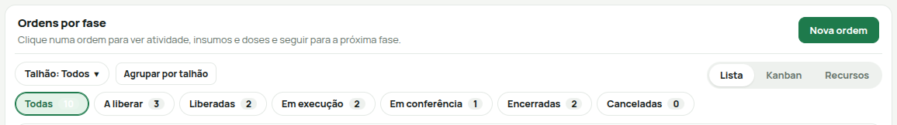
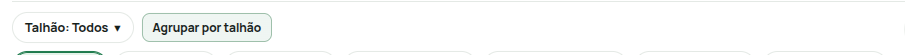
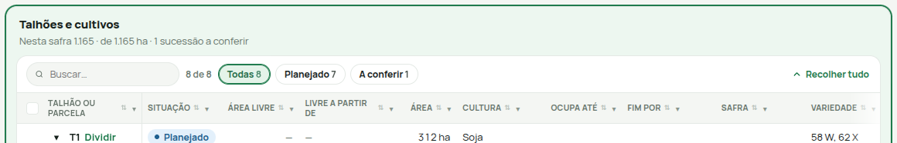
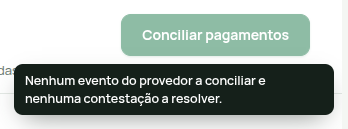

# Separador, hover verde, retorno visual e dica

Quatro padrões do design system do protótipo, pedidos pelo proprietário (Adrianus) e entregues pelo estilo e pelos componentes comuns do gerador (`engine.py`, `ui37.py`, `g2lib.js`). Nenhum deles é desenhado tela a tela.

Proposta para o capítulo 74 do PRD, que está em revisão. Os tokens abaixo são a fonte em uso no protótipo (`engine.DS_SEP`, `engine.DS_HOVER`, `engine.DS_RETORNO`, `engine.DS_DICA`).

| Padrão | Pedido | Onde vive | Teste |
|---|---|---|---|
| Separador | 05/10/2026 | `engine.SEP_CSS` (dentro de `G2_CSS`), header da casca (`ui37.shell37`, `engine.mobile`), `.g2-cab` | `ds_test.py` A |
| Hover verde | 05/10/2026 | `engine.INTERACAO_CSS` (`DS_HOVER`) | `ds_test.py` B, `ds_unit.js` 3 |
| Retorno visual | 09/10/2026 | `g2lib.js` (`g2flash`, `g2vivo`, `g2carga`, `g2montou`, `g2mudou`) chamado pelo motor (`engine.ENGINE_JS2`) | `ds_test.py` C e E |
| Dica | 09/10/2026 | `g2lib.js` (`g2dica`, `G2_DICAS`), `engine.GLOSSARIO` | `ds_test.py` D e E, `ds_unit.js` 1 e 2 |

## 1. Separador

**Pedido:** «tem telas sem essas linhas separadoras visuais que ficam abaixo do título e do botão no topo à direita como no caso nova safra. [...] acho melhor ter para organizar a visão e a mente em blocos. Faça em todas telas e padronize no design system.»

**Regra.** Uma linha de 1 px separa o cabeçalho do conteúdo, em três lugares:

1. **Cabeçalho da página** (título e ação do topo à direita). É a borda inferior do `header` da casca, em todas as telas. O índice e a ficha impressa, que não usam a casca, usam `.g2-cab`.
2. **Linha de título do bloco** (`section` com título, descrição e ação à direita). A linha fica recuada 12 px dos lados, como a moldura da tabela da tela Planejar safra. Quando o bloco já começa por uma tabela emoldurada (`.g2caixa` com borda), a borda da tabela é a linha. Assim não há linha dupla.
3. **Painel lateral** (`aside[role=dialog]`): abaixo do título e do × do topo à direita. É o caso do formulário «Nova safra».

| Token | Valor |
|---|---|
| cor | `#E4E9E5` (a mesma linha de tabelas e cartões) |
| recuo no bloco | 12 px de cada lado |
| espaço depois da linha | 10 px no bloco, 12 px no painel, 14 px em `.g2-cab` |

**Amostra** (o bloco não precisa de nada além da estrutura comum):

```html
<section>                                  <!-- bloco -->
  <div>                                    <!-- linha de título: a linha vem do CSS comum -->
    <div><h3>Ordens por fase</h3><div>Clique numa ordem…</div></div>
    <button>Nova ordem</button>
  </div>
  <div>… conteúdo …</div>
</section>
<header class="g2-cab">…</header>          <!-- tela fora da casca -->
```



## 2. Hover verde

**Pedido:** «Padronize o hover verdinho em vez do cinza.»

**Regra.** O realce passageiro do ponteiro é o verde-claro do sistema, igual ao do `.g2card`, e nunca cinza. Só vale onde há ponteiro com hover (`@media (hover:hover)`); no toque nada fica «grudado». O menu lateral escuro mantém a regra própria (clareia). Cada família de controle tem um hover:

| Família | Exemplos | Hover |
|---|---|---|
| Claro | secundário, opção de visão, aba, item de lista, chip, cartão clicável, link com cara de botão | camada `rgba(30,122,76,.07)` sobre o fundo (dá `#EFF6F2` no branco) e borda neutra `#E4E9E5` → `#9DBFAA` |
| Linha de tabela | `.g2ed`, linhas do Cadastro | fundo `#F2F8F4`; linha de grupo `#E8F3EC` |
| Cheio | primária verde, botão escuro, destrutivo cheio | só escurece (`brightness(.92)`); sem camada clara sobre o texto branco |
| Destrutivo claro | texto vermelho | camada vermelha `rgba(180,35,24,.06)`: o hover não diz «seguro» num comando que apaga |

Pressionado: camada verde `.14` no claro e `brightness(.86)` no cheio.

**Contraste AA medido** (`ds_unit.js`): texto `#15201A`, apagado `#65736A`, ação `#1E7A4C` e amarelo `#8A5A00` sobre o hover passam de 4,5:1. Branco sobre a primária escurecida também passa.

A camada é `background-image`, porque o estilo inline dos componentes não define imagem de fundo. Por isso o matiz do estado continua visível (tonal, amarelo, vermelho) e nada muda de tamanho.



## 3. Retorno visual de mudança

**Pedido:** «quando muda de tela e avança no processo não está dando aquele feedback ao usuário em tempo real como se fosse um flash de atualização e mudança de contexto.»

**Regra.** Uma só função de realce, `g2flash(el, msg)`. Ela é chamada só pelos pontos centrais do motor, nunca por tela:

| Quando | Ponto central | Realce | Anúncio (aria-live polite) |
|---|---|---|---|
| Abrir uma tela | `componentDidMount` → `g2montou` | título da tela (`h1`); a barra de carga termina; vindo de um link do protótipo, o foco vai ao título | `Tela: <título> · <estado>` |
| Clicar num link de outra tela | ouvinte de clique do `g2lib` | barra fina no topo (`#g2-carga`) do clique até a tela nova | — |
| Avançar ou voltar etapa, trocar seção (SAF, Compras, Planos, Manutenção, Estoque) | `componentDidUpdate` → `g2mudou`, lendo a faixa de progresso | bloco do novo contexto (o mesmo cujo título o `g2etapa` foca) | `Etapa i de n: <nome>` ou `Seção: <nome>` |
| Gravar, aprovar, liberar, mover cartão (todo comando que mostra aviso) | `componentDidUpdate` → `g2mudou`, quando o aviso (`g2toast`) é novo | o que mudou: linha da tabela, cartão do Kanban, região rotulada, estado do cabeçalho; sem nada mais fino, o bloco | o próprio aviso |
| Clicar num botão indisponível | ouvinte do `g2lib` | a dica do botão abre com o porquê | `Indisponível: <motivo>` |

Para achar o que mudou, o motor compara uma foto da tela antes e depois, por chaves estáveis: `data-g2g` + `data-rid` nas linhas, o código do cartão e a coluna do Kanban, regiões rotuladas, o estado do cabeçalho e os blocos. Uma tela nova não precisa fazer nada. Uma tela pode marcar um elemento com `data-g2k="chave"` para ele entrar na comparação.

| Token | Valor |
|---|---|
| realce | `#EDF7F0` → `#F2F8F4` com anel `rgba(30,122,76,.38)`, 520 ms, `ease-out` |
| menos movimento | sem animação; realce estático `#EDF7F0` com anel `#1E7A4C` por 600 ms |
| barra de carga | 3 px, `#1E7A4C`, até 82 % durante a navegação; completa e some em 0,5 s |
| região viva | `#g2-vivo`, `aria-live="polite"`, `aria-atomic="true"`, visualmente oculta |

O realce nunca atrasa a ação nem esconde o resultado: o desenho novo já está na tela e o realce é uma camada passageira por cima. O aviso visível (`role="status"`) fica com `aria-live="off"`, para que o leitor de tela ouça a mensagem uma vez, pela região viva. Duas frases no mesmo instante (o resultado e a recusa do segundo clique) saem juntas.



## 4. Dica (tooltip)

**Pedido:** «coloque tooltip onde for necessária para melhorar feedback ao usuário.»

**Regra.** Um componente comum, `g2dica`, com um só elemento `role="tooltip"` (`#g2-dica`):

- **Abre** com o ponteiro parado sobre o gatilho (300 ms), no foco de teclado (na hora), com toque longo (500 ms) ou ao tocar no ícone ⓘ (`.g2dica-i`).
- **Fecha** com Esc, ao tirar o ponteiro do gatilho e da dica, ao perder o foco ou ao tocar fora.
- **Leitor de tela:** enquanto a dica está aberta, o gatilho ganha `aria-describedby="g2-dica"`. A dica não repete o nome acessível.
- **Não depende do `title`**, que não aparece no teclado nem no toque. Se a tela já tinha `title`, ele sai de cima durante o hover e volta depois.

**Texto, nesta ordem:**

1. `data-dica="…"`: texto explícito. Vazio quer dizer sem dica.
2. `data-dica-de="<texto do selo>"` (ou a parte de célula `{k:'chip', …, de:1}`): significado e próximo passo do estado, buscados no dicionário único `G2_DICAS`.
3. `title` que acrescenta algo ao rótulo visível.
4. Nome do comando, em ícone sem texto.

Nada de dica que repita o rótulo visível.

**Onde se aplica.** Só onde ajuda a decidir ou entender:

| Caso | Como | Onde está hoje |
|---|---|---|
| Botão indisponível ou ação recusada | `aria-disabled="true"` + `data-dica` com o porquê e o que falta. O botão continua focável e o `g2lib` recusa o clique e anuncia `Indisponível: …`. O comando também confere de novo. | CF-05 (Pedir proposta empresarial), BO-02 (Conciliar pagamentos) |
| Selo e chip de estado | `data-dica-de` no selo ou `{k:'chip', …, de:1}` na célula da tabela. O dicionário só vale onde a tela pede, porque o mesmo texto noutro contexto pode significar outra coisa. | O.S.: 5 fases do Kanban (título da coluna, cartão, painel e lista) e selos de bloqueio (Falta insumo, Fora do registro, Total 0, Sobras a receber, Aguardando sinal do app, Apontamento em conferência, Insumo esgotado, Carga a pesar). A dica de «A liberar» já diz as exceções da aprovação: irrigação só com água, manutenção e beneficiamento liberam pelo responsável próprio. |
| Sigla e unidade | `engine.GLOSSARIO` vira a dica do cabeçalho da coluna, quando a coluna não traz ajuda própria | NC (AG-01, AG-01det), R$/ha (CF-05, BO-01), ha/h (CD-02), lâmina (IR-02, IR-03, IR-03det, IR-04), R$/h (SAF); sc/ha, t/ha, DAP, DAE, CAD, ETc, ETo, Kc, ha-op, ATR, TCH, COE, COT, carência e reentrada onde a coluna aparecer |
| Valor calculado | fórmula curta da coluna calculada (`edit.calc`), com os rótulos | colunas calculadas da grade (ex.: PT-02det: Quantidade × Preço; CO-03: Peso bruto − Tara) |
| Ícone sem texto | nome do comando (só visual: o leitor de tela já lê o nome) | botão do menu, ×, setas, filtro da coluna, menu recolhido |
| Texto de ajuda que já existia | `title` que acrescenta ao rótulo vira dica acessível | em todas as telas, sem marcação nova |

| Token | Valor |
|---|---|
| fundo / texto | `#15201A` / `#FFFFFF` (16,7:1) |
| largura máxima | 320 px (cabe em 390 px com 8 px de margem) |
| raio, fonte | 9 px; Manrope 12,5 px 600 |
| atraso | 300 ms no hover, 0 ms no foco, 500 ms no toque longo |
| ícone ⓘ (`.g2dica-i`) | 18 px desenhado; 44 px de alvo com ponteiro grosso; disponível, ainda sem uso (no toque, o toque longo já abre a dica) |
| termo com dica (`span[data-dica]` no texto) | sublinhado pontilhado `#8A968E` e cursor de ajuda; disponível para as telas, ainda sem uso |

**Amostras:**

```html
<!-- botão indisponível com motivo (continua focável) -->
<button aria-disabled="{{dis}}" data-dica="{{motivo}}">Conciliar pagamentos</button>
<!-- selo de estado: o significado vem do dicionário único -->
<span data-dica-de="{{fase}}">{{fase}}</span>
<!-- sigla ou unidade no texto -->
<span data-dica="DAP: dias após o plantio, contados da data de plantio do talhão.">DAP 25</span>
<!-- caminho no celular -->
<button type="button" class="g2dica-i" aria-label="Mais informação" data-dica="…">i</button>
```



## Verificação

| Comando | O que confere |
|---|---|
| `node ds_unit.js` | regra do texto da dica, dicionário de estados e contraste AA |
| `python3 ds_unit_test.py` | CSS comum, ausência de hover cinza, pontos centrais do motor, glossário e fórmula, tokens e páginas geradas |
| `python3 ds_test.py` | navegador: separador nas 140 páginas e a 390 px, hover computado, realce e anúncio (tela, etapa, O.S. no Kanban, BO-02), menos movimento, dica (hover, foco, Esc, aria-describedby, toque longo) e, com `DS_ANTES=<_render da base>`, capturas antes/depois a 1440 e 390 px de OS, PA, PM, AG-01, AG-01det e AG-07 em `_probe/ds/` (telas onde faltava a linha; o teste confere que antes ≠ depois) |
